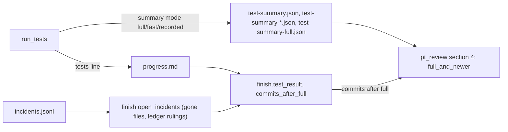
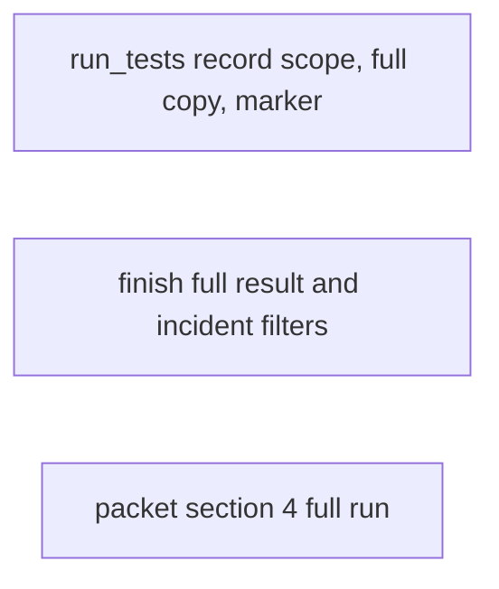

# Superlite: the full run is the reported result, whatever ran later (B128)

**Goal:** fix #593: the review packet and `finish` report the newest full run, never a later fast or recorded run; `run_tests --record` keeps its own scope label and never counts as the full run; `run_tests --fast` on a test file honours that file's marker the project's addopts deselects. Plus main's B127 follow-up: `finish.open_incidents` leaves out the gone-file and ledger-ruled incidents the packet leaves out.
**Architecture:** `run_tests.py` writes recorded runs as mode `recorded` with a `scope`, keeps a copy of every foreground full result in `test-summary-full.json`, and adds `-m "<marker> or (<addopts expr>)"` for a `--fast` test file that carries a deselected marker. `finish.py` takes the last non-recorded full ledger line as the result, names commits after it, and filters incidents like the packet. `pt_review.py` section 4 reads the newest full run with a result from all run summaries and adds one row for newer runs and one for commits after it.
**Tech stack:** Python 3.10+ stdlib, pytest (through `sl run_tests`).
**Spec:** this file, section Design; issue #593 Expected.
**Detail:** tests
**Target-min:** 11
**Wave0:** none
**Coverage:** off

Global constraints:
- Every Python code line keeps the file's trailing `# O(...)` complexity comment; update the module docstring where behaviour changes.
- Existing tests stay green. An existing test file changes only when the task Owns it. If another existing test turns red, report it in DONE_WITH_CONCERNS with the test id and the reason instead of editing it.
- Run `sl` as an executable (`<abs>/sl ...`). Verify with `<abs>/sl run_tests --fast <own test files> --task Tn --background`, then run the printed `wait:` line in the foreground and end the turn only after it reports.
- A ledger tests line keeps the shape `- tests <word> passed=N failed=N skipped=N seconds=S[ recorded]` (finish.TESTS parses it; report.py reads it through finish.test_result).
- No version edits; never run `scripts/evals.sh`, `claude plugin eval` or `scripts/test_layers.py run`; no docs/tools.md or SKILL.md edits (other batches own them).

Ruling: `--record --scope WORD` (default `external`) writes summary mode `recorded` plus `scope` and the ledger line `- tests <scope> ... recorded`; `full`, `fast` and anything not `[A-Za-z0-9_]+` are refused (exit 2, nothing written), because a recorded run never counts as the full run (#593) - cost if wrong: an external full-suite result must be rerun through run_tests to count.
Ruling: "the newest full run" means the newest full run with a result (no `error`, a count above 0), recorded runs excluded, in finish (ledger order) and the packet (`started`); a killed or crashed full run shows as a newer run, not as the result - cost if wrong: one extra row to read.
Ruling: "after the last checkpoint" is checked through the ledger in both: `- commit Tn` lines after the result's tests line print `- committed after this full run: Tn, ...` (finish.commits_after_full, shared by the packet) - cost if wrong: commits made while the full run ran go unnamed.
Ruling: a foreground full result (summary not named like a background run file, no `error`) is also written to `<stem>-full.json`, so a later run that rewrites `test-summary.json` never loses it; `run_summaries` already globs it.
Ruling: `--fast` honours a marker only for test files (`file` or `file::node`), never a directory (the #468 exit-5 hint stays), and only when no `-m` is given.
Ruling: finish has no base sha, so its gone-file filter is the packet's without `--base` (a file the run deleted counts as gone); outside a git repo it keeps every file; report.py gets the same filter through finish.open_incidents.
LAYERS: unit



## Design

### 1. run_tests.py (T1)
- `--scope WORD` with `--record` only (without it: stderr `run_tests: --scope needs --record`, exit 2). Bad scope: stderr `run_tests: --scope must be one word other than full or fast (a recorded run never counts as the full run): <value>`, exit 2, nothing written. Record summary: `mode` `recorded`, `scope`, `recorded` (the command, 200 chars); ledger `- tests <scope> passed=N failed=N skipped=N seconds=S recorded`.
- `write_summary`: mode `full`, no `error`, a file name that is not a background run file (`RUN_NAME`) and a stem not ending in `-full` also writes the same JSON to `<stem>-full<suffix>`.
- `file_markers(path) -> set[str]`: every `<x>.mark.<name>` and `mark.<name>` attribute name in the file (ast); unreadable or unparsable: empty set. `honoured_marker(paths, root=".")`: with the project's addopts `-m EXPR` (`addopts_marker`), the names EXPR negates (`not <name>`, in order), and the `--fast` paths that are `.py` files under root (a `::node` suffix dropped) carrying one of them: returns `("<n1> or <n2> or (<EXPR>)", note)`, note = `run_tests: <path> is marked <n1>[, <n2>], which addopts -m '<EXPR>' in <cfg> deselects; running with -m '<new>'` (first such path); else None. `run()` applies it after path expansion when no `-m` and no task `cmd=`: the default pytest runner gets it as `-m`; a test-cmd.json command only when `with_marker` accepts it; the note goes to stderr.

### 2. finish.py (T2)
- `test_result`: the result is the last `tests full` line without `recorded`, else the newest line.
- Newer line label: `recorded <mode>` for a recorded line (`- newer recorded integration run (not the run's result): ...`).
- `commits_after_full(ledger) -> list[str]`: distinct task ids of `commit` lines after the result line, in ledger order; [] without a non-recorded full line, without a ledger, or when none follows. `summary` prints `- committed after this full run: T3, T4 (it does not cover them; rerun sl run_tests --full)` after the newer line.
- `open_incidents(path, summary=None)`: root = the git toplevel of the log's folder (None outside git); entries = `pt.read_incidents(path, root)`; then drop entries `pt.ruled` by `pt.ledger_rulings(<log folder>/progress.md)`; with a root, `pt.split_gone(root, entries, None)` keeps the first part; then the existing stale, superseded and open filters.

### 3. pt_review.py (T3)
- `full_and_newer(runs)`: distinct runs (key: started, mode, passed, failed, skipped, task); full = the full run with a result (`_has_result`), not recorded, with the greatest numeric `started` (an untimed one ranks below every timed one; ties: list order); newer = distinct runs with a numeric `started` above full's, newest first. (None, []) without one.
- `read_test_summary(path, root=None, changed=None, runs=None, ledger=None)`: a full run from `full_and_newer(runs)` replaces `path`'s summary. After its rows: n=1 `- newer <label> run (not the full run's result): P passed, F failed, S skipped[; error: E]`, n>1 `- N newer runs (not the full run's result), newest <label>: ...`; label `recorded <scope or external>` for a recorded run, else its mode; E cut at 120. With `ledger` and a full run shown: `- committed after this full run: T3, T4 (it does not cover them; rerun run_tests --full)` from `finish.commits_after_full` (lazy import; any error: no row). Without a full run a recorded summary starts with `- recorded <scope> run outside run_tests (`<cmd>`), not the full suite:`. `nfail` counts the shown run only. `cmd_packet` passes `ledger=` (`--ledger`, else `.superlite/progress.md`).

## File structure

- `skills/subagent-driven-development/scripts/run_tests.py`: record scope, full copy, honoured marker.
- `skills/subagent-driven-development/scripts/finish.py`: full result, commits after it, packet incident filters.
- `skills/subagent-driven-development/scripts/pt_review.py`: section 4 run choice and rows.

## Task graph

```mermaid
%% schedule
gantt
  title Predicted schedule (mm:ss)
  dateFormat X
  axisFormat %M:%S
  section lane 1
  T1 run_tests records a scope keeps the f :t1, 0, 160s
  section lane 2
  T2 finish reports the full run commits a :t2, 0, 152s
  section lane 3
  T3 packet section 4 reports the newest f :t3, 0, 109s
```





critical path: T1 (2.7 min) · peak width 3 · predicted build 2.7 min · predicted total ≈ 6.2 min (target ✓)

## Package: reporting

App type: CLI. Categories: state (which run wins, order, copies), encoding (scope word, marker expression), file (copies, gone files).
**Probe entry:** none (report tools over files; the Review Focus cases are named tests)

### T1 run_tests records a scope, keeps the full result, honours a file marker · Complexity 4 · Est. context 45k
**Owns:** skills/subagent-driven-development/scripts/run_tests.py, tests/scripts/test_run_tests_record.py, tests/scripts/test_run_tests_593.py
**Components:** 2
**LOC owned:** 170
**Tests:** fast
**Model:** sonnet
**Est. time:** 4 min
**Produces:** run_tests.file_markers(path: str | Path) -> set[str] · run_tests.honoured_marker(paths: list[str], root: str | Path = ".") -> tuple[str, str] | None
e.g. run_tests.honoured_marker(["tests/test_i.py::test_i"], root) -> ("integration or (not integration)", "run_tests: tests/test_i.py is marked integration, which addopts -m 'not integration' in pyproject.toml deselects; running with -m 'integration or (not integration)'")
e.g. run_tests.honoured_marker(["tests"], root) -> None
**Review Focus:** state: `test_write_summary_copies_only_a_foreground_full_result`; encoding: `test_record_refuses_a_full_fast_or_bad_scope`, `test_honoured_marker_expression` (two negated markers keep EXPR's order).
**Notes:** in test_run_tests_record.py update the three assertions on the old shape: summary mode `recorded`, `scope` `external`, ledger lines `- tests external ...recorded`, finish label `tests (external, recorded)`. The env in `rt` keeps `SUPERLITE_HOME` (tmp) and the conftest's disk variables.
**Test code (verbatim):**
```python
"""run_tests: --record keeps its scope and never counts as the full run; a foreground full run keeps a copy;
--fast honours a test file's marker the addopts deselect (#593)."""
import json
import os
import subprocess
import sys
from pathlib import Path

SCRIPTS = Path(__file__).resolve().parents[2] / "skills" / "subagent-driven-development" / "scripts"
sys.path.insert(0, str(SCRIPTS))
import run_tests  # noqa: E402

PYPROJECT = "[tool.pytest.ini_options]\naddopts = \"-m 'not integration'\"\nmarkers = [\"integration\"]\n"


def rt(cwd, *args):
    env = {k: v for k, v in os.environ.items() if not k.startswith(("SUPERLITE_FLEET_", "SUPERLITE_STATE_DIR"))}
    env.update(SUPERLITE_HOME=str(Path(cwd) / "_home"), PYTHONIOENCODING="utf-8")
    cp = subprocess.run([sys.executable, str(SCRIPTS / "run_tests.py"), *map(str, args)], cwd=cwd, capture_output=True,
                        text=True, env=env, timeout=120)
    cp.both = cp.stdout + cp.stderr
    return cp


def summary(cwd, name="test-summary.json"):
    return json.loads((Path(cwd) / ".superlite" / name).read_text(encoding="utf-8"))


def ledger(cwd):
    return (Path(cwd) / ".superlite" / "progress.md").read_text(encoding="utf-8")


def test_record_keeps_its_scope_and_is_not_a_full_run(tmp_path):
    cp = rt(tmp_path, "--record", "--passed", "1", "--scope", "integration", "--command", "pytest -m integration")
    assert cp.returncode == 0, cp.both
    s = summary(tmp_path)
    assert (s["mode"], s["scope"], s["recorded"], s["passed"]) == ("recorded", "integration", "pytest -m integration", 1)
    assert "- tests integration passed=1 failed=0 skipped=0 seconds=0 recorded" in ledger(tmp_path)
    assert not (tmp_path / ".superlite" / "test-summary-full.json").exists()


def test_record_scope_defaults_to_external(tmp_path):
    assert rt(tmp_path, "--record", "--passed", "3", "--command", "x.sh").returncode == 0
    assert (summary(tmp_path)["mode"], summary(tmp_path)["scope"]) == ("recorded", "external")
    assert "- tests external passed=3 failed=0 skipped=0 seconds=0 recorded" in ledger(tmp_path)


def test_record_refuses_a_full_fast_or_bad_scope(tmp_path):
    for bad in ("full", "fast", "two words", "a-b", ""):
        cp = rt(tmp_path, "--record", "--passed", "1", "--scope", bad, "--command", "x.sh")
        assert cp.returncode == 2 and "--scope must be one word other than full or fast" in cp.stderr, (bad, cp.both)
    assert not (tmp_path / ".superlite" / "test-summary.json").exists()


def test_scope_without_record_exits_2(tmp_path):
    cp = rt(tmp_path, "--scope", "integration")
    assert cp.returncode == 2 and "run_tests: --scope needs --record" in cp.stderr


def test_write_summary_copies_only_a_foreground_full_result(tmp_path):
    c = {"passed": 2, "failed": 0, "skipped": 0, "skipped_tests": []}
    copy = tmp_path / "test-summary-full.json"
    run_tests.write_summary(tmp_path / "test-summary.json", "full", c, [], 1.0)
    assert json.loads(copy.read_text(encoding="utf-8"))["passed"] == 2
    run_tests.write_summary(tmp_path / "test-summary.json", "full", c, [], 1.0, error="boom")
    assert "error" not in json.loads(copy.read_text(encoding="utf-8"))
    run_tests.write_summary(tmp_path / "test-summary.json", "fast", {**c, "passed": 5}, [], 1.0)
    assert json.loads(copy.read_text(encoding="utf-8"))["passed"] == 2
    run_tests.write_summary(tmp_path / "test-summary-20261112T101010-1-abcdef.json", "full", c, [], 1.0)
    assert sorted(p.name for p in tmp_path.glob("*-full.json")) == ["test-summary-full.json"]


def test_a_later_fast_run_keeps_the_full_copy(tmp_path):
    (tmp_path / "tests").mkdir()
    (tmp_path / "tests" / "test_a.py").write_text("def test_a():\n    assert True\n", encoding="utf-8")
    assert rt(tmp_path, "--full").returncode == 0
    full = summary(tmp_path, "test-summary-full.json")
    assert (full["mode"], full["passed"]) == ("full", 1)
    assert rt(tmp_path, "--fast", "tests/test_a.py").returncode == 0
    assert summary(tmp_path)["mode"] == "fast" and summary(tmp_path, "test-summary-full.json") == full


def marker_project(tmp_path):
    (tmp_path / "pyproject.toml").write_text(PYPROJECT, encoding="utf-8")
    t = tmp_path / "tests"
    t.mkdir()
    (t / "test_i.py").write_text("import pytest\n\npytestmark = pytest.mark.integration\n\n\ndef test_i():\n    assert True\n", encoding="utf-8")
    (t / "test_mixed.py").write_text("import pytest\n\n\n@pytest.mark.integration\ndef test_i():\n    assert True\n\n\n"
                                     "def test_u():\n    assert True\n", encoding="utf-8")
    (t / "test_u.py").write_text("def test_u():\n    assert True\n", encoding="utf-8")
    return tmp_path


def test_file_markers_reads_decorators_and_pytestmark(tmp_path):
    p = marker_project(tmp_path)
    assert run_tests.file_markers(p / "tests" / "test_i.py") == {"integration"}
    assert run_tests.file_markers(p / "tests" / "test_mixed.py") == {"integration"}
    assert run_tests.file_markers(p / "tests" / "test_u.py") == set()
    (p / "bad.py").write_text("def (:\n", encoding="utf-8")
    assert run_tests.file_markers(p / "bad.py") == set() and run_tests.file_markers(p / "none.py") == set()


def test_honoured_marker_expression(tmp_path):
    p = marker_project(tmp_path)
    assert run_tests.honoured_marker(["tests/test_i.py::test_i"], p) == (
        "integration or (not integration)",
        "run_tests: tests/test_i.py is marked integration, which addopts -m 'not integration' in pyproject.toml deselects; "
        "running with -m 'integration or (not integration)'")
    assert run_tests.honoured_marker(["tests/test_u.py"], p) is None
    assert run_tests.honoured_marker(["tests"], p) is None
    (p / "tests" / "test_s.py").write_text("import pytest\n\n\n@pytest.mark.slow\n@pytest.mark.integration\ndef test_s():\n    pass\n", encoding="utf-8")
    (p / "pyproject.toml").write_text("[tool.pytest.ini_options]\naddopts = \"-m 'not integration and not slow'\"\n", encoding="utf-8")
    assert run_tests.honoured_marker(["tests/test_s.py"], p)[0] == "integration or slow or (not integration and not slow)"
    (p / "pyproject.toml").write_text("[tool.pytest.ini_options]\nmarkers = [\"integration\"]\n", encoding="utf-8")
    assert run_tests.honoured_marker(["tests/test_i.py"], p) is None


def test_fast_run_of_an_integration_file_runs_its_tests(tmp_path):
    p = marker_project(tmp_path)
    cp = rt(p, "--fast", "tests/test_mixed.py")
    assert cp.returncode == 0, cp.both
    s = summary(p)
    assert (s["mode"], s["passed"], s["failed"]) == ("fast", 2, 0)
    assert "running with -m 'integration or (not integration)'" in cp.stderr


def test_an_explicit_marker_wins(tmp_path):
    p = marker_project(tmp_path)
    cp = rt(p, "--fast", "tests/test_mixed.py", "-m", "not integration")
    assert cp.returncode == 0, cp.both
    assert summary(p)["passed"] == 1 and "running with -m" not in cp.stderr
```

### T2 finish reports the full run, commits after it, and filters incidents like the packet · Complexity 3 · Est. context 36k
**Owns:** skills/subagent-driven-development/scripts/finish.py, tests/scripts/test_finish_last_full_498.py, tests/scripts/test_finish_593.py
**Components:** 2
**LOC owned:** 120
**Tests:** fast
**Model:** sonnet
**Est. time:** 3 min
**Produces:** finish.commits_after_full(ledger: str | Path) -> list[str]
e.g. finish.commits_after_full(<ledger: tests full, commit T3, tests fast, commit T4, commit T3>) -> ["T3", "T4"]
e.g. finish.commits_after_full(<ledger: commit T3, tests fast>) -> []
**Review Focus:** state: `test_recorded_runs_never_replace_the_full_run` (old `tests full ... recorded` lines too), `test_commits_after_full`; file: `test_open_incidents_drop_gone_files_and_ruled_locations`, `test_open_incidents_outside_git_keep_missing_files`.
**Notes:** in test_finish_last_full_498.py `test_test_result_recorded_full_counts_as_full` becomes the opposite: with FULL, REC, FAST the result is FULL (5777), newer FAST, n 2; rename it `test_test_result_recorded_full_never_counts_as_full`. The git toplevel comes from `worktree.git` as `moved_lines` does.
**Test code (verbatim):**
```python
"""finish: a recorded or later run never replaces the last full run; commits after it are named; open incidents
leave out gone files and ledger-ruled locations like the packet (#593, B127 follow-up)."""
import json
import subprocess
import sys

from test_plan_tools import SCRIPTS, run

sys.path.insert(0, str(SCRIPTS))
import finish  # noqa: E402

FULL = "- tests full passed=3893 failed=0 skipped=8 seconds=812.3"
REC = "- tests integration passed=1 failed=0 skipped=0 seconds=4 recorded"
OLDREC = "- tests full passed=1 failed=0 skipped=0 seconds=4 recorded"
FAST = "- tests fast passed=12 failed=0 skipped=0 seconds=1.2"
C3 = "- commit T3 abc1234 fix the parser"
C4 = "- commit T4 def5678 more"


def ledger(tmp_path, *lines):
    sl = tmp_path / ".superlite"
    sl.mkdir(exist_ok=True)
    p = sl / "progress.md"
    p.write_text("# Progress ledger\n- start abc1234\n" + "".join(x + "\n" for x in lines), encoding="utf-8")
    return p


def git(root, *a):
    subprocess.run(["git", "-C", str(root), "-c", "user.email=t@t", "-c", "user.name=t", *a], check=True, capture_output=True)


def entry(file, line):
    return {"file": file, "line": line, "kind": "exception", "resolution": "open", "context": "boom"}


def test_recorded_runs_never_replace_the_full_run(tmp_path):
    for rec in (REC, OLDREC):
        res, newer, n = finish.test_result(ledger(tmp_path, FULL, rec, FAST))
        assert (res["mode"], res["passed"], res["recorded"]) == ("full", 3893, False)
        assert newer["mode"] == "fast" and n == 2


def test_only_recorded_and_fast_lines_give_the_newest_line(tmp_path):
    res, newer, n = finish.test_result(ledger(tmp_path, FAST, REC))
    assert (res["mode"], res["passed"], res["recorded"]) == ("integration", 1, True) and newer is None and n == 0


def test_commits_after_full(tmp_path):
    assert finish.commits_after_full(ledger(tmp_path, C3, FULL, FAST)) == []
    assert finish.commits_after_full(ledger(tmp_path, FULL, C3, FAST, C4, C3)) == ["T3", "T4"]
    assert finish.commits_after_full(ledger(tmp_path, C3, FAST)) == []
    assert finish.commits_after_full(ledger(tmp_path, FULL, OLDREC, C3)) == ["T3"]
    assert finish.commits_after_full(tmp_path / "missing" / "progress.md") == []


def test_finish_prints_the_full_run_a_newer_recorded_run_and_the_commits(tmp_path):
    p = ledger(tmp_path, FULL, C3, REC)
    cp = run(SCRIPTS / "finish.py", "--ledger", p, "--log", p.with_name("incidents.jsonl"), cwd=tmp_path)
    assert cp.returncode == 0, cp.both
    out = cp.out.splitlines()
    i = out.index("tests (full): 3893 passed, 0 failed, 8 skipped in 812.3s")
    assert out[i + 1] == "- newer recorded integration run (not the run's result): 1 passed, 0 failed, 0 skipped in 4.0s"
    assert out[i + 2] == "- committed after this full run: T3 (it does not cover them; rerun sl run_tests --full)"


def test_finish_without_commits_after_the_full_run_prints_no_commit_line(tmp_path):
    p = ledger(tmp_path, C3, FULL)
    cp = run(SCRIPTS / "finish.py", "--ledger", p, "--log", p.with_name("incidents.jsonl"), cwd=tmp_path)
    assert "committed after this full run" not in cp.out


def test_open_incidents_drop_gone_files_and_ruled_locations(tmp_path):
    git(tmp_path, "init", "-q")
    (tmp_path / "a.py").write_text("x = 1\n", encoding="utf-8")
    (tmp_path / "b.py").write_text("y = 2\n", encoding="utf-8")
    p = ledger(tmp_path, "- Ruling: b.py:3 is intended (B127)")
    log = p.with_name("incidents.jsonl")
    log.write_text("".join(json.dumps(entry(f, n)) + "\n" for f, n in (("a.py", 1), ("b.py", 3), ("gone.py", 2), ("b.py", 30))), encoding="utf-8")
    assert [(e["file"], e["line"]) for e in finish.open_incidents(log)] == [("a.py", 1), ("b.py", 30)]


def test_open_incidents_outside_git_keep_missing_files(tmp_path):
    p = ledger(tmp_path)
    log = p.with_name("incidents.jsonl")
    log.write_text(json.dumps(entry("gone.py", 2)) + "\n", encoding="utf-8")
    assert [e["file"] for e in finish.open_incidents(log)] == ["gone.py"]
```

### T3 packet section 4 reports the newest full run · Complexity 4 · Est. context 40k
**Owns:** skills/subagent-driven-development/scripts/pt_review.py, tests/scripts/test_packet_full_run_593.py
**Components:** 1
**LOC owned:** 140
**Tests:** fast
**Model:** sonnet
**Est. time:** 3 min
**Consumes:** finish.commits_after_full(ledger: str | Path) -> list[str] (T2)
**Produces:** pt_review.full_and_newer(runs: list[dict]) -> tuple[dict | None, list[dict]]
e.g. pt_review.full_and_newer([FAST(started 200), FULL(started 100)]) -> (FULL, [FAST])
e.g. pt_review.full_and_newer([FAST, REC]) -> (None, [])
**Review Focus:** state: `test_full_and_newer_picks_the_newest_full_run_with_a_result`, `test_full_and_newer_drops_repeated_copies`; protocol: `test_packet_section4_reads_the_full_run_a_later_fast_run_overwrote` (section 4 never says "full suite not run yet" when a full run exists).
**Notes:** the tests stub `finish.commits_after_full` with `monkeypatch.setattr(..., raising=False)`; the real one may not exist yet. Existing section-4 texts without a full run stay byte-identical (test_packet_stale `test_read_test_summary_fast_label`).
**Test code (verbatim):**
```python
"""Packet section 4 reports the newest full run whatever ran later; newer runs and commits after it get one row each (#593)."""
import json
import subprocess
import sys
from pathlib import Path

SCRIPTS = Path(__file__).resolve().parents[2] / "skills" / "subagent-driven-development" / "scripts"
sys.path.insert(0, str(SCRIPTS))
import finish  # noqa: E402
import pt_review as pt  # noqa: E402


def s(mode="full", started=100.0, passed=3893, failed=0, skipped=8, **kw):
    return {"mode": mode, "started": started, "passed": passed, "failed": failed, "skipped": skipped, "failures": [], "files": {}, **kw}


FULL = s()
FAST = s("fast", 200.0, 12, 0, 0)
REC = s("recorded", 300.0, 1, 0, 0, scope="integration", recorded="pytest -m integration")
OLDREC = s("full", 400.0, 1, 0, 0, recorded="x.sh")
KILLED = s("full", 500.0, 0, 1, 0, error="run_tests stopped by SIGTERM")


def write(p, d):
    p.write_text(json.dumps(d), encoding="utf-8")
    return p


def test_full_and_newer_picks_the_newest_full_run_with_a_result():
    full, newer = pt.full_and_newer([FAST, REC, FULL, s(started=50.0, passed=1)])
    assert full is FULL and newer == [REC, FAST]
    assert pt.full_and_newer([OLDREC, KILLED, FULL]) == (FULL, [KILLED, OLDREC])
    assert pt.full_and_newer([FAST, REC]) == (None, [])
    assert pt.full_and_newer([]) == (None, [])


def test_full_and_newer_drops_repeated_copies():
    assert pt.full_and_newer([dict(FAST), FULL, dict(FAST), dict(FULL)]) == (FULL, [FAST])


def test_an_untimed_full_run_ranks_below_timed_ones():
    untimed = {k: v for k, v in s(passed=7).items() if k != "started"}
    assert pt.full_and_newer([untimed, FULL])[0] is FULL
    assert pt.full_and_newer([untimed, FAST]) == (untimed, [])


def test_section4_shows_the_full_run_and_one_newer_row(tmp_path):
    text, nfail = pt.read_test_summary(write(tmp_path / "test-summary.json", FAST), runs=[FAST, FULL])
    assert text == ("- passed 3893 · failed 0 · skipped 8\n"
                    "- newer fast run (not the full run's result): 12 passed, 0 failed, 0 skipped")
    assert nfail == 0


def test_section4_counts_several_newer_runs_and_labels_recorded_and_errors(tmp_path):
    text, _ = pt.read_test_summary(write(tmp_path / "test-summary.json", REC), runs=[REC, FAST, FULL])
    assert text.splitlines()[-1] == ("- 2 newer runs (not the full run's result), newest recorded integration: "
                                     "1 passed, 0 failed, 0 skipped")
    text, _ = pt.read_test_summary(write(tmp_path / "test-summary.json", KILLED), runs=[KILLED, FULL])
    assert text.splitlines()[-1] == ("- newer full run (not the full run's result): 0 passed, 1 failed, 0 skipped; "
                                     "error: run_tests stopped by SIGTERM")


def test_section4_names_commits_after_the_full_run(tmp_path, monkeypatch):
    monkeypatch.setattr(finish, "commits_after_full", lambda ledger: ["T3", "T4"], raising=False)
    text, _ = pt.read_test_summary(write(tmp_path / "test-summary.json", FULL), runs=[FULL], ledger=tmp_path / "progress.md")
    assert text.splitlines()[-1] == "- committed after this full run: T3, T4 (it does not cover them; rerun run_tests --full)"
    text, _ = pt.read_test_summary(write(tmp_path / "test-summary.json", FULL), runs=[FULL])
    assert "committed after" not in text


def test_section4_without_a_full_run_keeps_the_fast_label_and_labels_a_recorded_run(tmp_path):
    text, _ = pt.read_test_summary(write(tmp_path / "test-summary.json", FAST), runs=[FAST])
    assert text.startswith("- full suite not run yet (it runs alongside this review); newest fast run:\n")
    text, _ = pt.read_test_summary(write(tmp_path / "test-summary.json", REC), runs=[REC])
    assert text == ("- recorded integration run outside run_tests (`pytest -m integration`), not the full suite:\n"
                    "- passed 1 · failed 0 · skipped 0")


def test_packet_section4_reads_the_full_run_a_later_fast_run_overwrote(tmp_path):
    sl = tmp_path / ".superlite"
    sl.mkdir()
    (tmp_path / "plan.md").write_text("# p\n\n### T1 thing · Complexity 1\n**Owns:** src/a.py\n\n## Review Focus\n- none\n", encoding="utf-8")
    write(sl / "test-summary-full.json", {**FULL, "skipped_tests": []})
    write(sl / "test-summary.json", {**FAST, "skipped_tests": []})
    (sl / "progress.md").write_text("- tests full passed=3893 failed=0 skipped=8 seconds=812.3\n"
                                    "- tests fast passed=12 failed=0 skipped=0 seconds=1.2\n", encoding="utf-8")
    r = subprocess.run([sys.executable, str(SCRIPTS / "pt_review.py"), "packet", "--plan", str(tmp_path / "plan.md"),
                        "--root", str(tmp_path), "--out", str(tmp_path / "packet.md")], capture_output=True, text=True, timeout=60)
    assert r.returncode == 0, r.stderr
    sec = (tmp_path / "packet.md").read_text(encoding="utf-8").split("## 4. Test summary\n", 1)[1].split("\n## 5.", 1)[0]
    assert "full suite not run yet" not in sec
    assert sec.startswith("- passed 3893 · failed 0 · skipped 8\n"
                          "- newer fast run (not the full run's result): 12 passed, 0 failed, 0 skipped")
```

## Review Focus

- reporting (CLI): state: which run wins (recorded, killed, untimed, repeated copies), commits after the full run; encoding: `--scope` word, marker expression order; file: the `-full.json` copy, gone files.

## Self-review

No placeholders; one task per file, no shared file, no edge (T3 stubs T2's `commits_after_full` from its examples); each task carries its Review Focus tests; plan near 15k characters.
