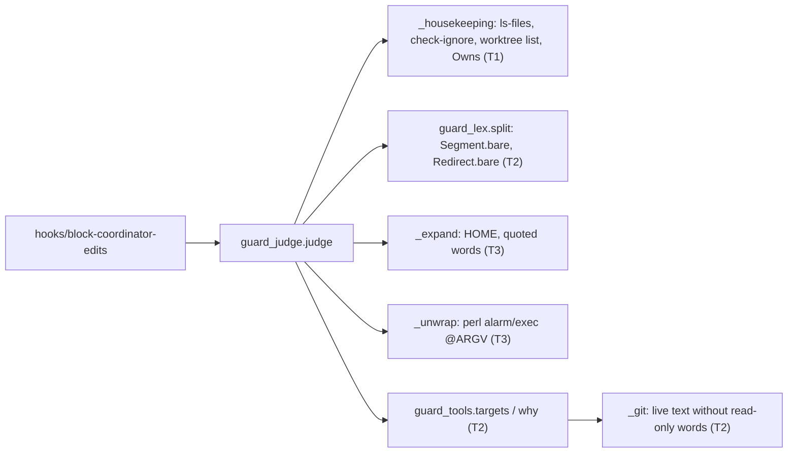
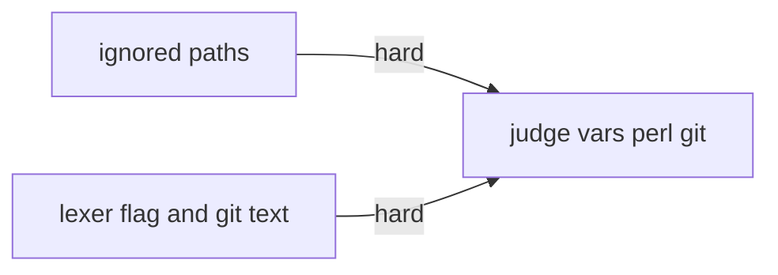

# Superlite: guard false blocks on ignored paths and variables (B159)

**Goal:** fix #664 and #665. A git-ignored path no task Owns passes as an `rm` target whatever its size, symlinks or link count, and as a redirect, `tee`, `cp` or `mv` target; a block says why it is no housekeeping (#664). `$HOME` resolves like `~`, a double-quoted expansion uses a value with spaces, `perl -e 'alarm N; exec @ARGV' CMD` is judged as CMD, and `git config` inside a `grep` pattern no longer makes `git lfs` unknown; an unknown git target names its token (#665).
**Architecture:** `guard_judge.py` asks git (`ls-files`, `check-ignore`, `worktree list`) in one helper `_housekeeping` for every code verdict of a literal target from one known folder (T1). The lexer marks per word whether an expansion sits outside double quotes, and `guard_tools` reads a `git config` only in text that can run, and says why a git target is `?` (T2). `guard_judge.py` uses both, reads `$HOME`, and unwraps the perl timeout idiom (T3).
**Tech stack:** Python 3.10+ stdlib, bash 3.2 hook, pytest through `sl run_tests`.
**Spec:** this file, section Design; issues #664 and #665.
**Detail:** tests
**Target-min:** 11
**Wave0:** none
**Max chars:** 40000
**Read first:** .superlite/briefs/standing-note.md

Global constraints:
- Standing note (main, binding): this repository is public: no host names, user names, home paths, other project or repository names, ticket keys or account names in code, tests, docs or commit messages. Never change the machine's gate config or ~/.superlite/machine.json; tests use private temp homes and state dirs. No real app builds as proof. Friction with superlite goes to `sl feedback add`. Full text: .superlite/briefs/standing-note.md.
- Every code line in `guard_*.py` keeps a trailing `# O(...)` complexity comment like its neighbours; stdlib only.
- Never weaken a block outside the false blocks named here. Existing tests stay green; an existing test file changes only when the task Owns it. Another red test: report it in DONE_WITH_CONCERNS with the test id and the reason, never edit it.
- Run `sl` as an executable (`<abs>/sl ...`). Verify with `<abs>/sl run_tests --fast <own test files> tests/scripts/test_block_coordinator_edits.py tests/scripts/test_guard_rm_dir_421.py tests/scripts/test_judge_housekeeping.py tests/scripts/test_guard_lex.py --task Tn --background`, then run the printed `wait:` line in the foreground and end the turn only after it reports.
- No version edits (the ship step bumps it). Never run `scripts/evals.sh`, `claude plugin eval` or `scripts/test_layers.py run`.
- `docs/hooks.md` is append-only for this batch: add lines, never reorder, rewrite or delete existing ones.

Ruling: #665 supersedes B46's "`$HOME` stays unresolved": `$HOME` reads the hook's `HOME` like `~` already does; the three pins (test_guard_targets, test_guard_judge, test_guard_vars_329) flip to "resolves outside, blocks inside" - cost if wrong: a Bash tool whose HOME differs from the hook's (none seen) writes elsewhere outside the project.
Ruling: an ignored path passes only when git also does not track it, no task Owns it (or anything below it), it holds no linked worktree of the repository and no state folder of the run, and its own path has no `.git`, `.superlite` or run-file part; nested repositories (SwiftPM checkouts under `.build/`) pass - cost if wrong: a build folder holding another session's run cannot be removed by rm.
Ruling: git runs from the deepest existing folder of the path, so a path inside a linked worktree follows that worktree's index and ignore rules - cost if wrong: one extra git call per refused target.
Ruling: a write passes through the ignore rule only when the file is not hard-linked (a write would reach its other names); `rm` of an ignored hard link or symlink passes (it removes one name) - cost if wrong: none known.
Ruling: the glob rule for a variable's value is unchanged (judged as a glob also inside quotes); only the whitespace split rule is skipped for a word whose expansions all sit inside double quotes - cost if wrong: a quoted glob value keeps today's verdict.
Ruling: read-only commands whose words never run (`grep`, `egrep`, `fgrep`, `rg`, `echo`, `printf`, `test`, `[`, `true`, `false`, `:`, `cat`, `head`, `tail`, `wc`, `ls`, `pwd`, `date`) drop their words from the text git's config check reads; their substitutions, subshells, heredocs and redirect targets stay - cost if wrong: one false pass for a `git config` that only such a command's output, piped into a shell, would run (that pipe is already an unknown target).
Ruling: tests for #664 and #665 go to tests/scripts/test_guard_false_blocks_554.py (the brief's file); lexer and code-reader unit cases to test_guard_lex.py and test_guard_tools.py; already in the lead worktree; no probe adapter; layers unit and headless (`hooks/**` changes).
LAYERS: unit, headless



## Design

### 1. Ignored paths (T1, #664)
- `Verdict` gains `why: str = field(default="", compare=False)`.
- `_housekeeping(v, ctx, folders, write=False) -> tuple[bool, str]` replaces `_stray` (keep `_tree_ok(top) -> bool`; add `_tree_why(top) -> str`, "" when ok, and make `_tree_ok` return `not _tree_why(top)`). `(False, "")` when the rule does not apply: mode not active, `v.rel` in `("?", ".")`, `"?"` in `v.abs`. Otherwise, in order, the first failing check gives `(False, reason)`:
  1. a part of `v.rel` is `.git`, `.superlite` or a run-file name (`NAMES`): `".git, .superlite and run files keep their own rules"`;
  2. no `ctx.sd` or no readable plan in its `stable.json`: `"no run plan to read Owns from"`;
  3. `git -C A ls-files --error-unmatch -- R` (A: the deepest existing folder at or above `dirname(v.abs)`, R: `v.abs` relative to A; env without GIT_DIR, GIT_WORK_TREE, GIT_INDEX_FILE; timeout 1 s): exit 0 `"tracked by git"`, other than 1 `"git could not tell"`;
  4. a task Owns it (`_owns_within` for a folder, `owns_match` for a file): `"owned by task Tn"` (the first such task);
  5. `git -C A check-ignore -q -- R`: exit 0 is ignored, 1 not ignored, other `"git could not tell"`.
  - Ignored: `write` and `_hardlinked(v.abs)`: `"hard link"`; a folder holding (at or below it, by real path) a worktree of `git -C <project> worktree list --porcelain` other than the project root: `"holds the linked worktree <rel>"`; one holding a state folder of the run (`sds`, kept on `_Ctx`): `"holds the run's state folder"`; else `(True, "")` with no size, symlink or link check.
  - Not ignored: `write`: `"not git-ignored"`. Remove of a folder (`folders` and a folder): `_tree_why` non-empty gives `"not git-ignored; " + why` (`"more than 2000 entries"`, `"symlink <rel>"`, `"hard link <rel>"`, `"holds .git, .superlite or a run file"`); a missing path, a symlink or a hard-linked file under remove: `"not git-ignored; symlink"`, `"not git-ignored; hard link"`, `"not git-ignored; no such file"`; else `(True, "")` (today's untracked rule).
- `_targets` loop: for a `code` verdict of a literal target (`one`, no glob flag), base not `git`: remove commands (`rm`, `rmdir`, `unlink`) call `_housekeeping(v, ctx, base != "unlink")`, every other command `_housekeeping(v, ctx, False, write=True)`; ok: `continue`; else the verdict gets `why`. `_run_seg` redirects: same with `write=True` when `c.inn` is one known folder and the target is literal and not a glob.
- `main` prints `Not housekeeping: <why>` right after the `Refused command:` line (before the unresolved hint), so the last lines stay as they are.
- MESSAGES "code" line and the hook's copy (hooks/block-coordinator-edits:757): "..., any docs.md and .superlite/**, rm a file or folder git does not track and no task Owns, and write or rm a git-ignored path no task Owns."; the hook's header comment (line 15) says the same; the two tests that pin the line follow.

### 2. Lexer flag and git's live text (T2, #665)
- `Segment.bare: list[bool] = field(default_factory=list, compare=False)`: per word, True when a `$` expansion (`$x`, `${x}`, `$(..)`, `$((..))`) or a backtick sits outside double quotes. `Redirect.bare: bool = field(default=True, compare=False)`: the same for the target. A missing entry counts as True. `$'...'`, single quotes and escapes are no expansion.
- `guard_tools._live_text(text) -> str` (cached): `guard_lex.split` the text; per segment join its words, unless its command word (after `NAME=value` words and control words, base name) is one of the read-only commands of the Ruling; always add heredocs, redirect targets, and recursively its `bodies` and `subshell`. `_git` reads `blob = _live_text(text)` when `text` is given (else the words as today) for its `GIT_CONFIG`, `GIT_DIR`, `--git-dir`, `GIT_WORK_TREE` and `_GIT_CONFIG_WRITTEN` checks.
- `guard_tools.why(words, cwd=None, env=None, top=None, text=None) -> str`: the reason `targets()` names `?` for these words, "" when it does not or the reason is not git's. Git reasons: an alias the guard cannot read `"<sub>: no git command, read as an alias while the command names <token>"`, token the first of `-c include.`, `--config-env`, `GIT_CONFIG`, `GIT_DIR`, `--git-dir`, `git config` that applies; `"--pathspec-from-file"`; `"<sub>: an alias of another alias"`; `"<sub>: an alias the guard cannot split"`.

### 3. Judge (T3, #665)
- `_expand(text, st, ctx, split=True, quoted=False)`: an unset `HOME` (not in `st.vars`) reads `os.environ["HOME"]` when it is absolute and NUL-free, else stays as written; its value with an IFS character stays as written when `split` and not `quoted` (as a variable's value does). With `quoted`, a variable's whitespace or unknown IFS no longer leaves it as written; the glob rule is unchanged.
- `_run_seg` passes `seg.bare` next to `dyn` down to `_run_words` (and through `_unwrap`, which slices it like `dyn`); `_run_words` expands a dyn word with `quoted=not bare[k]`; redirect targets go to `_check(..., quoted=not r.bare)`, which passes it to `_expand`.
- `_unwrap`: words `perl -e CODE CMD ...` (or `-E`; base `perl`, CODE literal) where CODE fullmatches `\s*alarm\s+(\d+|shift)\s*;\s*exec\s*\(?\s*@ARGV\s*\)?\s*;?\s*` continue with CMD (after one more word, the duration, for `shift`); nothing after it: no command.
- Unknown git target: when `guard_tools.targets` gives `?` for a git command, `guard_tools.why(...)` (same arguments) is kept on `ctx` for that command, and `_check` writes the word `? (from git: <why>)`; without a reason the word stays `? (from <cmd>)`.

## Coverage

| Category | State | Basis |
|---|---|---|
| Scope and success criteria | settled | #664 and #665 Wanted lists; the 16 reproduced sightings |
| Domain and data model | n/a | no data |
| Persistence and migration | n/a | none |
| Interfaces and contracts | ruled | `Verdict.why`, `Segment.bare`, `Redirect.bare` default so old callers keep working; `guard_tools.why` new |
| UI states | n/a | block text only |
| Concurrency and state ownership | n/a | read-only git calls |
| Error handling and recovery | ruled | any git error or timeout: today's block with "git could not tell" |
| Security and privacy | ruled | worktree, state folder, tracked, Owns and hard-link checks before an ignored path passes |
| Performance and limits | ruled | at most 3 git calls of 1 s timeout, only on a target about to block |
| Observability | ruled | `Not housekeeping:` line; `? (from git: ...)` word |
| Testing strategy | settled | named judge, lexer, code-reader and hook cases |
| Compatibility | settled | git 2.x `check-ignore -q`; bash 3.2 hook text only |
| Rollout | ruled | one PR; version bump at ship |
| Research unknowns | n/a | `check-ignore` on missing paths and files below ignored folders probed (exit 0) |

## File structure
- `skills/subagent-driven-development/scripts/guard_judge.py`: `_housekeeping`, `Verdict.why`, message (T1); HOME, quoted words, perl, git reason (T3).
- `skills/subagent-driven-development/scripts/guard_types.py`, `guard_lex.py`: `bare` flags (T2). `guard_tools.py`: `_live_text`, `why` (T2).
- `hooks/block-coordinator-edits`, `tests/scripts/test_judge_housekeeping.py`, `tests/scripts/test_coordinator_doc_images.py`: message (T1).
- `tests/scripts/test_guard_false_blocks_554.py`: T1 and T3 cases. `tests/scripts/test_guard_lex.py`, `test_guard_tools.py`: T2 cases. `test_guard_targets.py`, `test_guard_judge.py`, `test_guard_vars_329.py`: HOME pins (T3). `docs/hooks.md`: one line each (T1, T3).

## Task graph

```mermaid
%% schedule
gantt
  title Predicted schedule (mm:ss)
  dateFormat X
  axisFormat %M:%S
  section lane 1
  T1 ignored paths pass rm and writes :t1, 0, 330s
  T3 judge reads HOME quoted values perl's :t3, 330, 324s
  section lane 2
  T2 lexer quoted-expansion flag and git's :t2, 0, 324s
```




critical path: T1 → T3 (10.9 min) · peak width 2 · predicted build 10.9 min · predicted total ≈ 21.4 min (target ✗ 11.0)

## Package: coordinator guard
App type: library / parser. Categories: file (ignored, tracked, linked, worktree paths), encoding (quotes around expansions), state (variables, HOME), protocol (git exit codes). Specific risks: an ignored folder that holds a sibling worktree or the run's state; a write through a hard link; a `git config` that really runs hidden by the read-only filter; a split value read as one path.
**Probe entry:** none (Ruling: the guard's cases are named regression tests).

### T1 ignored paths pass rm and writes · Complexity 6 · Est. context 60k
**Owns:** skills/subagent-driven-development/scripts/guard_judge.py, hooks/block-coordinator-edits, tests/scripts/test_guard_false_blocks_554.py, tests/scripts/test_judge_housekeeping.py, tests/scripts/test_coordinator_doc_images.py, docs/hooks.md
**Components:** 2
**LOC owned:** 150
**Tests:** fast
**Model:** sonnet
**Est. time:** 3.5 min
**Covers:** 1
**Consumes:** none
**Produces:** guard_judge._housekeeping(v: Verdict, ctx: _Ctx, folders: bool, write: bool = False) -> tuple[bool, str]
**Review Focus:** file: `test_ignored_folder_holding_a_worktree_blocks`, `test_writes_keep_their_blocks` (hard link, tracked, owned); protocol: `test_rm_untracked_not_ignored_folder_of_2100_files_blocks` (git exit 1 vs 0); state: `test_rm_ignored_owned_path_blocks`.
**Notes:** keep `_tree_ok` (pinned by test_guard_rm_dir_421::test_tree_ok). Message line text: Design 1. In test_judge_housekeeping.py `BLOCK_LINE` and test_coordinator_doc_images.py `LINE` change to the new line. docs/hooks.md: insert one bullet line directly below the `block-coordinator-edits` bullet: "- `block-coordinator-edits`, git-ignored paths (#664): ..." describing Design 1 (pass rule, kept rules, the `Not housekeeping:` line).
**Test code (verbatim):** append to tests/scripts/test_guard_false_blocks_554.py:
```python
# --- #664: a git-ignored, unowned path passes as an rm target and as a write target ----------------------------
import io  # noqa: E402
import json  # noqa: E402
import os  # noqa: E402
import subprocess  # noqa: E402
import sys  # noqa: E402
from pathlib import Path  # noqa: E402

import pytest  # noqa: E402

sys.path.insert(0, str(Path(__file__).resolve().parents[2] / "skills" / "subagent-driven-development" / "scripts"))
import guard_judge as gj  # noqa: E402

PLAN_664 = "# Plan\n\n### T1 a\n**Owns:** src/a.py, .build/owned/\n\n### T2 b\n**Owns:** lib/b.py\n"


def _git(p, *a):
    subprocess.run(["git", "-C", str(p), "-c", "user.email=t@t", "-c", "user.name=t", *a], check=True, capture_output=True)


@pytest.fixture
def G(tmp_path):
    p = (tmp_path / "proj").resolve()
    (p / "src").mkdir(parents=True)
    (p / ".superlite").mkdir()
    (p / ".superlite" / "pool.json").write_text("{}")
    (p / "docs" / "plans").mkdir(parents=True)
    plan = p / "docs" / "plans" / "plan.md"
    plan.write_text(PLAN_664)
    (p / "src" / "a.py").write_text("x = 1\n")
    (p / ".gitignore").write_text(".build/\n*.log\ntmp/\n")
    subprocess.run(["git", "init", "-q", str(p)], check=True)
    _git(p, "add", "-A")
    _git(p, "commit", "-q", "-m", "init")
    (p / ".superlite" / "stable.json").write_text(json.dumps({"plan": str(plan), "stable": []}))
    return p


def jg(G, cmd, cwd=None):
    return gj.judge(cmd, cwd=str(cwd or G), project=str(G), mode="active", sds=(str(G / ".superlite"),))


def _files(d, n):
    d.mkdir(parents=True, exist_ok=True)
    for i in range(n):
        (d / f"f{i}").write_text("x")
    return d


def test_rm_ignored_folder_of_2100_files_passes(G):
    _files(G / ".build" / "dd", 2100)
    os.symlink(G / "src" / "a.py", G / ".build" / "dd" / "link")
    os.link(G / "src" / "a.py", G / ".build" / "dd" / "hard")
    for cmd in ("rm -rf .build/dd", "rm -r .build/dd/", "cd .build && rm -rf dd", "rmdir .build/dd"):
        assert jg(G, cmd) is None, cmd
    assert jg(G, "rm .build/dd/hard") is None  # one name of a hard-linked file
    assert jg(G, "unlink .build/dd/f1") is None
    _files(G / "tmp" / "x", 3)
    assert jg(G, "rm -rf tmp") is None


def test_rm_ignored_owned_path_blocks(G):
    _files(G / ".build" / "owned", 3)
    for cmd in ("rm -rf .build/owned", "rm -rf .build"):
        v = jg(G, cmd)
        assert v is not None and v.kind == "code" and v.why == "owned by task T1", cmd


def test_rm_untracked_not_ignored_folder_of_2100_files_blocks(G):
    _files(G / "untr", 2100)
    v = jg(G, "rm -rf untr")
    assert v is not None and v.kind == "code" and v.rel == "untr"
    assert v.why == "not git-ignored; more than 2000 entries"


def test_untracked_not_ignored_folder_reasons(G):
    os.symlink(G / "src" / "a.py", _files(G / "t1", 1) / "l")
    os.link(G / "src" / "a.py", _files(G / "t2", 1) / "h")
    v1, v2 = jg(G, "rm -r t1"), jg(G, "rm -r t2")
    assert v1.kind == "code" and v1.why.startswith("not git-ignored; symlink")
    assert v2.kind == "code" and v2.why.startswith("not git-ignored; hard link")
    assert jg(G, "rm -r src").why == "tracked by git"


def test_redirect_tee_cp_mv_into_ignored_folder_pass(G):
    (G / ".build").mkdir()
    (G / ".build" / "old.log").write_text("x")
    for cmd in ("echo hi > .build/x.log", "xcodebuild test > .build/new/b.log 2>&1", "echo hi | tee .build/t.log",
                "cp src/a.py .build/copy.py", "mv .build/old.log .build/older.log", "echo hi >> run.log",
                "cd .build && echo hi > here.txt"):
        assert jg(G, cmd) is None, cmd


def test_writes_keep_their_blocks(G):
    (G / ".build").mkdir()
    os.link(G / "src" / "a.py", G / ".build" / "hard.log")
    v = jg(G, "echo hi > .build/hard.log")  # a write through a hard link reaches src/a.py
    assert v is not None and v.kind == "code"
    v = jg(G, "echo hi > src/new.py")
    assert v is not None and v.rel == "src/new.py" and v.why == "not git-ignored"
    v = jg(G, "echo hi > src/a.py")
    assert v is not None and v.rel == "src/a.py" and v.why == "tracked by git"
    _files(G / ".build" / "owned", 1)
    v = jg(G, "cp src/a.py .build/owned/f0")
    assert v is not None and v.why == "owned by task T1"
    v = jg(G, "echo hi > .build/*.log")  # a glob target: not housekeeping
    assert v is not None


def test_ignored_folder_holding_a_worktree_blocks(G):
    _git(G, "worktree", "add", "-q", str(G / "tmp" / "wts" / "wt"))
    for cmd in ("rm -rf tmp", "rm -rf tmp/wts", "rm -rf tmp/wts/wt"):
        v = jg(G, cmd)
        assert v is not None and v.why == "holds the linked worktree tmp/wts/wt", cmd
    v = jg(G, "echo hi > tmp/wts/wt/src/a.py")  # tracked in that worktree
    assert v is not None and v.why == "tracked by git"
    assert jg(G, "echo hi > tmp/wts/wt/build.log") is None  # ignored in that worktree too


def test_ignored_folder_holding_the_state_folder_blocks(G):
    sd = _files(G / "tmp" / "state", 1)
    v = gj.judge("rm -rf tmp", cwd=str(G), project=str(G), mode="active", sds=(str(G / ".superlite"), str(sd)))
    assert v is not None and v.why == "holds the run's state folder"


def test_git_and_run_paths_keep_their_rules(G):
    _git(G, "init", "-q", str(G / ".build" / "repo"))
    v = jg(G, "rm -rf .build/repo/.git")
    assert v is not None and v.why == ".git, .superlite and run files keep their own rules"
    assert jg(G, "rm -rf .build/repo") is None  # a nested repository under an ignored folder is build output


def test_no_plan_no_housekeeping(G):
    _files(G / ".build" / "dd", 1)
    (G / ".superlite" / "stable.json").unlink()
    v = jg(G, "rm -rf .build/dd")
    assert v is not None and v.why == "no run plan to read Owns from"


def test_block_prints_why_after_the_refused_line(G, monkeypatch, capsys):
    _files(G / ".build" / "owned", 1)
    monkeypatch.setattr(sys, "stdin", io.StringIO(json.dumps(
        {"tool_name": "Bash", "tool_input": {"command": "rm -rf .build/owned"}, "cwd": str(G)})))
    rc = gj.main(["--mode", "active", "--project", str(G), "--sd", str(G / ".superlite")])
    lines = capsys.readouterr().err.splitlines()
    assert rc == 2
    k = lines.index(gj.REFUSED.format("rm -rf .build/owned"))
    assert lines[k + 1] == "Not housekeeping: owned by task T1"
    assert lines[-2:] == [f"Absolute target: {G}/.build/owned", "Blocked target: .build/owned"]
```
**Steps:** 1 append the tests, 2 run: FAIL, 3 implement Design 1, message and docs line, 4 run: PASS

### T2 lexer quoted-expansion flag and git's live text · Complexity 5 · Est. context 50k
**Owns:** skills/subagent-driven-development/scripts/guard_lex.py, skills/subagent-driven-development/scripts/guard_types.py, skills/subagent-driven-development/scripts/guard_tools.py, tests/scripts/test_guard_lex.py, tests/scripts/test_guard_tools.py
**Components:** 2
**LOC owned:** 110
**Tests:** fast
**Model:** sonnet
**Est. time:** 3 min
**Covers:** 2
**Consumes:** none
**Produces:** guard_lex.split(text: str) -> list[Segment] · guard_tools.why(words: list[str], cwd: str | None = None, env: dict | None = None, top: str | None = None, text: str | None = None) -> str
e.g. `split('cp "$S/x" $T/y')[0].bare -> [False, False, True]`
e.g. `[r.bare for r in split('echo hi > "$T/x.log" 2> $U/e')[0].redirects] -> [False, True]`
e.g. `why(["git", "lfs", "env"], text="git config alias.lfs x; git lfs env") -> "lfs: no git command, read as an alias while the command names git config"`
e.g. `why(["git", "lfs", "env"], text="git lfs env | grep -e 'git config filter'") -> ""`
**Review Focus:** encoding: `test_bare_marks_expansions_outside_double_quotes`; protocol: `test_git_config_that_runs_keeps_alias_unknown` (a real `git config` in a `-c` body, a substitution, an option cluster).
**Test code (verbatim):** append to tests/scripts/test_guard_lex.py:
```python
# --- #665: per word, does an expansion sit outside double quotes? ----------------------------------------------
def test_bare_marks_expansions_outside_double_quotes():
    (s,) = split('cp "$S/x.pdf" $T/y "$A"$B \'$C\' "a b" `pwd`/z "`pwd`/q" ${D}/w "${E:-x}"')
    assert s.bare == [False, False, True, True, False, False, True, False, True, False]
    (s,) = split("echo $'a b' \\$x $(date) \"$(date)\"")
    assert s.bare == [False, False, False, True, False]


def test_redirect_bare_flag():
    (s,) = split('echo hi > "$T/x.log" 2> $U/e >> plain')
    assert [r.bare for r in s.redirects] == [False, True, False]
```
append to tests/scripts/test_guard_tools.py:
```python
# --- #665: git config named only in a read-only command's words; why a git target is unknown ------------------
import guard_tools as _gt665  # noqa: E402


def test_git_config_in_a_grep_argument_is_data():
    for t in ("git lfs env 2>&1 | grep -i -e A -e B -e 'git config filter'", 'git lfs env | grep -e "git config filter"',
              "echo 'git config x y'; git lfs env", "printf '%s' GIT_DIR=/x; git lfs env"):
        assert _gt665.targets(["git", "lfs", "env"], text=t) == [], t


def test_git_config_that_runs_keeps_alias_unknown():
    for t in ("git config alias.lfs '!rm -rf src'; git lfs env", "bash -c 'git config alias.lfs x'; git lfs env",
              "echo $(git config --get alias.lfs); git lfs env", "git -c x=y config filter.a b && git lfs env",
              "GIT_DIR=/x git lfs env", "cat <<EOF | sh\ngit config alias.lfs x\nEOF\ngit lfs env"):
        assert _gt665.targets(["git", "lfs", "env"], text=t) == ["?"], t


def test_why_names_the_token():
    w = ["git", "lfs", "env"]
    assert _gt665.why(w, text="git config alias.lfs x; git lfs env") == \
        "lfs: no git command, read as an alias while the command names git config"
    assert _gt665.why(w, text="GIT_DIR=/x git lfs env") == "lfs: no git command, read as an alias while the command names GIT_DIR"
    assert _gt665.why(["git", "-c", "include.path=x", "lfs"]) == \
        "lfs: no git command, read as an alias while the command names -c include."
    assert _gt665.why(w, text="git lfs env | grep -e 'git config filter'") == ""
    assert _gt665.why(["git", "add", "--pathspec-from-file=f"]) == "--pathspec-from-file"
    assert _gt665.why(["python3", "-c", "open(input(), 'w')"]) == ""
```
**Notes:** check the names `split` and the guard_tools import style already at the top of each test file and use them. `why` must not change what `targets` returns.
**Steps:** 1 append the tests, 2 run: FAIL, 3 implement Design 2, 4 run: PASS

### T3 judge reads HOME, quoted values, perl's exec @ARGV, git's reason · Complexity 5 · Est. context 55k
**Owns:** skills/subagent-driven-development/scripts/guard_judge.py, tests/scripts/test_guard_false_blocks_554.py, tests/scripts/test_guard_targets.py, tests/scripts/test_guard_judge.py, tests/scripts/test_guard_vars_329.py, docs/hooks.md
**Components:** 2
**LOC owned:** 110
**Tests:** fast
**Model:** sonnet
**Est. time:** 3 min
**Covers:** 3
**Consumes:** guard_lex.split(text: str) -> list[Segment] (T2) · guard_tools.why(words: list[str], cwd: str | None = None, env: dict | None = None, top: str | None = None, text: str | None = None) -> str (T2)
**Produces:** guard_judge.judge(command: str, cwd: str, project: str, mode: str, sds: tuple = ()) -> Verdict | None
**Review Focus:** state: `test_home_inside_the_project_still_blocks`, `test_home_unset_or_relative_stays_unknown`; encoding: `test_unquoted_value_with_spaces_stays_unknown`; protocol: `test_perl_alarm_exec_argv_is_judged_by_its_command` (the `sh -c` and `system` cases).
**Notes:** pins to flip: test_guard_targets.py `rm "$HOME/x y"` -> returncode 0, plus `HOME={proj}; rm "$HOME/src/a.py"` -> 2; test_guard_judge.py line 191 -> `passes('rm "$HOME/x y"', P)` plus `blocked(f'HOME={P}; rm "$HOME/src/a"', P)`; test_guard_vars_329.py `test_home_stays_unresolved` -> `test_home_resolves_from_the_hook_env` (HOME=h: `echo hi > $HOME/x.txt` passes; HOME=P: `echo hi > $HOME/src/x.py` blocks with rel `src/x.py`). docs/hooks.md: one bullet line below T1's: "- `block-coordinator-edits`, variables (#665): ..." describing Design 3 and the read-only filter of Design 2.
**Test code (verbatim):** append to tests/scripts/test_guard_false_blocks_554.py:
```python
# --- #665: $HOME, quoted values with spaces, perl's exec @ARGV, git config in a grep pattern --------------------
import sys as _sys665  # noqa: E402
from pathlib import Path as _P665  # noqa: E402

import pytest as _pt665  # noqa: E402

_sys665.path.insert(0, str(_P665(__file__).resolve().parents[2] / "skills" / "subagent-driven-development" / "scripts"))
from guard_judge import judge as _judge665  # noqa: E402


@_pt665.fixture
def H(tmp_path, monkeypatch):
    p = (tmp_path / "p").resolve()
    (p / "src").mkdir(parents=True)
    (p / "src" / "x.py").write_text("x = 1\n")
    (p / ".superlite").mkdir()
    home = (tmp_path / "home").resolve()
    (home / "Library").mkdir(parents=True)
    monkeypatch.setenv("HOME", str(home))
    for name in ("S", "T", "DD", "NOPE_665"):
        monkeypatch.delenv(name, raising=False)
    return str(p)


def jh(cmd, P):
    return _judge665(cmd, P, P, "active")


def test_home_resolves_like_tilde(H):
    for cmd in ('cp /tmp/x "$HOME/Library/x/x.pdf"', "cp /tmp/x $HOME/Library/x/x.pdf", "cp /tmp/x ${HOME}/Library/x.pdf",
                'T="$HOME/Library/x"; cp /tmp/x "$T/x.pdf"',
                'DD="$HOME/Library/Developer/Xcode/DerivedData"; for d in a b; do rm -rf "$DD/$d"; done'):
        assert jh(cmd, H) is None, cmd


def test_home_inside_the_project_still_blocks(H, monkeypatch):
    v = jh(f'HOME={H}; echo hi > "$HOME/src/y.py"', H)  # an assigned HOME wins
    assert v is not None and v.rel == "src/y.py"
    monkeypatch.setenv("HOME", H)
    v = jh('cp /tmp/x "$HOME/src/x.py"', H)
    assert v is not None and v.rel == "src/x.py"


@_pt665.mark.parametrize("value", ["", "rel/home"])
def test_home_unset_or_relative_stays_unknown(H, monkeypatch, value):
    monkeypatch.setenv("HOME", value)
    v = jh("echo hi > $HOME/x.txt", H)
    assert v is not None and v.word == "$HOME/x.txt"


def test_quoted_value_with_spaces_resolves(H, tmp_path):
    out = str((tmp_path / "a b").resolve())
    for cmd in (f'T="{out}/c"; cp /tmp/x "$T/x.pdf"', f'T="{out}"; echo hi > "$T/x.log"',
                'S=/tmp/s; T="$HOME/Library/x/File Provider Storage"; cp "$S/x.pdf" "$T/x.pdf"'):
        assert jh(cmd, H) is None, cmd


def test_unquoted_value_with_spaces_stays_unknown(H, tmp_path):
    v = jh(f'T="{tmp_path}/a b"; cp /tmp/x $T/x.pdf', H)
    assert v is not None and v.word == "$T/x.pdf"
    v = jh(f'T="{tmp_path}/a b"; cp /tmp/x "$T"/$T/x.pdf', H)
    assert v is not None and v.rel == "?"


def test_targets_in_the_project_still_block(H):
    v = jh(f'T="{H}/src/a b"; echo hi > "$T.py"', H)
    assert v is not None and v.rel == "src/a b.py"
    v = jh('cp /tmp/x "$NOPE_665/x.py"', H)
    assert v is not None and v.word == "$NOPE_665/x.py"


def test_perl_alarm_exec_argv_is_judged_by_its_command(H):
    for cmd in ("perl -e 'alarm 30; exec @ARGV' xcrun simctl launch booted x", "perl -e 'alarm 30; exec @ARGV' echo hi",
                "perl -e 'alarm shift; exec @ARGV' 30 echo hi", "perl -E 'alarm 5;exec(@ARGV);' ls"):
        assert jh(cmd, H) is None, cmd
    v = jh("perl -e 'alarm 30; exec @ARGV' rm src/x.py", H)
    assert v is not None and v.rel == "src/x.py"
    v = jh("perl -e 'alarm 30; exec @ARGV' sh -c 'echo hi > src/x.py'", H)
    assert v is not None and v.rel == "src/x.py"
    v = jh("perl -e 'alarm 30; system @ARGV' echo hi", H)  # another program: as today
    assert v is not None and v.rel == "?"


def test_git_lfs_env_with_a_grep_pattern_passes(H):
    assert jh("git lfs env 2>&1 | grep -i -e A -e B -e 'git config filter'", H) is None
    assert jh('git lfs env | grep -e "git config filter"', H) is None


def test_unknown_git_target_names_its_token(H):
    v = jh("git config alias.lfs x; git lfs env", H)
    assert v is not None and v.rel == "?"
    assert v.word == "? (from git: lfs: no git command, read as an alias while the command names git config)"
    v = jh("perl -e 'alarm 30; system @ARGV' echo hi", H)
    assert v.word == "? (from perl)"
```
**Steps:** 1 append the tests and flip the pins, 2 run: FAIL, 3 implement Design 3, docs line, 4 run: PASS

## Review Focus
- file: an ignored folder holding a linked worktree, the run's state folder, an owned path, a tracked file; a write through a hard link (T1).
- encoding: `"$A"$B`, backticks and `$'...'` in the `bare` flag (T2); a quoted value with spaces in the project still blocks (T3).
- protocol: git exit codes other than 0 and 1 block; a real `git config` in a `-c` body, a substitution or a heredoc piped into `sh` keeps the alias unknown (T2).
- state: an assigned `HOME`, an unset or relative env `HOME`, a `HOME` inside the project (T3).

## Self-review
Coverage: #664 Wanted 1-5 -> T1; #665 Wanted 1-2 -> T2 flag + T3, 3 -> T3, 4 -> T2 + T3, 5 -> T3 tests. No placeholders. T3 consumes T2's `split` and `why` as produced. T1 and T3 share guard_judge.py, test_guard_false_blocks_554.py and docs/hooks.md and run in order (hard edge); T2 shares no file with T1.
