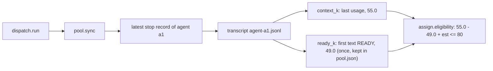
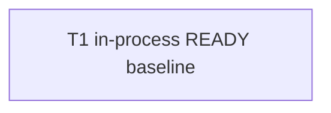

# Superlite: in-process agents get a READY baseline (B167)

**Goal:** fix #675: `pool.sync` stores `baseline_k` for an in-process agent (the context of its READY reply), so `assign.eligibility` counts only what the agent added since READY and an in-process implementer is reused after its first task instead of being evicted `context over 80k`.
**Architecture:** new `pool.ready_k(transcript)` reads the agent transcript (the one its stop record names) and returns the context of the agent's first assistant text when that text starts with `READY`; `pool.sync` calls it once per in-process agent that has no `baseline_k` yet and stores the value. `assign.eligibility` already subtracts `baseline_k`; its fallback (the prime's size) stays for agents without one. Docstrings of assign.py and dispatch.py and one appended docs/tools.md line say so.
**Tech stack:** Python 3.10+ stdlib; pytest through `sl run_tests`.
**Spec:** this file, section Design; issue #675.
**Detail:** tests
**Target-min:** 11
**Wave0:** none
**Coverage:** off

Global constraints:
- This repository is public: no host names, user names, home paths, other project or repository names, ticket keys or account names in code, tests, docs or commit messages.
- Never change `~/.superlite/machine.json` or the machine's gate config; tests use `tmp_path` only.
- Existing tests stay green. An existing test file changes only when the task Owns it. If another existing test turns red, report it in DONE_WITH_CONCERNS with the test id and the reason instead of editing it.
- Run `sl` as an executable (`<abs>/sl ...`). Verify with `<abs>/sl run_tests --fast <own test files> --task Tn --background`, then run the printed `wait:` line in the foreground and end the turn only after it reports.
- No version edits (the ship step bumps the version). Never run `scripts/evals.sh`, `claude plugin eval` or `scripts/test_layers.py run`.
- docs/tools.md is append-only for this batch: add one new line at the end of the file; never reorder, rewrite or delete an existing line.
- Code style as in pool.py: a `# O(...)` complexity comment on each new code line; `fleet_io` stays out of the in-process path (it needs `fcntl`, which Windows lacks).
- Standing rules from main (copied verbatim): This repository is public: no host names, user names, home paths, other project or repository names, ticket keys or account names in code, tests, docs, commit messages, PR texts or issue comments. Write "a Swift project", "a second Mac", "the machine". Never change the machine's gate config or ~/.superlite/machine.json; tests and proofs use private temp homes and state dirs. No real app builds as proof; this repository's own test suite is the check. Priority of this round: scheduling and admission of test runs, parallel agents and the fleet, wall-clock and token efficiency. Measure before and after where the issue names a waste (seconds, runs, tokens) and put the figures into your notes. Friction with superlite itself goes to `sl feedback add`, not into this batch. Online research is allowed when something is unclear (official docs first, then how others solved it); name the source in your notes.

Ruling: the baseline is read from the transcript, not from the agent's first stop record: in the current harness an in-process implementer hands READY back through SubagentHandback and keeps running, the coordinator's task arrives as an `isMeta` user record with `origin.kind == "coordinator"`, and no stop record falls between READY and the task (measured on the issue's evidence run: 7 implementer transcripts, READY at 48.9 to 49.1k, one task later 70.0 to 105.6k) - because a stop-record snapshot would hold the post-task context - cost if wrong: an agent whose first reply is not READY keeps the prime-size fallback (today's behaviour).
Ruling: only the agent's first assistant text counts, and only when its stripped text starts with `READY` (agents/implementer.md: "reply with exactly READY and nothing else") - because a later READY in a task reply, or a prime and task sent in one message, would give a baseline that already holds task work - cost if wrong: no baseline, today's fallback.
Ruling: `fleet_io.ready_k` (Herdr workers, turn cut) is left as is; its turn rule misses the coordinator-origin records of in-process transcripts, so the two readers stay separate (fleet_io.py is owned by other open batches).
Ruling: one task (pool.py holds the change; the docstrings and the docs line describe it); already in the lead worktree, no `sl worktree ensure`.
LAYERS: unit

## Design

1. `pool.ready_k(transcript) -> float | None`: reads the JSONL transcript (unreadable file or line: skipped; missing file: `None`). Walks the records in order; for each record with `type == "assistant"` whose `message.content` holds text (a string, or the `text` blocks of a list joined with `"\n"`), the first such record decides: when its stripped text starts with `READY`, return the k tokens of that record's `message.usage` (the same formula as `context_k`: input + cache read + cache write 5m and 1h, else `cache_creation_input_tokens`, divided by 1000, rounded to 0.1); when that record has no usage dict, the last usage seen before it; when none, `None`. When the first text does not start with `READY`, return `None`. Assistant records without text (tool_use only) are skipped. The usage formula moves into one helper `pool._usage_k(usage) -> float` that `context_k` uses too (its results stay byte-identical).
2. `pool.sync(data, sl_dir, now_ms)`: for an agent whose `backend` is not `"herdr"`, whose `baseline_k` is missing or `None`, and which has a stop record with a transcript: `ready_k(transcript)`; a non-`None` result is stored as `ag["baseline_k"]`. An existing `baseline_k` is never replaced. Herdr agents keep their path (fleet.json + `fleet_io.baseline_k`); `ready_k` is never called for them.
3. assign.py docstring: the `Eligible:` sentence says `context_k minus baseline_k (the READY context; else the prime's size) + Est. context <= 80`. dispatch.py docstring: the `The pool is synced first (...)` sentence adds `baseline_k from the READY reply`.
4. docs/tools.md: append at the end of the file one line: `` `pool sync` also fills `baseline_k` for an in-process agent: the context of its first assistant text when that text starts with READY, read from the transcript of its stop record and kept once set; without such a reply the prime-size fallback stays, so eviction counts only what an in-process agent added since READY (#675). ``

## File structure

- skills/subagent-driven-development/scripts/pool.py: `_usage_k`, `ready_k`, the in-process branch of `sync`, module docstring line.
- skills/subagent-driven-development/scripts/assign.py: docstring only.
- skills/subagent-driven-development/scripts/dispatch.py: docstring only.
- docs/tools.md: one appended line.
- tests/scripts/test_pool_inprocess_baseline_675.py: the regression tests.

```mermaid
%% schedule
gantt
  title Predicted schedule (mm:ss)
  dateFormat X
  axisFormat %M:%S
  section lane 1
  T1 in-process READY baseline :t1, 0, 288s
```

critical path: T1 (4.8 min) · peak width 1 · predicted build 4.8 min · predicted total ≈ 15.3 min (target ✗ 11.0)

## Pool

### T1 in-process READY baseline · Complexity 4 (O-1) · Est. context 48k
**Owns:** skills/subagent-driven-development/scripts/pool.py, skills/subagent-driven-development/scripts/assign.py, skills/subagent-driven-development/scripts/dispatch.py, docs/tools.md, tests/scripts/test_pool_inprocess_baseline_675.py
**Components:** 1
**LOC owned:** 150
**Tests:** fast
**Model:** sonnet
**Kind:** design
**Produces:** pool.ready_k(transcript: str) -> float | None
e.g. pool.ready_k("<tmp>/agent-a1.jsonl") -> 49.0 (prime user record, assistant text "READY" with usage input 3 + cache read 40000 + cache write 8997, then the coordinator record, then assistant "DONE" with usage 54995 + 5)
e.g. pool.ready_k("<tmp>/missing.jsonl") -> None
**Review Focus:** state: `test_sync_keeps_existing_baseline` (an agent with `baseline_k` 30.0 keeps 30.0 after sync); encoding: `test_ready_k_skips_bad_lines` (a non-JSON line before the READY record is skipped, result 49.0) and `test_ready_k_string_content` (content `"READY\n"` as a plain string gives 49.0)
**Probe entry:** none (reads a transcript file; covered by the named tests)
**Test code:** write `tests/scripts/test_pool_inprocess_baseline_675.py` with a helper `transcript(path, ready_k=49.0, end_k=55.0, first_text="READY")` that writes four records: user prime (`{"type":"user","message":{"role":"user","content":"Read /x/.superlite/prime.md, then reply READY"}}`), assistant `[{"type":"text","text":first_text}]` with usage `{"input_tokens":3,"cache_read_input_tokens":ready_k*1000-3-8997,"cache_creation_input_tokens":8997}`, user `{"type":"user","isMeta":true,"origin":{"kind":"coordinator"},"message":{"role":"user","content":[{"type":"text","text":"The coordinator sent a message while you were working: Task T2"}]}}`, assistant `"DONE"` with usage `{"input_tokens":5,"cache_read_input_tokens":end_k*1000-5}`; and a helper writing `metrics.jsonl` with `{"ev":"stop","t":1000,"agent_id":"a1","type":"superlite:implementer","transcript":<path>,"last":"DONE"}`. Tests, exact values:
- `test_ready_k_reads_first_ready_reply`: ready_k -> 49.0.
- `test_ready_k_none_when_first_text_is_not_ready`: first_text `"Working on T2"` (a later `"READY"` assistant record appended) -> None.
- `test_ready_k_missing_file`: -> None.
- `test_ready_k_skips_bad_lines`, `test_ready_k_string_content`: see Review Focus.
- `test_context_k_unchanged`: `pool.context_k` of the helper transcript -> 55.0.
- `test_sync_fills_in_process_baseline`: pool agent `{"id":"a1","tier":"sonnet","tasks":["T1"],"files":[],"context_k":20,"idle_min":0,"busy":False}` (no backend), no fleet.json; after `pool.sync(data, sd, 2000)`: `baseline_k == 49.0`, `context_k == 55.0`, and `assign.eligibility(agent, 20.0, None, 2.0) is None`; with end_k 129.0 instead: `assign.eligibility(agent, 20.0, None, 2.0) == "context over 80k"`.
- `test_sync_keeps_existing_baseline`: see Review Focus.
- `test_sync_never_reads_ready_for_herdr`: agent with `"backend":"herdr"`, no fleet.json, `monkeypatch.setattr(pool, "ready_k", <raises AssertionError>)`: sync runs, no `baseline_k`.
- `test_sync_no_ready_reply_keeps_fallback`: first_text `"DONE"`: no `baseline_k` after sync.
- `test_dispatch_keeps_in_process_agent_after_one_task`: `make_plan(tmp_path, [{"id":"T1","owns":"src/t1.py"},{"id":"T2","owns":"src/t2.py"}])` (Est. context 40k each), `.superlite/pool.json` with agent a1 as above, metrics and transcript in `.superlite`, empty `progress.md`; `dispatch.run(plan, pool, ledger, committed="T1", gate=False)` -> `"a1" not in evict`, some line's text names `a1`, and the saved pool.json holds `baseline_k` 49.0 for a1.
- `test_dispatch_evicts_in_process_agent_past_80k_added`: the same with end_k 129.0 -> `evict["a1"] == "context over 80k"`.
**Steps:** 1 write the tests, 2 run: FAIL (record the red summary line), 3 implement Design 1 to 4, 4 run: PASS.
**Notes:** keep `context_k`'s signature and results (fleet_io.ready_k calls it). `ready_k` reads the file once; sync calls it only while `baseline_k` is missing, so each agent's transcript is read for it at most until a value is stored.

## Self-review

Coverage: issue Wanted 1 (Design 2), 2 (assign already subtracts; Design 3 documents it), 3 (the sync and dispatch tests). No placeholders; one task, no edges; docs/tools.md only appended.
