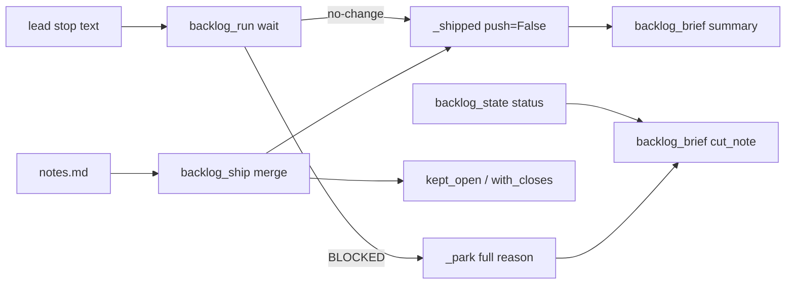
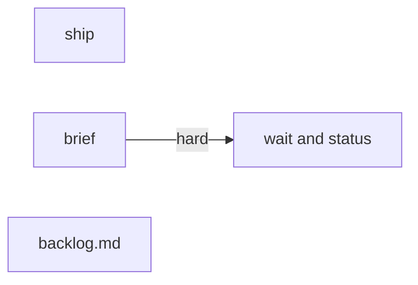

# Lead end states and unverified acceptance (B134: #581, #582)

**Goal:** a backlog lead can end with no code change, an acceptance step it did not run keeps its issue open and shows as UNVERIFIED, a design-only batch shows `awaits plan approval`, and parked reasons and summary rulings are cut at a sentence end with the full text one sl command away.
**Architecture:** stdlib Python scripts under skills/subagent-driven-development/scripts; `backlog_ship.py` (ship steps), `backlog_brief.py` (lead brief, summary text), `backlog_run.py` (wait), `backlog_state.py` (status rows), docs in `skills/subagent-driven-development/backlog.md`.
**Tech stack:** Python 3.10+, pytest under tests/scripts (fixtures in test_backlog_ship.py, test_backlog_run.py).
**Spec:** this file (Design).
**Detail:** tests
**Wave0:** none
**Worktree:** none
**Target-min:** 11

Global constraints:
- Cut marker, exact: ` [cut: sl backlog ship <B> notes prints the full text]` (leading space). Over-flow line, exact: `+N more note lines: sl backlog ship <B> notes prints them`.
- Note line kinds (case-insensitive, optional `- `/`* ` bullet): `Ruling:`, `Follow-up:`, `Left undone:`, `Unverified: <step> (#N)`, `Kind: design`.
- Reasons are stored whole up to 2000 characters, control characters removed, whitespace collapsed to single spaces.
- Every new script line keeps the repo's `# O(...)` complexity comment style.

## Design

What the issues ask (data): #581: a no-change end state (`DONE no-change: duplicate of <issue>`, main closes), an explicit exception for evidence comments, a batch kind `design` printing `awaits plan approval` after ship, reasons and rulings cut at a sentence end with the full text reachable by an sl command. #582: a lead that cannot produce acceptance evidence or a green suite stops with needs_decision ("ship without X?"); such an issue keeps open (`Refs`, the `B OPEN #N` line); the summary marks the step `UNVERIFIED`. Main's tell adds three backlog.md follow-ups (Decisions:/Attribution: lines, the evals-red rule, B133's ship changes).

1. **No-change end.** The lead ends `Status: DONE no-change: <reason>`. `wait` sees it in the stop text, keeps the notes, writes the summary (`B no-change: #N` head, `No change: <reason>`), marks the batch shipped with `no_change` and `open_issues` = its issues, removes the worktree with git only (`_shipped(push=False)`), prints `B no-change: <reason> summary=<path>` then `B OPEN #N`. Main closes those issues. Rejected: a new batch state (touches plan, status, reset and undo in files other batches own).
2. **Acceptance not run.** Brief and backlog.md: an acceptance step the lead cannot run is a NEEDS_DECISION ("Ship without <step>?"). Shipping without it: `Refs #N` in pr-body.md and an `Unverified: <step> (#N)` note. `merge` adds no `Closes` line for an issue kept open (Refs, named in an Unverified line, or every issue of a `Kind: design` batch), skips its Jira transition, and refuses (exit 2) a body that closes such an issue. `wait` prints ` unverified=K` and one `B UNVERIFIED: <step>` line; the summary rewrites the note as `UNVERIFIED: ...`.
3. **Design kind.** `Kind: design` in notes.md: issues stay open (above), the shipped line and status row end ` design: awaits plan approval`, the summary gets `Kind: design, awaits plan approval`.
4. **Full texts.** Park reasons come from the stop text's last Status line (not the 160-character `last` field), stored whole. The wait line cuts at 200, the status cell at 40 plus a `reason B: ...` line (cut at 400) under the table, both with the cut marker. `sl backlog ship B notes` (any session, read-only) prints `reason:`, `no-change:` and the full notes. Rejected: `sl backlog notes B` (backlog.py belongs to B144: a follow-up adds that alias).
5. **Tracker rule.** The brief says: change no issue state yourself; the one exception is an evidence comment when the issue or a standing note asks for one.

Ruling: `ship B notes` lives under `ship` because backlog.py (B144) routes only `ship` to a file this batch may edit (because the CLI router is owned elsewhere; cost if wrong: one alias later).
Ruling: a no-change batch counts as shipped with no PR (because shipped keeps its issues out of later plans and satisfies `depends`; cost if wrong: status shows it among shipped rows).
Ruling: backlog_ship.py, backlog_brief.py and backlog_state.py are edited although outside the batch list (no open batch lists them; named in notes.md).

## Coverage

| Category | State | Basis |
|---|---|---|
| Scope and success criteria | settled | issues #581, #582 Expected sections; main's tell |
| Domain and data model | ruled | batch keys `no_change` (str), `unverified` (list), `kind` ("design" or None) in backlog.json |
| Persistence and migration | ruled | new keys optional; old batches read as absent; no migration |
| Interfaces and contracts | ruled | `sl backlog ship B notes` added; existing wait/ship lines unchanged except the cut marker |
| UI states | n/a | CLI text only |
| Concurrency and state ownership | settled | backlog.json writes go through bs.update (flock), as today |
| Error handling and recovery | ruled | merge refuses (exit 2, lock kept) a body closing a kept-open issue |
| Security and privacy | ruled | lead text is untrusted: control characters removed, 2000-character cap |
| Performance and limits | ruled | wait line 200, status cell 40, status reason line 400, stored 2000 |
| Observability | ruled | wait lines `no-change`, `UNVERIFIED`, `design: awaits plan approval` |
| Testing strategy | ruled | pytest units per module with the existing fixtures; doc contract test |
| Compatibility | ruled | `note_items` gains `unverified`, `kind`; old tests updated |
| Rollout | ruled | ships in one version bump; rollback is a revert |
| Research unknowns | n/a | none |



## File structure

- skills/subagent-driven-development/scripts/backlog_ship.py: note kinds, kept-open issues, merge guard, `notes` action.
- skills/subagent-driven-development/scripts/backlog_brief.py: cut marker, summary head and lines, lead brief rules.
- skills/subagent-driven-development/scripts/backlog_run.py: no-change end, full park reasons, shipped line counts.
- skills/subagent-driven-development/scripts/backlog_state.py: status cells and reason lines.
- skills/subagent-driven-development/backlog.md: the rules.



Ruling: T2 -> T3 is a hard edge (because T3's tests import the real backlog_brief for the cut marker and summary head; cost if wrong: about 3 minutes of wall time).
Ruling: accept predicted 16 min (because the four tasks touch separate modules and the only chain is T2 -> T3; cost if wrong: a few minutes).

```mermaid
%% schedule
gantt
  title Predicted schedule (mm:ss)
  dateFormat X
  axisFormat %M:%S
  section lane 1
  T1 kept-open issues and ship notes :t1, 0, 422s
  section lane 2
  T2 cut marker summary kinds and lead rul :t2, 0, 419s
  T3 no-change end and full reasons :t3, 419, 424s
  section lane 3
  T4 backlog.md lead rules and ship change :t4, 0, 363s
```



critical path: T2 → T3 (14.0 min) · peak width 3 · predicted build 14.0 min · predicted total ≈ 26.5 min (target ✗ 11.0)

## Ship

### T1 kept-open issues and ship notes · Complexity 4 (O-1) · Est. context 40k
**Owns:** skills/subagent-driven-development/scripts/backlog_ship.py, tests/scripts/test_backlog_ship_582.py, tests/scripts/test_backlog_ship_notes_476.py
**Components:** 2
**LOC owned:** 140
**Tests:** fast
**Model:** sonnet
**Est. time:** 3 min
**Produces:** backlog_ship.note_items(notes: str) -> dict · backlog_ship.kept_open(text: str, issues: list, items: dict) -> list · backlog_ship.with_closes(text: str, issues: list, keep_open: tuple = ()) -> str
  e.g. note_items("Unverified: app check (#12)\nKind: design (docs/plans/a.md)\n") -> {"followups": [], "undone": [], "unverified": ["app check (#12)"], "kind": "design"}
  e.g. note_items("") -> {"followups": [], "undone": [], "unverified": [], "kind": None}
  e.g. kept_open("", [5, 6], {"unverified": ["app check (#6)"], "kind": None}) -> [6]
**Review Focus:** `test_kept_open_examples`: `#5` never matches `#56`; `test_merge_refuses_a_body_closing_a_kept_issue`
**Notes:** `kept_open`: every issue when items["kind"] == "design"; else issues the text names as `Refs #N` / `Refs KEY` (regex `(?i)\brefs?:?\s+#N\b`, Jira `(?i)\brefs?:?\s+KEY\b`) plus issues named `#N` (or a Jira key) inside an `unverified` item, in issue order. `with_closes` adds no line for n in keep_open or named `Refs #N`. `_merge` (also `--from-main`): parse items from notes before maxapp; keep = kept_open(source, issues, items); a source that closes a kept issue (the existing close/fix/resolve regex) -> `_refuse(ctx, "refused: #6 stays open (Unverified: note or Kind: design) but the PR body closes it; write Refs #6 instead")`; body = with_closes(source, issues, keep_open=tuple(keep)); close_jira skips kept keys. `_set(**items)` stores unverified and kind. New action `notes` (choices list), handled before the lead-env check like `done`: prints `reason: <reason>` if the batch has one, `no-change: <no_change>` if set, then `<sd>/backlog/B.notes.md` text if it exists, else `<worktree>/.superlite/notes.md`, else `no notes`; exit 0. Update test_backlog_ship_notes_476.py's note_items equalities for the two new keys.
**Test code (verbatim):**
```python
# tests/scripts/test_backlog_ship_582.py
import sys
from test_backlog_ship import sh, ship, b1, locked  # noqa: F401
from test_plan_tools import SCRIPTS
sys.path.insert(0, str(SCRIPTS))
import backlog_ship as bsh  # noqa: E402
import backlog_state as bs  # noqa: E402


def test_note_items_unverified_and_kind():
    assert bsh.note_items("Unverified: app check (#12)\nKind: design (docs/plans/a.md)\n") == {"followups": [], "undone": [], "unverified": ["app check (#12)"], "kind": "design"}
    assert bsh.note_items("") == {"followups": [], "undone": [], "unverified": [], "kind": None}
    assert bsh.note_items("- unverified: suite green\nKind: code") == {"followups": [], "undone": [], "unverified": ["suite green"], "kind": None}


def test_with_closes_keeps_refs_and_kept_issues_open():
    assert bsh.with_closes("Refs #5\n", [5, 6]) == "Refs #5\n\nCloses #6\n"
    assert bsh.with_closes("", [5], keep_open=(5,)) == ""
    assert bsh.with_closes("refs: #5", [5]) == "refs: #5"


def test_kept_open_examples():
    assert bsh.kept_open("Refs #5", [5, 6], {"unverified": [], "kind": None}) == [5]
    assert bsh.kept_open("", [5, 6], {"unverified": ["app check (#6)"], "kind": None}) == [6]
    assert bsh.kept_open("", [5, "PIX-1"], {"unverified": [], "kind": "design"}) == [5, "PIX-1"]
    assert bsh.kept_open("Refs PIX-1", [5, "PIX-1"], {"unverified": [], "kind": None}) == ["PIX-1"]
    assert bsh.kept_open("", [56], {"unverified": ["check (#5)"], "kind": None}) == []


def notes(sh, text, body=None):
    d = sh.wt / ".superlite"; d.mkdir(exist_ok=True); (d / "notes.md").write_text(text)
    if body is not None:
        (d / "pr-body.md").write_text(body)


def test_merge_adds_no_closes_for_an_unverified_issue(sh, capsys):
    locked(sh, capsys); bs.update(bs.path(sh.root), lambda d: bs.batch(d, "B1").update({"issues": [5, 6]}))
    notes(sh, "Unverified: running-app check (#6)\n", "Fixes #5\nRefs #6\n")
    sh.replies = {"maxapp ship": (0, "merged #201 as abc\n"), "gh issue view 6": (0, "OPEN\n")}
    rc, out = ship(capsys, "B1", "merge")
    assert rc == 0 and out.endswith("OPEN #6\n")
    assert (sh.sd / "backlog" / "B1.pr-body.md").read_text() == "Fixes #5\nRefs #6\n"
    assert (b1(sh)["unverified"], b1(sh)["kind"], b1(sh)["open_issues"]) == (["running-app check (#6)"], None, [6])


def test_merge_refuses_a_body_closing_a_kept_issue(sh, capsys):
    locked(sh, capsys)
    notes(sh, "Unverified: suite green (#5)\n", "Closes #5\n")
    rc, out = ship(capsys, "B1", "merge")
    assert rc == 2 and out.startswith("refused: #5 stays open") and "Refs #5" in out
    assert not any(c[:2] == ["maxapp", "ship"] for c in sh.calls)


def test_design_batch_closes_nothing(sh, capsys):
    locked(sh, capsys); notes(sh, "Kind: design (docs/plans/x.md)\n", "Refs #5\n")
    sh.replies = {"maxapp ship": (0, "merged #201 as abc\n"), "gh issue view 5": (0, "OPEN\n")}
    assert ship(capsys, "B1", "merge")[0] == 0
    assert "Closes" not in (sh.sd / "backlog" / "B1.pr-body.md").read_text() and b1(sh)["kind"] == "design"


def test_notes_prints_reason_and_full_notes_anywhere(sh, capsys, monkeypatch):
    monkeypatch.delenv("SUPERLITE_FLEET_ROLE")
    bs.update(bs.path(sh.root), lambda d: bs.batch(d, "B1").update({"state": "parked", "reason": "Status: BLOCKED " + "a" * 900}))
    assert ship(capsys, "B1", "notes") == (0, "reason: Status: BLOCKED " + "a" * 900 + "\nno notes\n")
    notes(sh, "Ruling: " + "r" * 700 + "\n")
    assert ship(capsys, "B1", "notes")[1].endswith("Ruling: " + "r" * 700 + "\n")
    (sh.sd / "backlog").mkdir(exist_ok=True); (sh.sd / "backlog" / "B1.notes.md").write_text("Ruling: kept\n")
    assert ship(capsys, "B1", "notes")[1].endswith("Ruling: kept\n")
    assert ship(capsys, "B9", "notes")[0] == 2
```
**Steps:** 1 failing test, 2 run: FAIL, 3 implement, 4 run: PASS
**Probe entry:** call=backlog_ship.note_items

## Brief

### T2 cut marker, summary kinds and lead rules · Complexity 4 (O-1) · Est. context 42k
**Owns:** skills/subagent-driven-development/scripts/backlog_brief.py, tests/scripts/test_backlog_brief_581.py, tests/scripts/test_backlog_brief_b90.py, tests/scripts/test_backlog_brief.py, tests/scripts/test_backlog_brief_557.py, tests/scripts/test_backlog_brief_jira_208.py
**Components:** 2
**LOC owned:** 120
**Tests:** fast
**Model:** sonnet
**Est. time:** 3 min
**Produces:** backlog_brief.cut_note(text: str, bid: str, limit: int = 400) -> str · backlog_brief.summary(batch: dict, notes: str) -> str
  e.g. cut_note("short", "B1") -> "short"
  e.g. cut_note("x" * 150 + ". " + "y" * 100, "B1", 200) -> "x" * 150 + ". [cut: sl backlog ship B1 notes prints the full text]"
  e.g. summary({"id": "B2", "issues": [7], "no_change": "duplicate of #3"}, "") -> "B2 no-change: #7\nPR: -\nVersion: -\nNo change: duplicate of #3\n"
**Review Focus:** `test_cut_note_examples`: a cut never splits a word; `test_summary_kinds`
**Notes:** cut_note keeps today's rule with the bound scaled: last SENTENCE end in (limit//2, limit], else bc._word(text, limit); then the marker. summary: head `B no-change: #N` when batch["no_change"], else `B shipped: #N`; after Version and Decisions add `No change: <cut_note(no_change, bid)>` or `Kind: design, awaits plan approval` (kind == "design"); a note line matching `(?i)^\s*(?:[-*]\s*)?unverified\s*:\s*` is written `UNVERIFIED: <rest>`; overflow line per Global constraints; 10-line cap unchanged. Lead brief: End line becomes `End: Status: DONE once merge printed shipped; Status: DONE no-change: <reason> when your issues need no code change (a duplicate: name the issue it duplicates; write no plan, ship nothing; main closes the issues); otherwise Status: BLOCKED with the reason. Then the JSON block.`; add ACCEPT line before `Ship:`: `Acceptance: a step your issue's acceptance asks for that you cannot run (the running-app check, the project suite green, a production step) is a decision, never a follow-up: let workers finish, ask "Ship without <step>?" in .superlite/question.json and end with Status: NEEDS_DECISION.`; add TRACKER line after ROOT_DOC_RULE: `Tracker: change no issue state yourself (merge and main close and move issues); the one exception is a comment with evidence (a duplicate's link, a measurement) when your issue or a standing note asks for one.`; the Jira line drops `and write no Jira change yourself` (keeps `(main moves the issues)`); NOTES_RULE adds after the Left undone part: `, one `Unverified: <step> (#N)` line per acceptance step shipped unrun with main's yes (that issue gets `Refs #N`, never `Closes`) and `Kind: design` when the batch ships only a spec and plan (every issue `Refs #N`)`. Update the old tests' marker and overflow strings and the golden brief.
**Test code (verbatim):**
```python
# tests/scripts/test_backlog_brief_581.py
import sys
from test_plan_tools import SCRIPTS
sys.path.insert(0, str(SCRIPTS))
import backlog_brief as bb  # noqa: E402

TAIL = " [cut: sl backlog ship B1 notes prints the full text]"
CTX = {"sl": "/p/sl", "backlog_md": "/p/backlog.md", "repo": "o/r", "approved": {"by": "AskUserQuestion", "time": "T0"}}


def test_cut_note_examples():
    assert bb.cut_note("short", "B1") == "short"
    assert bb.cut_note("x" * 150 + ". " + "y" * 100, "B1", 200) == "x" * 150 + "." + TAIL
    assert bb.cut_note("word " * 60, "B1", 200) == ("word " * 40).rstrip() + TAIL
    assert bb.cut_note("y" * 500, "B1") == "y" * 400 + TAIL


def test_summary_kinds():
    assert bb.summary({"id": "B2", "issues": [7], "no_change": "duplicate of #3"}, "") == "B2 no-change: #7\nPR: -\nVersion: -\nNo change: duplicate of #3\n"
    s = bb.summary({"id": "B1", "issues": [5], "pr": 9, "version": "1.0", "kind": "design"}, "Unverified: app check (#5)\n- unverified: suite\n")
    assert s == "B1 shipped: #5\nPR: #9\nVersion: 1.0\nKind: design, awaits plan approval\nUNVERIFIED: app check (#5)\nUNVERIFIED: suite\n"
    many = bb.summary({"id": "B1", "issues": [5]}, "\n".join(f"n{i}" for i in range(9))).splitlines()
    assert many[-1] == "+3 more note lines: sl backlog ship B1 notes prints them"


def test_lead_brief_end_states_acceptance_and_tracker():
    t = bb.lead_brief({"id": "B1", "topic": "t", "issues": [1], "files": ["a.py"]}, CTX)
    assert "Status: DONE no-change: <reason>" in t and "Ship without <step>?" in t
    assert "Tracker: change no issue state yourself" in t and "comment with evidence" in t
    assert "`Unverified: <step> (#N)`" in t and "`Kind: design`" in t
    j = bb.lead_brief({"id": "B1", "topic": "t", "issues": ["PIX-1"], "files": ["a.py"]}, CTX)
    assert "write no Jira change yourself" not in j and "main moves the issues" in j
```
**Steps:** 1 failing test, 2 run: FAIL, 3 implement, 4 run: PASS
**Probe entry:** none (text builders; Review Focus cases are named tests)

## Wait and status

### T3 no-change end and full reasons · Complexity 5 (O-1) · Est. context 48k
**Owns:** skills/subagent-driven-development/scripts/backlog_run.py, skills/subagent-driven-development/scripts/backlog_state.py, tests/scripts/test_backlog_run_581.py
**Components:** 2
**LOC owned:** 150
**Tests:** fast
**Model:** sonnet
**Est. time:** 4 min
**Consumes:** backlog_brief.cut_note(text: str, bid: str, limit: int = 400) -> str (T2) · backlog_brief.summary(batch: dict, notes: str) -> str (T2)
**Produces:** backlog_run.status_reason(text: str, last: str) -> str · backlog_run.no_change_reason(text: str) -> str | None
  e.g. status_reason("Outcome\nStatus: BLOCKED merge denied: main runs it\n```json\n{}\n```", "Outcome") -> "Status: BLOCKED merge denied: main runs it"
  e.g. status_reason("", "Status: BLOCKED - tui red") -> "Status: BLOCKED - tui red"
  e.g. no_change_reason("Status: **DONE** no-change: duplicate of #12") -> "duplicate of #12"
**Review Focus:** `test_wait_ends_a_no_change_batch`; `test_wait_parks_with_the_full_status_line`: a 900-character Status line is stored whole and printed cut
**Notes:** status_reason: the last line of `text` the STATUS regex matches, from `Status:` on; else `last`; whitespace collapsed, control characters removed, cap 2000; empty -> "lead stopped". NO_CHANGE regex `(?i)\bStatus:\s*\**\s*DONE\**\s+no[- ]change\s*:\s*(\S[^\n]*)`, group stripped of `*` and spaces, cleaned, cap 2000. In `_round`, before the `STATUS.search(_stop_text(rec))` park: a no-change reason -> read `<wt>/.superlite/notes.md` (missing: ""), items = backlog_ship._keep_notes(sd, bid, notes), write `<sd>/backlog/B.md` = backlog_brief.summary({**b, "no_change": r, **items}, notes), store `no_change`, `open_issues` = b["issues"] and items, then `out.extend(_shipped(p, sd, root, {...same...}, wt, push=False))`. The park there and in the transcript-unread case use status_reason(text, last) instead of the 120-character `last`. Every `B parked: R` line prints cut_note(R, bid, 200) (also the lead-parked loop). `_shipped`: first line `B no-change: <cut_note(no_change, bid, 200)> summary=<path>` when no_change; else today's line with ` unverified=K` after undone and ` design: awaits plan approval` last when kind == "design"; `B UNVERIFIED: <text>` lines after the left-undone lines. backlog_state.status_lines: parked cell = cut at 40 at a whole word, and after the table one `reason B: <cut_note(reason, B, 400)>` line per parked batch whose reason is over 40 characters (import backlog_brief inside the function); shipped cell adds ` unverified=K`, ` design: awaits plan approval`, and reads `no-change` instead of the version for a no_change batch.
**Test code (verbatim):**
```python
# tests/scripts/test_backlog_run_581.py
import sys
from test_backlog_run import bk, running, run, get  # noqa: F401
from test_plan_tools import SCRIPTS
sys.path.insert(0, str(SCRIPTS))
import backlog_brief  # noqa: E402
import backlog_run as br  # noqa: E402
import backlog_state as bs  # noqa: E402
import pytest  # noqa: E402

TAIL = " [cut: sl backlog ship B1 notes prints the full text]"


@pytest.fixture(autouse=True)
def real_brief(monkeypatch):
    monkeypatch.setitem(sys.modules, "backlog_brief", backlog_brief)


def test_status_reason_and_no_change_examples():
    assert br.status_reason("Outcome\nStatus: BLOCKED merge denied: main runs it\n```json\n{}\n```", "Outcome") == "Status: BLOCKED merge denied: main runs it"
    assert br.status_reason("", "Status: BLOCKED - tui red") == "Status: BLOCKED - tui red"
    assert br.status_reason("", "") == "lead stopped"
    assert br.no_change_reason("Status: **DONE** no-change: duplicate of #12") == "duplicate of #12"
    assert br.no_change_reason("Status: DONE") is None


def test_wait_ends_a_no_change_batch(bk, capsys):
    wt = running(bk, issues=[7]); (wt / ".superlite" / "notes.md").write_text("Ruling: dup\n")
    bk.stops["W1"] = {"t": 2000, "last": "Status: DONE no-change: duplicate of #3"}
    rc, out = run(capsys, "wait", "--timeout", "0")
    lines = out.splitlines()
    assert rc == 0 and lines[0] == f"B1 no-change: duplicate of #3 summary={bk.sd / 'backlog' / 'B1.md'}" and "B1 OPEN #7" in lines
    b = get(bk, "B1")
    assert (b["state"], b["no_change"], b["open_issues"]) == ("shipped", "duplicate of #3", [7])
    assert (bk.sd / "backlog" / "B1.md").read_text().startswith("B1 no-change: #7\n")
    assert (bk.sd / "backlog" / "B1.notes.md").read_text() == "Ruling: dup\n"


def test_wait_parks_with_the_full_status_line(bk, capsys):
    running(bk); reason = "Status: BLOCKED " + "word " * 180
    bk.stops["W1"] = {"t": 2000, "last": reason[:160]}
    br.sys.modules["fleet_io"].report_text = lambda tr: "Outcome: BLOCKED\n" + reason + "\n```json\n{}\n```"
    bk.stops["W1"]["transcript"] = "/t.jsonl"
    out = run(capsys, "wait", "--timeout", "0")[1]
    assert get(bk, "B1")["reason"] == reason.strip()
    assert out.startswith("B1 parked: Status: BLOCKED word") and out.rstrip("\n").endswith(TAIL) and len(out) < 270


def test_shipped_line_counts_unverified_and_design(bk, capsys):
    running(bk, merged=True, pr=201, version="1.5.8", unverified=["app check (#5)"], kind="design")
    bk.stops["W1"] = {"t": 2000, "last": "Status: DONE"}
    lines = run(capsys, "wait", "--timeout", "0")[1].splitlines()
    assert lines[0] == f"B1 shipped PR #201 1.5.8 summary={bk.sd / 'backlog' / 'B1.md'} unverified=1 design: awaits plan approval"
    assert "B1 UNVERIFIED: app check (#5)" in lines


def test_status_shows_a_long_reason_below_the_table(bk):
    reason = "Status: BLOCKED merge denied. " + "detail " * 80
    bs.update(bs.path(bk.root), lambda d: d.update({"batches": [{"id": "B1", "issues": [1], "files": [], "state": "parked", "reason": reason},
                                                               {"id": "B2", "issues": [2], "files": [], "state": "shipped", "version": "1.0", "no_change": "dup of #1"}]}))
    lines = bs.status_lines(bs.load(bs.path(bk.root)))
    row = next(x for x in lines if x.startswith("B1 |"))
    assert len(row.split(" | ")[-1]) <= 40
    assert any(x.startswith("reason B1: Status: BLOCKED merge denied.") and x.endswith(TAIL) for x in lines)
    assert next(x for x in lines if x.startswith("B2 |")).endswith("| no-change")
```
**Steps:** 1 failing test, 2 run: FAIL, 3 implement, 4 run: PASS
**Probe entry:** call=backlog_run.no_change_reason

## Docs

### T4 backlog.md lead rules and ship changes · Complexity 2 (O-1) · Est. context 30k
**Owns:** skills/subagent-driven-development/backlog.md, tests/scripts/test_backlog_docs_581.py
**Components:** 1
**LOC owned:** 40
**Tests:** fast
**Model:** sonnet
**Est. time:** 2 min
**Notes:** Keep every existing sentence other doc tests pin (run tests/scripts/test_backlog_docs*.py, test_backlog_main_docs.py, test_docs_b72_backlog.py, test_docs_b26.py). Main step 5: add after the `B OPEN #N` sentence: the `B no-change: <reason> summary=<path>` line (shipped with no PR, issues stay OPEN, main closes each with the reason as comment); ` unverified=K` and `B UNVERIFIED: <step>` lines (the issue stays open); ` design: awaits plan approval`; long reasons cut at a sentence end with the cut marker, `status` adds a `reason B: ...` line, `"$SL" backlog ship B notes` prints a batch's full reason, no-change text and notes (any session, read-only). Main step 6: B133's changes: `--wait` alone (also on `merge --from-main`) waits without a limit; ship lock waiters are served first come first served and each `WAIT:` line names `queue place N of M`; a branch already on origin is synced by merging `origin/<branch>` then `origin/<default>`, never rebased, an unpushed one rebases; a `maxapp ship` timeout while the PR is open, not DIRTY and has no red check is a healthy wait, up to 30 not counted toward the 5 runs; `ship B done --pr N` cleans up with git only (worktree remove, `branch -d`, `-D` only when the tip is PR N's head) and never runs maxapp ship; a failed cleanup shows `cleanup owed` in the status row plus one `cleanup owed: B <worktree>: <error>; fix it, then maxapp ship -C <worktree>` line. Lead section, new bullets: End states (`Status: DONE`, `Status: DONE no-change: <reason>`, `Status: NEEDS_DECISION`, `Status: BLOCKED <reason>`; wait stores the Status line whole, up to 2000 characters); Acceptance (`Ship without <step>?` NEEDS_DECISION, `Refs #N`, `Unverified: <step> (#N)`, merge adds no Closes for such an issue and refuses a body that closes it (exit 2), `Kind: design` keeps every issue open and shows `design: awaits plan approval`); Tracker (no issue state change; the one exception is an evidence comment); Evals (`an evals layer red on a case your batch's files do not touch` is never stamped by the lead (no `test_layers.py stamp`): question.json naming the case and its failing graders, end NEEDS_DECISION, #626); Attribution (each lead brief carries an `Attribution:` line). Summary paragraph: head `B shipped: #N` or `B no-change: #N`, `PR:`, `Version:`, the generated `Decisions:` line (`(Max)` or `(main's ruling)`), `No change:` / `Kind: design, awaits plan approval`, note lines with `Unverified:` written `UNVERIFIED:`, the new cut marker replacing `[cut: full text in B.notes.md]`. Note line kinds gain `Unverified:` and `Kind: design`.
**Test code (verbatim):**
```python
# tests/scripts/test_backlog_docs_581.py
from pathlib import Path

DOC = (Path(__file__).resolve().parents[2] / "skills" / "subagent-driven-development" / "backlog.md").read_text()


def test_lead_end_states_and_acceptance_are_documented():
    for s in ("Status: DONE no-change: <reason>", "Ship without <step>?", "`Refs #N`", "`Unverified: <step> (#N)`", "`Kind: design`",
              "design: awaits plan approval", "UNVERIFIED", "backlog ship B notes", "evidence", "an evals layer red on a case your batch's files do not touch"):
        assert s in DOC, s
    assert "full text in B.notes.md" not in DOC


def test_summary_lines_and_ship_changes_are_documented():
    for s in ("`Decisions:`", "`Attribution:`", "queue place", "first come first served", "`origin/<branch>`", "healthy wait", "cleanup owed", "never runs maxapp ship"):
        assert s in DOC, s
```
**Steps:** 1 failing test, 2 run: FAIL, 3 implement, 4 run: PASS
**Probe entry:** none (docs)

## Review Focus

Package backlog scripts: app type CLI; categories protocol (ship actions, wait lines), encoding (control characters in lead text), state (backlog.json keys), file (notes files). Specific risks: `#5` matching `#56`; a no-change claim with commits on the branch (remove_worktree keeps an unmerged branch and records `cleanup_owed`); a reason with control characters; a cut splitting a word.

## Self-review

Coverage: each issue bullet maps to T1 (Refs, Unverified, design keep-open, notes command), T2 (marker, summary, brief rules), T3 (no-change, reasons, lines), T4 (docs, main's follow-ups). Types: T3 consumes T2's two Produces lines as written.
