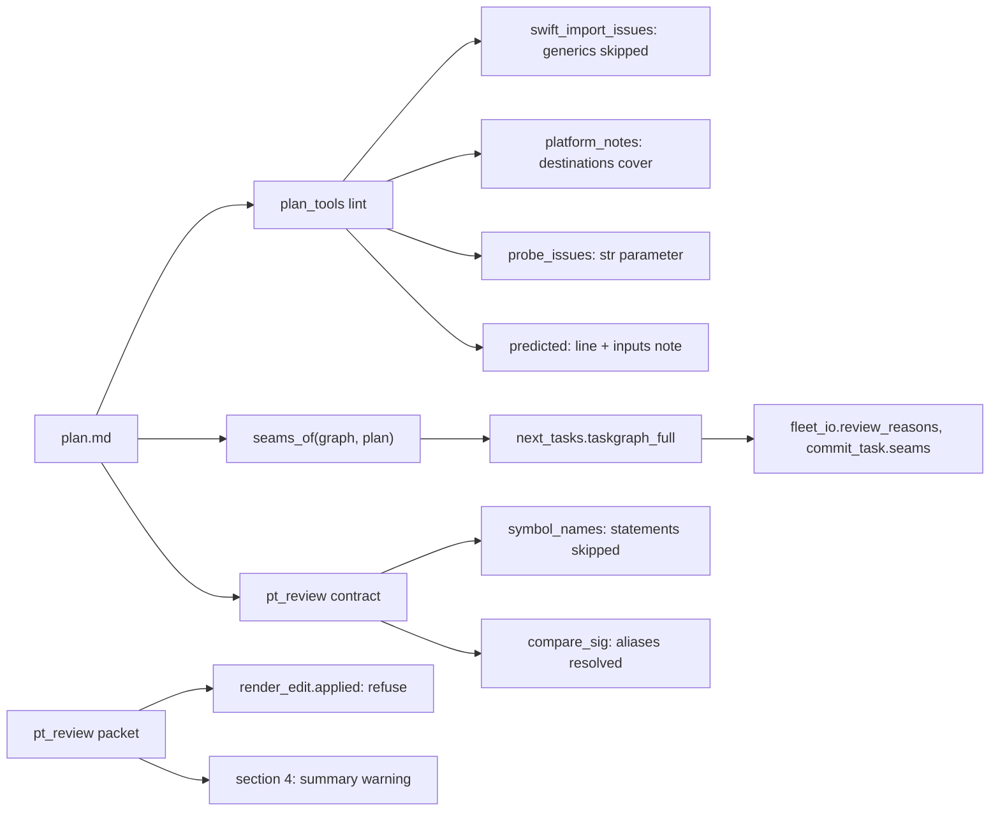
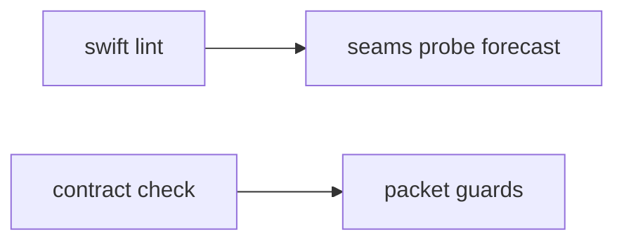

# Superlite: lint and contract check without false warnings; packet guards (B129)

**Goal:** fix #594 (six false warnings in plan lint, the pt_review contract and seam checks, and the probe lint) and main's three follow-ups for the same files: lint names missing or defaulted forecast inputs (B145), the review packet refuses while render edits are applied (B118), and packet section 4 shows the run summary's `warning` key (B131).
**Architecture:** `plan_tools.py` holds lint (Swift IMPORT, PLATFORM, PROBE, the `predicted:` line) and `seams_of`; `next_tasks.taskgraph_full` passes it the plan. `pt_review.py` holds the contract check (`symbol_names`, `compare_sig`, `read_real`) and the packet (`cmd_packet`, `read_test_summary`).
**Tech stack:** Python 3.10+ stdlib, pytest (through `sl run_tests`).
**Spec:** this file, section Design; issue #594.
**Detail:** contracts
**Target-min:** 11
**Wave0:** none
**Edges:** hard
**Coverage:** off

Global constraints:
- Every Python code line keeps the file's trailing `# O(...)` complexity comment.
- Existing tests stay green. An existing test file changes only when the task Owns it. If another existing test turns red, report it in DONE_WITH_CONCERNS with the test id and the reason instead of editing it.
- Run `sl` as an executable (`<abs>/sl ...`). Verify with `<abs>/sl run_tests --fast <own test files> --task Tn --background`, then run the printed `wait:` line in the foreground and end the turn only after it reports. Also run the existing test files the Notes name the same way.
- No version edits. Never run `scripts/evals.sh`, `claude plugin eval` or `scripts/test_layers.py run`. Never edit `tests/scripts/conftest.py`. Tests set `SUPERLITE_HOME` per test as the conftest does; no test touches the real `~/.superlite`.
- Tests build tmp plans, tmp SwiftPM trees (Package.swift plus `Sources/<Target>/*.swift`, no Swift toolchain needed) and tmp Python packages, as `tests/scripts/test_lint_platform_516.py`, `tests/scripts/test_plan_tools.py` and `tests/scripts/test_pt_review_declarations.py` do.

Ruling: main's tell adds the three follow-ups to B129 because they live in B129's two files (cost if wrong: B129 ships later).
Ruling: a plain ordering edge is an edge where one of the two tasks owns no file (`**Owns:** none` or no Owns entry); only such an edge stops being a seam. Edges between tasks that both own files stay seams without declared Consumes, because the review and seam tests pin that today (cost if wrong: a file-owning ordering edge still gets a seam review).
Ruling: PLATFORM coverage reads the destinations of the resolved test command (test-cmd.json `destinations` and `-destination` values in its command); `swift test` without a destination covers nothing, because lint may run on another machine than the tests (cost if wrong: a SwiftPM project on a Mac keeps the warning).
Ruling: a negated condition (`#if !os(macOS)`) is never covered by a destination (cost if wrong: one extra warning).
Ruling: type aliases resolve from the producer module's own source and the modules it imports a name from (one level), read with ast; runtime alias objects are not rendered (cost if wrong: an alias two imports deep still mismatches).
Ruling: the packet's render-edit refusal is `BLOCKED: render edits still applied: F; run sl render_edit restore first`, exit 2, as commit_task (B138).
Ruling: next_tasks.py is edited by T3 (no open batch lists it); notes.md names it.
LAYERS: unit

## Design

1. **Swift generics (#594 item 1).** `swift_import_issues` skips a type name that is a generic parameter: of the consumed signature's own `<...>` clauses, of the producer type's declaration (`struct WrappingMenuPicker<Content: View>`) and of the member's declaration (`init<Content>`, `func make<T>`) in the producer's owned Swift files.
2. **PLATFORM and the test destination (#594 item 2).** A `#if` condition the resolved test command's destinations build (`platform=macOS` builds `os(macOS)`) is covered; the warning names only uncovered conditions and is gone when none is left.
3. **Statement Produces lines (#594 item 3).** `symbol_names` gives no name for an unquoted lead that is a `key:value` token (`weekly:heart:2026-W37`) or for an item whose unquoted text holds `==` or `!=`; backticked spans still count.
4. **Type aliases (#594 item 4).** `compare_sig` compares annotations after replacing module-level alias names (`X = <type>`, `X: TypeAlias = <type>`) with their expansion on both sides.
5. **Plain ordering edges (#594 item 5).** `seams_of(graph, plan)` leaves out an edge whose producer or consumer owns no file; `taskgraph --format full` and `next_tasks.taskgraph_full` pass the plan.
6. **Probe `call=` parameter type (#594 item 6).** Lint rejects `call=` when the one required parameter is annotated with a non-text type.
7. **Forecast inputs (B145 follow-up).** Lint's `predicted:` line appends ` · inputs: ...` naming each missing or defaulted live input.
8. **Render edits (B118 follow-up).** The packet refuses while `render_edit.applied(sd)` lists files.
9. **Summary warning (B131 follow-up).** Packet section 4 shows the shown run's `warning` key.

## File structure

- `skills/subagent-driven-development/scripts/plan_tools.py`: items 1, 2 (T1), 5, 6, 7 (T3).
- `skills/subagent-driven-development/scripts/next_tasks.py`: passes the plan to `seams_of` (T3).
- `skills/subagent-driven-development/scripts/pt_review.py`: items 3, 4 (T2), 8, 9 (T4).

## Task graph

```mermaid
%% schedule
gantt
  title Predicted schedule (mm:ss)
  dateFormat X
  axisFormat %M:%S
  section lane 1
  T2 Contract check statement lines and ty :t2, 0, 247s
  T4 Packet guards render edits and summar :t4, 247, 234s
  section lane 2
  T1 Swift lint generics and test destinat :t1, 0, 245s
  T3 Plain-edge seams probe parameter type :t3, 245, 289s
```

critical path: T1 → T3 (8.9 min) · peak width 2 · predicted build 8.9 min · predicted total ≈ 17.4 min (target ✗ 11.0)

## Package: plan lint

App type: library (lint over a plan and a tree). Categories: deep (Swift generic clauses, nested `<>`), encoding (annotation strings), protocol (lint message texts). **Probe entry:** none (lint runs over tmp plans and trees; cases are named tests).

### T1 Swift lint: generics and test destinations · Complexity 4 · Est. context 46k
**Owns:** skills/subagent-driven-development/scripts/plan_tools.py, tests/scripts/test_lint_swift_594.py
**Components:** 2
**LOC owned:** 150
**Tests:** fast
**Model:** sonnet
**Est. time:** 2.5 min (2 components, about 150 LOC, fast tests)
**Covers:** 1, 2
**Produces:** plan_tools.swift_generic_params(text: str) -> set[str]
e.g. swift_generic_params("struct WrappingMenuPicker<Content: View, Label>: View {") -> {"Content", "Label"}
e.g. swift_generic_params("    public init<T: Codable>(value: T) {") -> {"T"}; swift_generic_params("Box<Item>.init(item: Item)") -> {"Item"}
e.g. swift_generic_params("WrappingMenuPicker.init(selection: Binding<String>, content: () -> Content)") -> set()
**Produces:** plan_tools.destination_conds(destination: str) -> set[str]
e.g. destination_conds("platform=macOS") -> {"os(macOS)", "canImport(AppKit)"}
e.g. destination_conds("platform=iOS Simulator,name=iPhone 16") -> {"os(iOS)", "targetEnvironment(simulator)", "canImport(UIKit)"}
e.g. destination_conds("generic/platform=iOS") -> {"os(iOS)", "canImport(UIKit)"}; destination_conds("platform=macOS,variant=Mac Catalyst") -> {"os(iOS)", "targetEnvironment(macCatalyst)", "canImport(UIKit)"}; destination_conds("id=ABC") -> set()
**Review Focus:** `test_generic_param_not_an_import`: Package.swift targets AppFeatures and Agent (Agent has no dependencies); `Sources/AppFeatures/WrappingMenuPicker.swift` holds `struct WrappingMenuPicker<Content: View>: View {` and `Sources/AppFeatures/Content.swift` holds `enum Content {}`; T1 owns the first file and Produces `WrappingMenuPicker.init(selection: Binding<String>, content: () -> Content)`, T2 owns `Sources/Agent/Use.swift` and Consumes it `(T1)`: lint prints no `WARNING: IMPORT` naming `Content`; `test_real_type_still_warns`: the same plan with `-> CardModel` added to the Produces and `struct CardModel {}` in AppFeatures prints one `WARNING: IMPORT: T2 consumes ... but CardModel is declared in AppFeatures`; `test_member_generic_skipped`: `init<Content>(...)` on a non-generic type in T1's file, same consume: no warning.
**Steps:** 1 failing tests, 2 run: FAIL, 3 implement, 4 run: PASS
**Notes:**
- Generics: `swift_import_issues` builds one generic map while it scans the targets (declared type name -> its clause's names) and, per seam pair, skips `swift_generic_params` of both signature items, the map entry of the produced type (`psig["cls"]`) and the clauses on `init<`/`func <member><` lines of the producer task's owned `.swift` files. A clause part's name is its first identifier (`Content: View` -> `Content`, `each T` -> `T`).
- Destinations: `platform_notes` resolves the project's test command once (`testcmd.resolve(root, ())` inside try/except, as `tests_issues` does) and unions `destination_conds` over its `destinations` list and the `-destination` values in its `command` (quoted or bare). Also `tvOS`, `watchOS` and `visionOS` (with `os(xrOS)`), each with `targetEnvironment(simulator)` for its `Simulator` form. A condition preceded by `!` on its `#if` line is never covered. Covered conditions drop out of the warning; none left: no warning. The `Tests: slow` + platform build exemption stays.
- Named tests: the e.g. lines; `test_macos_destination_covers_os_macos` (test-cmd.json `{"language": "swift", "test": "xcodebuild test -scheme App -destination 'platform=macOS'"}`, a task owning a `.swift` file with `#if os(macOS)`: no `WARNING: PLATFORM`); `test_destinations_key_covers` (`"destinations": ["platform=iOS Simulator,name=iPhone 16"]`, `#if os(iOS)`: no warning); `test_uncovered_cond_still_named` (macOS destination, `#if os(macOS)` and `#elseif os(iOS)`: the warning names `os(iOS)` and not `os(macOS)`); `test_negated_cond_not_covered` (macOS destination, `#if !os(macOS)`: warning); `test_swift_test_covers_nothing` (`"test": "swift test"`, `#if os(macOS)`: warning).
- Also run `tests/scripts/test_lint_platform_516.py` and the Swift IMPORT tests in `tests/scripts/test_plan_tools.py` (`-k swift`).

### T3 Plain-edge seams, probe parameter type, forecast inputs · Complexity 4 · Est. context 48k
**Owns:** skills/subagent-driven-development/scripts/plan_tools.py, skills/subagent-driven-development/scripts/next_tasks.py, tests/scripts/test_lint_seam_probe_forecast_594.py
**Components:** 3
**LOC owned:** 150
**Tests:** fast
**Model:** sonnet
**Est. time:** 3 min (3 components, about 150 LOC, fast tests)
**Covers:** 5, 6, 7
**Produces:** plan_tools.seams_of(graph: dict[str, list[str]], plan: Plan | None = None) -> list[str]
e.g. graph {"T1": [], "T2": ["T1"]}, T1 `**Owns:** none`: seams_of(graph, plan) -> []; seams_of(graph) -> ["T1↔T2"]
e.g. both tasks own files: seams_of(graph, plan) -> ["T1↔T2"]
**Produces:** plan_tools.text_param_issue(args: str, method: bool = False) -> str | None
e.g. text_param_issue("counts: dict[str, int]") -> "counts: dict[str, int]"
e.g. text_param_issue("text: str") -> None; text_param_issue("raw") -> None; text_param_issue("s: Optional[str], n: int = 3") -> None
e.g. text_param_issue("self, ref: 'str | None'", method=True) -> None; text_param_issue("x: Any") -> None
**Produces:** plan_tools.forecast_inputs_note(coef: dict) -> str
e.g. forecast_inputs_note({"time": {}}) -> "inputs: live inputs off (test minutes and contention not read)"
e.g. a coef with "prose" and live {"tests": {"fast_min": None, "full_min": 4, "full_source": "test-cmd.json", "slots": 3}, "contention": {"factor": 1.0, "slots": 3}} -> "inputs: fast test minutes missing (no test-cmd.json run_min, under 3 ledger runs)"
e.g. a coef without "prose", live tests fast 1/full 4 from test-cmd.json with slots None, contention factor 1.5 slots 2 -> "inputs: contention x1.5 (default 2 build slots); prose x2.0 time, x3.0 calls (built-in default)"; everything set -> ""
**Review Focus:** `test_reading_task_edge_is_no_seam`: plan T1 (human reading task, Owns none, no Consumes or Produces) --> T2 (owns a file): `plan_tools taskgraph --format full` JSON `seams` is `[]` and `fleet_io.review_reasons(plan, "T2")` holds no `seam` entry; `test_dict_param_call_rejected`: Probe entry `call=m.measurement_counts` with T1 Produces `m.measurement_counts(counts: dict[str, int]) -> int`: lint prints `PROBE: call=m.measurement_counts takes counts: dict[str, int]; probes pass one text argument (str)` as a task issue of the holder.
**Steps:** 1 failing tests, 2 run: FAIL, 3 implement, 4 run: PASS
**Notes:**
- `seams_of` with a plan leaves out an edge when `plan.by_id` has either id and that task owns no file (its written Owns empty or `none`); ids outside the plan keep the edge. `taskgraph --format full` (the `seams = seams_of(graph)` call) and `next_tasks.taskgraph_full`'s in-process branch pass the plan (load `plan_obj` before building `data`).
- Probe: in `probe_issues`, after a candidate with one required parameter passes, `text_param_issue(c["args"], method)` on it; a result is the issue above. Text types after dropping quotes, spaces and `typing.`/`t.` prefixes: `str`, `Optional[str]`, `str|None`, `None|str`, `Union[str,None]`, `Any`, `object`, `AnyStr`, `Text`, `LiteralString`; no annotation passes.
- Forecast: `forecast_inputs_note` parts in this order, joined by `; `: live block missing (the whole note is the live-off text); `fast`/`full` test minutes `None` -> `<mode> test minutes missing (no test-cmd.json run_min, under 3 ledger runs)`; `tests.slots` None -> `contention x<factor> (default <contention.slots> build slots)`; coef without `prose` -> `prose x2.0 time, x3.0 calls (built-in default)` (values from `predict.PROSE_DEFAULTS`). The lint line becomes `stats_line + "; " + pred + " · " + note` when the note is not empty; the coef comes from `predict.load_coef()` inside the existing try. Tests set `SUPERLITE_FORECAST_LIVE=0` or call the function directly.
- Named tests: the e.g. lines and the Review Focus tests; `test_file_owning_edge_stays_seam` (both own files, no Consumes: `["T1↔T2"]`); `test_next_tasks_full_drops_plain_edge` (`next_tasks.taskgraph_full(plan)["seams"] == []` for the reading-task plan); `test_str_param_call_passes`; `test_lint_line_names_inputs` (lint output with `SUPERLITE_FORECAST_LIVE=0` has `· inputs: live inputs off`).
- Also run `tests/scripts/test_fleet_io_review_422.py`, `tests/scripts/test_spawn_free.py` and `tests/scripts/test_plan_tools.py`.

## Package: contract check and review packet

App type: library plus CLI (`pt_review contract`, `pt_review packet`). Categories: encoding (annotation strings, statement lines), protocol (exit codes, packet section texts), state (render-edits file). **Probe entry:** none (tmp packages and run folders; cases are named tests).

### T2 Contract check: statement lines and type aliases · Complexity 5 · Est. context 50k
**Owns:** skills/subagent-driven-development/scripts/pt_review.py, tests/scripts/test_pt_review_alias_statement_594.py
**Components:** 2
**LOC owned:** 160
**Tests:** fast
**Model:** sonnet
**Est. time:** 3 min (2 components, about 160 LOC, fast tests)
**Covers:** 3, 4
**Produces:** pt_review.module_aliases(path: Path) -> dict[str, str]
e.g. a file with `SeriesKey = tuple[str, tuple[tuple[str, str], ...], int]` -> {"SeriesKey": "tuple[str, tuple[tuple[str, str], ...], int]"}
e.g. `Rows: TypeAlias = list[dict[str, int]]` -> {"Rows": "list[dict[str, int]]"}; `LIMIT = 3` and `name = "x"` -> {}
e.g. `from .kinds import SeriesKey` with `kinds.py` defining it -> {"SeriesKey": "tuple[...]"} (its expansion, one import level)
**Review Focus:** `test_alias_return_matches_expansion`: package `dm` with `dm/series.py` holding `SeriesKey = tuple[str, tuple[tuple[str, str], ...], int]` and `def key_of(row: dict) -> tuple[str, tuple[tuple[str, str], ...], int]`; plan T1 owns it and Produces `dm.series.key_of(row: dict) -> SeriesKey`: `check_interfaces` gives no mismatch; `test_alias_mismatch_still_reported`: code `-> tuple[str, int]`: one mismatch naming `SeriesKey`; `test_fixture_statement_line_skipped`: a Swift task owning `Sources/App/CardSamples.swift` (no `weekly` in it) with Produces `weekly:heart:2026-W37 card ranges == [7d, 30d, 90d]`: no `not declared` mismatch.
**Steps:** 1 failing tests, 2 run: FAIL, 3 implement, 4 run: PASS
**Notes:**
- Statements: `symbol_names` returns no name from the unquoted lead when its leading name is followed directly by `:` and a non-space character, or when the item's text outside backticks holds `==` or `!=`; backticked spans are read as before.
- Aliases: `module_aliases` reads module-level `Name = <expr>` and `Name: TypeAlias = <expr>` whose value is a type expression (a Name, Attribute, Subscript or `|` BinOp of those, `None` allowed inside) with `ast.unparse`; `from M import Name` follows to `M`'s file one level (relative imports from the file's folder, absolute ones through `find_module_file`). `read_real` adds `"aliases"` to each result from the located file; `compare_sig` replaces alias names (whole names, repeated until stable, at most 5 rounds) in both the planned and the real annotation before `norm_ann` compares them. Parameters and returns both.
- Named tests: the e.g. lines and the Review Focus tests; `test_alias_param_matches` (plan `f(k: SeriesKey) -> int`, code annotates the expansion); `test_code_alias_plan_expansion` (code `-> SeriesKey`, plan writes the expansion); `test_typealias_annotation`; `test_imported_alias`; `test_symbol_names_statement` (`symbol_names("weekly:heart:2026-W37 card ranges == [7d, 30d, 90d]") == []`, `symbol_names("total: Int") == ["total"]`, `` symbol_names("`weekly: [Card]` fixture == 3 cards") == ["weekly"] ``).
- Also run `tests/scripts/test_pt_review.py`, `tests/scripts/test_pt_review_declarations.py` and `tests/scripts/test_pt_review_noise.py`.

### T4 Packet guards: render edits and summary warning · Complexity 3 · Est. context 40k
**Owns:** skills/subagent-driven-development/scripts/pt_review.py, tests/scripts/test_pt_review_packet_guards_594.py
**Components:** 2
**LOC owned:** 80
**Tests:** fast
**Model:** sonnet
**Est. time:** 2 min (2 components, about 80 LOC, fast tests)
**Covers:** 8, 9
**Review Focus:** `test_packet_refuses_applied_render_edits`: `<root>/.superlite/render-edits.json` records `Sources/App/Demo.swift` (write it through `render_edit` or as its JSON shape): `pt_review packet --root R ...` exits 2, stdout `BLOCKED: render edits still applied: Sources/App/Demo.swift; run sl render_edit restore first`, no `review-packet.md` written; `test_packet_shows_summary_warning`: a full-run summary with `"warning": "Package.swift declares platforms iOS, macOS; no destination built iOS"`: section `## 4. Test summary` holds `- WARNING: Package.swift declares platforms iOS, macOS; no destination built iOS`.
**Steps:** 1 failing tests, 2 run: FAIL, 3 implement, 4 run: PASS
**Notes:**
- Refusal: first thing in `cmd_packet` after `sl` is set, `render_edit.applied(sl)` (lazy import, any exception reads as none); restored or empty: the packet builds as before (`test_packet_after_restore_builds`).
- Warning: `read_test_summary` appends `- WARNING: <text>` (text cut to 300 characters) after the result rows of the summary it shows as the result (the full run, else the newest summary); a missing, empty or non-string `warning` adds nothing (`test_no_warning_key_no_line`, `test_warning_on_newest_summary`).
- Also run `tests/scripts/test_pt_review.py`.

## Review Focus

- plan lint (library): deep (nested generic clauses `Box<Pair<A, B>>`), encoding (quoted annotations), protocol (message texts pinned above). Cases are in T1 and T3.
- contract and packet (library, CLI): encoding (alias expansion text, statement lines), protocol (exit 2 and the BLOCKED text), state (render-edits file). Cases are in T2 and T4.

## Self-review

Coverage: items 1-9 map to T1-T4. Edges: T1 --> T3 and T2 --> T4 are hard because each pair owns the same file. Probe entries: none, by package.
