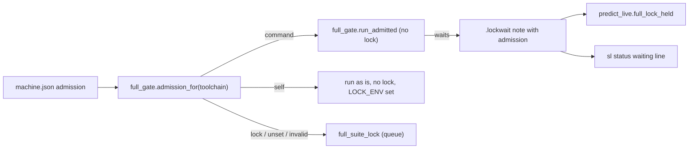
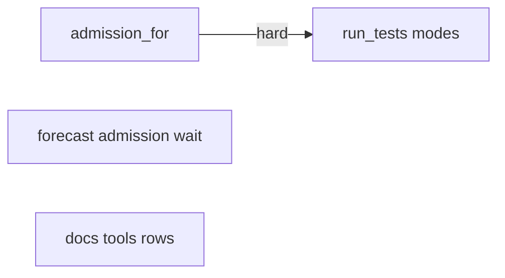

# Superlite: machine.json admission per toolchain (B154)

**Goal:** fix #659 (follow-up of #655): `~/.superlite/machine.json` `"admission"` says per toolchain how a local full run is admitted (through a gate command, by the machine itself, or under superlite's queued lock); run_tests names which applied, once; forecasts count a run waiting at an admission command; docs/tools.md names the shapes.
**Architecture:** `full_gate.admission_for` resolves the key for one toolchain into an `Admission` (mode, argv, note, warning); `run_tests.full_run_gate` acts on it (command: today's path; self: no lock, no wrap, `SUPERLITE_FULL_SUITE_LOCK` set for nested runs; lock: today's queued lock). `predict_live.full_lock_held` also counts a live `.lockwait` note with `"admission"` outside the run root. `sl status` already shows such notes (B153, `test_status_full_wait_655`); no change there.
**Tech stack:** Python 3.10+ stdlib, pytest (through `sl run_tests`); Markdown docs.
**Spec:** this file, section Design; issue #659.
**Detail:** tests
**Target-min:** 11
**Wave0:** none
**Coverage:** off
**Max chars:** 20000

Global constraints:
- Every Python code line keeps the file's trailing `# O(...)` complexity comment.
- Existing tests stay green. An existing test file changes only when the task Owns it. If another existing test turns red, report it in DONE_WITH_CONCERNS with the test id and the reason instead of editing it.
- Run `sl` as an executable (`<abs>/sl ...`). Verify with `<abs>/sl run_tests --fast <own test files> --task Tn --background`, then run the printed `wait:` line in the foreground and end the turn only after it reports. Never `run_tests --full`.
- Public repository: name no specific gate tool, host or project in code, tests or docs; write `<gate>` in docs and use a stub script named `gate` in tests.
- Never write the real `~/.superlite/machine.json`: tests write `Path(os.environ["SUPERLITE_HOME"]) / "machine.json"` (conftest points SUPERLITE_HOME at a temp folder per test) or pass `home=tmp_path`.
- No version edits. Never run `scripts/evals.sh`, `claude plugin eval` or `scripts/test_layers.py run`.

Ruling: bounded change to an existing flow (B153's admission), so no coverage pass; detail `tests` (because the parser is a small table of cases, the gate code exists).
Ruling: `"admission"` takes a list (1.5.164: every toolchain through that command) or an object keyed by toolchain name (`python`, `xcode`, the test-cmd.json language slug, `shell`: what `run_tests.lock_toolchain` returns) plus an optional `"default"`; each value is a non-empty list of strings (a command), `"self"` or `"lock"`. A toolchain with no entry and no `"default"` takes the lock. Only the entry a run uses is checked (because an unusable entry for another toolchain must not warn on every run; cost if wrong: a typo for a toolchain shows only when that toolchain runs).
Ruling: the one line names the mode and the entry; it is printed only when machine.json has an `"admission"` key, never in a nested run (one whose `SUPERLITE_FULL_SUITE_LOCK` names a live ancestor); with no key run_tests prints what 1.5.164 printed (because the issue keeps today's behaviour for the unset and list cases; cost if wrong: an unset machine shows no lock line).
Ruling: a `"self"` run exports `SUPERLITE_FULL_SUITE_LOCK=<pid>` to its test processes like a lock holder, so a nested run with a command entry is not admitted twice (because #659 measured the inner build inheriting the outer, small grant; cost if wrong: none for nested runs of the same toolchain, which also resolve to self).
Ruling: forecasts fold the admission waiter into the existing `full_lock` input (no new contention key), so predict.py, plan lint and the refit stay unchanged (cost if wrong: the forecast line cannot tell a lock holder from an admission waiter).
Ruling: a non-list, non-object value keeps 1.5.164's text only for a list that is empty or holds a non-string; any other value (a string, a number) warns `... must be a non-empty list of strings or an object keyed by toolchain ...`.
LAYERS: unit

## Design

### 1. Shapes (full_gate.py)
`admission_for(toolchain, home=None) -> Admission` reads `<home>/machine.json` (home: `history.home()`). Results, `where` = `machine.json "admission" for <tc>` when the toolchain's own key applied, `machine.json "admission" "default" for <tc>` when the default did:
- no file, unreadable, not an object, no key: `Admission(None, None, None, None)`.
- a list: as 1.5.164 (`admission_command`), note `full run through the admission command <basename> (machine.json "admission"); no full-suite lock`.
- an object, entry is a usable list: mode `command`, note `full run through the admission command <basename> (<where>); no full-suite lock`.
- `"self"`: note `full run admitted by the machine itself (<where>: "self"); no full-suite lock, no admission command`.
- `"lock"`: note `full run under the <tc> full-suite lock (<where>: "lock")`; no entry and no default: `full run under the <tc> full-suite lock (machine.json "admission" has no "<tc>" or "default" entry)`.
- unusable entry: mode `lock`, no note, warning `<where> must be a non-empty list of strings, "self" or "lock"; running under the full-suite lock`; a command not on PATH: `admission command <argv0> not found (<where>); running under the full-suite lock`.
`admission_command(home=None, toolchain="python")` stays as the list-form view: `(argv, None)` for mode command, `(None, warning)`, else `(None, None)`.

### 2. run_tests
`full_run_gate` prints the warning, then (not nested) the note, once per run, prefixed `run_tests: `; command and lock behave as in 1.5.164; self yields a plain Gate with `SUPERLITE_FULL_SUITE_LOCK` set in `os.environ` for the run and restored after.

### 3. Forecast
`predict_live.admission_waiting(root)`: a `test-summary*.lockwait` note holding a string `"admission"` and a live int `"pid"`, in a folder outside root: the run folders named by session bindings (`<home>/sessions/<id>` first line) and `<checkout>/.superlite` of root's checkouts. `full_lock_held` returns True for it too.

### 4. Docs
docs/tools.md run_tests row: the shapes, the three note lines, the fallback, and the warning that `"self"` is only right when the machine's gate really admits that toolchain's test command, including what it starts (simulators, UI test hosts). predict row: the admission waiter. Main's leftovers: backlog row (`sl backlog notes B`, `append_only`), commit_task, fleet and plan_tools rows (B146 lines).

## File structure

- `skills/subagent-driven-development/scripts/full_gate.py`, `tests/scripts/test_full_gate_655.py`, `tests/scripts/test_full_gate_659.py`: T1
- `skills/subagent-driven-development/scripts/run_tests.py`, `tests/scripts/test_run_tests_admission_659.py`: T2
- `skills/subagent-driven-development/scripts/predict_live.py`, `tests/scripts/test_predict_live_659.py`: T3
- `docs/tools.md`, `tests/scripts/test_docs_659_tools.py`: T4

## Task graph

```mermaid
%% schedule
gantt
  title Predicted schedule (mm:ss)
  dateFormat X
  axisFormat %M:%S
  section lane 1
  T1 admission_for :t1, 0, 202s
  T2 run_tests acts on the mode :t2, 202, 200s
  section lane 2
  T3 forecast counts admission waits :t3, 0, 193s
  section lane 3
  T4 docs tools rows :t4, 0, 185s
```

critical path: T1 → T2 (6.7 min) · peak width 3 · predicted build 6.7 min · predicted total ≈ 15.2 min (target ✗ 11.0)

## Package: admission

App type: library + CLI. Categories: protocol (stderr lines, JSON shapes), state (env restore, nested runs), file (machine.json). **Probe entry:** call=full_gate.admission_for

### T1 admission_for · Complexity 3 · Est. context 36k
**Owns:** skills/subagent-driven-development/scripts/full_gate.py, tests/scripts/test_full_gate_655.py, tests/scripts/test_full_gate_659.py
**Components:** 1
**LOC owned:** 170
**Tests:** fast
**Model:** sonnet
**Est. time:** 2.6 min (1 component, about 170 LOC, fast tests)
**Covers:** 1
**Produces:** full_gate.Admission(NamedTuple)
**Produces:** full_gate.admission_for(toolchain: str, home: Path | None = None) -> Admission
e.g. admission_for("xcode", H) with H/machine.json {"admission": {"xcode": "self", "default": ["sh", "-c", "exec \"$@\"", "gate"]}} -> Admission("self", None, 'full run admitted by the machine itself (machine.json "admission" for xcode: "self"); no full-suite lock, no admission command', None)
e.g. admission_for("python", H) with the same file -> Admission("command", ["sh", "-c", "exec \"$@\"", "gate"], 'full run through the admission command sh (machine.json "admission" "default" for python); no full-suite lock', None)
e.g. admission_for("shell", H) with {"admission": {"python": "lock"}} -> Admission("lock", None, 'full run under the shell full-suite lock (machine.json "admission" has no "shell" or "default" entry)', None)
e.g. admission_for("python", H) with {"admission": {"python": 7}} -> Admission("lock", None, None, 'machine.json "admission" for python must be a non-empty list of strings, "self" or "lock"; running under the full-suite lock')
**Review Focus:** `test_list_form_same_for_every_toolchain`: {"admission": ["sh"]} gives mode command, argv ["sh"] and the 1.5.164 note for python, xcode and shell; `test_bad_entry_of_other_toolchain_is_silent`: {"admission": {"xcode": 5, "default": "lock"}} for python -> mode lock, warning None; `test_default_entry_missing_command`: {"admission": {"default": ["/no/such/gate"]}} for xcode -> warning 'admission command /no/such/gate not found (machine.json "admission" "default" for xcode); running under the full-suite lock'; `test_string_value_warns`: {"admission": "self"} -> mode lock, warning 'machine.json "admission" must be a non-empty list of strings or an object keyed by toolchain; running under the full-suite lock'.
**Steps:** 1 failing tests, 2 run: FAIL, 3 implement, 4 run: PASS
**Notes:**
- `class Admission(NamedTuple)`: fields `mode: str | None` ("command", "self", "lock"; None: no key), `argv: list | None`, `note: str | None`, `warning: str | None`. Exact texts: Design 1.
- `admission_command(home=None, toolchain="python")` wraps `admission_for`; its existing tests in test_full_gate_655.py stay unchanged except `test_admission_not_a_list`, whose expected warning becomes the string-value text above (keep `WARN` for the empty list).
- A list entry is usable when it is a non-empty list of non-empty strings and `shutil.which(argv[0])` finds it. An empty string key or an empty object counts as an object with no entry.
- Docstring: name the object form and #659.
- Named tests (test_full_gate_659.py): the four e.g. lines, the Review Focus cases, `test_unset_is_none` (no file; `{}`; `{"floor": 10}` -> Admission(None, None, None, None)), `test_lock_entry` (`{"xcode": "lock"}` for xcode -> note 'full run under the xcode full-suite lock (machine.json "admission" for xcode: "lock")'), `test_self_from_default`, `test_admission_command_wrapper` (object form: python command -> (argv, None); self -> (None, None)).

### T2 run_tests acts on the mode · Complexity 4 · Est. context 46k
**Owns:** skills/subagent-driven-development/scripts/run_tests.py, tests/scripts/test_run_tests_admission_659.py
**Components:** 1
**LOC owned:** 160
**Tests:** fast
**Model:** sonnet
**Est. time:** 2.8 min (1 component, about 160 LOC, fast tests)
**Covers:** 2
**Consumes:** full_gate.admission_for(toolchain: str, home: Path | None = None) -> Admission (T1)
**Review Focus:** `test_self_restores_lock_env`: with LOCK_ENV unset before, inside a self gate `os.environ[run_tests.LOCK_ENV] == str(os.getpid())`, unset again after (also after an exception in the block); `test_self_skips_a_held_lock`: another process holds the xcode lock (`test_toolchain_lock_550.hold("xcode", 60)`), `{"xcode": "self"}` -> the gate yields at once with `lock_wait=1`, no gate args file; `test_note_printed_once`: a shell project `run_tests.main(["--full", "--lock-wait", "5"])` with `{"shell": "self"}` while `hold("shell", 60)` -> exit 0, stderr holds the self note exactly once and no `waiting for the shell full-suite lock`.
**Steps:** 1 failing tests, 2 run: FAIL, 3 implement, 4 run: PASS
**Notes:**
- `full_run_gate(a, label, toolchain="python", enabled=True)`: when `label == "full" and enabled`: `adm = full_gate.admission_for(toolchain)`; print `run_tests: {adm.warning}` when set; `nested = adm.mode is not None and outer.isdigit() and is_ancestor(int(outer))` (outer = `os.environ.get(LOCK_ENV, "")`); nested with mode command or self: yield `Gate(a, toolchain)` and return (as 1.5.164); not nested: print `run_tests: {adm.note}` when set. Then mode command: today's ExitStack branch with `adm.argv` (its old print is the note now); mode self: set `os.environ[LOCK_ENV] = str(os.getpid())`, yield `Gate(a, toolchain)`, restore the earlier value (pop when unset) in a finally; otherwise today's `full_suite_lock` branch.
- Module docstring line 61: replace the admission sentences with the shapes, the note lines and the self rule (#659), keeping the 1.5.164 sentences true.
- Reuse the helpers of tests/scripts/test_run_tests_admission_655.py (`gate` stub fixture text, `args`) and `test_toolchain_lock_550.hold/stop/shell_project`; write machine.json into `os.environ["SUPERLITE_HOME"]`.
- Named tests: the Review Focus cases, `test_dict_command_for_python` (`{"python": [gate, "run", "--"]}` -> gate args written, note names `for python`), `test_dict_lock_entry_waits` (`{"python": "lock"}` with `hold("python", 30)` -> `LockBusy` at lock_wait 1, note printed once), `test_missing_entry_takes_lock` (`{"xcode": "self"}` for python with the python lock held -> LockBusy, note 'has no "python" or "default" entry'), `test_invalid_entry_warns_once_and_locks`, `test_list_form_unchanged` (list form for xcode: through the gate, stderr holds the exact 1.5.164 note), `test_unset_prints_no_note` (no machine.json: no `machine.json "admission"` in stderr), `test_nested_self_prints_nothing` (LOCK_ENV = `os.getppid()`, `{"python": "self"}` -> no note).

## Package: forecast

App type: library. Categories: state (live and dead pids, own run), file (notes). **Probe entry:** none (needs session bindings and note files; cases are named tests).

### T3 forecast counts admission waits · Complexity 3 · Est. context 34k
**Owns:** skills/subagent-driven-development/scripts/predict_live.py, tests/scripts/test_predict_live_659.py
**Components:** 1
**LOC owned:** 110
**Tests:** fast
**Model:** sonnet
**Est. time:** 2.0 min (1 component, about 110 LOC, fast tests)
**Covers:** 3
**Produces:** predict_live.admission_waiting(root: Path) -> bool
e.g. admission_waiting(tmp/"proj") with a session binding to tmp/"other"/.superlite holding test-summary-r1.lockwait {"admission": "gate", "pid": os.getpid(), "since": 1.0} -> True
e.g. the same with "pid": 99999999 -> False
**Review Focus:** `test_own_note_does_not_count`: the note sits in root/.superlite -> False; `test_lock_note_is_not_an_admission_wait`: a note with "lock" and no "admission" -> False; `test_contention_counts_admission_wait`: `contention(root, CFG)` -> full_lock True, full_factor 1.5; `test_broken_note_is_skipped`: a note of invalid JSON next to a valid one still counts the valid one.
**Steps:** 1 failing tests, 2 run: FAIL, 3 implement, 4 run: PASS
**Notes:**
- Folders: every `<state.home()>/sessions/*` file's first line (absolute existing dir), plus `c / ".superlite"` for `c in checkouts(root)`; dedupe by resolved path; skip folders inside root (`_inside`). A note counts when it parses to a dict with a str `"admission"` and an int (not bool) `"pid"` that `is_alive`. Any OSError or ValueError skips that file or folder; never raises.
- `full_lock_held(root)` returns True when a lock holder counts (unchanged) or `admission_waiting(root)`.
- Module docstring: one sentence for the admission waiter (#659).
- Reuse `bind` and `project` from tests/scripts/test_predict_live_605.py; `CFG = {"slots": 2, "active_window_min": 120, "full_wait_share": 0.5}`.

## Package: docs

App type: docs. Categories: protocol (named lines). **Probe entry:** none (docs).

### T4 docs tools rows · Complexity 2 · Est. context 40k
**Owns:** docs/tools.md, tests/scripts/test_docs_659_tools.py
**Components:** 1
**LOC owned:** 60
**Tests:** fast
**Model:** sonnet
**Est. time:** 2.0 min (1 component, about 60 LOC, fast tests)
**Covers:** 4
**Review Focus:** `test_run_tests_row_names_shapes`: the run_tests row holds `"self"`, `"lock"`, `"default"`, `full run admitted by the machine itself`, `full run under the <toolchain> full-suite lock`, `simulators, UI test hosts` and every string `tests/scripts/test_docs_655_full_run_queue.py` asserts.
**Steps:** 1 failing tests, 2 run: FAIL, 3 implement, 4 run: PASS
**Notes:**
- run_tests row: after the 1.5.164 admission text, add the object form (`{"admission": {"xcode": "self", "default": ["<gate>", "run", "--"]}}`), the toolchain keys, the three note lines with `<name>`, `<where>` and `<toolchain>` placeholders (Design 1), the fallback (an unusable entry: one warning, the lock), and: `"self"` is only right when the machine's gate really admits that toolchain's test command, including what it starts (simulators, UI test hosts); superlite then shows no wait line, writes no `.lockwait` note and forecasts see no queue.
- predict row: after `(and the full-suite lock`, name that a run waiting at the admission command (a live `.lockwait` note with "admission" outside the run) counts like a held lock.
- backlog row: `sl backlog notes B` (same as `ship B notes`) and the triage proposal's `append_only` field (a file both batches list there does not serialise them; plan prints `append-only in both, no hold; conflicts resolve at the ship rebase`).
- commit_task row: `Tn: no red run (<why>); its review must prove each new test can fail` on stderr. fleet row (`spawn --for-review`): the `Red runs (task reports):` and `Plan contract outside Tn's Produces` brief sections and the `no red run` review hint. plan_tools row: lint warns `REACH:` (a Running-app check with no way in), `OWNS:` (a symlinked Owns entry) and `ALSO-TOUCHES:` (an Also-touches entry the task owns, no task owns, or whose owner does not depend on it).
- Named tests: the Review Focus case, `test_predict_row_names_admission_wait`, `test_backlog_row_names_notes_and_append_only`, `test_b146_rows` (each quoted string above in its row).

## Review Focus

- admission (library + CLI): protocol, state, file. Risks: the list form changing; LOCK_ENV leaking after a self run; a nested run admitted twice; a note printed twice.
- forecast: state, file. Risks: own run counted; dead pid counted.
