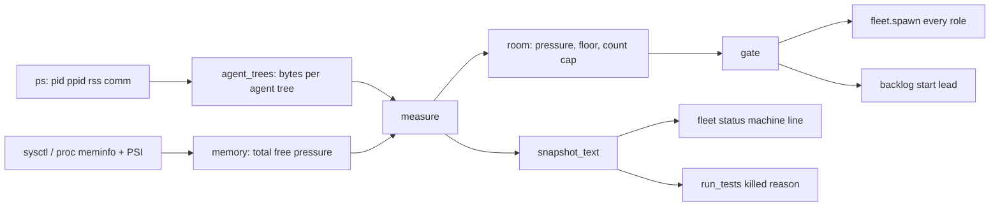
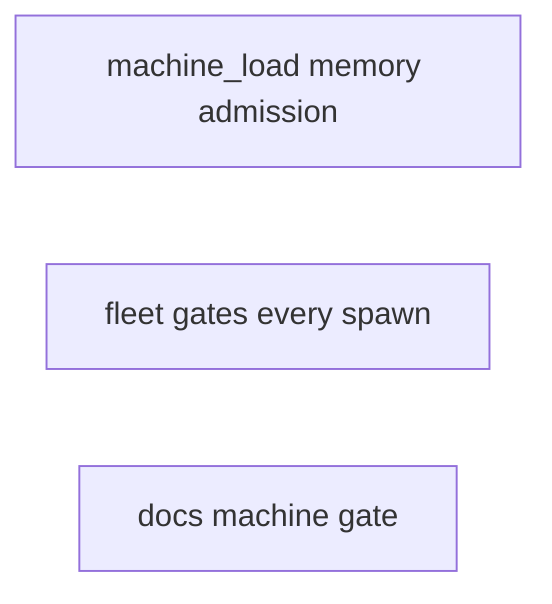

# Superlite: machine gate admits agents by measured memory (B152)

**Goal:** fix #643: a new lead or fleet worker starts while the machine's measured memory leaves room for one more agent above a floor, not while a count of leads, fixers and `xcodebuild` processes stays under a fixed limit. The count cap becomes optional; every agent spawn the fleet makes passes the gate; the busy line and `sl fleet status` name the measurement.
**Architecture:** `machine_load` measures with one `ps` call (agent CLI process trees, their mean resident size) and one OS memory read (macOS `sysctl`, Linux `/proc`), and decides with `room`; `gate` keeps its signature. `fleet.spawn` gates every role on its first attempt; `for_dispatch` shares one wait budget; `fleet status` prints `snapshot_text`. `backlog_run` keeps its gate call and drops the registry write.
**Tech stack:** Python 3.10+ stdlib, pytest (through `sl run_tests`); Markdown docs.
**Spec:** this file, section Design; issue #643 and main's message (sl backlog tell).
**Detail:** tests
**Target-min:** 11
**Wave0:** none
**Coverage:** off

Global constraints:
- Every Python code line keeps the file's trailing `# O(...)` complexity comment.
- Existing tests stay green. An existing test file changes only when the task Owns it. If another existing test turns red, report it in DONE_WITH_CONCERNS with the test id and the reason instead of editing it.
- Run `sl` as an executable (`<abs>/sl ...`). Verify with `<abs>/sl run_tests --fast <own test files> --task Tn --background`, then run the printed `wait:` line in the foreground and end the turn only after it reports.
- No version edits. Never run `scripts/evals.sh`, `claude plugin eval`, `scripts/test_layers.py run` or `run_tests --full`. No test calls the real `ps`, `sysctl` or Herdr.
- No CPU or load-average check anywhere (main's ruling: builds are admitted outside superlite). Never edit `backlog.py`, `fleet_lead.py`, `run_tests.py` or `predict_live.py`.

Ruling: agents are the agent CLI process trees `ps -axo pid=,ppid=,rss=,comm=` shows on the whole machine (Max's own sessions too), one tree per agent process with no agent ancestor; a nested agent belongs to the outer tree (because the issue measures the process tree and the machine's memory is shared; cost if wrong: a non-superlite agent raises the estimate, which only makes the gate stricter).
Ruling: the registry `~/.superlite/load/` and the Herdr crossing are removed; the optional count cap counts the measured agent trees (because the gate now covers every spawn and a `ps` call is cheaper than a Herdr round trip; cost if wrong: Max's `{"limit": 16}` stopgap now counts every agent, so main removes that file after the ship).
Ruling: memory the OS does not report (other OS, failed read) never blocks: the memory check is skipped and the line says `memory unknown` (because a measurement failure must not stop a run; cost if wrong: no memory protection on such a host).
Ruling: Linux pressure is `warn` at PSI `some avg10 >= 10`, `critical` at `full avg10 >= 10`, else `normal`; macOS maps `kern.memorystatus_vm_pressure_level` 1/2/4 to normal/warn/critical, another value is normal.
Ruling: the floor is `SUPERLITE_MACHINE_FLOOR` (percent, 0 to 100), else `machine.json` `{"floor": P}`, else 15; 0 turns the memory check off; `tests/scripts/conftest.py` (no open batch lists it) sets it to 0 next to `SUPERLITE_MACHINE_LIMIT=0`.
Ruling: `fleet.spawn` gates on its first attempt only (a slow-start retry replaces a worker, adds none); a busy gate prints the BLOCKED line and raises `SystemExit(3)` like a missing prime; `--for-dispatch` gives all its fresh workers one `--machine-wait` budget, as `backlog start` does.
LAYERS: unit



## Design

### 1. Measurement (#643 items 1, 2)
`agent_trees` builds the process tree from one `ps` call; agent names: claude, codex, gemini, opencode, droid, cursor-agent, qwen, kimi, copilot, pi (basename of `comm`). Each tree's bytes are the sum of its processes' resident sizes, children (shells, builds, test runs) included. `xcodebuild` is never counted on its own. The estimate is the mean tree size, 1 GB with no agent.

### 2. Admission (#643 items 1, 3)
`room`: count cap set and agents >= cap -> no; floor 0 or memory unknown -> yes; pressure not normal -> no; `free - each >= total * floor / 100` -> yes. `--over-limit` skips both checks.

### 3. Every spawn (#643 item 4)
`fleet.spawn` (implementers, reviewers, fixers, research, checker, final reviewer) gates before it opens a pane; `backlog start` keeps its gate.

### 4. Lines (#643 item 5)
Waiting: `machine busy: memory 10% free, floor 15% (23 agents, about 0.7 GB each); waiting up to 100 s for fleet spawn (fixer)`. Refused: `machine busy after 100 s: ...`. A set cap appends `; 16 agents of limit 16 from <source>`. `fleet status` ends with `machine: <same>; no count cap` while either check is on. `predict_live.py` is not touched (#643 item 6).

## File structure
- `skills/subagent-driven-development/scripts/machine_load.py`, `tests/scripts/test_machine_load_560.py`, `tests/scripts/conftest.py`, `skills/subagent-driven-development/scripts/backlog_run.py`, `tests/scripts/test_backlog_machine_560.py`: T1
- `skills/subagent-driven-development/scripts/fleet.py`, `tests/scripts/test_fleet_machine_gate_560.py`: T2
- `docs/tools.md`, `docs/fleet.md`, `tests/scripts/test_docs_machine_memory_643.py`: T3

## Task graph

```mermaid
%% schedule
gantt
  title Predicted schedule (mm:ss)
  dateFormat X
  axisFormat %M:%S
  section lane 1
  T1 machine_load memory admission :t1, 0, 707s
  section lane 2
  T2 fleet gates every spawn :t2, 0, 651s
  section lane 3
  T3 docs machine gate :t3, 0, 632s
```





critical path: T1 (11.8 min) · peak width 3 · predicted build 11.8 min · predicted total ≈ 30.3 min (target ✗ 11.0)

## Package: machine_load

App type: library (measurement and decision). Categories: numeric (percent, rounding, floor edge), encoding (ps lines with spaces, garbage sysctl), state (wait loop). **Probe entry:** none (inputs are process tables and OS text; cases are named tests).

### T1 machine_load memory admission · Complexity 5 · Est. context 46k
**Owns:** skills/subagent-driven-development/scripts/machine_load.py, tests/scripts/test_machine_load_560.py, tests/scripts/conftest.py, skills/subagent-driven-development/scripts/backlog_run.py, tests/scripts/test_backlog_machine_560.py
**Components:** 2
**LOC owned:** 230
**Tests:** fast
**Model:** sonnet
**Est. time:** 3.5 min (2 components, about 230 LOC, fast tests)
**Covers:** 1, 2, 4
**Produces:** machine_load.gate(what: str, wait_s: float, over: bool = False, poll_s: float = 10.0) -> str | None
e.g. gate("fleet spawn (fixer)", 0) with 7 GB of 64 GB free, 23 agents of 750 MB -> "machine busy after 0 s: memory 10% free, floor 15% (23 agents, about 0.7 GB each)"
e.g. gate("x", 0) with SUPERLITE_MACHINE_FLOOR=0 and SUPERLITE_MACHINE_LIMIT=0 -> None, nothing measured
**Produces:** machine_load.enabled() -> bool
e.g. enabled() with no env and no machine.json -> True (floor 15)
e.g. enabled() with SUPERLITE_MACHINE_FLOOR=0 and SUPERLITE_MACHINE_LIMIT=0 -> False
**Produces:** machine_load.snapshot_text() -> str
e.g. snapshot_text() with 52 of 64 GB free, 15 agents of 600 MB, no cap -> "machine: memory 81% free, floor 15% (15 agents, about 0.6 GB each); no count cap"
e.g. snapshot_text() with SUPERLITE_MACHINE_LIMIT=16 -> "machine: memory 81% free, floor 15% (15 agents, about 0.6 GB each); 15 agents of limit 16 from SUPERLITE_MACHINE_LIMIT"
**Produces:** machine_load.agent_trees(procs: list) -> list[int]
**Produces:** machine_load.measure(procs: list | None = None, mem: dict | None = None) -> dict
**Produces:** machine_load.room(m: dict, floor_pct: float, lim: int) -> bool
**Produces:** machine_load.describe(m: dict, floor_pct: float) -> str
**Review Focus:** `test_agent_trees_sum_process_trees`, `test_agent_trees_survive_cycles_and_unknown_parents`, `test_room` (floor edge), `test_darwin_memory_parse` (garbage -> None), `test_xcodebuild_not_counted`, `test_gate_off_measures_nothing`; all in the test code below.
**Test code (verbatim):** rewrite tests/scripts/test_machine_load_560.py as:
```python
"""machine_load (#560, #643): agents admitted by measured memory; an optional count cap."""
import json
import sys
from pathlib import Path

import pytest

SCRIPTS = Path(__file__).resolve().parents[2] / "skills" / "subagent-driven-development" / "scripts"
sys.path.insert(0, str(SCRIPTS))
import machine_load as ml  # noqa: E402

G, M = 1 << 30, 1 << 20


@pytest.fixture(autouse=True)
def _env(monkeypatch):
    monkeypatch.delenv("SUPERLITE_MACHINE_LIMIT", raising=False)
    monkeypatch.delenv("SUPERLITE_MACHINE_FLOOR", raising=False)


def test_agent_trees_sum_process_trees():
    procs = [(10, 1, 1000, "/usr/local/bin/claude"), (11, 10, 500, "/bin/zsh"), (12, 11, 2000, "xcodebuild"),
             (20, 1, 300, "claude"), (21, 20, 100, "claude"), (30, 1, 999, "zsh")]
    assert ml.agent_trees(procs) == [3500, 400]


def test_agent_trees_survive_cycles_and_unknown_parents():
    assert sorted(ml.agent_trees([(5, 6, 10, "claude"), (6, 5, 20, "zsh"), (7, 99, 30, "codex"), (0, 0, 5, "kernel_task")])) == [30, 30]


def test_darwin_memory_parse():
    assert ml._darwin(f"{64 * G}\n81\n1\n") == {"total": 64 * G, "free": 64 * G * 81 // 100, "pressure": "normal"}
    assert ml._darwin(f"{64 * G}\n9\n2\n")["pressure"] == "warn"
    assert ml._darwin(f"{64 * G}\n9\n4\n")["pressure"] == "critical"
    assert ml._darwin("garbage") is None


def test_linux_memory_parse():
    meminfo = "MemTotal:       16384000 kB\nMemFree:  100 kB\nMemAvailable:    8192000 kB\n"
    psi = "some avg10=0.50 avg60=0.10 avg300=0.00 total=1\nfull avg10=0.00 avg60=0.00 avg300=0.00 total=0\n"
    assert ml._linux(meminfo, psi) == {"total": 16384000 * 1024, "free": 8192000 * 1024, "pressure": "normal"}
    assert ml._linux(meminfo, psi.replace("some avg10=0.50", "some avg10=12.00"))["pressure"] == "warn"
    assert ml._linux(meminfo, psi.replace("full avg10=0.00", "full avg10=10.00"))["pressure"] == "critical"
    assert ml._linux(meminfo, "")["pressure"] == "normal"
    assert ml._linux("MemTotal: 1 kB\n", "") is None


def test_floor_and_limit_sources(monkeypatch):
    assert ml.floor() == (15.0, "default") and ml.limit() == (0, "default")
    f = ml.home() / "machine.json"
    f.parent.mkdir(parents=True, exist_ok=True)
    f.write_text(json.dumps({"limit": 16, "floor": 20}))
    assert ml.limit() == (16, str(f)) and ml.floor() == (20.0, str(f))
    monkeypatch.setenv("SUPERLITE_MACHINE_LIMIT", "4")
    monkeypatch.setenv("SUPERLITE_MACHINE_FLOOR", "10")
    assert ml.limit() == (4, "SUPERLITE_MACHINE_LIMIT") and ml.floor() == (10.0, "SUPERLITE_MACHINE_FLOOR")


def test_measure_mean_and_default():
    mem = {"total": 64 * G, "free": 52 * G, "pressure": "normal"}
    m = ml.measure(procs=[(10, 1, 600 * M, "claude"), (20, 1, 800 * M, "claude")], mem=mem)
    assert m == {"agents": 2, "each": 700 * M, "total": 64 * G, "free": 52 * G, "pressure": "normal"}
    m0 = ml.measure(procs=[], mem=mem)
    assert m0["agents"] == 0 and m0["each"] == G


def test_xcodebuild_not_counted():
    procs = [(10, 1, 600 * M, "claude")] + [(100 + i, 1, 2 * G, "/usr/bin/xcodebuild") for i in range(5)]
    m = ml.measure(procs=procs, mem={"total": 64 * G, "free": 40 * G, "pressure": "normal"})
    assert m["agents"] == 1 and m["each"] == 600 * M


def test_describe():
    m = {"agents": 23, "each": 750 * M, "total": 64 * G, "free": 7 * G, "pressure": "normal"}
    assert ml.describe(m, 15) == "memory 10% free, floor 15% (23 agents, about 0.7 GB each)"
    assert ml.describe({**m, "pressure": "warn"}, 15) == "memory pressure warn, 10% free, floor 15% (23 agents, about 0.7 GB each)"
    assert ml.describe({**m, "agents": 1}, 15) == "memory 10% free, floor 15% (1 agent, about 0.7 GB each)"
    assert ml.describe({**m, "agents": 0, "each": G}, 15) == "memory 10% free, floor 15% (no agents, 1.0 GB assumed)"
    assert ml.describe({**m, "total": None, "free": None, "pressure": None}, 15) == "memory unknown (23 agents, about 0.7 GB each)"


def test_room():
    m = {"agents": 15, "each": 600 * M, "total": 64 * G, "free": 52 * G, "pressure": "normal"}
    assert ml.room(m, 15, 0) is True
    assert ml.room({**m, "free": 10 * G}, 15, 0) is False
    assert ml.room({**m, "free": 11 * G}, 15, 0) is True
    assert ml.room({**m, "pressure": "warn"}, 15, 0) is False
    assert ml.room(m, 15, 16) is True
    assert ml.room({**m, "agents": 16}, 15, 16) is False
    assert ml.room({**m, "free": 1 * G, "pressure": "critical"}, 0, 0) is True
    assert ml.room({**m, "total": None, "free": None, "pressure": None}, 15, 0) is True


def _measures(monkeypatch, frees):
    it = iter(frees)
    monkeypatch.setattr(ml, "measure", lambda *a, **k: {"agents": 23, "each": 750 * M, "total": 64 * G, "free": next(it), "pressure": "normal"})


def test_gate_busy_line(monkeypatch):
    _measures(monkeypatch, [7 * G])
    assert ml.gate("backlog start B7", 0) == "machine busy after 0 s: memory 10% free, floor 15% (23 agents, about 0.7 GB each)"


def test_gate_waits_then_starts(monkeypatch, capsys):
    _measures(monkeypatch, [7 * G, 7 * G, 40 * G])
    assert ml.gate("fleet spawn (fixer)", 30, poll_s=0) is None
    err = capsys.readouterr().err
    assert [x for x in err.splitlines() if x.startswith("machine busy:")] == [
        "machine busy: memory 10% free, floor 15% (23 agents, about 0.7 GB each); waiting up to 30 s for fleet spawn (fixer)"]
    assert err.count("machine has room after") == 1 and "starting fleet spawn (fixer)" in err


def test_gate_count_cap_names_source(monkeypatch):
    monkeypatch.setenv("SUPERLITE_MACHINE_LIMIT", "16")
    monkeypatch.setattr(ml, "measure", lambda *a, **k: {"agents": 16, "each": 600 * M, "total": 64 * G, "free": 52 * G, "pressure": "normal"})
    assert ml.gate("x", 0) == "machine busy after 0 s: memory 81% free, floor 15% (16 agents, about 0.6 GB each); 16 agents of limit 16 from SUPERLITE_MACHINE_LIMIT"


def test_gate_over_limit(monkeypatch, capsys):
    _measures(monkeypatch, [1 * G])
    assert ml.gate("x", 0, over=True) is None
    assert "machine limit overridden (--over-limit): memory 1% free" in capsys.readouterr().err


def test_gate_off_measures_nothing(monkeypatch):
    monkeypatch.setenv("SUPERLITE_MACHINE_FLOOR", "0")
    monkeypatch.setenv("SUPERLITE_MACHINE_LIMIT", "0")
    monkeypatch.setattr(ml, "measure", lambda *a, **k: pytest.fail("no measurement when both checks are off"))
    assert ml.gate("x", 0) is None and ml.enabled() is False


def test_snapshot_text(monkeypatch):
    monkeypatch.setattr(ml, "measure", lambda *a, **k: {"agents": 15, "each": 600 * M, "total": 64 * G, "free": 52 * G, "pressure": "normal"})
    assert ml.snapshot_text() == "machine: memory 81% free, floor 15% (15 agents, about 0.6 GB each); no count cap"
    monkeypatch.setenv("SUPERLITE_MACHINE_LIMIT", "16")
    assert ml.snapshot_text() == "machine: memory 81% free, floor 15% (15 agents, about 0.6 GB each); 15 agents of limit 16 from SUPERLITE_MACHINE_LIMIT"
```
**Steps:** 1 failing tests, 2 run: FAIL, 3 implement, 4 run: PASS
**Notes:**
- Process tuples are `(pid, ppid, rss_bytes, comm)`; `_ps()` runs `ps -axo pid=,ppid=,rss=,comm=` (timeout 10 s), splits each line with `split(None, 3)` (a `comm` may hold spaces), rss KiB x 1024, skips bad lines, returns [] on any failure. `agent_trees` returns tree sizes ordered by root pid; an ancestor walk stops at a pid seen before, at `pid == ppid` or at an unknown pid.
- `memory()`: `sys.platform == "darwin"` -> `_darwin(stdout of sysctl -n hw.memsize kern.memorystatus_level kern.memorystatus_vm_pressure_level)`; Linux -> `_linux(/proc/meminfo text, /proc/pressure/memory text or "")`; else or on any error None. `measure` with `mem=None` calls `memory()` and fills total, free, pressure with None when it is None; with `procs=None` it calls `_ps()`.
- `describe`: free percent is `free * 100 // total`; floor printed with `:g`; GB with one decimal of `each / 2**30`. `_line(m, flo, lim, src)` = describe + `; N agents of limit L from SRC` when lim; `gate`, its stderr lines (`machine busy: ...; waiting up to N s for WHAT`, `machine has room after N s: ...; starting WHAT`, `machine limit overridden (--over-limit): ...`) and `snapshot_text` (`machine: ` + `_line`, or + `; no count cap`) share it. `gate` keeps its loop shape: room -> None; over -> None; time up -> `machine busy after N s: ...`; first wait prints; sleep poll_s. `enabled()` is `floor > 0 or limit > 0`; `gate` returns None at once when not enabled.
- `limit()`: env digits, else `machine.json` `limit` (int), else `(0, "default")`. `floor()`: env float in 0..100, else `machine.json` `floor`, else `(15.0, "default")`; bad values fall through.
- Remove `register`, `count`, `_live_names`, `_dir`, `STALE_S`, `COUNTED`, `_parts`, `_cores`, `_mem_gb`; rewrite the module docstring (#560, #643, no CPU check).
- `backlog_run.cmd_start`: delete the `machine_load.register(...)` block (with its `contextlib.suppress`); the gate call stays. tests/scripts/test_backlog_machine_560.py: the fake module gets no `register`; its busy text becomes `machine busy after 0 s: memory 10% free, floor 15% (23 agents, about 0.7 GB each)` in the fake and the asserted BLOCKED line; drop the `ml.regs` assert and `test_unwritable_registry_does_not_fail_started_lead`.
- tests/scripts/conftest.py: add `monkeypatch.setenv("SUPERLITE_MACHINE_FLOOR", "0")` beside the LIMIT line; both comments say no test reaches the real `ps` or `sysctl` (#560, #643).

## Package: fleet

App type: CLI. Categories: protocol (flags reach the gate), state (retry not gated twice, one budget per dispatch). **Probe entry:** none (fake Herdr; cases are named tests).

### T2 fleet gates every spawn · Complexity 4 · Est. context 44k
**Owns:** skills/subagent-driven-development/scripts/fleet.py, tests/scripts/test_fleet_machine_gate_560.py
**Components:** 1
**LOC owned:** 150
**Tests:** fast
**Model:** sonnet
**Est. time:** 2.7 min (1 component, about 150 LOC, fast tests)
**Covers:** 3, 4
**Consumes:** machine_load.gate(what: str, wait_s: float, over: bool = False, poll_s: float = 10.0) -> str | None (T1) · machine_load.enabled() -> bool (T1) · machine_load.snapshot_text() -> str (T1)
**Produces:** fleet.spawn(sd, plan, tier, project, cfg=None, env=None, role: str = "implementer", over: bool = False, machine_wait: float = 100.0) -> dict
**Review Focus:** `test_retry_is_not_gated_again`, `test_spawn_quiet_reports_machine_busy`, `test_status_without_checks_has_no_machine_line`; all in the test code below.
**Test code (verbatim):** rewrite tests/scripts/test_fleet_machine_gate_560.py as:
```python
"""#560, #643: every fleet spawn passes the machine gate; fleet status shows the machine line."""
import pytest
from test_fleet import fleet, world  # noqa: F401,E402

import machine_load as ml  # noqa: E402

BUSY = "machine busy after 0 s: memory 10% free, floor 15% (23 agents, about 0.7 GB each)"
LINE = "machine: memory 81% free, floor 15% (15 agents, about 0.6 GB each); no count cap"


def _gate(monkeypatch, ret):
    calls = []
    monkeypatch.setattr(ml, "gate", lambda *a, **k: calls.append((a, k)) or ret)
    return calls


def test_fixer_spawn_blocked_when_busy(world, monkeypatch, capsys):
    fleet.main(["on", "--accounts", "claude1,claude3"])
    _gate(monkeypatch, BUSY)
    capsys.readouterr()
    world.fh.calls.clear()
    with pytest.raises(SystemExit) as e:
        fleet.main(["spawn", "--role", "fixer", "--tier", "1"])
    assert e.value.code == 3
    assert capsys.readouterr().out.strip() == f"BLOCKED: fleet spawn: {BUSY}; rerun later, or pass --over-limit"
    assert world.fh.calls == []


def test_implementer_spawn_is_gated(world, monkeypatch):
    fleet.main(["on", "--accounts", "claude1,claude3"])
    calls = _gate(monkeypatch, BUSY)
    with pytest.raises(SystemExit):
        fleet.main(["spawn", "--tier", "sonnet"])
    assert len(calls) == 1 and calls[0][0][0] == "fleet spawn (implementer)"


def test_over_limit_and_wait_reach_the_gate(world, monkeypatch):
    fleet.main(["on", "--accounts", "claude1,claude3"])
    calls = _gate(monkeypatch, None)
    monkeypatch.setattr(fleet, "_spawn", lambda *a, **k: {"id": "W1"})
    assert fleet.main(["spawn", "--role", "fixer", "--tier", "1", "--over-limit", "--machine-wait", "5"]) == 0
    (args, _), = calls
    assert args[1] == 5.0 and args[2] is True


def test_default_wait_is_100(world, monkeypatch):
    fleet.main(["on", "--accounts", "claude1,claude3"])
    calls = _gate(monkeypatch, None)
    monkeypatch.setattr(fleet, "_spawn", lambda *a, **k: {"id": "W1"})
    fleet.main(["spawn", "--role", "fixer", "--tier", "1"])
    assert calls[0][0][1] == 100.0 and calls[0][0][2] is False


def test_retry_is_not_gated_again(world, monkeypatch):
    calls = _gate(monkeypatch, None)
    seen = []

    def fake(sd, plan, tier, project, cfg, env, role, after):
        seen.append(after)
        if after is None:
            raise fleet._Slow("W1", "claude1", "slow")
        return {"id": "W2"}
    monkeypatch.setattr(fleet, "_spawn", fake)
    assert fleet.spawn(world.sd, world.plan, "sonnet", world.proj)["id"] == "W2"
    assert len(calls) == 1 and len(seen) == 2


def test_spawn_quiet_reports_machine_busy(world, monkeypatch):
    _gate(monkeypatch, BUSY)
    w, why = fleet._spawn_quiet(world.sd, world.plan, "sonnet", world.proj, False, 0.0)
    assert w is None and why == f"fleet spawn: {BUSY}; rerun later, or pass --over-limit"


def test_spawn_writes_no_registry(world, monkeypatch):
    fleet.main(["on", "--accounts", "claude1,claude3"])
    _gate(monkeypatch, None)
    fleet.spawn(world.sd, world.plan, "sonnet", world.proj)
    assert not (ml.home() / "load").exists()


def test_status_prints_machine_line(world, monkeypatch, capsys):
    fleet.main(["on", "--accounts", "claude1,claude3"])
    monkeypatch.setattr(ml, "enabled", lambda: True, raising=False)
    monkeypatch.setattr(ml, "snapshot_text", lambda: LINE)
    capsys.readouterr()
    fleet.main(["status"])
    assert LINE in capsys.readouterr().out.splitlines()


def test_status_without_checks_has_no_machine_line(world, monkeypatch, capsys):
    fleet.main(["on", "--accounts", "claude1,claude3"])
    monkeypatch.setattr(ml, "enabled", lambda: False, raising=False)
    monkeypatch.setattr(ml, "snapshot_text", lambda: pytest.fail("no measurement when both checks are off"))
    capsys.readouterr()
    fleet.main(["status"])
    assert not any(x.startswith("machine:") for x in capsys.readouterr().out.splitlines())
```
**Steps:** 1 failing tests, 2 run: FAIL, 3 implement, 4 run: PASS
**Notes:**
- `spawn(...)`: before the first `_spawn` call, `busy = ml.gate(f"fleet spawn ({role})", machine_wait, over)`; busy -> `print(f"BLOCKED: fleet spawn: {busy}; rerun later, or pass --over-limit")` and `raise SystemExit(3)`. The retry call (`after` set) is not gated. Delete the `ml.register(...)` block in `_spawn`.
- `_spawn_quiet(sd, plan, tier, project, over=False, machine_wait=100.0)` passes both to `spawn`. `for_dispatch(sd, plan, project, over=False, machine_wait=100.0)`: one `deadline = time.monotonic() + machine_wait` before the dispatch lines; each `_spawn_quiet` gets `max(0.0, deadline - time.monotonic())`. `for_review(..., package=None, over=False, machine_wait=100.0)` passes both to its `spawn`.
- `main`: delete the `if a.role == "fixer" and ...: ml.gate(...)` block; pass `a.over_limit, a.machine_wait` to `for_dispatch`, `for_review` and the plain `spawn`. Help texts: `--over-limit` skips the machine gate (memory floor and count cap) for every spawn; `--machine-wait` seconds a spawn waits for room.
- `status`: while `ml.enabled()`, print `ml.snapshot_text()` as the last line before the backlog hint, in the on and the off branch; any exception from either call prints nothing.
- Keep tests/scripts/test_fleet.py and the other fleet tests green (conftest sets both checks to 0).

## Package: docs

App type: docs. **Probe entry:** none (prose).

### T3 docs machine gate · Complexity 2 · Est. context 26k
**Owns:** docs/tools.md, docs/fleet.md, tests/scripts/test_docs_machine_memory_643.py
**Components:** 1
**LOC owned:** 50
**Tests:** fast
**Model:** sonnet
**Est. time:** 1.6 min (1 component, about 50 LOC, fast tests)
**Covers:** 1, 2, 3, 4
**Review Focus:** `test_fleet_row_names_memory_gate`: the `| \`fleet\` |` row of docs/tools.md contains `SUPERLITE_MACHINE_FLOOR`, `default 15`, `1 GB`, `SUPERLITE_MACHINE_LIMIT`, `unset or 0 = no cap`, `xcodebuild` processes are not counted, `--over-limit` skips both checks, `--machine-wait S`, `machine busy after N s: memory`, and not `leads, fixers and xcodebuild`; `test_backlog_run_row_names_same_gate`: the `| \`backlog_run\` |` row contains `same machine gate as \`fleet spawn\`` and still `machine busy` and `machine: ... parks`; `test_fleet_md_capacity_bullet`: docs/fleet.md's `## Capacity` section has a bullet starting `- Machine gate (#560, #643):` that contains `kern.memorystatus_vm_pressure_level`, `MemAvailable`, `/proc/pressure/memory`, `15%`, `{"floor": P}`, `{"limit": N}`, `sl fleet status`.
**Steps:** 1 failing tests, 2 run: FAIL, 3 implement, 4 run: PASS
**Notes:**
- docs/tools.md `fleet` row: replace the sentence that starts `A fixer \`spawn\` counts the machine's leads` and ends `skips the cap (#560).` with: ``Every agent `spawn` (plain, each fresh worker of `--for-dispatch` with one `--machine-wait` budget for the call, `--for-review`, research) passes the machine gate (#560, #643): it starts while the OS memory pressure is normal and free memory minus one agent's estimate (the mean resident size of the live agent CLI process trees, 1 GB when none runs) stays at or above the floor (`SUPERLITE_MACHINE_FLOOR` or `~/.superlite/machine.json` `{"floor": P}`, percent of physical memory, default 15; 0 = no memory check) and the agent count stays under the optional cap (`SUPERLITE_MACHINE_LIMIT` or `machine.json` `{"limit": N}`; unset or 0 = no cap); `xcodebuild` processes are not counted. Without room it waits `--machine-wait S` (default 100), then prints `BLOCKED: fleet spawn: machine busy after N s: memory 11% free, floor 15% (23 agents, about 0.7 GB each); rerun later, or pass --over-limit` and exits 3; `--over-limit` skips both checks. `status` ends with the same `machine: ...` line while either check is on.``
- docs/tools.md `backlog_run` row: replace `for a free place under the same machine limit` with `for room under the same machine gate as \`fleet spawn\``.
- docs/fleet.md `## Capacity`: append the bullet ``- Machine gate (#560, #643): every worker and lead start is admitted by measured memory, not by a count. One `ps` call finds the agent CLI process trees on the machine (each agent with its shells, builds and test runs); their mean resident size is one agent's estimate, 1 GB when none runs. A start goes ahead while the OS reports normal memory pressure (macOS `kern.memorystatus_vm_pressure_level`, Linux `/proc/pressure/memory`) and free memory (macOS `kern.memorystatus_level`, Linux `MemAvailable`) minus that estimate stays at or above the floor, 15% of physical memory by default (`SUPERLITE_MACHINE_FLOOR` or `~/.superlite/machine.json` `{"floor": P}`; 0 turns the memory check off). `{"limit": N}` or `SUPERLITE_MACHINE_LIMIT` adds a cap on the agent count (unset or 0: none). Builds and test suites are not counted: they are admitted outside superlite. `sl fleet status` ends with the same `machine: ...` line.``
- tests/scripts/test_docs_b118.py stays green (fleet row keeps `--over-limit` and `--machine-wait S`; backlog_run row keeps `machine busy` and `machine: ... parks`). Test: read the files, find rows by `line.startswith("| \`fleet\` |")`, the section between `## Capacity` and the next `## `.

## Review Focus

machine_load: library (numeric, encoding, state); fleet: CLI (protocol, state); docs: none. Each task carries its cases above.

## Self-review
Coverage: Design 1-4 map to T1-T3. Placeholders: none. Types: `gate`, `enabled`, `snapshot_text` produced by T1, consumed by T2 with examples; `spawn` gains `over` and `machine_wait`. Graph: no edges (T2's tests replace the machine_load calls). Fields: all set.
