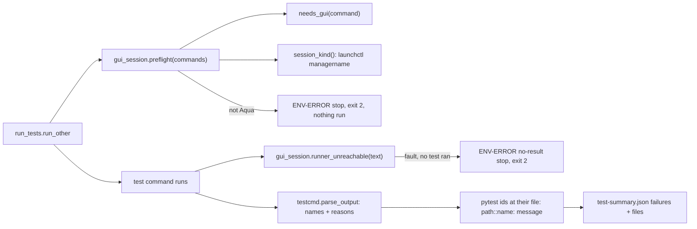
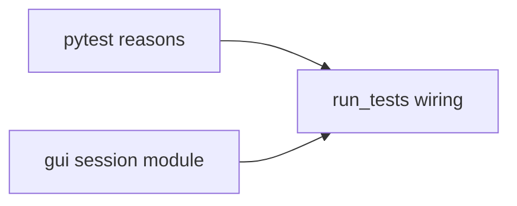

# Superlite: macOS GUI session preflight, ENV-ERROR for an unreachable test runner, located pytest ids (B119)

**Goal:** fix #561 (a macOS `xcodebuild test` in a session without the desktop login fails on testmanagerd and reads as a red test run) and main's follow-up from B129: a red remote full run names its failure `-::exit code 1 ...` or `-::<id>: failed` instead of the pytest id at its file with its message.
**Architecture:** a new library module `gui_session.py` decides whether a command runs a macOS xcodebuild test, reads the session type through `launchctl managername` and words the ENV-ERROR texts; `run_tests.run_other` calls it before the runs (preflight) and after a red run (test runner unreachable). `testcmd.parse_output` keeps each pytest short-summary id's message and traceback line; `run_tests.run_other` places those ids at their file.
**Tech stack:** Python 3.10+ stdlib, pytest (through `sl run_tests`).
**Spec:** this file, section Design; issue #561; main's B129 follow-up (sl backlog tell).
**Detail:** tests
**Target-min:** 11
**Wave0:** none
**Edges:** hard
**Coverage:** off

Global constraints:
- Every Python code line keeps the file's trailing `# O(...)` complexity comment (new files too).
- Existing tests stay green. An existing test file changes only when the task Owns it. If another existing test turns red, report it in DONE_WITH_CONCERNS with the test id and the reason instead of editing it.
- Run `sl` as an executable (`<abs>/sl ...`). Verify with `<abs>/sl run_tests --fast <own test files> --task Tn --background`, then run the printed `wait:` line in the foreground and end the turn only after it reports. Also run the existing test files the Notes name the same way.
- No version edits. Never run `scripts/evals.sh`, `claude plugin eval` or `scripts/test_layers.py run`. Never edit `tests/scripts/conftest.py`. No test touches the real `~/.superlite` (the conftest sets `SUPERLITE_HOME`).
- Tests must pass on Linux (the full suite runs on a Linux server): fake `launchctl` and `xcodebuild` as executable shell scripts in a tmp `bin/` put first on `PATH`; never call the real ones.
- ENV-ERROR texts start with `ENV-ERROR: ` and stay at most 400 characters.

Ruling: main's tell adds the remote pytest-id follow-up to B119 because it lives in run_tests.py, B119's file; B151 already parses the ids (a replayed remote run gives `-::<id>: failed`), so the work left is the file, line and message (cost if wrong: one more small batch).
Ruling: the preflight runs only for a command with an xcodebuild segment whose action is `test` or `test-without-building` and whose destination is macOS or Mac Catalyst, or that names no `-destination`; a destination without `platform=` is not checked (cost if wrong: such a run still fails late, then the ENV-ERROR stop names it).
Ruling: a session other than `Aqua` stops the run before setup with exit 2 and no incident; `launchctl` missing, failing or timing out (5 s) runs as before; `SUPERLITE_GUI_CHECK=0` skips the check; a test-cmd.json with `"lock": false` (its command runs on another machine) is never checked (cost if wrong: a false stop needs the variable).
Ruling: a red run whose output names the test runner fault (testmanagerd, `Failed to establish communication with the test runner`, `never finished bootstrapping`, `Test runner never began executing tests`) and shows no executed test is an ENV-ERROR no-result stop: exit 2, the no-result log and incident, never a red result (cost if wrong: a real failure in a run that also lost its runner reads as a stop).
Ruling: the fallback order for Swift projects when the macOS lane is unreachable: `swift test` for package targets, then an iOS Simulator destination, then a run from the logged-in desktop session; it is written in the ENV-ERROR texts and the docs/tools.md run_tests row (cost if wrong: one wording change).
Ruling: `fleet spawn` checking the session type is left to a follow-up: fleet.py belongs to B139.
Ruling: a pytest id is placed at its file only when the path part exists as a file under the run folder (the tree for a tree run, else the project root); otherwise it stays `-` with its message (cost if wrong: a remote path layout that differs keeps `-`).
Ruling: gui_session.py and testcmd.py are edited outside the brief's list (no open batch lists them); notes.md names them.
LAYERS: unit

## Design

1. **Preflight (#561).** Before setup and before any run, `run_other` passes its run commands (one per destination) to `gui_session.preflight`. When one runs a macOS xcodebuild test and `launchctl managername` prints anything but `Aqua` (`Background` for an SSH-descended session or a lost desktop login), the run stops: stderr `run_tests: ENV-ERROR: no macOS GUI session ...`, a zero summary whose `error` holds the text, exit 2, no test command run.
2. **Unreachable test runner (#561 comment).** A red run whose output names the test runner fault and shows no executed test stops as ENV-ERROR (exit 2, summary `error`, no-result log and incident) instead of `0 passed, 1 failed` with a failing name `to` read from `Failed to establish ...`. The text names the session type when known.
3. **Fallback order (#561 comment).** Both texts and the docs row name it: `swift test` for package targets, else an iOS Simulator destination (`--destination 'platform=iOS Simulator,name=<device>'`), else a run from the logged-in desktop session.
4. **Located pytest ids (main's B129 follow-up).** `parse_output` keeps each short-summary id's message (after ` - `) and the line of its traceback; `run_other` writes `tests/a.py::test_bad: assert 5.23 < 5` at file `tests/a.py` (as a JUnit run does) and counts the file's failure.

## File structure

- `skills/subagent-driven-development/scripts/testcmd.py`: `parse_output` `reasons` key, `merge_parsed` keeps it (T1).
- `skills/subagent-driven-development/scripts/gui_session.py` (new): command check, session type, ENV-ERROR texts (T2).
- `skills/subagent-driven-development/scripts/run_tests.py`: preflight, ENV-ERROR stop, located ids, docstring (T3).
- `docs/tools.md`: run_tests row (T3).

## Task graph

```mermaid
%% schedule
gantt
  title Predicted schedule (mm:ss)
  dateFormat X
  axisFormat %M:%S
  section lane 1
  T2 gui_session module :t2, 0, 244s
  T3 run_tests wiring and docs row :t3, 244, 290s
  section lane 2
  T1 pytest failure reasons in parse_outpu :t1, 0, 194s
```

critical path: T2 → T3 (8.9 min) · peak width 2 · predicted build 8.9 min · predicted total ≈ 17.4 min (target ✗ 11.0)

## Package: test output and session checks

App type: library (pure functions over command and output text, one subprocess call). Categories: encoding (quoted commands, ANSI, unicode marks), protocol (exit codes, summary texts), state (the summary file). **Probe entry:** none (the functions take text and fake executables; cases are named tests).

### T1 pytest failure reasons in parse_output · Complexity 3 · Est. context 36k
**Owns:** skills/subagent-driven-development/scripts/testcmd.py, tests/scripts/test_testcmd_reasons_b119.py
**Components:** 1
**LOC owned:** 110
**Tests:** fast
**Model:** sonnet
**Est. time:** 2 min (1 component, about 110 LOC, fast tests)
**Covers:** 4
**Produces:** testcmd.parse_output(text: str, rc: int) -> dict
e.g. parse_output(PROBE, 1)["reasons"] -> {"tests/test_probe.py::test_bad": ("assert 5.23 < 5", 5)}
e.g. parse_output("FAILED tests/a.py::TestX::test_y[1]\n1 failed in 0.10s\n", 1)["reasons"] -> {"tests/a.py::TestX::test_y[1]": ("", 0)}
e.g. parse_output("3 passed in 0.10s\n", 0)["reasons"] -> {}; parse_output("--- FAIL: TestX\n", 1)["reasons"] -> {}
**Review Focus:** `test_reason_and_line_from_section`: PROBE gives the first e.g.; `test_two_tests_same_file_get_own_lines`: two failing tests of one file, sections `____ test_a ____` (line `tests/t.py:4: AssertionError`) and `____ test_b ____` (line `tests/t.py:9: AssertionError`): reasons give 4 and 9; `test_class_param_header`: id `tests/a.py::TestX::test_y[1]` matches header `____ TestX.test_y[1] ____`; `test_collection_error_id`: `ERROR tests/b.py - ImportError: no module x` under the short summary with section `____ ERROR collecting tests/b.py ____` holding `tests/b.py:1: in <module>`: reasons `{"tests/b.py": ("ImportError: no module x", 1)}`; `test_long_message_cut`: a 300-character message is cut to 160; `test_merge_parsed_keeps_reasons`: `merge_parsed([("a", p1), ("b", p2)])["reasons"]` holds both ids, the first part's value wins on a shared id.
**Steps:** 1 failing tests, 2 run: FAIL, 3 implement, 4 run: PASS
**Notes:**
- `reasons` holds exactly the ids `_parse_pytest` puts in `names` (same 50 cap); it is `{}` for a green run and for every non-pytest parse (xcode branch included: add the key there too).
- Message: the text after the first ` - ` of the id's FAILED/ERROR line, stripped, cut to 160 characters; `""` when there is none.
- Line: the id's section header is a line `^_{3,} (.+?) _{3,}$` whose name equals the id's parts after the path joined by `.` (an id without `::` matches `ERROR collecting <path>`). Its section runs to the next such header or the next `^=+ .* =+$` line. The last line in it matching `^<path>:(\d+):` (path regex-escaped) gives the line; no section or no match gives 0. Search only above the short summary.
- PROBE (verbatim, also used by T3): `"bringing up nodes...\n\n.F    [100%]\n=================================== FAILURES ===================================\n___________________________________ test_bad ___________________________________\n[gw1] linux -- Python 3.12.3 /usr/bin/python\n\n    def test_bad():\n>       assert 5.23 < 5\nE       assert 5.23 < 5\n\ntests/test_probe.py:5: AssertionError\n=========================== short test summary info ============================\nFAILED tests/test_probe.py::test_bad - assert 5.23 < 5\n1 failed, 1 passed in 0.31s\nmaxapp remote: command exited 1\n"`.
- Also run `tests/scripts/test_testcmd_pytest_summary_638.py`, `tests/scripts/test_testcmd_counts_481.py`, `tests/scripts/test_testcmd_names_597.py` and `tests/scripts/test_testcmd_destinations_598.py`.

### T2 gui_session module · Complexity 4 · Est. context 38k
**Owns:** skills/subagent-driven-development/scripts/gui_session.py, tests/scripts/test_gui_session_561.py
**Components:** 2
**LOC owned:** 150
**Tests:** fast
**Model:** sonnet
**Est. time:** 2.5 min (2 components, about 150 LOC, fast tests)
**Covers:** 1, 2, 3
**Produces:** gui_session.needs_gui(command: str) -> bool
e.g. needs_gui("xcodebuild test -scheme App -destination 'platform=macOS'") -> True; needs_gui("xcodebuild -scheme App test") -> True
e.g. needs_gui("cd app && /usr/bin/xcodebuild test-without-building -xctestrun a.xctestrun") -> True; needs_gui("xcodebuild test -scheme A -destination 'platform=macOS,variant=Mac Catalyst'") -> True
e.g. needs_gui("xcodebuild test -scheme App -destination 'platform=iOS Simulator,name=iPhone 16'") -> False; needs_gui("xcodebuild build -scheme App") -> False; needs_gui("swift test") -> False; needs_gui("maxapp remote 'xcodebuild test -scheme App'") -> False
**Produces:** gui_session.session_kind(launchctl: str | None = None) -> str | None
e.g. session_kind("<tmp>/bin/launchctl") with a fake printing `Background` -> "Background"; a fake printing `Aqua\n` -> "Aqua"
e.g. session_kind("<tmp>/missing") -> None; a fake exiting 1 -> None; a fake printing nothing -> None
**Produces:** gui_session.preflight(commands: list[str]) -> str | None
e.g. preflight(["xcodebuild test -scheme App"]) with a fake launchctl printing `Background` on PATH -> "ENV-ERROR: no macOS GUI session (launchctl managername: Background, not Aqua): ..."
e.g. the same with `Aqua` -> None; preflight(["swift test"]) -> None (launchctl never called); with SUPERLITE_GUI_CHECK=0 -> None
**Produces:** gui_session.runner_unreachable(text: str) -> bool
e.g. runner_unreachable(TMD) -> True; runner_unreachable(TMD + "Executed 3 tests, with 1 failure (0 unexpected) in 0.2 (0.3) seconds\n") -> False; runner_unreachable("** TEST FAILED **\n") -> False
**Produces:** gui_session.unreachable_reason(kind: str | None) -> str
e.g. unreachable_reason("Background") -> "ENV-ERROR: xcodebuild could not reach its test runner (testmanagerd) and ran no test: an environment fault, not a test failure; session: Background; ..."
e.g. unreachable_reason(None) -> text holding "session: unknown"
**Review Focus:** `test_quoted_operator_not_split`: `xcodebuild test -scheme 'A && B'` -> True (one segment); `test_unbalanced_quote_false`: `xcodebuild test -scheme 'A` -> False, no exception; `test_env_prefix`: `env FOO=1 xcodebuild test -scheme A` -> True; `test_destination_id_not_checked`: `-destination 'id=ABC'` -> False; `test_timeout_none`: a fake launchctl sleeping 10 s with the timeout patched to 0.5 -> None; `test_swift_testing_counts_as_executed`: TMD plus `✔ Test foo() passed after 0.001 seconds.` -> False; `test_texts_capped`: every text starts `ENV-ERROR: ` and is at most 400 characters and names `swift test` and `iOS Simulator`.
**Steps:** 1 failing tests, 2 run: FAIL, 3 implement, 4 run: PASS
**Notes:**
- `needs_gui`: split with `testcmd._segments` (skip operator items), each segment with `shlex.split` (ValueError: that segment is False). The xcodebuild word is one whose basename is `xcodebuild` (after `env`, `VAR=1` words or `xcrun`); the words after it hold `test` or `test-without-building`; destinations are the words after each `-destination`. True when none, or any one's `testcmd.destination_platform` is `macOS` or `macCatalyst`.
- `session_kind`: path from the argument, else `shutil.which("launchctl")`; `subprocess.run([path, "managername"], capture_output=True, text=True, timeout=TIMEOUT)` with module constant `TIMEOUT = 5`; OSError, TimeoutExpired, non-zero exit or empty output give None; else the first line, stripped.
- `preflight`: None when `SUPERLITE_GUI_CHECK` is `0`, no command `needs_gui`, or the kind is None or `Aqua`. Else `ENV-ERROR: no macOS GUI session (launchctl managername: <kind>, not Aqua): xcodebuild test on macOS needs the desktop login session (testmanagerd), so nothing ran; <FALLBACK>; SUPERLITE_GUI_CHECK=0 skips this check`.
- `FALLBACK` (module constant): `fallback: swift test for package targets, else an iOS Simulator destination (--destination 'platform=iOS Simulator,name=<device>'), else run it from the logged-in desktop session`.
- `runner_unreachable`: True when `testmanagerd|Failed to establish communication with the test runner|never finished bootstrapping|Test runner never began executing tests` is found and no executed test is: `Executed [1-9]\d* tests?`, a line `^\s*Test [Cc]ase '`, or a line `^\W*[◇✔✘] Test ` (multiline).
- `unreachable_reason(kind)`: `ENV-ERROR: xcodebuild could not reach its test runner (testmanagerd) and ran no test: an environment fault, not a test failure; session: <kind or unknown>; <FALLBACK>`.
- TMD (verbatim, also used by T3): `"Testing failed:\n\tFailed to establish communication with the test runner. (Underlying Error: The connection to service named com.apple.testmanagerd.control was invalidated: failed at lookup with error 3 - No such process.)\n\tTest session results, code coverage, and logs:\n\t\t/tmp/x.xcresult\n\n** TEST FAILED **\n"`.
- A fake launchctl: `#!/bin/sh\necho Background\n` written to `tmp_path/"bin"/"launchctl"`, mode 0o755; `monkeypatch.setenv("PATH", f"{bin}:{os.environ['PATH']}")`.

## Package: run_tests

App type: CLI (`sl run_tests`). Categories: protocol (exit codes, stderr lines, summary keys), state (summary, incidents), file (paths under the run folder). **Probe entry:** none (end-to-end runs over tmp projects with fake executables; cases are named tests).

### T3 run_tests wiring and docs row · Complexity 5 · Est. context 52k
**Owns:** skills/subagent-driven-development/scripts/run_tests.py, docs/tools.md, tests/scripts/test_run_tests_gui_session_561.py
**Components:** 3
**LOC owned:** 170
**Tests:** fast
**Model:** sonnet
**Est. time:** 3.5 min (3 components, about 170 LOC, fast tests)
**Covers:** 1, 2, 3, 4
**Consumes:** gui_session.preflight(commands: list[str]) -> str | None (T2) · gui_session.runner_unreachable(text: str) -> bool (T2) · gui_session.unreachable_reason(kind: str | None) -> str (T2) · gui_session.session_kind(launchctl: str | None = None) -> str | None (T2) · testcmd.parse_output(text: str, rc: int) -> dict (T1)
**Review Focus:** `test_preflight_stops_background`: fake launchctl `Background`, test-cmd.json `{"language": "swift", "test": "xcodebuild test -scheme App -destination 'platform=macOS'"}`, a fake xcodebuild that touches `ran.txt`: exit 2, stderr holds `run_tests: ENV-ERROR: no macOS GUI session (launchctl managername: Background`, summary `error` starts `ENV-ERROR: `, no `ran.txt`, setup not run; `test_preflight_aqua_runs`: `Aqua`, the fake prints `Test Case '-[AppTests.T test_a]' passed (0.001 seconds).` and `Executed 1 test, with 0 failures (0 unexpected) in 0.001 (0.002) seconds`, exit 0: exit 0, 1 passed; `test_ios_destination_not_checked`, `test_lock_false_not_checked`, `test_gui_check_off`: `Background` and the command runs; `test_runner_unreachable_env_error`: `Aqua`, the fake prints TMD (T2 Notes) and exits 65: exit 2, summary `error` starts `ENV-ERROR: xcodebuild could not reach its test runner`, no failure named `to`, stderr names a no-result log; `test_remote_pytest_id_located`: `tests/test_probe.py` exists, test-cmd.json `{"language": "python", "test": "cat out.txt; exit 1", "lock": false}` with PROBE (T1 Notes) in `out.txt`: summary failures `["tests/test_probe.py::test_bad: assert 5.23 < 5"]`, files `{"tests/test_probe.py": [0, 1]}`; `test_missing_path_stays_dash`: no such file: `["-::tests/test_probe.py::test_bad: assert 5.23 < 5"]`.
**Steps:** 1 failing tests, 2 run: FAIL, 3 implement, 4 run: PASS
**Notes:**
- Preflight in `run_other`: compute `dests` and `runs` before the setup step; when `spec.get("lock") is not False` and `gui_session.preflight([c for _, c in runs])` returns a text, `return usage_error(a, label, text)` (stderr, zero summary with `error`, exit 2, no incident).
- ENV-ERROR stop: in the no-JUnit branch right after `p` is parsed and before the signal check, when `r.returncode` and `gui_session.runner_unreachable(strip_ansi(text))`: the text is `gui_session.unreachable_reason(kind)` with `kind = gui_session.session_kind()` unless `"lock": false` (then None); then stderr, `write_summary(..., error=text)`, `publish_summary`, `record_no_result(a, text, sub(spec["command"]), r.returncode, [*p["tail"]], cwd)`, print `0 0 0 <seconds>`, return 2, as the 126/127 stop does.
- Located ids: build `files` before `failures`; for each name in `p["names"]` that is a key of `p.get("reasons", {})`: path, rest = the parts before and after the first `::`; when `(Path(cwd) if cwd else root) / path` is a file, the failure is `(path, line, f"{rest}: {msg or 'failed'}")` (`msg or 'failed'` alone when rest is empty) and `files[path][1] += 1`; else `("-", 0, f"{name}: {msg or 'failed'}")`. Names not in reasons keep `("-", 0, f"{n}: failed")`. The xcodebuild `failure_sites` override stays.
- Docstring: one line each for the preflight, the ENV-ERROR stop and the located ids, next to the #499 line.
- docs/tools.md `run_tests` row: append, after its last sentence, the preflight (`launchctl managername` not `Aqua`, `SUPERLITE_GUI_CHECK=0`, `"lock": false` unchecked), the ENV-ERROR stop (exit 2), the fallback order and the located pytest ids. Keep every span pinned by tests/scripts/test_docs_*.py byte for byte.
- Also run `tests/scripts/test_run_tests_remote_638.py`, `tests/scripts/test_run_tests_failure_sites_499.py`, `tests/scripts/test_run_tests_destinations_598.py`, `tests/scripts/test_run_tests_exit_paths.py`, `tests/scripts/test_run_tests_no_result_trace.py`, `tests/scripts/test_docs_contract.py` and the docs tests that read the run_tests row (`grep -l run_tests tests/scripts/test_docs_*.py`).

## Review Focus

- Encoding: quoted commands (`'A && B'`, unbalanced quotes), ANSI in xcodebuild output, the `✔`/`✘`/`◇` marks, parametrized ids with brackets.
- Protocol: exit 2 for both ENV-ERROR stops, never 1; the summary `error` key; the located failure text equals a JUnit run's `file::name: message`.
- State: the preflight runs before setup and writes no incident; the runner stop writes one no-result incident.

## Self-review

Coverage: Design 1 (T2, T3), 2 (T2, T3), 3 (T2, T3), 4 (T1, T3). No placeholders. Consumes match Produces. Edges are hard: T3's end-to-end tests run T1's and T2's code. No two parallel tasks share a file.
