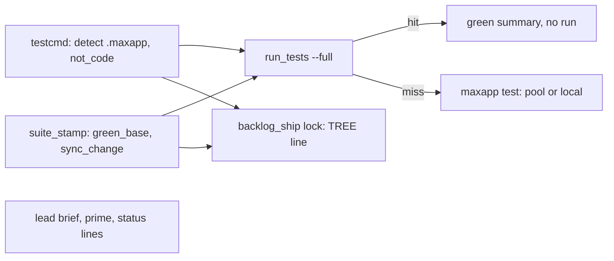
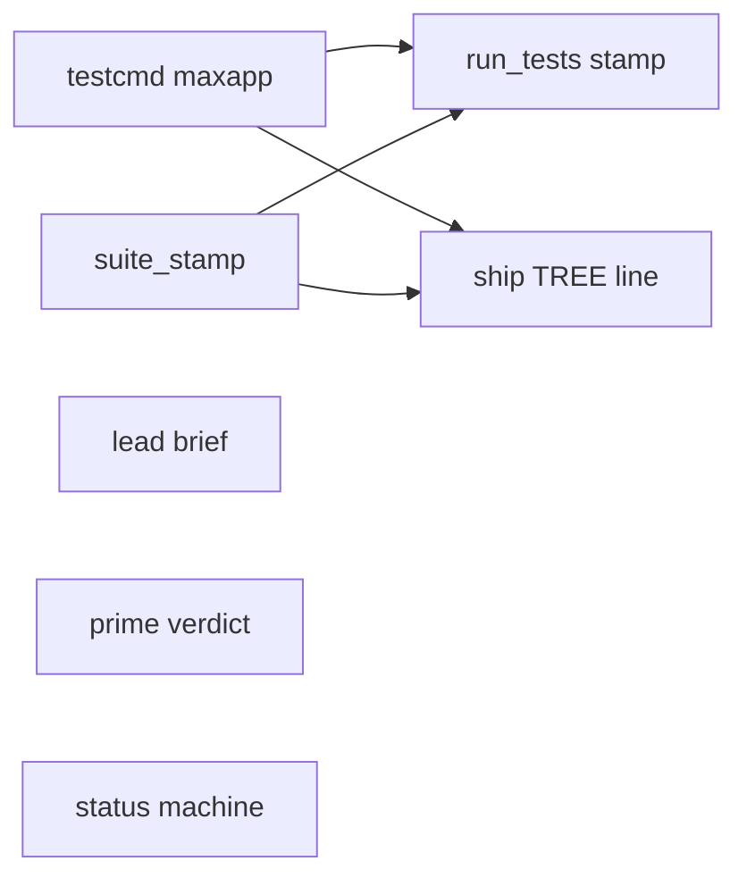

# maxapp test default, test stamp read and docs-only skip (#627, #639)

**Goal:** Swift test runs reach the build pool (`maxapp test` by default for a `.maxapp` project, no `-derivedDataPath` and no warning for it), a full run whose tree a green `maxapp test` stamp covers returns that result without a run, a change of only not-code paths starts no full run, the ship sync says whether the tree changed, and the briefs and `sl backlog status` name the verdict command, build folders, free disk and build slots.
**Architecture:** one new pure module `suite_stamp.py` (stamp reader, docs-only base, sync change) used by `run_tests.py` and `backlog_ship.py`; `testcmd.py` detects `.maxapp` and reads the `not_code` setting; text lines in `backlog_brief.py`, `build_prime.py` and `backlog.py`.
**Tech stack:** Python 3 stdlib, pytest; tests in `tests/scripts/`.
**Spec:** the issue bodies #627 and #639; this doc's design.
**Detail:** tests
**Wave0:** none
**Edges:** hard
**Target-min:** 12

Global constraints:
- Standing rules (main's, copy into every brief and task message): this repository is public: no host names, user names, home paths, other project or repository names, ticket keys or account names in code, tests, docs, commit messages, PR texts or issue comments (write "a Swift project", "a second Mac", "the machine"). Never change the machine's gate config or `~/.superlite/machine.json`; tests and proofs use private temp homes and state dirs. No real app builds as proof; this repository's own test suite is the check. Friction with superlite itself goes to `sl feedback add`.
- Every code line keeps the repo's trailing complexity comment (`# O(1)`, `# O(n)` ...), as in the files around it. Stdlib only.
- Tests never call a real `maxapp`, `maxapp-slot` or `xcodebuild`: a fake executable script on a temp `PATH`, temp git repos (`git init`, `git -c user.name=t -c user.email=t@e commit`).
- Stamp file (the shape maxapp's planned test stamp takes, mirroring maxapp's smoke stamp): `<git common dir>/maxapp/test/<tree id>.<platform>`, lines `tree=<id>`, `platform=
`, `commit=<sha>`, `tests=<N>`; it counts only when `tree=` and `platform=` match and `tests` is an integer above 0. superlite reads it and never writes it.

## Design

Understood (issues): #627: superlite never reaches the pool: `testcmd` proposes `xcodebuild`, `run_tests` injects `-derivedDataPath` (the pool used to pin such a run), briefs do not name the pool-aware command, scratchpad builds pile up, `backlog status` shows no build slots or disk. #639 (Max's decision in the issue): the full suite runs once per tree; superlite reads maxapp's per-tree stamp instead of rerunning; ship reruns only when the sync changed the tree; a not-code-only change starts no full run when the project says so; the lead brief names the build folders and when a device build is needed; never weaker.
Found in the code and tools: maxapp's pool today drops `-derivedDataPath` on the host and never pins on it; maxapp test writes no stamp yet (planned in maxapp); `backlog_run.project_cleanup` already sweeps the worktree's session scratchpads (B136) and fleet workers start in the lead's worktree, so their scratchpads are under the same folder.

- **testcmd**: `detect` returns `{"language": "swift", "test": "maxapp test", "test_file": "maxapp test {only_testing}", ...}` when `.maxapp` holds `package` and `package_scheme` and `maxapp` is on PATH; `config_source` ranks it above the user-level entry (a `.maxapp` is the project's own declaration), `propose` above a project test script. `{only_testing}` in a maxapp command expands to `--only Target/Suite` pairs. `not_code_globs(cfg)` reads `"not_code": [globs]` from `.superlite/test-cmd.json`; `resolve` returns it as `spec["not_code"]`.
- **suite_stamp** (new): `maxapp_platforms` (a plain `maxapp test [--ios]` only), `is_not_code` (glob match), `green_base` (HEAD's tree or the nearest stamped first-parent ancestor within 50 commits, with every change since it, committed, uncommitted or untracked, a not-code path), `sync_change` (tree before and after the ship sync).
- **run_tests**: a run-root `--full` run (no `--task`, no **Tests:** cmd, no `--destination`) with a maxapp test command asks `green_base` first; a hit prints one line, writes a green full summary with `"stamp"`, closes failures like any green full run and exits 0 with no test process. `maxapp` commands lock as the `xcode` toolchain and get no derived-data warning.
- **backlog_ship lock**: in a worktree without `scripts/test_layers.py` (there LAYERS rules) one `TREE:` line after the sync: unchanged, only not-code paths, or changed with the rerun named.
- **briefs**: the lead brief's build sentence names the verdict command, the pool, the build folders, when a device build is needed, and asks the lead to copy it into worker briefs; its ship sentence says when to rerun after `lock`. The prime of a Swift project gets one verdict line. `backlog status` ends with one `machine:` line (free disk, `maxapp-slot --busy` when on PATH).

Ruling: `maxapp` commands get no `-derivedDataPath` (because Xcode keys DerivedData by the tree's path, maxapp locks per checkout and `trees.sweep_derived_data` removes a removed tree's DerivedData; cost if wrong: module caches stay shared, pruned at the warn level).
Ruling: the stamp is read through the planned file layout, not `maxapp test --status` (because only the file carries the test count a summary needs; cost if wrong: no stamp is found and every full run runs, as today).
Ruling: superlite never writes a maxapp stamp (because `maxapp ship` will gate on it; cost if wrong: none, maxapp stamps its own green runs).
Ruling: the not-code setting is `"not_code": ["docs/**", "**/*.md"]` in `.superlite/test-cmd.json` (main's ruling: a setting in .superlite config); globs: `**` any depth, `**/` zero or more folders, `*` and `?` inside one segment, matched against the root-relative posix path.
Ruling: the docs-only skip needs a stamp (no stamp, no skip) and stops at the nearest stamped ancestor; a deleted or renamed file counts by its old and new path (`--no-renames`).
Ruling: `TREE:` is printed only where no `scripts/test_layers.py` checks layers (because LAYERS already names the stale layers there; cost if wrong: one missing hint).
Ruling: item 4 of #627 (ship removes the lead's and workers' scratchpad build folders) needs no change: B136's sweep covers the worktree's scratchpads and workers start in that worktree.
Ruling: plan detail `tests` (because no core is algorithmic beyond the glob match, which has named cases).

## Coverage

| Category | State | Basis |
|---|---|---|
| Scope and success criteria | settled | #627 to-fix 1-5 and #639 Done-when; item 4 ruled already done |
| Domain and data model | ruled | stamp file lines tree, platform, commit, tests (Global constraints) |
| Persistence and migration | ruled | read-only of maxapp's stamp; `not_code` is a new optional key, absent means none |
| Interfaces and contracts | settled | Produces lines below; summary gains an optional `"stamp"` key |
| UI states | n/a | CLI output lines only |
| Concurrency and state ownership | ruled | stamp files are maxapp's; superlite reads them, a half-written file does not count |
| Error handling and recovery | ruled | any git or file error means no stamp: the run runs; bad `not_code` is ignored with one note |
| Security and privacy | ruled | config globs are compiled as patterns, never run; paths come from git with `-z` |
| Performance and limits | ruled | at most 50 ancestors, one stat per platform each; slot query timeout 5 s |
| Observability | ruled | one stderr line per stamp hit, one `TREE:` line, one `machine:` line |
| Testing strategy | ruled | temp git repos and fake executables; no real maxapp |
| Compatibility | ruled | projects without `.maxapp` or `maxapp` behave as before |
| Rollout | ruled | ships in the plugin version; no stamp exists until maxapp writes one, so nothing changes before that |
| Research unknowns | n/a | maxapp's pool and smoke stamp code read; the planned stamp shape is in #639 |

## File structure

- `skills/subagent-driven-development/scripts/testcmd.py`: maxapp detection, `--only` expansion, `not_code_globs`.
- `skills/subagent-driven-development/scripts/suite_stamp.py` (new): stamp read, docs-only base, sync change.
- `skills/subagent-driven-development/scripts/run_tests.py`: stamp hit before the run; maxapp toolchain and warning.
- `skills/subagent-driven-development/scripts/backlog_ship.py`: `TREE:` line in `lock`.
- `skills/subagent-driven-development/scripts/backlog_brief.py`: build and ship sentences.
- `skills/subagent-driven-development/scripts/build_prime.py`: Swift verdict line.
- `skills/subagent-driven-development/scripts/backlog.py`: `machine:` status line.

## Task graph

```mermaid
%% schedule
gantt
  title Predicted schedule (mm:ss)
  dateFormat X
  axisFormat %M:%S
  section lane 1
  T1 testcmd maxapp default and not_code :t1, 0, 243s
  T3 run_tests stamp hit and maxapp toolch :t3, 243, 198s
  section lane 2
  T2 suite_stamp module :t2, 0, 207s
  T4 backlog_ship TREE line :t4, 243, 189s
  section lane 3
  T5 lead brief build and ship sentences :t5, 0, 184s
  section lane 4
  T6 prime verdict line for Swift projects :t6, 0, 184s
  section lane 5
  T7 backlog status machine line :t7, 0, 179s
```

critical path: T1 → T3 (7.3 min) · peak width 5 · predicted build 7.3 min · predicted total ≈ 15.8 min (target ✗ 12.0)

## Tests and config

### T1 testcmd maxapp default and not_code · Complexity 3 · Est. context 40k
**Owns:** skills/subagent-driven-development/scripts/testcmd.py, tests/scripts/test_testcmd_maxapp_627.py
**Components:** 2
**LOC owned:** 170
**Tests:** fast
**Model:** sonnet
**Est. time:** 3 min
**Produces:** testcmd.not_code_globs(cfg: dict | None) -> list[str] · testcmd.resolve(root=".", paths=(), notes: list | None = None) -> dict | None
e.g. not_code_globs({"not_code": ["docs/**", "**/*.md"]}) -> ["docs/**", "**/*.md"]
e.g. not_code_globs({"not_code": "docs"}) -> [] (stderr note `test-cmd.json "not_code" must be a list of glob strings; ignored`)
e.g. resolve(root) for a `.maxapp` project -> {"language": "swift", "command": "maxapp test", "not_code": [], ...}
**Review Focus:** `test_maxapp_detect_needs_keys_and_path`: `.maxapp` without `package_scheme`, or no `maxapp` on PATH -> the old detection; `test_maxapp_only_testing_expands_to_only`: `maxapp test {only_testing}` with a test file of suite `FooTests` in target `CoreTests` -> `maxapp test --only CoreTests/FooTests`; `test_maxapp_beats_user_entry`: a user-level swift entry plus `.maxapp` -> `maxapp test`, origin `.maxapp`; `test_project_file_still_wins`: a project test-cmd.json beats `.maxapp`.
**Steps:** 1 failing tests, 2 run: FAIL, 3 implement, 4 run: PASS
**Notes:** `.maxapp` is `key=value` lines, `#` comments and blank lines allowed; never sourced. Detection sits in `detect` before the Package.swift check and returns `"junit": ""`, `"setup": ""`. A maxapp command is one whose segment starts with a `maxapp` word followed by `test` (`(?:^|[\s/])maxapp\s+test(?=\s|$)`). Every resolve() return dict gains `"not_code"`. `propose` returns the maxapp detection before `_find_script`. Update the module docstring (Order line, `{only_testing}` line, `not_code`).

### T2 suite_stamp module · Complexity 5 · Est. context 45k
**Owns:** skills/subagent-driven-development/scripts/suite_stamp.py, tests/scripts/test_suite_stamp_639.py
**Components:** 1
**LOC owned:** 210
**Tests:** fast
**Model:** sonnet
**Est. time:** 4 min
**Produces:** suite_stamp.maxapp_platforms(command: str) -> list[str] | None · suite_stamp.is_not_code(path: str, globs: list[str]) -> bool · suite_stamp.green_base(root, command: str, not_code: list[str], depth: int = 50) -> dict | None · suite_stamp.sync_change(root, before: str, after: str, not_code: list[str]) -> tuple[str, list[str]]
e.g. maxapp_platforms("maxapp test") -> ["macOS"]; maxapp_platforms("maxapp test --ios") -> ["macOS", "iOS"]; maxapp_platforms("maxapp test --only A/B") -> None; maxapp_platforms("xcodebuild test -scheme X") -> None
e.g. is_not_code("docs/a/b.md", ["docs/**"]) -> True; is_not_code("README.md", ["**/*.md"]) -> True; is_not_code("Sources/a.swift", ["docs/**", "**/*.md"]) -> False
e.g. green_base(repo, "maxapp test", []) with HEAD's tree stamped for macOS (tests=12), clean -> {"commit": "<HEAD sha>", "tree": "<tree id>", "tests": 12, "platforms": ["macOS"], "stamps": ["<path>"], "changed": []}
e.g. sync_change(repo, t, t, []) -> ("unchanged", []); a docs-only change with ["docs/**"] -> ("not_code", ["docs/x.md"]); with a code file -> ("code", ["docs/x.md", "src/a.py"])
**Review Focus:** `test_stamp_must_name_tree_and_platform`: a copied stamp file whose `tree=` differs, an empty file, `tests=0` or `tests=x` -> None; `test_dirty_code_change_is_no_hit`: HEAD stamped, an uncommitted `src/a.py` edit -> None; `test_untracked_code_file_is_no_hit`: HEAD stamped, an untracked `src/new.py` -> None; `test_docs_commit_after_stamp_hits`: parent stamped, HEAD only changes `docs/x.md`, globs `["docs/**"]` -> base is the parent, changed `["docs/x.md"]`; `test_no_globs_needs_exact_tree`: same repo, globs `[]` -> None; `test_deleted_code_file_counts`: HEAD deletes `src/a.py` after a stamped parent, globs `["docs/**"]` -> None; `test_ios_needs_both_platforms`: `maxapp test --ios` with only a macOS stamp -> None, with both -> tests summed; `test_dot_build_ignored`: an untracked `.build/x` does not count as a change; `test_not_git_repo`: a plain folder -> None, no exception.
**Steps:** 1 failing tests, 2 run: FAIL, 3 implement, 4 run: PASS
**Notes:** git through `subprocess.run(["git", "-C", root, ...])`, `-z` outputs; common dir by `rev-parse --path-format=absolute --git-common-dir`; tree by `rev-parse HEAD^{tree}` and `<c>^{tree}`; ancestors by `rev-list --first-parent --max-count=<depth> HEAD`; changes since a base by `diff --name-only --no-renames -z <c>` plus `ls-files --others --exclude-standard -z`, `.build/` paths dropped. HEAD first; the first stamped commit is the base (older ones are not tried). Any git error or OSError -> None. `maxapp_platforms` takes the command words by `shlex.split` (ValueError -> None): exactly `maxapp test` or `maxapp test --ios`, the first word's basename `maxapp`. Module docstring in the repo's style.

### T3 run_tests stamp hit and maxapp toolchain · Complexity 5 · Est. context 55k
**Owns:** skills/subagent-driven-development/scripts/run_tests.py, tests/scripts/test_run_tests_stamp_639.py
**Components:** 1
**LOC owned:** 150
**Tests:** fast
**Model:** sonnet
**Est. time:** 4 min
**Consumes:** suite_stamp.green_base(root, command: str, not_code: list[str], depth: int = 50) -> dict | None (T2) · testcmd.resolve(root=".", paths=(), notes: list | None = None) -> dict | None (T1)
**Produces:** run_tests.stamp_hit(a, spec: dict, label: str) -> int | None
e.g. stamp_hit(a, {"command": "maxapp test", "python": False, "not_code": []}, "full") with HEAD stamped (tests=12) -> 0; stderr `run_tests: full suite green by the maxapp test stamp for <commit12> (tree <tree12>, 12 tests on macOS); no run`; summary passed 12, failed 0, mode full, "stamp" {"commit", "tree", "platforms", "changed"}
e.g. stamp_hit(a, spec, "fast") -> None
**Review Focus:** `test_stamp_hit_runs_no_command`: a fake `maxapp` on PATH that writes a marker file; `run_tests --full` with a stamp -> exit 0, no marker, `test-summary.json` passed 12 with `stamp`; `test_no_stamp_runs`: same without a stamp -> the fake runs once; `test_fast_and_task_never_read_stamp`: `--fast <test file>` and `--task T1 --full` run the command although stamped; `test_docs_only_hit_names_changes`: stamped parent, HEAD changes `docs/x.md`, `"not_code": ["docs/**"]` -> no run, stderr names `docs/x.md`; `test_maxapp_lock_toolchain`: lock_toolchain({"command": "maxapp test", "language": "swift"}) -> "xcode"; `test_maxapp_no_derived_data_warning`: wrapped_build_warning("maxapp test", tree, root, "swift") -> None in a dir with an .xcodeproj.
**Steps:** 1 failing tests, 2 run: FAIL, 3 implement, 4 run: PASS
**Notes:** call `stamp_hit` in `run()` right after the Node checks and before `free_disk`, only when `label == "full"`, `not a.task`, no **Tests:** cmd spec, no `--destination` flag, `not spec["python"]`. A hit writes the summary through `write_summary` (add the optional `"stamp"` key the way `WARNING` is recorded) and returns `finish_run(a, label, counts, [], {}, 0.0, 0)`, so a green full run's incident closing, ledger line and unit stamp happen as usual. Changed paths on the stderr line: the first 5, then `(+N more)`. `lock_toolchain`: a maxapp test/build/smoke command -> `xcode`. Docstring: one sentence each for the stamp hit, the maxapp toolchain and why a maxapp command gets no `-derivedDataPath` (first Ruling above).

## Ship, briefs and status

### T4 backlog_ship TREE line · Complexity 3 · Est. context 40k
**Owns:** skills/subagent-driven-development/scripts/backlog_ship.py, tests/scripts/test_backlog_ship_tree_639.py
**Components:** 1
**LOC owned:** 90
**Tests:** fast
**Model:** sonnet
**Est. time:** 2.5 min
**Consumes:** suite_stamp.sync_change(root, before: str, after: str, not_code: list[str]) -> tuple[str, list[str]] (T2) · testcmd.not_code_globs(cfg: dict | None) -> list[str] (T1)
**Produces:** backlog_ship.tree_line(wt, before: str) -> str | None
e.g. tree_line(wt, <same tree>) -> "TREE: unchanged by the sync: the tested tree ships, no full rerun"
e.g. tree_line(wt, <tree before a docs-only rebase>) with not_code ["docs/**"] -> "TREE: changed by the sync only in not-code paths (1 file): no full rerun"
e.g. tree_line(wt, <tree before a code rebase>) -> "TREE: changed by the sync (2 files: docs/x.md, src/a.py): run the full suite once (sl run_tests --full) before bump"
**Review Focus:** `test_lock_prints_tree_unchanged`: `_lock` on a worktree whose sync is a no-op prints the unchanged line before `lock held`; `test_lock_tree_changed_names_rerun`: origin/main moved with a code file -> the changed line; `test_no_tree_line_with_layer_checker`: a worktree with `scripts/test_layers.py` -> no `TREE:` line; `test_tree_line_lists_five`: 7 changed files -> 5 names and `+2 more`.
**Steps:** 1 failing tests, 2 run: FAIL, 3 implement, 4 run: PASS
**Notes:** `_lock` takes `git rev-parse HEAD^{tree}` before `_sync` and appends `tree_line(wt, before)` after a sync without conflict, before the LAYERS line. not_code from `testcmd.config_source(Path(wt))[0]`. No line when `before` is empty or git fails. Follow the fixtures of tests/scripts/test_backlog_ship_587_588.py. Docstring: one sentence.

### T5 lead brief build and ship sentences · Complexity 2 · Est. context 35k
**Owns:** skills/subagent-driven-development/scripts/backlog_brief.py, tests/scripts/test_backlog_brief_builds_627.py
**Also-touches:** tests/scripts/test_backlog_brief_jira_208.py
**Components:** 1
**LOC owned:** 60
**Tests:** fast
**Model:** sonnet
**Est. time:** 2 min
**Review Focus:** `test_build_sentence_names_verdict_and_folders`: the lead brief holds `maxapp test`, `build pool`, `<tree>/.build/DerivedData`, `.build/` of the worktree, `running-app check`, `copy this sentence into every worker brief`; `test_ship_sentence_names_tree_rule`: the approved Ship sentence holds `TREE: changed` and `LAYERS:`; `test_not_approved_brief_has_no_tree_rule`.
**Steps:** 1 failing tests, 2 run: FAIL, 3 implement, 4 run: PASS
**Notes:** replace the current "Build inside your worktree: ..." sentence with: "Builds: the verdict is `sl run_tests` (the project's test command; a project with `.maxapp` runs `maxapp test`, which a build pool may place on another Mac, and a full run whose tree a green maxapp test stamp covers returns that result without a run); task trees build in <tree>/.build/DerivedData and any build of your own goes under the worktree's .build/, never -derivedDataPath outside the worktree (your session scratchpad included; backlog cleanup removes scratchpad build folders when the worktree goes); a product, simulator or device build stays on this machine and runs only when an issue's acceptance asks for a running-app check; copy this sentence into every worker brief." Add to the approved Ship sentence, after the four-step text: "After `lock`, rerun the full suite only when it prints `LAYERS:` or `TREE: changed ... run the full suite`; `TREE: unchanged` or a not-code-only change ships the tested tree." Update the golden brief in the Also-touches file.

### T6 prime verdict line for Swift projects · Complexity 2 · Est. context 35k
**Owns:** skills/subagent-driven-development/scripts/build_prime.py, tests/scripts/test_build_prime_verdict_627.py
**Components:** 1
**LOC owned:** 60
**Tests:** fast
**Model:** sonnet
**Est. time:** 2 min
**Review Focus:** `test_swift_prime_has_verdict_line`: a project resolving to a swift command `maxapp test` -> both preambles' output holds one line `- Verdict: sl run_tests runs the project's test command (maxapp test); a build pool may run it on another Mac. A product build, simulator or device run stays on this machine and is no proof unless your task names it.`; `test_python_prime_has_none`: a pytest project -> no `Verdict:` line; `test_resolve_error_adds_nothing`: testcmd.resolve raising -> prime built, no line.
**Steps:** 1 failing tests, 2 run: FAIL, 3 implement, 4 run: PASS
**Notes:** the line goes right after the `Run the verify command ...` rule; resolve with `testcmd.resolve(<run root>)` and add the line only for `language == "swift"` with a command; the command shown is the resolved full command cut to 80 characters.

### T7 backlog status machine line · Complexity 1 · Est. context 30k
**Owns:** skills/subagent-driven-development/scripts/backlog.py, tests/scripts/test_backlog_status_machine_627.py
**Components:** 1
**LOC owned:** 50
**Tests:** fast
**Model:** haiku
**Kind:** mechanical
**Est. time:** 1.5 min
**Produces:** backlog.machine_line(root) -> str
e.g. machine_line(root) with 123.4 GB free and `maxapp-slot --busy` printing `1 2` -> "machine: 123.4 GB free disk; build slots 1/2 busy (maxapp-slot)"
e.g. machine_line(root) with no `maxapp-slot` on PATH -> "machine: 123.4 GB free disk"
**Review Focus:** `test_machine_line_with_slots`: fake `maxapp-slot` printing `1 2` on PATH, `shutil.disk_usage` monkeypatched to free 123.4 GB -> the first example; `test_machine_line_without_slots`: empty PATH dir -> the second example; `test_machine_line_bad_slot_output`: fake prints `x` or exits 2 -> the second example; `test_status_ends_with_machine_line`: `cmd_status` output's last line starts with `machine: ` (after a `next:` line too).
**Steps:** 1 failing tests, 2 run: FAIL, 3 implement, 4 run: PASS
**Notes:** free disk of `root` by `shutil.disk_usage(root).free / 1024**3`, one decimal; slots by `subprocess.run(["maxapp-slot", "--busy"], capture_output=True, text=True, timeout=5)` when `shutil.which("maxapp-slot")`; any error drops the slots part. `cmd_status` appends it last.

## Review Focus

Package scripts (CLI and library; protocol, file, state): a stamp copied from another tree or platform never counts; a narrowed or task run never reads a stamp; an untracked or deleted code file defeats the docs-only skip; a missing tool or git failure falls back to running. **Probe entry:** call=suite_stamp.maxapp_platforms

## Self-review

Coverage: #627 1 (T1, T3), 2 (T3 ruling and docstring), 3 (T5, T6), 4 (ruled done), 5 (T7); #639 stamp read (T2, T3), ship (T4, T5), docs-only (T1, T2, T3), lead brief (T5), never weaker (T2 cases, T3 cases). No placeholders; Consumes match Produces; edges are execution dependencies; no shared files.
