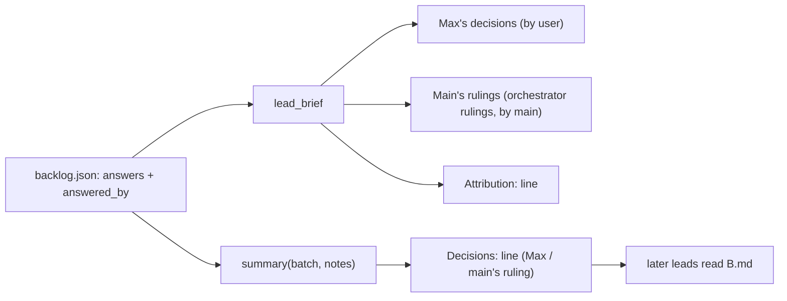
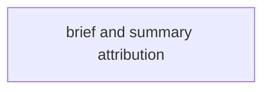

# Superlite: orchestrator rulings never reach a lead as Max's (B121)

**Goal:** fix #557: an answer main ruled as AI orchestrator reaches a batch lead as an orchestrator ruling, and the lead's notes, summary and PR text never name Max for it.
**Architecture:** `backlog_brief.py` only. The lead brief's main-rulings header names them orchestrator rulings, and every lead brief carries one `Attribution:` line saying when a lead may name Max. The shipped-batch summary (`.superlite/backlog/B.md`, read by every later lead) gains one generated `Decisions:` line that names who answered each recorded decision, from backlog.json's `answered_by`.
**Tech stack:** Python 3.10+ stdlib, pytest (through `sl run_tests`).
**Spec:** this file, section Design; issue #557.
**Detail:** tests
**Target-min:** 11
**Wave0:** none
**Coverage:** off

Global constraints:
- Every Python code line keeps the file's trailing `# O(...)` complexity comment.
- Existing tests stay green. An existing test file changes only when the task Owns it. If another existing test turns red, report it in DONE_WITH_CONCERNS with the test id and the reason instead of editing it.
- Run `sl` as an executable (`<abs>/sl ...`). Verify with `<abs>/sl run_tests --fast <own test files> --task Tn --background`, then run the printed `wait:` line in the foreground and end the turn only after it reports.
- No version edits (the ship step bumps the version). Never run `scripts/evals.sh`, `claude plugin eval` or `scripts/test_layers.py run`.

Ruling: root cause seen in pix-app's backlog.json: B110 and B113 hold `answered_by: user` for answers main ruled, because main's answers file had no `by` and `backlog_checks.answer_by` defaults it to `user`; that default lives in backlog_checks.py (B125, running) and the decide/answer output in backlog.py and backlog_run.py (other batches), so it becomes a follow-up in notes.md (because the brief forbids those files; cost if wrong: main must still remember `by`).
Ruling: backlog_state.py needs no change (it records the `by` map it is given; cost if wrong: none).
Ruling: the `Decisions:` line lists only answers with an `answered_by` of `user` or `main` (a record before #477 has none), at most 4 entries then `; +N more`, the question cut at 60 and the answer at 50 characters at a whole word, a trailing ` (Recommended)` dropped (because later leads need the provenance, not the full text, and the summary keeps its 10-line cap; cost if wrong: a cut question is less clear).
Ruling: one mechanical task (one file, about 110 lines with tests); already in the lead worktree, no `sl worktree ensure`; no probe adapter (pure text from dicts); layers: unit.
LAYERS: unit



## Design

### 1. Lead brief
`MAIN_HEAD` becomes `Main's rulings (orchestrator rulings: main decided these as AI orchestrator, not Max; record each as main's ruling, never as Max's decision):`. A new constant `ATTRIBUTION` (exact text in T1) goes into every lead brief as its own line right after the decisions block (after the main-rulings list when there is one, before the standing note), whether or not the ship is approved.

### 2. Summary
New `decisions_line(batch) -> str | None`. `summary` appends it to the three head lines when it is not None; the note lines then get the room left under the 10-line cap: when there are more note lines than the room, it keeps room - 1 of them plus the `+N more note lines: full text in B.notes.md` line.

## File structure

- `skills/subagent-driven-development/scripts/backlog_brief.py`: attribution line, orchestrator-rulings header, `Decisions:` summary line (T1)
- `tests/scripts/test_backlog_brief_557.py`: the tests below (T1)

## Task graph

```mermaid
%% schedule
gantt
  title Predicted schedule (mm:ss)
  dateFormat X
  axisFormat %M:%S
  section lane 1
  T1 lead briefs and summaries name who an :t1, 0, 97s
```





critical path: T1 (1.6 min) · peak width 1 · predicted build 1.6 min · predicted total ≈ 5.1 min (target ✓)

## Package: backlog briefs

App type: library (pure text). Categories: encoding (control characters, cuts), state (which answers count). **Probe entry:** none (dict inputs; cases are named tests).

### T1 lead briefs and summaries name who answered · Complexity 3 · Est. context 30k
**Owns:** skills/subagent-driven-development/scripts/backlog_brief.py, tests/scripts/test_backlog_brief_557.py
**Kind:** mechanical
**Components:** 1
**LOC owned:** 110
**Tests:** fast
**Model:** haiku
**Est. time:** 2.0 min (1 component, about 110 LOC, fast tests)
**Covers:** 1, 2
**Consumes:** none
**Produces:** backlog_brief.decisions_line(batch: dict) -> str | None
e.g. decisions_line({"answers": {"Lock path?": "Per tree"}, "answered_by": {"Lock path?": "main"}}) -> "Decisions: Lock path?: Per tree (main's ruling)"
e.g. decisions_line({"answers": {"Keep v1?": "Drop (Recommended)"}, "answered_by": {"Keep v1?": "user"}}) -> "Decisions: Keep v1?: Drop (Max)"
e.g. decisions_line({"answers": {"Q?": "x"}}) -> None
**Review Focus:** encoding: `test_decisions_line_cuts_at_words_drops_control_characters_and_caps_entries`; state: `test_decisions_line_names_who_answered`, `test_summary_with_decisions_stays_at_ten_lines`.
**Notes:** in backlog_brief.py:
- `MAIN_HEAD = "Main's rulings (orchestrator rulings: main decided these as AI orchestrator, not Max; record each as main's ruling, never as Max's decision):"`
- `ATTRIBUTION = ("Attribution: name Max in notes.md, pr-body.md and commit messages only for a decision listed under Max's decisions above, one an answer file's by marks user, or one a shipped summary's `Decisions:` line marks (Max); main's rulings, your own choices and a decision whose source you do not know are rulings: write them as main's or your own, never as Max's.")`; `lead_brief` appends it right after the decisions block (after the `MAIN_HEAD` list when present), before the standing note.
- `WHO = {"user": "Max", "main": "main's ruling"}`, `DECISIONS_MAX = 4`. `decisions_line`: for each (q, a) of `batch["answers"]` (missing: `{}`) in order whose `batch["answered_by"]` (missing: `{}`) value is in WHO: `f"{bc._word(clean(q, None), 60)}: {bc._word(clean(a2, None), 50)} ({WHO[by]})"` where a2 is a with a trailing `bc.REC` removed; no entry: None; else `"Decisions: " + "; ".join(first DECISIONS_MAX entries)` plus `f"; +{rest} more"` when more remain.
- `summary`: `head` gets `decisions_line(batch)` appended when not None; `room = SUMMARY_LINES - len(head)`; when `len(lines) > room`: keep `lines[:room - 1]` (each through `cut_note`) plus `f"+{len(lines) - (room - 1)} more note lines: full text in {full}"`; else every line through `cut_note`. With no decisions this is today's behaviour exactly.
- The module docstring names the `Decisions:` line (#557).
**Test code (verbatim):** new file tests/scripts/test_backlog_brief_557.py:
```python
"""#557: main's answers reach a lead as orchestrator rulings; shipped summaries say who answered each decision."""
import sys
from test_plan_tools import SCRIPTS
sys.path.insert(0, str(SCRIPTS))
import backlog_brief as bb  # noqa: E402

B = {"id": "B4", "topic": "t", "issues": [7], "files": ["a.py"], "version": "1.0", "pr": 9}
CTX = {"sl": "/p/sl", "backlog_md": "/p/backlog.md", "repo": "o/r", "approved": {"by": "AskUserQuestion", "time": "T0"}}
Q = "How should reviewers and fixers avoid sharing a build folder and test target on a compiled stack?"
A = "Isolated tree per worker as --task does, with the base checkpoint and every change (Recommended)"


def test_main_head_names_orchestrator_rulings():
    assert bb.MAIN_HEAD.startswith("Main's rulings (orchestrator rulings: main decided these as AI orchestrator, not Max;")
    t = bb.lead_brief({**B, "answers": {"Q?": "x"}, "answered_by": {"Q?": "main"}}, CTX)
    assert "Max's decisions: none\n" + bb.MAIN_HEAD + "\n- Q?: x\n" + bb.ATTRIBUTION + "\n" in t


def test_attribution_rule_in_every_brief():
    mine = {**B, "answers": {"Q?": "x"}, "answered_by": {"Q?": "user"}}
    for b, ctx in ((B, CTX), (mine, CTX), (B, {**CTX, "approved": None})):
        assert bb.ATTRIBUTION in bb.lead_brief(b, ctx)
    t = bb.lead_brief(mine, CTX)
    assert t.index("Max's decisions:\n- Q?: x") < t.index(bb.ATTRIBUTION) < t.index("Rulings from shipped batches")
    for s in ("notes.md", "pr-body.md", "commit messages", "Max's decisions", "by", "`Decisions:`", "(Max)", "never as Max's"):
        assert s in bb.ATTRIBUTION, s


def test_decisions_line_names_who_answered():
    b = {**B, "answers": {"Keep the v1 API?": "Drop (Recommended)", "Lock path?": "Per tree"},
         "answered_by": {"Keep the v1 API?": "user", "Lock path?": "main"}}
    assert bb.decisions_line(b) == "Decisions: Keep the v1 API?: Drop (Max); Lock path?: Per tree (main's ruling)"
    assert bb.decisions_line(B) is None
    assert bb.decisions_line({**B, "answers": {"Q?": "x"}}) is None
    assert bb.decisions_line({**B, "answers": {"Q?": "x"}, "answered_by": {"Q?": "bot"}}) is None


def test_decisions_line_cuts_at_words_drops_control_characters_and_caps_entries():
    b = {**B, "answers": {Q: A}, "answered_by": {Q: "main"}}
    assert bb.decisions_line(b) == ("Decisions: How should reviewers and fixers avoid sharing a build folder: "
                                    "Isolated tree per worker as --task does, with the (main's ruling)")
    odd = {"Q\x1b[2J?": "a\nb"}
    assert bb.decisions_line({**B, "answers": odd, "answered_by": {"Q\x1b[2J?": "user"}}) == "Decisions: Q[2J?: a b (Max)"
    six = {f"Q{i}?": "x" for i in range(6)}
    line = bb.decisions_line({**B, "answers": six, "answered_by": {k: "user" for k in six}})
    assert line == "Decisions: " + "; ".join(f"Q{i}?: x (Max)" for i in range(4)) + "; +2 more"


def test_summary_carries_the_decisions_line_after_the_head():
    b = {**B, "answers": {"Lock path?": "Per tree"}, "answered_by": {"Lock path?": "main"}}
    assert bb.summary(b, "Ruling: ok\n").splitlines() == [
        "B4 shipped: #7", "PR: #9", "Version: 1.0", "Decisions: Lock path?: Per tree (main's ruling)", "Ruling: ok"]


def test_summary_with_decisions_stays_at_ten_lines():
    b = {**B, "answers": {"Lock path?": "Per tree"}, "answered_by": {"Lock path?": "user"}}
    six = bb.summary(b, "\n".join(f"n{i}" for i in range(6))).splitlines()
    assert len(six) == 10 and six[3] == "Decisions: Lock path?: Per tree (Max)" and six[9] == "n5"
    nine = bb.summary(b, "\n".join(f"n{i}" for i in range(9))).splitlines()
    assert len(nine) == 10 and nine[8] == "n4" and nine[9] == "+4 more note lines: full text in B4.notes.md"
    plain = bb.summary(B, "\n".join(f"n{i}" for i in range(7))).splitlines()
    assert len(plain) == 10 and plain[9] == "n6"
```
**Steps:** 1 write the test file, 2 run: FAIL, 3 implement, 4 run: PASS (also tests/scripts/test_backlog_brief.py, test_backlog_brief_b90.py, test_backlog_brief_b89.py, test_backlog_brief_jira_208.py, test_backlog_brief_render_567.py stay green).

## Review Focus

Package backlog briefs: library (pure text); encoding and state cases are named in T1.

## Self-review

1. Coverage: Design 1 and 2 map to T1. 2. Placeholders: none. 3. Types: one Produces, no consumer. 4. Graph: one task. 5. Fields: all set. 6. Review Focus and probe entry set. 7. Limits: schedule and lint run next.
