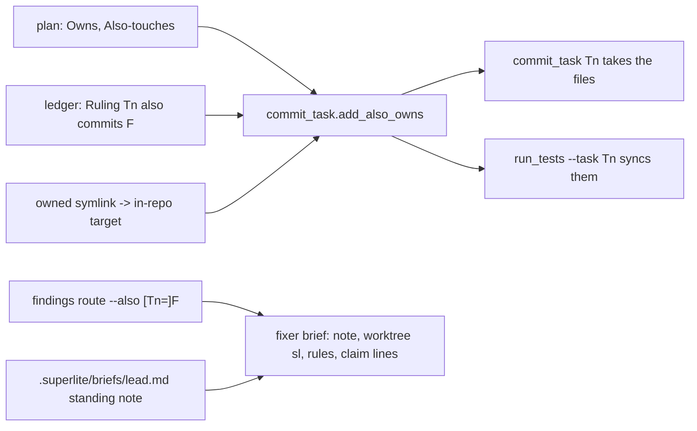
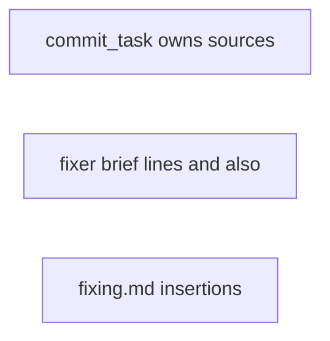

# Superlite: files outside Owns, fixer briefs (B130)

**Goal:** fix #596 and #603: commit_task takes a task's `**Also-touches:**` files and the in-repo targets of its owned symlinks (run_tests --task syncs both through the same function), a `--claim` names its next step, a `### T1: Title` heading gives the title `Title`; fixer briefs from `findings route` copy the lead's standing note, name the worktree's `sl` for tool files, say checkpoints are hidden and formatting is own-files only, and take extra files with `--also`; fixing.md says where briefs and notes live.
**Architecture:** `commit_task.add_also_owns` (called by commit_task and by run_tests before it builds a task tree) grows two sources; `findings.route` gains `also=`; brief text gains lines; fixing.md gains sentences.
**Tech stack:** Python 3.10+ stdlib, pytest (through `sl run_tests`); Markdown.
**Spec:** this file, section Design; issues #596, #603.
**Detail:** tests
**Target-min:** 11
**Wave0:** none
**Coverage:** off

Global constraints:
- Existing tests stay green. An existing test file changes only when the task Owns it. If another existing test turns red, report it in DONE_WITH_CONCERNS with the test id and the reason instead of editing it.
- Run `sl` as an executable (`<abs>/sl ...`). Verify with `<abs>/sl run_tests --fast <own test files> --task Tn --background`, then run the printed `wait:` line in the foreground and end the turn only after it reports. Never `run_tests -m` (refused, #638).
- Format only the files you changed; never run a format command over the whole tree.
- No version edits. Never run `scripts/evals.sh`, `claude plugin eval` or `scripts/test_layers.py run`.
- Keep each file's per-line `# O(...)` complexity comments on new code lines, as the file does.

Ruling: bounded change to existing flows, written as a plan because the lead brief requires the plan flow; `**Coverage:** off` (no new subsystem).
Ruling: the compile-only plan field is `**Also-touches:**` (the issue's own name), parsed like Owns; it joins the task's owns inside `commit_task.add_also_owns`, so run_tests (owned by B119/B151) syncs it with no edit of its own (it already calls that function, #239).
Ruling: `--claim` still commits nothing (it precedes the edit, and a checkpoint marks the task done); it prints its `next:` line, and several tasks with `--claim` stay refused with a message that names `--also`, which already commits files with the first of several tasks.
Ruling: plan lint (plan_tools.py: B129, B146), writing-plans SKILL.md (B142, B143), docs/tools.md (B119, B135) and the guard message (hooks/block-coordinator-edits, guard_judge.py: B141) belong to other open batches: their parts become follow-ups in notes.md.
Ruling: next_tasks.py (title parse) is listed by no open batch: T1 edits it and notes.md names it.
Ruling: already in the lead worktree, no `sl worktree ensure`; no probe adapter (named tests cover every case).
LAYERS: unit, headless



## Design

### 1. commit_task and next_tasks (#596)
- `add_also_owns(info, ledger)` appends, in this order and each entry once: the ledger's `Ruling: Tn also commits F` entries (as today); then each task's `**Also-touches:**` entries (`nt.parse_owns(nt._field(info[t].get("body", ""), "Also-touches"))`); then, for every entry of the task's owns (the additions included) that is a symlink (`os.path.islink` on the entry without a trailing `/`), its target as a path relative to the cwd (both through `os.path.realpath`), posix form, with a trailing `/` when the entry has one. A target outside the cwd adds nothing.
- `--claim`: after its `Tn claimed F` lines, one more stdout line `next: commit_task Tn --plan <the --plan value as passed> (a claim commits nothing; it records the ruling)`. With several tasks the refusal becomes `error: --claim takes one task and commits nothing; to commit <files> with <first> and commit <rest> in one call: commit_task <ids> --also <files> --ruling TEXT` (files, rest and ids space-joined), exit 2.
- `next_tasks.parse_plan`: a title that starts with `:` (spaces after it optional) or with `-`, `–` or `—` followed by a space loses that separator and its spaces, so `### T1: Title` gives `Title` and the checkpoint subject `T1: Title`.

### 2. findings route (#603, #596)
- `standing_note(sd) -> list[str]`: in `<sd>/briefs/lead.md`, the line equal to `backlog_brief.NOTE_HEAD` and the lines right after it that start with four spaces; `[]` when the file or the line is missing. Task and coordinator briefs put `""` plus these lines right before `""`, `Findings:`.
- Worktree sl: `fleet_io.worktree_sl(root, superlite_root, files)` with files = the task's Owns (task brief), the finding files and the extra files; when it returns `(path, names)`, the line `Worktree sl (live checks of the tools this fix touches: <names, comma-space>; type it literally): <path>` then `fleet_io.WORKTREE_REST` come right after the `sl (type it literally ...)` line. `superlite_root` defaults to `Path(findings.__file__).resolve().parents[3]`.
- `FORMAT_RULE` (in `shared_lines`, so both brief kinds): `Format only the files you changed: pass their paths to the project's format command, never run it over the whole tree; a format command that takes no paths is the coordinator's, once at the final-review gate.`
- `CHECKPOINT_RULE` (task briefs only, the line after `Commit:`): ``commit_task stores a hidden checkpoint under `refs/superlite/` (not a commit on the branch), so your files stay modified in `git status` after it: that is normal, not a concern to report.``
- `route(sd, plan, reports, sl_path, also=None, superlite_root=None)`: each `also` value is `FILE` or `Tn=FILE` (`Tn` matches `[A-Z]{1,3}\d+[A-Za-z]?`), FILE through `rel(FILE, root)`. Checked before any file is written, against the task briefs this call writes (plan order; the coordinator group never counts): `Tn=FILE` with no brief for Tn raises `AlsoError(f"--also {value}: {tid} gets no brief in this call ({names})")`; a bare FILE when the call writes not exactly one task brief raises `AlsoError(f"--also {value} needs one task brief; this call writes {n} ({names}): pass --also Tn={value}")`; `names` is the ids comma-space joined, or `none`. A call with no findings ignores `also`. A brief with extra files gets `Extra files (findings route --also; the fix may edit them too): a, b` right after its `Task:` line; each extra file outside the task's Owns gets the claim line with `--ruling "<ALSO_RULING>"`, `ALSO_RULING = "coordinator ruling: the fix needs this file (findings route --also)"` (a file that is also a finding file keeps `RULING`). The printed `files=` lists finding and extra files, sorted.
- CLI: `findings route --plan P [--also [Tn=]FILE ...] REPORT.json ...` (`--also` repeatable, one value each); `AlsoError` prints `error: <message>` on stderr, exit 2.

### 3. fixing.md (#603, main's tell from B137)
Insertions only (every existing sentence stays):
1. At the end of the **Fleet on:** paragraph: ``A file the fix needs outside its findings goes in with `--also F` (the call writes one brief) or `--also Tn=F` (that task's brief): the brief lists it with its claim line, so the fixer's commit takes it; a ruling that lets a fixer touch another file goes this way, never as text. Every brief copies the standing note of `.superlite/briefs/lead.md` and, in a superlite worktree, names the worktree's `sl` for the tools it touches.``
2. A new paragraph right after the **Fleet on:** paragraph: ``A brief you write by hand goes to `.superlite/briefs/fix-<id>.md`, never `.superlite/fixes/`: that folder holds the fixers' notes, and a fixer rewrites its note there every round, so a brief in it is lost.``
3. At the end of the **Outside Owns:** bullet: ``A claim only records the ruling and prints `next: commit_task Tn`; that later `commit_task Tn` commits F with the task. To commit F with Tn now: `commit_task Tn --also F --ruling "..."`.``
4. In the **Fixer contract:** bullet, right after `` `commit_task <Tn>`; report a closed list.``: ``A dirty `git status` after `commit_task` is normal: it stores a hidden checkpoint under `refs/superlite/`, not a commit on the branch. Format only the files you changed (their paths to the project's format command), never the whole tree; a format command that takes no paths is the coordinator's, once at the final-review gate.``

## File structure

- `skills/subagent-driven-development/scripts/commit_task.py`: add_also_owns sources, claim next line and refusal (T1)
- `skills/subagent-driven-development/scripts/next_tasks.py`: title separator (T1)
- `tests/scripts/test_commit_also_touches_596.py`: T1's tests
- `skills/subagent-driven-development/scripts/findings.py`: brief lines, --also (T2)
- `tests/scripts/test_findings_brief_603.py`: T2's tests
- `skills/subagent-driven-development/fixing.md`: four insertions (T3)
- `tests/scripts/test_fixing_doc_603.py`: T3's test

## Task graph

```mermaid
%% schedule
gantt
  title Predicted schedule (mm:ss)
  dateFormat X
  axisFormat %M:%S
  section lane 1
  T1 commit_task owns sources claim next s :t1, 0, 379s
  section lane 2
  T2 fixer brief lines and route --also :t2, 0, 341s
  section lane 3
  T3 fixing.md insertions :t3, 0, 270s
```





critical path: T1 (6.3 min) · peak width 3 · predicted build 6.3 min · predicted total ≈ 16.8 min (target ✗ 11.0)

## Package: scripts

App type: CLI. Categories: file (symlinks), protocol (flags), state (ledger). **Probe entry:** none (CLI flags and brief text; every case is a named test).

### T1 commit_task owns sources, claim next step, title separator · Complexity 4 · Est. context 45k
**Owns:** skills/subagent-driven-development/scripts/commit_task.py, skills/subagent-driven-development/scripts/next_tasks.py, tests/scripts/test_commit_also_touches_596.py
**Components:** 3
**LOC owned:** 150
**Tests:** fast
**Model:** sonnet
**Est. time:** 3 min (3 components, about 150 LOC, fast tests)
**Covers:** 1
**Consumes:** none
**Produces:** commit_task.add_also_owns(info: dict, ledger: str) -> None
**Review Focus:** `test_owned_symlink_target_commits_with_its_task` (file: an edit through an owned link commits the target); `test_link_outside_the_repo_adds_nothing` (file); `test_claim_with_several_tasks_names_also` (protocol).
**Notes:** update the module docstring of commit_task.py (one sentence each for Also-touches, symlink targets, the claim's next line). Keep `Tn claimed F` unchanged (pinned by test_commit_scope_batch). Symlink creation failing (OSError) skips the symlink tests.
**Test code (verbatim):** new file tests/scripts/test_commit_also_touches_596.py:
```python
"""#596: commit_task takes **Also-touches:** files and owned symlinks' targets; --claim names its next step; `### T1: Title` titles."""
import os
import sys
from pathlib import Path

import pytest

HERE = Path(__file__).resolve().parent
sys.path.insert(0, str(HERE))
from test_commit_scope_batch import RULING, commit, entries  # noqa: E402
from test_run_scripts import SCRIPTS, git, make_repo, write  # noqa: E402

sys.path.insert(0, str(SCRIPTS))
import commit_task  # noqa: E402
import next_tasks as nt  # noqa: E402

PLAN = """# Plan

### T1: enum payload · Complexity 2 · Est. context 20k

**Owns:** `src/a.py`, `src/link.py`
**Also-touches:** `src/b.py`

### T2 · user of the enum · Complexity 2 · Est. context 20k

**Owns:** `src/b.py`

### T3 — dashed · Complexity 1 · Est. context 20k

**Owns:** `src/c.py`
"""


def repo_with(tmp_path):
    repo = make_repo(tmp_path)
    write(repo, "plan.md", PLAN)
    write(repo, "src/a.py", "A = 0\n")
    write(repo, "src/b.py", "B = 0\n")
    write(repo, "lib/real.py", "R = 0\n")
    try:
        os.symlink("../lib/real.py", repo / "src" / "link.py")
    except OSError:
        pytest.skip("no symlinks here")
    git(repo, "add", "-A")
    git(repo, "commit", "-q", "-m", "plan")
    return repo


def owns_after(repo, monkeypatch):
    monkeypatch.chdir(repo)
    info = nt.parse_plan(str(repo / "plan.md"))
    commit_task.add_also_owns(info, str(repo / ".superlite" / "progress.md"))
    return info


def test_add_also_owns_adds_plan_field_and_link_targets(tmp_path, monkeypatch):
    info = owns_after(repo_with(tmp_path), monkeypatch)
    assert info["T1"]["owns"] == ["src/a.py", "src/link.py", "src/b.py", "lib/real.py"]
    assert info["T2"]["owns"] == ["src/b.py"]


def test_link_outside_the_repo_adds_nothing(tmp_path, monkeypatch):
    repo = repo_with(tmp_path)
    (tmp_path / "outside.py").write_text("O = 0\n", encoding="utf-8")
    os.remove(repo / "src" / "link.py")
    os.symlink(str(tmp_path / "outside.py"), repo / "src" / "link.py")
    assert owns_after(repo, monkeypatch)["T1"]["owns"] == ["src/a.py", "src/link.py", "src/b.py"]


def test_also_touches_file_commits_with_its_task(tmp_path):
    repo = repo_with(tmp_path)
    write(repo, "src/a.py", "A = 1\n")
    write(repo, "src/b.py", "B = 1\n")
    r = commit(repo, "T1")
    assert r.returncode == 0, r.stdout + r.stderr
    assert sorted(entries(repo)[-1]["files"]) == ["src/a.py", "src/b.py"]
    assert git(repo, "log", "-1", "--format=%s", r.stdout.strip().splitlines()[-1]) == "T1: enum payload"


def test_owned_symlink_target_commits_with_its_task(tmp_path):
    repo = repo_with(tmp_path)
    (repo / "src" / "link.py").write_text("R = 1\n", encoding="utf-8")
    r = commit(repo, "T1")
    assert r.returncode == 0, r.stdout + r.stderr
    assert entries(repo)[-1]["files"] == ["lib/real.py"]
    assert "outside every Owns" not in r.stderr and "out-of-scope" not in r.stdout


def test_claim_names_its_next_step(tmp_path):
    repo = repo_with(tmp_path)
    r = commit(repo, "T2", "--claim", "src/a.py", "--ruling", RULING)
    assert r.returncode == 0, r.stdout + r.stderr
    assert r.stdout.splitlines()[-2:] == [
        "T2 claimed src/a.py", "next: commit_task T2 --plan plan.md (a claim commits nothing; it records the ruling)"]


def test_claim_with_several_tasks_names_also(tmp_path):
    repo = repo_with(tmp_path)
    r = commit(repo, "T1", "T2", "--claim", "x.md", "--ruling", RULING)
    assert r.returncode == 2
    assert ("error: --claim takes one task and commits nothing; to commit x.md with T1 and commit T2 in one call: "
            "commit_task T1 T2 --also x.md --ruling TEXT") in r.stderr


def test_heading_separators_leave_the_title(tmp_path):
    info = nt.parse_plan(str(repo_with(tmp_path) / "plan.md"))
    assert [info[t]["title"] for t in ("T1", "T2", "T3")] == ["enum payload", "user of the enum", "dashed"]
```
**Steps:** 1 write the test file, 2 run it: FAIL, 3 implement Design 1, 4 run: PASS

### T2 fixer brief lines and route --also · Complexity 4 · Est. context 44k
**Owns:** skills/subagent-driven-development/scripts/findings.py, tests/scripts/test_findings_brief_603.py
**Components:** 2
**LOC owned:** 190
**Tests:** fast
**Model:** sonnet
**Est. time:** 3 min (2 components, about 190 LOC, fast tests)
**Covers:** 2
**Consumes:** none
**Produces:** findings.route(sd: Path, plan: Path, reports: list[str], sl_path: str, also: list[str] | None = None, superlite_root: str | None = None) -> list[str] · findings.standing_note(sd: Path) -> list[str] · findings.AlsoError(ValueError)
**Review Focus:** `test_also_with_several_briefs_needs_a_task` (protocol: nothing written before the check); `test_coordinator_brief_gets_the_note_and_format_rule_only` (state: a busy implementer sends the finding to the coordinator brief).
**Notes:** import fleet_io lazily inside route (it imports herdr_client). Update the module docstring (the --also form and the new brief lines). Existing test_findings_route*.py stay green unchanged.
**Test code (verbatim):** new file tests/scripts/test_findings_brief_603.py:
```python
"""#603 #596: fixer briefs copy the standing note, name the worktree sl, carry the format and checkpoint rules; --also adds files."""
import json
import re
import sys

import pytest
from test_plan_tools import SCRIPTS
from test_findings_route import f, run  # noqa: F401  (the fixture)

sys.path.insert(0, str(SCRIPTS))
import backlog_brief as bb  # noqa: E402
import findings  # noqa: E402
import fleet_io  # noqa: E402

TOOL = "skills/subagent-driven-development/scripts"
LEAD = (f"# Lead brief: B1 (x)\nMax's decisions: none\n{bb.NOTE_HEAD}\n    run_tests -m is refused for now\n    second line\n"
        "Rulings from shipped batches: none\n")
NOTE = f"{bb.NOTE_HEAD}\n    run_tests -m is refused for now\n    second line\n"


def brief(sd, name):
    return (sd / "briefs" / name).read_text(encoding="utf-8")


def test_brief_copies_the_standing_note(run):
    root, sd, plan, report = run
    (sd / "briefs").mkdir()
    (sd / "briefs" / "lead.md").write_text(LEAD, encoding="utf-8")
    findings.route(sd, plan, [report("FR1", [f("src/a.py", 1, 1)])], "/sl/sl")
    text = brief(sd, "fix-F-T1-1.md")
    assert NOTE in text and text.index(NOTE) < text.index("Findings:")
    assert "Rulings from shipped batches" not in text and "Max's decisions" not in text


def test_no_lead_brief_no_note_and_no_worktree_sl(run):
    root, sd, plan, report = run
    findings.route(sd, plan, [report("FR1", [f("src/a.py", 1, 1)])], "/sl/sl")
    text = brief(sd, "fix-F-T1-1.md")
    assert bb.NOTE_HEAD not in text and "Worktree sl" not in text
    assert findings.standing_note(sd) == []


def test_coordinator_brief_gets_the_note_and_format_rule_only(run):
    root, sd, plan, report = run
    (sd / "briefs").mkdir()
    (sd / "briefs" / "lead.md").write_text(LEAD, encoding="utf-8")
    (sd / "fleet.json").write_text(json.dumps({"workers": {"W1": {"state": "busy", "role": "implementer", "task": "T1"}}}))
    findings.route(sd, plan, [report("FR1", [f("src/a.py", 1, 1)])], "/sl/sl")
    text = brief(sd, "fix-F-C-1.md")
    assert NOTE in text and findings.FORMAT_RULE in text and findings.CHECKPOINT_RULE not in text


def test_brief_names_the_worktree_sl_for_a_tool_file(run):
    root, sd, plan, report = run
    sl = root / TOOL / "sl"
    sl.parent.mkdir(parents=True)
    sl.write_text("#!/bin/sh\n", encoding="utf-8")
    findings.route(sd, plan, [report("FR1", [f(f"{TOOL}/findings.py", 3, 1)])], "/sl/sl")
    text = brief(sd, "fix-F-T3-1.md")
    want = f"Worktree sl (live checks of the tools this fix touches: findings; type it literally): {root.resolve() / TOOL / 'sl'}"
    assert want in text and fleet_io.WORKTREE_REST in text


def test_task_brief_says_checkpoints_are_hidden_and_formats_own_files(run):
    root, sd, plan, report = run
    findings.route(sd, plan, [report("FR1", [f("src/a.py", 1, 1)])], "/sl/sl")
    text = brief(sd, "fix-F-T1-1.md")
    assert findings.FORMAT_RULE in text and findings.CHECKPOINT_RULE in text
    assert text.index(findings.CHECKPOINT_RULE) > text.index("Commit: `/sl/sl commit_task T1")
    for s in ("only the files you changed", "pass their paths", "never run it over the whole tree", "takes no paths",
              "the coordinator's, once at the final-review gate"):
        assert s in findings.FORMAT_RULE
    for s in ("hidden checkpoint", "refs/superlite/", "stay modified in `git status`", "normal"):
        assert s in findings.CHECKPOINT_RULE


def test_also_file_joins_the_one_brief_with_a_claim_line(run):
    root, sd, plan, report = run
    lines = findings.route(sd, plan, [report("FR1", [f("src/a.py", 1, 1)])], "/sl/sl", also=["src/b.py"])
    b = sd.resolve() / "briefs"
    assert lines == [f"fixer tier=sonnet brief={b / 'fix-F-T1-1.md'} files=src/a.py,src/b.py task=T1"]
    text = (b / "fix-F-T1-1.md").read_text(encoding="utf-8")
    assert "Extra files (findings route --also; the fix may edit them too): src/b.py" in text
    assert f'/sl/sl commit_task T1 --claim src/b.py --ruling "{findings.ALSO_RULING}" --plan {plan.resolve()}' in text


def test_also_with_several_briefs_needs_a_task(run):
    root, sd, plan, report = run
    r = report("FR1", [f("src/a.py", 1, 1), f("src/d.py", 2, 1)])
    msg = "--also src/c.py needs one task brief; this call writes 2 (T1, T3): pass --also Tn=src/c.py"
    with pytest.raises(findings.AlsoError, match=re.escape(msg)):
        findings.route(sd, plan, [r], "/sl/sl", also=["src/c.py"])
    assert sorted(sd.glob("briefs/fix-*.md")) == []
    with pytest.raises(findings.AlsoError, match=re.escape("--also T2=src/c.py: T2 gets no brief in this call (T1, T3)")):
        findings.route(sd, plan, [r], "/sl/sl", also=["T2=src/c.py"])
    lines = findings.route(sd, plan, [r], "/sl/sl", also=["T3=src/c.py"])
    assert [ln.split(" files=")[1] for ln in lines] == ["src/a.py task=T1", "src/c.py,src/d.py task=T3"]


def test_cli_also_error_exits_2(run, capsys):
    root, sd, plan, report = run
    r = report("FR1", [f("src/a.py", 1, 1)])
    assert findings.main(["route", "--plan", str(plan), "--also", "T2=src/c.py", r]) == 2
    assert "error: --also T2=src/c.py: T2 gets no brief in this call (T1)" in capsys.readouterr().err
    assert findings.main(["route", "--plan", str(plan), "--also", "src/c.py", r]) == 0
```
**Steps:** 1 write the test file, 2 run it: FAIL, 3 implement Design 2, 4 run: PASS

## Package: docs

App type: prompt text. **Probe entry:** none (doc text; one named test).

### T3 fixing.md insertions · Complexity 1 · Est. context 25k
**Owns:** skills/subagent-driven-development/fixing.md, tests/scripts/test_fixing_doc_603.py
**Kind:** mechanical
**Components:** 1
**LOC owned:** 30
**Tests:** fast
**Model:** haiku
**Est. time:** 1.5 min (1 component, about 30 LOC, fast tests)
**Covers:** 3
**Consumes:** none
**Produces:** none
**Review Focus:** `test_fixing_md_holds_the_four_insertions`: each Design 3 text is in fixing.md exactly once, in its place.
**Notes:** insert the four Design 3 texts verbatim (without the outer double backticks), changing no other character of fixing.md.
**Test code (verbatim):** new file tests/scripts/test_fixing_doc_603.py:
```python
"""#603 #596: fixing.md says where briefs and notes live, names route --also and the claim's next step, the format and checkpoint rules."""
from pathlib import Path

TEXT = (Path(__file__).resolve().parents[2] / "skills" / "subagent-driven-development" / "fixing.md").read_text(encoding="utf-8")


def test_fixing_md_holds_the_four_insertions():
    for s in ("or `--also Tn=F` (that task's brief): the brief lists it with its claim line", "goes this way, never as text",
              "copies the standing note of `.superlite/briefs/lead.md`",
              "A brief you write by hand goes to `.superlite/briefs/fix-<id>.md`, never `.superlite/fixes/`",
              "A claim only records the ruling and prints `next: commit_task Tn`",
              "A dirty `git status` after `commit_task` is normal: it stores a hidden checkpoint under `refs/superlite/`",
              "a format command that takes no paths is the coordinator's, once at the final-review gate"):
        assert TEXT.count(s) == 1, s
    assert TEXT.index("A brief you write by hand") > TEXT.index("**Fleet on:**")
    assert TEXT.index("A brief you write by hand") < TEXT.index("A file no task owns goes to the closest committed task")
    assert TEXT.index("A claim only records") > TEXT.index("- **Outside Owns:**")
    assert TEXT.index("A dirty `git status`") > TEXT.index("`commit_task <Tn>`; report a closed list.")
```
**Steps:** 1 write the test file, 2 run it: FAIL, 3 insert the four texts, 4 run: PASS

## Self-review

Coverage: Design 1 -> T1, 2 -> T2, 3 -> T3. No placeholders. No Consumes; T2's `fleet_io.worktree_sl` and `WORKTREE_REST` and T1's `nt.parse_owns`/`nt._field` exist on main. No two tasks share a file; no edges (T3 names T2's flags only). Fields filled.
