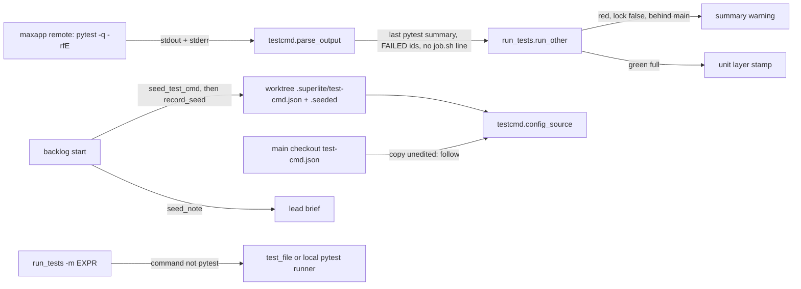
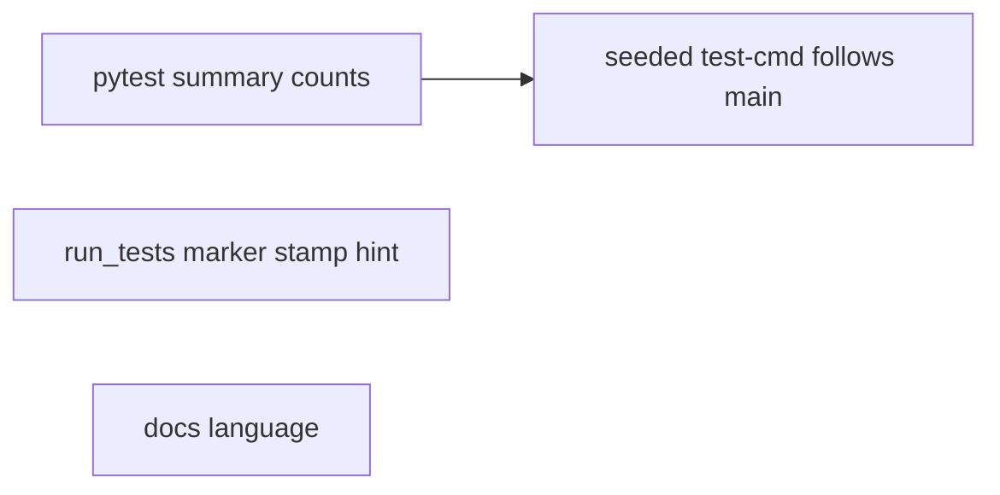

# Superlite: remote full run counts, marker runs, seeded test-cmd.json (B151)

**Goal:** fix #638: a red remote full run is counted from its last pytest summary line with the short summary's failing ids; `run_tests -m EXPR` with a wrapped (remote) test command runs locally instead of being refused; a lead worktree's seeded `test-cmd.json` follows the main checkout's file unless edited there, and a differing copy is named. Main's additions: a green configured `--full` run stamps the unit layer; the server's `job.sh: waiting for a free job slot` line never counts; a red remote full run on a branch behind the main checkout says to merge it first.
**Architecture:** `testcmd.parse_output` gains a pytest branch (last summary line wins) and drops placement noise lines; `testcmd` records the bytes `backlog start` seeded (`.superlite/test-cmd.seeded`) and `config_source` follows the main checkout's file while the worktree copy still equals them; `backlog_run.start` records the seed and puts `testcmd.seed_note` into the lead brief; `run_tests` falls back for `-m`, stamps configured full runs and warns on a red remote run behind the main checkout; `docs/language.md` says all of it.
**Tech stack:** Python 3.10+ stdlib, pytest (through `sl run_tests`); Markdown docs.
**Spec:** this file, section Design; issue #638 and main's message (sl backlog tell).
**Detail:** tests
**Target-min:** 11
**Wave0:** none
**Coverage:** off

Global constraints:
- Every Python code line keeps the file's trailing `# O(...)` complexity comment.
- Existing tests stay green. An existing test file changes only when the task Owns it. If another existing test turns red, report it in DONE_WITH_CONCERNS with the test id and the reason instead of editing it.
- Run `sl` as an executable (`<abs>/sl ...`). Verify with `<abs>/sl run_tests --fast <own test files> --task Tn --background`, then run the printed `wait:` line in the foreground and end the turn only after it reports.
- No version edits. Never run `scripts/evals.sh`, `claude plugin eval`, `scripts/test_layers.py run` or `run_tests --full`. No test calls `maxapp`.
- Never edit `backlog.py` (B144 owns it; `seed_test_cmd` stays as is), `docs/tools.md`, `pt_review.py`, or the GUI preflight code in `run_tests.py` (B119).

Ruling: the pytest branch runs before the jest/vitest `Tests:` branch and wins whenever a pytest summary line exists (because nested fixture output in a red run printed `Tests:` and `N passed` lines that won; cost if wrong: a non-pytest runner printing `N passed in 1.2s` alone is read as pytest, with the same counts).
Ruling: a marker run whose test command is not pytest uses `test_file` with `{files}` replaced by the given paths or, with none, by `testcmd.python_full_args(root)` (superlite: `tests`), else the local pytest runner when the config language is python or detection finds a Python project; a `**Tests:** cmd=` task command stays refused (because `test_file` is the local command and a marker run is a fast run; cost if wrong: a project whose `test_file` is not pytest and is not Python keeps the refusal).
Ruling: the seed record is a byte copy at `.superlite/test-cmd.seeded`; a worktree without a record (seeded before 1.5.150) or with an edited copy keeps its own file, and `sl testcmd` plus the lead brief name the difference (because an unrecorded copy cannot be told from an edit; cost if wrong: an old stale copy runs until the lead deletes it, but it is told to).
Ruling: by main (sl backlog tell), not the user: a green configured `--full` run from the git toplevel holding `scripts/test_layers.py` stamps the unit layer like the default pytest run; the review packet's missing `warning` line is a follow-up for B129 (pt_review.py).
Ruling: the behind-hint fires on a red `--full` run whose test-cmd.json says `"lock": false`, inside a linked worktree that lacks commits of the main checkout's HEAD; it joins the summary's `warning` (which `--wait` already prints) and one stderr line (because that is when the lead acts; cost if wrong: a local red full run behind main gets no hint).
Ruling: sequential - T1 and T2 both own testcmd.py.
LAYERS: unit

## Design

### 1. Counts of a red remote run (#638 item 1)
`parse_output` (non-Xcode path) looks for pytest summary lines: `63 failed, 7203 passed, 9 skipped in 591.45s`, `==== 2 failed, 3 passed, 1 warning in 0.12s (0:00:00) ====`, words passed, failed, error(s), skipped, xfailed, xpassed, deselected, warning(s), rerun, `in N(.N)s` or `in N seconds`. The last one in the output wins: passed + xpassed are passed, failed + errors are failed, skipped + xfailed are skipped. Failing names: the `FAILED <id>` and `ERROR <id>` lines (id cut before ` - `) after the last `short test summary info` header line that precedes that summary line, else the run of such lines right above it; at most 50, each up to 120 characters.

### 2. Placement noise (main's item 3)
`parse_output` drops lines matching `^job\.sh: waiting for a free job slot` before parsing, so they reach no count, name, tail or `last` line; the full output log keeps them.

### 3. Marker runs with a wrapped command (#638 item 2)
See the marker Ruling. The note on stderr: ``run_tests: -m runs `<command>`: the test command `<test>` is not pytest`` (for the runner fallback `<command>` is `the local pytest runner`).

### 4. Seeded copy follows the main checkout (#638 item 3)
`backlog start` records the seed right after `backlog.seed_test_cmd` copied it. `config_source` returns the main checkout's config (origin its path) while the worktree's copy equals the record and differs from the main file. `seed_note` names the state; `sl testcmd` prints it on stderr as `testcmd: <note>`, the lead brief as `Test command: <note>`.

### 5. Unit stamp and behind-hint (main's item 1, #638 item 3 last sentence)
`run_tests` no longer clears `a.unit_snap` for a configured command. A red full remote run behind the main checkout adds ``this branch lacks N commits of <branch> (the main checkout); the remote run tests this branch's tree: merge <branch> first (`git merge <branch>`), then rerun`` to `WARNING`.

### 6. Docs
`docs/language.md`: the User-level default and Remote full run paragraphs say a green configured full run stamps the unit layer, and the Remote full run paragraph names the counting, the marker fallback, the seed follow and the behind-hint.

## File structure
- `skills/subagent-driven-development/scripts/testcmd.py`, `tests/scripts/test_testcmd_pytest_summary_638.py`: T1
- `skills/subagent-driven-development/scripts/testcmd.py`, `skills/subagent-driven-development/scripts/backlog_run.py`, `tests/scripts/test_testcmd_seed_638.py`, `tests/scripts/test_backlog_start_seed_638.py`: T2
- `skills/subagent-driven-development/scripts/run_tests.py`, `tests/scripts/test_run_tests_remote_638.py`, `tests/scripts/test_run_tests_unit_stamp.py`: T3
- `docs/language.md`, `tests/scripts/test_docs_remote_run_638.py`: T4

## Task graph

```mermaid
%% schedule
gantt
  title Predicted schedule (mm:ss)
  dateFormat X
  axisFormat %M:%S
  section lane 1
  T3 run_tests marker stamp hint :t3, 0, 432s
  section lane 2
  T1 pytest summary counts :t1, 0, 380s
  T2 seeded test-cmd follows main :t2, 380, 428s
  section lane 3
  T4 docs language :t4, 0, 362s
```

critical path: T1 → T2 (13.5 min) · peak width 3 · predicted build 13.5 min · predicted total ≈ 26.0 min (target ✗ 11.0)

## Package: testcmd

App type: parser (runner output) and config resolution. Categories: deep (nested summaries), encoding (ANSI, params with spaces), file (seed record), state (edited vs seeded copy). **Probe entry:** none (cases are named tests).

### T1 pytest summary counts · Complexity 4 · Est. context 38k
**Owns:** skills/subagent-driven-development/scripts/testcmd.py, tests/scripts/test_testcmd_pytest_summary_638.py
**Components:** 1
**LOC owned:** 140
**Tests:** fast
**Model:** sonnet
**Est. time:** 2.5 min (1 component, about 140 LOC, fast tests)
**Covers:** 1, 2
**Produces:** testcmd.parse_output(text: str, rc: int) -> dict
e.g. parse_output("tests/a.py F.\n=== short test summary info ===\nFAILED tests/a.py::test_x - AssertionError: 1 failed, 2 passed in 0.1s\n1 failed, 1 passed in 0.50s\n", 1) -> {"passed": 1, "failed": 1, "skipped": 0, "names": ["tests/a.py::test_x"], "counted": True, ...}
e.g. parse_output("7200 passed, 9 skipped in 591.45s (0:09:51)\njob.sh: waiting for a free job slot\n", 0) -> {"passed": 7200, "failed": 0, "skipped": 9, "names": [], "tail": ["7200 passed, 9 skipped in 591.45s (0:09:51)"], ...}
**Review Focus:** `test_nested_summary_in_failure_output_loses`: a FAILURES section holding `Tests: 1 failed, 2 passed`, `1 failed, 2 passed in 0.2s` and `FAILED tests/inner.py::t` lines, then the short summary with 63 FAILED lines and `63 failed, 7203 passed, 9 skipped in 591.45s` -> passed 7203, failed 63, skipped 9, 50 names, none of them `tests/inner.py::t`; `test_errors_count_as_failed`: `1 failed, 5 passed, 2 errors in 3.00s` -> failed 3 and the ERROR id listed; `test_param_id_with_spaces`: `FAILED tests/a.py::t[a b] - x` -> name `tests/a.py::t[a b]`; `test_job_slot_line_never_counts`: red exit with only `job.sh: waiting for a free job slot` -> failed 1, counted False, names [], tail []; `test_xfail_xpass_deselected`: `3 passed, 1 xfailed, 1 xpassed, 4 deselected, 2 warnings in 1.00s` -> passed 4, skipped 1.
**Steps:** 1 failing tests, 2 run: FAIL, 3 implement, 4 run: PASS
**Notes:**
- Module constants `PYTEST_SUMMARY` (anchored: optional `=+ ` prefix, count items `\d+ <word>` joined by `, `, ` in N(.N)s` or ` in N seconds`, optional ` (H:MM:SS)`, optional ` =+` suffix) and `NOISE` (`^job\.sh: waiting for a free job slot`). Filter NOISE out of `lines` before `_parse_xcode`.
- The pytest branch comes before the `Tests:` summary branch; it sets `names` from the short summary (also on a green exit it lists none). `counted` stays `bool(passed or failed or skipped)`; a red exit with zero failed still becomes failed 1. `empty` logic is unchanged.
- The existing jest, vitest, go, cargo, dotnet, mocha, Xcode tests in tests/scripts (test_testcmd*.py, test_run_tests_*) stay green.
- Docstring: name the pytest branch and the noise filter in the parse_output Library entry.

### T2 seeded test-cmd follows main · Complexity 4 · Est. context 42k
**Owns:** skills/subagent-driven-development/scripts/testcmd.py, skills/subagent-driven-development/scripts/backlog_run.py, tests/scripts/test_testcmd_seed_638.py, tests/scripts/test_backlog_start_seed_638.py
**Components:** 2
**LOC owned:** 170
**Tests:** fast
**Model:** sonnet
**Est. time:** 3.0 min (2 components, about 170 LOC, fast tests)
**Covers:** 4
**Produces:** testcmd.record_seed(wt: str | Path) -> bool
e.g. record_seed(wt) with wt/.superlite/test-cmd.json = b'{"test": "a"}\n' -> True, wt/.superlite/test-cmd.seeded holds the same bytes
e.g. record_seed(wt) with no test-cmd.json in wt -> False, no record written, nothing printed
**Produces:** testcmd.seed_note(root: str | Path) -> str
e.g. seed_note(wt) with copy == record and the main file changed -> "the main checkout's /m/.superlite/test-cmd.json changed since it was seeded here, so runs follow it; if this branch predates that change, merge the default branch first: the new command may need its fixes"
e.g. seed_note(wt) with copy edited (differs from record and main) -> "this worktree's .superlite/test-cmd.json differs from the main checkout's /m/.superlite/test-cmd.json and is the one that runs; delete it to follow the main checkout's"
e.g. seed_note(wt) with copy == main file, or the main checkout itself, or no copy -> ""
**Review Focus:** `test_config_source_follows_main_while_copy_unedited`: worktree copy `{"test": "old"}` == record, main `{"test": "new"}` -> config_source returns test "new", origin the main path; `test_edited_copy_runs`: copy `{"test": "mine"}`, record `{"test": "old"}` -> test "mine"; `test_no_record_keeps_copy`: copy differs from main, no record -> copy runs and seed_note names the difference; `test_unreadable_main_keeps_copy`: main file `not json` -> the copy runs; `test_testcmd_cli_prints_note`: `testcmd.py --root wt` prints `testcmd: <note>` on stderr and its stdout JSON is unchanged; `test_start_records_seed_and_brief_note`: `backlog start` on a fresh batch writes `.superlite/test-cmd.seeded` equal to the copy and the brief has no `Test command:` line; a parked batch whose copy differs from main gets one `Test command: ` line in its brief.
**Steps:** 1 failing tests, 2 run: FAIL, 3 implement, 4 run: PASS
**Notes:**
- `SEEDED = ".superlite/test-cmd.seeded"`. `record_seed` writes atomically (tmp + replace); an OSError prints `test-cmd.json seed not recorded in <wt>: <err>` on stderr and returns False.
- A private `_seed_state(root) -> (state, main_path)` with state `none` (no copy, not a linked worktree, or the main checkout has no file), `same`, `follows` (copy bytes == record bytes != main bytes) or `own`. `config_source` checks `root / SEEDED` first and spawns git only when the record exists; on `follows` with `read_config(main)` not None it returns `(main cfg, "test-cmd.json", str(main / CONFIG))`.
- `main()`: after the resolve JSON, print `testcmd: <note>` on stderr when `seed_note(root)` is not empty.
- `backlog_run.start`: `if backlog.seed_test_cmd(root, wt): testcmd.record_seed(wt)`; after `lead_brief` (and the resume block) append `Test command: <note>` as its own line when `testcmd.seed_note(wt)` is not empty. Update the docstring sentence on seeding (#334, #638). Build the backlog test on `test_backlog_run.bk` like `tests/scripts/test_backlog_start_test_cmd_334.py`; that file stays green unchanged.

## Package: run_tests

App type: CLI. Categories: protocol (`-m`, `--full`), state (unit stamp, git refs). **Probe entry:** none (subprocess fixtures; cases are named tests).

### T3 run_tests marker stamp hint · Complexity 5 · Est. context 50k
**Owns:** skills/subagent-driven-development/scripts/run_tests.py, tests/scripts/test_run_tests_remote_638.py, tests/scripts/test_run_tests_unit_stamp.py
**Components:** 2
**LOC owned:** 190
**Tests:** fast
**Model:** sonnet
**Est. time:** 3.3 min (2 components, about 190 LOC, fast tests)
**Covers:** 3, 5
**Produces:** run_tests.behind_main() -> tuple[int, str] | None
e.g. behind_main() in a linked worktree 2 commits behind the main checkout's HEAD on branch main -> (2, "main")
e.g. behind_main() in the main checkout, outside git, or level with it -> None
**Review Focus:** `test_marker_uses_test_file_without_paths`: test-cmd.json `test` = `sh -c 'echo remote; exit 1'`, `test_file` = `<python> -m pytest {files} -q -p no:cacheprovider`, a tests/ folder with one `@pytest.mark.slow` test and one plain test -> `run_tests -m slow` exits 0, 1 passed, stderr names the `-m runs` note; `test_marker_falls_back_to_local_runner`: same without `test_file`, language python -> exits 0 with the note `the local pytest runner`; `test_marker_task_cmd_still_refused` stays as in test_run_tests_task_cmd_475; `test_configured_full_run_stamps_unit` (replaces `test_configured_test_command_does_not_stamp`): a green configured `--full` run stamps (`unit layer stamped` on stderr, unit line not stale); `test_red_remote_full_run_behind_main_warns`: linked worktree 1 commit behind, `"lock": false`, red command -> summary `warning` holds `lacks 1 commit` and `git merge main`; `test_green_or_locked_run_no_hint`: a green run or one without `"lock": false` has no hint; `test_job_slot_line_not_in_failure_text`: red command printing `1 failed, 2 passed in 0.1s` then `job.sh: waiting for a free job slot` on stderr -> no failure entry and no test-output.log line holds `job.sh`.
**Steps:** 1 failing tests, 2 run: FAIL, 3 implement, 4 run: PASS
**Notes:**
- Marker: in `run`, when `with_marker(spec["command"], a.marker)` is None and `spec.get("source") != "plan"`, a helper `marker_spec(spec, paths, marker) -> (spec, note) | None` tries `test_file` from `testcmd.config_source(Path("."))[0]` (paths shell-joined as `resolve` does, else `testcmd.python_full_args(Path("."))`), then the python runner spec (`{"language": "python", "python": True, "command": None, "junit": "", "env": spec env, "setup": "", "source": spec source, "origin": spec origin, "isolate": False, "lock": True, "destinations": []}`) when the config language is python or `testcmd.detect(Path("."))` says python; None keeps the usage error. Print the note once on stderr. Never touch the GUI preflight code.
- Stamp: drop `if not spec["python"]: a.unit_snap = None` (main's ruling); update the comment and the module docstring's stamp sentence (a configured command too).
- Hint: `behind_main` uses `testcmd._main_checkout_root(Path("."))`, `git -C <main> rev-parse HEAD` and `--abbrev-ref HEAD`, then `git rev-list --count HEAD..<sha>`; any git error -> None. In `run_other` after the runs: label full, `spec.get("lock") is False`, a non-zero exit, and `behind_main()` -> join the hint to `WARNING` with `; ` and print `run_tests: WARNING: <hint>` on stderr. `N commit` vs `N commits` by count.
- Test fixtures: build linked worktrees with `git worktree add`; use `sys.executable` for commands; set git identity through env as tests/scripts/_fixtures.py does.

## Package: docs

App type: docs. **Probe entry:** none (prose).

### T4 docs language · Complexity 2 · Est. context 26k
**Owns:** docs/language.md, tests/scripts/test_docs_remote_run_638.py
**Components:** 1
**LOC owned:** 40
**Tests:** fast
**Kind:** mechanical
**Model:** haiku
**Est. time:** 1.6 min (1 component, about 40 LOC, fast tests)
**Covers:** 6
**Review Focus:** `test_remote_paragraph_names_638`: the `**Remote full run.**` paragraph contains `last pytest summary line`, `FAILED`, `job.sh: waiting for a free job slot`, `-m EXPR`, `test_file`, `test-cmd.seeded`, `delete it to follow`, `merge`; `test_configured_full_run_stamps`: neither the User-level default nor the Remote full run paragraph contains `never stamps`, and the Remote full run paragraph contains `a green configured --full run` and `stamps the unit layer`.
**Steps:** 1 failing tests, 2 run: FAIL, 3 implement, 4 run: PASS
**Notes:**
- Edit only the `**User-level default.**` sentence `a configured command never stamps the unit layer` (now: a green configured `--full` run from the git toplevel holding `scripts/test_layers.py` stamps it like the default pytest run) and the `**Remote full run.**` paragraph (replace its `A configured command never stamps ...` sentence the same way, keep every phrase `tests/scripts/test_docs_remote_run_630.py` and `test_docs_533_user_test_cmd.py` assert, then append four sentences: counting from the last pytest summary line with the `FAILED`/`ERROR` ids of the short summary and the `job.sh: waiting for a free job slot` line ignored; `-m EXPR` with a remote `test` runs `test_file` (paths, else the project's test paths) or the local pytest runner, with one stderr note; `backlog start` records the seeded copy in `.superlite/test-cmd.seeded` and a copy still equal to it follows the main checkout's file, while an edited or unrecorded copy that differs runs and `sl testcmd` and the lead brief say `delete it to follow` the main checkout's; a red remote full run in a worktree behind the main checkout adds a `warning` to merge the default branch first).
- Test: read docs/language.md, split on blank lines, find paragraphs by their bold heads, assert the needles above.

## Review Focus

testcmd: parser (deep, encoding) and config (file, state); run_tests: CLI (protocol, state); docs: none. Each task carries its cases above.

## Self-review
Coverage: items 1-6 map to T1-T4. Placeholders: none. Types: `parse_output`, `record_seed`, `seed_note`, `behind_main` named once each. Graph: T1 --> T2 only (shared testcmd.py). Fields: all set.
