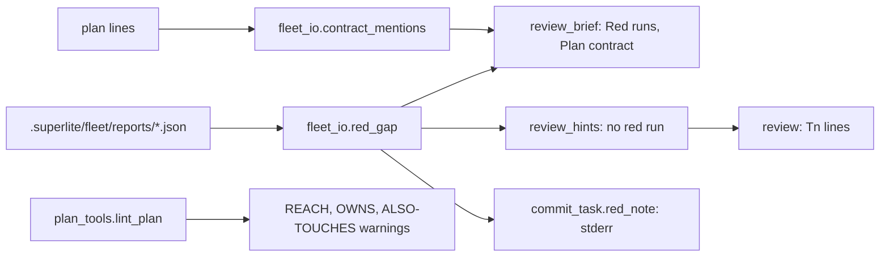
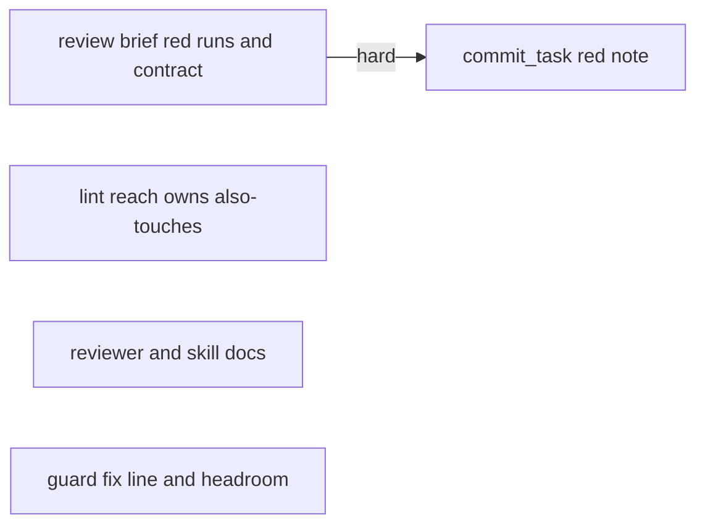

# Superlite: reviews prove red runs and read the plan contract (B146)

**Goal:** fix #606: a task whose implementer report shows no red run is flagged (commit_task stderr, `review:` hint, review brief) and its reviewer proves each new test can fail; the review brief lists the other plan lines (table rows, later tasks' lines) that name the task's types. Main's tell adds: plan lint warns on Running-app checks with no way in (#601), on symlinked Owns and on `**Also-touches:**` entries (#596); the guard's fix line says where a hand-written fixer brief goes (#603 item 1); the flaky guard loop test gets CPU-time headroom.
**Architecture:** `fleet_io` gains `red_gap` (reads `.superlite/fleet/reports/*.json`) and `contract_mentions` (reads the plan), both used by `review_brief` and `review_hints`; `commit_task.red_note` prints the flag; `plan_tools` gains three warning functions called from `lint_plan`; docs and the guard message change text only.
**Tech stack:** Python 3.10+ stdlib, pytest (through `sl run_tests`); Markdown; bash (hook).
**Spec:** this file, section Design; issues #606, #601, #596, #603.
**Detail:** tests
**Target-min:** 11
**Wave0:** none
**Coverage:** off

Global constraints:
- Existing tests stay green. An existing test file changes only when the task Owns it. If another existing test turns red, report it in DONE_WITH_CONCERNS with the test id and the reason instead of editing it.
- Run `sl` as an executable (`<abs>/sl ...`). Verify with `<abs>/sl run_tests --fast <own test files> --task Tn --background`, then run the printed `wait:` line in the foreground and end the turn only after it reports. Never `run_tests -m`.
- Format only the files you changed; never run a format command over the whole tree.
- No version edits. Never run `scripts/evals.sh`, `claude plugin eval` or `scripts/test_layers.py run`.
- Keep each Python file's per-line `# O(...)` complexity comments on new code lines, as the file does.

Ruling: (main's ruling) a task report with no red run is flagged and the reviewer proves the test: commit_task prints a stderr note, review_hints adds the reason `no red run` (so commit_task --dispatch and fleet spawn --for-dispatch print a `review:` line), and the review brief lists the task with the proof job.
Ruling: no red run means the newest implementer report naming the task has an empty `red`, a `none ...` red while the task owns a test file, or a red line without the word `fail`; no report (fleet off, inline build) flags nothing.
Ruling: #606's contract half is the brief option: other plan lines naming the task's types go into the review brief; no lint warning (a conformance grammar per language would be guesswork).
Ruling: contract_mentions lives in fleet_io.py beside review_brief, its one user, so plan_tools.py has one task (T3); fleet_io.py, skills/subagent-driven-development/SKILL.md, skills/writing-plans/SKILL.md, hooks/block-coordinator-edits, guard_judge.py and tests/scripts/test_guard_priors_312.py are listed by no open batch: this batch edits them and notes.md names them.
Ruling: reach lint reads each `- C<n>:` line of `## Running-app checks` only in a plan whose tasks own a UI file; a UI path (`A > B`) counts as a way in, as the writing-plans Reach rule says (main's tell lists the other four).
Ruling: the flaky parity case is test_nested_literal_for_loops_are_not_walked_again: it raises guard_judge.MAX_SECONDS to 10 s for itself and asserts CPU time under 10 s (B141's pattern); MAX_STEPS still fails a re-walk.
Ruling: T1 -->|hard| T2: T2's tests run commit_task, which calls T1's real red_gap in T2's task tree, so T2 waits for T1's checkpoint.
Ruling: accept predicted total over the 11 min target - five independent tasks, the critical path is one task - cost: none.
Ruling: docs/tools.md (B119, B135, B152) is not edited: its rows go to notes.md as a follow-up. Already in the lead worktree, no `sl worktree ensure`; no probe adapter (named tests cover every case).
LAYERS: unit, headless, evals



## Design

### 1. Red runs (#606, T1, T2)
- `red_gap(sd, tid, owns) -> str | None`: every readable `<sd>/fleet/reports/*.json` whose object has `role == "implementer"` and `tid in str(label).split(",")`; the newest by file mtime wins (ties: the larger file name). None when there is none. `red = str(obj.get("red") or "").strip()`: empty -> `its report names no red run`; starts with `none` (any case) -> when `[o for o in owns if testcmd.is_test_path(o)]` is non-empty, `` its report says `<red>`, but it owns test files (<first 3, comma-space>) ``, else None; no `fail` (any case) in it -> `` its red run `<red, first 120 chars>` names no failing test ``; else None. Unreadable or non-dict files are skipped.
- `RED_PROOF` (constant): `Prove each new test of these tasks can fail: take out or break the code it tests, run the test red through run_tests, put the code back, and list each red run's summary line under tests; a test that stays green is a finding.`
- `review_brief`: right before the `Probe adapter:` line, when any task has a gap: `Red runs (task reports):`, one `- Tn: <gap>` line per such task (task order), then `RED_PROOF`, then `""`.
- `review_hints`: a task with a gap gets `no red run` appended to its reasons; a task with no other reason now gets a hint for it.
- `commit_task.red_note(sd, tid, owns) -> str | None`: `<tid>: no red run (<gap>); its review must prove each new test can fail`, None without a gap, when `<sd>/fleet/reports` is no folder, or when the lookup raises. main prints it on stderr for every task that got a new checkpoint (not `no change since its last checkpoint`), right after its SHA line.

### 2. Plan contract rows (#606, T1)
- `contract_mentions(pl, tid, limit=12) -> (names, rows, total)`: names, ordered and unique: each Produces item's `parse_signature(item)["cls"]` when set; an item that is no signature gives the dotted segments of its leading `[A-Za-z_][\w.]*` that start with a capital; then the stem of each owned non-test file (`testcmd.is_test_path`) that is `[A-Z][A-Za-z0-9]+`. Names under 3 characters and `None True False Self Any` are dropped. Rows: every plan line outside the task's own block (`t.line` to `t.line + t.text.count("\n")`, 0-based), not inside a mermaid block, not a heading (`#` to `####` then a space), that holds a name as a whole word (`(?<![\w])Name(?![\w])`): a line inside another task's block gives `(line_no, other_id, text)`; a table row elsewhere (starts with `|` after spaces) gives `(line_no, "table", text)`; other lines are skipped. `line_no` is 1-based, text is `ln.strip()[:240]`; rows are in plan order; `total` counts all, `rows` keeps the first `limit`.
- `review_brief`, per task with rows, right before the red-run section: `Plan contract outside Tn's Produces (other plan lines that name <names, comma-space>; the build must fit each line, a mismatch is a finding):`, one `- plan:<n> (<where>): <text>` line per row, `- (<total - shown> more: grep the plan for <names>)` when cut, then `""`. The limit is the module constant `CONTRACT_LIMIT = 12`.

### 3. Lint (T3)
- `ui_file(path) -> bool`: not a test path (`testcmd.is_test_path`), and the suffix (lower) is one of `.tsx .jsx .vue .svelte .html .css .scss .storyboard .xib .xaml`, or it is one of `.swift .kt .dart .java` and its stem ends with `View`, `Views`, `Screen`, `Scene`, `Widget`, `Cell`, `Sheet`, `Page` or `Controller` (case-sensitive) or a folder of it is (lower) `views`, `ui`, `screens`, `widgets`, `components` or `pages`.
- `reach_warnings(plan, root) -> list[str]`: [] unless a non-draft task owns a UI file. Section: unfenced lines after a heading `## Running-app checks` (any case) up to the next `#` or `##` heading; each line `^\s*[-*]\s+(C\d+)\s*:\s*(.*)$`, split on `;`: the first part is the target, the part starting `reach:` (any case) is the reach (text after the colon, stripped). Ways in: launch argument `(?:^|[\s`(])--?[A-Za-z]`, fixture `\bfixtures?\b` (any case), URL `\b[a-z][\w+.-]*://`, `\blocalhost\b` or `(?:^|[\s`(])/[\w-]`, UI path `\s(?:>|->|→|»)\s`, preview `\b(?:previews?|snapshots?)\b` (any case) or `#Preview`; task: a whole-word id of this plan. Messages, in line order:
  - no reach part: `WARNING: REACH: C6 has no reach: part; name how the checker reaches the state (writing-plans: Reach)`
  - no way and no task: `WARNING: REACH: C2 reach "<reach>" names no launch argument, fixture, URL, UI path, preview or task; name the way in, or add a task that makes the state reachable and name it (reach: -fixture empty-inbox (T4))`
  - with `root`, `testcmd.config_source(root)` giving source `test-cmd.json` and a dict `launch`: per key whose value is a dict with `"worker": False`, named as a whole word (any case) in the target or the reach, and the reach has no preview and no task: `WARNING: REACH: C3 runs on <key>, which test-cmd.json "launch" marks "worker": false, and its reach names no preview or task; reach it through a preview, or add a task that makes it reachable another way and name it`
- `owns_link_warnings(plan, root) -> list[str]`: [] without root; per non-draft task and Owns entry (no `*?[` in it), `root / entry.rstrip("/")` that `os.path.islink`: rel = `os.path.relpath(os.path.realpath(link), os.path.realpath(root))`, posix; inside: `WARNING: OWNS: T1 owns src/link.py, a symlink to lib/real.py; commit_task counts the target as owned, but name lib/real.py in Owns so review and lint see the file the task edits`; outside (`..` first or absolute): `WARNING: OWNS: T1 owns src/out.py, a symlink to <realpath> outside the repository; edits through it are never committed, so own a file inside the repository`.
- `also_touches_warnings(plan) -> list[str]`: entries of the `also-touches` field parsed as Owns are (split_top_level, strip_ticks, expand_braces), per non-draft task, in written order; graph `parse_taskgraph(plan)` (PlanError: `{}`) and `ancestors`. An entry the task owns: `WARNING: ALSO-TOUCHES: T1 lists src/a.py, which it owns already; drop it from Also-touches`; no owner: `WARNING: ALSO-TOUCHES: T1 lists src/z.py, which no task owns; put it in T1's Owns (Also-touches is for a file a later task owns)`; per owner U whose ancestors lack the task: `WARNING: ALSO-TOUCHES: T1 lists src/c.py, owned by T3, which does not depend on T1; Also-touches is for a file a later task owns (an edge T1 --> T3), so add that edge or move the edit to T3`.
- `lint_plan` calls the three right after the platform_notes block, inside one `try` (OSError, ValueError ignored), with `root = stable_root(str(plan.path)) if plan.path else None` (its own try: None on OSError or ValueError).

### 4. Docs and guard (T4, T5)
Texts are in the tasks.

## File structure

- `skills/subagent-driven-development/scripts/fleet_io.py`: red_gap, contract_mentions, brief sections, hint reason (T1)
- `tests/scripts/test_review_brief_606.py`: T1's tests
- `skills/subagent-driven-development/scripts/commit_task.py`: red_note and its stderr line (T2)
- `tests/scripts/test_commit_red_run_606.py`: T2's tests
- `skills/subagent-driven-development/scripts/plan_tools.py`: ui_file, three warning functions, lint_plan calls (T3)
- `tests/scripts/test_lint_reach_owns_606.py`: T3's tests
- `agents/package-reviewer.md`, `skills/subagent-driven-development/SKILL.md`, `skills/writing-plans/SKILL.md`, `tests/scripts/test_docs_review_red_606.py`: T4
- `hooks/block-coordinator-edits`, `skills/subagent-driven-development/scripts/guard_judge.py`, `tests/scripts/test_guard_priors_312.py`, `tests/scripts/test_guard_fix_brief_603.py`: T5

## Task graph

```mermaid
%% schedule
gantt
  title Predicted schedule (mm:ss)
  dateFormat X
  axisFormat %M:%S
  section lane 1
  T3 lint reach symlinked Owns Also-touche :t3, 0, 556s
  section lane 2
  T1 review brief red runs and plan contra :t1, 0, 510s
  T2 commit_task red-run note :t2, 510, 455s
  section lane 3
  T5 guard fix line and loop-test headroom :t5, 0, 493s
  section lane 4
  T4 reviewer and skill docs :t4, 0, 450s
```





critical path: T1 → T2 (16.1 min) · peak width 4 · predicted build 16.1 min · predicted total ≈ 30.6 min (target ✗ 11.0)

## Package: review brief

App type: CLI. Categories: file (report files), protocol (brief lines), state (newest report). **Probe entry:** none (brief and stderr text; every case is a named test).

### T1 review brief red runs and plan contract · Complexity 4 · Est. context 40k
**Owns:** skills/subagent-driven-development/scripts/fleet_io.py, tests/scripts/test_review_brief_606.py
**Components:** 2
**LOC owned:** 130
**Tests:** fast
**Model:** sonnet
**Est. time:** 3 min (2 components, about 130 LOC, fast tests)
**Covers:** 1, 2
**Consumes:** none
**Produces:** fleet_io.red_gap(sd: str, tid: str, owns: list[str]) -> str | None · fleet_io.contract_mentions(pl: plan_tools.Plan, tid: str, limit: int = 12) -> tuple[list[str], list[tuple[int, str, str]], int]
e.g. red_gap(sd, "T1", ["src/a.py"]) -> "its report names no red run" (T1.json: role implementer, red "")
e.g. red_gap(sd, "T1", ["src/a.py"]) -> None (red "tests (fast): 0 passed, 1 failed", or no report)
**Review Focus:** `test_red_gap_reads_batch_labels_and_the_newest_implementer_report` (state: the newest of two reports wins, a broken file is skipped); `test_contract_rows_over_the_limit_name_the_rest` (protocol).
**Notes:** update the module docstring of fleet_io.py (one sentence each: the red-run section, the plan-contract section, the `no red run` hint). Import testcmd as the file already does. Keep `Probe adapter:` the brief's last non-empty line (pinned by test_fleet_io_review_422).
**Test code (verbatim):** new file tests/scripts/test_review_brief_606.py:
```python
"""#606: review briefs flag a task whose report shows no red run and list the plan lines that name its types."""
import json
import os
import sys

import pytest

from test_plan_tools import SCRIPTS

sys.path.insert(0, str(SCRIPTS))
import fleet_io as io  # noqa: E402
import plan_tools as pt  # noqa: E402

FENCE = "```"
PLAN_TEXT = f"""# Plan
**Goal:** x.

| Type | Conforms to | Task |
|---|---|---|
| FooConfig | Codable, Sendable | T1 |
| Other | Equatable | T2 |

{FENCE}mermaid
flowchart LR
  T1[FooConfig]
  T2[loader]
  %% taskgraph
  T1 --> T2
{FENCE}

## Package: core (library)

### T1 config · Complexity 3 · Est. context 30k
**Owns:** Sources/Core/FooConfig.swift, Tests/CoreTests/FooConfigTests.swift
**Produces:** FooConfig.init(retries: Int) -> FooConfig
**Notes:** FooConfig holds retries.

### T2 loader · Complexity 3 · Est. context 30k
**Owns:** Sources/Core/Loader.swift
**Consumes:** FooConfig.init(retries: Int) -> FooConfig (T1)
**Steps:** 1 decode a FooConfig from JSON through its Codable conformance
"""
OWNS = ["Sources/Core/FooConfig.swift", "Tests/CoreTests/FooConfigTests.swift"]
ROW6 = "- plan:6 (table): | FooConfig | Codable, Sendable | T1 |"


@pytest.fixture
def world(tmp_path):
    proj = tmp_path / "proj"
    sd = proj / ".superlite"
    sd.mkdir(parents=True)
    (proj / ".git").mkdir()
    plan = proj / "plan.md"
    plan.write_text(PLAN_TEXT, encoding="utf-8")
    return type("W", (), {"proj": proj, "sd": sd, "plan": str(plan)})


def report(world, name, label, red, role="implementer", age=0):
    d = world.sd / "fleet" / "reports"
    d.mkdir(parents=True, exist_ok=True)
    p = d / f"{name}.json"
    p.write_text(json.dumps({"status": "DONE", "label": label, "role": role, "red": red}), encoding="utf-8")
    t = 1_700_000_000 - age
    os.utime(p, (t, t))
    return p


def test_red_gap_kinds(world):
    assert io.red_gap(world.sd, "T1", OWNS) is None
    report(world, "T1", "T1", "")
    assert io.red_gap(world.sd, "T1", OWNS) == "its report names no red run"
    report(world, "T1", "T1", "none - no test")
    assert io.red_gap(world.sd, "T1", OWNS) == ("its report says `none - no test`, but it owns test files "
                                                "(Tests/CoreTests/FooConfigTests.swift)")
    assert io.red_gap(world.sd, "T1", OWNS[:1]) is None
    report(world, "T1", "T1", "tests (fast): 3 passed")
    assert io.red_gap(world.sd, "T1", OWNS) == "its red run `tests (fast): 3 passed` names no failing test"
    report(world, "T1", "T1", "tests (fast): 0 passed, 1 failed")
    assert io.red_gap(world.sd, "T1", OWNS) is None


def test_red_gap_reads_batch_labels_and_the_newest_implementer_report(world):
    report(world, "review-T1", "review-T1", "", role="package-reviewer")
    assert io.red_gap(world.sd, "T1", OWNS) is None
    report(world, "T1", "T1", "tests (fast): 0 passed, 1 failed", age=60)
    report(world, "T2", "T2,T1", "", age=0)
    assert io.red_gap(world.sd, "T1", OWNS) == "its report names no red run"
    assert io.red_gap(world.sd, "T2", []) == "its report names no red run"
    (world.sd / "fleet" / "reports" / "T3.json").write_text("{broken", encoding="utf-8")
    assert io.red_gap(world.sd, "T3", []) is None


def test_contract_mentions(world):
    pl = pt.Plan.load(world.plan)
    names, rows, total = io.contract_mentions(pl, "T1")
    assert names == ["FooConfig"]
    assert rows == [(6, "table", "| FooConfig | Codable, Sendable | T1 |"),
                    (26, "T2", "**Consumes:** FooConfig.init(retries: Int) -> FooConfig (T1)"),
                    (27, "T2", "**Steps:** 1 decode a FooConfig from JSON through its Codable conformance")]
    assert total == 3
    assert io.contract_mentions(pl, "T1", limit=1)[1:] == ([(6, "table", "| FooConfig | Codable, Sendable | T1 |")], 3)
    assert io.contract_mentions(pl, "T2") == (["Loader"], [], 0)


def test_review_brief_flags_the_red_run_and_lists_the_contract(world):
    report(world, "T1", "T1", "")
    lines = io.review_brief(world.sd, world.plan, ["T1"], "/sl/sl", "/sl").splitlines()
    i = lines.index("Red runs (task reports):")
    assert lines[i + 1:i + 3] == ["- T1: its report names no red run", io.RED_PROOF]
    j = lines.index("Plan contract outside T1's Produces (other plan lines that name FooConfig; "
                    "the build must fit each line, a mismatch is a finding):")
    assert lines[j + 1:j + 4] == [ROW6, "- plan:26 (T2): **Consumes:** FooConfig.init(retries: Int) -> FooConfig (T1)",
                                  "- plan:27 (T2): **Steps:** 1 decode a FooConfig from JSON through its Codable conformance"]
    assert j < i
    assert [ln for ln in lines if ln.strip()][-1].startswith("Probe adapter:")


def test_review_brief_without_gaps_or_mentions_adds_nothing(world):
    report(world, "T2", "T2", "tests (fast): 0 passed, 1 failed")
    out = io.review_brief(world.sd, world.plan, ["T2"], "/sl/sl", "/sl")
    assert "Red runs" not in out and "Plan contract outside" not in out


def test_contract_rows_over_the_limit_name_the_rest(world, monkeypatch):
    monkeypatch.setattr(io, "CONTRACT_LIMIT", 1)
    lines = io.review_brief(world.sd, world.plan, ["T1"], "/sl/sl", "/sl").splitlines()
    j = [n for n, ln in enumerate(lines) if ln.startswith("Plan contract outside T1")][0]
    assert lines[j + 1:j + 3] == [ROW6, "- (2 more: grep the plan for FooConfig)"]


def test_review_hints_name_a_missing_red_run(world):
    (world.sd / "progress.md").write_text("- commit T1 abc1234 config\n", encoding="utf-8")
    report(world, "T1", "T1", "")
    assert dict(io.review_hints(world.sd, world.plan))["T1"] == ["seam T1↔T2", "no red run"]
```
**Steps:** 1 write the tests, 2 run: FAIL, 3 implement, 4 run: PASS

### T2 commit_task red-run note · Complexity 2 · Est. context 30k
**Owns:** skills/subagent-driven-development/scripts/commit_task.py, tests/scripts/test_commit_red_run_606.py
**Components:** 1
**LOC owned:** 50
**Tests:** fast
**Model:** sonnet
**Est. time:** 2 min (1 component, about 50 LOC, fast tests)
**Covers:** 1
**Consumes:** fleet_io.red_gap(sd: str, tid: str, owns: list[str]) -> str | None (T1)
**Produces:** commit_task.red_note(sd: str, tid: str, owns: list[str]) -> str | None
**Review Focus:** `test_commit_with_a_red_run_or_no_report_is_quiet` (state: no report folder prints nothing).
**Notes:** import fleet_io lazily inside red_note, only when `<sd>/fleet/reports` is a folder. Print with `print(note, file=sys.stderr)` in main's new-checkpoint branch. Add one docstring sentence: a task whose fleet report shows no red run gets that stderr line (#606).
**Test code (verbatim):** new file tests/scripts/test_commit_red_run_606.py:
```python
"""#606: commit_task names a task whose report shows no red run."""
import json
import sys
from pathlib import Path

HERE = Path(__file__).resolve().parent
sys.path.insert(0, str(HERE))
from test_run_scripts import SCRIPTS, commit, git, make_repo, write  # noqa: E402

sys.path.insert(0, str(SCRIPTS))
import commit_task  # noqa: E402

PLAN = """# Plan

### T1 · config · Complexity 2 · Est. context 20k

**Owns:** `src/a.py`, `tests/test_a.py`
"""
NOTE = "T1: no red run (its report names no red run); its review must prove each new test can fail"


def repo_with(base, red=None):
    base.mkdir()
    repo = make_repo(base)
    write(repo, "plan.md", PLAN)
    git(repo, "add", "-A")
    git(repo, "commit", "-q", "-m", "plan")
    write(repo, "src/a.py", "A = 1\n")
    write(repo, "tests/test_a.py", "def test_a():\n    assert True\n")
    if red is not None:
        write(repo, ".superlite/fleet/reports/T1.json",
              json.dumps({"status": "DONE", "label": "T1", "role": "implementer", "red": red}))
    return repo


def test_commit_names_a_missing_red_run(tmp_path):
    r = commit(repo_with(tmp_path / "gap", red=""), "T1")
    assert r.returncode == 0, r.stdout + r.stderr
    assert NOTE in r.stderr.splitlines()


def test_commit_with_a_red_run_or_no_report_is_quiet(tmp_path):
    for name, red in (("red", "tests (fast): 0 passed, 1 failed"), ("none", None)):
        r = commit(repo_with(tmp_path / name, red=red), "T1")
        assert r.returncode == 0, r.stdout + r.stderr
        assert "no red run" not in r.stderr


def test_red_note_values(tmp_path):
    sd = tmp_path / ".superlite"
    assert commit_task.red_note(str(sd), "T1", ["src/a.py"]) is None
    d = sd / "fleet" / "reports"
    d.mkdir(parents=True)
    (d / "T1.json").write_text(json.dumps({"label": "T1", "role": "implementer", "red": "none - no test"}), encoding="utf-8")
    assert commit_task.red_note(str(sd), "T1", ["src/a.py"]) is None
    assert commit_task.red_note(str(sd), "T1", ["tests/test_a.py"]) == (
        "T1: no red run (its report says `none - no test`, but it owns test files (tests/test_a.py)); "
        "its review must prove each new test can fail")
```
**Steps:** 1 write the tests, 2 run: FAIL, 3 implement, 4 run: PASS

## Package: plan lint

App type: library. Categories: file (symlinks), encoding (reach text), state (taskgraph order). **Probe entry:** none (warning text; every case is a named test).

### T3 lint reach, symlinked Owns, Also-touches · Complexity 4 · Est. context 45k
**Owns:** skills/subagent-driven-development/scripts/plan_tools.py, tests/scripts/test_lint_reach_owns_606.py
**Components:** 3
**LOC owned:** 150
**Tests:** fast
**Model:** sonnet
**Est. time:** 4 min (3 components, about 150 LOC, fast tests)
**Covers:** 3
**Consumes:** none
**Produces:** plan_tools.ui_file(path: str) -> bool · plan_tools.reach_warnings(plan: Plan, root: Path | None) -> list[str] · plan_tools.owns_link_warnings(plan: Plan, root: Path | None) -> list[str] · plan_tools.also_touches_warnings(plan: Plan) -> list[str]
**Review Focus:** `test_symlinked_owns_name_their_target` (file: a link inside and one outside the repository); `test_reach_on_a_platform_no_worker_launches` (encoding: the platform word in the target).
**Notes:** testcmd is imported lazily, as `_covered_conds` does. Add the three warning kinds to the module docstring in one sentence.
**Test code (verbatim):** new file tests/scripts/test_lint_reach_owns_606.py:
```python
"""#601/#596 follow-ups (B146): lint warns on Running-app checks with no way in, symlinked Owns and Also-touches entries."""
import json
import os
import subprocess
import sys

import pytest

from test_plan_tools import SCRIPTS

sys.path.insert(0, str(SCRIPTS))
import plan_tools as ptm  # noqa: E402

PLAN_TOOLS = SCRIPTS / "plan_tools.py"
FENCE = "```"
GRAPH = f"""{FENCE}mermaid
flowchart LR
  T1[one]
  T2[two]
  T3[three]
  %% taskgraph
  T1 --> T2
{FENCE}
"""
UI = f"""# Plan
**Goal:** x.

{GRAPH}
### T1 inbox view · Complexity 3 · Est. context 30k
**Owns:** App/Views/InboxView.swift

### T2 empty fixture · Complexity 2 · Est. context 30k
**Owns:** App/Fixtures/EmptyInbox.swift

### T3 model · Complexity 2 · Est. context 30k
**Owns:** App/Model/Inbox.swift

## Running-app checks
- C1: iOS simulator; reach: -fixture empty-inbox (T2); see: the empty state text
- C2: iOS simulator; reach: open the inbox; see: three rows
- C3: macOS app; reach: Settings > Accounts; see: the account list
- C4: macOS app; reach: InboxView preview; see: the badge
- C5: web page; reach: http://localhost:3000/inbox; see: rows
- C6: iOS simulator; see: the title
"""
LINKS = f"""# Plan
**Goal:** x.

{GRAPH}
### T1 one · Complexity 2 · Est. context 30k
**Owns:** src/link.py, src/out.py, src/a.py

### T2 two · Complexity 2 · Est. context 30k
**Owns:** src/b.py

### T3 three · Complexity 2 · Est. context 30k
**Owns:** src/c.py
"""
ALSO = LINKS.replace("**Owns:** src/link.py, src/out.py, src/a.py",
                     "**Owns:** src/a.py\n**Also-touches:** src/b.py, src/a.py, src/z.py, src/c.py")
C2 = ('WARNING: REACH: C2 reach "open the inbox" names no launch argument, fixture, URL, UI path, preview or task; '
      "name the way in, or add a task that makes the state reachable and name it (reach: -fixture empty-inbox (T4))")
C3 = ('WARNING: REACH: C3 runs on macos, which test-cmd.json "launch" marks "worker": false, and its reach names no '
      "preview or task; reach it through a preview, or add a task that makes it reachable another way and name it")
C6 = "WARNING: REACH: C6 has no reach: part; name how the checker reaches the state (writing-plans: Reach)"


def proj_with(base, text, launch=None):
    proj = base / "proj"
    (proj / ".superlite").mkdir(parents=True)
    (proj / ".git").mkdir()
    if launch is not None:
        cfg = {"language": "swift", "test": "swift test", "launch": launch}
        (proj / ".superlite" / "test-cmd.json").write_text(json.dumps(cfg), encoding="utf-8")
    p = proj / "plan.md"
    p.write_text(text, encoding="utf-8")
    return proj, p


def lint(base, proj, p):
    env = dict(os.environ, PYTHONIOENCODING="utf-8", SUPERLITE_HOME=str(base / "home"))
    return subprocess.run([sys.executable, str(PLAN_TOOLS), "lint", "--plan", str(p)], capture_output=True, text=True,
                          cwd=proj, env=env, timeout=120).stdout


def test_reach_without_a_way_in_warns(tmp_path):
    proj, p = proj_with(tmp_path, UI)
    assert ptm.reach_warnings(ptm.Plan.load(str(p)), proj) == [C2, C6]


def test_reach_on_a_platform_no_worker_launches(tmp_path):
    launch = {"macos": {"worker": False, "why": "shares the user's container"}, "ios": {"worker": True}}
    proj, p = proj_with(tmp_path, UI, launch)
    assert ptm.reach_warnings(ptm.Plan.load(str(p)), proj) == [C2, C3, C6]


def test_reach_needs_ui_files(tmp_path):
    text = (UI.replace("App/Views/InboxView.swift", "src/inbox.py").replace("App/Fixtures/EmptyInbox.swift", "src/fixture.py")
            .replace("App/Model/Inbox.swift", "src/model.py"))
    proj, p = proj_with(tmp_path, text)
    assert ptm.reach_warnings(ptm.Plan.load(str(p)), proj) == []
    assert ptm.reach_warnings(ptm.Plan.load(str(p)), None) == []


@pytest.mark.parametrize("path, ui", [
    ("App/Views/InboxView.swift", True), ("web/src/Inbox.tsx", True), ("App/Main.storyboard", True),
    ("app/ui/Badge.kt", True), ("App/Model/Inbox.swift", False), ("src/inbox.py", False),
    ("Tests/AppTests/InboxViewTests.swift", False),
])
def test_ui_file(path, ui):
    assert ptm.ui_file(path) is ui


def test_symlinked_owns_name_their_target(tmp_path):
    proj, p = proj_with(tmp_path, LINKS)
    (proj / "src").mkdir()
    (proj / "lib").mkdir()
    (proj / "lib" / "real.py").write_text("R = 0\n", encoding="utf-8")
    (proj / "src" / "a.py").write_text("A = 0\n", encoding="utf-8")
    outside = tmp_path / "outside.py"
    outside.write_text("O = 0\n", encoding="utf-8")
    try:
        os.symlink("../lib/real.py", proj / "src" / "link.py")
        os.symlink(str(outside), proj / "src" / "out.py")
    except OSError:
        pytest.skip("no symlinks here")
    assert ptm.owns_link_warnings(ptm.Plan.load(str(p)), proj) == [
        "WARNING: OWNS: T1 owns src/link.py, a symlink to lib/real.py; commit_task counts the target as owned, "
        "but name lib/real.py in Owns so review and lint see the file the task edits",
        f"WARNING: OWNS: T1 owns src/out.py, a symlink to {os.path.realpath(outside)} outside the repository; "
        "edits through it are never committed, so own a file inside the repository",
    ]
    assert ptm.owns_link_warnings(ptm.Plan.load(str(p)), None) == []


def test_also_touches_entries(tmp_path):
    _, p = proj_with(tmp_path, ALSO)
    assert ptm.also_touches_warnings(ptm.Plan.load(str(p))) == [
        "WARNING: ALSO-TOUCHES: T1 lists src/a.py, which it owns already; drop it from Also-touches",
        "WARNING: ALSO-TOUCHES: T1 lists src/z.py, which no task owns; put it in T1's Owns "
        "(Also-touches is for a file a later task owns)",
        "WARNING: ALSO-TOUCHES: T1 lists src/c.py, owned by T3, which does not depend on T1; Also-touches is for a file "
        "a later task owns (an edge T1 --> T3), so add that edge or move the edit to T3",
    ]


def test_lint_prints_the_new_warnings(tmp_path):
    proj, p = proj_with(tmp_path, ALSO)
    assert "WARNING: ALSO-TOUCHES: T1 lists src/z.py, which no task owns" in lint(tmp_path, proj, p)
    proj2, p2 = proj_with(tmp_path / "ui", UI)
    assert C2 in lint(tmp_path, proj2, p2)
```
**Steps:** 1 write the tests, 2 run: FAIL, 3 implement, 4 run: PASS

## Package: docs and guard

App type: docs and a hook. Categories: protocol (message text). **Probe entry:** none (text only; named tests pin it).

### T4 reviewer and skill docs · Complexity 2 · Est. context 25k
**Owns:** agents/package-reviewer.md, skills/subagent-driven-development/SKILL.md, skills/writing-plans/SKILL.md, tests/scripts/test_docs_review_red_606.py
**Components:** 1
**LOC owned:** 40
**Tests:** fast
**Kind:** mechanical
**Model:** haiku
**Est. time:** 2 min (1 component, about 40 LOC, fast tests)
**Covers:** 1, 2, 3
**Consumes:** none
**Produces:** none
**Review Focus:** none (text pinned by the named tests).
**Steps:** 1 write the test file, 2 run: FAIL, 3 make the edits below, 4 run: PASS. Edits, each an insertion or replacement of exactly this text:
- `agents/package-reviewer.md`, right after the Rules bullet that starts `- Fix every finding you report`, two new bullets: ``- A `Red runs (task reports):` section in your brief names tasks whose report shows no red run. Prove each new test of those tasks can fail before you accept it: take out or break the code it tests by hand, run the test through `run_tests --fast` and see it fail for the right reason, then put the code back and see it pass. A test that stays green is a finding: make it fail on the defect it guards, with its own red run.`` and ``- A `Plan contract outside Tn's Produces` section lists other plan lines (table rows, later tasks' lines) that name the task's types. The Produces line is not the whole contract: check the build against each listed line too (a conformance, a configuration type, a parameter a later task passes); a mismatch is a finding, and when its fix belongs to a later task, list it as open.``
- `agents/package-reviewer.md`, the Report paragraph: replace `tests added (each with its red run's summary line)` with `tests added and tests proven red (each with its red run's summary line)`.
- `skills/subagent-driven-development/SKILL.md`, the Reviews bullet that starts `- Brief: absolute`: append `` `fleet spawn --for-review` adds a `Red runs (task reports):` section (tasks whose report shows no red run; the reviewer proves each new test can fail) and per task a `Plan contract outside Tn's Produces` section (other plan lines that name its types); `commit_task` names such a task on stderr and its `review:` line says `no red run`.``
- `skills/writing-plans/SKILL.md`, the `Owns` table row: after `never share a file.` add `` Lint warns (`OWNS:`) on an entry that is a symlink and names its target: own the target.``; then a new row right after it: ``| `Also-touches` | Optional: files this task edits that a later task owns, such as a compile-only change to the users of an enum it changes (`**Also-touches:** src/b.swift`). commit_task commits them with this task and run_tests --task syncs them. Lint warns (`ALSO-TOUCHES:`) on an entry the task owns already, one no task owns, and one whose owner does not depend on this task. |``
- `skills/writing-plans/SKILL.md`, the end of the `**Reach.**` bullet: append `` Lint warns (`REACH:`) when a plan whose tasks own UI files has a check whose `reach:` names none of these and no task, or names a platform the entry marks `"worker": false` without a preview or task.``
**Test code (verbatim):** new file tests/scripts/test_docs_review_red_606.py:
```python
"""#606 and B146 follow-ups: the agent and skill docs name the red-run proof, the plan contract and the new lint warnings."""
from pathlib import Path

ROOT = Path(__file__).resolve().parents[2]


def read(rel):
    return " ".join((ROOT / rel).read_text(encoding="utf-8").split())


def test_package_reviewer_proves_red_runs_and_reads_the_plan_contract():
    t = read("agents/package-reviewer.md")
    assert "A `Red runs (task reports):` section in your brief names tasks whose report shows no red run." in t
    assert "A test that stays green is a finding" in t
    assert "The Produces line is not the whole contract" in t
    assert "tests added and tests proven red (each with its red run's summary line)" in t


def test_sdd_brief_line_names_both_sections():
    t = read("skills/subagent-driven-development/SKILL.md")
    assert "`Red runs (task reports):`" in t and "`Plan contract outside Tn's Produces`" in t and "`no red run`" in t


def test_writing_plans_names_also_touches_and_the_lint_warnings():
    t = read("skills/writing-plans/SKILL.md")
    assert "| `Also-touches` |" in t
    assert "`ALSO-TOUCHES:`" in t and "`OWNS:`" in t and "`REACH:`" in t
```

### T5 guard fix line and loop-test headroom · Complexity 2 · Est. context 25k
**Owns:** hooks/block-coordinator-edits, skills/subagent-driven-development/scripts/guard_judge.py, tests/scripts/test_guard_priors_312.py, tests/scripts/test_guard_fix_brief_603.py
**Components:** 2
**LOC owned:** 40
**Tests:** fast
**Kind:** mechanical
**Model:** haiku
**Est. time:** 2 min (2 components, about 40 LOC, fast tests)
**Covers:** 4
**Consumes:** none
**Produces:** none
**Review Focus:** none (text pinned by the named tests).
**Steps:** 1 write the new test file, 2 run: FAIL, 3 make the edits below, 4 run both test files: PASS. Edits:
- The fix line, in both `hooks/block-coordinator-edits` (the `printf` argument that starts `'- Fix: give a fixer`) and `guard_judge.py` (`MESSAGES["code"]`, the item that starts `"- Fix: give a fixer"`), becomes exactly the `FIX` string of the test below. In the hook keep it one single-quoted argument (it holds backticks, which must not run).
- `tests/scripts/test_guard_priors_312.py`: add `import time` to the imports and `import guard_judge  # noqa: E402` after the `from guard_judge import ...` line; replace the last test with:
```python
@pytest.mark.parametrize("ns", [(10, 10), (5, 5, 5), (3, 3, 3, 3)])
def test_nested_literal_for_loops_are_not_walked_again(P, ns, monkeypatch):
    # A re-walk spends MAX_STEPS, which no machine load changes. The 1.5 s wall-clock budget is raised to 10 s here:
    # the server's 4-worker full run starved it (B130 follow-up); 10 s of CPU time still fails a walk that went slow.
    monkeypatch.setattr(guard_judge, "MAX_SECONDS", 10)
    names = "abcd"
    head = "".join(f"for {names[k]} in {' '.join(str(i) for i in range(n))}; do " for k, n in enumerate(ns))
    body = "echo hi > docs/" + "".join("$" + names[k] for k in range(len(ns))) + ".md; " + "done; " * len(ns)
    t = time.process_time()
    assert run(head + body, P) is None
    assert time.process_time() - t < 10
```
**Test code (verbatim):** new file tests/scripts/test_guard_fix_brief_603.py:
```python
"""#603 item 1 (B146): the coordinator guard's fix line says where a hand-written fixer brief goes."""
import sys
from pathlib import Path

HERE = Path(__file__).resolve().parent
sys.path.insert(0, str(HERE))
from test_block_coordinator_edits import proj, run  # noqa: E402,F401

sys.path.insert(0, str(HERE.parents[1] / "skills" / "subagent-driven-development" / "scripts"))
import guard_judge as gj  # noqa: E402

FIX = ("- Fix: give a fixer a finding id F-<Tn>-<n>, tiered per skills/subagent-driven-development/fixing.md: known cause, "
       "one module -> fixer-sonnet; cross-module -> fixer-sonnet-high; unknown cause -> fixer-opus. A brief you write by "
       "hand goes to .superlite/briefs/fix-<id>.md (`sl findings route` writes them for you); .superlite/fixes/<id>.md "
       "holds only the note the fixer writes itself.")


def test_hook_fix_line(proj):  # noqa: F811
    r = run(proj, "Edit", {"file_path": str(proj / "src" / "app.py")})
    assert r.returncode == 2
    assert [ln for ln in r.stderr.splitlines() if ln.startswith("- Fix:")] == [FIX]


def test_judge_fix_line_matches_the_hook():
    assert [ln for ln in gj.MESSAGES["code"] if ln.startswith("- Fix:")] == [FIX]
```

## Review Focus

- review brief (CLI): file (report files: broken, other roles, batch labels), protocol (brief line order, `Probe adapter:` last), state (newest report wins).
- plan lint (library): file (symlink inside and outside the repository), encoding (reach words, platform names in any case), state (taskgraph order for Also-touches).
- docs and guard: protocol (the hook and the judge print the same fix line).

## Self-review

Every #606 expectation maps to T1 (brief, hints), T2 (commit_task) and T4 (agent rules); main's four extras map to T3 (1, 2), T5 (3, 4) and T4 (docs). No placeholders. T2 consumes T1's red_gap with the same signature and the one edge. No two tasks share a file.
