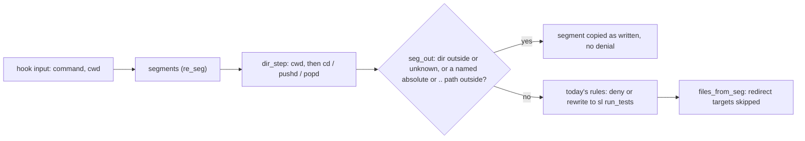
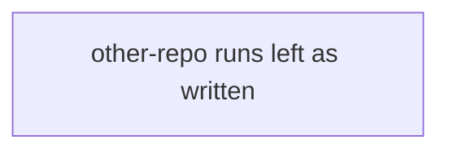

# Superlite: the test-run rewrite hook leaves other repositories alone (B123)

**Goal:** fix #565: `hooks/rewrite-test-runs` leaves a test run outside the plan root as written (a cross-repository `cd /other && npm install && npm run build && npm test > /tmp/x.log 2>&1`), and a shell redirect target is never taken as a test path.
**Architecture:** `hooks/rewrite-test-runs` only (bash builtins). A directory walk over the command's segments tracks where each segment runs (the payload `cwd`, then each `cd`/`pushd`); a test segment that runs outside the plan root, or names an absolute or `..` path outside it, is copied unchanged and skips every denial. `files_from_seg` skips redirect operators and their targets.
**Tech stack:** bash 3.2+ builtins (no external process, no `${v,,}`, no `declare -A`, no `mapfile`), pytest (through `sl run_tests`).
**Spec:** this file, section Design; issue #565.
**Detail:** tests
**Target-min:** 11
**Wave0:** none
**Coverage:** off

Global constraints:
- The hook keeps using bash builtins only: no command substitution, no pipe, no external program (each process costs about 250 ms on Windows); `builtin cd` is allowed.
- Existing tests stay green. An existing test file changes only when the task Owns it. If another existing test turns red, report it in DONE_WITH_CONCERNS with the test id and the reason instead of editing it.
- Run `sl` as an executable (`<abs>/sl ...`). Verify with `<abs>/sl run_tests --fast <own test files> --task Tn --background`, then run the printed `wait:` line in the foreground and end the turn only after it reports. Also run tests/scripts/test_rewrite_test_runs.py, test_rewrite_isolate.py, test_rewrite_collect_only.py and test_rewrite_quoted_paths.py the same way before DONE.
- No version edits (the ship step bumps the version). Never run `scripts/evals.sh`, `claude plugin eval` or `scripts/test_layers.py run`.

Ruling: "outside the plan root" means outside SL_PROJ (the folder holding the run's `.superlite`), judged lexically and, when that says outside, again on the real path (`builtin cd -P` on the nearest existing folder), so `/tmp` vs `/private/tmp` and a symlinked spelling of the plan root count as inside (because the hook must not stop rewriting runs it rewrites today; cost if wrong: a symlink inside the plan root that points out still gets rewritten).
Ruling: the payload `cwd` counts as inside when it is the plan root, below it, or above it (the main checkout that holds a linked worktree under `.claude/worktrees/`), or missing; an explicit `cd`/`pushd` target counts as inside only at or below the plan root (because a coordinator launched in the main checkout runs the worktree's tests with a bare `pytest`, while an explicit `cd` names where it means to run; cost if wrong: a bare run from the main checkout keeps today's rewrite).
Ruling: a `cd` target the hook cannot read (a variable, command substitution, glob, `~user`, `cd -`, `popd`) makes the directory unknown, and an unknown directory counts as outside: the command passes as written, as the hook already does for quoted test arguments (because guessing would rewrite another repository's run again; cost if wrong: `cd "$WT" && pytest` is not rewritten).
Ruling: a `cd` inside a subshell counts for the rest of the command (no `(`/`)` tracking; fail open: a later run in the plan root passes as written; cost if wrong: rare raw runs).
Ruling: an outside segment skips every denial too (until/while loop, `/dev/null`, a subagent's bare full suite, the isolate-stack project runner), because their advice (`sl run_tests`) cannot run another repository's tests; the whole-command loop denial is skipped when any segment of the command runs outside.
Ruling: a rewritten segment still drops its redirects, as today; only the redirect target stops counting as a test path (because #565 asks for the path, and existing tests pin the dropped `2>&1`; cost if wrong: a `> log` on a rewritten run writes nothing).
Ruling: the issue's alternative (a summary line naming the repository and the columns) is not built: outside runs are no longer rewritten, so no `run_tests` summary is printed for them (run_tests.py belongs to other batches).
Ruling: one design task (one hook, one new test file, one docs line); already in the lead worktree, no `sl worktree ensure`; no probe adapter (a bash hook; cases are named tests); layers: unit.
LAYERS: unit



## Design

### 1. Directory walk
New builtins-only helpers in `hooks/rewrite-test-runs`, called after `superlite_state`:
- `norm_path P`: P with `\` turned to `/`, `//` collapsed, `.` segments dropped and `..` resolved (never above `/` or a `C:` drive), trailing `/` dropped, into REPLY. P is absolute.
- `under_root P`: 0 when the normalized absolute P is the plan root (normalized SL_PROJ) or below it. Lexical test first; when it says no, the physical test: the nearest existing folder D of P (strip trailing segments until `[ -d ]`), its real path read with `builtin cd -P -- "$D"` (save `$PWD` first, restore with `builtin cd -- "$saved"`, all output to /dev/null), plus the stripped rest, compared with the plan root's real path (computed once the same way). Plan root `/` contains everything.
- `dir_start`: `here` and `here_in` from the payload `cwd` (decoded with `jstr cwd` before `cwdv` is sanitized; `\` to `/`): missing gives `here` = plan root, `here_in=1`; relative is joined onto the plan root; `here_in=1` when `under_root` or when the plan root lies below `here` (lexically, `$root == $here/*`); else 0.
- `dir_step SEG`: SEG minus leading whitespace and any leading `(`, `{` and `!` characters, minus trailing whitespace, `)` and `}`. When its first word is `cd` or `pushd`: skip the options `-L`, `-P`, `-e`, `-@`, `--`; the next word is the operand (a word that is wholly `'...'`, or `"..."` holding no `$`, backtick or backslash, is taken literally; later words are ignored). No operand or `~`: `$HOME`; `~/x`: `$HOME/x`; `-`, `~user`, or an unquoted operand holding `$`, a backtick, `\`, `*`, `?`, `[`, `{` or a quote: unknown. Absolute: `norm_path`; relative: `norm_path "$here/$op"` when `here` is known, else unknown. Then `here_in` = `under_root` (no above-the-root rule for an explicit `cd`). `popd`: unknown. Unknown sets `here=""`, `here_in=0`. Any other SEG changes nothing.
- `seg_out SEG`: 0 (outside) when `here_in=0`, or SEG matches `re_test` and one of its `files_from_seg` words is absolute, starts with `~/`, or has a `..` segment, and resolves (against `here`; absolute as is; `~/` from `$HOME`) to a path where `under_root` fails.

### 2. Where it applies
- The subagent / fleet-worker loop: `dir_start` before it; per segment `dir_step`, then `seg_out` skips that segment's isolate and full-suite checks.
- The coordinator loop denial: a pre-pass (`dir_start`, then per segment `dir_step` and `seg_out`) sets `any_out=1` when any segment runs outside; the until/while denial is skipped then.
- The rewrite loop: `dir_start` before it; per segment `dir_step`, then an outside segment is copied as written (no `/dev/null` denial, no rewrite). No changed segment: exit 0 with no output, as today.

### 3. Redirect targets
`files_from_seg` skips a word that is a redirect operator (`^[0-9]*(>>?|>\||<>?|<<<|PH1|PH2>?)$`, PH1/PH2 being the `>&`/`&>` placeholders) together with the word after it, and a word that starts with one glued to its target (`^[0-9]*(>|<|PH1|PH2)`: `>/tmp/x.log`, `2>err.txt`, `2PH11`).

### 4. Docs
The hook's header comment and the `rewrite-test-runs` bullet in docs/hooks.md gain one sentence each: a test run outside the plan root (the payload cwd, then each `cd`/`pushd`; a cwd above the plan root, such as the main checkout of a linked worktree, counts as inside), in a directory the hook cannot read (a variable, `cd -`, `popd`), or naming an absolute or `..` path outside it, is left as written with no rewrite and no denial; a redirect target is never a test path.

## File structure

- `hooks/rewrite-test-runs`: directory walk, outside segments kept, redirect targets skipped (T1)
- `tests/scripts/test_rewrite_other_repo_565.py`: the tests below (T1)
- `docs/hooks.md`: one sentence in the `rewrite-test-runs` bullet (T1)

## Task graph

```mermaid
%% schedule
gantt
  title Predicted schedule (mm:ss)
  dateFormat X
  axisFormat %M:%S
  section lane 1
  T1 other-repo test runs left as written :t1, 0, 167s
```





critical path: T1 (2.8 min) · peak width 1 · predicted build 2.8 min · predicted total ≈ 6.3 min (target ✓)

## Package: rewrite hook

App type: CLI (a PreToolUse hook: command text in, JSON or nothing out). Categories: protocol (cd forms, separators, denials), encoding (quotes, placeholders, paths), file (symlinks, missing folders). **Probe entry:** none (bash hook; cases are named tests).

### T1 other-repo test runs left as written · Complexity 5 · Est. context 45k
**Owns:** hooks/rewrite-test-runs, tests/scripts/test_rewrite_other_repo_565.py, docs/hooks.md
**Kind:** design
**Components:** 2
**LOC owned:** 220
**Tests:** fast
**Model:** sonnet
**Est. time:** 4.0 min (2 components, about 220 LOC, fast tests)
**Covers:** 1, 2, 3, 4
**Consumes:** none
**Produces:** none
**Review Focus:** protocol: `test_cd_into_another_repo_left_as_written`, `test_back_into_the_plan_root_rewrites_only_that_run`, `test_outside_runs_are_never_denied`, `test_inside_runs_still_denied`; encoding: `test_redirect_target_is_no_test_path`, `test_unreadable_directory_left_as_written`; file: `test_symlinked_spelling_of_the_plan_root_still_rewritten`, `test_builtins_only`.
**Notes:** follow Design 1-4 exactly. Keep `dir_start`/`dir_step` state in plain globals (`here`, `here_in`); every loop calls `dir_start` first. Read the payload cwd raw (`jstr cwd` into its own variable before `cwdv` strips backslashes). `builtin cd` must never print (redirect both streams) and must leave `$PWD` as it was. The quote-spanning check (odd quote count, exit 0) stays first in each loop. Update the header comment (Design 4).
**Test code (verbatim):** new file tests/scripts/test_rewrite_other_repo_565.py:

```python
"""#565: a test run outside the plan root is left as written; a redirect target is no test path."""
import json
import os
import shutil
import subprocess
from pathlib import Path

import pytest

ROOT = Path(__file__).resolve().parents[2]
HOOK = ROOT / "hooks" / "rewrite-test-runs"
BASH = shutil.which("bash")
SL = (ROOT / "skills" / "subagent-driven-development" / "scripts" / "sl").as_posix()
SLFULL = f'bash "{SL}" run_tests --full'
SLFAST = f'bash "{SL}" run_tests --fast'

pytestmark = pytest.mark.skipif(os.name == "nt", reason="POSIX paths")


@pytest.fixture
def tree(tmp_path):
    main = tmp_path / "main"
    proj = main / ".claude" / "worktrees" / "wt"
    (proj / ".superlite").mkdir(parents=True)
    (proj / ".superlite" / "pool.json").write_text("{}")
    (proj / "tests").mkdir()
    other = tmp_path / "other"
    (other / "tests").mkdir(parents=True)
    return {"main": main, "proj": proj, "other": other, "tmp": tmp_path}


def run(proj, command, env_extra=None, **extra):
    raw = json.dumps({"tool_name": "Bash", "tool_input": {"command": command}, **extra})
    env = {k: v for k, v in os.environ.items() if not k.startswith("SUPERLITE_")}
    env.pop("CLAUDE_PLUGIN_ROOT", None)
    env["CLAUDE_PROJECT_DIR"] = str(proj)
    env.update(env_extra or {})
    return subprocess.run([BASH, str(HOOK)], input=raw, capture_output=True, text=True, env=env)


def unchanged(r):
    assert (r.returncode, r.stdout, r.stderr) == (0, "", "")
    return True


def rewritten(r):
    assert r.returncode == 0 and r.stderr == "", r.stderr
    return json.loads(r.stdout)["hookSpecificOutput"]["updatedInput"]["command"]


def test_issue_565_cross_repo_check_left_as_written(tree):
    cmd = f"cd {tree['other']} && npm install && npm run build && npm test > /tmp/x-565.log 2>&1"
    assert unchanged(run(tree["proj"], cmd, cwd=str(tree["proj"])))


@pytest.mark.parametrize("form", [
    "cd {o} && npm test",
    "cd {o}; npm test",
    "pushd {o} && npm test",
    "(cd {o} && npm test -- --ci)",
    "cd {o} && pytest -x",
    "cd {o} && pytest tests/test_a.py",
    "cd {o} && go test ./...",
    "cd '{o}' && npm test",
    'cd "{o}" && npm test',
    "cd -P {o} && npm test",
    "cd {o}/tests && cd .. && npm test",
    "cd {main} && pytest",
])
def test_cd_into_another_repo_left_as_written(tree, form):
    assert unchanged(run(tree["proj"], form.format(o=tree["other"], main=tree["main"])))


def test_cwd_in_another_repo_left_as_written(tree):
    assert unchanged(run(tree["proj"], "npm test", cwd=str(tree["other"])))
    assert unchanged(run(tree["proj"], "pytest tests/test_a.py", cwd=str(tree["other"])))


def test_runs_in_the_plan_root_still_rewritten(tree):
    p = tree["proj"]
    assert rewritten(run(p, "pytest", cwd=str(p))).strip() == SLFULL
    assert rewritten(run(p, "pytest tests/test_a.py", cwd=str(p / "tests"))).strip() == f"{SLFAST} tests/test_a.py"
    assert rewritten(run(p, f"pytest {p}/tests/test_a.py")).strip() == f"{SLFAST} {p}/tests/test_a.py"
    assert rewritten(run(p, f"cd {p} && pytest -x")) == f"cd {p} && {SLFULL} "
    assert rewritten(run(p, f"cd {p}/tests && pytest")) == f"cd {p}/tests && {SLFULL} "
    assert rewritten(run(p, "cd tests && pytest", cwd=str(p))) == f"cd tests && {SLFULL} "


def test_cwd_above_the_plan_root_still_rewritten(tree):
    p = tree["proj"]
    assert rewritten(run(p, "pytest tests/test_a.py", cwd=str(tree["main"]))).strip() == f"{SLFAST} tests/test_a.py"
    assert rewritten(run(p, "npm test", cwd=str(tree["main"]))).strip() == SLFULL


def test_back_into_the_plan_root_rewrites_only_that_run(tree):
    o, p = tree["other"], tree["proj"]
    cmd = f"cd {o} && npm run build && npm test; cd {p} && pytest"
    assert rewritten(run(p, cmd)) == f"cd {o} && npm run build && npm test; cd {p} && {SLFULL} "


@pytest.mark.parametrize("cmd", [
    "cd $REPO && npm test",
    'cd "$REPO" && pytest',
    "cd $(git rev-parse --show-toplevel) && pytest",
    "cd - && pytest",
    "popd && pytest",
    "cd ~other && npm test",
    "cd *x && npm test",
])
def test_unreadable_directory_left_as_written(tree, cmd):
    assert unchanged(run(tree["proj"], cmd))


def test_tilde_is_home(tree):
    p = tree["proj"]
    assert rewritten(run(p, "cd ~/tests && pytest", env_extra={"HOME": str(p)})) == f"cd ~/tests && {SLFULL} "
    assert unchanged(run(p, "cd ~ && pytest", env_extra={"HOME": str(tree["other"])}))
    assert unchanged(run(p, "cd && pytest", env_extra={"HOME": str(tree["other"])}))


def test_symlinked_spelling_of_the_plan_root_still_rewritten(tree):
    link = tree["tmp"] / "alias"
    link.symlink_to(tree["proj"], target_is_directory=True)
    assert rewritten(run(tree["proj"], f"cd {link} && pytest")) == f"cd {link} && {SLFULL} "
    assert rewritten(run(tree["proj"], f"cd {link}/tests && pytest")) == f"cd {link}/tests && {SLFULL} "
    out = tree["tmp"] / "out-link"
    out.symlink_to(tree["other"], target_is_directory=True)
    assert unchanged(run(tree["proj"], f"cd {out} && pytest"))


@pytest.mark.parametrize("cmd", [
    "pytest {o}/tests/test_a.py",
    "pytest ../../../../other/tests/test_a.py",
    "cargo test --manifest-path {o}/Cargo.toml",
])
def test_named_path_outside_the_plan_root_left_as_written(tree, cmd):
    assert unchanged(run(tree["proj"], cmd.format(o=tree["other"]), cwd=str(tree["proj"])))


@pytest.mark.parametrize("cmd,want", [
    ("pytest tests/test_a.py > out/log.txt", " tests/test_a.py"),
    ("pytest tests/test_a.py >/tmp/x-565.log 2>&1", " tests/test_a.py"),
    ("pytest tests/test_a.py 2> err/x.log", " tests/test_a.py"),
    ("pytest tests/test_a.py >> logs/x.log", " tests/test_a.py"),
    ("pytest tests/test_a.py &> logs/x.log", " tests/test_a.py"),
    ("pytest tests/test_a.py < in/x.txt", " tests/test_a.py"),
    ("npm test > /tmp/x-565.log 2>&1", None),
    ("npm test 2>logs/err.txt", None),
])
def test_redirect_target_is_no_test_path(tree, cmd, want):
    got = rewritten(run(tree["proj"], cmd)).strip()
    assert got == (f"{SLFAST}{want}" if want else SLFULL)


def test_outside_runs_are_never_denied(tree):
    o, p = tree["other"], tree["proj"]
    assert unchanged(run(p, f"cd {o} && until npm test; do sleep 1; done"))
    assert unchanged(run(p, f"cd {o} && npm test > /dev/null"))
    assert unchanged(run(p, f"cd {o} && npm test", agent_id="a1"))
    assert unchanged(run(p, f"cd {o} && pytest", env_extra={"SUPERLITE_FLEET_WORKER": "W3"}))


def test_inside_runs_still_denied(tree):
    p = tree["proj"]
    assert run(p, "until npm test; do sleep 1; done").returncode == 2
    assert run(p, f"cd {p} && npm test > /dev/null").returncode == 2
    assert run(p, "npm test", agent_id="a1").returncode == 2
    assert run(p, "pytest", env_extra={"SUPERLITE_FLEET_WORKER": "W3"}).returncode == 2


def test_isolate_stack_runner_in_another_repo_not_denied(tree):
    p, o = tree["proj"], tree["other"]
    (p / ".superlite" / "test-cmd.json").write_text(json.dumps({"language": "swift", "test": "xcodebuild test -scheme App"}))
    assert run(p, "xcodebuild test -scheme App", agent_id="a1").returncode == 2
    assert unchanged(run(p, f"cd {o} && xcodebuild test -scheme App", agent_id="a1"))


def test_builtins_only(tree):
    o, p = tree["other"], tree["proj"]
    assert unchanged(run(p, f"cd {o} && npm test", env_extra={"PATH": ""}))
    link = tree["tmp"] / "alias2"
    link.symlink_to(p, target_is_directory=True)
    assert rewritten(run(p, f"cd {link} && pytest", env_extra={"PATH": ""})) == f"cd {link} && {SLFULL} "
```
**Steps:** 1 write the test file, 2 run: FAIL, 3 implement Design 1-3, 4 run: PASS (and the four existing rewrite test files), 5 docs (Design 4).

## Review Focus

Package rewrite hook: protocol (each `cd` form, `;`/`&&`/`||`/`|` separators, subshell parentheses, a cd back into the plan root), encoding (quoted operands, `>&`/`&>` placeholders inside redirect words, Windows backslashes in `cwd`), file (symlinked plan root, `/tmp` vs `/private/tmp`, missing folders in `under_root`, `$PWD` restored). Cases are T1's named tests.

## Self-review

1. Coverage: Design 1-4 map to T1. 2. Placeholders: none. 3. Types: no Produces, no consumer. 4. Graph: one task. 5. Fields: all set. 6. Review Focus and probe entry set. 7. Limits: schedule and lint run next.
