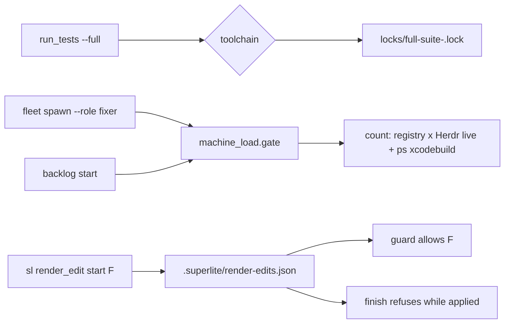
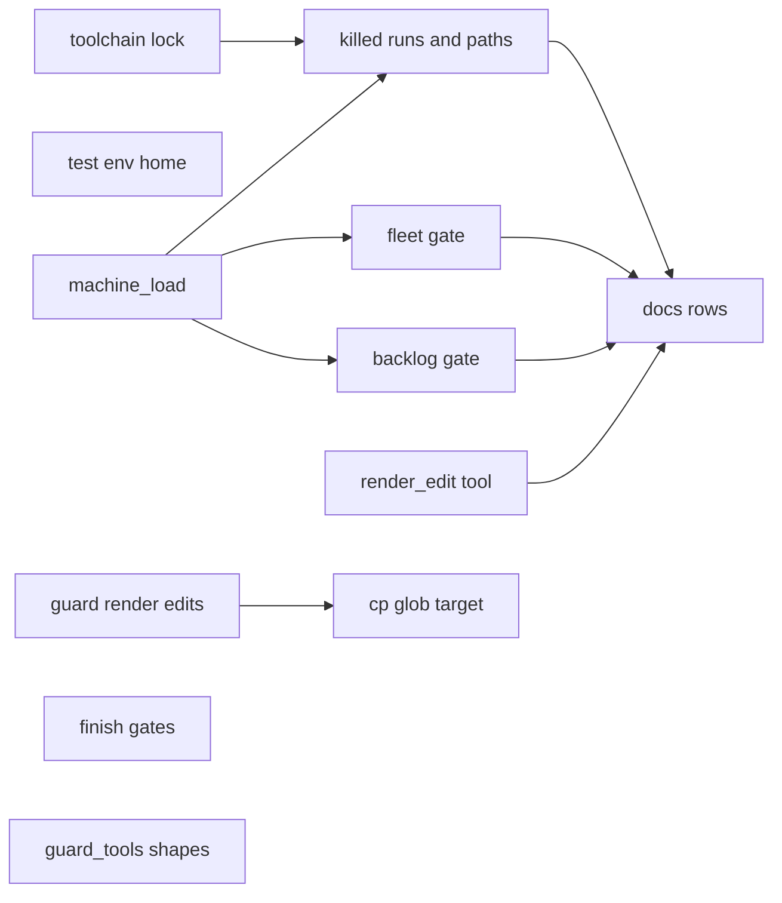

# Superlite: toolchain locks, machine cap, killed runs, render edits, guard false blocks (B118)

**Goal:** fix #550 (one long foreign full suite stalls every repository), #560 (no machine-wide cap on leads, fixers and xcodebuild), #548 (signal-killed runs and a doubled npm path reported as no-result bugs), #547 (a lead's throwaway render-check edits are blocked), #554 (guard false blocks), in that order of importance.
**Architecture:** run_tests takes one full-suite lock per toolchain; a new `machine_load` module counts leads, fixers (machine-wide registry crossed with live Herdr agents) and xcodebuild processes and gates `fleet spawn` and `backlog start`; run_tests classifies signal kills and keeps root-relative `--fast` paths; a new `render_edit` tool records throwaway edits the guard then allows until `render_edit restore`; guard_tools/guard_judge resolve three more read-only or allowed shapes.
**Tech stack:** Python 3.10+ stdlib, bash (hooks), pytest through `sl run_tests`.
**Spec:** this file, section Design; issues #550, #560, #548, #547, #554 and main's follow-ups.
**Detail:** contracts
**Target-min:** 14
**Wave0:** none
**Coverage:** off (five filed issues are the spec; every open choice is a Ruling line below)
**Max chars:** 26000

Global constraints:
- Existing tests stay green. An existing test file changes only when the task Owns it; another one turning red goes into DONE_WITH_CONCERNS with its id and reason.
- Every new or changed code line in `skills/subagent-driven-development/scripts/*.py` carries the `# O(...)` complexity comment its neighbours carry; stdlib only.
- Run `sl` as an executable (`<abs>/sl ...`). Verify with `<abs>/sl run_tests --fast <own test files> --task Tn --background`, then the printed `wait:` line in the foreground; end the turn only after it reports.
- No version edits. Never run `scripts/evals.sh`, `claude plugin eval` or `scripts/test_layers.py run`.
- Tests never touch the real `~/.superlite`, Herdr or `ps`: inject `live`, `procs`, env and paths (conftest sets `SUPERLITE_HOME` per test).

Ruling: main's rulings (orchestrator, not Max): lock per toolchain; a start above the machine-wide limit queues, with an explicit override flag and a wait message that names what is counted; throwaway demo-data edits are allowed when reverted before commit.
Ruling: the toolchain of a full run is `python` for the pytest path, `xcode` for a command with an `xcodebuild` or `swift` word, `node` for a Node runner word, else the test-cmd language (letters and digits) or `other` (because those are the resources that contend; cost if wrong: two light suites of one toolchain still queue).
Ruling: the machine limit is `SUPERLITE_MACHINE_LIMIT`, else `<superlite home>/machine.json` `{"limit": N}`, else max(2, min(cores // 3, memory GB // 8)) (6 on 18 cores and 64 GB); 0 = no limit; busy means count >= limit (because the crashes came at 3 leads on a Mac mini and 6 leads on 18 cores; cost if wrong: one more start waits or one fewer is held).
Ruling: only lead and fixer starts are gated (implementers and reviewers keep a run's own pipeline moving); the wait is bounded by `--machine-wait S` (default 100 s, under the default 120 s Bash timeout), then `BLOCKED: ... machine busy ...` names the rerun and `--over-limit` (cost if wrong: a caller reruns more often).
Ruling: a signal kill (exit < 0, or 129, 130, 137, 143 with no result) keeps the `no-result` incident with a `signal` field; `finish` files no auto feedback for it (because it is the machine or the harness, not superlite; cost if wrong: a real superlite kill goes unfiled).
Ruling: render edits refuse a file a plan task owns or one with uncommitted changes, and `finish` refuses while any is applied (commit_task and the packet belong to B130/B129: follow-up); the start-SHA scratch build for "before" screenshots (#547 comment) is left out as a follow-up.
Ruling: the packet's stale-summary part of #550 is covered by its existing `committed after this full run` line (pt_review belongs to B129).
Ruling: B118 also edits files no open batch lists: finish.py, guard_tools.py, guard_files.py, tests/scripts/conftest.py, the two new scripts.
LAYERS: unit, headless

## Design

### 1. Toolchain lock (#550)
`full_suite_lock(a, label, toolchain)` holds `<home>/locks/full-suite-<toolchain>.lock`. The holder record adds `toolchain` and `expect` (the `seconds` of the root's `.superlite/test-summary-full.json`, when readable). Wait line: `run_tests: waiting for the <tc> full-suite lock (held by pid P in ROOT (task T) since HH:MM:SS, N min ago[; its last full run took M min, done about HH:MM]); full <tc> runs on one machine run one at a time, other toolchains do not wait (--lock-wait S bounds the wait)`. A changed holder prints the line again and rewrites the note. The `.lockwait` note is `{"lock": <path>, "holder": {...}}`; `--wait` names the live holder of that lock (an old note: its holder). The LockBusy reason keeps `full-suite lock: still held by ... after S s` and names the toolchain inside.

### 2. Test env follow-ups (main)
`test_0_3_1_scripts.py` and `test_run_scripts.py` read `os.environ` per call, so the conftest `SUPERLITE_HOME` reaches nested runs; conftest also points `SUPERLITE_HOME` at a session temp folder at import, before any module snapshots the env.

### 3. Machine cap (#560)
`machine_load`: `register(name, role, root)` writes `<home>/load/<name>.json`; `count(live, procs)` counts registry entries named in `live` (Herdr agent names) by role (`lead`, `fixer*`) plus `xcodebuild` entries in `procs`; `limit()`; `gate(what, wait_s, over)` polls until below, printing the wait line once; `snapshot_text()`. `fleet spawn` registers every worker and gates fixer roles; `backlog start` gates each lead and registers it. `backlog wait` adds one `machine: ...` line when a round parks batches for a machine reason.

### 4. Killed runs and doubled paths (#548)
A run with no result and a signal exit gets the error `test run killed by SIG<NAME> (exit N): its test processes were killed before a result (<snapshot_text>); not a test failure, rerun it` (the packet's `killed()` reads it as a killed run). `to_root` keeps a relative `--fast` path that exists only from the root as is (stderr note). A non-Python `--fast` path with a `/` and a file suffix (no glob, no `...`) that exists nowhere is a usage error.

### 5. Render edits (#547)
`sl render_edit start F... | restore [F...] | status` with `.superlite/render-edits.json` = `{"files": {"<root-relative path>": {"existed": true}}, "started": EPOCH}` written `json.dumps(indent=1, sort_keys=True)`. The guard (Edit/Write in the hook, Bash in the judge) allows a listed path in an active run; its block message names the tool.

### 6. Guard false blocks (#554)
`git apply` with `--check`, `--stat`, `--numstat` or `--summary` and no `--apply`/`--index`/`--cached` writes nothing; a `sys.argv` tuple unpack and an f-string with unknown parts resolve (the latter as a glob); `cp|mv SRC_GLOB... DIR/` targets `DIR/<source name glob>`.

## File structure

- `skills/subagent-driven-development/scripts/run_tests.py`: toolchain lock (T1), killed runs and paths (T3)
- `skills/subagent-driven-development/scripts/machine_load.py`: new, count and gate (T4)
- `skills/subagent-driven-development/scripts/fleet.py`: register and gate (T5)
- `skills/subagent-driven-development/scripts/backlog_run.py`: lead gate, machine park line (T6)
- `skills/subagent-driven-development/scripts/render_edit.py`: new tool (T7)
- `hooks/block-coordinator-edits`, `skills/subagent-driven-development/scripts/guard_judge.py`: render-edit allowance (T8), cp glob (T11)
- `skills/subagent-driven-development/scripts/finish.py`: stop and render gates (T9)
- `skills/subagent-driven-development/scripts/guard_tools.py`: git apply, Python targets (T10)
- `docs/tools.md`: rows (T12)

## Task graph

```mermaid
%% schedule
gantt
  title Predicted schedule (mm:ss)
  dateFormat X
  axisFormat %M:%S
  section lane 1
  T10 guard_tools read-only apply and Pyth :t10, 0, 140s
  T12 docs rows for lock machine limit kil :t12, 263, 93s
  section lane 2
  T8 guard allows recorded render edits :t8, 0, 139s
  T11 cp and mv of a glob into a folder :t11, 139, 94s
  section lane 3
  T4 machine_load count limit and gate :t4, 0, 114s
  T3 killed runs and root-relative fast pa :t3, 114, 149s
  section lane 4
  T1 per-toolchain full-suite lock :t1, 0, 112s
  T6 backlog start gate and machine park l :t6, 114, 140s
  section lane 5
  T7 render_edit tool :t7, 0, 112s
  T5 fleet spawn registers and gates fixer :t5, 114, 98s
  section lane 6
  T9 finish skips signal kills refuses ope :t9, 0, 94s
  section lane 7
  T2 test env takes SUPERLITE_HOME per cal :t2, 0, 91s
```

critical path: T4 → T3 → T12 (5.9 min) · peak width 7 · predicted build 5.9 min · predicted total ≈ 18.9 min (target ✗ 14.0)

## Package: run_tests

App type: CLI. Categories: state, file, protocol. **Probe entry:** none (the cases are named tests).

### T1 per-toolchain full-suite lock · Complexity 5 · Est. context 55k
**Owns:** skills/subagent-driven-development/scripts/run_tests.py, tests/scripts/test_toolchain_lock_550.py, tests/scripts/test_full_suite_lock_480.py, tests/regression/test_full_lock_ancestor_holder_479.py
**Components:** 1
**LOC owned:** 140
**Tests:** fast
**Model:** sonnet
**Est. time:** 4 min
**Covers:** 1
**Consumes:** none
**Produces:** run_tests.lock_toolchain(spec: dict) -> str · run_tests.full_lock_path(toolchain: str) -> Path
e.g. lock_toolchain({"python": True}) -> "python"
e.g. lock_toolchain({"python": False, "language": "swift", "command": "cd P && xcodebuild test -scheme X"}) -> "xcode"
e.g. lock_toolchain({"python": False, "language": "shell", "command": "bash scripts/ci.sh lint"}) -> "shell"
**Review Focus:** `test_two_toolchains_do_not_wait`: a held `python` lock (a child holding flock on full-suite-python.lock) and a `--full` run of a test-cmd.json `bash t.sh` project finishes without a `waiting for` line; `test_same_toolchain_waits_and_names_age`: a held python lock makes a python full run print `waiting for the python full-suite lock (held by pid P ... min ago` and, with `--lock-wait 1`, exit 2 with `full-suite lock: still held by`; `test_wait_names_live_holder`: a `.lockwait` note `{"lock": L, "holder": {"pid": 1}}` while L names pid 2 makes `--wait` print `held by pid 2`; `test_old_note_still_read`: a note that is a bare holder dict still prints its pid; `test_expect_from_last_full_run`: holder root with `test-summary-full.json` `{"seconds": 600}` prints `its last full run took 10 min`.
**Notes:** both call sites pass a toolchain (`run_other`: lock_toolchain(spec); pytest path: "python"). Update the docstring paragraph on the lock. The two existing lock test files change only where they name `full-suite.lock`.
**Steps:** 1 failing tests, 2 run: FAIL, 3 implement, 4 run: PASS

### T3 killed runs and root-relative fast paths · Complexity 4 · Est. context 50k
**Owns:** skills/subagent-driven-development/scripts/run_tests.py, tests/scripts/test_run_tests_killed_548.py
**Components:** 2
**LOC owned:** 130
**Tests:** fast
**Model:** sonnet
**Est. time:** 4 min
**Covers:** 4
**Consumes:** machine_load.snapshot_text() -> str (T4)
**Produces:** run_tests.signal_name(rc: int) -> str | None
e.g. signal_name(-9) -> "SIGKILL"
e.g. signal_name(143) -> "SIGTERM"
e.g. signal_name(1) -> None
**Review Focus:** `test_sigkill_pytest_is_killed_not_failure`: a test-cmd.json command `sh -c 'kill -9 $$'` (and a pytest run whose test kills its own process group with SIGKILL) writes a summary whose `error` starts `test run killed by SIGKILL (exit` and holds `its test processes were killed`, and its incident has `"signal": "SIGKILL"`; `test_exit_143_without_result_is_sigterm`: `sh -c 'exit 143'` reads as SIGTERM; `test_exit_143_with_counts_is_a_result`: a command printing a pytest-style `1 passed` line then `exit 143` is not a signal kill; `test_root_relative_path_from_package_dir`: run from `pkg/a` with `--fast pkg/a/test/x.test.ts` (exists from the root only) keeps `pkg/a/test/x.test.ts` and prints `run_tests: --fast pkg/a/test/x.test.ts read from the root`; `test_missing_node_path_is_usage_error`: `--fast pkg/missing/x.test.ts` in a test-cmd.json project exits 2 with `test path not found`; `test_go_pattern_not_checked`: `./pkg/...` passes the check.
**Notes:** the signal check runs only when the run produced no result (no JUnit counts, no output count). `snapshot_text` failures never stop a run (empty text).
**Steps:** 1 failing tests, 2 run: FAIL, 3 implement, 4 run: PASS

### T2 test env takes SUPERLITE_HOME per call · Complexity 1 · Est. context 25k
**Owns:** tests/scripts/test_0_3_1_scripts.py, tests/scripts/test_run_scripts.py, tests/scripts/conftest.py, tests/scripts/test_test_env_home_550.py
**Components:** 1
**LOC owned:** 40
**Tests:** fast
**Model:** sonnet
**Est. time:** 1.5 min
**Covers:** 2
**Consumes:** none
**Produces:** none
**Review Focus:** `test_run_helpers_pass_the_test_home`: with `monkeypatch.setenv("SUPERLITE_HOME", X)`, the env each `run()` helper of the two modules builds (call it with a script that prints `os.environ["SUPERLITE_HOME"]`, or read the helper's env function) holds X; `test_conftest_sets_a_session_home_at_import`: `os.environ["SUPERLITE_HOME"]` at module import of the new test is not `~/.superlite`.
**Notes:** keep the module `ENV` names (other code may import them) but build the env inside `run()` from `os.environ` at call time with the same overrides. In conftest, at import: `os.environ["SUPERLITE_HOME"] = tempfile.mkdtemp(prefix="sl-home-")`, removed at exit.
**Steps:** 1 failing tests, 2 run: FAIL, 3 implement, 4 run: PASS

## Package: machine cap

App type: concurrency. Categories: state, protocol. **Probe entry:** none (needs Herdr and ps; named tests).

### T4 machine_load count, limit and gate · Complexity 5 · Est. context 45k
**Owns:** skills/subagent-driven-development/scripts/machine_load.py, tests/scripts/test_machine_load_560.py
**Components:** 1
**LOC owned:** 150
**Tests:** fast
**Model:** sonnet
**Est. time:** 4 min
**Covers:** 3
**Consumes:** none
**Produces:** machine_load.register(name: str, role: str, root: str) -> None · machine_load.count(live: set | None = None, procs: list | None = None) -> dict · machine_load.limit() -> tuple · machine_load.gate(what: str, wait_s: float, over: bool = False, poll_s: float = 10.0) -> str | None · machine_load.snapshot_text() -> str
e.g. count(live={"sl-a-w1", "lead-b7"}, procs=["/usr/bin/xcodebuild", "zsh"]) with registry {"sl-a-w1": fixer-sonnet, "lead-b7": lead, "sl-a-w2": fixer-opus} -> {"leads": 1, "fixers": 1, "xcodebuild": 1, "total": 3, "herdr": True}
e.g. limit() with SUPERLITE_MACHINE_LIMIT=4 -> (4, "SUPERLITE_MACHINE_LIMIT")
e.g. gate("backlog start B7", 0, over=False) at total 6 of limit 6 -> "machine busy after 0 s: 2 leads, 1 fixer, 3 xcodebuild = 6 of limit 6"
**Review Focus:** `test_count_crosses_registry_with_live`; `test_limit_env_file_default` (env 4; file `{"limit": 3}`; default with cores 18 and 64 GB -> 6; `0` -> no limit, gate returns None); `test_gate_waits_then_starts` (counts 6, 6, 5 with limit 6 and poll 0: returns None, stderr one `machine busy: ... (counted machine-wide: leads and fixers in live Herdr panes, xcodebuild processes; limit 6 from ...); waiting up to` line and one `below its limit after` line); `test_gate_over_limit` prints `machine limit overridden (--over-limit)`; `test_herdr_down_counts_processes_only` (count with live None and herdr raising: herdr False, leads 0); `test_registry_drops_stale` (an entry not live and older than 24 h is removed by count).
**Notes:** `count(None, None)` reads `herdr_client.agents()` names and `ps -axo comm=`; injectable module-level readers for tests. Registry entry `{"role", "root", "since"}`, atomic write.
**Steps:** 1 failing tests, 2 run: FAIL, 3 implement, 4 run: PASS

### T5 fleet spawn registers and gates fixers · Complexity 3 · Est. context 50k
**Owns:** skills/subagent-driven-development/scripts/fleet.py, tests/scripts/test_fleet_machine_gate_560.py
**Components:** 1
**LOC owned:** 60
**Tests:** fast
**Model:** sonnet
**Est. time:** 3 min
**Covers:** 3
**Consumes:** machine_load.register(name: str, role: str, root: str) -> None (T4) · machine_load.gate(what: str, wait_s: float, over: bool = False, poll_s: float = 10.0) -> str | None (T4)
**Produces:** none
**Review Focus:** `test_fixer_spawn_blocked_when_busy`: gate returning a busy line makes `fleet spawn --role fixer --tier 1` print `BLOCKED: fleet spawn: machine busy ...; rerun later, or pass --over-limit` and exit 3 before any pane opens; `test_over_limit_passes_through` (`--over-limit` reaches gate as over=True); `test_implementer_spawn_not_gated`; `test_spawn_registers_role` (a started worker calls register with its herdr name and role); `--machine-wait S` reaches gate as wait_s (default 100).
**Steps:** 1 failing tests, 2 run: FAIL, 3 implement, 4 run: PASS

### T6 backlog start gate and machine park line · Complexity 3 · Est. context 50k
**Owns:** skills/subagent-driven-development/scripts/backlog_run.py, tests/scripts/test_backlog_machine_560.py
**Components:** 2
**LOC owned:** 80
**Tests:** fast
**Model:** sonnet
**Est. time:** 3.5 min
**Covers:** 3
**Consumes:** machine_load.register(name: str, role: str, root: str) -> None (T4) · machine_load.gate(what: str, wait_s: float, over: bool = False, poll_s: float = 10.0) -> str | None (T4)
**Produces:** backlog_run.machine_park_line(lines: list) -> str | None
e.g. machine_park_line(["B3 parked: PR not merged: runner offline", "B5 parked: runner offline", "B6 shipped pr=12"]) -> "machine: runner offline parks B3, B5; fix the machine first, then sl backlog start B3 B5"
e.g. machine_park_line(["B3 parked: tests red"]) -> None
**Review Focus:** `test_start_gates_each_lead` (gate busy for B8: `BLOCKED: B8 not started: machine busy ...; rerun sl backlog start B8, or --over-limit`, B8 keeps its state, exit 2; B7 before it started and registered as `lead`); `test_machine_park_line` (patterns: runner offline, offline runner, GUI session, login session, WindowServer; case-insensitive); `test_round_prepends_machine_line`.
**Notes:** one `--machine-wait` budget (default 100 s) for the whole start call; `--over-limit` flag.
**Steps:** 1 failing tests, 2 run: FAIL, 3 implement, 4 run: PASS

## Package: render edits and guard

App type: CLI and file I/O. Categories: file, state, protocol. **Probe entry:** none (git and hook state; named tests).

### T7 render_edit tool · Complexity 4 · Est. context 40k
**Owns:** skills/subagent-driven-development/scripts/render_edit.py, tests/scripts/test_render_edit_547.py
**Components:** 1
**LOC owned:** 140
**Tests:** fast
**Model:** sonnet
**Est. time:** 3.5 min
**Covers:** 5
**Consumes:** none
**Produces:** render_edit.main(argv: list | None = None) -> int · render_edit.applied(sd: Path) -> list
e.g. applied(Path(".superlite")) with {"files": {"Demo/Seed.swift": {"existed": true}}} -> ["Demo/Seed.swift"]
**Review Focus:** `test_start_records_and_restore_reverts` (in a git repo: start `Demo/Seed.swift`, edit it, `restore` brings back HEAD bytes and empties the list; `restored Demo/Seed.swift`); `test_new_file_is_deleted_on_restore` (existed false); `test_refuses_dirty_file` (exit 2, `has uncommitted changes`); `test_refuses_task_owned_file` (a plan whose task owns it: exit 2, `owned by T3`); `test_refuses_outside_root_and_protected` (`../x`, `.superlite/orchestrator.json`); `test_status_exit_1_when_applied`; the JSON format of Design 5 byte for byte.
**Notes:** run root = git toplevel of the cwd; plan from `--plan` or `.superlite/stable.json`; `sl render_edit` with no args prints usage, exit 2.
**Steps:** 1 failing tests, 2 run: FAIL, 3 implement, 4 run: PASS

### T8 guard allows recorded render edits · Complexity 4 · Est. context 60k
**Owns:** hooks/block-coordinator-edits, skills/subagent-driven-development/scripts/guard_judge.py, tests/scripts/test_guard_render_edits_547.py
**Components:** 2
**LOC owned:** 70
**Tests:** fast
**Model:** sonnet
**Est. time:** 4 min
**Covers:** 5
**Consumes:** none
**Produces:** none
**Review Focus:** `test_edit_of_recorded_file_allowed` (active run, render-edits.json lists `Demo/Seed.swift`: Edit and Write of it exit 0, of `Demo/Other.swift` exit 2); `test_bash_write_and_checkout_allowed` (`sed -i '' s/a/b/ Demo/Seed.swift` and `git checkout HEAD -- Demo/Seed.swift` exit 0); `test_block_message_names_render_edit` (a blocked Edit's stderr holds `sl render_edit start`, the last two stderr lines unchanged); `test_quoted_key_only` (a file listing `Demo/Seed.swift.bak` does not allow `Demo/Seed.swift`); a linked worktree reads its own `.superlite`.
**Notes:** match the exact JSON key line `"<rel>": {` in the hook (bash builtins only); the judge parses the JSON.
**Steps:** 1 failing tests, 2 run: FAIL, 3 implement, 4 run: PASS

### T9 finish skips signal kills, refuses open render edits · Complexity 2 · Est. context 35k
**Owns:** skills/subagent-driven-development/scripts/finish.py, tests/scripts/test_finish_gates_548_547.py
**Components:** 1
**LOC owned:** 40
**Tests:** fast
**Model:** sonnet
**Est. time:** 2 min
**Covers:** 4, 5
**Consumes:** none
**Produces:** none
**Review Focus:** `test_signal_kill_not_filed` (a `no-result` incident with `"signal": "SIGKILL"` is not in read_stops; one without is); `test_open_render_edit_refuses` (render-edits.json listing a file: finish prints `BLOCKED: render edits still applied: Demo/Seed.swift; run sl render_edit restore first`, exit 2, no report written).
**Steps:** 1 failing tests, 2 run: FAIL, 3 implement, 4 run: PASS

### T10 guard_tools read-only apply and Python targets · Complexity 4 · Est. context 55k
**Owns:** skills/subagent-driven-development/scripts/guard_tools.py, tests/scripts/test_guard_false_blocks_554.py
**Components:** 2
**LOC owned:** 80
**Tests:** fast
**Model:** sonnet
**Est. time:** 3.5 min
**Covers:** 6
**Consumes:** none
**Produces:** none
**Review Focus:** through the hook in an active run: `test_git_apply_check_reads_only` (`D=/tmp/x; git diff HEAD --binary > $D/b.patch; git apply --check -R $D/b.patch` exit 0; `git apply x.patch` still exit 2); `test_argv_tuple_unpack` (`S=/tmp/sc; python3 -I - "$S/copy/A.swift" "$S/q.png" <<'EOF'` with `p,img=sys.argv[1],sys.argv[2]` and `open(p,'w')` exit 0; with the project's `src/A.swift` exit 2); `test_fstring_target_is_glob` (`Path(f".superlite/plan-parts/{letter}.md").write_text(x)` exit 0, `Path(f"src/{n}.py").write_text(x)` exit 2); pins that pass today: the B46 `echo "Left undone: ..." >> .superlite/notes.md; python3 - <<'EOF'` docs edit and `python3 -I - <<EOF` reading JSON exit 0.
**Steps:** 1 failing tests, 2 run: FAIL, 3 implement, 4 run: PASS

### T11 cp and mv of a glob into a folder · Complexity 3 · Est. context 50k
**Owns:** skills/subagent-driven-development/scripts/guard_judge.py, skills/subagent-driven-development/scripts/guard_files.py, tests/scripts/test_guard_cp_glob_554.py
**Components:** 1
**LOC owned:** 40
**Tests:** fast
**Model:** sonnet
**Est. time:** 2.5 min
**Covers:** 6
**Consumes:** none
**Produces:** none
**Review Focus:** `test_cp_md_glob_into_docs` (`cp a/*.md docs/x/` exit 0; `cp a/*.py docs/x/` exit 2; `mv a/*.md docs/x` with docs/x an existing folder exit 0; `cp a/* docs/x/` exit 2).
**Steps:** 1 failing tests, 2 run: FAIL, 3 implement, 4 run: PASS

## Package: docs

### T12 docs rows for lock, machine limit, killed runs, render_edit · Complexity 2 · Est. context 45k
**Owns:** docs/tools.md, tests/scripts/test_docs_480_full_suite_lock.py, tests/scripts/test_docs_b118.py
**Components:** 1
**LOC owned:** 60
**Tests:** fast
**Model:** sonnet
**Est. time:** 2 min
**Covers:** 1, 3, 4, 5
**Consumes:** none
**Produces:** none
**Review Focus:** `test_docs_b118`: the `run_tests` row holds `~/.superlite/locks/full-suite-<toolchain>.lock`, `other toolchains do not wait` and `test run killed by SIG<NAME>`; the `fleet` row holds `--over-limit` and `--machine-wait S`; the `backlog_run` (or backlog) row holds `machine busy` and `machine: ... parks`; a `| \`render_edit\` |` row holds `start F`, `restore`, `status` and `finish refuses`. test_docs_480 pins the new lock path instead of `full-suite.lock`.
**Steps:** 1 update test_docs_480 and write test_docs_b118, 2 run: FAIL, 3 edit docs/tools.md from the committed code, 4 run: PASS

## Self-review

Coverage: Design 1 T1, 2 T2, 3 T4-T6, 4 T3 T9, 5 T7 T8 T9, 6 T10 T11; docs T12. Same-file tasks are ordered by edges (run_tests T1->T3, guard_judge T8->T11). Consumes match Produces. No placeholders.
