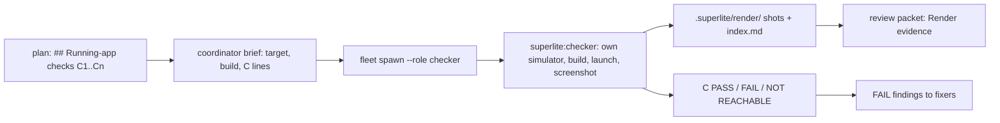
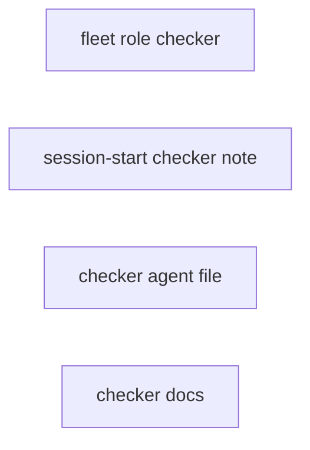

# Superlite: a checker fleet role for running-app checks (B142)

**Goal:** fix #600: a `checker` fleet role (`superlite:checker`) runs the real app, widget or extension once, with the standing rules for simulator, macOS, web and render checks built into its agent file, so a coordinator's brief shrinks to the target and the check lines; writing-plans names UI verification as `## Running-app checks` lines a checker runs, never a plan task; SDD runs them once before the final review packet.
**Architecture:** `fleet_roles.launch` gains a one-turn `checker` role (no `--tier`, model and effort from `agents/checker.md`); `hooks/session-start` gives it the brief-role note; prompt and doc text for the rest.
**Tech stack:** Python 3.10+ stdlib, bash, Markdown prompts; pytest through `sl run_tests`.
**Spec:** this file, section Design; issue #600.
**Detail:** tests
**Target-min:** 11
**Wave0:** none
**Coverage:** off

Global constraints:
- Existing tests stay green. An existing test file changes only when the task Owns it. If another existing test turns red, report it in DONE_WITH_CONCERNS with the test id and the reason instead of editing it.
- Run `sl` as an executable (`<abs>/sl ...`). Verify with `<abs>/sl run_tests --fast <own test files> --task Tn --background`, then run the printed `wait:` line in the foreground and end the turn only after it reports.
- No version edits (the ship step bumps the version). Never run `scripts/evals.sh`, `claude plugin eval` or `scripts/test_layers.py run`.
- Python lines keep the repo's `# O(...)` complexity comment on every code line.

Ruling: Max's decision: a new checker fleet role with standing rules (not a brief generator).
Ruling: the checker takes no `--tier`; its model is sonnet, effort high, from its agent file (because the 1.5.111 miss was a role without rules, not a model limit, and fleet.py's respawn hint keeps a tier only for implementer, fixer and research; cost if wrong: a later `--tier opus` for checkers).
Ruling: no brief generator: the coordinator copies the plan's `C<n>` lines into a short brief (YAGNI; the standing rules carry the 60 to 100 lines).
Ruling: the checker's own simulator is `sl-check-<basename of ROOT>`, made with `simctl create` (because `simctl clone` refuses watch simulators); its builds go to `<ROOT>/.build/CheckDerivedData` (never the tests' `.build/DerivedData`, which a background suite may be using).
Ruling: throwaway renders go through `sl render_edit start`/`restore`, which commit_task and finish already guard.
Ruling: already in the lead worktree, no `sl worktree ensure`; no probe adapter (prompt and doc text plus a role table); layers: unit, headless, tui (hooks/session-start), evals (agents/**, skills/*/SKILL.md).
LAYERS: unit, headless, tui, evals



## Design

### 1. Fleet role
`fleet_roles.ROLES` ends with `"checker"`; `launch("checker", None, cfg)` returns agent `superlite:checker`, no `--model` flag (model from frontmatter), `--effort` from frontmatter, `TAIL`, `one_turn` True, `prime` and `pool` False; any tier raises `ValueError("checker takes no --tier")`. The unknown-role message then lists `implementer, fixer, package-reviewer, final-reviewer, research, checker`.

### 2. Session note
`hooks/session-start` gives `SUPERLITE_FLEET_ROLE=checker` the brief-role note (one more name in the `case` pattern).

### 3. Agent file
`agents/checker.md`, verbatim in T3.

### 4. Docs
SDD `fleet.md` (Checker bullet), SDD `SKILL.md` (one sentence in Final review 2), writing-plans `SKILL.md` (Running-app checks rule, plan-shape item, red flag, MCP note), `docs/simulator-limits.md` (two entries), `docs/skills-and-agents.md` (one agent line), verbatim in T4.

## File structure

- `skills/subagent-driven-development/scripts/fleet_roles.py`: the checker role (T1)
- `tests/scripts/test_fleet_roles_checker_600.py`: its tests (T1)
- `hooks/session-start`, `tests/scripts/test_session_start_roles.py`: checker brief note (T2)
- `agents/checker.md`, `tests/scripts/test_checker_agent_600.py`: the agent and its pinned rules (T3)
- `skills/subagent-driven-development/fleet.md`, `skills/subagent-driven-development/SKILL.md`, `skills/writing-plans/SKILL.md`, `docs/simulator-limits.md`, `docs/skills-and-agents.md`, `tests/scripts/test_docs_checker_600.py`: docs (T4)

## Task graph

```mermaid
%% schedule
gantt
  title Predicted schedule (mm:ss)
  dateFormat X
  axisFormat %M:%S
  section lane 1
  T3 checker agent file :t3, 0, 277s
  section lane 2
  T4 checker docs :t4, 0, 274s
  section lane 3
  T1 fleet role checker :t1, 0, 271s
  section lane 4
  T2 session-start checker note :t2, 0, 268s
```





critical path: T3 (4.6 min) · peak width 4 · predicted build 4.6 min · predicted total ≈ 15.1 min (target ✗ 11.0)

## Package: checker role

App type: library (role table) and prompt text. Categories: none beyond the named tests. **Probe entry:** none (a role table and prompt text; the cases are named tests).

### T1 fleet role checker · Complexity 2 · Est. context 28k
**Owns:** skills/subagent-driven-development/scripts/fleet_roles.py, tests/scripts/test_fleet_roles_checker_600.py
**Kind:** mechanical
**Components:** 1
**LOC owned:** 45
**Tests:** fast
**Model:** haiku
**Est. time:** 1.5 min (1 component, about 45 LOC, fast tests)
**Covers:** 1
**Consumes:** none
**Produces:** none
**Review Focus:** `test_checker_launch_reads_its_agent_file`, `test_checker_takes_no_tier`, `test_unknown_role_lists_checker` below.
**Notes:** in `fleet_roles.py`: append `"checker"` to `ROLES`; add `"checker"` to the module docstring's role list (`Roles: implementer (the default), fixer, package-reviewer, final-reviewer, research, checker.`); in `launch`, before the final `else:`, add `elif role == "checker":` that raises `ValueError("checker takes no --tier")` when `tier is not None`, else sets `agent = "superlite:checker"` (each line with its `# O(1)` comment). Nothing else changes: `pin` stays None, so `--model` is not passed.
**Test code (verbatim):** new file tests/scripts/test_fleet_roles_checker_600.py:
```python
"""#600: the checker fleet role runs superlite:checker as a one-turn brief worker; it takes no --tier."""
import sys
import pytest
from test_plan_tools import SCRIPTS
sys.path.insert(0, str(SCRIPTS))
import fleet_roles as fr  # noqa: E402
import routing  # noqa: E402

CFG = routing.load_cfg()
TAIL = ["--disallowedTools", "AskUserQuestion"]


def test_checker_launch_reads_its_agent_file(tmp_path):
    (tmp_path / "checker.md").write_text("---\nname: checker\nmodel: sonnet\neffort: high\n---\nbody\n", encoding="utf-8")
    r = fr.launch("checker", None, CFG, agents_dir=tmp_path)
    assert r == {"role": "checker", "agent": "superlite:checker", "model": "sonnet", "effort": "high",
                 "argv": ["--agent", "superlite:checker", "--effort", "high"] + TAIL,
                 "prime": False, "pool": False, "one_turn": True}


@pytest.mark.parametrize("tier", ["sonnet", "opus", "1"])
def test_checker_takes_no_tier(tier):
    with pytest.raises(ValueError, match="checker takes no --tier"):
        fr.launch("checker", tier, CFG)


def test_unknown_role_lists_checker():
    assert fr.ROLES[-1] == "checker"
    with pytest.raises(ValueError, match="^unknown role lead; use implementer, fixer, package-reviewer, final-reviewer, research, checker$"):
        fr.launch("lead", None, CFG)


def test_checker_env_names_the_role():
    assert fr.env("checker")["SUPERLITE_FLEET_ROLE"] == "checker"
```
**Steps:** 1 write the test file, 2 run it: FAIL, 3 change fleet_roles.py, 4 run: PASS

### T2 session-start checker note · Complexity 1 · Est. context 24k
**Owns:** hooks/session-start, tests/scripts/test_session_start_roles.py
**Kind:** mechanical
**Components:** 1
**LOC owned:** 5
**Tests:** fast
**Model:** haiku
**Est. time:** 1.5 min (1 component, about 5 LOC, fast tests)
**Covers:** 2
**Consumes:** none
**Produces:** none
**Review Focus:** `test_brief_roles_get_the_brief_note[checker-superlite:checker]`: the checker gets the brief note.
**Notes:** in `hooks/session-start`, change the line `    fixer|package-reviewer|final-reviewer|research)  # O(1)` to `    fixer|package-reviewer|final-reviewer|research|checker)  # O(1)`; nothing else. In `tests/scripts/test_session_start_roles.py`, replace only the parametrize decorator of `test_brief_roles_get_the_brief_note` with the one below; nothing else.
**Test code (verbatim):** the new decorator in tests/scripts/test_session_start_roles.py (the test body stays; with role `checker` and agent `superlite:checker` it expects exactly `You are superlite fleet worker W1 (checker, superlite:checker). The coordinator sends one brief file: do what it says, then end with the status line and the JSON block it asks for. Do not start a superlite run.`):
```python
@pytest.mark.parametrize("role,agent", [("fixer", "superlite:fixer-opus"), ("package-reviewer", "superlite:package-reviewer"),
                                        ("final-reviewer", "superlite:final-reviewer"), ("research", "superlite:researcher"),
                                        ("checker", "superlite:checker")])
```
**Steps:** 1 add the test pair, 2 run it: FAIL (the checker gets the implementer note), 3 change the hook line, 4 run: PASS

### T3 checker agent file · Complexity 2 · Est. context 30k
**Owns:** agents/checker.md, tests/scripts/test_checker_agent_600.py
**Kind:** mechanical
**Components:** 1
**LOC owned:** 110
**Tests:** fast
**Model:** haiku
**Est. time:** 2 min (1 component, about 110 LOC, fast tests)
**Covers:** 3
**Consumes:** none
**Produces:** none
**Review Focus:** `test_checker_frontmatter`, `test_checker_standing_rules` below.
**Notes:** write `agents/checker.md` exactly as the file text below (between the `~~~` lines, without them).
File text:
~~~markdown
---
name: checker
description: Running-app checker, one turn. Builds the real app, widget or extension, runs it once on its own simulator (or on macOS, or in a browser), checks each listed item and reports PASS, FAIL or NOT REACHABLE with screenshots. Never fixes.
model: sonnet
effort: high
disallowedTools: Agent, Task, Workflow, AskUserQuestion, SendMessage, EnterWorktree, ExitWorktree, EnterPlanMode, ExitPlanMode, CronCreate, CronDelete, ScheduleWakeup, RemoteTrigger, PushNotification, TaskCreate, TaskUpdate, TaskStop
---

You run the real artifact once and check what it shows. Your brief gives the literal absolute `sl` path (type it in every command; each Bash call is a fresh shell), `PLAN`, `ROOT` (the run root: a worktree or the checkout), the target (scheme or app, platform, device type; a web app: its start command), the build command, and the checks, one `C<n>: <target>; reach: <state>; see: <what must show>` line each. The rules below are standing: the brief does not repeat them.

## Every check runs

- Run every listed check. Each ends PASS, FAIL or NOT REACHABLE; none is skipped, merged or left out of the report.
- NOT REACHABLE names what you tried and what stopped you (a command and its error, a state no launch argument, URL or UI step reaches). Spend at most 5 minutes reaching one state, then report it NOT REACHABLE and go on.
- Judge from the screen, never from the code: a check passes only when a screenshot shows what it asks for.
- You report; you never fix. Change no product or test file, commit nothing, and leave git alone (no stash, checkout, reset or branch).

## Build

- Build inside ROOT only: `xcodebuild` gets `-derivedDataPath <ROOT>/.build/CheckDerivedData`, never a folder outside ROOT (your scratchpad and /tmp included) and never `<ROOT>/.build/DerivedData`, which the run's tests use.
- A target that does not build or launch: report BLOCKED with the command and its first error lines; no check runs then.

## Simulators (iOS, iPadOS, watchOS, visionOS)

- Use only your own simulator, `sl-check-<basename of ROOT>` (several device types: `sl-check-<basename of ROOT>-<n>`). Find it in `xcrun simctl list devices`; missing: `xcrun simctl create <name> <device type> <runtime>` with the brief's device type, else the newest iPhone of the newest installed runtime (a watch: a watch device type; `simctl clone` refuses watch simulators).
- Never boot, shut down, erase, install on or delete a simulator with another name: other sessions and the run's test workers use them. Never `xcrun simctl shutdown all`, `erase all` or `delete unavailable`; never quit Simulator.app or kill CoreSimulator processes.
- One simulator of yours booted at a time: `xcrun simctl shutdown <udid>` before the next one boots, and at the end. Keep it; your `Simulators:` line names it, and the coordinator deletes it at freeze.
- `xcrun simctl install <udid> <app>`, `xcrun simctl launch <udid> <bundle id> [args]`; reach a state with launch arguments, `xcrun simctl openurl <udid> <url>`, or the UI tool the brief names. Screenshot: `xcrun simctl io <udid> screenshot <file>`.

## macOS apps

- Launch the built `.app` with `open -n <app>`, capture with `screencapture -x` (one window: `-l <window id>`; else a region: `-R x,y,w,h`), then quit it by PID. Hold focus no longer than the check needs.
- A capture that is refused or blank (no Screen Recording permission for the terminal) makes the check NOT REACHABLE, naming that.

## Web apps

- Start the brief's start command on a free port, capture with the project's browser tool (Playwright, Puppeteer) headless, then stop the server by PID.

## Views no running state reaches (SwiftUI views, widget families)

- Render it with a throwaway snapshot test (`ImageRenderer` into a PNG). Record the file before you write it: `<abs sl> render_edit start <file> --plan PLAN`; run the test once; then `<abs sl> render_edit restore --plan PLAN`. Never leave a throwaway file, hosted test or edit in the tree: `commit_task` and `finish` refuse while one is recorded.

## Screenshots

- Save each as `<ROOT>/.superlite/render/C<n>-<short name>.png` and put one `- C<n>-<short name>.png: <caption>` line per shot in `<ROOT>/.superlite/render/index.md` (replace a line for the same file; keep the other lines). The final review packet lists those shots.

## Known limits

Before you retry a failing simulator or capture step, read `docs/simulator-limits.md` in the plugin (three folders above the `sl` file's folder): it lists what was tried and what works.

## Report

- One line per check, in order: `C<n> PASS|FAIL|NOT REACHABLE - <what the screen showed, one line> - <screenshot path or none>`.
- Then `Simulators: <name> <udid> (created|reused), ...` or `Simulators: none`.
- Each FAIL is also a finding in your JSON block: the file and line most likely at fault (line 0 when unknown), the problem as seen, the fix you expect, tier 3 when the cause is unknown.
- Status: DONE when every check ran (PASS or FAIL), DONE_WITH_CONCERNS when any is NOT REACHABLE, BLOCKED when none could run.
~~~
**Test code (verbatim):** new file tests/scripts/test_checker_agent_600.py:
```python
"""#600: the checker agent carries the standing rules for running-app checks."""
from pathlib import Path

TEXT = (Path(__file__).resolve().parents[2] / "agents" / "checker.md").read_text(encoding="utf-8")


def test_checker_frontmatter():
    fm = TEXT.split("---")[1]
    for s in ("\nname: checker\n", "\nmodel: sonnet\n", "\neffort: high\n", "disallowedTools: Agent, Task, Workflow, AskUserQuestion,"):
        assert s in fm, s


def test_checker_standing_rules():
    for s in ("absolute `sl` path", "PASS, FAIL or NOT REACHABLE", "none is skipped", "at most 5 minutes",
              "you never fix", "`sl-check-<basename of ROOT>`", "`xcrun simctl create <name> <device type> <runtime>`",
              "Never boot, shut down, erase, install on or delete a simulator with another name",
              "`xcrun simctl shutdown all`", "One simulator of yours booted at a time", "`Simulators:` line",
              "-derivedDataPath <ROOT>/.build/CheckDerivedData", "never `<ROOT>/.build/DerivedData`",
              "`screencapture -x`", "Screen Recording permission", "render_edit start <file> --plan PLAN",
              "render_edit restore --plan PLAN", "<ROOT>/.superlite/render/index.md", "docs/simulator-limits.md",
              "`C<n> PASS|FAIL|NOT REACHABLE - ", "Simulators: none", "BLOCKED when none could run"):
        assert s in TEXT, s
    assert "$SL" not in TEXT and "$SUPERLITE" not in TEXT
```
**Steps:** 1 write the test file, 2 run it: FAIL (no agent file), 3 write agents/checker.md, 4 run: PASS

### T4 checker docs · Complexity 2 · Est. context 34k
**Owns:** skills/subagent-driven-development/fleet.md, skills/subagent-driven-development/SKILL.md, skills/writing-plans/SKILL.md, docs/simulator-limits.md, docs/skills-and-agents.md, tests/scripts/test_docs_checker_600.py
**Kind:** mechanical
**Components:** 1
**LOC owned:** 70
**Tests:** fast
**Model:** haiku
**Est. time:** 2 min (1 component, about 70 LOC, fast tests)
**Covers:** 4
**Consumes:** none
**Produces:** none
**Review Focus:** the test below; `tests/scripts/test_orchestrator.py` (SDD_CAP 13300) and `tests/scripts/test_agent_mcp_tools.py` stay green.
**Notes:** each edit inserts or replaces exactly the text given; change nothing else.
1. `skills/subagent-driven-development/fleet.md`: right after the line that starts `- Research: \`--role research\``, insert the line `FLEET_CHECKER` (constant in the test).
2. `skills/subagent-driven-development/SKILL.md`: in Final review step 2, insert `SDD_CHECKER` (constant in the test) plus one space directly before `UI screenshots (`.
3. `skills/writing-plans/SKILL.md`: (a) in "Plan shape, in this order", replace `9. **Self-review.**` with the two lines `9. **Running-app checks:** a UI, widget, app extension or browser target (Review Focus rules).` and `10. **Self-review.**`; (b) in the Review Focus rules, replace `since agents inherit the session's MCP tools;` with `since in-process agents inherit the session's MCP tools (fleet workers start without them);`, and right after that bullet insert the line `WP_RULE` (constant in the test); (c) append the row `WP_FLAG` (constant in the test) as the last row of the Red flags table.
4. `docs/simulator-limits.md`: append a blank line and `LIMITS_TAIL` (constant in the test) at the end of the file.
5. `docs/skills-and-agents.md`: right after the line that starts `` - `fixer-opus` (opus, high)``, insert the line `AGENTS_LINE` (constant in the test).
**Test code (verbatim):** new file tests/scripts/test_docs_checker_600.py:
```python
"""#600: the docs name the checker role, the Running-app checks section and the simulator limits it meets."""
from pathlib import Path

ROOT = Path(__file__).resolve().parents[2]
SDD = ROOT / "skills" / "subagent-driven-development"
FLEET_CHECKER = ("- Checker: `--role checker` (`superlite:checker`; fleet off: Agent `superlite:checker`), one turn, for a plan's "
                 "`## Running-app checks` once every task is committed, before the review packet. Brief "
                 "`.superlite/briefs/check-<round>.md`: the absolute `sl` path, `PLAN`, `ROOT`, the target (scheme or app, platform, "
                 "device type; a web app: its start command), the build command and the `C<n>` lines. Its standing rules (own "
                 "`sl-check-<worktree>` simulator, `.build/CheckDerivedData`, throwaway renders through `render_edit`) are in "
                 "`agents/checker.md`. It answers one `C<n> PASS|FAIL|NOT REACHABLE` line per check and writes its screenshots and "
                 "`index.md` lines into `.superlite/render/`; FAIL findings go to fixers (`fixing.md`); at freeze delete the "
                 "simulators its `Simulators:` line names.")
SDD_CHECKER = "A plan's `## Running-app checks` run here once, by a checker (fleet.md); FAIL lines are findings."
WP_RULE = ("- **Running-app checks.** A check that needs the running artifact (a simulator, the built macOS app, a widget, an app "
           "extension, a browser page) is never a plan task or a task step: an implementer skips it or cannot reach it. List each "
           "in a `## Running-app checks` section, one `- C<n>: <target>; reach: <state>; see: <what must show>` line per check. "
           "The coordinator runs them once, after every task is committed and before the final review packet, with a checker "
           "(`superlite:checker`, `../subagent-driven-development/fleet.md`), whose agent file holds the standing rules (own "
           "simulator, own build folder, screenshots in `.superlite/render/`).")
WP_FLAG = ("| \"Last task: integration and simulator check\" | Not a task: `## Running-app checks` lines a checker runs before "
           "the final review. |")
LIMITS_TAIL = (
    "## SwiftUI previews: no command-line renderer\n\n"
    "Seen: superlite 1.5.123, in fleet package reviews ([#600](https://github.com/maxboettinger/superlite/issues/600)).\n\n"
    "Xcode renders `#Preview` blocks only inside Xcode: the Xcode MCP `RenderPreview` tool needs a running Xcode, and fleet "
    "workers start without MCP servers. Two reviewers rendered PNGs with throwaway hosted tests instead and left them in the tree.\n\n"
    "What to do: a checker renders a view no running state reaches with a throwaway `ImageRenderer` snapshot test, recorded "
    "with `sl render_edit start <file>` and undone with `sl render_edit restore` (`agents/checker.md`).\n\n"
    "## macOS: no simulator for a render check\n\n"
    "Seen: superlite 1.5.109 ([#600](https://github.com/maxboettinger/superlite/issues/600)). With no macOS render check, "
    "every macOS UI batch ended with a live check left for the user; 36 piled up after about 60 batches.\n\n"
    "What to do: a checker launches the built `.app` and captures it with `screencapture -x` (`agents/checker.md`). Untried: "
    "whether a fleet pane's terminal has the Screen Recording permission `screencapture` needs; a refused or blank capture is "
    "NOT REACHABLE.\n")
AGENTS_LINE = ("- `checker` (sonnet, high): a one-turn worker that runs the built app, widget or extension once on its own "
               "simulator (or on macOS, or in a browser) and reports each listed check PASS, FAIL or NOT REACHABLE with "
               "screenshots; never fixes.")


def lines(p):
    return p.read_text(encoding="utf-8").split("\n")


def test_fleet_md_names_the_checker_after_research():
    ls = lines(SDD / "fleet.md")
    assert ls.count(FLEET_CHECKER) == 1
    assert ls[ls.index(FLEET_CHECKER) - 1].startswith("- Research: `--role research`")


def test_sdd_runs_the_checks_before_the_packet():
    t = (SDD / "SKILL.md").read_text(encoding="utf-8")
    assert t.count(SDD_CHECKER + " UI screenshots (`.png`, `.jpg`, `.jpeg`) go in `.superlite/render/` first") == 1
    assert len(t) <= 13300


def test_writing_plans_names_running_app_checks():
    t = (ROOT / "skills" / "writing-plans" / "SKILL.md").read_text(encoding="utf-8")
    ls = t.split("\n")
    assert "9. **Running-app checks:** a UI, widget, app extension or browser target (Review Focus rules)." in ls
    assert "10. **Self-review.**" in ls and "9. **Self-review.**" not in ls
    assert ls.count(WP_RULE) == 1 and "RenderPreview" in ls[ls.index(WP_RULE) - 1]
    assert "since in-process agents inherit the session's MCP tools (fleet workers start without them);" in t
    assert ls.count(WP_FLAG) == 1 and ls[ls.index(WP_FLAG) - 1].startswith("| ")


def test_simulator_limits_gain_two_entries():
    t = (ROOT / "docs" / "simulator-limits.md").read_text(encoding="utf-8")
    assert t.endswith("\n\n" + LIMITS_TAIL)


def test_agents_doc_lists_the_checker_after_fixer_opus():
    ls = lines(ROOT / "docs" / "skills-and-agents.md")
    assert ls.count(AGENTS_LINE) == 1 and ls[ls.index(AGENTS_LINE) - 1].startswith("- `fixer-opus` (opus, high)")
```
**Steps:** 1 write the test file, 2 run it: FAIL, 3 make the five edits, 4 run: PASS

## Self-review

Coverage: Design 1-4 map to T1-T4. No placeholders. No Consumes or Produces; no edges (T1's test writes its own agent file; T3 pins the real one). Owns are disjoint. Fields filled.
