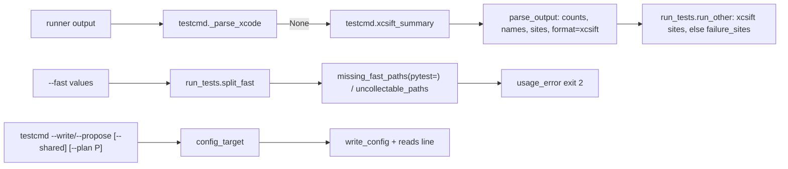
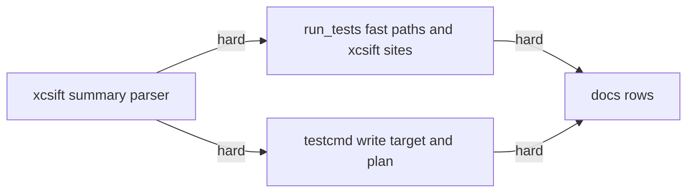

# Superlite: xcsift summaries, --fast paths pytest cannot take, testcmd write target (B158)

**Goal:** fix #661 (a test wrapper's xcsift JSON summary is read as the run's counts), #662 (`--fast` values with spaces, missing `.py` paths for a pytest test-cmd.json command and non-`.py` files for the built-in pytest runner are usage errors, not `no-result` stops) and #663 (`testcmd --write`/`--propose` target the root's own `.superlite/test-cmd.json`, `--shared` writes the main checkout's, `--plan` writes a run folder).
**Architecture:** `testcmd.py` gains `xcsift_summary` (used by `parse_output` when no raw xcodebuild lines were printed) and a `config_target(root, shared, plan)` / `write_config(..., target)` pair behind new `--shared` and `--plan` flags. `run_tests.py` gains `split_fast`, `is_pytest_command`, `uncollectable_paths`, a `pytest` flag on `missing_fast_paths`, and places xcsift failures at their file instead of running `failure_sites`. `docs/tools.md` and `commands/setup.md` describe it.
**Tech stack:** Python 3.10+ stdlib, pytest (through `sl run_tests`); Markdown docs.
**Spec:** this file, section Design; issues #661, #662, #663.
**Detail:** tests
**Target-min:** 11
**Wave0:** none
**Coverage:** off

Global constraints:
- Every Python code line keeps the file's trailing `# O(...)` complexity comment.
- Existing tests stay green. An existing test file changes only when the task Owns it. If another existing test turns red, report it in DONE_WITH_CONCERNS with the test id and the reason instead of editing it.
- Run `sl` as an executable (`<abs>/sl ...`). Verify with `<abs>/sl run_tests --fast <own test files> --task Tn --background`, then run the printed `wait:` line in the foreground and end the turn only after it reports.
- No version edits. Never run `scripts/evals.sh`, `claude plugin eval` or `scripts/test_layers.py run`. Tests use tmp folders only; never the real `~/.superlite` or `~/.config/superlite`.
- This repository is public: no host names, user names, home paths, other project names or account names in code, tests or docs. Fixtures use neutral paths such as `/src/Tests/ArchitectureTests/PipelineConfigTests.swift`.
- Never edit `fleet.py`, `backlog*.py`, `next_tasks.py`, `state.py`, `docs/hooks.md`, `failure_sites.py`.
- Standing rules for every lead and its workers (the owner's decisions, passed on by main): This repository is public: no host names, user names, home paths, other project or repository names, ticket keys or account names in code, tests, docs, commit messages, PR texts or issue comments. Write "a Swift project", "a second Mac", "the machine". Never change the machine's gate config or ~/.superlite/machine.json; tests and proofs use private temp homes and state dirs. No real app builds as proof; this repository's own test suite is the check. Priority of this round: scheduling and admission of test runs, parallel agents and the fleet, wall-clock and token efficiency. Measure before and after where the issue names a waste (seconds, runs, tokens) and put the figures into your notes. Friction with superlite itself goes to `sl feedback add`, not into this batch. Online research is allowed when something is unclear (official docs first, then how others solved it); name the source in your notes.
- Builds: the verdict is `sl run_tests` (the project's test command; a project with `.maxapp` runs `maxapp test`, which a build pool may place on another Mac, and a full run whose tree a green maxapp test stamp covers returns that result without a run); task trees build in <tree>/.build/DerivedData and any build of your own goes under .build/ of the worktree, never -derivedDataPath outside the worktree (your session scratchpad included; backlog cleanup removes scratchpad build folders when the worktree goes); a product, simulator or device build stays on this machine and runs only when an issue's acceptance asks for a running-app check.

Ruling: xcsift's JSON format only (pretty-printed or one line); its TOON format is not read (because #661 names the JSON summary; cost if wrong: a TOON wrapper stays a `no tests ran` stop).
Ruling: raw xcodebuild or Swift Testing lines win over an xcsift summary in the same output (`_parse_xcode` first; because it names crashes and restarts; cost if wrong: none, both count the same run).
Ruling: xcsift failing names are `failed_tests[].test` verbatim, collected whatever the exit code (run_tests reads any failed count as red); a summary with `"status": "failed"` and no failed count is one uncounted failure even on exit 0 (a wrapper whose pipe hides xcodebuild's exit; cost if wrong: none, the run was red).
Ruling: a `--fast` comma part that holds whitespace and is not an existing path (its `::` id dropped) splits on whitespace; an existing path with a space stays one path (because the reported values were space-joined lists; cost if wrong: a missing path with a space is named as two missing paths).
Ruling: the built-in pytest runner refuses every existing file that is not `.py` (folders, `x.py::test_id` and `...` patterns pass), not only known test-code suffixes (because pytest collects only `.py` here; cost if wrong: a pytest plugin that collects another suffix needs a test-cmd.json command).
Ruling: #663 reverses B115's linked-worktree target: `--write` and `--propose` use `<root>/.superlite/test-cmd.json`; `--shared` the main checkout's (the root's own outside a linked worktree); `--plan P` `state.plan_dir(P)/test-cmd.json` (and `--root` defaults to that folder's parent). B115's refusals stay: exit 2 while any `test-cmd.json` sets the command or the target exists.
Ruling: docs/tools.md is append-only for this batch; the testcmd row's `--write ... writes it to the main checkout's` phrase, which this batch makes false, is rewritten in place and named in notes.md; every other change is inserted mid-row (row ends are pinned by test_docs_b67_tools.py).
LAYERS: unit

## Design

### 1. xcsift summary (#661)
`parse_output` calls `xcsift_summary(lines, rc)` when `_parse_xcode` returns None and uses its result. It finds the last JSON object in the output whose `summary` holds an int `passed_tests` or `failed_tests` and reads passed, failed and (when an int) `skipped_tests`; `failed_tests[]` gives names, reasons and file sites; `errors[0]` gives the build error. A zero-count summary is uncounted, so run_tests still stops with `no tests ran ...; runner: xcsift summary: 0 passed, 0 failed tests`.

### 2. run_tests places xcsift failures (#661)
For an xcsift result run_tests skips `failure_sites` and places each site at its file when that file lies under the run folder, else `-`.

### 3. --fast paths (#662)
`split_fast` splits commas, then whitespace (Ruling above), in `to_root`, `run` and the `--background` parent. A pytest test-cmd.json command checks `.py` paths for existence; the built-in runner refuses existing non-`.py` files with a usage error naming the file, `**Tests:** cmd=` and a test-cmd.json command. All are `usage_error` exits (2, no incident, no auto feedback).

### 4. testcmd target and --plan (#663)
See the Ruling. After a write, stdout adds `testcmd: run_tests in <root> reads <file>`.

### 5. Docs
`docs/tools.md` run_tests and testcmd rows; `commands/setup.md` names the new target.

## File structure

- `skills/subagent-driven-development/scripts/testcmd.py` parse side, `tests/scripts/test_testcmd_counts_481.py`: T1
- `skills/subagent-driven-development/scripts/run_tests.py`, `tests/scripts/test_run_tests_fast_mapping_597.py`: T2
- `skills/subagent-driven-development/scripts/testcmd.py` CLI side, `tests/scripts/test_testcmd_propose_570.py`, `tests/scripts/test_testcmd_seed_638.py`: T3
- `docs/tools.md`, `commands/setup.md`, `tests/scripts/test_docs_b158_tools.py`: T4

## Task graph

```mermaid
%% schedule
gantt
  title Predicted schedule (mm:ss)
  dateFormat X
  axisFormat %M:%S
  section lane 1
  T1 xcsift summary parser :t1, 0, 740s
  T2 run_tests fast paths and xcsift sites :t2, 740, 745s
  T4 docs rows for B158 :t4, 1485, 718s
  section lane 2
  T3 testcmd write target and --plan :t3, 740, 734s
```

critical path: T1 → T2 → T4 (36.7 min) · peak width 2 · predicted build 36.7 min · predicted total ≈ 57.2 min (target ✗ 11.0)

## Package: testcmd

App type: library / parser. Categories: encoding (JSON inside other text), numeric (missing or non-int keys), state (green, red, zero). **Probe entry:** none (cases are named tests).

### T1 xcsift summary parser · Complexity 4 · Est. context 40k
**Owns:** skills/subagent-driven-development/scripts/testcmd.py, tests/scripts/test_testcmd_counts_481.py
**Components:** 1
**LOC owned:** 170
**Tests:** fast
**Model:** sonnet
**Est. time:** 3.0 min (1 component, about 170 LOC, fast tests)
**Covers:** 1
**Produces:** testcmd.xcsift_summary(lines: list[str], rc: int) -> dict | None
e.g. xcsift_summary(GREEN.splitlines(), 0) -> {"passed": 2, "failed": 0, "skipped": 0, "names": [], "reasons": {}, "sites": [], "counted": True, "empty": "", "format": "xcsift", "error": "", "marker": "", "tail": [...]}
e.g. xcsift_summary(RED.splitlines(), 1) -> passed 1, failed 1, names ["ArchitectureTests.PipelineConfigTests testB"], reasons {that name: ('XCTAssertEqual failed: ("1") is not equal to ("2")', 42)}, sites [("/src/Tests/ArchitectureTests/PipelineConfigTests.swift", 42, 'ArchitectureTests.PipelineConfigTests testB: XCTAssertEqual failed: ("1") is not equal to ("2")')]
e.g. xcsift_summary(ZERO.splitlines(), 0) -> passed 0, failed 0, counted False, empty "xcsift summary: 0 passed, 0 failed tests"; xcsift_summary(["7 passed in 0.1s"], 0) -> None
**Review Focus:** `test_xcsift_inside_wrapper_text`: `wrapper: building` before and `wrapper: done in 3 s` after the RED JSON parse as RED; `test_xcsift_last_object_wins`: two summaries, the last counts; `test_xcsift_non_int_counts_ignored`: `"passed_tests": "5"` and no int key gives None; `test_xcsift_nested_object_is_not_the_summary`: the RED JSON still reads passed 1 although its `failed_tests` entries are objects too.
**Steps:** 1 failing tests, 2 run: FAIL, 3 implement, 4 run: PASS
**Notes:**
- Recorded fixtures (xcsift 1.7.4 output, keep verbatim as module constants in the test file): GREEN `{"summary": {"warnings": 0, "errors": 0, "linker_errors": 0, "test_time": "0.003s", "passed_tests": 2, "failed_tests": 0}, "status": "success"}`; RED `{"status": "failed", "summary": {"failed_tests": 1, "passed_tests": 1, "errors": 0, "warnings": 0, "linker_errors": 0, "test_time": "0.003s"}, "failed_tests": [{"message": "XCTAssertEqual failed: (\"1\") is not equal to (\"2\")", "file": "/src/Tests/ArchitectureTests/PipelineConfigTests.swift", "duration": 0.002, "line": 42, "test": "ArchitectureTests.PipelineConfigTests testB"}]}`; ZERO `{"summary": {"errors": 0, "failed_tests": 0, "linker_errors": 0, "warnings": 0}, "status": "success"}`; BUILD `{"status": "failed", "errors": [{"file": "/src/App/Foo.swift", "message": "cannot find 'bar' in scope", "line": 10}], "summary": {"linker_errors": 0, "failed_tests": 0, "errors": 1, "warnings": 0}}`. Write each with `json.dumps(obj, indent=2, separators=(",", " : "))` (xcsift's pretty layout) for the line-based tests.
- `xcsift_summary`: None unless some line holds `"passed_tests"` or `"failed_tests"`. Candidates: indices whose line, left-stripped, starts with `{`; try at most the last 200, last first: `json.JSONDecoder().raw_decode("\n".join(lines[i:]).lstrip())`; ValueError: next. The first dict whose `summary` is a dict holding an int (not bool) `passed_tests` or `failed_tests` wins. passed/failed/skipped = the int `passed_tests`, `failed_tests`, `skipped_tests`, else 0. For each dict entry of a list `failed_tests` (at most 50): name = `str(entry.get("test") or "").strip()[:120]` (skip empty, no repeats), message = `str(entry.get("message") or "").strip()[:160]`, line = int `line` else 0, file = str `file` else ""; reasons[name] = (message, line); sites append (file, line, f"{name}: {message or 'failed'}"). failed = max(failed, len(names)). counted = bool(passed or failed or skipped). When not failed and (rc or `status == "failed"`): failed = 1. error: first dict of a list `errors`: `f"{file}:{line}: {message}"` with a file, else the message; else `_error_marker(lines)["error"]`; marker = `_error_marker(lines)["marker"]`. empty = "" when counted, else `"xcsift summary: 0 passed, 0 failed tests"`. tail = lines[-40:]. format "xcsift".
- `parse_output`: after `xc = _parse_xcode(...)` returns None, `xs = xcsift_summary(lines, rc)`; return it when not None. The other branches return no `format` or `sites` key (callers use `.get`).
- Module docstring: name `xcsift_summary` on the Library line and one sentence on the summary keys read.
- Named tests: the three e.g. lines, the four Review Focus tests, `test_xcsift_build_error` (BUILD with rc 1: failed 1, counted False, error `/src/App/Foo.swift:10: cannot find 'bar' in scope`), `test_xcsift_status_failed_green_exit` (BUILD with rc 0: failed 1), `test_xcsift_skipped_key` (`"skipped_tests": 3` is skipped 3), `test_raw_xcode_lines_win` (`Executed 3 tests, with 0 failures (0 unexpected) in 0.1 (0.1) seconds` plus GREEN: passed 3, no `format`), `test_run_tests_xcsift_green_passes` and `test_run_tests_xcsift_zero_stops` (copy `test_run_tests_no_count_stops`: test-cmd.json `{"language": "bash", "test": "cat out.json"}` with GREEN or ZERO in out.json; green: exit 0, summary passed 2; zero: exit 1, error starts `no tests ran:` and holds `runner: xcsift summary: 0 passed, 0 failed tests`).

### T3 testcmd write target and --plan · Complexity 3 · Est. context 36k
**Owns:** skills/subagent-driven-development/scripts/testcmd.py, tests/scripts/test_testcmd_propose_570.py, tests/scripts/test_testcmd_seed_638.py
**Components:** 1
**LOC owned:** 130
**Tests:** fast
**Model:** sonnet
**Est. time:** 2.5 min (1 component, about 130 LOC, fast tests)
**Covers:** 4
**Produces:** testcmd.config_target(root: Path, shared: bool = False, plan: str | None = None) -> Path · testcmd.write_config(root: Path, config: dict, target: Path | None = None) -> Path
e.g. config_target(wt) with wt a linked worktree -> (wt / ".superlite" / "test-cmd.json").resolve(); config_target(wt, shared=True) -> (main / ".superlite" / "test-cmd.json").resolve()
e.g. config_target(root, plan="/p/.superlite") -> Path("/p/.superlite/test-cmd.json"); a plan file docs/plans/p.md inside a git repo -> <toplevel>/.superlite/test-cmd.json
**Review Focus:** `test_write_in_linked_worktree_leaves_main_untouched`: `--write` from a worktree whose main checkout has no file creates `wt/.superlite/test-cmd.json` and no main file; `test_propose_target_is_the_file_config_source_reads`: in a worktree, `--propose`'s `target` equals `(wt / testcmd.config_source(wt)[2]).resolve()` after `--write`; `test_shared_writes_main_checkout`: `--write --shared` from the worktree writes the main file and stdout's reads line names it.
**Steps:** 1 failing tests, 2 run: FAIL, 3 implement, 4 run: PASS
**Notes:**
- `config_target`: plan given: `state.plan_dir(plan).resolve() / "test-cmd.json"` (import `state` inside the function; it sits beside testcmd.py); shared: the old behaviour (main checkout's when root is a linked worktree, else root's); else `Path(root).resolve() / CONFIG`. `write_config` writes `target or config_target(root)` with the old refusal (`FileExistsError`).
- `main`: `--root` default None; `--shared` (store_true); `--plan P`. root = `--root`, else `state.plan_dir(P).parent` with `--plan`, else `.`. `--propose` and `--write` use `config_target(root, a.shared, a.plan)`. `--write` refusals unchanged. After a write, stdout keeps `wrote <target posix>: <test>`, then `testcmd: run_tests in <root resolved posix> reads <file>`, where `_, src, origin = config_source(root)`; file = `(root / origin).resolve().as_posix()` when origin is relative and src is `test-cmd.json`, origin itself when absolute, else `no test-cmd.json (<origin>)`. Without `--propose`/`--write`, `--plan` only sets the root.
- Module docstring usage lines: add `[--shared] [--plan P]` to `--propose` and `--write`, one sentence on the target.
- Rewrite `test_write_in_linked_worktree_targets_main_checkout` into the first Review Focus test (keep its git setup). Named tests: the e.g. lines, the three Review Focus tests, `test_plan_flag_writes_run_folder` (`--plan <tmp>/proj/.superlite --write --test "make test"` writes `<tmp>/proj/.superlite/test-cmd.json`; `--plan docs/plans/p.md` in a git repo writes the toplevel's), `test_write_prints_reads_line` (outside a worktree: line `testcmd: run_tests in <root> reads <root>/.superlite/test-cmd.json`); in test_testcmd_seed_638.py `test_write_in_seeded_worktree_refuses` (worktree copy present: `--write --test x` exits 2, both files byte-identical).

## Package: run_tests

App type: CLI. Categories: protocol (exit 2 vs no-result, stderr lines), file (paths with spaces, folders, `::` ids), encoding (quoted values). **Probe entry:** none (needs git fixtures and fake commands; cases are named tests).

### T2 run_tests fast paths and xcsift sites · Complexity 5 · Est. context 50k
**Owns:** skills/subagent-driven-development/scripts/run_tests.py, tests/scripts/test_run_tests_fast_mapping_597.py
**Components:** 1
**LOC owned:** 200
**Tests:** fast
**Model:** sonnet
**Est. time:** 3.5 min (1 component, about 200 LOC, fast tests)
**Covers:** 2, 3
**Consumes:** testcmd.xcsift_summary(lines: list[str], rc: int) -> dict | None (T1)
**Produces:** run_tests.split_fast(chunk: str, base: str = ".") -> list[str] · run_tests.is_pytest_command(command: str) -> bool · run_tests.uncollectable_paths(paths: list[str]) -> list[str]
e.g. split_fast("tests/a.py tests/b.py,tests/c.py") -> ["tests/a.py", "tests/b.py", "tests/c.py"]; split_fast("tests/my a.py") with that file present -> ["tests/my a.py"]
e.g. is_pytest_command("python -m pytest tests/a.py -q") -> True; is_pytest_command("bash run.sh x.py") -> False
e.g. uncollectable_paths(["tests", "tests/test_a.py::test_x", "tools/tests/a_test.sh", "pkg/..."]) with those files and folders present -> ["tools/tests/a_test.sh"]
**Review Focus:** `test_space_list_from_subfolder`: `--fast "a.py b.py"` run from `tests/` with both files there reaches the command as `tests/a.py tests/b.py`; `test_quoted_list_never_one_argument`: a `test_file` `printf '%s\n' {files} > .superlite/got.txt; echo '2 passed'` gets two lines for `--fast "tests/a.py tests/b.py"`; `test_builtin_refusal_has_no_incident`: the `.sh` refusal leaves no `no-result` row in incidents.jsonl and writes no `.superlite/no-result-*.log`.
**Steps:** 1 failing tests, 2 run: FAIL, 3 implement, 4 run: PASS
**Notes:**
- `split_fast`: `nt.csv(chunk)`; a part holding whitespace whose `part.split("::", 1)[0]` is not an existing path under `base` becomes `part.split()`. Use it in `to_root.fix` (base = cwd), in `run` (line `paths = ...`) and in the `--background` parent (base `.`).
- `is_pytest_command`: the word split of `with_marker` (shlex, punctuation chars, ValueError: False); True when a word's basename is `pytest` or `py.test`.
- `missing_fast_paths(paths, python=True, pytest=False)`: with `pytest` also checks paths whose `::`-less part ends in `.py`. Both callers (`run` and the parent) pass `pytest=is_pytest_command(spec["command"])` for a non-Python spec.
- `uncollectable_paths`: each path without `...` whose `::`-less part is an existing file not ending in `.py`. For `spec["python"]`, after the missing check in `run` and in the parent: `usage_error` / parent stderr + exit 2 with `pytest cannot collect <p, p> (not a .py file): run it through the task's **Tests:** cmd=<command> or a .superlite/test-cmd.json command that runs it`.
- `run_other`, in the `report is None` branch: when `p.get("format") == "xcsift"`, build failures from `p["sites"]` instead of the names loop and skip `failure_sites`: base = `Path(cwd) if cwd else root`; a site file that is absolute and lies under base, or relative and exists under base, and is a file, is placed at its base-relative posix path and line (and counts in `files`); else `("-", 0, ctx)`. When `p["failed"]` and no site exists, add `("-", 0, f"build error: {p['error']}"[:160])` if `p["error"]`, else `("-", 0, "xcsift summary: status failed")`.
- Module docstring: one sentence each for the whitespace split, the pytest `.py` check, the built-in refusal and xcsift placement, beside the `test path not found` sentence.
- Named tests: the e.g. lines, the three Review Focus tests, `test_missing_py_with_pytest_test_file_is_usage_error` (test_file `python -m pytest {files} -q`, `--fast tests/gone.py`: exit 2, stderr `test path not found: tests/gone.py`), `test_missing_py_with_other_command_still_runs` (test_file `echo '1 passed' {files}`: exit 0), `test_builtin_runner_refuses_sh_test` (no test-cmd.json, `conftest.py` and `tools/tests/a_test.sh` present: exit 2, stderr names the file and `**Tests:** cmd=`), `test_background_parent_refuses_sh_test` (same with `--background`: exit 2, no summary written), `test_xcsift_swift_red_run_places_failure` (test-cmd.json language swift, test `cat .superlite/red.json; exit 1`, red.json is T1's RED with `file` = the absolute path of an existing `Tests/ArchitectureTests/PipelineConfigTests.swift` in the repo: summary failure at `Tests/ArchitectureTests/PipelineConfigTests.swift` line 42 with the message), `test_xcsift_swift_green_run_passes` (`cat` of GREEN, exit 0: exit 0, passed 2).

## Package: docs

App type: docs. Categories: none. **Probe entry:** none (prose).

### T4 docs rows for B158 · Complexity 1 · Est. context 30k
**Owns:** docs/tools.md, commands/setup.md, tests/scripts/test_docs_b158_tools.py
**Components:** 1
**LOC owned:** 50
**Tests:** fast
**Kind:** mechanical
**Model:** haiku
**Est. time:** 1.5 min (1 component, about 50 LOC, fast tests)
**Covers:** 5
**Review Focus:** `test_row_ends_kept`: tests/scripts/test_docs_b67_tools.py, test_docs_570_setup_writes.py and test_docs_533_user_test_cmd.py stay green.
**Steps:** 1 write the test, 2 run: FAIL, 3 edit the docs, 4 run: PASS (also the three files above)
**Notes:**
- docs/tools.md `run_tests` row: insert right after the exact text ``(exit 2, `test path not found: P (cwd C, root R)`, no incident); `` (keep its trailing space) the text RT, which ends with `; ` before the existing `a non-Python run ...`: `` a `--fast` value is split on commas, then on whitespace unless the part is an existing path; a pytest test-cmd.json command gets the same `test path not found` check for `.py` paths; the built-in pytest runner refuses an existing file that is not `.py` (exit 2, `pytest cannot collect <path> (not a .py file)` naming `**Tests:** cmd=` and a test-cmd.json command, no incident); a test wrapper's xcsift JSON summary (`summary.passed_tests`, `failed_tests`, `skipped_tests`; `failed_tests[]` `test`, `message`, `file`, `line`; `errors[]`) is read when no raw xcodebuild lines were printed: its counts are the run's, a zero summary stops with `no tests ran ...; runner: xcsift summary: 0 passed, 0 failed tests`, and each failure is placed at its file when that file is under the run folder; ``
- docs/tools.md `testcmd` row: replace exactly `writes it to the main checkout's \`.superlite/test-cmd.json\` (the project's outside a linked worktree)` with TC: `` writes it to the root's own `.superlite/test-cmd.json`, also in a linked worktree (the file `run_tests` reads first; `--propose` prints the same `target`); `--shared` writes the main checkout's file instead, which every worktree without its own reads; `--plan P` (a plan or run folder) writes that run's `.superlite/test-cmd.json` and makes its project the root; after a write a second line says `testcmd: run_tests in <root> reads <file>` ``.
- commands/setup.md: replace exactly `and \`target\` the file it would write (the main checkout's from a linked worktree)` with `` and `target` the file it would write (the root's own, also in a linked worktree; `sl testcmd --write --shared` writes the main checkout's, which every worktree without its own reads) ``.
- tests/scripts/test_docs_b158_tools.py: read docs/tools.md and commands/setup.md (paths from `Path(__file__).resolve().parents[2]`); `row(name)` = the line starting with ``| `name` |``; assert RT in row("run_tests"), TC in row("testcmd"), the setup text in setup.md, and `"(the main checkout's from a linked worktree)" not in` the setup line that names `target`.

## Review Focus

Per package above. Cross-cutting: every new refusal is a `usage_error` (exit 2, summary `error`, no incident, no `no-result` log, no auto feedback); stdout of `testcmd --propose` stays one JSON document.

## Self-review

Coverage: #661 items 1-3 T1, item 2 end-to-end T1, failure placement T2, item 4 T1 fixtures, item 5 T4; #662 items 1-3 T2, item 4 T2 tests; #663 items 1-3 T3, item 4 T3 tests, docs T4. No placeholders. T1 and T3 share testcmd.py and run in order (hard edge). Interfaces match: T2 consumes T1's `xcsift_summary` result keys (`format`, `sites`, `failed`, `error`).
