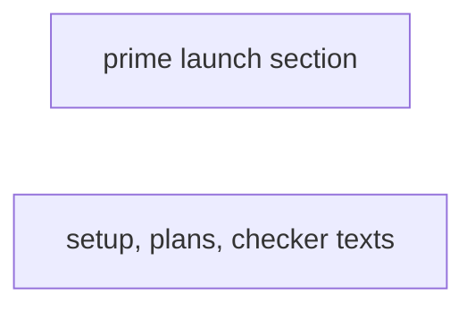

# Superlite: plans name how a UI state is reached in the running app (B143)

**Goal:** fix #601: setup records per project and platform whether a worker may launch the app and with which data (`launch` in `.superlite/test-cmd.json`), the prime carries it to every implementer, and a plan's `## Running-app checks` `reach:` names the launch argument, fixture, URL or preview, or a task that makes the state reachable.
**Architecture:** `build_prime.launch_section(root)` reads the run root's `.superlite/test-cmd.json` (the main checkout's from a linked worktree, never the user-level entry) and renders its `launch` map as a `## Running the app` section in the slim and full primes. `commands/setup.md` gains the check that writes the entry; `skills/writing-plans/SKILL.md` gains the `reach:` rule; `agents/checker.md` never launches a platform the entry marks `"worker": false`.
**Tech stack:** Python 3.10+ stdlib, pytest (through `sl run_tests`); Markdown docs.
**Spec:** this file, section Design; issue #601.
**Detail:** tests
**Target-min:** 11
**Wave0:** none
**Coverage:** off

Global constraints:
- Every Python code line keeps the file's trailing `# O(...)` complexity comment.
- Existing tests stay green. An existing test file changes only when the task Owns it. If another existing test turns red, report it in DONE_WITH_CONCERNS with the test id and the reason instead of editing it.
- Run `sl` as an executable (`<abs>/sl ...`). Verify with `<abs>/sl run_tests --fast <own test files> --task Tn --background`, then run the printed `wait:` line in the foreground and end the turn only after it reports.
- No version edits. Never run `scripts/evals.sh`, `claude plugin eval` or `scripts/test_layers.py run`.
- Never edit `plan_tools.py`, `pt_review.py` (B129, B146), `testcmd.py`, `run_tests.py`, `docs/language.md` (B151), `docs/tools.md` (B119, B135, B152) or `skills/subagent-driven-development/SKILL.md` (B141).

Ruling: by main, not the user: setup records app launchability in `.superlite/test-cmd.json` and the prime carries it (main's ruling on "How is app launchability recorded per project?").
Ruling: the entry is `"launch": {"<platform>": {"worker": true|false, "data": "<launch arguments, fixtures, URLs, previews and the states they show>", "why": "<why a worker may not launch it>"}}`; a platform value that is a plain string is shown verbatim; keys stay in file order (because setup writes it by hand from the user's answer and a string is the easiest fallback; cost if wrong: one more shape to read later).
Ruling: `launch` is project-only: a user-level `~/.config/superlite/test-cmd.json` entry's `launch` is ignored, like `related` and `pythonpath` (because launchability is per app, not per language; cost if wrong: none, a user entry can still be copied into the project file).
Ruling: no `launch` entry leaves every prime byte-identical to today, and the mini (haiku) prime never gets the section (because `Kind: mechanical` never covers UI; cost if wrong: a haiku task touching a launch path sees no entry).
Ruling: lint's warning for a UI change whose plan names no way in is a follow-up: plan lint lives in `plan_tools.py`, which B129 (running) and B146 (planned) own.
Ruling: B143 also edits `agents/checker.md` (no open batch lists it): a checker never launches a platform marked `"worker": false`, since #601 found a Debug Mac app that shares the user's bundle id, container and Keychain.
LAYERS: unit, headless, evals

## Design

What the issue says: workers mid-task found that a UI state could not be reached (no fixture launch path; a server-paired app shows only its demo data; a Debug Mac app shares the user's data, so no worker may run it). Expected: setup records launchability per platform and data; a UI plan names how the changed state is reached or adds a task that makes it reachable; lint warns when it names neither.

### 1. Setup records `launch` (#601 setup)

A new `/superlite:setup` check, for a project with an app, widget, app extension or web UI target: does `.superlite/test-cmd.json` (the main checkout's from a linked worktree) hold `launch`? Setup works the entry out from the code (platforms, whether a worker's own simulator, macOS launch or browser can run it, which launch arguments, fixtures, URLs or previews reach which states) and proposes it in its fix line; on a yes it adds the key and keeps the file's other keys. A project without the file gets its test command first (the file needs `test`).

### 2. The prime carries it (#601 build_prime)

`build_prime.launch_section(root)` returns `""` when the run root's config (via `testcmd.config_source`, source `test-cmd.json` only) has no usable `launch`; otherwise a `## Running the app` section: one intro line, then one `- <platform>: ...` line per platform. The slim prime puts it after `## Global constraints`, the full prime right after the preamble. A malformed entry prints one stderr note and is skipped; data with newlines becomes one line.

### 3. Plans name the way in (#601 writing-plans)

writing-plans' Running-app checks gain a **Reach** rule: `reach:` names a launch argument, fixture, URL or UI path from the `launch` entry, or a preview or snapshot render; a state none of them reaches gets a task that makes it reachable, named in `reach:`. A red-flags row backs it. The checker refuses to launch a platform marked `"worker": false`.

## File structure

- `skills/subagent-driven-development/scripts/build_prime.py`: `launch_section(root)`, wired into `build_slim` and `build`.
- `tests/scripts/test_build_prime_launch_601.py`: T1's tests.
- `commands/setup.md`: the `launch` check.
- `skills/writing-plans/SKILL.md`: the Reach rule and red-flags row.
- `agents/checker.md`: the `"worker": false` rule.
- `tests/scripts/test_docs_601_launch.py`: T2's pinned texts.

## Task graph

```mermaid
%% schedule
gantt
  title Predicted schedule (mm:ss)
  dateFormat X
  axisFormat %M:%S
  section lane 1
  T1 prime launch section :t1, 0, 565s
  section lane 2
  T2 setup writing-plans and checker texts :t2, 0, 549s
```

critical path: T1 (9.4 min) · peak width 2 · predicted build 9.4 min · predicted total ≈ 25.9 min (target ✗ 11.0)

## Package: build_prime

App type: file I/O / generator. Categories: file, encoding, deep. Risks: a `launch` value that is not an object, a platform value that is a list or number, a newline in `data` breaking the prime's line structure, non-ASCII text, a user-level entry leaking in.
**Probe entry:** none (the prime is built from files on disk; its Review Focus cases are named tests in T1)

### T1 prime launch section · Complexity 3 · Est. context 40k
**Owns:** skills/subagent-driven-development/scripts/build_prime.py, tests/scripts/test_build_prime_launch_601.py
**Components:** 1
**LOC owned:** 170
**Tests:** fast
**Model:** sonnet
**Est. time:** 3 min (1 component, about 170 LOC, fast tests)
**Covers:** 2
**Produces:** build_prime.launch_section(root: Path) -> str
e.g. launch_section(root) with `{"test": "make test", "launch": {"ios": {"worker": true, "data": "-demo: demo account, 3 lists"}}}` -> "## Running the app\n\nHow a worker reaches the app's states, per platform, as /superlite:setup recorded them in `.superlite/test-cmd.json` (`launch`). Reach a UI state only this way or the way your task names; never launch the app on a platform marked no.\n\n- ios: a worker may launch it; data: -demo: demo account, 3 lists"
e.g. launch_section(root) with `{"test": "make test"}` -> ""
**Review Focus:** `test_launch_not_object_ignored_with_note`: `"launch": ["ios"]` gives no section and stderr `test-cmd.json "launch" must map each platform to {"worker": true|false, "data": "...", "why": "..."}; ignored`; `test_platform_value_list_skipped`: `{"ios": ["x"], "web": "npm run dev"}` gives only the web line and the same note once; `test_multiline_data_collapsed`: data `"a\n  b"` renders `data: a b`; `test_user_entry_launch_ignored`: a user-level entry with `launch` and no project file gives no section; `test_non_ascii_kept`: data `"Größe ✓"` appears unchanged in the UTF-8 prime.
**Test code (contracts):**
- `test_slim_prime_lists_launch_platforms`: project test-cmd.json `{"language": "go", "test": "make test", "launch": {"ios": {"worker": true, "data": "-demo: demo account, 3 lists"}, "macos": {"worker": false, "why": "the Debug app shares bundle id, container and Keychain with the installed app", "data": "SwiftUI previews only"}}}`; the slim prime holds `## Running the app` after `## Global constraints` and before `## Stable tasks`, and the lines `- ios: a worker may launch it; data: -demo: demo account, 3 lists` then `- macos: no worker launch (the Debug app shares bundle id, container and Keychain with the installed app); data: SwiftUI previews only`, in that order.
- `test_full_prime_has_launch_section_before_plan`: `--prime full`: the section sits after the preamble's `Rules:` block and before `## Plan`.
- `test_no_launch_entry_leaves_prime_unchanged`: the slim prime with `{"language": "go", "test": "make test"}` is byte-identical to the one built with no test-cmd.json, and holds no `## Running the app`.
- `test_worker_missing_says_not_recorded`: `{"web": {"data": "seeded db"}}` renders `- web: worker launch not recorded; data: seeded db`; `{"web": {"worker": false}}` renders `- web: no worker launch`.
- `test_string_platform_value_verbatim`: `{"web": "npm run dev on a free port; SEED=1 seeds 3 users"}` renders `- web: npm run dev on a free port; SEED=1 seeds 3 users`.
- `test_main_checkout_launch_used_from_worktree`: a git repo with the file in the main checkout's `.superlite/`, the plan in a linked worktree without one: the worktree's slim prime holds the main checkout's lines.
- `test_mini_prime_has_no_launch_section`: `--tier haiku` with a `launch` entry: `prime-haiku.md` holds no `## Running the app`.
- plus the five Review Focus tests above.
**Steps:** 1 failing tests, 2 run: FAIL, 3 implement, 4 run: PASS
**Notes:** Root is `plan_tools.stable_root(plan)` (as `with_root` uses); read the config with `testcmd.config_source(root)` and use `cfg["launch"]` only when its source is `"test-cmd.json"`. An empty map or no usable platform gives `""`. A platform object renders `a worker may launch it` (`worker` true), `no worker launch` plus ` (<why>)` when `why` is a non-empty string (`worker` false), else `worker launch not recorded`; then `; data: <data>` when `data` is a non-empty string. Strings are whitespace-collapsed (`" ".join(s.split())`). Print the stderr note at most once per call. `tests/scripts/test_slim_prime.py` `make()` shows a plan fixture; `tests/scripts/conftest.py` already points `SUPERLITE_USER_TEST_CMD` at a missing file (set it yourself for the user-entry test).

## Package: docs

App type: docs. Categories: none beyond exact wording. Risk: the setup example JSON does not parse, or the texts drift from the prime's field names.
**Probe entry:** none (Markdown only)

### T2 setup, writing-plans and checker texts · Complexity 2 · Est. context 36k
**Owns:** commands/setup.md, skills/writing-plans/SKILL.md, agents/checker.md, tests/scripts/test_docs_601_launch.py
**Components:** 1
**LOC owned:** 70
**Tests:** fast
**Model:** sonnet
**Est. time:** 2 min (1 component, about 70 LOC, fast tests)
**Covers:** 1, 3
**Review Focus:** `test_setup_launch_example_parses`: the backticked `"launch": {...}` example in setup.md parses as JSON once wrapped in braces, and has one platform with `"worker": true` and one with `"worker": false` plus a `why`.
**Test code (contracts):** `tests/scripts/test_docs_601_launch.py` asserts each text below is present verbatim (`in` the file's text), plus `test_setup_launch_example_parses`, plus `test_reach_rule_after_running_app_checks`: in writing-plans the `- **Reach.**` bullet comes right after the `- **Running-app checks.**` bullet.
1. `commands/setup.md`, a new bullet right after the test command bullet (the one ending `so \`sl run_tests\` and every worker find it;`):
   `- for a project with an app, widget, app extension or web UI target: whether its \`.superlite/test-cmd.json\` (the main checkout's from a linked worktree) holds a \`launch\` entry, which says per platform whether a worker may launch the app and with which data. Work it out from the code: the platforms the targets build for; whether a worker's own simulator, macOS launch or browser can run it (not a Debug macOS app that shares its bundle id, container or Keychain with the user's installed app; an app paired with its server shows only what its demo data shows); and which launch arguments, fixture files, URLs or previews reach which states. The fix line proposes the entry, for example \`"launch": {"ios": {"worker": true, "data": "-demo: signed-in demo account with 3 lists; no server pairing"}, "macos": {"worker": false, "why": "the Debug app shares bundle id, container and Keychain with the installed app", "data": "SwiftUI previews only"}}\`; on a yes add it to that file and keep its other keys (a project without the file gets its test command first). \`build_prime\` copies it into every implementer's prime, and plans name its launch arguments and fixtures in their \`## Running-app checks\` \`reach:\` parts;`
2. `skills/writing-plans/SKILL.md`, a new bullet right after the `- **Running-app checks.**` bullet:
   `- **Reach.** \`reach:\` names how the changed state is reached in the running app: a launch argument, fixture, URL or UI path from the project's \`launch\` entry in \`.superlite/test-cmd.json\` (setup records per platform whether a worker may launch the app and with which data; the prime repeats it), or a preview or snapshot render for a view no running state reaches. A state none of these reaches (an error or empty state, a screen that needs server pairing, a platform the entry marks \`"worker": false\`) gets a task that makes it reachable, such as a demo launch argument or a fixture loader, and \`reach:\` names that task (\`reach: -fixture empty-inbox (T4)\`). With no \`launch\` entry, read the app's launch arguments and fixtures from the code. Never leave the way in for the checker to find: it reports such a check NOT REACHABLE.`
   and a last row in the Red flags table:
   `| "The checker will find a way into that state" | \`reach:\` names the launch argument, fixture, URL or preview, or a task adds one. |`
3. `agents/checker.md`, a new last bullet in `## Every check runs`:
   `- Read the \`launch\` entry in \`<ROOT>/.superlite/test-cmd.json\` (the main checkout's when ROOT has none): never launch the app on a platform it marks \`"worker": false\` (its Debug build shares the user's own app data). A check there passes only through a preview or snapshot render (below); else it is NOT REACHABLE, naming that entry.`
**Steps:** 1 failing tests, 2 run: FAIL, 3 edit the three files, 4 run: PASS
**Notes:** In the texts above, `\`` stands for a plain backtick. Keep every other line of the three files unchanged; existing pin tests (`tests/scripts/test_checker_agent_600.py`, `test_docs_checker_600.py`, `test_docs_533_user_test_cmd.py`, `test_docs_570_setup_writes.py`, `test_docs_b93_writing_plans.py`) must stay green: run them with your own file.

## Self-review

Coverage: Design 1 -> T2, 2 -> T1, 3 -> T2; lint's warning is a follow-up (ruling). No placeholders; T1 and T2 share no file and no edge.
