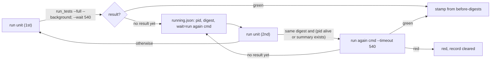
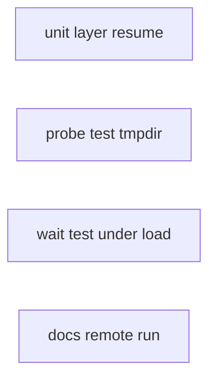

# Unit layer through a remote full run, two flaky tests (B149, #630)

**Goal:** a configured remote `--full` run (`maxapp remote`, about 10 min) can stamp the unit layer; the remote route is documented; two load- and machine-dependent tests stop flaking.
**Architecture:** `scripts/test_layers.py run unit` records the background run it started (its `run again:` command) in `running.json`; the next `run unit` waits on that same run instead of starting a new one, and stamps from the digests taken before it. Docs name the route. Test-only fixes for the two flaky tests.
**Tech stack:** Python 3 stdlib, pytest. Test command: `sl run_tests` (project default pytest for `--fast`).
**Spec:** issue #630 latest comments plus main's tell to B149 (scope: unit layer stamp, docs, two flaky tests; not run_tests.py, not testcmd.py).
**Detail:** tests
**Wave0:** none
**Coverage:** off
**Target-min:** 8

Global constraints:
- Every product line in `scripts/*.py` ends with the repo's trailing cost comment (`# O(1)`, `# O(n)`, ...), as the surrounding code does.
- Never edit `skills/subagent-driven-development/scripts/run_tests.py` or `testcmd.py` (other batches own them). A cause found there is reported as a concern, not fixed.
- Unit-layer default wait stays 540 s (`DEFAULT_UNIT_WAIT`).

Ruling: a plain configured `sl run_tests --full` still does not stamp the unit layer: the gate (`if not spec["python"]: a.unit_snap = None`) is in run_tests.py, owned by B131 (running) and B119; it goes to notes.md as a follow-up. `test_layers.py run unit` already stamps on a green exit of the configured command; what failed was the remote run outlasting the 540 s wait and each rerun starting a new run (because 540 s is under the 600 s Bash limit and a remote run takes about 600 s).
Ruling: resume only when the current unit-layer hash equals the pending run's start hash, and its pid is alive or the summary file named by the last word of its `run again:` command exists; otherwise start a new run (a changed file needs a new run; a dead run with no summary would only wait out the timeout).
Ruling: every green layer run stamps from the digests taken before the run (today the foreground path re-hashes after it), so a file changed during the run stays stale, matching run_tests' own stamp.



## File structure

- `scripts/layer_store.py`: `start_run` takes an optional `wait`; new `pending`.
- `scripts/test_layers.py`: `cmd_run` resumes a pending unit run; stamps from before-digests.
- `tests/scripts/test_test_layers.py`: `FakeStore` gains the same two signatures.
- `tests/scripts/test_test_layers_resume_630.py`: new, resume behaviour.
- `tests/scripts/test_probe_run.py`: commit-mode test uses its own TMPDIR.
- `tests/scripts/test_0_3_1_scripts.py`: `test_wait_exits_1_on_red` load-tolerant.
- `docs/language.md`, `docs/testing.md`, `tests/scripts/test_docs_remote_run_630.py`: the remote route and the resume.

## Task graph

```mermaid
%% schedule
gantt
  title Predicted schedule (mm:ss)
  dateFormat X
  axisFormat %M:%S
  section lane 1
  T1 unit layer resumes its pending run :t1, 0, 434s
  section lane 2
  T3 wait-on-red test tolerates load :t3, 0, 361s
  section lane 3
  T4 docs remote full run and the unit-lay :t4, 0, 360s
  section lane 4
  T2 probe commit test uses its own TMPDIR :t2, 0, 359s
```





critical path: T1 (7.2 min) · peak width 4 · predicted build 7.2 min · predicted total ≈ 37.2 min (target ✗ 8.0)

## Unit layer

App type: CLI (file state). Categories: state, protocol. Risks: resuming a run of other content; a stale record that waits out the whole timeout.

### T1 unit layer resumes its pending run · Complexity 4 · Est. context 40k
**Owns:** scripts/test_layers.py, scripts/layer_store.py, tests/scripts/test_test_layers.py, tests/scripts/test_test_layers_resume_630.py
**Components:** 2
**LOC owned:** 190
**Tests:** fast
**Model:** sonnet
**Est. time:** 4 min
**Produces:** layer_store.start_run(store: Path, layer: str, digest: str, pid: int, wait: str | None = None) -> None · layer_store.pending(store: Path, layer: str) -> dict
  e.g. after start_run(s, "unit", "ab12", 4242, wait="sl run_tests --wait /r/s.json"): pending(s, "unit") -> {"pid": 4242, "digest": "ab12", "wait": "sl run_tests --wait /r/s.json"}
  e.g. pending(s, "headless") -> {} (no record, or running.json unreadable)
**Review Focus:** state: `test_changed_file_starts_a_new_run`, `test_dead_pending_run_without_summary_starts_new_run`; protocol: `test_second_run_waits_on_pending_run_and_stamps` (the override is not run; `--timeout 540` appended).
**Steps:** 1 write the tests below, 2 run: FAIL, 3 implement, 4 run: PASS (also `tests/scripts/test_test_layers.py`, `test_test_layers_wait_494.py`, `test_layer_store.py`, `test_layer_stamp_record_626.py`).
**Notes:**
- `cmd_run`, per layer: `digests = layer_digests(layer, root)`, `before = hash_digests(digests)`. For `unit` only: `rec = layer_store.pending(state, "unit")`; resume when `rec.get("wait")` is a str, `rec.get("digest") == before`, and (`layer_store.pid_alive(rec["pid"])` or `Path(shlex.split(rec["wait"])[-1]).exists()`). Resume command: `f"{rec['wait']} --timeout {unit_wait(args):g}"`; it replaces both the default and any `--command-override` for that layer, and prints `unit: waiting on the run started earlier: <wait>` to stderr.
- Keep `start_run(state, layer, before, os.getpid())` / `end_run` around the subprocess as today. Green: `write_stamp(root, state, layer, digests)` (before-digests). No result yet with a pid: `start_run(state, layer, before, pid, wait=rerun)`. Red: the record stays cleared.
- The running line becomes `{layer}: running (no result after {secs} s; run `python3 scripts/test_layers.py run {layer}` again to wait on this run and stamp it; see it: {rerun})`.
- `FakeStore.start_run` takes `wait=None` and keeps it; `FakeStore.pending(store, layer)` returns the kept record or `{}`.
**Test code (verbatim):**
```python
"""#630: `test_layers.py run unit` waits on its own pending background run and stamps it from the digests taken before it."""
import subprocess
from pathlib import Path

import layer_store
from test_test_layers import cli, repo, stale_names  # noqa: F401


def no_result(pid, rerun):
    return f"printf 'tests: no result yet after 540 s (pid {pid} still running); run again: {rerun}\\n' >&2; exit 2"


def waiter(tmp_path, body):
    script, log = tmp_path / "wait.sh", tmp_path / "wait-args.txt"
    script.write_text(f'echo "$@" >> {log}\n{body}\n')
    return script, log


def start_pending(repo, tmp_path, script):
    sleeper = subprocess.Popen(["sleep", "120"])
    summary = tmp_path / "s.json"
    r = cli(repo, "run", "unit", "--command-override", "unit=" + no_result(sleeper.pid, f"sh {script} {summary}"))
    assert r.returncode == 4 and "unit: running" in r.stdout, r.stdout + r.stderr
    assert "python3 scripts/test_layers.py run unit` again" in r.stdout
    return sleeper, summary


def stop(p):
    p.kill()
    p.wait()


def test_pending_record_round_trip(tmp_path):
    s = tmp_path / "test-layers.json"
    layer_store.start_run(s, "unit", "ab12", 4242, wait="sl run_tests --wait /r/s.json")
    assert layer_store.pending(s, "unit") == {"pid": 4242, "digest": "ab12", "wait": "sl run_tests --wait /r/s.json"}
    assert layer_store.pending(s, "headless") == {}
    layer_store.start_run(s, "tui", "cd34", 7)
    assert layer_store.pending(s, "tui") == {"pid": 7, "digest": "cd34"}


def test_second_run_waits_on_pending_run_and_stamps(repo, tmp_path):
    script, log = waiter(tmp_path, "exit 0")
    sleeper, summary = start_pending(repo, tmp_path, script)
    try:
        r = cli(repo, "run", "unit", "--command-override", "unit=exit 1")
        assert r.returncode == 0 and "unit: green" in r.stdout, r.stdout + r.stderr
        assert log.read_text().split() == [str(summary), "--timeout", "540"]
        assert "unit" not in stale_names(repo)
    finally:
        stop(sleeper)


def test_changed_file_starts_a_new_run(repo, tmp_path):
    script, log = waiter(tmp_path, "exit 0")
    sleeper, _ = start_pending(repo, tmp_path, script)
    try:
        (repo / "hooks" / "x").write_text("changed\n")
        r = cli(repo, "run", "unit", "--command-override", "unit=exit 1")
        assert r.returncode == 1 and "unit: red" in r.stdout
        assert not log.exists()
    finally:
        stop(sleeper)


def test_red_pending_run_clears_the_record(repo, tmp_path):
    script, log = waiter(tmp_path, "echo boom >&2; exit 1")
    sleeper, _ = start_pending(repo, tmp_path, script)
    try:
        r = cli(repo, "run", "unit", "--command-override", "unit=exit 1")
        assert r.returncode == 1 and "unit: red" in r.stdout
        r = cli(repo, "run", "unit", "--command-override", "unit=exit 0")
        assert r.returncode == 0 and len(log.read_text().splitlines()) == 1
    finally:
        stop(sleeper)


def test_still_running_keeps_the_record(repo, tmp_path):
    sleeper = subprocess.Popen(["sleep", "120"])
    try:
        script, log = tmp_path / "wait.sh", tmp_path / "wait-args.txt"
        script.write_text(f'echo "$@" >> {log}\n' + no_result(sleeper.pid, f"sh {script} {tmp_path / 's.json'}") + "\n")
        r = cli(repo, "run", "unit", "--command-override", "unit=" + no_result(sleeper.pid, f"sh {script} {tmp_path / 's.json'}"))
        assert r.returncode == 4
        r = cli(repo, "run", "unit", "--command-override", "unit=exit 1")
        assert r.returncode == 4 and "unit: running" in r.stdout and len(log.read_text().splitlines()) == 1
        assert "unit running run in progress" in cli(repo, "status").stdout.splitlines()
        script.write_text(f'echo "$@" >> {log}\nexit 0\n')
        r = cli(repo, "run", "unit", "--command-override", "unit=exit 1")
        assert r.returncode == 0 and "unit: green" in r.stdout
    finally:
        stop(sleeper)


def test_dead_pending_run_without_summary_starts_new_run(repo, tmp_path):
    script, log = waiter(tmp_path, "exit 0")
    sleeper, _ = start_pending(repo, tmp_path, script)
    stop(sleeper)
    r = cli(repo, "run", "unit", "--command-override", "unit=exit 0")
    assert r.returncode == 0 and not log.exists()


def test_dead_pending_run_with_summary_is_resumed(repo, tmp_path):
    script, log = waiter(tmp_path, "exit 0")
    sleeper, summary = start_pending(repo, tmp_path, script)
    stop(sleeper)
    summary.write_text("{}")
    r = cli(repo, "run", "unit", "--command-override", "unit=exit 1")
    assert r.returncode == 0 and log.exists()


def test_green_run_stamps_digests_from_before_the_run(repo):
    r = cli(repo, "run", "unit", "--command-override", "unit=echo changed > hooks/x")
    assert r.returncode == 0 and "unit: green" in r.stdout
    assert "unit" in stale_names(repo)
```

**Probe entry:** none (a CLI driven by its tests through subprocess; Review Focus cases are named tests above)

## Flaky tests

App type: test suite. Categories: state (shared machine temp dir, load). No probe entry: test-only changes.

### T2 probe commit test uses its own TMPDIR · Complexity 1 · Est. context 22k
**Owns:** tests/scripts/test_probe_run.py
**Components:** 1
**LOC owned:** 8
**Tests:** fast
**Kind:** mechanical
**Model:** haiku
**Est. time:** 1.5 min
**Review Focus:** state: the temp-checkout check reads only this test's TMPDIR.
**Steps:** in `test_commit_mode_probes_the_commit_not_the_working_tree` only: at the top add `tmp = tmp_path / "tmp"` and `tmp.mkdir()`; pass `env={"TMPDIR": str(tmp)}` to both `run(proj, "--commit", "HEAD", ...)` calls; replace `assert not list(Path(tempfile.gettempdir()).glob("probe-commit-*/tree/.git"))` with `assert not list(tmp.glob("probe-commit-*/tree/.git"))`. Leave the `tempfile` import if another line still uses it, else remove it. Run `run_tests --fast tests/scripts/test_probe_run.py --task T2`: PASS.
**Test code (verbatim):** the edited test above (`probe_run.py` makes its checkout with `tempfile.mkdtemp(prefix="probe-commit-")`, which honours `TMPDIR`).
**Probe entry:** none (test-only change)

### T3 wait-on-red test tolerates load · Complexity 3 · Est. context 45k
**Detail:** contracts
**Owns:** tests/scripts/test_0_3_1_scripts.py
**Components:** 1
**LOC owned:** 20
**Tests:** fast
**Model:** sonnet
**Est. time:** 3 min
**Review Focus:** state: `test_wait_exits_1_on_red` keeps asserting `run_tests --wait` exits 1 and the summary's `failed == 1` for a red background run.
**Steps:** use `superlite:systematic-debugging`. Known: in B150's loaded Mac full run (load 6 to 9) the test's inner `run_tests --wait --timeout 120` timed out; the file passes alone and on Linux. The test starts a **full** background run (no `--fast`) in a tmp project that is no git repo. Read the background child's path in `run_tests.py` (`start_background` -> child `main` -> `free_disk` -> `full_suite_lock` (`lock_holder`, `is_ancestor`: up to 64 `ps` calls, 10 s timeout each) -> pytest) and name what it can wait on under load; reproduce with artificial load (for example 8 busy `python3 -c "while 1: pass"` processes, killed by pid afterwards) and time each phase from the child's `.log`. Then change only the test so load cannot make it time out while it still checks the same contract: candidates are a `--fast test_pass.py test_fail.py` background run (no full-suite lock, no ancestor walk; keep it only if the full mode is not what the test is about) and a wait budget near the helper's subprocess timeout (the `run` helper's fixed `timeout=240` may take a parameter). Report the cause in one line; when the cause is product code in `run_tests.py`, also report it as a concern (that file is another batch's).
**Test code:** `test_wait_exits_1_on_red(tmp_path)`: project with `test_pass.py` and `test_fail.py`; background run returns 0; `--wait` returns 1; `json.loads(stdout)["failed"] == 1`.
**Probe entry:** none (test-only change)

## Docs

### T4 docs: remote full run and the unit-layer resume · Complexity 1 · Est. context 24k
**Owns:** docs/language.md, docs/testing.md, tests/scripts/test_docs_remote_run_630.py
**Components:** 1
**LOC owned:** 25
**Tests:** fast
**Kind:** mechanical
**Model:** haiku
**Est. time:** 1.5 min
**Steps:** 1 write the test, 2 run: FAIL, 3 edit the two docs, 4 run: PASS.
1. `docs/language.md`: append one new paragraph at the end of the file, after the `**Forecast.**` paragraph and separated by one blank line (do not touch the other paragraphs; another batch edits them), exactly:

**Remote full run.** A repository whose full suite runs on another machine (a Linux sandbox through `maxapp remote`) says so in `.superlite/test-cmd.json` (a worktree uses the main checkout's): `{"language": "python", "test": "maxapp remote '<install step> && <suite command>'", "test_file": "<local command> {files}", "lock": false}`. `test` is the `--full` command and runs remotely; `"test_file"` keeps `--fast` runs on this machine, and without it a fast run resolves to the remote `test` command (the whole suite, remotely). The sandbox starts from the checkout alone, so `test` carries the project's own install step (superlite's: `maxapp remote --timeout 40 'uv run --no-project --with pytest python -m pytest tests -q -rfE -p no:cacheprovider'`, where `uv run --with pytest` installs the runner). `"lock": false` lets the full run skip the machine-wide full-suite lock, since it uses no local compute. A configured command never stamps the unit layer by itself (it may run less than the whole suite); `python3 scripts/test_layers.py run unit` runs it and stamps the layer when it exits green. A remote run outlasts that call's 540 s wait, so the first call reports `unit: running`; the next call waits on the same run instead of starting another (as long as no unit-layer file changed since it started) and stamps the layer from the digests taken before the run.

2. `docs/testing.md`: in the paragraph starting "`run --wait S` sets the unit layer's wait", replace `and the command exits with exit 4 (red stays exit 1).` with `and the command exits with exit 4 (red stays exit 1). Running `run unit` again waits on that same run when no unit-layer file changed since it started and its process lives or its summary exists, else it starts a new run; a green layer run stamps the digests taken before it, so a file changed during the run stays stale.`
**Test code (verbatim):**
```python
"""#630: the remote full run and the unit-layer resume are documented."""
from pathlib import Path

DOCS = Path(__file__).resolve().parents[2] / "docs"


def test_language_md_documents_the_remote_full_run():
    text = (DOCS / "language.md").read_text(encoding="utf-8")
    para = next(p for p in text.split("\n\n") if p.startswith("**Remote full run.**"))
    for needle in ('"test_file"', '"lock": false', "maxapp remote", "install step", "a fast run resolves to the remote",
                   "scripts/test_layers.py run unit", "unit: running", "digests taken before the run"):
        assert needle in para, needle


def test_testing_md_documents_the_resume():
    text = (DOCS / "testing.md").read_text(encoding="utf-8")
    assert "Running `run unit` again waits on that same run" in text
```
**Probe entry:** none (docs)

## Review Focus

- Unit layer (CLI, state/protocol): a resumed run must never stamp digests other than the ones its run started with; a stale record must not cost a 540 s wait.
- Flaky tests: each fix keeps the test's contract; no global temp dir or machine-wide lock is read by an assertion.

## Self-review

Coverage: main's items (1) T1 plus the run_tests.py follow-up, (2) T4, (3) T2 and T3. No placeholders. No edges: T4's text is verbatim, T1's tests run only T1's code. Owns are disjoint.
