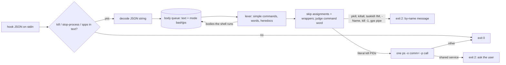

# Superlite: block-unsafe-kill reads only command words (B160)

**Goal:** fix #666: `hooks/block-unsafe-kill` stops matching kill words inside quoted text, heredoc bodies and the arguments of other commands (`echo "--- kill job 1 wrapper"` was refused as `kill 1 would stop launchd`; `sl feedback add "<text naming pkill>"` was refused as a by-name kill). Only a command word at command position is checked; every case the current tests block stays blocked.
**Architecture:** the hook keeps its shape (bash 3.2 builtins, one `ps` call at most, fail open) and swaps its whole-string regexes for a small shell lexer: decode the JSON string, split it into simple commands the way the shell does (quotes, escapes, comments, redirects, heredocs, substitutions), queue the bodies the shell runs (`$(...)`, `sh -c`, `eval`, a stdin shell's heredoc ...), skip assignments and wrapper words, then judge each command word: `pkill`/`killall`/`taskkill /IM|/FI`/`Stop-Process -Name` and Get-Process pipes block, `kill` PIDs go to the shared-service `ps` check, `kill ... -1` blocks.
**Tech stack:** bash 3.2 (hooks/), pytest through `sl run_tests`; Markdown docs.
**Spec:** this file, section Design; issue #666.
**Detail:** tests
**Target-min:** 11
**Wave0:** none
**Coverage:** off

Global constraints:
- `hooks/block-unsafe-kill` runs under stock macOS `/bin/bash` 3.2 and Git Bash: no bash 4+ syntax (`tests/scripts/test_hooks_bash32.py` lints it), no external command except the one existing `ps -o comm= -p <pids>` call (each spawn costs about 250 ms on Windows), malformed input exits 0 with no output.
- Existing tests in `tests/scripts/test_block_unsafe_kill.py` and `tests/scripts/test_kill_shared.py` stay byte-identical and green; new tests are appended. If another existing test turns red, report it in DONE_WITH_CONCERNS with the test id instead of editing it.
- `docs/hooks.md` is append-only (other batches append to it): add lines, never reorder, rewrite or delete an existing line.
- Run `sl` as an executable (`<abs>/sl ...`). Verify with `<abs>/sl run_tests --fast tests/scripts/test_block_unsafe_kill.py tests/scripts/test_kill_shared.py tests/scripts/test_hooks_bash32.py --task T1 --background`, then run the printed `wait:` line in the foreground and end the turn only after it reports. Then run the same three files once under bash 3.2: `PATH="/bin:$PATH" uv run --no-project --with pytest python -m pytest tests/scripts/test_block_unsafe_kill.py tests/scripts/test_kill_shared.py -q -p no:cacheprovider` (both runs must pass; name both in the report).
- No version edits. Never run `scripts/evals.sh`, `claude plugin eval` or `scripts/test_layers.py run`.
- Standing rules from main (copy them into every brief): this repository is public: no host names, user names, home paths, other project or repository names, ticket keys or account names in code, tests, docs, commit messages, PR texts or issue comments. Never change the machine's gate config or `~/.superlite/machine.json`; tests use private temp homes and state dirs. No real app builds as proof; this repository's own test suite is the check. Friction with superlite itself goes to `sl feedback add`, not into this batch.

Ruling: detail `tests`: T1 carries the full test code and the lexer rules as Notes, not the hook code (because ~90 named cases pin the behaviour and a Sonnet implementer writes the bash; cost if wrong: one fixer round).
Ruling: the lexer is pure bash inside the hook, not the Python guard judge (because the hook runs on every Bash call, a Python spawn costs about 250 ms on Windows, and `test_name_kills_still_blocked_without_ps` runs with an empty PATH; cost if wrong: a bash lexer reads fewer shell forms than `guard_lex.py`).
Ruling: bodies the shell runs are read as commands: `$(...)` (also inside double quotes), backticks, `<(...)`/`>(...)`, `sh|bash|zsh|dash|ksh -c BODY`, `eval ARGS`, `env -S STRING`, `find -exec ... ;`, `cmd /c REST`, `powershell|pwsh -Command REST` (read as PowerShell), and the heredoc bodies and here-strings of a stdin shell (a shell with no `-c` and no script operand standing on the heredoc's line, so `cat <<EOF | sh` counts) (because the old hook blocked all of these and #666 item 3 keeps every blocked case; cost if wrong: `echo pkill x | bash` is no longer read).
Ruling: `kill` with the PID operand `-1` blocks for every signal (`kill -9 -1`, `kill -- -1`, `kill -TERM -1`), not only -9/KILL (because -1 signals every process the user may signal; cost if wrong: none known).
Ruling: PowerShell `kill`, `Stop-Process` and `spps` share one rule: a `-Name`/`-ProcessName` parameter (any prefix of Name, `-n`) blocks; a command piped (directly or later in the same pipeline) from `Get-Process`/`gps`/`ps` without `-Id` blocks; literal PIDs (positional or after `-Id`) go to the shared-service `ps` check, which is new for `Stop-Process -Id` (because one rule per command keeps `kill 4242` and `Stop-Process -Id 4242` alike; cost if wrong: on Windows `ps -o` fails and the check fails open, as it does today).
Ruling: at most 32 queued bodies are read per command; more are ignored (fail open, the hook's policy for input it cannot read).
LAYERS: unit, headless



## Design

### 1. What counts as a command word (#666 items 1, 2)
A word is a command word when it starts a simple command: at the text start, after an unquoted newline, `;`, `&`, `&&`, `|`, `||`, `(`, `)`, inside `$(`, a backtick body or `<(`, after leading `NAME=value` assignments, after a control word (`if then else elif do while until ! { time`), and after a wrapper with its options (`env sudo doas nohup time exec command builtin nice timeout xargs stdbuf setsid caffeinate watch`). PowerShell also starts one after `{` and `}`. Every other word, every quoted string, comment, redirect target and heredoc body is data and never blocks.

### 2. What blocks (#666 item 3)
Command word (basename, `.exe` stripped, case-insensitive): `pkill`, `killall`; `taskkill` with an argument `/IM`, `//IM`, `-IM`, `/FI`, `//FI` or `-FI`; `kill` with PID operand `-1`; PowerShell `kill`/`Stop-Process`/`spps` per the ruling above. `kill` and PowerShell PIDs are collected over all commands and bodies and resolved with one `ps` call as today. Messages are unchanged.

### 3. Docs
`docs/hooks.md` gains one bullet after the `block-unsafe-kill` bullet naming the command-word rule, the bodies read as commands, `kill -- -1` and the PowerShell rule.

## File structure
- `hooks/block-unsafe-kill`, `tests/scripts/test_block_unsafe_kill.py`, `tests/scripts/test_kill_shared.py`, `docs/hooks.md`: T1

## Task graph


critical path: T1 (4.5 min) · peak width 1 · predicted build 4.5 min · predicted total ≈ 12.9 min (target ✗ 11.0)

## Package: kill hook

App type: parser (a shell lexer in a PreToolUse hook). Categories: deep (nesting of quotes, substitutions, heredocs), encoding (JSON escapes, `\uXXXX`, CRLF), protocol (exit 2 + stderr, fail open), state (heredoc queue across lines). **Probe entry:** none (bash hook; cases are named tests).

### T1 kill hook reads command words · Complexity 6 · Est. context 52k
**Owns:** hooks/block-unsafe-kill, tests/scripts/test_block_unsafe_kill.py, tests/scripts/test_kill_shared.py, docs/hooks.md
**Components:** 2
**LOC owned:** 330
**Tests:** fast
**Model:** sonnet
**Est. time:** 5 min (2 components, about 330 LOC, fast tests)
**Covers:** 1, 2, 3
**Produces:** hooks/block-unsafe-kill (stdin: hook JSON; exit 2 + stderr message to block, else exit 0 with no output)
**Review Focus:** `test_text_mentioning_kill_words_passes_666` (deep, encoding); `test_kill_words_at_command_position_block_666` (deep: `cat <<-EOF` tab-stripped delimiter, `\`-newline continuation, `find -exec ... \;`); `test_powershell_backtick_escape_666` (backtick escapes `"` in PowerShell); `test_long_inputs_stay_fast_666` (a 3,000-line heredoc and a 3,000-line `python -c` string, each under 10 s).
**Test code (verbatim):** append to `tests/scripts/test_block_unsafe_kill.py` (add `import time` to its imports):
```python
# --- #666: only a command word is read; quotes, heredocs and other commands' arguments are data

TEXT_ONLY = (
    'echo "--- kill job 1 wrapper"',
    'sl feedback add "pkill -f server and killall node were refused as text"',
    "echo 'killall node'",
    'printf "%s\\n" "taskkill /F /IM python.exe"',
    'grep -rn "pkill\\|killall" hooks/',
    "grep -E '(pkill|killall)' notes.txt",
    "python3 -c \"import re; print(re.findall(r'\\b(kill|pkill|killall)\\b', 'x'))\"",
    "python3 -c 'import json; print(json.dumps({\"cmd\": \"killall node\"}))'",
    "python3 - <<'EOF'\nimport re\nPAT = re.compile(r'\\b(kill|pkill|killall)\\b')\nprint('pkill -f server')\nEOF\necho done",
    "cat > notes.json <<EOF\n{\"cmd\": \"killall node\", \"all\": \"kill -9 -1\"}\nEOF",
    "cat <<-EOF > x.txt\n\tpkill -f x\n\tEOF\nls",
    'git commit -m "Block pkill and killall only at command position"',
    "jq -n '{\"cmd\": \"pkill -f x\"}'",
    "# pkill -f x\nls",
    "ls  # killall node",
    "echo pkill; echo killall",
    "echo $'pkill -f x'",
    'echo "$(echo pkill -f x)"',
    "man pkill",
    "which killall taskkill",
    'echo "unterminated pkill -f x',
)


def test_text_mentioning_kill_words_passes_666():
    for cmd in TEXT_ONLY:
        r = run(cmd)
        assert r.returncode == 0, cmd
        assert r.stdout == "" and r.stderr == "", cmd


AT_COMMAND_POSITION = (
    "x; pkill -f server", "x && killall node", "false || pkill -f x", "ls | killall node",
    "echo node | xargs killall", "echo $(pkill -f x)", "echo `killall node`", 'echo "$(pkill -f x)"',
    "cat <(pkill -f x)", "env FOO=1 pkill -f x", "env -u HOME killall node", "sudo pkill -f x",
    "sudo -u root killall node", "nohup pkill -f x &", "time pkill -f x", "xargs -n 1 pkill -f < names.txt",
    "FOO=1 BAR=2 pkill -f x", "/usr/bin/pkill -f x", "if true; then pkill -f x; fi",
    "while true; do killall node; done", "(pkill -f x)", "{ killall node; }", "! pkill -f x",
    "timeout 5 pkill -f x", "nice -n 5 killall node", "exec pkill -f x", "command pkill -f x",
    "bash -c 'pkill -f x'", 'sh -c "killall node"', "bash -lc 'echo a; pkill -f x'", "eval 'pkill -f x'",
    "bash <<'EOF'\npkill -f x\nEOF", "cat <<'EOF' | sh\nkillall node\nEOF", "bash <<< 'pkill -f x'",
    "env -S 'pkill -f x'", "find . -name '*.pid' -exec pkill -F {} \\;", "taskkill.exe /F /IM node.exe",
    "cmd /c taskkill /F /IM node.exe", 'powershell -Command "Stop-Process -Name node"',
    "echo ok \\\n&& pkill -f x", "cat <<'EOF'\npkill -f x\nEOF\nkillall node",
    "cat <<-EOF > x.txt\n\tdata\n\tEOF\npkill -f x", "echo 'a' \"b\" c; pkill -f x", 'pkill "unterminated',
    "kill -- -1", "kill -TERM -1", "kill -s TERM -1",
)


def test_kill_words_at_command_position_block_666():
    for cmd in AT_COMMAND_POSITION:
        r = run(cmd)
        assert r.returncode == 2, cmd
        assert "PID" in r.stderr, cmd


def test_powershell_command_position_666():
    for cmd in ("Write-Output a; Stop-Process -Name python", "Get-Process | Where-Object CPU -gt 100 | Stop-Process",
                "Get-Process node | kill", "spps -Name node", '1..3 | ForEach-Object { Stop-Process -Name "n$_" }',
                "if ($true) { Stop-Process -Name node -Force }", "Stop-Process -n node"):
        assert run(cmd, "PowerShell").returncode == 2, cmd
    for cmd in ("Get-Process node | ForEach-Object { Stop-Process -Id $_.Id }", "Stop-Process -Id 12 -Force",
                'Write-Output "Stop-Process -Name python"', "Write-Host 'Get-Process x | Stop-Process'",
                "Select-String -Pattern 'taskkill /IM' -Path notes.txt", "# Stop-Process -Name x\nGet-ChildItem"):
        r = run(cmd, "PowerShell")
        assert r.returncode == 0, cmd
        assert r.stdout == "" and r.stderr == "", cmd


def test_powershell_backtick_escape_666():
    assert run('Write-Output "a `" Stop-Process -Name x"', "PowerShell").returncode == 0
    assert run('Write-Output "a `" ; Stop-Process -Name x', "PowerShell").returncode == 0
    assert run('Write-Output "a"; Stop-Process -Name x', "PowerShell").returncode == 2


def test_long_inputs_stay_fast_666():
    body = "\n".join(f"pkill -f server{i}  # kill {i}" for i in range(3000))
    code = "\n".join(f'print("pkill -f server{i}")' for i in range(3000))
    for cmd in (f"cat > notes.txt <<'EOF'\n{body}\nEOF\necho done", f"python3 -c '{code}'"):
        start = time.monotonic()
        r = run(cmd)
        assert r.returncode == 0
        assert time.monotonic() - start < 10


def test_docs_name_the_command_word_rule_666():
    text = (ROOT / "docs" / "hooks.md").read_text(encoding="utf-8")
    line = next(ln for ln in text.splitlines() if ln.startswith("- `block-unsafe-kill` reads"))
    for word in ("command position", "heredoc", "sh -c", "eval", "kill -- -1", "Get-Process", "#666"):
        assert word in line, word
```
Append to `tests/scripts/test_kill_shared.py`:
```python
def test_text_after_kill_word_is_no_pid_666(fake_ps):
    fake_ps["set"]("/sbin/launchd")
    for cmd in ('echo "--- kill job 1 wrapper"', "echo '--- kill job 1 wrapper'", "echo kill 1",
                'sl feedback add "refused as kill 1,1,1,1,1"', "git log --grep 'kill 1'",
                "cat <<EOF\nkill 1\nEOF", "python3 -c 'print(\"kill 1\")'", 'grep -c "kill -9 1" log.txt',
                "kill -l 1"):
        r = run(cmd, fake_ps)
        assert r.returncode == 0, cmd
        assert r.stdout == "" and r.stderr == "", cmd
    assert calls(fake_ps) == []


def test_kill_pid_1_still_blocked_666(fake_ps):
    fake_ps["set"]("/sbin/launchd")
    cmds = ("kill 1", "kill -9 1", "echo x; kill 1", "sudo kill -9 1", "bash -c 'kill 1'", "x && kill -TERM 1",
            "echo $(kill 1)", "xargs kill 1", "kill 1 2>/dev/null")
    for cmd in cmds:
        r = run(cmd, fake_ps)
        assert r.returncode == 2, cmd
        assert "launchd" in r.stderr, cmd
    assert calls(fake_ps) == ["-o comm= -p 1"] * len(cmds)


def test_powershell_stop_process_id_checked_666(fake_ps):
    fake_ps["set"](XCODE)
    for cmd in ("Stop-Process -Id 4242", "Stop-Process -Id 4242 -Force", "kill -Id 4242"):
        assert run(cmd, fake_ps, tool="PowerShell").returncode == 2, cmd
    assert calls(fake_ps) == ["-o comm= -p 4242"] * 3
```
**Steps:** 1 append the failing tests, 2 run: FAIL (keep the summary line as `Red run:`), 3 implement, 4 run: PASS (both bash versions), 5 docs bullet, 6 run: PASS
**Notes:**
- Fast path first: when the raw JSON command contains none of `kill`, `stop-process`, `spps` (case-insensitive), exit 0 before any decoding.
- Decode the JSON string with global replacements, not a per-character loop: `\\` to a placeholder byte (`$'\001'`, which raw JSON never holds), then `\n` to newline, `\t` to tab, `\r`/`\b`/`\f` to a space, `\"` to `"`, `\/` to `/`, each `\u00XX` below 0x20 to a space and 0x20-0x7e to its character (`printf -v ch '\x..'`), any other `\uXXXX` to `x`; the placeholder last becomes `\`. Then `LC_ALL=C` for byte-wise string work.
- Lexer, one pass per queued body, mode `bash` or `ps` (the tool name; queued bodies inherit it, `powershell -Command` bodies are `ps`). Outside quotes: blanks (space, tab) split words; newline, `;`, `&`, `|`, `(`, `)` end a simple command (`&&`, `||`, `;;`, `|&` too); a command after a single `|` is piped (the pipeline ends at any other separator). `\x` is a literal `x`, `\`-newline vanishes (ps mode: the backtick is the escape character and `\` is literal). `'...'` is literal (ps: `''` inside is a quote). Bash `$'...'` is literal with `\x` pairs. `"..."`: bash `\` escapes `"\$` and the backtick; ps the backtick escapes and `""` is a quote; in both, `$(` inside starts a substitution. `$(` (not `$((`) and bash backticks: find the matching close (quote-aware, nested), queue the body, put `$_` into the word. `$((`, `${`: skip to the matching close, put `$_` into the word. Any other `$` stays in the word, so the word is not a literal PID. `<(`/`>(`: queue the body. `#` at a word start: comment to the line end (ps: also `<# ... #>`). Unterminated quotes or substitutions run to the end of the text as data.
- Redirects: `<`, `>`, `>>`, `>|`, `<>`, `&>`, `>&`, `<&` (an all-digit current word before them is an fd and dropped); the next word is the target and dropped. `<<`/`<<-` take the next word as delimiter (quotes removed); at the line's end each pending heredoc body runs to the line equal to its delimiter (`<<-`: leading tabs stripped first) or the text end; find that line with pattern removal on the rest of the text (`${rest%%$'\n'"$d"$'\n'*}` style), never line by line or per character. `<<<` takes the next word as data. ps mode: `@'`/`@"` at a word start runs to a line starting `'@`/`"@` as data.
- A stdin shell (`sh bash zsh dash ksh ash` with no `-c` in any option cluster and no operand, or with `-s`) sets a flag for its line: that line's heredoc bodies and here-strings are queued. A shell with `-c` queues its first operand after the options (`-o`/`+o`/`-O`/`+O`, `--rcfile`, `--init-file` take a value).
- Per simple command: drop leading `NAME=...`/`NAME+=...`; loop over wrapper and control words, skipping each wrapper's options (`--` ends them) and the values of `env -u -C -P`, `sudo|doas -u -g -h -p -C -D -r -t -U -T -R`, `exec -a`, `nice -n`, `timeout -s -k` plus its one duration operand, `xargs -I -J -L -n -P -s -d -E -a -R`, `stdbuf -i -o -e`, `caffeinate -t -w`, `watch -n`; `env -S STRING` queues STRING; `command -v|-V` ends the check (nothing runs). Then judge the basename of the command word (after the last `/` or `\`, `.exe` stripped): `pkill`, `killall`; `taskkill` per Design 2; `eval` queues its arguments joined by spaces; `cmd` queues the words after `/c`, `/k` or `/r`; `powershell`/`pwsh` queue the words after `-c`, `-command`, `-cwa` or `-commandwithargs` as ps; `find` judges each `-exec|-execdir|-ok|-okdir ... ;|+` slice as a simple command; `get-process`, `gps` (ps mode also `ps`) mark the pipeline.
- `kill` in bash mode: before the first operand, `--` ends options, `-s X`/`-n X` (X `0`: probe), `-0` (probe), `-l`/`-L` (probe, stop), any other `-WORD` is the one signal; after that every word is an operand: `-1` blocks, `%N` is a job, an all-digit word is a PID, anything else is skipped. A probe drops that command's PIDs (as today). ps mode: `kill`/`stop-process`/`spps` per the ruling; PIDs are positional or after `-Id`/`-i` (split on `,`).
- Block on the first by-name finding with the existing message; collect PIDs in order over all commands and bodies, then the existing single `ps` call and shared-service list. Stop after 32 bodies.
- Rewrite the hook's header comment: what it blocks, the command-word rule, builtins only.
- `docs/hooks.md`: add one new bullet directly after the existing `block-unsafe-kill` bullet (that line stays byte-identical), starting ``- `block-unsafe-kill` reads only command words (#666):``: command position (line start, `;`, `&&`, `||`, `|`, `(`, `$(`, a backtick, control words, wrapper words with their options), text in quotes, heredoc bodies, comments and other commands' arguments never block, the bodies read as commands (`$(...)`, backticks, `<(...)`, `sh -c`, `eval`, `env -S`, `find -exec`, `cmd /c`, `powershell -Command`, a stdin shell's heredoc or here-string), `kill` with PID `-1` for any signal (`kill -- -1`), and the PowerShell rule (`-Name`, a pipe from `Get-Process` without `-Id`, `Stop-Process -Id` PIDs checked).

## Review Focus

Package kill hook (parser): deep (nested quotes in `$(...)` in double quotes, heredoc delimiter quoting `<<'EOF'`, `<<"EOF"`, `<<\EOF`, two heredocs on one line), encoding (`\uXXXX`, `\\n` typed by the model stays a backslash and an `n`, CRLF), protocol (exit 2 with the message on stderr, no stdout; fail open on malformed JSON), state (pending heredocs across a line end, the stdin-shell flag reset per line). The named tests sit in T1.

## Self-review
- Coverage: #666 items 1-2 (Design 1, TEXT_ONLY, PowerShell pass cases), item 3 (existing tests unchanged, AT_COMMAND_POSITION), item 4 (the two issue commands, `kill 1`, `kill -9 1`, by-name at command position).
- One task, one package; no edges; docs fold into T1.
