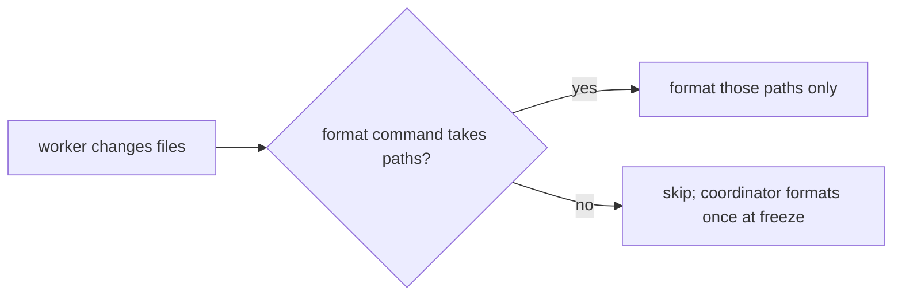

# Superlite: workers format only their own files (B137)

**Goal:** fix #568: implementer, package-reviewer and fixer briefs tell a worker to format only the files it changed (their paths passed to the project's format command), never the whole tree; a format command that takes no paths is skipped and the coordinator formats once at freeze.
**Architecture:** prompt text only. The six worker agent files (`agents/implementer.md`, `implementer-haiku.md`, `package-reviewer.md`, `fixer-sonnet.md`, `fixer-sonnet-high.md`, `fixer-opus.md`) each gain one identical rule line; a new test reads each file and checks the line and its place.
**Tech stack:** Markdown prompts; Python 3.10+ stdlib, pytest (through `sl run_tests`).
**Spec:** this file, section Design; issue #568.
**Detail:** tests
**Target-min:** 11
**Wave0:** none
**Coverage:** off

Global constraints:
- Existing tests stay green. An existing test file changes only when the task Owns it. If another existing test turns red, report it in DONE_WITH_CONCERNS with the test id and the reason instead of editing it.
- Run `sl` as an executable (`<abs>/sl ...`). Verify with `<abs>/sl run_tests --fast <own test files> --task Tn --background`, then run the printed `wait:` line in the foreground and end the turn only after it reports.
- No version edits (the ship step bumps the version). Never run `scripts/evals.sh`, `claude plugin eval` or `scripts/test_layers.py run`.
- Change no other line of the six agent files: only the one inserted line per file.

Ruling: main's ruling (orchestrator, not Max): a format command that takes no paths is skipped by the worker and the coordinator formats once at freeze.
Ruling: the skip and the own-files rule hold for every worker, not only one in a shared checkout (because formatting the whole tree touches files the worker does not own in its own tree too, which commit_task and the reviewer's scope rule refuse; cost if wrong: none, an own-tree worker loses nothing it may keep).
Ruling: one identical line in all six files (because one string keeps the test and later edits simple; cost if wrong: the reviewer line says "files you changed" where its scope rule says "files in scope", which only narrows it).
Ruling: SKILL.md Freeze (B122), fixing.md (B130, B138), fleet.md (B138) and the generated fix brief in findings.py (B130) belong to other open batches: the coordinator-side "format once at freeze" step becomes a follow-up in notes.md (cost if wrong: coordinators do not format at freeze until it lands).
Ruling: one mechanical task; already in the lead worktree, no `sl worktree ensure`; no probe adapter (prompt text); layers: unit (tests/scripts), headless and evals (agents/**).
LAYERS: unit, headless, evals



## Design

### 1. The rule line
Every worker agent file gains this exact line (`FORMAT` below):

`- Format only the files you changed: pass their paths to the project's format command (the one its AGENTS.md, CLAUDE.md or scripts name), never run it over the whole tree. A format command that takes no paths: skip it; the coordinator formats once at freeze.`

### 2. Where it goes
- `agents/implementer.md`, `agents/implementer-haiku.md`: the line right after `- Edit only the files you own.`
- `agents/fixer-sonnet.md`, `agents/fixer-sonnet-high.md`, `agents/fixer-opus.md`: the line right after `- Fix only the listed findings. No refactors. Touch no file outside the findings, except the test file for the regression test.`
- `agents/package-reviewer.md`: the line right after the rule line that starts `- Out of scope: change only the files in scope`.

## File structure

- `agents/implementer.md`, `agents/implementer-haiku.md`, `agents/package-reviewer.md`, `agents/fixer-sonnet.md`, `agents/fixer-sonnet-high.md`, `agents/fixer-opus.md`: one inserted rule line each (T1)
- `tests/scripts/test_worker_format_own_files_568.py`: the test below (T1)

## Task graph

```mermaid
%% schedule
gantt
  title Predicted schedule (mm:ss)
  dateFormat X
  axisFormat %M:%S
  section lane 1
  T1 worker briefs format only their own f :t1, 0, 90s
```




critical path: T1 (1.5 min) · peak width 1 · predicted build 1.5 min · predicted total ≈ 5.0 min (target ✓)

## Package: worker briefs

App type: prompt text. Categories: none beyond the named test. **Probe entry:** none (prompt text; the case is a named test).

### T1 worker briefs format only their own files · Complexity 1 · Est. context 25k
**Owns:** agents/implementer.md, agents/implementer-haiku.md, agents/package-reviewer.md, agents/fixer-sonnet.md, agents/fixer-sonnet-high.md, agents/fixer-opus.md, tests/scripts/test_worker_format_own_files_568.py
**Kind:** mechanical
**Components:** 1
**LOC owned:** 35
**Tests:** fast
**Model:** haiku
**Est. time:** 1.5 min (1 component, about 35 LOC, fast tests)
**Covers:** 1, 2
**Consumes:** none
**Produces:** none
**Review Focus:** `test_every_worker_formats_only_its_own_files`: each of the six files holds the `FORMAT` line exactly once, directly after its anchor line.
**Notes:** write the test first and run it red (all six files lack the line), then insert the line into each file at its place (Design 2), changing nothing else.
**Test code (verbatim):** new file tests/scripts/test_worker_format_own_files_568.py:
```python
"""#568: implementer, reviewer and fixer briefs format only the files the worker changed, never the whole tree."""
from pathlib import Path

AGENTS = Path(__file__).resolve().parents[2] / "agents"
FORMAT = ("- Format only the files you changed: pass their paths to the project's format command (the one its AGENTS.md, CLAUDE.md "
          "or scripts name), never run it over the whole tree. A format command that takes no paths: skip it; the coordinator "
          "formats once at freeze.")
EDIT = "- Edit only the files you own."
FIX = "- Fix only the listed findings. No refactors. Touch no file outside the findings, except the test file for the regression test."
SCOPE = "- Out of scope: change only the files in scope"
ANCHORS = {
    "implementer.md": EDIT,
    "implementer-haiku.md": EDIT,
    "fixer-sonnet.md": FIX,
    "fixer-sonnet-high.md": FIX,
    "fixer-opus.md": FIX,
    "package-reviewer.md": SCOPE,
}


def test_every_worker_formats_only_its_own_files():
    for name, anchor in ANCHORS.items():
        lines = (AGENTS / name).read_text(encoding="utf-8").split("\n")
        assert lines.count(FORMAT) == 1, name
        at = lines.index(FORMAT)
        assert lines[at - 1].startswith(anchor), name


def test_format_rule_names_the_skip_and_the_freeze():
    for s in ("only the files you changed", "pass their paths", "never run it over the whole tree", "takes no paths: skip it",
              "the coordinator formats once at freeze"):
        assert s in FORMAT, s
```
**Steps:** 1 write the test file, 2 run it: FAIL (`tests (fast): 1 passed, 1 failed`), 3 insert the line in the six files, 4 run: PASS

## Self-review

Coverage: Design 1 and 2 map to T1. No placeholders. No Consumes or Produces. One task, no edges. Fields filled. Plan well under 15k characters.
