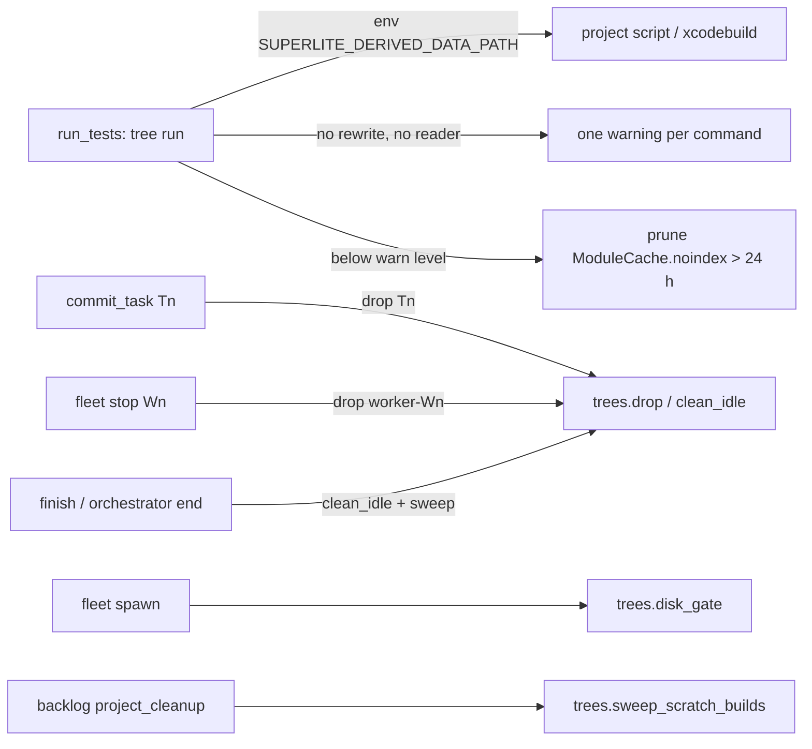
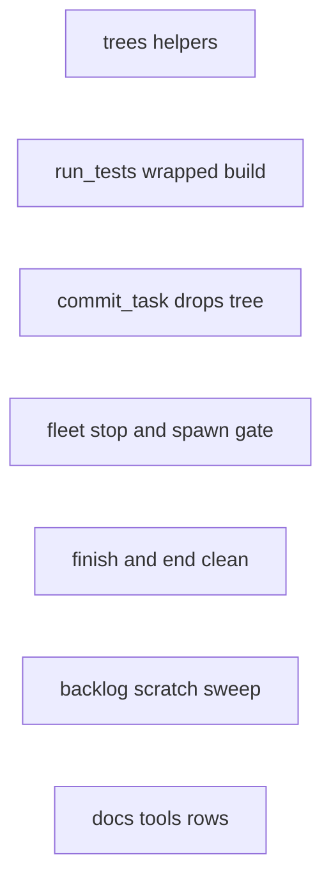

# Superlite: wrapped xcodebuild builds in the tree; tree cleanup at its source (B136)

**Goal:** fix #614 (follow-up to #574): a wrapped Xcode test command (a project script that runs xcodebuild) builds in the task tree, the shared module cache is pruned when the disk runs low, and every tree cleanup runs where its trees stop being needed (commit, worker stop, finish, run end, worktree removal).
**Architecture:** `trees.py` gains `clean_idle` (drop every tree nothing runs in) and `sweep_scratch_builds` (Xcode build folders in a removed worktree's Claude Code session scratchpads). `run_tests` exports `SUPERLITE_DERIVED_DATA_PATH`, warns once per command it cannot point at the tree, and prunes module cache entries older than 24 h below the warn level. `commit_task`, `fleet stop`, `finish`, `orchestrator end` and the backlog worktree cleanup call the cleanup themselves; `fleet spawn` runs the disk gate. `docs/tools.md` names all of it.
**Tech stack:** Python 3.10+ stdlib, pytest (through `sl run_tests`); Markdown docs.
**Spec:** this file, section Design; issue #614.
**Detail:** tests
**Target-min:** 11
**Wave0:** none
**Coverage:** off

Global constraints:
- Every Python code line keeps the file's trailing `# O(...)` complexity comment.
- Existing tests stay green. An existing test file changes only when the task Owns it. If another existing test turns red, report it in DONE_WITH_CONCERNS with the test id and the reason instead of editing it.
- Run `sl` as an executable (`<abs>/sl ...`). Verify with `<abs>/sl run_tests --fast <own test files> --task Tn --background`, then run the printed `wait:` line in the foreground and end the turn only after it reports.
- No version edits. Never run `scripts/evals.sh`, `claude plugin eval` or `scripts/test_layers.py run`. No test touches the real `~/Library/Developer/Xcode/DerivedData` or `/tmp/claude-<uid>`: `tests/scripts/conftest.py` points `SUPERLITE_DERIVED_DATA_HOME` and (after T1) `SUPERLITE_SCRATCH_HOME` at tmp folders, and the disk gate env at 0.
- Cleanup is best effort: a cleanup error never changes a command's exit code or stdout; each removal prints at most one line on stderr (backlog cleanup: stdout, beside its other cleanup lines).
- Never edit `docs/fleet.md` (B135 owns it), `dispatch.py`, `backlog_ship.py` or `plan_tools.py`.

Ruling: by main, not the user: a test command on an Xcode stack with no rewritable xcodebuild word gets `SUPERLITE_DERIVED_DATA_PATH=<tree>/.build/DerivedData` in its environment, plus one warning line naming the command (because a project script can pass it to xcodebuild; cost if wrong: a script that ignores it still fills the shared DerivedData, but the warning says so).
Ruling: by main, not the user: when the disk gate is below the warn level (also below the floor, before the refusal is decided) `run_tests` prunes `ModuleCache.noindex` entries untouched for 24 h and prints one line with the count and GB; it never touches a DerivedData folder of a live tree or workspace (because #614 measured 304 GB of module cache that only a manual `trees clean --module-cache-hours H` removed; cost if wrong: one cold module rebuild per old entry).
Ruling: the variable is exported on every isolated tree run (any stack; a test-cmd.json `env` entry of the same name wins); the warning needs an Xcode stack: test-cmd language `swift` and an `.xcodeproj` or `.xcworkspace` at the root or one or two folder levels down (hidden folders skipped), so `swift test` packages never warn (because SwiftPM builds in the tree's `.build` already; cost if wrong: an Xcode project nested three levels deep gets no warning).
Ruling: "a script that reads the variable" means a command word that names an existing file (relative to the tree or the root, at most 1 MB) whose text contains `SUPERLITE_DERIVED_DATA_PATH`, or the command text itself contains it; the warning is printed once per command per run folder (`.superlite/derived-data-warned.json`) (cost if wrong: a script that reads it through another file still warns once).
Ruling: `fleet spawn` gates plain spawns and `--for-review`/`--package`; `--for-dispatch` keeps dispatch's own gate (because dispatch already refuses below the floor; cost if wrong: none, one gate per path). `fleet stop` drops `worker-<Wn>` (eviction stops workers through it); a dead worker's tree is left to the next reap.
Ruling: `finish` and `orchestrator end` drop every tree under the run root's `.superlite/trees` that no live process marks busy and sweep orphaned DerivedData; finish's stdout stays byte-identical, the line goes to stderr.
Ruling: the backlog worktree cleanup (`backlog_run.project_cleanup`, used by ship merge, ship done, plan --reset and reset) removes, before the project cleanup command, Xcode build folders below `<scratch home>/<slug of the worktree path>/*/scratchpad` (scratch home: `$SUPERLITE_SCRATCH_HOME`, else `${CLAUDE_CODE_TMPDIR:-/tmp}/claude-<uid>`; slug: every character that is not a letter or digit becomes `-`), and the lead brief tells leads to build inside their worktree (because 92 GB in 48 such folders outlived their worktrees; cost if wrong: a Claude Code version that names its temp folders differently is not swept).
Ruling: left undone for this urgent ship (main allowed it): the live-tree cap per run and the lint disk forecast (#574, #614 item 5).
LAYERS: unit

## Design

### 1. Wrapped commands build in the tree (#614 item 1)
In an isolated tree run, `run_tests` adds `SUPERLITE_DERIVED_DATA_PATH` to the run's environment (setup and command). When the stack is Xcode, `with_derived_data` changed neither command nor setup, and no script the command names reads the variable, it prints once per command: ``run_tests: WARNING: the test command `<cmd>` has no xcodebuild word to rewrite and no script it names reads SUPERLITE_DERIVED_DATA_PATH, so it builds in the shared DerivedData; pass -derivedDataPath "$SUPERLITE_DERIVED_DATA_PATH" to xcodebuild in that script`` (`<cmd>` cut to 200 characters).

### 2. Module cache prune at the warn level (#614 item 3)
`free_disk` prunes with `trees.prune_module_cache(24)` when its first gate result is warn or refuse, prints `run_tests: module cache: removed N entries older than 24 h, X.X GB`, then gates again.

### 3. Cleanup at its source (#614 item 2)
`commit_task` drops each checkpointed task's tree; `fleet stop` drops `worker-<Wn>`; `fleet spawn` refuses below the floor; `finish` and `orchestrator end` run `clean_idle` and the DerivedData sweep.

### 4. Lead build folders (#614 item 4)
`project_cleanup` sweeps the worktree's scratchpad build folders; the lead brief's Build line tells leads to build inside the worktree.

### 5. Docs (#574 follow-up, #614)
`docs/tools.md` rows trees, run_tests, dispatch, commit_task, fleet, finish and orchestrator name the gate, the reaps, the sweeps, the prune, the per-tree `-derivedDataPath` and the variable.

## File structure

- `skills/subagent-driven-development/scripts/trees.py`, `tests/scripts/conftest.py`, `tests/scripts/test_trees_614.py`: T1
- `skills/subagent-driven-development/scripts/run_tests.py`, `tests/scripts/test_run_tests_wrapped_614.py`: T2
- `skills/subagent-driven-development/scripts/commit_task.py`, `tests/scripts/test_commit_task_tree_614.py`: T3
- `skills/subagent-driven-development/scripts/fleet.py`, `tests/scripts/test_fleet_trees_614.py`: T4
- `skills/subagent-driven-development/scripts/finish.py`, `skills/subagent-driven-development/scripts/orchestrator.py`, `tests/scripts/test_finish_end_trees_614.py`: T5
- `skills/subagent-driven-development/scripts/backlog_run.py`, `skills/subagent-driven-development/scripts/backlog_brief.py`, `tests/scripts/test_backlog_scratch_614.py`, `tests/scripts/test_backlog_brief_jira_208.py`, `tests/scripts/test_backlog_brief_render_567.py`: T6
- `docs/tools.md`, `tests/scripts/test_docs_614_tools.py`: T7

## Task graph

```mermaid
%% schedule
gantt
  title Predicted schedule (mm:ss)
  dateFormat X
  axisFormat %M:%S
  section lane 1
  T5 finish and orchestrator end clean the :t5, 0, 143s
  section lane 2
  T6 backlog scratch sweep and lead build :t6, 0, 138s
  section lane 3
  T2 run_tests wrapped build and module ca :t2, 0, 116s
  section lane 4
  T1 trees helpers :t1, 0, 113s
  section lane 5
  T4 fleet stop drops worker trees spawn g :t4, 0, 102s
  section lane 6
  T3 commit_task drops the task's tree :t3, 0, 99s
  section lane 7
  T7 docs tools rows :t7, 0, 91s
```

critical path: T5 (2.4 min) · peak width 7 · predicted build 2.4 min · predicted total ≈ 5.9 min (target ✓)

## Package: trees

App type: file I/O library. Categories: file (deletion scope, symlinks, missing folders), state (busy markers of live and dead pids). **Probe entry:** none (filesystem fixtures; cases are named tests).

### T1 trees helpers · Complexity 4 · Est. context 40k
**Owns:** skills/subagent-driven-development/scripts/trees.py, tests/scripts/conftest.py, tests/scripts/test_trees_614.py
**Components:** 1
**LOC owned:** 150
**Tests:** fast
**Model:** sonnet
**Est. time:** 2.6 min (1 component, about 150 LOC, fast tests)
**Covers:** 3, 4
**Produces:** trees.clean_idle(root: str | Path) -> list[str]
e.g. clean_idle(repo) with trees T1, T3 and worker-W2 under repo/.superlite/trees, T3 marked by a live `T3.busy.<os.getpid()>` -> ["T1", "worker-W2"] (T3 stays)
e.g. clean_idle(tmp_path) with no .superlite/trees folder -> []
**Produces:** trees.sweep_scratch_builds(worktree: str | Path, home: str | Path | None = None) -> tuple[int, int]
e.g. sweep_scratch_builds("/w/b1", home=H) with H/-w-b1/s1/scratchpad/dd/Build/x.o (3 bytes) and H/-w-b1/s1/scratchpad/dd/Logs/ -> (1, 3) (dd removed, scratchpad kept)
e.g. sweep_scratch_builds("/w/b1", home=H) with only H/-w-b1/s1/scratchpad/notes.md -> (0, 0)
**Review Focus:** `test_scratch_sweep_never_leaves_its_slug`: a build folder under H/-w-b2/... stays when the worktree is /w/b1; `test_scratch_sweep_keeps_a_symlinked_build_folder_target`: scratchpad/dd a symlink to a build folder elsewhere is not followed (the target stays); `test_clean_idle_drops_a_tree_of_a_dead_pid_marker`: a `T1.busy.999999999` marker does not keep T1.
**Steps:** 1 failing tests, 2 run: FAIL, 3 implement, 4 run: PASS
**Notes:**
- `clean_idle`: for each folder under `<root>/.superlite/trees` (sorted names), `drop(root, key)` when `not is_busy(root, key)`; return the dropped keys; never raises (an OSError or a failed drop skips that key). Files (overlay lists, markers) are left to `drop`.
- `scratch_home(home=None) -> Path`: `home` when given, else `$SUPERLITE_SCRATCH_HOME`, else `Path(os.environ.get("CLAUDE_CODE_TMPDIR") or "/tmp") / f"claude-{os.getuid()}"`.
- `_slug(path)`: `re.sub(r"[^A-Za-z0-9]", "-", str(path))`. `sweep_scratch_builds` looks in `scratch_home(home) / _slug(p)` for `p` in the absolute and the resolved worktree path (each once), then in every `<that>/*/scratchpad` folder walks at most 3 levels down without following symlinks. A build folder is a real (non-symlink) directory holding a `Build` directory plus a `Logs` or `ModuleCache.noindex` directory or an `info.plist` file, or holding a `ModuleCache.noindex` directory alone. Remove it (`shutil.rmtree`), count it and its byte size (`_size`) when it is gone; never descend into it. Missing folders: `(0, 0)`. Never raises.
- conftest `_isolated_superlite_home` also sets `SUPERLITE_SCRATCH_HOME` to `tmp_path / "_scratch"`.
- Docstring: add the two functions to the Cleanup paragraph.
- Named tests: the four e.g. lines, the three Review Focus tests, `test_scratch_home_default` (no env: `/tmp/claude-<uid>`; `CLAUDE_CODE_TMPDIR=/x`: `/x/claude-<uid>`), `test_scratch_sweep_resolved_path_slug` (worktree given through a symlinked parent is found by its resolved slug), `test_module_cache_alone_counts` (scratchpad/mc/ModuleCache.noindex/a.pcm removed).

## Package: run_tests

App type: CLI. Categories: protocol (env and stderr lines), file (warn marker), state (once per command). **Probe entry:** none (needs a git fixture and a fake test command; cases are named tests).

### T2 run_tests wrapped build and module cache prune · Complexity 5 · Est. context 52k
**Owns:** skills/subagent-driven-development/scripts/run_tests.py, tests/scripts/test_run_tests_wrapped_614.py
**Components:** 1
**LOC owned:** 170
**Tests:** fast
**Model:** sonnet
**Est. time:** 3.0 min (1 component, about 170 LOC, fast tests)
**Covers:** 1, 2
**Produces:** run_tests.wrapped_build_warning(command: str, tree: Path, root: Path, language: str) -> str | None
e.g. wrapped_build_warning("lockf -t 1800 /tmp/l Scripts/test.sh", tree, root, "swift") with root/App.xcodeproj/ and tree/Scripts/test.sh holding `xcodebuild test -scheme App` -> "run_tests: WARNING: the test command `lockf -t 1800 /tmp/l Scripts/test.sh` has no xcodebuild word to rewrite and no script it names reads SUPERLITE_DERIVED_DATA_PATH, so it builds in the shared DerivedData; pass -derivedDataPath \"$SUPERLITE_DERIVED_DATA_PATH\" to xcodebuild in that script"
e.g. the same call with tree/Scripts/test.sh holding `xcodebuild test -scheme App -derivedDataPath "$SUPERLITE_DERIVED_DATA_PATH"` -> None
e.g. wrapped_build_warning("swift test", tree, root, "swift") with only root/Package.swift -> None
**Review Focus:** `test_warning_once_per_command`: two isolated runs of the same wrapped command print the warning once, a changed command prints it again; `test_env_entry_wins`: test-cmd.json `"env": {"SUPERLITE_DERIVED_DATA_PATH": "/x"}` reaches the script as `/x`; `test_prune_runs_below_warn_only`: with `SUPERLITE_DISK_WARN_GB=0` no module cache line and an old entry stays.
**Steps:** 1 failing tests, 2 run: FAIL, 3 implement, 4 run: PASS
**Notes:**
- `MODULE_CACHE_HOURS = 24`, `WARNED = ".superlite/derived-data-warned.json"` (a JSON list of commands).
- `wrapped_build_warning`: None unless `language == "swift"` and an `.xcodeproj` or `.xcworkspace` entry sits in `root` or one or two folder levels below it (hidden folders and `node_modules`, `.build`, `DerivedData` skipped). None when the command contains `SUPERLITE_DERIVED_DATA_PATH`, or a word of `shlex.split(command)` (a ValueError: `command.split()`) names an existing file under `tree` or `root` (absolute words as they are), at most 1 MB, whose text (utf-8, errors replaced) contains it. Else the line in the first e.g., the command cut to 200 characters plus `...` when longer.
- In `main`'s `if tree:` block (after `with_derived_data`), always: `spec = {**spec, "env": {"SUPERLITE_DERIVED_DATA_PATH": str(trees.derived_data_path(tree)), **(spec.get("env") or {})}}`. When neither `spec["command"]` nor `spec.get("setup")` changed under `with_derived_data`, compute the warning with `root = Path.cwd()` and `spec.get("language")`; print it on stderr only when the command is not yet in `WARNED`, then add it (an unreadable or broken file counts as empty; a write error is ignored).
- `free_disk`: after the first `trees.disk_gate`, when its state is `warn` or `refuse`, call `trees.prune_module_cache(MODULE_CACHE_HOURS)` (in the existing try, after the DerivedData sweep) and print `run_tests: module cache: removed {n} entries older than 24 h, {size / 1024 ** 3:.1f} GB` on stderr whatever n is; the second gate then decides. Nothing else is pruned.
- Module docstring: one sentence each for the variable, the warning and the prune, next to the #574 lines.
- Named tests (build the isolated swift run like `tests/scripts/test_run_tests_disk_574.py` does: `set_cmd`, `run_env`, a fake `Scripts/test.sh` that writes `$SUPERLITE_DERIVED_DATA_PATH` to a file): the three e.g. lines, the three Review Focus tests, `test_script_sees_the_trees_derived_data_path` (the file holds `<tree>/.build/DerivedData`), `test_rewritten_xcodebuild_does_not_warn`, `test_root_run_exports_nothing` (no `--task`: the variable is unset in the script), `test_prune_below_warn_removes_old_entries` (`SUPERLITE_DISK_WARN_GB=1000000`, an entry of `$SUPERLITE_DERIVED_DATA_HOME/ModuleCache.noindex` with mtime 25 h ago is removed and a 1 h old one stays; stderr has `module cache: removed 1 entries older than 24 h`), `test_long_command_is_cut`.

## Package: cleanup callers

App type: CLI. Categories: state (busy trees, live workers), protocol (stdout unchanged, one stderr line). **Probe entry:** none (git and herdr fixtures; cases are named tests).

### T3 commit_task drops the task's tree · Complexity 2 · Est. context 34k
**Owns:** skills/subagent-driven-development/scripts/commit_task.py, tests/scripts/test_commit_task_tree_614.py
**Components:** 1
**LOC owned:** 70
**Tests:** fast
**Model:** sonnet
**Est. time:** 1.6 min (1 component, about 70 LOC, fast tests)
**Covers:** 3
**Review Focus:** `test_busy_tree_stays`: a tree with a live busy marker of this pid stays after its task's checkpoint; `test_failed_task_keeps_its_tree`: a `Tn FAILED` task's tree stays; `test_stdout_unchanged`: stdout is exactly the SHA line.
**Steps:** 1 failing tests, 2 run: FAIL, 3 implement, 4 run: PASS
**Notes:**
- In `main`, after the task loop and `release_agents`: for every task in `committed` (also an unchanged one), `trees.drop(".", tid)` when `not trees.is_busy(".", tid)` (lazy `import trees` inside a try; any exception is ignored). Dropped keys print one stderr line `commit_task: removed test tree(s) nothing needs: T1, T3`.
- Module docstring: one sentence (#614).
- Named tests: `test_checkpoint_drops_the_tree` (prepare `trees.prepare(repo, "T1", [])`, commit T1: `.superlite/trees/T1` gone, stderr line present), plus the Review Focus tests. Build the plan and repo like an existing commit_task test (for example `tests/scripts/test_commit_task.py`).

### T4 fleet stop drops worker trees, spawn gates the disk · Complexity 3 · Est. context 40k
**Owns:** skills/subagent-driven-development/scripts/fleet.py, tests/scripts/test_fleet_trees_614.py
**Components:** 1
**LOC owned:** 90
**Tests:** fast
**Model:** sonnet
**Est. time:** 2.0 min (1 component, about 90 LOC, fast tests)
**Covers:** 3
**Review Focus:** `test_spawn_refused_below_floor_opens_no_pane`: `SUPERLITE_DISK_FLOOR_GB=1000000`: plain `spawn` prints `BLOCKED: fleet spawn: disk: ...`, exits 3 and calls no herdr pane function; `test_stop_keeps_a_busy_worker_tree`; `test_for_dispatch_not_gated_twice`: `--for-dispatch` makes no `fleet spawn` gate call (dispatch gates).
**Steps:** 1 failing tests, 2 run: FAIL, 3 implement, 4 run: PASS
**Notes:**
- `stop()`: after each `fs.set_state(sd, wid, "stopped")`, when `sd.name == ".superlite"` and `not trees.is_busy(sd.parent, f"worker-{wid}")`, `trees.drop(sd.parent, f"worker-{wid}")`; exceptions ignored; nothing printed (stop's return value and stdout unchanged).
- `main`, `spawn` branch: after the fleet-off check and the argument checks (`--wait`, `--timeout`, `--brief` file) and before any spawn, unless `a.for_dispatch`: `level, line = trees.disk_gate(state.git_root(sd) or sd.parent)`; `refuse`: print `BLOCKED: fleet spawn: {line}` on stdout, return 3; `warn`: print `fleet: {line}` on stderr. Lazy `import trees`.
- Module docstring: one line for each (#614).
- Named tests (use the `world` fixture style of `tests/scripts/test_fleet.py`): `test_stop_drops_the_worker_tree` (a git repo whose `.superlite` is the run folder, `trees.prepare(root, "worker-W1", [])`, stop W1: tree gone), `test_spawn_warns_below_warn_level` (`SUPERLITE_DISK_WARN_GB=1000000`: stderr `fleet: disk: WARNING: ...`, the spawn goes on), plus the Review Focus tests.

### T5 finish and orchestrator end clean the run's trees · Complexity 3 · Est. context 38k
**Owns:** skills/subagent-driven-development/scripts/finish.py, skills/subagent-driven-development/scripts/orchestrator.py, tests/scripts/test_finish_end_trees_614.py
**Components:** 2
**LOC owned:** 90
**Tests:** fast
**Model:** sonnet
**Est. time:** 2.2 min (2 components, about 90 LOC, fast tests)
**Covers:** 3
**Consumes:** trees.clean_idle(root: str | Path) -> list[str] (T1)
**Review Focus:** `test_finish_stdout_unchanged`: finish's stdout with trees present equals its stdout without them; `test_end_refused_cleans_nothing`: an `end` refused for another live session's run leaves the trees; `test_busy_tree_survives_finish`.
**Steps:** 1 failing tests, 2 run: FAIL, 3 implement, 4 run: PASS
**Notes:**
- One helper per file, best effort (any exception ignored): when the run folder `sd` is named `.superlite`, `dropped = trees.clean_idle(sd.parent)` and `n, freed = trees.sweep_derived_data()`; when either removed something print one stderr line `finish: removed {len(dropped)} test tree(s) and {n} orphaned DerivedData folder(s), {freed / 1024 ** 3:.1f} GB` (orchestrator: prefix `orchestrator:`).
- finish `main`: after `log_auto(...)`, with the `sd` it already resolved. orchestrator `main`, `end` branch: after `print(end(sd))`, before `return 0`.
- Module docstrings: one sentence each (#614).
- Named tests: `test_finish_drops_idle_trees` (`trees.prepare(root, "T1", [])`, `finish --plan <plan>`: tree gone, stderr line `finish: removed 1 test tree(s) and 0 orphaned DerivedData folder(s), 0.0 GB`), `test_end_drops_idle_trees` (same through `orchestrator end --plan`), `test_no_line_when_nothing_removed`, plus the Review Focus tests. Fake `clean_idle` with the T1 e.g. values where a real tree is not needed.

## Package: backlog

App type: CLI (ship cleanup) and pure text (brief). Categories: file (deletion scope), protocol (cleanup lines). **Probe entry:** none (fixtures; cases are named tests).

### T6 backlog scratch sweep and lead build rule · Complexity 2 · Est. context 36k
**Owns:** skills/subagent-driven-development/scripts/backlog_run.py, skills/subagent-driven-development/scripts/backlog_brief.py, tests/scripts/test_backlog_scratch_614.py, tests/scripts/test_backlog_brief_jira_208.py, tests/scripts/test_backlog_brief_render_567.py
**Components:** 2
**LOC owned:** 60
**Tests:** fast
**Model:** sonnet
**Est. time:** 1.7 min (2 components, about 60 LOC, fast tests)
**Covers:** 4
**Consumes:** trees.sweep_scratch_builds(worktree: str | Path, home: str | Path | None = None) -> tuple[int, int] (T1)
**Review Focus:** `test_sweep_runs_without_cleanup_cmd`: no `.superlite/cleanup-cmd.json`: the sweep still runs and `project_cleanup` returns None; `test_sweep_error_never_fails_cleanup`: a raising sweep prints nothing and the cleanup command still runs.
**Steps:** 1 failing tests, 2 run: FAIL, 3 implement, 4 run: PASS
**Notes:**
- `project_cleanup`: right after the `str(wt) in ("", ".")` check and before `cleanup_cmd(root)`: `n, freed = trees.sweep_scratch_builds(wt)` (lazy `import trees`, any exception ignored); when n, print `{bid} scratch builds: removed {n} folder(s), {freed / 1024 ** 3:.1f} GB` on stdout. Return values unchanged.
- `backlog_brief.py` lead brief: the `Build:` line ends `..., the test layers. Build inside your worktree: never pass -derivedDataPath outside it (your session scratchpad included); sl run_tests builds each task tree in <tree>/.build/DerivedData and backlog cleanup removes scratchpad build folders when the worktree goes.` Update the pinned expected text in the two owned brief tests.
- Named tests: `test_cleanup_sweeps_scratch_builds` (scratch home with `<slug of wt>/s/scratchpad/dd/Build` and `Logs`: dd gone, stdout `B1 scratch builds: removed 1 folder(s), 0.0 GB`), `test_lead_brief_names_build_rule`, plus the Review Focus tests.

## Package: docs

App type: docs. Categories: none beyond wording. **Probe entry:** none (Markdown).

### T7 docs tools rows · Complexity 2 · Est. context 32k
**Owns:** docs/tools.md, tests/scripts/test_docs_614_tools.py
**Components:** 1
**LOC owned:** 50
**Tests:** fast
**Model:** sonnet
**Est. time:** 1.5 min (1 component, about 50 LOC, fast tests)
**Covers:** 5
**Steps:** 1 failing tests, 2 run: FAIL, 3 implement, 4 run: PASS
**Notes:**
- Append these exact sentences, each at the end of its row's last cell (before the closing ` |`), keeping every existing word (other docs tests pin spans of these rows); each `\`` below is one literal backtick in the doc:
  - `trees`: ` Cleanup (#574, #614): run_tests and dispatch refuse below 20 GB free and warn below 50 GB (SUPERLITE_DISK_FLOOR_GB, SUPERLITE_DISK_WARN_GB; 0 turns a check off) and remove the trees of committed tasks and stopped workers that no busy marker holds; \`clean\` also sweeps the Xcode DerivedData folders of removed trees and, with \`--module-cache-hours H\`, ModuleCache.noindex entries untouched for H hours; each tree builds with \`-derivedDataPath <tree>/.build/DerivedData\`.`
  - `run_tests`: ` A tree run exports SUPERLITE_DERIVED_DATA_PATH=<tree>/.build/DerivedData to its setup and command (a test-cmd.json env entry wins); on an Xcode stack whose command has no rewritable xcodebuild word and names no script that reads the variable it prints one WARNING per command; below the warn level it prunes module cache entries older than 24 h and prints \`module cache: removed N entries older than 24 h, X GB\` (#614).`
  - `dispatch`: ` Before a round it checks the disk like run_tests (refuse below 20 GB, warn below 50 GB), sweeps orphaned DerivedData and drops the trees of committed tasks, stopped workers and evicted agents (#574).`
  - `commit_task`: ` A checkpointed task's test tree is removed unless a run marks it busy (#614).`
  - `fleet`: ` \`stop\` removes the stopped worker's \`worker-<Wn>\` tree; \`spawn\` (not \`--for-dispatch\`, which dispatch gates) refuses below the disk floor with \`BLOCKED: fleet spawn: disk: ...\`, exit 3 (#614).`
  - `finish`: ` It removes the run's idle test trees and orphaned DerivedData and says so in one stderr line (#614).`
  - `orchestrator`: ` \`end\` removes the run's idle test trees and orphaned DerivedData too (#614).`
- `tests/scripts/test_docs_614_tools.py`: one test per row, each asserting its sentence (without the leading space) is a substring of that row (the line starting with `` | `<name>` | ``).
