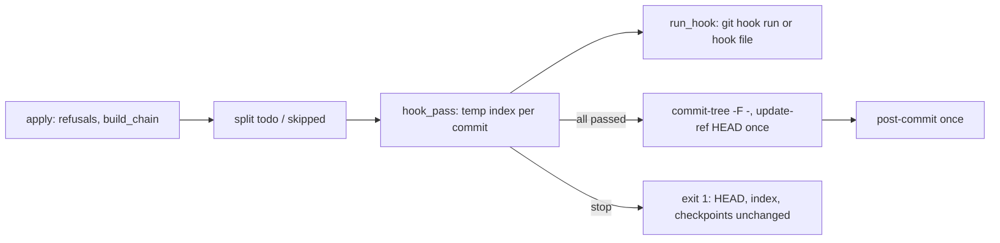
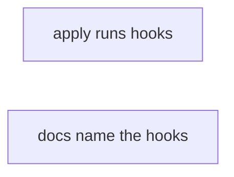

# Superlite: `sl autocommit apply` runs the project's git hooks (B181, #709)

**Goal:** fix #709: `sl autocommit apply` runs the commit hooks a plain `git commit` would run (pre-commit, prepare-commit-msg, commit-msg; post-commit after), with the environment git gives them, before HEAD moves; a failing hook names the hook and the task, leaves HEAD, the index and the checkpoints unchanged, and a rerun after the fix applies the same checkpoints. docs/tools.md, the finishing skill and /superlite:commit say so.
**Architecture:** One script, `skills/subagent-driven-development/scripts/autocommit.py`. `apply()` keeps its refusal checks and chain building; between the chain and the `commit-tree` loop it gains a hook pass (`hook_pass`) that, per commit to write, fills a temporary index with that commit's tree and runs the hooks through `run_hook` (`git hook run`, or the hook file on git before 2.36). Only when every hook passed are the commits written (`commit-tree -F -` with the hooked message), HEAD moved once, and post-commit run once.
**Tech stack:** Python 3.10+ stdlib (subprocess, git CLI); pytest through `sl run_tests`; Markdown docs.
**Spec:** this file, section Design; issue #709.
**Detail:** tests
**Target-min:** 11
**Wave0:** none
**Worktree:** none
**Coverage:** off
**Max chars:** 28000
**Read first:** .superlite/briefs/standing.md
LAYERS: unit, headless, evals

Global constraints:
- Public repository: no host names, user names, home paths, other project or repository names, ticket keys or account names in any file, test or commit message.
- Never change the machine's gate config, ~/.superlite/machine.json or any global git config; tests use private temp homes and state dirs.
- No real app builds; this repository's test suite is the check (`sl run_tests`).
- Tests isolate hooks: a test that installs a hook sets `core.hooksPath` in its own temp repository to a folder under its `tmp_path`; the one test of the default `.git/hooks` folder runs apply with `GIT_CONFIG_GLOBAL` pointing to an empty file and `GIT_CONFIG_NOSYSTEM=1`.
- Exact texts: T1 writes the messages of Design 1 verbatim, T2 quotes them verbatim; neither changes a word.
- `docs/tools.md`: the autocommit row is edited only by inserting Design 2's clause at the named spot (the row must still end with the clause `tests/scripts/test_docs_b72_tools.py` pins, and hold exactly one ` | `); other new lines go at the end of the file.

Ruling: hooks run per commit apply writes (squash: one per task), the order git uses: pre-commit, prepare-commit-msg (`<message file> message`), commit-msg; all of them before any commit object or ref is written; post-commit once after HEAD moved, exit status ignored (as git does). Because: #709 item 2 names the task each hook ran for, and HEAD must stay unchanged on a failure.
Ruling: hooks run through `git hook run --ignore-missing <name> [-- args]` when `git --version` is 2.36 or newer (git then honours `core.hooksPath` and config hooks, gives no stdin, sends the hook's stdout to stderr, runs it at the top level and sets GIT_DIR in a linked worktree); older git runs the executable file `git rev-parse --git-path hooks/<name>` from the top level with stdin /dev/null and stdout to stderr. Because: `git hook` does not exist before 2.36 and calling it there would fail every apply.
Ruling: hook env adds `GIT_INDEX_FILE` = the absolute path of `.superlite/apply-hook.index` (a temporary index holding that commit's tree, removed after the pass) and `GIT_EDITOR=:` (git's value when no editor runs); no author variables. HEAD stays at the run's start commit during the pass, so a later commit's `git diff --cached` also lists the earlier tasks' changes (documented).
Ruling: a pre-commit that changes the temporary index stops apply (never commits a tree a hook built: the next task's tree comes from its checkpoint and would drop the change). The message file is the git dir's `COMMIT_EDITMSG` (as `git commit`); it is read back after commit-msg and cleaned like git's whitespace cleanup, so a hook's edit (a `Change-Id:` trailer) is kept; an empty message stops apply. No `--no-verify` option.
Ruling: T2 runs beside T1 with no edge (round priority: wall-clock; lint predicted 30.7 min on the T1 → T2 chain): T2's tests check only its docs and strings that exist today, T1's tests pin the stop lines Design 1 fixes verbatim, and the final review compares the two.
Ruling: MISSED TARGET accepted: the critical path is T1 alone (one script and its test file; a split would share autocommit.py), and the predicted 23.3 min holds lint's contention x2.5 for 2 build slots.
Ruling: adjacent fix: docs/tools.md gets two new end lines that B182 (#711) and B183 (#714) left for this batch's file; commands/commit.md (no open batch lists it) names the hook refusal.

## Design

### 1. Hook pass in `apply` (#709 Wanted 1, 2)

`apply()` today: refusal checks, `build_chain`, the `edited_since` refusal, then a loop that skips an entry whose tree equals the previous tree (`apply: skipped <title> (no change left)`) and writes `commit-tree` commits, then `update-ref` HEAD once, `git reset -q -- <files>`, prints, `clean()`.

New order after the `edited_since` refusal:
1. Split `chain` into `todo` (entries whose tree differs from the previous tree, in order) and `skipped` (as today; same skip rule, same print).
2. `messages = hook_pass(todo, trailers)` when `todo` is not empty. Any stop exits here (`sys.exit(<line>)`, exit code 1) before a commit object, a ref, the index or `.superlite/checkpoints.json` changes.
3. For each `(entry, tree)` and its message: `git commit-tree <tree> -F - [-p <parent>]` with the message on stdin (`git()` gains `input=None`, passed to `subprocess.run`).
4. As today: `update-ref -m "superlite: apply checkpoints" HEAD ...`, `reset -q -- <files>`; then `run_hook("post-commit", [], {"GIT_EDITOR": ":"})` once, result ignored; then the prints and `clean()` unchanged.

With no hooks installed the commits, messages and printed lines are exactly today's: the message file holds `<title>\n` or `<title>\n\n<trailer lines>\n`, which `clean_message` leaves as is.

`hook_pass(todo, trailers)`, per `(entry, tree)`:
- empty the temporary index, `git read-tree <tree>` into it (env `GIT_INDEX_FILE`);
- `run_hook("pre-commit", [], env)`; non-zero: stop line A;
- `git write-tree` with that index; a different tree: stop line B, naming `git diff --name-only <tree> <new tree>` (up to 8, then ` ...`);
- write the message to `COMMIT_EDITMSG`; `run_hook("prepare-commit-msg", [<file>, "message"], env)`, then `run_hook("commit-msg", [<file>], env)`; non-zero: stop line A;
- `clean_message(<file text>)`; empty: stop line C;
- in a `finally`: remove the temporary index.
`env` = `{"GIT_INDEX_FILE": <absolute .superlite/apply-hook.index>, "GIT_EDITOR": ":"}`. Before each hook: flush stdout and stderr.

Stop lines (verbatim; `<title>` is the entry's commit title such as `T1: parser`, which already names the task):
- A: `apply: the <hook> hook failed (exit <rc>) for <title>; HEAD and the checkpoints are unchanged: fix the cause, then rerun `sl autocommit apply` (a file you edit for the fix needs `sl commit_task` again first, or commit it yourself with `git add -A && git commit`)`
- B: `apply: the pre-commit hook changed the staged files for <title>: <files>; HEAD and the checkpoints are unchanged: checkpoint the change with `sl commit_task` and rerun `sl autocommit apply`, or commit it yourself with `git add -A && git commit``
- C: `apply: the commit message for <title> is empty after the commit-msg hook; HEAD and the checkpoints are unchanged`

The hook's own output passes through (no capture): `git hook run` sends it to stderr; the fallback runs the hook with `stdout=sys.stderr`.

### 2. Docs (#709 Wanted 3, adjacent lines)

docs/tools.md, `autocommit` row: insert this clause directly before the row's `; `apply` writes no commit whose tree equals the commit it sits on`:
> `; before HEAD moves, `apply` runs the project's commit hooks for every commit it writes, as a plain `git commit` would (`git hook run`, so `core.hooksPath` and config hooks count; git before 2.36 runs the hook file): `pre-commit` with `GIT_INDEX_FILE` naming a temporary index that holds that commit's tree (HEAD stays at the run's start, so a later commit's index diff also shows the earlier tasks' changes), then `prepare-commit-msg` and `commit-msg` on the message, whose edits are kept; a failing hook prints `apply: the <hook> hook failed (exit N) for <title>`, and a `pre-commit` that changes the staged files or a message left empty stops it too; each stop leaves HEAD, the index and the checkpoints unchanged, so a rerun after the fix applies the same checkpoints; `post-commit` runs once after HEAD moved and its exit status is ignored; there is no `--no-verify``

(The clause is the text between the outer backticks of the quote line above, starting with `; before HEAD moves` and ending with `there is no `--no-verify``.)

docs/tools.md, two new lines at the end of the file:
- `A `run=` probe entry runs in a scratch `HOME` and working folder, without `GH_TOKEN`, `GITHUB_TOKEN`, `SSH_AUTH_SOCK` or other credential variables; `probe_run` exits 2 on a generated adapter whose `run=` predates that sandbox (`probe_run: adapter's run= predates the sandbox; rebuild with plan_tools adapter`), and plan lint fails `PROBE: run=<cmd> has a dry-run flag` and `PROBE: run=<cmd> runs <tool>` and warns `WARNING: PROBE: run=<cmd> names "<word>"` (#711).`
- `A `run_tests --fast` run whose paths are all dropped runs the whole command, still labelled fast (summary mode, ledger, no unit stamp), and unless `-m`, pass-through arguments or an honoured marker narrow it, it passes the full-run gate like a full run: `machine.json` admission, else the toolchain's full-suite lock; `"lock": false` skips it (#714).`

skills/finishing-a-development-branch/SKILL.md, the paragraph starting `If `finish` printed NOTHING WAS COMMITTED`: replace `which refuses only when commits since the run touched checkpointed files or a checkpointed file changed again, and leaves unrelated changes uncommitted;` with:
> `which runs the project's commit hooks (`pre-commit`, `prepare-commit-msg`, `commit-msg`) for each commit before HEAD moves, refuses when commits since the run touched checkpointed files, a checkpointed file changed again or a hook failed (HEAD and the checkpoints stay as they were: fix the cause, run it again), and leaves unrelated changes uncommitted; give that Bash call a 600000 ms timeout when the project's `pre-commit` runs its tests;`

commands/commit.md, step 3: replace `if it refuses (HEAD moved or a checkpointed file was edited again), print why and stop;` with:
> `it runs the project's commit hooks for each commit before HEAD moves (give the Bash call a 600000 ms timeout when the project's `pre-commit` runs its tests); if it refuses (HEAD moved, a checkpointed file was edited again or a hook failed: HEAD and the checkpoints stay unchanged), print why and stop;`

## File structure

- `skills/subagent-driven-development/scripts/autocommit.py`: `apply` gains the hook pass; new `git_version`, `clean_message`, `run_hook`, `hook_pass`; `git()` gains `input`.
- `tests/scripts/test_autocommit_hooks_709.py` (new): the hook tests.
- `docs/tools.md`, `skills/finishing-a-development-branch/SKILL.md`, `commands/commit.md`: Design 2 texts.
- `tests/scripts/test_docs_709_hooks.py` (new): pins the Design 2 texts and the quoted code strings.



## Task graph

```mermaid
%% schedule
gantt
  title Predicted schedule (mm:ss)
  dateFormat X
  axisFormat %M:%S
  section lane 1
  T1 apply runs the commit hooks :t1, 0, 529s
  section lane 2
  T2 docs name the hooks :t2, 0, 446s
```





critical path: T1 (8.8 min) · peak width 2 · predicted build 8.8 min · predicted total ≈ 23.3 min (target ✗ 11.0)

## Package: autocommit

**Probe entry:** none (Ruling: no probe adapter; apply writes commits, and named tests cover the hook contract).

### T1 apply runs the commit hooks · Complexity 4 · Est. context 40k
**Owns:** skills/subagent-driven-development/scripts/autocommit.py, tests/scripts/test_autocommit_hooks_709.py
**Components:** 2
**LOC owned:** 300
**Tests:** fast
**Model:** sonnet
**Covers:** 1
**Produces:** autocommit.git_version(text: str) -> tuple[int, int] · autocommit.clean_message(text: str) -> str · autocommit.run_hook(name: str, args: list[str], env: dict) -> int · autocommit.hook_pass(todo: list[tuple[dict, str]], trailers: list[str]) -> list[str]
e.g. git_version("git version 2.54.0 (Apple Git-157)") -> (2, 54); git_version("no version here") -> (0, 0)
e.g. clean_message("T1: parser\n\n\nChange-Id: I1  \n\n") -> "T1: parser\n\nChange-Id: I1\n"; clean_message(" \n\n") -> ""
e.g. run_hook("pre-commit", [], {"GIT_INDEX_FILE": "/abs/idx", "GIT_EDITOR": ":"}) -> 0 when no pre-commit hook exists
**Review Focus:** the tests below; every existing `tests/scripts/test_autocommit*.py`, `test_commit_plan_root_365.py` and `test_packet_fast_forward.py` stays green unchanged (no-hook output and messages are byte-identical).
**Test code (verbatim):**
```python
# tests/scripts/test_autocommit_hooks_709.py
"""`sl autocommit apply` runs the project's commit hooks before HEAD moves (#709)."""
import os
import shutil
import subprocess
import sys
from pathlib import Path

import pytest

sys.path.insert(0, str(Path(__file__).resolve().parent))
from test_autocommit import ENV, SCRIPTS, git, make_repo, run, two_tasks  # noqa: E402

sys.path.insert(0, str(SCRIPTS))
import autocommit  # noqa: E402

GIT_VERSION = autocommit.git_version(subprocess.run(["git", "--version"], capture_output=True, text=True).stdout)


def hooks(repo, tmp_path, **scripts):
    """Write each hook (`pre_commit` -> pre-commit) into tmp_path/hooks and point core.hooksPath at it."""
    d = tmp_path / "hooks"
    d.mkdir(exist_ok=True)
    for name, body in scripts.items():
        p = d / name.replace("_", "-")
        p.write_text("#!/bin/sh\n" + body + "\n", encoding="utf-8")
        p.chmod(0o755)
    git(repo, "config", "core.hooksPath", str(d))
    return d


def state(repo):
    return {"head": git(repo, "rev-parse", "HEAD"), "index": git(repo, "ls-files", "--stage"),
            "refs": git(repo, "for-each-ref", "refs/superlite"),
            "checkpoints": (repo / ".superlite" / "checkpoints.json").read_text(encoding="utf-8")}


def fake_old_git(tmp_path):
    """PATH with a git that reports 2.30.0 and has no `hook` command."""
    real = shutil.which("git")
    b = tmp_path / "bin"
    b.mkdir()
    g = b / "git"
    g.write_text('#!/bin/sh\nif [ "$1" = "--version" ]; then echo "git version 2.30.0"; exit 0; fi\n'
                 'if [ "$1" = "hook" ]; then echo "git: hook is not a git command" >&2; exit 1; fi\n'
                 f'exec "{real}" "$@"\n', encoding="utf-8")
    g.chmod(0o755)
    return {**ENV, "PATH": f"{b}{os.pathsep}{ENV.get('PATH', '')}"}


def test_git_version_reads_the_first_two_numbers():
    assert autocommit.git_version("git version 2.54.0 (Apple Git-157)") == (2, 54)
    assert autocommit.git_version("git version 2.30.1") == (2, 30)
    assert autocommit.git_version("no version here") == (0, 0)


def test_clean_message_like_git_whitespace_cleanup():
    assert autocommit.clean_message("T1: parser\n\n\nChange-Id: I1  \n\n") == "T1: parser\n\nChange-Id: I1\n"
    assert autocommit.clean_message("\n\nT1: parser") == "T1: parser\n"
    assert autocommit.clean_message(" \n\n") == ""


def test_failing_pre_commit_stops_apply_and_keeps_state(tmp_path):
    repo = make_repo(tmp_path)
    two_tasks(repo)
    hooks(repo, tmp_path, pre_commit='echo "pre-commit says no"\nexit 1')
    before = state(repo)
    r = run("autocommit", "apply", cwd=repo)
    assert r.returncode == 1, r.stdout + r.stderr
    assert "pre-commit says no" in r.stderr
    assert ("apply: the pre-commit hook failed (exit 1) for T1: parser; HEAD and the checkpoints are unchanged: "
            "fix the cause, then rerun `sl autocommit apply`") in r.stderr
    assert state(repo) == before
    assert not (repo / ".superlite" / "apply-hook.index").exists()


def test_failure_names_the_later_task_and_writes_no_commit(tmp_path):
    repo = make_repo(tmp_path)
    two_tasks(repo)
    hooks(repo, tmp_path, pre_commit='if git ls-files --error-unmatch src/b.py >/dev/null 2>&1; then exit 3; fi')
    before = state(repo)
    r = run("autocommit", "apply", cwd=repo)
    assert r.returncode == 1, r.stdout + r.stderr
    assert "apply: the pre-commit hook failed (exit 3) for T2: lexer;" in r.stderr
    assert state(repo) == before


def test_rerun_after_the_fix_applies_the_same_checkpoints(tmp_path):
    repo = make_repo(tmp_path)
    base = git(repo, "rev-parse", "HEAD")
    two_tasks(repo)
    d = hooks(repo, tmp_path, pre_commit="exit 1")
    assert run("autocommit", "apply", cwd=repo).returncode == 1
    (d / "pre-commit").write_text("#!/bin/sh\nexit 0\n", encoding="utf-8")
    r = run("autocommit", "apply", cwd=repo)
    assert r.returncode == 0, r.stdout + r.stderr
    assert "applied 2 commit(s)" in r.stdout
    assert git(repo, "log", "--format=%s", f"{base}..HEAD").split("\n") == ["T2: lexer", "T1: parser"]
    assert git(repo, "for-each-ref", "refs/superlite") == ""


def test_hooks_run_in_git_order_with_the_temporary_index(tmp_path):
    repo = make_repo(tmp_path)
    two_tasks(repo)
    log = tmp_path / "log"
    hooks(repo, tmp_path,
          pre_commit=f'echo "pre-commit $GIT_INDEX_FILE $(git ls-files | tr "\\n" " ")" >> "{log}"',
          prepare_commit_msg=f'echo "prepare-commit-msg $2 $(head -n 1 "$1")" >> "{log}"',
          commit_msg=f'echo "commit-msg $(head -n 1 "$1")" >> "{log}"',
          post_commit=f'echo "post-commit" >> "{log}"')
    r = run("autocommit", "apply", cwd=repo)
    assert r.returncode == 0, r.stdout + r.stderr
    lines = log.read_text(encoding="utf-8").splitlines()
    assert [ln.split()[0] for ln in lines] == ["pre-commit", "prepare-commit-msg", "commit-msg",
                                               "pre-commit", "prepare-commit-msg", "commit-msg", "post-commit"]
    assert lines[0].split()[1] == str((repo / ".superlite" / "apply-hook.index").resolve())
    assert "src/a.py" in lines[0] and "src/b.py" not in lines[0]
    assert "src/a.py" in lines[3] and "src/b.py" in lines[3]
    assert lines[1] == "prepare-commit-msg message T1: parser"
    assert lines[2] == "commit-msg T1: parser"
    assert lines[5] == "commit-msg T2: lexer"


def test_commit_msg_hook_edit_is_kept(tmp_path):
    repo = make_repo(tmp_path)
    base = git(repo, "rev-parse", "HEAD")
    two_tasks(repo)
    hooks(repo, tmp_path, commit_msg='printf "\\nChange-Id: I0123\\n\\n\\n" >> "$1"')
    r = run("autocommit", "apply", "--trailer", "Signed-off-by: A <a@example.com>", cwd=repo)
    assert r.returncode == 0, r.stdout + r.stderr
    first = git(repo, "rev-list", "--reverse", f"{base}..HEAD").split("\n")[0]
    assert git(repo, "log", "-1", "--format=%B", first) == (
        "T1: parser\n\nSigned-off-by: A <a@example.com>\n\nChange-Id: I0123")


def test_failing_commit_msg_hook_stops_apply(tmp_path):
    repo = make_repo(tmp_path)
    two_tasks(repo)
    hooks(repo, tmp_path, commit_msg='echo "message rejected"; exit 1')
    before = state(repo)
    r = run("autocommit", "apply", cwd=repo)
    assert r.returncode == 1, r.stdout + r.stderr
    assert "message rejected" in r.stderr
    assert "apply: the commit-msg hook failed (exit 1) for T1: parser;" in r.stderr
    assert state(repo) == before


def test_pre_commit_that_changes_the_staged_files_stops_apply(tmp_path):
    repo = make_repo(tmp_path)
    two_tasks(repo)
    hooks(repo, tmp_path, pre_commit="git rm -q --cached tests/test_a.py")
    before = state(repo)
    r = run("autocommit", "apply", cwd=repo)
    assert r.returncode == 1, r.stdout + r.stderr
    assert "apply: the pre-commit hook changed the staged files for T1: parser: tests/test_a.py;" in r.stderr
    assert state(repo) == before
    assert (repo / "tests" / "test_a.py").exists()


def test_empty_message_after_commit_msg_stops_apply(tmp_path):
    repo = make_repo(tmp_path)
    two_tasks(repo)
    hooks(repo, tmp_path, commit_msg=': > "$1"')
    before = state(repo)
    r = run("autocommit", "apply", cwd=repo)
    assert r.returncode == 1, r.stdout + r.stderr
    assert ("apply: the commit message for T1: parser is empty after the commit-msg hook; "
            "HEAD and the checkpoints are unchanged") in r.stderr
    assert state(repo) == before


def test_post_commit_failure_is_ignored(tmp_path):
    repo = make_repo(tmp_path)
    two_tasks(repo)
    hooks(repo, tmp_path, post_commit='echo "post-commit failed"; exit 1')
    r = run("autocommit", "apply", cwd=repo)
    assert r.returncode == 0, r.stdout + r.stderr
    assert "applied 2 commit(s)" in r.stdout
    assert "post-commit failed" in r.stderr


def test_default_hooks_folder_without_hooks_path(tmp_path):
    repo = make_repo(tmp_path)
    two_tasks(repo)
    mark = tmp_path / "mark"
    h = repo / ".git" / "hooks" / "pre-commit"
    h.write_text(f'#!/bin/sh\necho "$GIT_INDEX_FILE" > "{mark}"\n', encoding="utf-8")
    h.chmod(0o755)
    empty = tmp_path / "empty.gitconfig"
    empty.write_text("", encoding="utf-8")
    r = run("autocommit", "apply", cwd=repo, env={**ENV, "GIT_CONFIG_GLOBAL": str(empty), "GIT_CONFIG_NOSYSTEM": "1"})
    assert r.returncode == 0, r.stdout + r.stderr
    assert mark.read_text(encoding="utf-8").strip().endswith("apply-hook.index")


def test_old_git_runs_the_hook_file(tmp_path):
    repo = make_repo(tmp_path)
    two_tasks(repo)
    log = tmp_path / "log"
    hooks(repo, tmp_path, pre_commit=f'echo "$GIT_INDEX_FILE $(pwd)" >> "{log}"',
          commit_msg='echo "old git says no"; exit 2')
    before = state(repo)
    r = run("autocommit", "apply", cwd=repo, env=fake_old_git(tmp_path))
    assert r.returncode == 1, r.stdout + r.stderr
    assert "old git says no" in r.stderr
    assert "apply: the commit-msg hook failed (exit 2) for T1: parser;" in r.stderr
    idx, cwd = log.read_text(encoding="utf-8").split()
    assert idx.endswith("apply-hook.index")
    assert Path(cwd).resolve() == repo.resolve()
    assert state(repo) == before


@pytest.mark.skipif(GIT_VERSION < (2, 36), reason="git hook run needs git 2.36")
def test_hook_in_a_linked_worktree_sees_git_dir(tmp_path):
    repo = make_repo(tmp_path)
    wt = tmp_path / "wt"
    git(repo, "worktree", "add", "-q", "-b", "side", str(wt))
    two_tasks(wt)
    log = tmp_path / "log"
    hooks(repo, tmp_path, pre_commit=f'echo "$GIT_DIR" >> "{log}"')
    r = run("autocommit", "apply", cwd=wt)
    assert r.returncode == 0, r.stdout + r.stderr
    assert log.read_text(encoding="utf-8").splitlines()[0].endswith("/.git/worktrees/wt")
```
**Steps:** 0 measure before: in `.superlite/scratch/` (never committed) time `autocommit.py apply` on 5 fresh two-task repos without hooks (the `make_repo` + `two_tasks` setup, outside the timing), keep the median; 1 write the test file; 2 run: FAIL; 3 implement Design 1; 4 run: PASS, plus `sl run_tests --fast` over every `tests/scripts/test_autocommit*.py`; 5 measure after the same way. Report both medians (ms) in the DONE summary.
**Notes:** `git_version`: first `(\d+)\.(\d+)` match of the text. `clean_message`: strip trailing whitespace of each line, drop leading blank lines, collapse runs of blank lines to one, drop trailing blank lines, end with one `\n`; `""` when nothing is left. `run_hook`: decide with `git_version(git("--version").stdout) >= (2, 36)`, cached once per process (`functools.lru_cache` on a no-argument helper); new path `subprocess.run(["git", "hook", "run", "--ignore-missing", name, *(["--", *args] if args else [])], env={**os.environ, **env}, stdin=subprocess.DEVNULL, stdout=sys.stderr)`; old path: the file `git rev-parse --git-path hooks/<name>` resolved against the cwd, run only when it is a file and executable, `cwd=` the output of `git rev-parse --show-toplevel`, same env, stdin and stdout; return its `returncode`, 0 when there is no hook. `COMMIT_EDITMSG` path: `git rev-parse --git-path COMMIT_EDITMSG` resolved against the cwd. A stop is `sys.exit(<stop line>)` so the exit code is 1; the temporary index is removed in a `finally`. Update the module docstring's `apply` line: `apply` runs the project's commit hooks before HEAD moves. Keep every other message and behaviour of `apply` as it is.

## Package: docs

**Probe entry:** none (Markdown texts; named tests cover them).

### T2 docs name the hooks · Complexity 1 · Est. context 30k
**Owns:** docs/tools.md, skills/finishing-a-development-branch/SKILL.md, commands/commit.md, tests/scripts/test_docs_709_hooks.py
**Components:** 1
**LOC owned:** 70
**Tests:** fast
**Kind:** mechanical
**Model:** haiku
**Covers:** 2
**Review Focus:** `test_autocommit_row_names_the_hooks`: the `autocommit` row of docs/tools.md holds HOOKS verbatim, holds exactly one ` | ` and still ends with `|`; `test_end_lines`: docs/tools.md holds PROBE_LINE and FAST_LINE as whole lines; `test_finish_and_commit_texts`: the finishing SKILL.md holds FINISH and no `which refuses only when`; commands/commit.md holds COMMIT; `test_quoted_strings_exist`: plan_tools.py holds `has a dry-run flag`; skills/subagent-driven-development/probes/probe_run.py holds `adapter's run= predates the sandbox; rebuild with plan_tools adapter`. `tests/scripts/test_docs_b72_tools.py` and `test_docs_b32_tools.py` stay green.
**Test code:** the four named tests above in pytest; HOOKS, PROBE_LINE, FAST_LINE, FINISH and COMMIT are module constants holding Design 2's texts exactly (HOOKS: the clause from `; before HEAD moves` to `there is no `--no-verify``; PROBE_LINE and FAST_LINE: the two end lines without the list marker `- ` and without the outer backticks; FINISH and COMMIT: the replacement texts without the outer backticks). The row is the docs/tools.md line starting with `| `autocommit` |`.
**Steps:** 1 failing tests, 2 run: FAIL, 3 edit the three docs per Design 2, 4 run: PASS
**Notes:** Insert, never rewrite: in docs/tools.md only the clause insert and the two appended lines; in the finishing SKILL.md and commands/commit.md only the named replacement. The docs/tools.md row is one very long line: use an edit anchored on `; `apply` writes no commit whose tree equals the commit it sits on`, which occurs once.

## Review Focus

- autocommit (CLI, git plumbing): protocol (hook order and arguments, `GIT_INDEX_FILE`, exit codes), state (HEAD, index, refs and checkpoints untouched on every stop; rerun applies), file (temporary index removed; `COMMIT_EDITMSG` read back), compatibility (git before 2.36). Cases: T1's named tests.
- docs: the texts match Design 2 and the quoted strings exist (T2's named tests).

## Running-app checks

none (no UI, widget, extension or browser target).

## Self-review

- Coverage: #709 Wanted 1 and 2 → T1 (Design 1); Wanted 3 → T2 (Design 2); B182/B183 doc follow-ups → T2.
- Graph: no edge; T2's tests read only its own docs and existing plan_tools/probe_run strings, T1's tests pin the stop lines T2 quotes; no shared files.
- Measurement: T1 reports the no-hook apply median before and after; the build lead writes both into notes.md.
