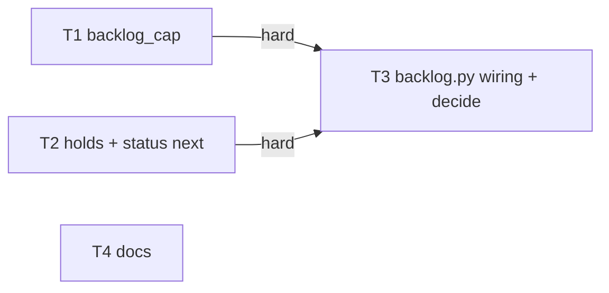

# Superlite: backlog start picks its own lead cap; status names overlap holds; decide --print --batch without a question (B194, #737 #743 #748)

**Goal:** fix #737 (a batch without a worktree or question.json prints `B has no open question`, exit 0), #743 (status shows which of two planned batches that share a file starts first) and #748 (`sl backlog start` without `--cap` takes its cap from the machine's room command, account headroom and overlap, prints one `cap:` line; status ends with it).
**Architecture:** a new pure-plus-readers module `backlog_cap.py` computes the cap and its line; `backlog_state.holds` names each ready planned batch held by file overlap and its holder; `backlog.py` (the start and run route, status, decide) wires both. `backlog_run.py` (owned by other batches) is not touched: backlog.py's route appends `--cap N` before it hands over.
**Tech stack:** Python 3.10+ stdlib; pytest through `sl run_tests`.
**Spec:** this file, section Design; issues #737, #743, #748.
**Detail:** tests
**Target-min:** 11
**Wave0:** none
**Worktree:** none
**Max chars:** 24000

Global constraints:
- Public repository: no host names, user names, home paths, other project or repository names, ticket keys or account names in code, tests, docs or commit messages (tests name accounts `a1`, `a2`). Write "a Swift project", "a second Mac", "the machine".
- Never change the machine's gate config or ~/.superlite/machine.json; tests and proofs use private temp homes (`SUPERLITE_HOME`) and state dirs; tests never run the real `claude-profile`, `herdr` or a real room command (fake scripts, monkeypatch).
- No real app builds as proof; this repository's own test suite is the check.
- Builds: the verdict is `sl run_tests` (the project's test command; a project with `.maxapp` runs `maxapp test`, which a build pool may place on another Mac, and a full run whose tree a green maxapp test stamp covers returns that result without a run); task trees build in <tree>/.build/DerivedData and any build of your own goes under .build/ of the worktree, never -derivedDataPath outside the worktree (your session scratchpad included; backlog cleanup removes scratchpad build folders when the worktree goes); a product, simulator or device build stays on this machine and runs only when an issue's acceptance asks for a running-app check.
- Simulators: append the UDID of each simulator you or a worker creates (`xcrun simctl create` or `clone`; a checker's `Simulators:` line marks its created ones) as one line to /Users/max/github/superlite/.claude/worktrees/superlite-b194-backlog-auto-cap-and-status/.superlite/simulators.txt; never list one you did not create.
- Friction with superlite itself goes to `sl feedback add`, not into this batch.
- Priority of this round: scheduling and admission of test runs, parallel agents and the fleet, wall-clock and token efficiency. Measure before and after where the issue names a waste (seconds, runs, tokens) and put the figures into your report.
- Online research is allowed when something is unclear (official docs first, then how others solved it); name the source in your report.
- Code style of the scripts: every code line ends with a `# O(...)` complexity comment, as in the neighbouring code.
- A hook blocks Bash text that names the backlog decide subcommand (also in a heredoc): write such test code with the Write tool.
- Do not edit `backlog_run.py`, `fleet.py`, `fleet_io.py`, `backlog_brief.py`, `backlog_checks.py`, `docs/tools.md` or `skills/subagent-driven-development/backlog-main.md` (other batches own them).

Ruling: the cap is computed in backlog.py's start route (`_start`) and appended as `--cap N` (because `cmd_start` lives in backlog_run.py, owned by running B190 and planned B196; the route is the start path's entry point in our files).
Ruling: `sl backlog run` without `--cap` gets the same cap once at its start through backlog.py's route (because main's default loop is `run`; a fixed 2 there would stall after a wider `start`); recomputing per start round is a follow-up for backlog_run.py.
Ruling: the machine.json keys are `room` (argv list), `lead_units` (default 2), `leads_per_repo` (default 6), `leads_per_machine` (default 12) and `lead_weekly_max` (percent, default none); all in machine.json because each is a property of the machine (cost if wrong: a key moves later, docs only).
Ruling: default `lead_units` 2, measured on the machine (18 cores, 64 GB): 9 live leads with 24 to 26 agents used 0.2 to 1.0 cores of agent-tree CPU (mean 0.5) and 16 to 17 GB resident, while the load average was 5.5, so about 0.6 cores and 1.8 GB per lead with its workers; 2 per lead leaves room for a lead's fast test runs (full suites queue on the full-suite lock).
Ruling: the per-machine bound counts live herdr agents named `sl-*-lead` (fleet_lead names leads with ident `lead`); herdr unreachable drops that bound from the minimum.
Ruling: accounts gate is binary (no usable account: cap = running leads); usable mirrors `fleet.choose_account` (fleet.json `accounts` of main's run, else every usage account; `current` or a path unknown to usage counts as usable) plus `lead_weekly_max`; no usage data is `accounts unknown`, not a refusal. Making the lead's own account choice skip accounts above `lead_weekly_max` is a follow-up (fleet.py).
Ruling: status prints the `cap:` line last, only while a batch is planned and only outside a fleet worker (only main runs the room command); a planned batch held by a planned one reads `start, or after Bx` (the issue's example), one held by a running one keeps `clash Bx`.
Ruling: `overlap_lines` (plan time) stays unchanged; status is the live view that names the order.
Ruling: accept predicted 26.7 min - T3's integration tests run T1's lead_cap and T2's holds for real, so T1 and T2 come first - a few minutes of wall clock.
Ruling: decide --print --batch for an unknown id prints `BLOCKED: unknown batch B9`, exit 3 (exit code unchanged).

## Design

### 1. decide --print --batch (#737)
`cmd_decide`, the `--print --batch B` branch: unknown id: `BLOCKED: unknown batch B`, exit 3. Worktree None or empty, or `<worktree>/.superlite/question.json` missing (FileNotFoundError, also when the worktree folder is gone): stdout `B has no open question`, exit 0. Every other OSError, invalid JSON or RecursionError keeps `BLOCKED: B question.json unreadable: <e>` (exit 3); an invalid question keeps `BLOCKED: B question.json invalid: ...`.

### 2. Overlap holds in status (#743)
`backlog_state.holds(data) -> dict`: walk planned batches in `_id_key` order with `chosen = []`; skip one with an unshipped depends or open decisions (`_unanswered`); `c = _clash(b, active + chosen)` (active first): a clash maps `b["id"] -> c["id"]`, else `chosen.append(b)`. Cap ignored; the order is `startable`'s, so the batch with next `start` is the one `startable` picks. `status_lines` planned branch: `waits D`, else `decide`, else holder active `clash H`, holder planned `start, or after H`, else `start`. `startable` is unchanged.

### 3. The lead cap (#748)
`backlog_cap.decide(active, room, room_why, cfg, live, accounts, held) -> (cap, line)` is pure. Limits (each a total lead count, as `--cap`):
- room: `room` dict given: `active + room["room"] // cfg["lead_units"]`, part `room {n} {unit}, {u} per lead` (room 0 with a reason: `room 0 {unit}: {reason}`); else `FIXED_CAP` 2, part `fixed cap 2: {room_why}`.
- repo: `cfg["leads_per_repo"]`, part `{n} per repository`.
- machine (only when `live` is not None): `active + max(0, cfg["leads_per_machine"] - live)`, part `{live} of {m} leads on the machine`.
- accounts `("none", reasons)`: `active`, part `no account usable: ` + first 3 reasons joined by `, ` (+ ` (+N more)`); `("ok", [])`: part `accounts ok`; `("unknown", [])`: part `accounts unknown (no usage data)`; ok and unknown set no limit.
`cap = min(...)`, never below 0. The decider is the first limit equal to cap in the order accounts, room, repo, machine. Line: `cap: {cap} (` + parts joined by `; ` + `)`, parts: the decider's part, then the room part and the accounts part unless one decided, then `{held} held by overlap` when held > 0, then `machine.json {key} invalid, default {v}` per invalid config key.

Readers: `machine_cfg(home)` reads `<home>/machine.json` keys `lead_units`, `leads_per_repo`, `leads_per_machine` (positive int, not bool) and `lead_weekly_max` (number, 0 < x <= 100), else the default plus an invalid note. `read_room(home)` runs the `room` argv (`subprocess.run`, stdin DEVNULL, capture, text, timeout 20 s, check=False) and checks one JSON object: `room` int >= 0 (not bool), `unit` non-empty str, optional `reason` str (control characters to spaces; unit cut to 40, reason to 80). Its why texts (exact): `machine.json names no room command` (file or key missing), `machine.json unreadable` (bad JSON or not an object), `machine.json room is not an argv list`, `room command did not run: {e}`, `room command timed out after 20 s`, `room command exited {rc}`, `room command printed no JSON object`, `room output: room must be an integer >= 0`, `room output: unit must be a text`. `account_state(root, tier, weekly_max, env)` and `live_leads()` as ruled above. `lead_cap(data, root, held=0, tier=None, env=None)` gathers them (home = `history.home()`) and calls `decide`.

Wiring (backlog.py): `_start` and the `run` route: no `--cap`/`--cap=` in the args, no `-h`/`--help`, not `SUPERLITE_FLEET_WORKER`: print the `cap:` line on stdout, then hand over `rest + ["--cap", str(cap)]`; `held = len(bs.holds(data))`; tier = `--model M`, else `run_config.resolve(<--config or None>, root)["lead"]["model"]`, else None (any exception: None). `--cap N` passes through with no line. `cmd_status` appends the line last while a batch is planned, outside a fleet worker.

## Coverage

| Category | State | Basis |
|---|---|---|
| Scope and success criteria | settled | issues #737, #743, #748 Expected sections |
| Domain and data model | ruled | machine.json keys and defaults (Rulings above) |
| Persistence and migration | n/a | no stored state added; machine.json read only |
| Interfaces and contracts | ruled | `--cap N` semantics kept (total leads); backlog_run.py untouched, route appends `--cap` |
| UI states | n/a | CLI text only |
| Concurrency and state ownership | settled | read-only reads of backlog.json, machine.json, herdr agent list |
| Error handling and recovery | ruled | every room failure falls back to fixed cap 2 with its why text (Design 3) |
| Security and privacy | ruled | room command is the owner's own machine.json argv, run without a shell; output sanitised and cut |
| Performance and limits | ruled | room timeout 20 s; claude-profile and herdr calls measured at 0.03 s and under 0.01 s |
| Observability | settled | one `cap:` line in start, run and status |
| Testing strategy | ruled | pure `decide` table tests; readers with fake scripts in a temp SUPERLITE_HOME; wiring with monkeypatched `backlog_run.main` |
| Compatibility | ruled | no room command: cap stays 2 (bounded by accounts and the machine bound) |
| Rollout | n/a | ships with the version bump |
| Research unknowns | n/a | measured load already (Ruling) |

```mermaid
%% schedule
gantt
  title Predicted schedule (mm:ss)
  dateFormat X
  axisFormat %M:%S
  section lane 1
  T1 backlog_cap module :t1, 0, 429s
  T3 backlog.py wiring and decide :t3, 429, 422s
  section lane 2
  T2 overlap holds in status :t2, 0, 363s
  section lane 3
  T4 cap docs :t4, 0, 359s
```

critical path: T1 → T3 (14.2 min) · peak width 3 · predicted build 14.2 min · predicted total ≈ 26.7 min (target ✗ 11.0)

## File structure
- `skills/subagent-driven-development/scripts/backlog_cap.py` (new): cap rule, machine.json readers, accounts gate, live lead count.
- `skills/subagent-driven-development/scripts/backlog_state.py`: `holds`, status next step.
- `skills/subagent-driven-development/scripts/backlog.py`: start and run route, status line, decide branch.
- `docs/config.md`, `commands/backlog.md`, `docs/fleet.md`: the cap and its keys.

## Backlog scripts
App type: CLI (protocol, state, file). **Probe entry:** none (the backlog commands start leads and run outside commands; named tests cover them)

### T1 backlog_cap module · Complexity 4 · Est. context 45k
**Owns:** skills/subagent-driven-development/scripts/backlog_cap.py, tests/scripts/test_backlog_cap_748.py
**Components:** 2
**LOC owned:** 240
**Tests:** fast
**Model:** sonnet
**Covers:** 3
**Produces:** backlog_cap.decide(active: int, room: dict | None, room_why: str, cfg: dict, live: int | None, accounts: tuple, held: int) -> tuple[int, str]
e.g. decide(0, {"room": 12, "unit": "cores"}, "", DEFAULTS, 3, ("ok", []), 1) -> (6, "cap: 6 (room 12 cores, 2 per lead; accounts ok; 1 held by overlap)")
e.g. decide(0, None, "machine.json names no room command", DEFAULTS, None, ("ok", []), 0) -> (2, "cap: 2 (fixed cap 2: machine.json names no room command; accounts ok)")
e.g. decide(1, {"room": 40, "unit": "cores"}, "", DEFAULTS, 11, ("ok", []), 0) -> (2, "cap: 2 (11 of 12 leads on the machine; room 40 cores, 2 per lead; accounts ok)")
**Produces:** backlog_cap.lead_cap(data: dict, root: Path, held: int = 0, tier: str | None = None, env: dict | None = None) -> tuple[int, str]
e.g. lead_cap({"batches": []}, root) with no machine.json, usage of one usable account, live_leads() None -> (2, "cap: 2 (fixed cap 2: machine.json names no room command; accounts ok)")
e.g. lead_cap(data with 1 running batch, root, held=1) with room script printing {"room": 12, "unit": "cores"} -> (7, "cap: 7 (room 12 cores, 2 per lead; accounts ok; 1 held by overlap)") when leads_per_repo is 8 in machine.json
**Produces:** backlog_cap.DEFAULTS: dict = {"lead_units": 2, "leads_per_repo": 6, "leads_per_machine": 12, "lead_weekly_max": None}
**Review Focus:** `test_repo_bound_decides`: decide(0, {"room": 30, "unit": "cores"}, "", DEFAULTS, 0, ("ok", []), 0) -> (6, "cap: 6 (6 per repository; room 30 cores, 2 per lead; accounts ok)"); `test_no_account_usable`: decide(1, {"room": 12, "unit": "cores"}, "", {**DEFAULTS, "lead_weekly_max": 90}, 2, ("none", ["a1: weekly_all 95% >= lead_weekly_max 90%"]), 0) -> (1, "cap: 1 (no account usable: a1: weekly_all 95% >= lead_weekly_max 90%; room 12 cores, 2 per lead)"); `test_room_zero_reason`: decide(2, {"room": 0, "unit": "cores", "reason": "two full suites run"}, "", DEFAULTS, 4, ("ok", []), 0) -> (2, "cap: 2 (room 0 cores: two full suites run; accounts ok)"); `test_accounts_unknown`: part `accounts unknown (no usage data)`; `test_reasons_capped_at_three`: 5 reasons show 3 then ` (+2 more)`; `test_invalid_cfg_note`: machine.json `{"lead_units": 0}` -> default 2 and part `machine.json lead_units invalid, default 2`; `test_lead_units_true_invalid`: `true` is invalid; one test per read_room why text (missing file, bad JSON, `"room": "x"`, missing binary, exit 3, timeout with `timeout=` monkeypatched small via a sleeping script, non-object stdout `[1]`, `{"room": -1, "unit": "c"}`, `{"room": true, "unit": "c"}`, `{"room": 1}`); `test_room_reason_sanitised`: a reason with `\n` and 200 characters comes back one line of 80; `test_account_state_weekly_max`: fake claude-profile (env `SUPERLITE_CLAUDE_PROFILE_BIN`) with a1 weekly_all 95 and a2 weekly_all 40, weekly_max 90 -> ("ok", []), with a2 at 91 -> ("none", 2 reasons); `test_account_state_no_usage`: profile exits 1 -> ("unknown", []); `test_live_leads_counts_lead_names`: agents `sl-x-b1-lead`, `sl-x-b1-w1`, `other` -> 1; HerdrError -> None.
**Test code:** named tests above, in pytest; fake scripts are `#!/usr/bin/env python3` files in tmp_path made executable; set `SUPERLITE_HOME` to tmp_path with monkeypatch.
**Steps:** 1 failing tests, 2 run: FAIL, 3 implement per Design 3, 4 run: PASS
**Notes:** Use `accounts.read_usage(env)`, `read_listing(env)`, `aliases`, `entry_name`, `is_path`, `_skip`, `_pct`, `reasons` and `fleet_state.load(root / ".superlite")` (its `accounts` key); `herdr_client.agents()` and `herdr_client.HerdrError`. Lead names match `re.fullmatch(r"sl-.*-lead", name)`. Module docstring names #748 and the rule in three lines.

### T2 overlap holds in status · Complexity 2 · Est. context 35k
**Owns:** skills/subagent-driven-development/scripts/backlog_state.py, tests/scripts/test_backlog_status_overlap_743.py
**Components:** 1
**LOC owned:** 90
**Tests:** fast
**Model:** sonnet
**Covers:** 2
**Produces:** backlog_state.holds(data: dict) -> dict
e.g. holds(data(b("B61", ["docs.md"]), b("B62", ["docs.md"]))) -> {"B62": "B61"}
e.g. holds(data(b("B61", ["docs.md"], "running"), b("B62", ["docs.md"]))) -> {"B62": "B61"}
e.g. holds(data(b("B61", ["a.py"]), b("B62", ["b.py"]))) -> {}
**Review Focus:** `test_two_planned_share_a_file`: rows read `B61 | ... | start` and `B62 | ... | start, or after B61`; `test_running_holder_keeps_clash`: B61 running -> B62 `clash B61`; `test_waiting_batch_holds_nothing`: B61 depends on unshipped B60 -> B61 `waits B60`, B62 `start`; `test_open_decision_holds_nothing`: B61 with an open question -> B62 `start`; `test_append_only_no_hold`: both list docs.md in `append_only` -> both `start`; `test_status_matches_startable`: for three planned batches B1 {a}, B2 {a}, B3 {b}, `startable(d, cap=9)` == the ids whose next is `start`; `test_first_holder_named`: B3 shares with B1 and B2 (B2 held) -> B3 names B1.
**Test code:** named tests above, in pytest, with `backlog_fixtures.batch` and an in-memory `data(...)` helper as in tests/scripts/test_backlog_state.py.
**Steps:** 1 failing tests, 2 run: FAIL, 3 implement per Design 2, 4 run: PASS
**Notes:** Run the existing status and startable tests too (test_backlog_state.py, test_backlog_status_rounds_406.py, test_backlog_append_only_602.py) and keep them green without editing them.

### T3 backlog.py wiring and decide · Complexity 3 · Est. context 50k
**Owns:** skills/subagent-driven-development/scripts/backlog.py, tests/scripts/test_backlog_start_cap_748.py, tests/scripts/test_backlog_decide_batch_737.py
**Components:** 2
**LOC owned:** 200
**Tests:** fast
**Model:** sonnet
**Covers:** 1, 3
**Consumes:** backlog_cap.lead_cap(data: dict, root: Path, held: int = 0, tier: str | None = None, env: dict | None = None) -> tuple[int, str] (T1) · backlog_state.holds(data: dict) -> dict (T2)
**Review Focus:** `test_decide_no_worktree`: batch worktree None -> stdout `B1 has no open question`, exit 0; `test_decide_missing_question_file`: worktree with `.superlite/` but no question.json -> same; `test_decide_worktree_gone`: worktree path that does not exist -> same; `test_decide_unknown_batch`: `--batch B9` -> `BLOCKED: unknown batch B9`, exit 3; `test_decide_bad_json_still_blocked`: `{` -> `BLOCKED: B1 question.json unreadable: ...`, exit 3; `test_start_appends_cap`: no --cap -> `backlog_run.main` gets `["start", ..., "--cap", "5"]` and stdout starts with the fake's `cap:` line; `test_start_explicit_cap_no_line`: `--cap 3` and `--cap=3` pass through, lead_cap not called; `test_start_help_no_cap`; `test_start_in_fleet_worker_no_cap`: SUPERLITE_FLEET_WORKER set -> lead_cap not called; `test_run_appends_cap`: `run --timeout 9` -> `["run", "--timeout", "9", "--cap", "5"]`; `test_tier_from_model_flag`: `--model sonnet` -> tier `sonnet`; `test_held_passed`: two planned batches sharing a file -> lead_cap gets held=1; `test_status_ends_with_cap_line`: a planned batch -> last status line is the fake `cap:` line; `test_status_no_planned_no_cap`: only shipped batches -> no `cap:` line, `next: sl backlog plan` last; `test_status_fleet_worker_no_cap`; `test_start_real_cap_integration`: real backlog_cap with SUPERLITE_HOME machine.json room script printing {"room": 6, "unit": "cores"}, fake claude-profile, `backlog_cap.live_leads` monkeypatched to 0 -> `--cap 3` handed over and line `cap: 3 (room 6 cores, 2 per lead; accounts ok)`.
**Test code:** named tests above, in pytest; the `bk` fixture of tests/scripts/test_backlog_cli.py for state; monkeypatch `backlog_run.main` to record argv and return 0, and `backlog_cap.lead_cap` with a fake returning (5, "cap: 5 (room 10 cores, 2 per lead; accounts ok)").
**Steps:** 1 failing tests, 2 run: FAIL, 3 implement per Design 1 and the Wiring paragraph of Design 3, 4 run: PASS
**Notes:** One helper `_with_cap(cmd: str, rest: list, root: Path) -> list` serves `_start` and the `run` route. The start subcommand help line gains `; without --cap: the cap: line's limit (machine room, accounts, overlap)`. Run tests/scripts/test_backlog_cli.py, test_backlog_decide_fit.py, test_backlog_steps_answer_674.py and test_backlog_status_machine_627.py too and keep them green.

## Docs

### T4 cap docs · Complexity 2 · Est. context 30k
**Owns:** docs/config.md, commands/backlog.md, docs/fleet.md, tests/scripts/test_docs_lead_cap_748.py
**Components:** 1
**LOC owned:** 60
**Tests:** fast
**Model:** sonnet
**Covers:** 3
**Review Focus:** `test_config_names_cap_keys`: docs/config.md has a `## Lead cap` section naming `room`, `lead_units`, `leads_per_repo`, `leads_per_machine`, `lead_weekly_max`, `fixed cap 2` and `cap:`; `test_backlog_command_no_fixed_cap`: commands/backlog.md has no `capped at 2` and names `cap:` and `--cap N`; `test_fleet_points_to_config`: docs/fleet.md's Machine gate line names `docs/config.md` and `room`.
**Test code:** named tests above, in pytest, reading the files from the repository root.
**Steps:** 1 failing tests, 2 run: FAIL, 3 write the docs from Design 3 and the Rulings, 4 run: PASS
**Notes:** docs/config.md `## Lead cap` (after Run config): the room command's JSON (`room`, `unit`, optional `reason`), each key with its default, the limit rule, the line format with the Design 3 examples, the fallback, the measured default (from the Ruling), that only main runs it and that `run` computes it once at its start. commands/backlog.md: step 4's `capped at 2` becomes the cap line's limit with `--cap N` overriding; step 1 gains one sentence: while a batch is planned, status ends with the `cap:` line, and a planned batch held by another reads `start, or after B`. docs/fleet.md: one sentence at the end of the Machine gate line pointing to docs/config.md Lead cap for the `room`, `lead_units` and lead bound keys. Keep every other sentence unchanged; run tests/scripts/test_docs_run_config_681.py and test_docs_build_lead_699.py too.

## Review Focus
CLI package: protocol (args `--cap`, `--cap=`, `--help`, run route), state (holds order equals startable), file (machine.json, question.json missing or broken). Cases are in each task.

## Self-review
Coverage: #737 T3, #743 T2, #748 T1 T3 T4. Placeholders: none. Consumes match Produces (lead_cap, holds). No two parallel tasks share a file: T1, T2, T4 parallel; T3 after T1 and T2.
