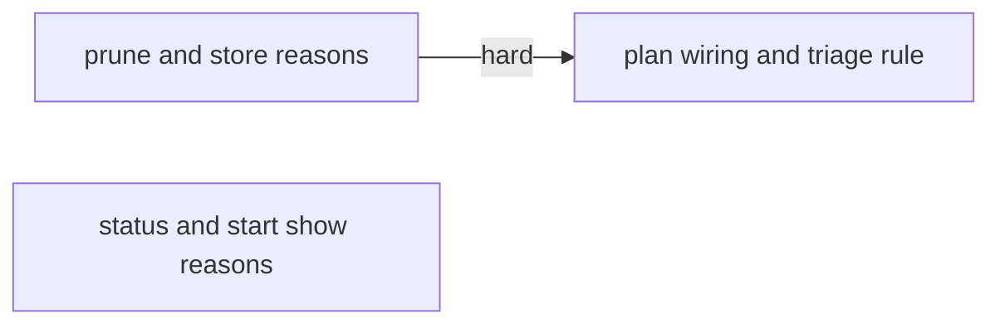

# Superlite: batch dependencies carry a reason and are checked against shared files (B196, #742)

**Goal:** fix #742. `sl backlog plan` keeps a `depends` entry only where the two batches share a file (`backlog_checks.serial_files`) or the triage gave a `why` (the issue text names the order); every kept entry carries a one-line reason, stored with the batch and shown in `backlog status` and in the `waits for` refusal of `backlog start`. A dependency with neither is dropped and named in a `depends:` plan line.
**Architecture:** the proposal's `depends` takes batch ids or `{"id", "why"}` objects; `check_proposal` stores ids in `depends` (unchanged shape for every reader) and reasons in a new batch key `depends_why` ({id: reason}, only when non-empty). A new pure `backlog_checks.prune_depends` repairs the list between `check_proposal` and `separate` in `backlog.cmd_plan`; `separate` carries reasons through merges. `backlog_state.waits_for` names the first unshipped dependency and its reason for `status_lines` and `backlog_run._pick`.
**Tech stack:** Python 3.10+ stdlib, pytest (through `sl run_tests`).
**Spec:** this file, section Design; issue #742.
**Detail:** tests
**Target-min:** 11
**Wave0:** none
**Worktree:** none
**Coverage:** off

Global constraints:
- Every script line keeps the repo's `# O(...)` complexity comment; stdlib only; LF endings.
- Tests use `tmp_path` and the existing fixtures (`backlog_fixtures.batch`, `test_backlog_cli.bk`, `test_backlog_run.bk`); never the machine's `~/.superlite`, a real fleet or real `gh`.
- Standing rules for every lead and its workers (the owner's decisions, passed on by main): this repository is public: no host names, user names, home paths, other project or repository names, ticket keys or account names in code, tests, docs, commit messages, PR texts or issue comments (write "a Swift project", "a second Mac", "the machine"). Never change the machine's gate config or ~/.superlite/machine.json; tests and proofs use private temp homes and state dirs. No real app builds as proof; this repository's own test suite is the check. Priority of this round: scheduling and admission of test runs, parallel agents and the fleet, wall-clock and token efficiency; measure before and after where the issue names a waste. Friction with superlite itself goes to `sl feedback add`, not into this batch. Online research is allowed when something is unclear (official docs first, then how others solved it); name the source.
- Builds: the verdict is `sl run_tests` (the project's test command; a project with `.maxapp` runs `maxapp test`, which a build pool may place on another Mac, and a full run whose tree a green maxapp test stamp covers returns that result without a run); task trees build in <tree>/.build/DerivedData and any build of your own goes under .build/ of the worktree, never -derivedDataPath outside the worktree (your session scratchpad included; backlog cleanup removes scratchpad build folders when the worktree goes); a product, simulator or device build stays on this machine and runs only when an issue's acceptance asks for a running-app check.
- Simulators: append the UDID of each simulator you or a worker creates (`xcrun simctl create` or `clone`; a checker's `Simulators:` line marks its created ones) as one line to `/Users/max/github/superlite/.claude/worktrees/superlite-b196-backlog-depends-reasons/.superlite/simulators.txt`; never list one you did not create; ship cleanup shuts down and deletes each listed one.

## Design

- Proposal `depends` entries: a batch id string, or `{"id": "<batch id>", "why": "<text>"}` (`why` optional). Anything else (a non-list, a number, an object without a string `id`, a non-string `why`) is `<B>: depends must be a list of batch ids or {"id", "why"} objects`. A `why` loses control characters and blank runs and is cut to `DEPENDS_WHY_MAX` (80) at a whole word (`_word`); a blank one counts as none. The first non-blank `why` per id wins. Unknown id and self checks and the cycle check are unchanged.
- Stored batch: `"depends": [ids]` as today, plus `"depends_why": {id: reason}` right after it, only when non-empty.
- `prune_depends(batches, backlog=())` (deep copies, input untouched): a local id wins over a backlog id. Pass 1, per batch in list order, per dependency in its order: a `why` keeps it; else files the two share (`serial_files`, so append-only-in-both is no share) keep it with the reason `shares <first file>` or `shares <first file> (+N more)`; else it is dropped with the line `depends: <B> no longer waits for <D>: no shared file and no reason`. Pass 2: per batch in id order, per batch it reached through the original local dependencies (`_reach`) but no longer reaches, in id order, that shares a file with it: a direct dependency is added with the `shares ...` reason and the line `depends: <B> waits for <D>: <reason> (the order the dropped dependencies held)`; reach is recomputed after each add. Afterwards every batch's `depends_why` keys equal its `depends`.
- `separate`: a merged batch keeps the reason of each dependency it keeps (its own first, else the merged one's); a batch that depended on the merged-away id gets the reason under the kept id unless it already had one there; keys outside `depends` are dropped; an empty map drops the key.
- `cmd_plan`: right before `bc.separate(batches)`: `batches, dlines = bc.prune_depends(batches, [b for b in d["batches"] if b["id"] in known_b])`. After `apply` renumbers, the two ids in each `depends:` line are renamed to the stored ids (backlog ids stay), and the lines join `notes`. `_renumber` renames `depends_why` keys too.
- Triage brief Rules: the clause `depends names batches that must ship first` becomes the sentence in T3. The JSON shape keeps `"depends": []`.
- `backlog_state.waits_for(data, b) -> str`: `""` when every dependency shipped; else the first unshipped id, plus `": <reason>"` when `depends_why` (a dict) holds a non-blank one for it (control characters to blanks, blank runs collapsed). `status_lines`: the `next` cell stays `waits <id>`; after the table rows (after the `reason Bn:` lines, before the step lines) one `<B> waits for <waits_for>` line per listed planned batch whose `waits_for` carries a reason. `_pick` refuses with `<B> waits for <waits_for(...)>` (the run loop's ` waits for ` retry match holds). `skip_issue` drops a removed batch's id from every `depends_why` too.

Ruling: `depends` stays a list of ids and reasons live in `depends_why` (because `backlog_run`, `backlog_state`, `_renumber`, `separate` and every stored backlog.json read ids; a list of objects would break each and old files) (lead's ruling).
Ruling: a triage `why` keeps a dependency without a shared file (because code cannot check that an issue's text names an order; the reason in status makes the claim visible) (lead's ruling).
Ruling: a dependency with neither is repaired (dropped, `depends:` line), never a rejected proposal (because one needless edge should not cost a second triage run) (lead's ruling).
Ruling: an order between two batches that share a file, held only through dropped dependencies, becomes a direct dependency (because otherwise `separate` merges the pair into one batch and the triage's order is lost) (lead's ruling).
Ruling: the status cell keeps `waits Bx` and the reason goes on its own line after the table (because the table stays one scannable line per batch, as the `reason Bn:` lines of parked batches do; the existing row tests stay valid) (lead's ruling).

## Task graph

```mermaid
%% schedule
gantt
  title Predicted schedule (mm:ss)
  dateFormat X
  axisFormat %M:%S
  section lane 1
  T1 Plan keeps only reasoned dependencies :t1, 0, 236s
  T3 Plan prints the repairs and the triag :t3, 236, 220s
  section lane 2
  T2 Status and start show the dependency :t2, 0, 225s
```





critical path: T1 → T3 (7.6 min) · peak width 2 · predicted build 7.6 min · predicted total ≈ 14.1 min (target ✗ 11.0)

## Package: backlog dependencies

App type: CLI library. Categories: state (the stored `depends`/`depends_why` pair), protocol (plan, status and start lines).
**Probe entry:** none (pure functions and CLI lines; named tests cover them)

### T1 Plan keeps only reasoned dependencies · Complexity 4 · Est. context 40k
**Owns:** skills/subagent-driven-development/scripts/backlog_checks.py, tests/scripts/test_backlog_depends_why_742.py
**Components:** 2
**LOC owned:** 170
**Tests:** fast
**Model:** sonnet
**Covers:** Design
**Produces:** backlog_checks.DEPENDS_WHY_MAX: int · backlog_checks.prune_depends(batches: list[dict], backlog: list = ()) -> tuple[list[dict], list[str]]
e.g. prune_depends([B1 files ["a.py"], B2 files ["b.py"] depends ["B1"]]) -> ([B1, B2 with depends []], ["depends: B2 no longer waits for B1: no shared file and no reason"])
e.g. prune_depends([B1 files ["a.py"], B2 files ["a.py"] depends ["B1"]]) -> ([B1, B2 with depends ["B1"], depends_why {"B1": "shares a.py"}], [])
e.g. prune_depends([B1 a.py, B2 b.py depends ["B1"], B3 a.py depends ["B2"]]) -> lines [..."B2 no longer waits for B1...", ..."B3 no longer waits for B2...", "depends: B3 waits for B1: shares a.py (the order the dropped dependencies held)"], B3 depends ["B1"]
**Review Focus:** the tests below; `test_backlog_checks.py`, `test_backlog_checks_583.py`, `test_backlog_append_only_602.py` stay green unchanged.
**Test code (verbatim):**
```python
# tests/scripts/test_backlog_depends_why_742.py
"""A dependency is kept only where the batches share a file or the triage gives a why; every kept one carries its reason (#742)."""
import sys
import pytest
from test_plan_tools import SCRIPTS
sys.path.insert(0, str(SCRIPTS))
import backlog_checks as bc  # noqa: E402

DROP = "depends: {} no longer waits for {}: no shared file and no reason"


def bt(bid, files, depends=()):
    return {"id": bid, "topic": "t", "issues": [int(bid[1:])], "files": list(files), "depends": list(depends), "decisions": []}


def check(*bs, backlog=frozenset()):
    out, errs = bc.check_proposal({"batches": list(bs)}, {int(b["id"][1:]) for b in bs}, backlog)
    assert errs == []
    return out


def test_depends_takes_ids_and_why_objects():
    out = check(bt("B1", ["a.py"]), bt("B2", ["b.py"]), bt("B3", ["c.py"], ["B1", {"id": "B2", "why": "  issue #3\tsays after\n#2 "}, {"id": "B2", "why": "x"}]))
    assert out[2]["depends"] == ["B1", "B2"] and out[2]["depends_why"] == {"B2": "issue #3 says after #2"}
    assert "depends_why" not in out[0]


def test_a_long_why_is_cut_at_a_whole_word():
    out = check(bt("B1", ["a.py"]), bt("B2", ["b.py"], [{"id": "B1", "why": "word " * 30}]))
    assert out[1]["depends_why"]["B1"] == ("word " * 16).strip() and bc.DEPENDS_WHY_MAX == 80


@pytest.mark.parametrize("bad", [[7], [{"why": "x"}], [{"id": "B1", "why": 3}], "B1"])
def test_a_bad_depends_entry_rejects(bad):
    b = bt("B2", ["b.py"])
    b["depends"] = bad
    out, errs = bc.check_proposal({"batches": [bt("B1", ["a.py"]), b]}, {1, 2})
    assert out == [] and any(e.startswith("B2: depends must be a list of batch ids") for e in errs)


def test_an_unknown_id_in_a_why_object_is_still_rejected():
    out, errs = bc.check_proposal({"batches": [bt("B1", ["a.py"], [{"id": "B7", "why": "x"}])]}, {1})
    assert out == [] and "B1: depends on unknown batch B7" in errs


def test_prune_keeps_shared_and_reasoned_and_drops_the_rest():
    out, lines = bc.prune_depends(check(bt("B1", ["a.py", "b.py"]), bt("B2", ["c.py"]), bt("B3", ["d.py"]),
                                        bt("B4", ["b.py", "a.py"], ["B1", {"id": "B2", "why": "issue #4 needs #2 first"}, "B3"])))
    assert out[3]["depends"] == ["B1", "B2"] and out[3]["depends_why"] == {"B1": "shares a.py (+1 more)", "B2": "issue #4 needs #2 first"}
    assert lines == [DROP.format("B4", "B3")]


def test_a_triage_why_wins_over_the_generated_one():
    out, lines = bc.prune_depends(check(bt("B1", ["a.py"]), bt("B2", ["a.py"], [{"id": "B1", "why": "issue #2 says after #1"}])))
    assert out[1]["depends_why"] == {"B1": "issue #2 says after #1"} and lines == []


def test_append_only_in_both_is_no_shared_file():
    out, lines = bc.prune_depends(check({**bt("B1", ["n.md"]), "append_only": ["n.md"]}, {**bt("B2", ["n.md"], ["B1"]), "append_only": ["n.md"]}))
    assert out[1]["depends"] == [] and "depends_why" not in out[1] and lines == [DROP.format("B2", "B1")]


def test_the_issue_round_keeps_only_the_file_orders():
    out, lines = bc.prune_depends(check(bt("B10", ["x.py"]), bt("B11", ["k.py"], ["B10"]), bt("B12", ["x.py"], ["B11"]), bt("B13", ["y.py"], ["B11"]),
                                        bt("B14", ["m.py"], ["B12", "B13"]), bt("B15", ["y.py"], ["B14"])))
    assert {b["id"]: b["depends"] for b in out} == {"B10": [], "B11": [], "B12": ["B10"], "B13": [], "B14": [], "B15": ["B13"]}
    assert out[2]["depends_why"] == {"B10": "shares x.py"} and out[5]["depends_why"] == {"B13": "shares y.py"}
    assert lines == [DROP.format("B11", "B10"), DROP.format("B12", "B11"), DROP.format("B13", "B11"), DROP.format("B14", "B12"),
                     DROP.format("B14", "B13"), DROP.format("B15", "B14"),
                     "depends: B12 waits for B10: shares x.py (the order the dropped dependencies held)",
                     "depends: B15 waits for B13: shares y.py (the order the dropped dependencies held)"]
    assert [b["id"] for b in bc.separate(out)] == ["B10", "B11", "B12", "B13", "B14", "B15"]


def test_a_backlog_batch_dependency_is_checked_against_its_files():
    run = {"id": "B5", "state": "running", "files": ["a.py"], "depends": []}
    out, lines = bc.prune_depends(check(bt("B1", ["a.py"], ["B5"]), bt("B2", ["b.py"], ["B5"]), backlog=frozenset({"B5"})), [run])
    assert out[0]["depends_why"] == {"B5": "shares a.py"} and out[1]["depends"] == [] and lines == [DROP.format("B2", "B5")]


def test_a_local_id_wins_over_a_backlog_id():
    out, lines = bc.prune_depends(check(bt("B1", ["a.py"]), bt("B2", ["b.py"], ["B1"]), backlog=frozenset({"B1"})),
                                  [{"id": "B1", "state": "running", "files": ["b.py"], "depends": []}])
    assert out[1]["depends"] == [] and lines == [DROP.format("B2", "B1")]


def test_prune_leaves_its_input_alone():
    bs_ = check(bt("B1", ["a.py"]), bt("B2", ["b.py"], ["B1"]))
    bc.prune_depends(bs_)
    assert bs_[1]["depends"] == ["B1"]


def test_separate_carries_the_reasons_through_a_merge():
    out, _ = bc.prune_depends(check(bt("B1", ["z.py"]), bt("B2", ["a.py", "z.py"], ["B1"]), bt("B3", ["a.py"]),
                                    bt("B4", ["q.py"], [{"id": "B3", "why": "issue #4 says after #3"}])))
    assert [(b["id"], b["depends"], b.get("depends_why")) for b in bc.separate(out)] == [
        ("B1", [], None), ("B2", ["B1"], {"B1": "shares z.py"}), ("B4", ["B2"], {"B2": "issue #4 says after #3"})]


def test_a_merge_keeps_the_first_reason_for_a_renamed_dependency():
    out, _ = bc.prune_depends(check(bt("B1", ["a.py"]), bt("B2", ["a.py"]),
                                    bt("B3", ["q.py"], [{"id": "B1", "why": "issue #3 after #1"}, {"id": "B2", "why": "issue #3 after #2"}])))
    assert [(b["id"], b["depends"], b.get("depends_why")) for b in bc.separate(out)] == [("B1", [], None), ("B3", ["B1"], {"B1": "issue #3 after #1"})]
```
**Steps:** 1 write the test file, 2 run: FAIL, 3 implement, 4 run: PASS
**Notes:** keep the old error text as the prefix (`depends must be a list of batch ids`); add `"depends_why"` to the output dict only when non-empty, right after `"depends"`. `prune_depends` builds its lines in the two passes' order (all drops first, then the restored ones).

### T2 Status and start show the dependency reason · Complexity 3 · Est. context 36k
**Owns:** skills/subagent-driven-development/scripts/backlog_state.py, skills/subagent-driven-development/scripts/backlog_run.py, tests/scripts/test_backlog_depends_status_742.py
**Components:** 2
**LOC owned:** 90
**Tests:** fast
**Model:** sonnet
**Covers:** Design
**Produces:** backlog_state.waits_for(data: dict, b: dict) -> str
e.g. waits_for(B1 shipped, B2 planned; B3 depends ["B1", "B2"], depends_why {"B2": "shares b.py"}) -> "B2: shares b.py"
e.g. waits_for(same, B3 with depends_why {}) -> "B2"
e.g. waits_for(B2 with no depends) -> ""
**Review Focus:** the tests below; `test_backlog_state.py`, `test_backlog_run_lifecycle.py`, `test_backlog_status_overlap_743.py` stay green unchanged.
**Test code (verbatim):**
```python
# tests/scripts/test_backlog_depends_status_742.py
"""status and start name the reason a planned batch waits for another (#742)."""
import sys
from backlog_fixtures import batch as b
from test_backlog_run import bk, put, run  # noqa: F401
from test_plan_tools import SCRIPTS
sys.path.insert(0, str(SCRIPTS))
import backlog_state as bs  # noqa: E402


def data(*batches):
    return {**bs.default(), "repo": "o/r", "batches": list(batches)}


def test_waits_for_names_the_first_unshipped_dependency_and_its_reason():
    d = data(b("B1", ["a.py"], "shipped"), b("B2", ["b.py"]),
             b("B3", ["a.py", "b.py"], depends=["B1", "B2"], depends_why={"B1": "shares a.py", "B2": "shares b.py"}))
    b3 = d["batches"][2]
    assert bs.waits_for(d, b3) == "B2: shares b.py" and bs.waits_for(d, d["batches"][1]) == ""
    b3["depends_why"] = {}
    assert bs.waits_for(d, b3) == "B2"
    b3["depends_why"] = {"B2": "issue #3\x1b[2J says\nafter #2"}
    assert bs.waits_for(d, b3) == "B2: issue #3 [2J says after #2"
    b3["depends_why"] = "broken"
    assert bs.waits_for(d, b3) == "B2"


def test_status_keeps_the_cell_and_adds_one_reason_line():
    d = data(b("B1", ["a.py"], "running"), b("B2", ["a.py"], depends=["B1"], depends_why={"B1": "shares a.py"}), b("B3", ["c.py"], depends=["B1"]))
    lines = bs.status_lines(d)
    assert "B2 | #2 | planned | - | - | waits B1" in lines and "B3 | #3 | planned | - | - | waits B1" in lines
    assert [x for x in lines if " waits for " in x] == ["B2 waits for B1: shares a.py"]
    assert lines.index("B2 waits for B1: shares a.py") > lines.index("B3 | #3 | planned | - | - | waits B1")


def test_skip_drops_the_reason_with_the_dependency():
    d = data(b("B1", ["a.py"]), b("B2", ["a.py"], depends=["B1"], depends_why={"B1": "shares a.py"}))
    bs.skip_issue(d, 1)
    assert [x["id"] for x in d["batches"]] == ["B2"] and d["batches"][0]["depends"] == [] and "depends_why" not in d["batches"][0]


def test_start_refusal_names_the_reason(bk, capsys):
    put(bk, b("B1", ["a.py"]), b("B2", ["a.py"], depends=["B1"], depends_why={"B1": "shares a.py"}))
    rc, out = run(capsys, "start", "B2")
    assert rc == 2 and "BLOCKED: B2 waits for B1: shares a.py" in out.splitlines()
```
**Steps:** 1 write the test file, 2 run: FAIL, 3 implement, 4 run: PASS
**Notes:** `_pick` replaces its inline `next(...)` with `bs.waits_for(data, b)`; the status cell keeps `waits <id>` (no reason in the table). In `skip_issue` pop `depends_why` when it ends empty.

### T3 Plan prints the repairs and the triage rule names the why · Complexity 2 · Est. context 34k
**Owns:** skills/subagent-driven-development/scripts/backlog.py, skills/subagent-driven-development/scripts/backlog_brief.py, tests/scripts/test_backlog_plan_depends_742.py, tests/scripts/test_backlog_plan_add_583.py
**Components:** 2
**LOC owned:** 60
**Tests:** fast
**Model:** sonnet
**Covers:** Design
**Consumes:** backlog_checks.prune_depends(batches: list[dict], backlog: list = ()) -> tuple[list[dict], list[str]] (T1)
**Review Focus:** the tests below; `test_backlog_cli.py`, `test_backlog_plan_round.py`, `test_backlog_steps_brief_674.py` stay green unchanged.
**Test code (verbatim):**
```python
# tests/scripts/test_backlog_plan_depends_742.py
"""backlog plan drops a dependency with no shared file and no why, names it under the stored ids and keeps every reason (#742)."""
import pytest
from test_backlog_cli import bk, cli, load, bs, bl  # noqa: F401
from test_backlog_plan_add_583 import state


@pytest.fixture(autouse=True)
def _env(monkeypatch):
    for k in ("SUPERLITE_FLEET_ROLE", "SUPERLITE_FLEET_PARENT_DIR", "SUPERLITE_FLEET_WORKER", "SUPERLITE_STATE_DIR"):
        monkeypatch.delenv(k, raising=False)
    monkeypatch.setattr(bl, "_tracked", lambda root: [])


def bt(bid, n, files, depends=()):
    return {"id": bid, "topic": "t", "issues": [n], "files": list(files), "depends": list(depends), "decisions": []}


def test_plan_drops_a_dependency_without_shared_file_or_why(bk, capsys):
    bk.batches = [bt("B7", 1, ["a.py"]), bt("B8", 2, ["b.py"], ["B7"])]
    rc, out = cli(capsys, "plan")
    b2 = bs.batch(load(bk), "B2")
    assert rc == 0 and b2["depends"] == [] and "depends_why" not in b2
    assert "depends: B2 no longer waits for B1: no shared file and no reason" in out.splitlines()


@pytest.mark.parametrize("dep,why", [("B7", "shares a.py"), ({"id": "B7", "why": "issue #2 says after #1"}, "issue #2 says after #1")])
def test_plan_stores_the_reason_under_the_new_ids(bk, capsys, dep, why):
    bk.batches = [bt("B7", 1, ["a.py"]), bt("B8", 2, ["a.py", "c.py"], [dep])]
    rc, out = cli(capsys, "plan")
    b2 = bs.batch(load(bk), "B2")
    assert rc == 0 and b2["depends"] == ["B1"] and b2["depends_why"] == {"B1": why} and "no longer waits" not in out


def test_plan_add_checks_a_dependency_on_an_open_batch(bk, capsys):
    state(bk, "running")
    bk.batches = [bt("B174", 2, ["b.py"], ["B1"])]
    rc, out = cli(capsys, "plan", "--issues", "2", "--add")
    assert rc == 0 and bs.batch(load(bk), "B2")["depends"] == []
    assert "depends: B2 no longer waits for B1: no shared file and no reason" in out.splitlines()


def test_triage_rules_name_the_why(bk, capsys):
    assert cli(capsys, "plan")[0] == 0
    text = (bk.sd / "briefs" / "triage.md").read_text(encoding="utf-8")
    assert ('depends lists a batch that must ship first, only when the two batches share a file or an issue\'s text names the order, as '
            '{"id": "<batch>", "why": "<the shared file, or the issue words that name the order; one line, at most 80 characters, no batch ids>"}; '
            'plan drops a dependency with neither a shared file nor a why, since every dependency keeps a lead idle until the other batch ships') in text
    assert "depends names batches that must ship first" not in text
```
In `tests/scripts/test_backlog_plan_add_583.py::test_worker_ids_and_open_depends_are_accepted` change B174's `"depends": ["B1"]` to `"depends": [{"id": "B1", "why": "issue #2 says after #1"}]` and add `and b2["depends_why"] == {"B1": "issue #2 says after #1"}` to its first assert on `b2` (its b.py shares no file with the running B1, so the bare id is now dropped).
**Steps:** 1 write the test file and the 583 edit, 2 run: FAIL, 3 implement, 4 run: PASS
**Notes:** the Rules clause `depends names batches that must ship first` in `backlog_brief.triage_brief` is replaced by the sentence the last test pins (text before and after it unchanged). In `cmd_plan`: prune right before `bc.separate`; in `apply` (both the `add` and the plain branch) record `{proposal id: stored id}` from the batches before and after `_renumber` (same order), and rename only the two ids of each `depends: <B> (no longer )?waits for <D>` line (regex on that prefix; a backlog id not in the map stays); those lines go into the printed `notes`. `_renumber` renames `depends_why` keys with the same map.

## Review Focus

- state: `depends_why` keys always equal `depends` after `prune_depends` and after `separate`; old backlog.json batches without the key keep working (status, start, skip).
- protocol: the `depends:` plan lines, the `<B> waits for <D>: <reason>` status line and refusal; the run loop's ` waits for ` retry match (`backlog_run.py`, the line list holding `" waits for "`) still matches.

## Self-review

Coverage: proposal shape and pruning (T1), storage under new ids and plan lines and triage rule (T3), status, start refusal and skip (T2). No placeholders. T3 consumes T1's `prune_depends` exactly as produced; the hard edge holds because T3's plan tests run the real prune. T1, T2 and T3 own disjoint files.
