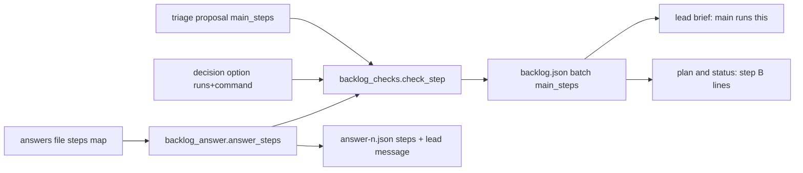
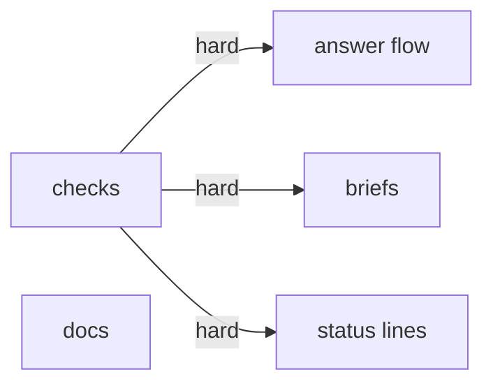

# Superlite: steps a lead cannot run are named at plan and decision time (B166, #674)

**Goal:** fix #674: a step a lead cannot run (installing a tool, changing global git or system config, writing to an outside service) is named before the lead starts, by the triage proposal, a decision option or an answer, with its exact command and who runs it (main or Max); the lead brief lists it as `main runs this: <command>` and the lead records it at the start, not after the build; `sl backlog plan` and `status` list it for main.
**Architecture:** one step record `{"runs": "main"|"user", "command": str, "why"?: str}` (plus `issues` from triage or `question` from an answer), validated by `backlog_checks.check_step` and stored per batch as `main_steps` in backlog.json. Sources: the triage proposal's per-batch `main_steps`, a decision option's `runs`+`command` keys (kept by `clean_question`, stripped for AskUserQuestion by `ask_shape`), an answers file's `steps` map (`backlog_answer.answer_steps`). Readers: `backlog_brief.lead_brief` (steps block plus an always-present rule), `backlog_state.step_lines` (status and plan), `backlog_run.cmd_answer` (answer file and lead message).
**Tech stack:** Python 3.10+ stdlib, pytest (through `sl run_tests`); Markdown docs.
**Spec:** this file, section Design; issue #674.
**Detail:** contracts
**Target-min:** 11
**Wave0:** none
**Worktree:** none
**Max chars:** 26000

Global constraints:
- Every script line keeps the repo's `# O(...)` complexity comment where the file uses them; stdlib only; LF endings.
- Tests use `tmp_path` homes and state dirs and the existing backlog fixtures (`tests/scripts/backlog_fixtures.py`, the `bk` fixture of `tests/scripts/test_backlog_cli.py`); never the real `~/.superlite`.
- `step_line` wording: `main runs this: <command>` for runs main, `Max runs this: <command>` for runs user.
- Standing rules for every lead and its workers (the owner's decisions, passed on by main): this repository is public: no host names, user names, home paths, other project or repository names, ticket keys or account names in code, tests, docs, commit messages, PR texts or issue comments (write "a Swift project", "a second Mac", "the machine"). Never change the machine's gate config or ~/.superlite/machine.json; tests and proofs use private temp homes and state dirs. No real app builds as proof; this repository's own test suite is the check. Priority of this round: scheduling and admission of test runs, parallel agents and the fleet, wall-clock and token efficiency; measure before and after where the issue names a waste and put the figures into your report. Friction with superlite itself goes to `sl feedback add`, not into this batch. Online research is allowed when something is unclear (official docs first); name the source.
- Builds: the verdict is `sl run_tests` (the project's test command; a project with `.maxapp` runs `maxapp test`, which a build pool may place on another Mac, and a full run whose tree a green maxapp test stamp covers returns that result without a run); task trees build in <tree>/.build/DerivedData and any build of your own goes under .build/ of the worktree, never -derivedDataPath outside the worktree (your session scratchpad included; backlog cleanup removes scratchpad build folders when the worktree goes); a product, simulator or device build stays on this machine and runs only when an issue's acceptance asks for a running-app check.
- Simulators: append the UDID of each simulator you or a worker creates (`xcrun simctl create` or `clone`) as one line to `<worktree>/.superlite/simulators.txt`; never list one you did not create; ship cleanup shuts down and deletes each listed one.

## Coverage

| Category | State | Basis |
|---|---|---|
| Scope and success criteria | settled | #674 Wanted 1-4; success: a triage, option or answer step reaches backlog.json, the lead brief (`main runs this:`), plan and status lines and the answer message; tests pin brief text and the triage flag |
| Domain and data model | ruled | step record in Design 1; per batch `main_steps` list, stored only when non-empty |
| Persistence and migration | ruled | new optional key; a batch without it reads as none; no migration |
| Interfaces and contracts | ruled | proposal key `main_steps`; option keys `runs`, `command`; answers file key `steps`; answer-n.json key `steps`; every old file shape still valid |
| UI states | n/a | CLI text only |
| Concurrency and state ownership | ruled | written inside the existing `bs.update` transactions of plan, decide and answer |
| Error handling and recovery | ruled | a bad step refuses the proposal (plan) or the answers file (exit 2, `BLOCKED:` line); nothing half-written |
| Security and privacy | ruled | steps come from issue text: one line, at most 300 characters, no control characters; main checks a step before running it (backlog.md rule); a lead never runs one |
| Performance and limits | ruled | at most 8 steps per batch; `why` at most 200 characters, cut to 80 in status |
| Observability | ruled | `step B: ...` lines in plan and status, `step: ...` lines on decide --print stderr, a count on the decide line |
| Testing strategy | ruled | unit tests per task over dicts and the existing CLI fixtures |
| Compatibility | ruled | AskUserQuestion never sees `runs`/`command` (ask_shape strips them); old answers files and proposals unchanged |
| Rollout | ruled | ships with the next version; rollback reverts the PR |
| Research unknowns | n/a | none: every hook point mapped by researchers R1 and R2 |

## Design

### 1. Step record (#674 Wanted 1, 2)
`{"runs": "main"|"user", "command": "<exact command, 1-300 chars, one line>", "why": "<0-200 chars, optional>"}`; a triage entry adds `"issues": [<n>]` (a non-empty subset of the batch's issues); a recorded answer step adds `"question": "<question text>"`. Unknown keys are dropped. `runs: user` is for a step only the user can do (an interactive sign-in).

### 2. Sources (#674 Wanted 1, 2)
Triage: the brief's `TRIAGE_RUN` rule asks for `main_steps` per batch (install a tool, global git or system config, an outside-service write, deploy or remote host) and for `runs`+`command` on a decision option whose choice needs such a step; the JSON template gains `"main_steps": []`. Decide and answer: an answers file may carry `"steps": {question: step}`; an answer whose label picks an option with `runs` records that option's step; the explicit map wins.

### 3. Readers (#674 Wanted 1, 3)
Lead brief: one rule sentence always (never run such a step; at the start write `Left undone: main runs this: <command>` per step not seen done), plus a list of the batch's steps. Status and plan: `step B: main runs this: <command> (#12: why)` per step of every batch not shipped. `answer`: `steps` in answer-n.json and a message sentence.

Ruling: `runs` names main or the user, never the lead (because the lead is the one the classifier refuses).
Ruling: status lists steps only for batches not yet shipped (because a shipped batch's unrun step is already a `Left undone:` line on its shipped line).
Ruling: no deterministic text scan of issue bodies (because issue #674's own body names `git lfs install` as evidence; a scan would flag it; the triage worker judges and the lead brief rule covers the fast path).
Ruling: edges T1 -> T2, T3, T4 are hard (because their tests call `check_step` and `step_line` in the real module and the plan has no Wave 0 stubs).

## Main diagram

## File structure

- `skills/subagent-driven-development/scripts/backlog_checks.py`: step validation, option keys, proposal key, ask shape, step line.
- `skills/subagent-driven-development/scripts/backlog_answer.py`: answer steps, adding steps to a batch, the message text.
- `skills/subagent-driven-development/scripts/backlog.py`: decide print/file, plan --add lines.
- `skills/subagent-driven-development/scripts/backlog_run.py`: answer command.
- `skills/subagent-driven-development/scripts/backlog_brief.py`: lead and triage brief text.
- `skills/subagent-driven-development/scripts/backlog_state.py`: status step lines.
- `skills/subagent-driven-development/backlog.md`, `docs/tools.md`: docs.

## Task graph

```mermaid
%% schedule
gantt
  title Predicted schedule (mm:ss)
  dateFormat X
  axisFormat %M:%S
  section lane 1
  T1 step checks :t1, 0, 198s
  T2 answer flow :t2, 198, 246s
  section lane 2
  T5 docs :t5, 0, 178s
  T3 lead and triage briefs :t3, 198, 185s
  section lane 3
  T4 status step lines :t4, 198, 182s
```

critical path: T1 → T2 (7.4 min) · peak width 3 · predicted build 7.4 min · predicted total ≈ 13.9 min (target ✗ 11.0)

## Package: backlog steps

App type: CLI and file state. Categories: protocol (proposal and answers file shapes), encoding (control characters, newlines, length in a command), state (dedupe, shipped batches).
**Probe entry:** none (dict-shaped inputs; named tests cover them)

### T1 step checks · Complexity 4 · Est. context 40k
**Owns:** skills/subagent-driven-development/scripts/backlog_checks.py, tests/scripts/test_backlog_steps_checks_674.py
**Components:** 1
**LOC owned:** 170
**Tests:** fast
**Model:** sonnet
**Covers:** 1, 2
**Produces:** backlog_checks.check_step(obj: object, where: str, issues: list | None = None) -> tuple
e.g. check_step({"runs": "main", "command": "git lfs install", "why": "LFS hooks"}, "B1 main_steps 1") -> ({"runs": "main", "command": "git lfs install", "why": "LFS hooks"}, [])
e.g. check_step({"runs": "lead", "command": ""}, "x") -> (None, ["x runs: main or user", "x command: 1 to 300 characters, one line"])
e.g. check_step({"issues": [12], "runs": "user", "command": "gh auth login", "sudo": True}, "B1 main_steps 1", [12, 13]) -> ({"issues": [12], "runs": "user", "command": "gh auth login"}, [])
**Produces:** backlog_checks.step_line(step: dict) -> str
e.g. step_line({"runs": "main", "command": "git lfs install"}) -> "main runs this: git lfs install"
e.g. step_line({"runs": "user", "command": "gh auth login"}) -> "Max runs this: gh auth login"
**Produces:** backlog_checks.ask_shape(q: dict) -> tuple
e.g. ask_shape({"questions": [{"question": "Store assets?", "header": "Assets", "options": [{"label": "Git LFS (Recommended)", "description": "main installs git-lfs", "runs": "main", "command": "git lfs install"}, {"label": "Plain git", "description": "no tool"}]}]}) -> ({"questions": [{"question": "Store assets?", "header": "Assets", "options": [{"label": "Git LFS (Recommended)", "description": "main installs git-lfs"}, {"label": "Plain git", "description": "no tool"}]}]}, ['step: "Store assets?" / "Git LFS (Recommended)": main runs this: git lfs install'])
e.g. ask_shape({"questions": [{"question": "Q", "header": "H", "multiSelect": False, "options": [{"label": "A"}, {"label": "B"}]}]}) -> ({"questions": [{"question": "Q", "header": "H", "multiSelect": False, "options": [{"label": "A"}, {"label": "B"}]}]}, [])
**Review Focus:** `test_check_step_ok`, `test_check_step_errors`, `test_check_step_drops_unknown`: the three check_step examples; `test_check_step_issues_subset`: {"issues": [99], "runs": "main", "command": "c"} with issues [12] gives (None, ["w issues: a non-empty list of this batch's issues"]) for where "w", and [] issues the same error; `test_command_one_line`: command "a\nb" and a 301-character command give the command error, a 300-character one passes; `test_why_limits`: why of 201 characters or holding "\x07" gives "w why: 0 to 200 characters, one line"; `test_not_an_object`: check_step("x", "w") gives (None, ["w: not an object"]); `test_option_runs_needs_command`: check_question with option 1 {"label": "A", "runs": "main"} gives an error list holding "q1 option 1 command: 1 to 300 characters, one line"; `test_clean_question_keeps_option_step`: clean_question keeps an option's runs and command and still drops other unknown keys; `test_proposal_main_steps_stored`: check_proposal with batch B1 issues [12], main_steps [{"issues": [12], "runs": "main", "command": "git lfs install", "why": "LFS"}] stores exactly that list; a batch with [] or no main_steps has no main_steps key; `test_proposal_main_steps_errors`: main_steps "x" gives "B1: main_steps must be a list", 9 valid entries give "B1: main_steps: at most 8 entries", entry 1 with runs "lead" gives "B1 main_steps 1 runs: main or user"; `test_step_line` and `test_ask_shape`: the examples; ask_shape leaves its input unchanged.
**Steps:** 1 failing tests, 2 run: FAIL, 3 implement, 4 run: PASS
**Notes:** Error order inside check_step: not-an-object (returns at once), issues (only when the `issues` argument is not None), runs, command, why. command: str, 1-300 characters, no character below 32 and no 127 (so no newline or tab). why: optional str, 0-200 characters, same character rule. Clean result key order: issues (when checked), runs, command, why (when present). RUNS = {"main": "main", "user": "Max"} is the module constant step_line reads. In check_question an option with "runs" or "command" is checked with check_step on {k: o[k] for k in ("runs", "command") if k in o} and where f"{p} option {n}" (n from 1), errors appended to errs; clean_question copies runs and command when present. In check_proposal, after `decisions`: `main_steps = b.get("main_steps", [])`; not a list: error; over 8: error; each entry check_step(entry, f"{bid} main_steps {k}", sorted(set(issues))); stored as `**({"main_steps": cleaned} if cleaned else {})` like append_only. ask_shape deep-copies its input, pops runs and command from every option dict, and builds a line for each option that had both: question text through `_word(question, 60)`. Update `fit_question` only if a test shows it touches the new keys (it must not).

### T2 answer flow · Complexity 5 · Est. context 55k
**Owns:** skills/subagent-driven-development/scripts/backlog_answer.py, skills/subagent-driven-development/scripts/backlog.py, skills/subagent-driven-development/scripts/backlog_run.py, tests/scripts/test_backlog_steps_answer_674.py
**Components:** 2
**LOC owned:** 210
**Tests:** fast
**Model:** sonnet
**Covers:** 2, 3
**Consumes:** backlog_checks.check_step(obj: object, where: str, issues: list | None = None) -> tuple (T1) · backlog_checks.ask_shape(q: dict) -> tuple (T1) · backlog_checks.step_line(step: dict) -> str (T1)
**Produces:** backlog_answer.answer_steps(obj: dict, answers: dict, questions: dict) -> tuple
e.g. answer_steps({"answers": {"B1: Store assets?": "Git LFS"}}, {"B1: Store assets?": "Git LFS"}, {"B1: Store assets?": {"question": "B1: Store assets?", "options": [{"label": "Git LFS (Recommended)", "runs": "main", "command": "git lfs install"}]}}) -> ({"B1: Store assets?": {"runs": "main", "command": "git lfs install"}}, "")
e.g. answer_steps({"answers": {"Q": "own text"}, "steps": {"Q": {"runs": "user", "command": "gh auth login", "why": "sign in"}}}, {"Q": "own text"}, {}) -> ({"Q": {"runs": "user", "command": "gh auth login", "why": "sign in"}}, "")
e.g. answer_steps({"answers": {"Q": "x"}, "steps": {"Other": {"runs": "main", "command": "c"}}}, {"Q": "x"}, {}) -> ({}, "steps: Other is not answered in this file")
**Produces:** backlog_answer.add_steps(batch: dict, steps: dict) -> int
e.g. add_steps({"id": "B1"}, {"Store assets?": {"runs": "main", "command": "git lfs install"}}) -> 1 and the batch then holds main_steps [{"runs": "main", "command": "git lfs install", "question": "Store assets?"}]
e.g. add_steps(that same batch, {"Again?": {"runs": "main", "command": "git lfs install"}}) -> 0 (same runs and command already listed)
**Produces:** backlog_answer.steps_text(steps: dict) -> str
e.g. steps_text({"Q": {"runs": "main", "command": "git lfs install"}}) -> "Steps for main or Max (never run one yourself; write each you cannot see done as one `Left undone: main runs this: <command>` line into .superlite/notes.md now): main runs this: git lfs install."
e.g. steps_text({}) -> ""
**Review Focus:** `test_answer_steps_examples`: the three examples; `test_answer_steps_bad_map`: obj steps "x" gives ({}, "steps: an object {question: {runs, command, why}}"); a step with runs "lead" gives ({}, "steps Q runs: main or user"); `test_option_step_with_note`: answer "Git LFS; note: fine" still picks the option's step; `test_decide_records_option_step`: a planned B1 whose stored decision has option "Git LFS (Recommended)" with runs main, command "git lfs install"; `decide --file` with {"answers": {"B1: Store assets?": "Git LFS"}, "by": "user"} exits 0, backlog.json B1 main_steps is [{"runs": "main", "command": "git lfs install", "question": "Store assets?"}] and the stdout line ends with ", 1 main steps (sl backlog status lists them)"; answer "Plain git" leaves no main_steps; `test_decide_explicit_step_wins`: the same file plus "steps" {"B1: Store assets?": {"runs": "user", "command": "gh auth login"}} records only the user step; `test_decide_step_on_ship_refused`: a steps key equal to the ship question exits 2 printing `BLOCKED: steps: <its first 60 characters> takes no step`, and backlog.json is unchanged; `test_decide_print_strips_step_keys`: `decide --print` stdout JSON has no runs or command key in any option and stderr holds `step: "B1: Store assets?" / "Git LFS (Recommended)": main runs this: git lfs install`; the `--batch` form strips them from the lead's question.json the same way; `test_answer_writes_steps`: `answer B1 --file F` for a needs_decision B1 whose question.json option carries runs main and command "git lfs install", answered with that label, writes answer-1.json with "steps" {"<question>": {"runs": "main", "command": "git lfs install"}}, the message sent to the lead contains "main runs this: git lfs install", and B1 main_steps gains the step with the question text; an answer with no step writes no "steps" key; `test_added_lines_keep_step_lines`: with `backlog_state.status_lines` patched to return ["batch | issues | state | lead | PR | next", "B3 | #9 | planned | - | - | start", "step B3: main runs this: c (#9)", "step B1: main runs this: d (#1)"], added_lines(data, ["B3"], None) keeps the B3 row and its step line and drops the B1 step line.
**Steps:** 1 failing tests, 2 run: FAIL, 3 implement, 4 run: PASS
**Notes:** answer_steps: obj "steps" absent means {}; present and not a dict of str keys: the bad-map error; a key not in `answers`: the not-answered error (key cut to 60); each explicit step through check_step(v, f"steps {key[:60]}"), first error returned. For an answer without an explicit step: label = answers[q].split("; note: ", 1)[0]; option = the first in questions.get(q, {}).get("options") whose `_bare(label)` equals it and that has runs or command; its {runs, command} through check_step (same where); none: no step. add_steps stores {**step, "question": text} without `issues`, skips a (runs, command) pair already in the batch's main_steps, returns the count added. In backlog.py cmd_decide: --print (both forms) prints `ask_shape(...)[0]` as JSON and each step line on stderr after the cut lines; --file: after the answer texts validate, call answer_steps(obj, answers, qs); a step key that is the ship question or starts with "Admit outside issue #" is refused with the BLOCKED line above; inside `apply`, after bs.answer succeeds, group steps by the batch id (`q.partition(": ")`) and call add_steps(bs.batch(c, bid), {text: step}); the count suffix only when above 0. added_lines also keeps rows starting with `step <id>:` for an id in ids. In backlog_run.py `_answers` also returns the steps (4-tuple: answers, by, steps, error), reading questions as {q["question"]: q}; cmd_answer writes "steps" into answer-n.json only when non-empty, calls add_steps in `mark`, and appends " " + steps_text(steps) to either message. Update existing callers and tests of `_answers` to the 4-tuple.

### T3 lead and triage briefs · Complexity 3 · Est. context 42k
**Owns:** skills/subagent-driven-development/scripts/backlog_brief.py, tests/scripts/test_backlog_steps_brief_674.py
**Components:** 1
**LOC owned:** 90
**Tests:** fast
**Model:** sonnet
**Covers:** 2, 3
**Consumes:** backlog_checks.step_line(step: dict) -> str (T1)
**Review Focus:** `test_lead_brief_rule_always`: lead_brief of a batch without main_steps holds STEPS_RULE once and no STEPS_HEAD; `test_lead_brief_lists_steps`: a batch with main_steps [{"issues": [12], "runs": "main", "command": "git lfs install", "why": "LFS hooks"}, {"runs": "user", "command": "gh auth login", "question": "Who signs in?"}] gives, right after STEPS_RULE, the lines STEPS_HEAD, "- main runs this: git lfs install (#12: LFS hooks)" and "- Max runs this: gh auth login (decision: Who signs in?)"; `test_lead_brief_steps_control_chars`: a stored why "a\x07b" renders as "ab"; `test_lean_brief_has_steps`: the lean variant holds the same block; `test_triage_brief_names_main_steps`: triage_brief holds TRIAGE_RUN, the words `main_steps`, `"runs"` and `"command"`, and the template holds `"append_only": [], "main_steps": [], "depends": []`.
**Steps:** 1 failing tests, 2 run: FAIL, 3 implement, 4 run: PASS
**Notes:** STEPS_RULE = "Steps a lead cannot run (installing a tool, changing global git or system config, writing to an outside service: the auto-mode classifier denies them) are main's or Max's: never run one; at the start, before the build, write one `Left undone: main runs this: <command>` line (`Max runs this:` for Max's) into .superlite/notes.md per such step your issues or decisions ask for that you cannot see done, and build around it." STEPS_HEAD = "Steps for main or Max (named at plan or decision time):". Place both right after the main's-rulings block, before ATTRIBUTION. A line: "- " + bc.step_line(s) + " (" + source + ")"; source: issues as `ref(n)` joined by spaces, plus ": " + clean(why, 200) when why; else "decision: " + clean(question) plus ": " + clean(why, 200) when why; a step with neither: the why alone, or no parentheses. New TRIAGE_RUN = "a lead has no deploy, production, migration-run or other remote-host access and cannot install a tool, change global git or system config or write to an outside service (the auto-mode classifier denies those commands): list each such step an issue's text asks for in its batch's main_steps, one {\"issues\": [<n>], \"runs\": \"main\", \"command\": \"<exact command, at most 300 characters>\", \"why\": \"<what it is for, at most 200 characters>\"} per step (at most 8; \"runs\": \"user\" only for a step only the user can do, such as an interactive sign-in), and give a decision option whose choice needs such a step \"runs\" and \"command\" keys and name the step in its description; offer no other option a lead cannot carry out; ". The closing template gains `"main_steps": [], ` between append_only and depends. Existing tests pinning the triage brief or a full lead brief (test_backlog_brief*.py, test_backlog_brief_jira_208.py) are updated to the new text; check test_backlog_brief_limits still passes.

### T4 status step lines · Complexity 2 · Est. context 32k
**Owns:** skills/subagent-driven-development/scripts/backlog_state.py, tests/scripts/test_backlog_steps_status_674.py
**Components:** 1
**LOC owned:** 70
**Tests:** fast
**Model:** sonnet
**Covers:** 3
**Consumes:** backlog_checks.step_line(step: dict) -> str (T1)
**Produces:** backlog_state.step_lines(rows: list) -> list
e.g. step_lines([{"id": "B2", "state": "planned", "main_steps": [{"issues": [12], "runs": "main", "command": "git lfs install", "why": "LFS hooks"}]}]) -> ["step B2: main runs this: git lfs install (#12: LFS hooks)"]
e.g. step_lines([{"id": "B3", "state": "running", "main_steps": [{"runs": "user", "command": "gh auth login", "question": "Who signs in?"}]}]) -> ["step B3: Max runs this: gh auth login (decision: Who signs in?)"]
e.g. step_lines([{"id": "B4", "state": "shipped", "main_steps": [{"runs": "main", "command": "x"}]}]) -> []
**Review Focus:** `test_step_lines_examples`: the three examples; `test_status_lines_print_steps`: status_lines of a backlog with planned B2 holding the first example's step holds that line after the batch rows and before any left-out line; `test_status_why_cut`: a why of 200 characters prints cut to at most 80 at a whole word; `test_status_strips_control_chars`: a stored command "a\x07b" prints as "a b"; `test_plan_prints_steps`: a plain plan's printed lines come from status_lines, so they hold the step line (call status_lines on the stored data).
**Steps:** 1 failing tests, 2 run: FAIL, 3 implement, 4 run: PASS
**Notes:** Source text as in T3: issues `ref(n)` joined by spaces plus ": " + why; else "decision: " + question cut with `backlog_checks._word(q, 60)` plus ": " + why; why cut with `backlog_checks._word(why, 80)`. Each whole line passes through the same control-character replacement the `reason B:` line uses (`re.sub(r'[\x00-\x1f\x7f]', ' ', ...)` then split/join). status_lines appends step_lines(rows) after the `reason` lines and before left_out_lines.

### T5 docs · Complexity 2 · Est. context 30k
**Owns:** skills/subagent-driven-development/backlog.md, docs/tools.md, tests/scripts/test_backlog_docs_674.py
**Components:** 1
**LOC owned:** 40
**Tests:** fast
**Model:** sonnet
**Covers:** 1, 2, 3
**Review Focus:** `test_backlog_md_main_steps`: backlog.md holds MAIN2, MAIN3 and LEAD below verbatim; `test_tools_md_main_steps`: docs/tools.md's last non-empty line starts with "Main steps (#674):"; `test_pinned_docs_unchanged`: the existing docs tests still pass (no pinned sentence changed).
**Steps:** 1 failing tests, 2 run: FAIL, 3 implement, 4 run: PASS
**Notes:** Append MAIN2 at the end of Main item 2's paragraph: "A step a lead cannot run (installing a tool, changing global git or system config, writing to an outside service) is a batch's `main_steps` entry from triage (`{\"issues\": [N], \"runs\": \"main\"|\"user\", \"command\": C, \"why\": W}`, at most 8), and a decision option may carry `runs` and `command` for the step its choice needs; `plan` and `status` print one `step B: main runs this: <command> (#N: <why>)` line (`Max runs this:` for `runs: user`, `decision: <question>` for a step from an answer) per step of every batch not yet shipped (#674). Its text comes from issue text: check that the issue's own author or the user's decision asks for it, then run it before `start` (ask the user to run a `Max runs this:` one); never run a destructive one without the user's yes." Append MAIN3 at the end of Main item 3: "`decide --print` prints each option without `runs` and `command` and names its step in one `step: \"<question>\" / \"<label>\": main runs this: <command>` line on stderr. An answers file may add `\"steps\": {\"<question>\": {\"runs\": \"main\"|\"user\", \"command\": C, \"why\": W}}` for a step its answer needs (a free-text answer too; the ship and admit questions take none), and an answer that picks an option with `runs` records that option's step; `decide` and `answer` add each step to the batch's `main_steps`, and `answer` also writes them as `steps` into the lead's `answer-<n>.json` and names them in its message." Add LEAD as a new Lead bullet after the Adjacent fixes bullet: "- Steps for main: the lead brief lists the batch's `main_steps` as `- main runs this: <command> (<source>)` lines (`Max runs this:` for the user's). A lead never runs one, nor any other step that installs a tool, changes global git or system config or writes to an outside service: at the start, before the build, it writes one `Left undone: main runs this: <command>` line into `.superlite/notes.md` per such step it cannot see done and builds around it, so main sees it on the shipped line (#674)." Append to docs/tools.md (append-only file: add a line at the end, change nothing else): "Main steps (#674): a triage proposal's per-batch `main_steps` (`{\"issues\", \"runs\": \"main\"|\"user\", \"command\", \"why\"}`), a decision option's `runs` and `command` keys and an answers file's `steps` map name a step a lead cannot run; `sl backlog plan` and `status` print one `step B: main runs this: <command> (...)` line per step of every batch not yet shipped, `decide --print` strips the keys and names each option step on stderr, and the lead brief lists them with the rule to record each as `Left undone: main runs this: <command>` at the start." In backlog.md the JSON quotes are plain `"` (the backslashes above are this plan's escaping only).

## Review Focus

Package backlog steps: CLI, file state. Risks: an issue-borne command with a newline or control character reaching main's status (encoding); AskUserQuestion receiving unknown option keys (protocol); a step recorded twice or listed for a shipped batch (state); an old answers file or proposal refused (compatibility). Each case is a named test in T1-T4.

## Self-review

Coverage: Wanted 1 (T1 option keys, T2 answers, T3 brief), Wanted 2 (T1 proposal key, T3 triage rule), Wanted 3 (T4 status, T2 plan --add), Wanted 4 (tests in every task). No placeholders. Consumes match Produces. T1-T4 own disjoint files; T5 owns only docs and its test.
