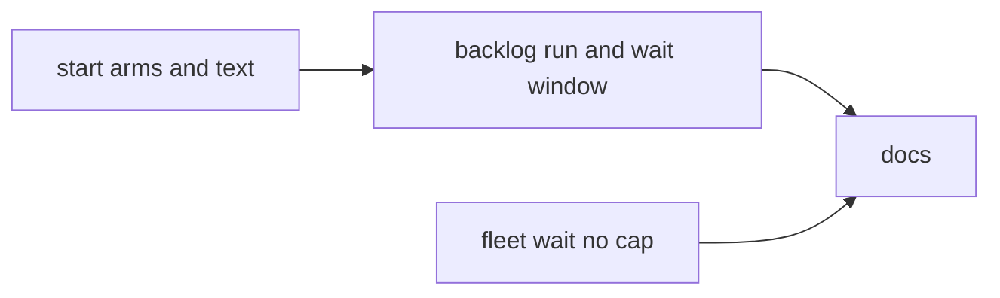

# Superlite: one backlog run loop, a collecting wait, an uncapped fleet wait (B165, #673)

**Goal:** fix #673: `sl backlog run` starts, waits and starts again until a batch needs main; `backlog wait --window S` collects several ends into one wake; `backlog start` applies an experiment arm per batch and passes the config's `lead.text` to the brief; `fleet wait --timeout 0` waits without a cap; the docs say how main re-arms after a restart.
**Architecture:** `backlog_run.cmd_run` loops over the existing `cmd_start` (output captured and classified) and `_round` (one wait round); `cmd_wait` keeps polling for `--window` seconds after its first line unless a line is urgent. `cmd_start` resolves an experiment arm's run config per batch. `fleet_io.wait` treats a 0 timeout as no limit. Docs follow the code.
**Tech stack:** Python 3.10+ stdlib, pytest (through `sl run_tests`); Markdown docs.
**Spec:** this file, section Design; issue #673 (body and its 3 owner comments).
**Detail:** contracts
**Target-min:** 11
**Wave0:** none
**Worktree:** none
**Max chars:** 24000

Global constraints:
- Every script line keeps the repo's `# O(...)` complexity comment; stdlib only; LF endings.
- Tests use `tmp_path` roots, homes (`SUPERLITE_HOME`) and state dirs and the fakes of `tests/scripts/test_backlog_run.py` (`bk`, `put`, `get`, `run`, `running`); never the real `~/.superlite`, never a real Herdr.
- Standing rules for every lead and its workers (the owner's decisions, passed on by main): this repository is public: no host names, user names, home paths, other project or repository names, ticket keys or account names in code, tests, docs, commit messages, PR texts or issue comments (write "a Swift project", "a second Mac", "the machine"). Never change the machine's gate config or ~/.superlite/machine.json; tests and proofs use private temp homes and state dirs. No real app builds as proof; this repository's own test suite is the check. Priority of this round: scheduling and admission of test runs, parallel agents and the fleet, wall-clock and token efficiency. Friction with superlite itself goes to `sl feedback add`, not into this batch.
- Builds: the verdict is `sl run_tests` (the project's test command; a project with `.maxapp` runs `maxapp test`, which a build pool may place on another Mac, and a full run whose tree a green maxapp test stamp covers returns that result without a run); task trees build in <tree>/.build/DerivedData and any build of your own goes under .build/ of the worktree, never -derivedDataPath outside the worktree (your session scratchpad included; backlog cleanup removes scratchpad build folders when the worktree goes); a product, simulator or device build stays on this machine and runs only when an issue's acceptance asks for a running-app check.
- Simulators: append the UDID of each simulator you create (`xcrun simctl create` or `clone`) as one line to `<worktree>/.superlite/simulators.txt`; never list one you did not create; ship cleanup shuts down and deletes each listed one.
- Wait lines keep today's text; new lines only where this plan names them. `backlog wait` with no `--window` behaves exactly as today.

## Coverage

| Category | State | Basis |
|---|---|---|
| Scope and success criteria | settled | #673 Wanted 1-4 plus the 3 owner comments (wait window, lead.text, experiment arms); success: one `backlog run` call covers several ships and returns only for needs_decision, parked, a start refusal or the run end |
| Domain and data model | ruled | batch record gains `experiment` and `arm` only when an arm applies (Design 3) |
| Persistence and migration | ruled | no new state file: `run` is stateless over backlog.json and the stop records, so a restarted run resumes; no migration |
| Interfaces and contracts | settled | `start`, `wait` (without `--window`) and `fleet wait` with a non-zero timeout keep their lines and exit codes |
| UI states | n/a | CLI text only |
| Concurrency and state ownership | ruled | `run` runs only in main (refused in a fleet worker, like `start`); backlog.json writes stay in `bs.update` |
| Error handling and recovery | ruled | a start refusal that clears by itself (disk floor, machine load, slot, depends, shared files, live lead) is retried, every other `BLOCKED:` returns (Design 1) |
| Security and privacy | n/a | local state files only |
| Performance and limits | ruled | run default timeout 43200 s, poll 10 s, start retry every 300 s; window default 0 |
| Observability | ruled | every line is printed and flushed when known, so a killed run leaves its output file complete up to the kill |
| Testing strategy | ruled | unit tests per task over the backlog fakes; the owner's two named regressions in T2 |
| Compatibility | ruled | `--timeout 0` on `backlog wait`/`run` keeps meaning one round (tests rely on it); on `fleet wait` 0 becomes no cap (no caller passed 0) |
| Rollout | ruled | ships with the next version; rollback reverts the PR |
| Research unknowns | settled | Claude Code applies no timeout to a `run_in_background` Bash call (community reports, e.g. claudeissues.com issue 88702; `backlog wait --timeout 21600` already runs in the background for hours here) |

Ruling: `backlog run` is a new subcommand, not `wait --start` (because main's loop is start plus wait and the issue's first option names it; cost if wrong: one alias).
Ruling: `fleet wait` covers one run's state dir per call (because worker ids `W1...` repeat across worktrees and each report is claimed in its own `fleet.json`; main covers every lead's worktree through `backlog run`/`backlog wait`); the docs say so.
Ruling: urgent lines are `B needs_decision ...` and `B parked: ...`; shipped, no-change, follow-up, OPEN, cleanup and `worker panes gone` lines never end a run or a window (because main must act only on the urgent ones; cost if wrong: one regex).
Ruling: a corrupt experiments.json or an arm whose config does not resolve refuses that batch (`BLOCKED:`, state kept) instead of falling back to the default config (because an arm run on the wrong config spoils the measurement).
Ruling: `run` takes no `--note`; it refreshes the stored standing note and the open batches' files before every start (`backlog.set_standing`).
Ruling: `fleet_restore`'s main re-arm line becomes `backlog run` (because `wait` alone starts nothing); fleet_restore.py and docs/fleet.md are outside the batch list and no open batch lists them (notes.md names them).

## Design

### 1. `sl backlog run` (#673 Wanted 1, 4)
`run [--timeout 43200] [--poll 10] [--cap 2] [--model M] [--config NAME] [--machine-wait 100] [--over-limit] [--retry 300]`, main session only. Loop: (a) start attempt when due: the first pass, after any wait round that printed lines, or every `--retry` s while the last attempt left a retry refusal; it refreshes the standing note, calls `cmd_start` with no batch ids and the flags, prints the captured lines (a retry refusal once per text) and returns at once on any other `BLOCKED:` line (exit 2, exit 3 for Herdr not reachable) after the `run end` lines; (b) one `_round`; its lines print (with `machine_park_line` first); an urgent line returns 0 after the `run_end` lines; other lines make the next start due and loop without sleeping; (c) no batch `running`: print `no running batch` plus `run_end` lines, return 0; (d) deadline passed: `TIMEOUT`, return 0 (`--timeout 0` = one pass, as `wait`); (e) sleep `--poll`.

### 2. `backlog wait --window S` (#673 comment 1)
Default 0 (today). With S > 0, after the first round with lines the wait keeps polling until S seconds passed since that round, a round prints an urgent line, no batch is running, or the timeout; each round's lines print when they come; `run_end` lines once at the end.

### 3. `backlog start` per-batch run config (#673 comments 2, 3)
Without `--config`, after a batch passes the disk and machine gates and its worktree, `experiment.assign(root, bid)` gives its arm; an arm resolves `run_config.resolve(arm["config"], root, overrides)` for that batch (one stderr `run config: <id> for <bid> (experiment <E> arm <A>)` line). `ctx["text"] = rc["lead"].get("text")` for the batch's config. The batch record gets `run_config` from that config and `experiment`, `arm` when an arm applies. `--config` skips the experiment.

### 4. `fleet wait --timeout 0` (#673 Wanted 2, 3)
0 (also `0s`, `0m`) waits until the wait's own end condition (all pending reported, `--any` first report, `--wave` first failure), never TIMEOUT; one stderr note says to run it as a background command. `fleet restore` prints `re-arm: <sl> backlog run` for a fleet with leads.

### 5. Docs (#673 Wanted 3)
backlog.md Main 4, 5, 8; commands/backlog.md 4, 5, 8; docs/fleet.md wait and restore bullets; docs/tools.md two appended lines.

## File structure

- `skills/subagent-driven-development/scripts/backlog_run.py`: `cmd_run`, `urgent`, `retry_refusal`, `wait --window`, start arms and text.
- `skills/subagent-driven-development/scripts/backlog.py`: `run` routing, help line, `set_standing`.
- `skills/subagent-driven-development/scripts/fleet_io.py`: no-cap wait.
- `skills/subagent-driven-development/scripts/fleet_restore.py`: main re-arm line.
- `skills/subagent-driven-development/backlog.md`, `commands/backlog.md`, `docs/fleet.md`, `docs/tools.md`: docs.

## Task graph

```mermaid
%% schedule
gantt
  title Predicted schedule (mm:ss)
  dateFormat X
  axisFormat %M:%S
  section lane 1
  T3 fleet wait no cap :t3, 0, 225s
  T4 docs :t4, 439, 181s
  section lane 2
  T1 start arms and text :t1, 0, 189s
  T2 backlog run and wait window :t2, 189, 250s
```

critical path: T1 → T2 → T4 (10.3 min) · peak width 2 · predicted build 10.3 min · predicted total ≈ 18.8 min (target ✗ 11.0)

## Package: backlog

**Probe entry:** none (CLI over the backlog fakes; named tests)

### T1 start arms and text · Complexity 3 · Est. context 50k
**Owns:** skills/subagent-driven-development/scripts/backlog_run.py, tests/scripts/test_backlog_start_arms_673.py
**Components:** 1
**LOC owned:** 110
**Tests:** fast
**Model:** sonnet
**Covers:** 3
**Produces:** backlog_run.cmd_start(a) -> int
**Review Focus:** `test_start_lean_config_yields_lean_brief`: project `.superlite/run-configs.json` `{"configs": {"lean1": {"lead": {"text": "lean"}}}}`, a one-issue batch with no questions; `start B1 --config lean1` writes a lead brief equal to `backlog_brief.lead_brief(batch, ctx)` with `ctx["text"] == "lean"` and holding the lean variant's head (the line only `lead_variant` lean emits); `test_start_text_from_default_config`: no `--config`, no experiment: the ctx the stubbed `lead_brief` records has `text == run_config.resolve(None, root)["lead"].get("text")`; `test_start_assigns_alternating_arms`: configs `armA` (lead effort `high`) and `armB` (lead effort `medium`), `experiment.set_arms(root, "E1", ["armA", "armB"], batches=2, min_per_arm=1, seed=1)`, B1 and B2 planned, cap 2: one `start` gives the two batches different arms, each record has `experiment == "E1"`, `arm` in {armA, armB}, `run_config` starting with its arm name, and the fake spawn got that arm's effort; `test_start_config_flag_skips_experiment`: experiment active, `start B1 --config armA`: experiments.json `assigned` stays empty, the record has no `arm` key; `test_start_corrupt_experiment_store_blocks_batch`: `.superlite/experiments.json` holds `not json`: `start B1` prints `BLOCKED: B1 not started: experiment: ...`, exit 2, B1 stays planned, no spawn; `test_start_arm_config_unknown_blocks_batch`: the arm names `nope` (no layer defines it): `BLOCKED: B1 not started: run config: ...`, exit 2, B1 planned.
**Steps:** 1 failing tests, 2 run: FAIL, 3 implement, 4 run: PASS
**Notes:** In `cmd_start`'s per-batch loop, after the worktree checks and before `ctx`: when `a.config` is None, `arm = experiment.assign(root, bid)` (`experiment.ExperimentError` → `print(f"BLOCKED: {bid} not started: experiment: {e}")`, code 2, continue); with an arm, `brc = run_config.resolve(arm["config"], root, {"lead": {"model": a.model}} if a.model else None)` (`ConfigError` → `BLOCKED: {bid} not started: run config: {e}`, code 2, continue) and one stderr line `run config: {brc['id']} for {bid} (experiment {arm['experiment']} arm {arm['arm']})`; else `brc = rc`. Add `"text": brc["lead"].get("text")` to `ctx`; spawn with `brc`; `mark` stamps `brc["id"]` and, with an arm, `experiment` and `arm`. Read `experiment.set_arms` for its exact arguments; `experiment.assign` locks and keeps a batch's arm when asked again.

### T2 backlog run and wait window · Complexity 6 · Est. context 70k
**Owns:** skills/subagent-driven-development/scripts/backlog_run.py, skills/subagent-driven-development/scripts/backlog.py, tests/scripts/test_backlog_run_loop_673.py, tests/scripts/test_backlog_wait_lag.py
**Components:** 2
**LOC owned:** 230
**Tests:** fast
**Model:** sonnet
**Covers:** 1, 2
**Consumes:** backlog_run.cmd_start(a) -> int (T1)
**Produces:** backlog_run.cmd_run(a) -> int · backlog_run.urgent(line: str) -> bool · backlog_run.retry_refusal(line: str) -> bool · backlog.set_standing(root: Path) -> dict
  e.g. urgent("B3 needs_decision question=/w/.superlite/question.json") -> True
  e.g. urgent("B3 shipped PR #9 1.5.181 summary=/r/.superlite/backlog/B3.md") -> False
  e.g. retry_refusal("BLOCKED: waiting for disk: B4 not started: 12 GB free on /r, below the 20 GB floor; sl backlog start B4 (B4 keeps its state)") -> True
  e.g. retry_refusal("BLOCKED: B4 lead did not start; B4 keeps its state, rerun sl backlog start B4") -> False
**Review Focus:** `test_run_starts_next_planned_after_ship` (#673 Wanted 4): cap 1, B1 running with `merged` set and its pane gone, B2 planned: `run --timeout 0 --poll 0` prints `B1 shipped ...`, then `B2 running lead=...`, then `TIMEOUT`, exit 0; `test_run_returns_on_needs_decision` (#673 Wanted 4): B1 running with a fresh valid question.json: `run --timeout 60 --poll 0` prints `B1 needs_decision question=...` and returns 0 at once (no TIMEOUT, no sleep called); `test_run_one_call_covers_three_ships`: B1-B3 planned, cap 1, each started lead's batch is merged with its pane gone on the next round: one `run --timeout 60 --poll 0` prints three shipped lines in order, then `no running batch`, exit 0 (today: 3 `wait` plus 3 `start` calls); `test_run_returns_on_parked`: lead pane gone without `merged`: `B1 parked: lead pane gone`, exit 0; `test_run_start_refusal_returns_2`: the start prints `BLOCKED: B2 lead did not start; ...`: run prints it and exits 2; `test_run_retries_disk_refusal`: B1 running, B2 refused by the disk floor: the refusal prints once over two rounds, then `TIMEOUT`, exit 0; with nothing running it ends `no running batch`, exit 0; `test_run_refuses_in_fleet_worker`: `SUPERLITE_FLEET_WORKER=W3`: exit 2, `BLOCKED: sl backlog run runs only in the main session`; `test_backlog_cli_routes_run`: `backlog.main(["run", "--timeout", "0"])` reaches `backlog_run.main(["run", "--timeout", "0"])`; `test_run_refreshes_standing_before_each_start`: a note stored in backlog.json reaches `backlog_brief.STANDING["note"]` before each start; in test_backlog_wait_lag.py: `test_wait_window_collects_two_ships`: B1 ships in round 1, B2 in round 2: `wait --window 60 --poll 0` prints both shipped lines in one call and ends (no batch running); `test_wait_window_returns_at_once_on_needs_decision`: B1 ships in round 1, B2 asks in round 2, B3 still running: the call returns after round 2 with both lines; `test_wait_without_window_returns_at_first_line`: same rounds without `--window`: only B1's line.
**Steps:** 1 failing tests, 2 run: FAIL, 3 implement, 4 run: PASS
**Notes:** Design 1 and 2 are the contract. `cmd_run` refuses in a fleet worker first, calls `main_cost.note_session` like `wait`, and runs `cmd_start` on an `argparse.Namespace(batch=[], cap, model, config, machine_wait, over_limit)` under `contextlib.redirect_stdout` to classify its lines. `urgent`: `re.match(r"\S+ (needs_decision |parked: )", line)`. `retry_refusal`: a `BLOCKED:` line holding `waiting for disk:`, ending `, or --over-limit`, or holding `is still running`, `no free slot`, ` waits for ` or `shares files with running`. Print with `flush=True`. `backlog.py`: add `run` to `ROUTED` and a help line ("run": "start, wait and start again until a batch needs main"); move `_start`'s STANDING assignment into `set_standing(root)` (returns the dict) and call it from `_start` and from `cmd_run` (lazy `import backlog`) before each start. Add `run` to the module docstrings' usage lines.

## Package: fleet

**Probe entry:** none (CLI over the fleet fakes; named tests)

### T3 fleet wait no cap · Complexity 3 · Est. context 45k
**Owns:** skills/subagent-driven-development/scripts/fleet_io.py, skills/subagent-driven-development/scripts/fleet_restore.py, tests/scripts/test_fleet_wait_nocap_673.py, tests/scripts/test_fleet_restore_577.py
**Components:** 2
**LOC owned:** 70
**Tests:** fast
**Model:** sonnet
**Covers:** 4
**Review Focus:** `test_wait_zero_timeout_never_times_out`: one busy worker whose stop record appears after a fake clock passed 3,600,000 ms: `wait(sd, ["W1"], 0, poll_s=0, clock=fake)` returns its report and printed no TIMEOUT; `test_wait_any_zero_timeout_ends_on_first_report`: two busy workers, the first reports: BUSY names the second; `test_parse_zero_forms`: `parse_timeout` of `0`, `0s`, `0m` is 0; `test_cli_zero_timeout_note`: `fleet_io.main(["wait", "--timeout", "0", ...])` with no busy worker prints the stderr note naming a background command and exits 0; `test_nonzero_timeout_unchanged`: `--timeout 1500ms` with a silent worker still prints `TIMEOUT W1`; `test_restore_rearms_backlog_run`: the restore of a fleet with a lead prints `re-arm: <sl> backlog run` (update the 577 test that pins `backlog wait`).
**Steps:** 1 failing tests, 2 run: FAIL, 3 implement, 4 run: PASS
**Notes:** In `wait`, the timeout check becomes `if timeout_ms and clock() - start >= timeout_ms`. `main`: for a 0 timeout print `note: --timeout 0 waits without a limit; run it as a background command (a foreground Bash call ends at 600000 ms)` on stderr. Docstring: one line for `--timeout 0`. fleet_restore line 277: `backlog run`.

## Package: docs

**Probe entry:** none (docs)

### T4 docs · Complexity 2 · Est. context 45k
**Owns:** skills/subagent-driven-development/backlog.md, commands/backlog.md, docs/tools.md, docs/fleet.md, tests/scripts/test_docs_backlog_run_673.py
**Components:** 1
**LOC owned:** 60
**Tests:** fast
**Model:** sonnet
**Covers:** 5
**Review Focus:** `test_backlog_md_run`: skills/subagent-driven-development/backlog.md holds `backlog run`, `--window`, `fleet restore` and `re-arm`; `test_command_run`: commands/backlog.md holds `backlog run` and `--window`; `test_fleet_md_zero_timeout`: docs/fleet.md holds `--timeout 0` and names why one wait covers one run's state dir; `test_tools_md_append_only`: docs/tools.md keeps its old last line starting `` `experiment set --arms A,B` `` and the new lines come after it, naming `backlog run`, `--window` and `fleet wait --timeout 0`.
**Steps:** 1 failing tests, 2 run: FAIL, 3 implement, 4 run: PASS
**Notes:** Read T1-T3's diffs (`git log -p` on their files) first and describe what they do. backlog.md Main 4/5: `"$SL" backlog run` as a background command is main's default loop (start plus wait until needs_decision, parked, a start refusal or the run end; shipped lines do not end it; exit codes 0, 2, 3), `start`/`wait` stay for single steps, `wait --window S` collects ends for S seconds (needs_decision and parked still return at once), start applies an experiment arm and the config's `lead.text` per batch; Main 8 and the restart rule: after a Herdr restart `sl fleet restore` first, then rerun `backlog run` (it re-reads backlog.json and every lead's stop records, so ends that happened meanwhile print on its first round); a run stopped for low memory restarts with `backlog run --timeout 540` in the foreground. commands/backlog.md: the same in steps 4, 5 and 8, shortest form. docs/fleet.md: the `fleet wait` bullet gains `--timeout 0` (no limit, background only) and why one call covers one run's state dir (worker ids repeat across worktrees, reports are claimed per fleet.json); the restore bullet names the `backlog run` re-arm. docs/tools.md: append-only, two new lines at the end (backlog run and wait --window and start arms; fleet wait --timeout 0); never edit an existing line. Run the existing doc tests that pin these files (`grep -l` the four paths under tests/scripts) with `--fast`.

## Review Focus

- backlog (CLI, state loop): state (start after ship, retry versus return, standing refresh), protocol (exit codes, line order, flush), file (a corrupt experiments.json); cases in T1, T2.
- fleet (CLI wait): protocol (0 versus a short timeout, `--any`), state (no TIMEOUT line); cases in T3.

## Self-review

Every Wanted item maps to a task (1: T2; 2: T3, T4; 3: T3, T4; 4: T2; comment 1: T2; comments 2, 3: T1). T1 and T2 share backlog_run.py and run one after the other on their edge; T3 runs beside them; T4 waits for the code it describes.
