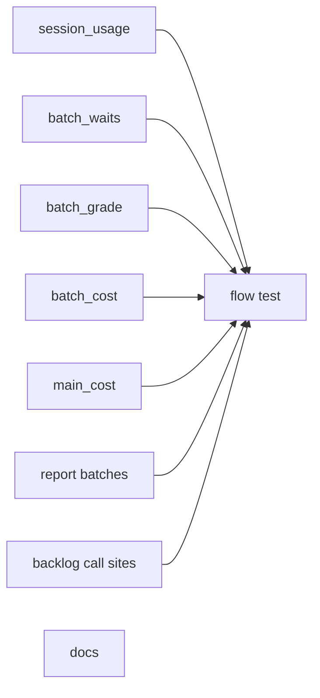

# Superlite: one cost and quality row per backlog batch, and main's cost per round (B168, #680)

**Goal:** fix #680: when a backlog batch ships or parks, one row per batch lands in a file next to `backlog.json` that outlives the worktree: lead cost (tokens with thinking, turns, wall-clock, blocked waits, wake-ups by kind, cost by turn kind), its workers by role, full test runs, and a quality grade; main's cost per plan round; `sl report --batches` prints it.
**Architecture:** `metrics.session_usage` reads one session transcript (dedup by message id, thinking from `output_tokens_details`). New `batch_waits.py` classifies lead and main turns and counts lead wake-ups; new `batch_grade.py` reads a lead worktree's `.superlite` (workers, test runs, fleet reports) and grades; new `batch_cost.py` builds and appends the batch row; new `main_cost.py` records main's sessions and writes the main row per round. `backlog_ship._merge` saves the worktree snapshot before `maxapp ship` can remove it; `backlog_run` writes the row at ship, no-change and park, notes main's session at start and wait, and writes the main row at the run end. `report.py --batches` prints rows.
**Tech stack:** Python 3.10+ stdlib, pytest (through `sl run_tests`); Markdown docs.
**Spec:** this file, section Design; issue #680.
**Detail:** contracts
**Target-min:** 11
**Wave0:** none
**Worktree:** none
**Max chars:** 40000

Global constraints:
- Every script line keeps the repo's `# O(...)` complexity comment; stdlib only; LF endings.
- No row, snapshot, test or doc holds a home path, user name, host name or other project name; tests use `tmp_path` roots and fake transcripts.
- A failure while recording (unreadable transcript, bad JSON, missing worktree) never changes a ship or park outcome: `record`, `record_main`, `save_snapshot` and `note_session` catch every `Exception` and return None.
- Row file: `<root>/.superlite/batch-costs.jsonl` (next to `backlog.json`), one JSON object per line, `"row": "batch"` or `"row": "main"`, append-only.
- Token dict everywhere in the new code: `{"input", "cache_read", "cache_write", "output", "thinking"}` (cache_write = 5 m + 1 h; thinking is part of output, reported beside it).
- Prices from `metrics.load_prices()`; family by `metrics.fam_key`.
- Standing rules for every lead and its workers (the owner's decisions, passed on by main): this repository is public: no host names, user names, home paths, other project or repository names, ticket keys or account names in code, tests, docs, commit messages, PR texts or issue comments (write "a Swift project", "a second Mac", "the machine"). Never change the machine's gate config or ~/.superlite/machine.json; tests and proofs use private temp homes and state dirs. No real app builds as proof; this repository's own test suite is the check. Priority of this round: scheduling and admission of test runs, parallel agents and the fleet, wall-clock and token efficiency; measure before and after where the issue names a waste and put the figures into your report. Friction with superlite itself goes to `sl feedback add`, not into this batch. Online research is allowed when something is unclear (official docs first); name the source.
- Builds: the verdict is `sl run_tests` (the project's test command; a project with `.maxapp` runs `maxapp test`, which a build pool may place on another Mac, and a full run whose tree a green maxapp test stamp covers returns that result without a run); task trees build in <tree>/.build/DerivedData and any build of your own goes under .build/ of the worktree, never -derivedDataPath outside the worktree (your session scratchpad included; backlog cleanup removes scratchpad build folders when the worktree goes); a product, simulator or device build stays on this machine and runs only when an issue's acceptance asks for a running-app check.
- Simulators: append the UDID of each simulator you create (`xcrun simctl create` or `clone`) as one line to `<worktree>/.superlite/simulators.txt`; never list one you did not create; ship cleanup shuts down and deletes each listed one.

## Coverage

| Category | State | Basis |
|---|---|---|
| Scope and success criteria | settled | #680 Wanted 1-6; success: a shipped or parked batch has a row, `sl report --batches` prints lead vs workers, kinds and grade |
| Domain and data model | ruled | row shapes in Design 1-3 |
| Persistence and migration | ruled | new append-only `batch-costs.jsonl`; no migration (older batches have no row) |
| Interfaces and contracts | settled | backlog ship/park paths keep their outputs and exit codes; `_shipped`/`_park` signatures unchanged |
| UI states | n/a | CLI text only |
| Concurrency and state ownership | ruled | main's process writes rows (wait, from-main, done); a lead only writes its snapshot; one-line appends |
| Error handling and recovery | ruled | recording never raises (Global constraints) |
| Security and privacy | ruled | no paths or names in rows; session ids only; transcript text is data, never parsed as commands |
| Performance and limits | ruled | one parse per transcript at batch end; no caps needed (lead transcripts a few tens of MB) |
| Observability | settled | the row itself; `sl report --batches` |
| Testing strategy | ruled | unit tests with synthetic transcripts per module; T9 runs the flow with fixture files under `tests/scripts/fixtures/batch_cost_680/` |
| Compatibility | ruled | `ship_reds` is a new optional batch key; old backlog.json without `main_sessions` works |
| Rollout | ruled | ships with the next version; rollback is reverting the PR (the jsonl stays unread) |
| Research unknowns | settled | thinking tokens: `usage.output_tokens_details.thinking_tokens` in real transcripts (checked); lead effort: `--effort` in the lead's `launch.argv` |

Ruling: detail `contracts` (because every Produces carries e.g. lines and the tests are named with exact values; verbatim tests would double the plan; cost if wrong: one fixer round).
Ruling: the batch row lives in new modules, not `history.py` (because history rows are per task and global, the batch row belongs next to `backlog.json`, and B161/B170 also own history.py; cost if wrong: a later move).
Ruling: the quality grade reads the lead worktree's fleet reports (leads always run fleet on); a batch without them grades tasks 0 (cost if wrong: an in-process run shows no task pass rate).
Ruling: a parked then resumed batch gets one cumulative row per end; `report --batches` uses each batch's latest row (cost if wrong: none, all rows stay).
Ruling: wake-up kinds add `lock` (ship lock `--wait`) and `prompt` (main's messages after the brief) to report, busy, timeout and test_wait.

## Design

### 1. Batch row (#680 Wanted 1)
Written by `batch_cost.record(root, batch, end)` with end `shipped`, `no-change` or `parked`: `{"v": 1, "row": "batch", "t", "batch", "issues", "config": "default", "end", "pr", "version", "lead": {"model", "effort", "turns", "tokens", "cost_usd", "wall_s", "blocked_wait_s", "wakeups", "kinds"}, "workers": {role: {"n", "tokens", "cost_usd"}}, "workers_total": {"n", "tokens", "cost_usd"}, "tests": {"full", "full_min", "fast", "fast_min"}, "grade": {...}}`. Lead transcripts: the stop records of `batch["lead"]` in main's `metrics.jsonl` (own stops only, `fleet_io.own_stop`); model and effort from main's `fleet.json` worker entry (`tier`, `--effort` in `launch.argv`, else null). Workers, tests and quality come from the worktree's `.superlite`; `_merge` saves them as `<root>/.superlite/backlog/<B>.snapshot.json` before `maxapp ship`, and `record` uses the saved snapshot when the worktree is gone.

### 2. Quality grade (#680 Wanted 2)
`grade`: tasks, first_time_pass (implementer report DONE or DONE_WITH_CONCERNS and no fixer label `F-<task>-n`), package_findings, final_rounds, final_verdicts (by FR number), fixer_rounds, ci_red (`ship_reds`, counted by `_merge` on RED), ship_reruns (`ship_runs`), ship_waits, questions; points = not-first-time tasks + package findings + (final rounds - 1) + fixer rounds + 2 x ci_red + ship_reruns + questions; letter A (0), B (1-3), C (4-7), D (8+).

### 3. Main cost per round (#680 Wanted 3)
`main_cost.note_session(root)` (in `backlog start` and `backlog wait`) adds `$SUPERLITE_SESSION_ID` (else `CLAUDE_CODE_SESSION_ID`) to `backlog.json` `main_sessions`. At the run end `record_main(root)` writes `{"v": 1, "row": "main", "t", "round", "sessions", "unmeasured", "windows", "turns", "tokens", "cost_usd", "wall_s", "kinds"}` once per round: each session's transcript `<CLAUDE_CONFIG_DIR or ~/.claude>/projects/<project dir>/<id>.jsonl` from the previous main row's end for that session to now, turns by backlog subcommand. A session without a transcript is listed in `unmeasured`.

### 4. Report (#680 Wanted 4)
`sl report --batches [--root R] [--json]`: one line per batch (latest row), a total line (lead share of lead + workers), one line per main row.

### 5. Docs (#680 Wanted 5)
`metrics.md` gains `## Batch cost record` (row fields, grade, what stays unmeasured) and the thinking line is fixed; `docs/tools.md` gains lines for the new modules and `report --batches`.

### 6. Tests (#680 Wanted 6)
Synthetic transcripts per unit; T9 runs park, ship and report over fixture files. No live agents.

## File structure
- `skills/subagent-driven-development/scripts/metrics.py`: + `session_usage`.
- `skills/subagent-driven-development/scripts/batch_waits.py` (new): turn kinds, lead wake-ups.
- `skills/subagent-driven-development/scripts/batch_grade.py` (new): worktree snapshot and grade.
- `skills/subagent-driven-development/scripts/batch_cost.py` (new): batch row, snapshot file, rows file.
- `skills/subagent-driven-development/scripts/main_cost.py` (new): main sessions and the main row.
- `skills/subagent-driven-development/scripts/report.py`: + `--batches`.
- `skills/subagent-driven-development/scripts/backlog_ship.py`, `backlog_run.py`: call sites.
- `skills/subagent-driven-development/metrics.md`, `docs/tools.md`: docs.

## Task graph

```mermaid
%% schedule
gantt
  title Predicted schedule (mm:ss)
  dateFormat X
  axisFormat %M:%S
  section lane 1
  T7 backlog call sites :t7, 0, 321s
  T9 batch cost flow test :t9, 321, 285s
  section lane 2
  T3 batch_grade :t3, 0, 288s
  section lane 3
  T4 batch_cost :t4, 0, 288s
  section lane 4
  T2 batch_waits :t2, 0, 286s
  section lane 5
  T1 metrics.session_usage :t1, 0, 285s
  section lane 6
  T5 main_cost :t5, 0, 283s
  section lane 7
  T6 report --batches :t6, 0, 280s
  section lane 8
  T8 metrics.md and tools.md :t8, 0, 273s
```

critical path: T7 → T9 (10.1 min) · peak width 8 · predicted build 10.1 min · predicted total ≈ 20.6 min (target ✗ 11.0)

## Package: transcript readers
App type: data pipeline. Categories: numeric, encoding, state.
**Probe entry:** none (every reader takes a path or a block list; the named Review Focus tests cover bad input)

### T1 metrics.session_usage · Complexity 4 · Est. context 45k
**Owns:** skills/subagent-driven-development/scripts/metrics.py, tests/scripts/test_metrics_session_usage_680.py
**Components:** 1
**LOC owned:** 140
**Tests:** fast
**Model:** sonnet
**Est. time:** 2.5 min
**Covers:** 1, 3
**Produces:** metrics.session_usage(path: str | Path, since: float | None = None, until: float | None = None, kind=None, prices: dict | None = None, sidechain: bool = False) -> dict
e.g. session_usage("lead.jsonl") -> {"turns": 2, "tokens": {"input": 4, "cache_read": 3000, "cache_write": 500, "output": 300, "thinking": 120}, "cost_usd": 0.009116, "model": "opus", "first": 1794520000.0, "last": 1794520090.0, "wall_s": 90.0, "kinds": {}}
e.g. session_usage("missing.jsonl") -> {"turns": 0, "tokens": {"input": 0, "cache_read": 0, "cache_write": 0, "output": 0, "thinking": 0}, "cost_usd": 0.0, "model": None, "first": None, "last": None, "wall_s": None, "kinds": {}}
e.g. session_usage("lead.jsonl", kind=lambda blocks: "read") -> {..., "kinds": {"read": {"turns": 2, "cost_usd": 0.009116}}}
**Review Focus:** `test_streamed_snapshots_count_once`: three entries with one message id and output 10, 40, 25 give output 40 and turns 1; `test_thinking_from_details_else_text`: details 120 gives 120; no details and 350 thinking characters give 100; `test_sidechain_skipped_unless_asked`: an `isSidechain` entry counts only with sidechain=True; `test_window_keeps_messages_inside`: since/until keep a message whose first timestamp is inside, inclusive; `test_bad_lines_and_non_utf8`: a non-JSON line and invalid bytes are skipped.
**Steps:** 1 failing tests, 2 run: FAIL, 3 implement, 4 run: PASS
**Notes:** Example "lead.jsonl": two opus assistant messages, usage (input 2, cache_read 1500, cache_creation.ephemeral_5m 250, output 150, output_tokens_details.thinking_tokens 60) each, short text, 90 s apart; cost from `load_prices()` = 4x4e-6 + 3000x2e-7 + 500x5e-6 + 300x2e-5. Count only `type == "assistant"` entries; per message id keep the max of each counter and of thinking; output tops up to int(chars / CHARS_PER_TOKEN) with `msg_chars` as `coordinator_record` does; thinking per message = details value when the key exists, else int(thinking characters / 3.5). cost per message by `fam_key(model)`, rounded to 6 at the end; model = family with most turns (tie: alphabetical first); wall_s = last - first rounded 1. kind gets the message's merged content blocks (all snapshots); kinds sorted by key, cost rounded 6. Leave every existing function unchanged.

### T2 batch_waits · Complexity 4 · Est. context 42k
**Owns:** skills/subagent-driven-development/scripts/batch_waits.py, tests/scripts/test_batch_waits_680.py
**Components:** 1
**LOC owned:** 150
**Tests:** fast
**Model:** sonnet
**Est. time:** 2.6 min
**Covers:** 1, 3
**Produces:** batch_waits.lead_kind(blocks: list) -> str
e.g. lead_kind([{"type": "tool_use", "name": "Bash", "input": {"command": "/x/sl fleet wait --timeout 540000 --plan .superlite"}}]) -> "wait"
e.g. lead_kind([{"type": "tool_use", "name": "Read", "input": {"file_path": "/x/a.py"}}]) -> "read"
e.g. lead_kind([{"type": "text", "text": "Status: DONE"}]) -> "text"
**Produces:** batch_waits.main_kind(blocks: list) -> str
e.g. main_kind([{"type": "tool_use", "name": "Bash", "input": {"command": "/x/sl backlog plan --github"}}]) -> "plan"
e.g. main_kind([{"type": "tool_use", "name": "Read", "input": {"file_path": "/x/a"}}]) -> "other"
e.g. main_kind([]) -> "text"
**Produces:** batch_waits.waits(path: str | Path) -> dict
e.g. waits("lead.jsonl") -> {"wakeups": {"report": 1, "busy": 0, "timeout": 1, "test_wait": 1, "lock": 0, "prompt": 1}, "blocked_wait_s": 420.0}
e.g. waits("missing.jsonl") -> {"wakeups": {"report": 0, "busy": 0, "timeout": 0, "test_wait": 0, "lock": 0, "prompt": 0}, "blocked_wait_s": 0.0}
**Review Focus:** `test_busy_line_is_busy`: a fleet wait result whose text has a line starting `BUSY W2` counts busy; `test_timeout_wins_over_report`: a result with a `W1 T1 DONE` line and a `TIMEOUT W2` line counts timeout; `test_spawn_wait_is_a_wait`: `sl fleet spawn --role final-reviewer --brief b.md --wait` is kind wait; `test_repeated_tool_use_id_counts_once`: two snapshots of one tool_use id give one wake-up; `test_brief_is_not_a_prompt`: the first user text is not counted, a later one is, `isMeta` and text starting `<` never are.
**Steps:** 1 failing tests, 2 run: FAIL, 3 implement, 4 run: PASS
**Notes:** Lead kinds, highest first over the message's tool_use blocks: wait (Bash `fleet wait`, `fleet_io.py wait`, `fleet spawn ... --wait`, `run_tests ... --wait`, `backlog ship B lock ... --wait`), ship (`backlog ship`, `maxapp ship`), dispatch (`fleet spawn|send|run`, tool Agent or Task), test (`run_tests`), sl (any other `/sl ` or `scripts/sl ` call), edit (Write, Edit, NotebookEdit), read (Read, Grep, Glob, or Bash starting cat, sed, head, tail, grep, rg, ls, find, wc, git, gh), skill (Skill), other; no tool_use: text. Main kind: the word after `backlog ` in a Bash command among plan, decide, start, wait, answer, tell, status, ship, skip, unskip, park, reset, notes; another tool: other; none: text. waits: pair each wait tool_use (first timestamp per id) with its tool_result entry (`tool_use_id`); blocked += result t - use t (never negative); fleet wait kinds: a line starting `TIMEOUT` -> timeout, else a line starting `BUSY` -> busy, else report; run_tests wait -> test_wait; lock wait -> lock. Example "lead.jsonl": fleet wait 300 s with a W1 report, fleet wait 60 s TIMEOUT, run_tests --wait 60 s, the brief and one later user text. blocked_wait_s rounded 1.

### T3 batch_grade · Complexity 5 · Est. context 50k
**Owns:** skills/subagent-driven-development/scripts/batch_grade.py, tests/scripts/test_batch_grade_680.py
**Components:** 1
**LOC owned:** 160
**Tests:** fast
**Model:** sonnet
**Est. time:** 2.8 min
**Covers:** 1, 2
**Consumes:** metrics.session_usage(path: str | Path, since: float | None = None, until: float | None = None, kind=None, prices: dict | None = None, sidechain: bool = False) -> dict (T1)
**Produces:** batch_grade.workers(sd: str | Path, prices: dict | None = None) -> dict
e.g. workers(".superlite") -> {"implementer": {"n": 2, "tokens": {"input": 8, "cache_read": 6000, "cache_write": 1000, "output": 600, "thinking": 0}, "cost_usd": 0.0091}, "layer": {"n": 1, "tokens": {"input": 0, "cache_read": 0, "cache_write": 0, "output": 0, "thinking": 0}, "cost_usd": 0.0}}
**Produces:** batch_grade.test_runs(sd: str | Path) -> dict
e.g. test_runs(".superlite") -> {"full": 2, "full_min": 8.5, "fast": 5, "fast_min": 0.4}
**Produces:** batch_grade.quality(sd: str | Path) -> dict
e.g. quality(".superlite") -> {"tasks": 3, "first_time_pass": 2, "package_findings": 1, "final_rounds": 2, "final_verdicts": ["CHANGES_REQUESTED", "APPROVED"], "fixer_rounds": 2}
**Produces:** batch_grade.grade(quality: dict, batch: dict) -> dict
e.g. grade({"tasks": 3, "first_time_pass": 2, "package_findings": 1, "final_rounds": 2, "final_verdicts": ["CHANGES_REQUESTED", "APPROVED"], "fixer_rounds": 2}, {"ship_runs": 1, "ship_waits": 3, "questions": 1}) -> {"tasks": 3, "first_time_pass": 2, "package_findings": 1, "final_rounds": 2, "final_verdicts": ["CHANGES_REQUESTED", "APPROVED"], "fixer_rounds": 2, "ci_red": 0, "ship_reruns": 1, "ship_waits": 3, "questions": 1, "points": 7, "letter": "C"}
e.g. grade({}, {}) -> {"tasks": 0, "first_time_pass": 0, "package_findings": 0, "final_rounds": 0, "final_verdicts": [], "fixer_rounds": 0, "ci_red": 0, "ship_reruns": 0, "ship_waits": 0, "questions": 0, "points": 0, "letter": "A"}
**Produces:** batch_grade.snapshot(sd: str | Path, prices: dict | None = None) -> dict
e.g. snapshot("/missing") -> {"workers": {}, "tests": {"full": 0, "full_min": 0.0, "fast": 0, "fast_min": 0.0}, "quality": {"tasks": 0, "first_time_pass": 0, "package_findings": 0, "final_rounds": 0, "final_verdicts": [], "fixer_rounds": 0}}
**Review Focus:** `test_role_from_type_when_fleet_json_lacks_it`: type `fleet:superlite:fixer-sonnet-high` gives role fixer, `superlite:implementer-haiku` implementer; `test_lead_is_not_a_worker`: role or type lead is left out; `test_batch_label_counts_each_task`: implementer label `T1,T2` DONE counts 2 tasks; `test_fixer_label_marks_rework`: `F-T1-3` makes T1 not first-time; `test_findings_int_or_list`: findings 2 or a list of 2 both add 2; `test_verdicts_by_round_number`: FR10 sorts after FR2; `test_summary_copy_skipped`: `test-summary.json` is not a run, `test-summary-<stamp>.json` is; `test_bad_report_json_skipped`.
**Steps:** 1 failing tests, 2 run: FAIL, 3 implement, 4 run: PASS
**Notes:** workers: agent ids from `<sd>/fleet.json` workers and from `<sd>/metrics.jsonl` launch/stop lines; role = fleet.json `role`, else the type without `fleet:` and `superlite:` and without a `-sonnet-high`, `-sonnet`, `-opus`, `-haiku` suffix, else other; transcript = the latest stop line with one; tokens and cost from `metrics.session_usage(tr, prices=prices, sidechain=True)`; cost rounded 6. Reports: `<sd>/fleet/reports/*.json` with `role` and `label`; tasks from implementer labels split on commas. points and letter as Design 2; ci_red from `ship_reds`, ship_reruns from `ship_runs`. Every reader returns its empty value for a missing folder.

## Package: batch rows
App type: data pipeline, file. Categories: file, state, encoding.
**Probe entry:** none (file readers and writers keyed by a root path; covered by named tests)

### T4 batch_cost · Complexity 5 · Est. context 50k
**Owns:** skills/subagent-driven-development/scripts/batch_cost.py, tests/scripts/test_batch_cost_680.py
**Components:** 1
**LOC owned:** 160
**Tests:** fast
**Model:** sonnet
**Est. time:** 2.8 min
**Covers:** 1
**Consumes:** metrics.session_usage(path: str | Path, since: float | None = None, until: float | None = None, kind=None, prices: dict | None = None, sidechain: bool = False) -> dict (T1) · batch_waits.lead_kind(blocks: list) -> str (T2) · batch_waits.waits(path: str | Path) -> dict (T2) · batch_grade.snapshot(sd: str | Path, prices: dict | None = None) -> dict (T3) · batch_grade.grade(quality: dict, batch: dict) -> dict (T3)
**Produces:** batch_cost.costs_path(root: str | Path) -> Path
e.g. costs_path("/r") -> Path("/r/.superlite/batch-costs.jsonl")
**Produces:** batch_cost.read_rows(root: str | Path) -> list
e.g. read_rows("/r") -> [{"v": 1, "row": "batch", "batch": "B1", "end": "shipped", "lead": {"cost_usd": 1.2}, "workers_total": {"n": 2, "cost_usd": 0.4}, "grade": {"points": 0, "letter": "A"}}]
e.g. read_rows("/missing") -> []
**Produces:** batch_cost.save_snapshot(root: str | Path, bid: str, wt: str | Path) -> Path | None
e.g. save_snapshot("/r", "B1", "/wt") -> Path("/r/.superlite/backlog/B1.snapshot.json")
**Produces:** batch_cost.build_row(root: str | Path, batch: dict, end: str) -> dict
e.g. build_row("/r", {"id": "B1", "issues": [7], "lead": "W3", "worktree": "/gone", "pr": 9, "version": "1.0.1"}, "shipped") -> {"v": 1, "row": "batch", "t": "2026-11-13T10:00:00Z", "batch": "B1", "issues": [7], "config": "default", "end": "shipped", "pr": 9, "version": "1.0.1", "lead": {"model": "opus", "effort": None, "turns": 2, "tokens": {"input": 4, "cache_read": 3000, "cache_write": 500, "output": 300, "thinking": 120}, "cost_usd": 0.009116, "wall_s": 90.0, "blocked_wait_s": 420.0, "wakeups": {"report": 1, "busy": 0, "timeout": 1, "test_wait": 1, "lock": 0, "prompt": 1}, "kinds": {"wait": {"turns": 2, "cost_usd": 0.009116}}}, "workers": {}, "workers_total": {"n": 0, "tokens": {"input": 0, "cache_read": 0, "cache_write": 0, "output": 0, "thinking": 0}, "cost_usd": 0.0}, "tests": {"full": 0, "full_min": 0.0, "fast": 0, "fast_min": 0.0}, "grade": {"tasks": 0, "first_time_pass": 0, "package_findings": 0, "final_rounds": 0, "final_verdicts": [], "fixer_rounds": 0, "ci_red": 0, "ship_reruns": 0, "ship_waits": 0, "questions": 0, "points": 0, "letter": "A"}}
**Produces:** batch_cost.record(root: str | Path, batch: dict, end: str) -> dict | None
e.g. record("/r", {"id": "B1"}, "parked") -> {"v": 1, "row": "batch", "batch": "B1", "end": "parked", ...} (and one line appended to costs_path)
**Review Focus:** `test_snapshot_used_when_worktree_gone`: a saved B1.snapshot.json fills workers when the worktree is missing; `test_fresh_worktree_wins_and_is_saved`: an existing worktree `.superlite` is read and the snapshot file rewritten; `test_two_lead_transcripts_sum`: two distinct stop transcripts of W3 add turns and tokens, a child-session stop (`own_stop` false) is skipped; `test_effort_from_launch_argv`: argv `["claude", "--effort", "high"]` gives effort high; `test_record_never_raises`: a batch dict without `id` returns None and writes nothing; `test_row_has_no_paths`: no value in the row starts with `/`.
**Steps:** 1 failing tests, 2 run: FAIL, 3 implement, 4 run: PASS
**Notes:** main sd = `<root>/.superlite`. Lead transcripts: stop lines of `batch["lead"]` in main sd `metrics.jsonl` passing `fleet_io.own_stop(rec, worker)` with the fleet.json worker entry, distinct, in order; lead usage = sum of `session_usage(tr, kind=batch_waits.lead_kind)` (turns, tokens, cost, wall_s, kinds summed) and of `batch_waits.waits(tr)`; model = usage model of the transcript with most turns, else the worker `tier`; effort = argv value after `--effort`, else None. Snapshot: `<worktree>/.superlite` a folder: `batch_grade.snapshot` and save it; else the saved file; else `batch_grade.snapshot` of a missing folder. workers_total sums workers. grade = `batch_grade.grade(snapshot["quality"], batch)`. t is UTC `%Y-%m-%dT%H:%M:%SZ`. Append with one write of `json.dumps(row, sort_keys=True) + "\n"`, creating the folder. read_rows skips non-object and bad lines.

### T5 main_cost · Complexity 4 · Est. context 44k
**Owns:** skills/subagent-driven-development/scripts/main_cost.py, tests/scripts/test_main_cost_680.py
**Components:** 1
**LOC owned:** 130
**Tests:** fast
**Model:** sonnet
**Est. time:** 2.4 min
**Covers:** 3
**Consumes:** metrics.session_usage(path: str | Path, since: float | None = None, until: float | None = None, kind=None, prices: dict | None = None, sidechain: bool = False) -> dict (T1) · batch_waits.main_kind(blocks: list) -> str (T2) · batch_cost.costs_path(root: str | Path) -> Path (T4) · batch_cost.read_rows(root: str | Path) -> list (T4)
**Produces:** main_cost.main_transcript(root: str | Path, session: str, env: dict | None = None) -> Path | None
e.g. main_transcript("/r", "abc", {"CLAUDE_CONFIG_DIR": "/c"}) -> Path("/c/projects/-r/abc.jsonl") (when that file exists, else None)
**Produces:** main_cost.note_session(root: str | Path, env: dict | None = None) -> str | None
e.g. note_session("/r", {"SUPERLITE_SESSION_ID": "abc"}) -> "abc" (backlog.json main_sessions gains {"id": "abc", "t": 1794520000.0} once)
e.g. note_session("/r", {"SUPERLITE_SESSION_ID": "abc", "SUPERLITE_FLEET_WORKER": "W2"}) -> None
**Produces:** main_cost.main_row(root: str | Path, data: dict, now: float | None = None, env: dict | None = None) -> dict
e.g. main_row("/r", {"round": ["B1", "B2"], "main_sessions": [{"id": "abc", "t": 1.0}, {"id": "gone", "t": 2.0}]}, now=100.0) -> {"v": 1, "row": "main", "t": "2026-11-13T10:00:00Z", "round": ["B1", "B2"], "sessions": ["abc", "gone"], "unmeasured": ["gone"], "windows": {"abc": [None, 100.0]}, "turns": 3, "tokens": {"input": 6, "cache_read": 900, "cache_write": 0, "output": 90, "thinking": 0}, "cost_usd": 0.001002, "wall_s": 40.0, "kinds": {"plan": {"turns": 1, "cost_usd": 0.000334}, "wait": {"turns": 2, "cost_usd": 0.000668}}}
**Produces:** main_cost.record_main(root: str | Path, env: dict | None = None) -> dict | None
e.g. record_main("/r") -> {"v": 1, "row": "main", ...} (one line appended; None when the last main row has the same round, or no backlog.json)
**Review Focus:** `test_window_starts_at_previous_main_row`: a second round's row for session abc starts at the first row's until; `test_same_round_written_once`: a second record_main for an unchanged round returns None; `test_session_noted_once`: two note_session calls leave one entry; `test_no_session_id_no_entry`: an env without either id returns None; `test_resolved_root_tried`: a symlinked root finds the transcript under the resolved path's project folder.
**Steps:** 1 failing tests, 2 run: FAIL, 3 implement, 4 run: PASS
**Notes:** the main_row example: session abc is three sonnet messages (2 input, 300 cache_read, 30 output each), one plan subcommand call and two wait subcommand calls, 40 s first to last. env defaults to `os.environ`. Candidates: `<CLAUDE_CONFIG_DIR>/projects/<fleet_io.project_dir(p)>/<id>.jsonl`, then `~/.claude/projects/...`, for p = str(root) and str(root.resolve()); first that exists. note_session writes through `backlog_state.update(backlog_state.path(root), fn)`; session id from SUPERLITE_SESSION_ID, else CLAUDE_CODE_SESSION_ID. main_row: since for a session = the `windows[id][1]` of the last main row naming it, else None; usage via `session_usage(path, since, now, kind=batch_waits.main_kind)`, summed; t is UTC now. record_main loads `backlog_state.load(backlog_state.path(root))`, skips when the last main row's round equals data["round"], appends like batch_cost.record.

### T6 report --batches · Complexity 3 · Est. context 40k
**Owns:** skills/subagent-driven-development/scripts/report.py, tests/scripts/test_report_batches_680.py
**Components:** 1
**LOC owned:** 110
**Tests:** fast
**Model:** sonnet
**Est. time:** 2.2 min
**Covers:** 4
**Consumes:** batch_cost.read_rows(root: str | Path) -> list (T4)
**Produces:** report.batches_json(rows: list) -> dict
e.g. batches_json([{"row": "batch", "batch": "B1", "end": "parked", "lead": {"cost_usd": 1.0}}, {"row": "batch", "batch": "B1", "end": "shipped", "lead": {"cost_usd": 3.0, "turns": 40, "wall_s": 600.0, "blocked_wait_s": 300.0, "kinds": {"wait": {"turns": 20, "cost_usd": 2.0}}}, "workers": {"implementer": {"n": 2, "cost_usd": 1.0}}, "workers_total": {"n": 2, "cost_usd": 1.0}, "grade": {"points": 2, "letter": "B"}}, {"row": "main", "round": ["B1"], "cost_usd": 0.5, "turns": 9, "kinds": {"wait": {"turns": 9, "cost_usd": 0.5}}}]) -> {"batches": [<the B1 shipped row>], "main": [<the main row>], "total": {"batches": 1, "lead_usd": 3.0, "workers_usd": 1.0, "lead_share": 0.75, "main_usd": 0.5, "rounds": 1}}
**Produces:** report.batches_text(rows: list) -> str
e.g. batches_text(<rows above>) -> "B1 shipped grade B (2) | lead $3.00 40 turns, wall 10.0 min, waits 5.0 min | workers $1.00 (implementer 2 $1.00) | lead by kind: wait $2.00\ntotal: 1 batches, lead $3.00 (75% of lead + workers), workers $1.00; main $0.50 over 1 rounds\nmain B1: $0.50, 9 turns (wait $0.50)\n"
e.g. batches_text([]) -> "report: no batch rows\n"
**Review Focus:** `test_latest_row_per_batch`: the parked then shipped B1 shows once, as shipped; `test_kinds_top_four_by_cost`: six kinds print the four costliest, descending; `test_missing_fields_print_zero`: a row without lead or grade prints `grade ? (0)` and `$0.00`; `test_cli_batches_json`: `report.py --batches --root R --json` prints batches_json of `read_rows(R)`, exit 0.
**Steps:** 1 failing tests, 2 run: FAIL, 3 implement, 4 run: PASS
**Notes:** latest row per batch in file order, ordered by first appearance; lead_share = lead / (lead + workers) rounded 4, 0.0 when both are 0. CLI: `--batches` with `--root` (default `backlog_state.main_root(Path.cwd())`) and `--json`; `--plan` stays required otherwise. Keep every existing function unchanged.

### T7 backlog call sites · Complexity 4 · Est. context 52k
**Owns:** skills/subagent-driven-development/scripts/backlog_ship.py, skills/subagent-driven-development/scripts/backlog_run.py, tests/scripts/test_backlog_cost_hooks_680.py
**Components:** 2
**LOC owned:** 90
**Tests:** fast
**Model:** sonnet
**Est. time:** 2.4 min
**Covers:** 1, 2, 3
**Consumes:** batch_cost.record(root: str | Path, batch: dict, end: str) -> dict | None (T4) · batch_cost.save_snapshot(root: str | Path, bid: str, wt: str | Path) -> Path | None (T4) · main_cost.note_session(root: str | Path, env: dict | None = None) -> str | None (T5) · main_cost.record_main(root: str | Path, env: dict | None = None) -> dict | None (T5)
**Review Focus:** `test_merge_saves_snapshot_before_ship`: a fake `_run` sees `<root>/.superlite/backlog/B1.snapshot.json` already written; `test_red_counts_ship_reds`: two RED merges leave `ship_reds` 2; `test_shipped_records_before_cleanup`: `_shipped` calls record with end shipped (no_change: no-change) before the worktree removal; `test_park_records_parked`: `_park` and the lead-parked branch of `_round` each record parked once; `test_run_end_records_main`: run_end past the fleet check calls record_main; `test_record_failure_keeps_output`: record raising leaves `_shipped` lines and `_park` lines unchanged.
**Steps:** 1 failing tests, 2 run: FAIL, 3 implement, 4 run: PASS
**Notes:** backlog_ship `_merge`: right before `rc, out = _run(cmd, wt)` call `batch_cost.save_snapshot(root, bid, wt)`; on rc 3 (both lead and main paths) `_set(root, bid, ship_reds=(b.get("ship_reds") or 0) + 1)`. backlog_run: `_shipped` first line after the state update `batch_cost.record(root, b, "no-change" if b.get("no_change") else "shipped")`; `_park` after `bs.update` `batch_cost.record(Path(p).parent.parent, {**b, "state": "parked", "reason": reason}, "parked")`; the first loop of `_round` (a lead that parked itself) records parked; `cmd_start` and `cmd_wait` call `main_cost.note_session(root)` after `root = _root()`; `run_end` calls `main_cost.record_main(root)` after the `fleet_state.is_on` check. Wrap each call in `try/except Exception: pass`. Tests monkeypatch batch_cost and main_cost functions.

## Package: docs and flow
**Probe entry:** none (docs and an end-to-end test)

### T8 metrics.md and tools.md · Complexity 2 · Est. context 30k
**Owns:** skills/subagent-driven-development/metrics.md, docs/tools.md, tests/scripts/test_docs_680.py
**Components:** 1
**LOC owned:** 60
**Tests:** fast
**Model:** sonnet
**Est. time:** 2.0 min
**Covers:** 5
**Review Focus:** `test_thinking_line_fixed`: metrics.md no longer says thinking tokens are not stored and names `output_tokens_details`; `test_row_fields_named`: metrics.md names `batch-costs.jsonl`, `blocked_wait_s`, `wakeups`, `workers_total`, `grade`, `letter`, `unmeasured`; `test_tools_lines`: docs/tools.md names `batch_cost`, `main_cost`, `report --batches`.
**Steps:** 1 failing tests, 2 run: FAIL, 3 implement, 4 run: PASS
**Notes:** metrics.md: replace the line ending "thinking tokens are not stored and stay uncounted." with one saying thinking tokens are read from `usage.output_tokens_details.thinking_tokens` (part of output; `session_usage` reports them beside it), and add `## Batch cost record` with Design 1-4 in a few lines, plus "Unmeasured:" naming: main turns of a session that never ran `backlog start` or `backlog wait`, a main session after `/clear` until it runs one, worker panes without a stop record, layer panes (shell, no tokens), lead effort when the launch has no `--effort`, list prices (not billed amounts). docs/tools.md is append-only: add lines after the last line, change none.

### T9 batch cost flow test · Complexity 3 · Est. context 46k
**Owns:** tests/scripts/test_batch_cost_flow_680.py, tests/scripts/fixtures/batch_cost_680/lead.jsonl, tests/scripts/fixtures/batch_cost_680/worker.jsonl, tests/scripts/fixtures/batch_cost_680/main.jsonl
**Components:** 1
**LOC owned:** 140
**Tests:** fast
**Model:** sonnet
**Est. time:** 2.4 min
**Covers:** 6
**Review Focus:** `test_park_then_ship_two_rows_report_latest`: `_park` then `_shipped` on one batch with a fixture worktree write two rows; `report.batches_text` shows the shipped one with the grade letter; `test_worktree_gone_uses_snapshot`: after `save_snapshot` and removing the worktree, the shipped row keeps the worker roles; `test_main_row_from_fixture`: note_session plus run_end write one main row with kinds plan and wait.
**Steps:** 1 failing tests, 2 run: PASS (the code is in)
**Notes:** fixture transcripts are scrubbed shapes of real ones (assistant usage with `output_tokens_details`, a fleet wait tool_use and its tool_result, a `TIMEOUT` result), no paths except relative ones, timestamps in 2026-11. Build the root in tmp_path: `.superlite/backlog.json` through `backlog_state`, main `metrics.jsonl` and `fleet.json` with the lead W3 stop pointing at a tmp copy of lead.jsonl, a worktree `.superlite` with `fleet.json`, `metrics.jsonl` (worker W1 stop at worker.jsonl), `fleet/reports/T1.json`, `FR1.json` and a `test-summary-<stamp>.json` with mode full. Stub `maxapp` and Herdr calls the way tests/scripts/test_backlog_run_lifecycle.py does; set CLAUDE_CONFIG_DIR to tmp.

## Review Focus
- transcript readers (data pipeline): numeric (dedup of streamed snapshots, thinking inside output), encoding (bad lines, invalid UTF-8), state (windows across rounds). Cases in T1, T2, T3.
- batch rows (file, state): a gone worktree, a park then ship, a record that fails. Cases in T4, T5, T7.

## Self-review
Coverage: Design 1-6 map to T1-T9. Consumes match Produces. Only T9 has edges (its tests run all code). No file is owned twice; docs/tools.md is append-only.
