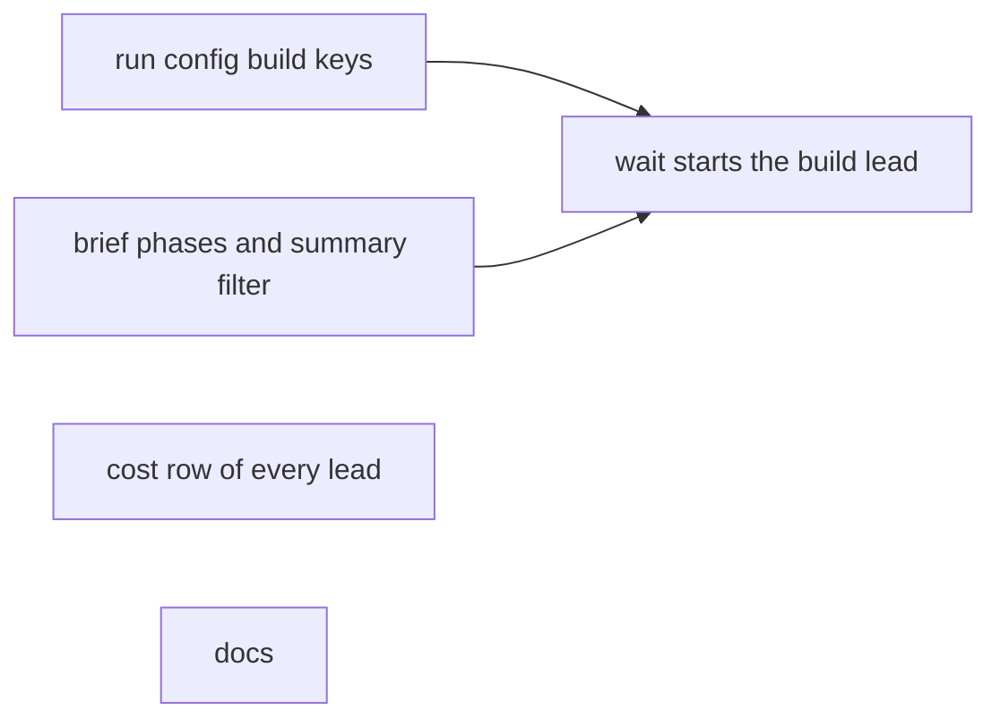

# Superlite: a cheaper build lead after the plan, filtered summary list in the lead brief (B175, #699)

**Goal:** fix #699: run config key `lead.build_model` (plus `lead.build_effort`); with it set the planning lead stops after a linted plan with `Status: DONE planned: <plan>`, `backlog wait` checks the plan and starts a build lead on it with the build model and a `build` brief; a plan that does not run goes back to the planning lead once, then parks; the cost row shows every lead and one grade; the lead brief lists only the shipped summaries that touch the batch's files plus the last five.
**Tech stack:** Python 3.10+ stdlib, pytest (through `sl run_tests`); Markdown docs.
**Spec:** issue #699 (body and the owner's comment on the summary list), this file's Design.
**Wave0:** none
**Worktree:** none
**Coverage:** off
**Max chars:** 30000

Global constraints:
- This repository is public: no host names, user names, home paths, other project or repository names, ticket keys or account names in code, tests, docs or commit messages; write "a Swift project", "a second Mac", "the machine".
- Never change the machine's gate config or ~/.superlite/machine.json; tests use private temp homes and state dirs (tests/scripts/conftest.py sets SUPERLITE_HOME per test).
- Every function line keeps the repo's `# O(...)` complexity comment style.
- No real app builds as proof; this repository's own test suite is the check.
- A lead brief without `phase` in its ctx and without `summaries_more` stays byte-identical to today (the golden tests in tests/scripts/test_backlog_brief_jira_208.py and test_backlog_brief_render_567.py stay unchanged).
- The built-in default config gains no key, so every resolved config id stays as it is (`default-801050ba` for the built-in default under an empty SUPERLITE_HOME).
- Standing rules for every lead and its workers (the owner's decisions, passed on by main): this repository is public: no host names, user names, home paths, other project or repository names, ticket keys or account names in code, tests, docs, commit messages, PR texts or issue comments; write "a Swift project", "a second Mac", "the machine". Never change the machine's gate config or ~/.superlite/machine.json; tests and proofs use private temp homes and state dirs. No real app builds as proof; this repository's own test suite is the check. Priority of this round: scheduling and admission of test runs, parallel agents and the fleet, wall-clock and token efficiency; measure before and after where the issue names a waste (seconds, runs, tokens) and put the figures into your notes. Friction with superlite itself goes to `sl feedback add`, not into this batch. Online research is allowed when something is unclear (official docs first, then how others solved it); name the source in your notes.
- Builds: the verdict is `sl run_tests` (the project's test command; a project with `.maxapp` runs `maxapp test`, which a build pool may place on another Mac, and a full run whose tree a green maxapp test stamp covers returns that result without a run); task trees build in <tree>/.build/DerivedData and any build of your own goes under .build/ of the worktree, never -derivedDataPath outside the worktree (your session scratchpad included; backlog cleanup removes scratchpad build folders when the worktree goes); a product, simulator or device build stays on this machine and runs only when an issue's acceptance asks for a running-app check.
- Simulators: append the UDID of each simulator you create (`xcrun simctl create` or `clone`) as one line to `.superlite/simulators.txt` of this worktree (the run root); never list one you did not create; ship cleanup shuts down and deletes each listed one.

Ruling 1: the plan stop is `Status: DONE planned: <plan path>` (the `DONE no-change:` pattern), not a new status word, because the lead's first message (fleet_report.brief_message) allows only DONE, DONE_WITH_CONCERNS, NEEDS_CONTEXT and BLOCKED; cost if wrong: one regex.
Ruling 2: `backlog wait` checks the plan (file inside the worktree, `plan_tools.py lint` exit 0, every task owns files) before it starts the build lead, while the planning lead still lives; red goes back to that lead once (`plan_returned`), a second red or a failed send parks. A build lead that later finds the plan wrong asks main (question.json); one that cannot lint it ends BLOCKED and parks. Cost if wrong: a build lead onboarding on a plan main's check passed.
Ruling 3: `lead.build_effort` null means the lead's `effort`, so two arms that differ only in `lead.build_model` are one experiment factor; the build lead always gets an explicit `--effort`.
Ruling 4: the cost row's `lead` is the sum over all leads of the batch (so `sl report` and `sl experiment report` compare whole-batch lead cost unchanged) and a new `leads` list holds one entry per lead (id, phase, model, effort, turns, tokens, cost, wall); the grade stays one per batch.
Ruling 5: summaries: a shipped batch's summary is listed when its batch record's files share a file with this batch or its text names one of this batch's file paths or basenames, plus the last five shipped in the backlog's batch order; one `Other shipped summaries:` line names the count and the folder. The build brief lists none (the plan carries the rulings).

## Design

### 1. Run config (T1)
`LEAD_KEYS` gains `build_model` (null or a model string without whitespace) and `build_effort` (null or one of EFFORTS). `run_config.build_lead(rc) -> dict | None`: None when `rc["lead"].get("build_model")` is falsy; else a deep copy of rc with `lead.model = build_model`, `lead.effort = build_effort or lead.effort`; every other key (id, name, sources) kept.

### 2. Brief phases (T2)
`lead_brief(batch, ctx)` reads `ctx.get("phase")`: None (one lead, today's brief), `"plan"` or `"build"` (with `ctx["plan"]`, the plan path from the worktree root).
- plan: today's lines up to and including the code-questions line; then the plan head (lean: `LEAN_BUILD` with its last words `Both paths then run ` replaced by `Both paths then stop: `; default: `Plan: superlite:brainstorming (AI orchestrator, no questions), superlite:writing-plans, then stop: `) followed by `PLAN_STOP`; then the wave-wait line, the escalate line and `PLAN_END`. No Build/Builds sentence, Simulators, Evals, Acceptance or Ship line.
- build: `# Lead brief: B (topic)`, the Resume line when ctx resume, `You are the build lead of batch B in R. Read <backlog.md> first: it holds the lead rules.`, `BUILD_ROLE` (formatted with the plan), then today's lines from the data rule through the standing note, `Rulings from shipped batches: applied in the plan by the planning lead; do not read them again.`, the run/First/code lines, `BUILD_HEAD` + today's Build tail (`superlite:subagent-driven-development with fleet on, the final review ...` through `copy this sentence into every worker brief.`), then every later line as today (Simulators to End).
- `pick_summaries(batch, shipped, last=5) -> (paths, rest)` and the `Other shipped summaries:` line (Ruling 5).

### 3. Wait and start (T3)
`cmd_start`: summaries through `pick_summaries`; `lead_phase(batch, rc)`; plan and single phases write `briefs/lead.md`, a resumed build phase writes `briefs/lead-build.md` and starts on `build_lead(rc)`. The batch record gains `phase` (`single`, `plan`, `build`) and `leads` (cumulative `[{"id", "phase", "model"}]`). `_round`: a running batch in phase `plan` whose last Status line is `DONE planned: P` runs `plan_errors(wt, P)`; green starts the build lead (spawn, brief, stop the planning lead, record), red returns once then parks (Ruling 2). Any other phase with `DONE planned:` parks as any DONE does today.

### 4. Cost record (T4)
`batch_cost` sums the leads in `batch["leads"]` (none: `[batch["lead"]]`) into `lead` and writes `leads`; `report.batches_text` names them when there are two or more.

### 5. Docs (T5)
docs/tools.md, docs/config.md, docs/experiments.md and skills/subagent-driven-development/backlog.md name the keys, the plan stop, the build lead, the check, the return and park, the `building` wait line, the cost row and the summary filter.

## Task graph

```mermaid
%% schedule
gantt
  title Predicted schedule (mm:ss)
  dateFormat X
  axisFormat %M:%S
  section lane 1
  T3 wait starts the build lead :t3, 0, 247s
  section lane 2
  T4 cost row of every lead :t4, 0, 226s
  section lane 3
  T2 brief phases and summary filter :t2, 0, 193s
  section lane 4
  T5 docs :t5, 0, 178s
  section lane 5
  T1 run config build keys :t1, 0, 176s
```

critical path: T3 (4.1 min) · peak width 5 · predicted build 4.1 min · predicted total ≈ 12.6 min

### T1 run config build keys
**Owns:** skills/subagent-driven-development/scripts/run_config.py, skills/subagent-driven-development/config/run-configs.json, tests/scripts/test_run_config_build_699.py
**Components:** 1
**LOC owned:** 70
**Tests:** fast
**Kind:** mechanical
**Model:** haiku
**Produces:** run_config.build_lead(rc: dict) -> dict | None
  e.g. build_lead({"id": "b-1", "lead": {"model": "opus", "effort": "xhigh", "build_model": "sonnet"}, "cache_ttl": {}, "workers": {}}) -> {"id": "b-1", "lead": {"model": "sonnet", "effort": "xhigh", "build_model": "sonnet"}, "cache_ttl": {}, "workers": {}}
  e.g. build_lead({"id": "d-1", "lead": {"model": "opus", "effort": "xhigh"}, "cache_ttl": {}, "workers": {}}) -> None
**Steps:** 1 failing tests, 2 run: FAIL, 3 implement, 4 run: PASS
**Notes:** `LEAD_KEYS = ("model", "effort", "autocompact", "deny", "mcp", "text", "build_model", "build_effort")`. In `_lead`: `build_model` not None and not a non-empty string without whitespace -> `_bad(src, name, "lead.build_model", "must be null or a model string without whitespace")`; `build_effort` not None and not in EFFORTS -> `_bad(src, name, "lead.build_effort", f"{v} is not one of {', '.join(EFFORTS)}")`. `build_lead` uses `copy.deepcopy` and never changes its argument; `lead.effort` becomes `build_effort` when that is truthy. In config/run-configs.json change only `_comment`: `lead{model,effort,autocompact,deny,mcp,text,build_model,build_effort}` and add the sentence `build_model set: a build lead on that model runs the plan the planning lead wrote (#699).`; add no key to the configs. Module docstring line 1 adds `build lead model`.
Tests in tests/scripts/test_run_config_build_699.py (import run_config and experiment from skills/subagent-driven-development/scripts the way tests/scripts/test_run_config_681.py does):
- `test_build_keys_accepted`: `load_text('{"configs": {"x": {"lead": {"build_model": "sonnet", "build_effort": "high"}}}}')` returns without error; `{"build_model": null, "build_effort": null}` too.
- `test_build_model_whitespace_refused`: `"build_model": "son net"` raises ConfigError whose text contains `lead.build_model: must be null or a model string without whitespace`; `"build_model": 3` too.
- `test_build_effort_refused`: `"build_effort": "huge"` raises ConfigError containing `huge is not one of low, medium, high, xhigh, max`.
- `test_build_lead_none`: `build_lead(resolve("default"))` is None.
- `test_build_lead_copy`: the first `e.g.` above returns exactly that dict and its argument still has `lead.model == "opus"`; with `"build_effort": "high"` added the result's `lead.effort == "high"`.
- `test_default_id_unchanged`: with SUPERLITE_HOME set to an empty tmp dir, `resolve("default")["id"] == "default-801050ba"`.
- `test_one_factor`: a project run-configs.json `{"configs": {"a": {"lead": {"effort": "high"}}, "b": {"lead": {"effort": "high", "build_model": "sonnet"}}}}` -> `experiment.config_diff(resolve("a", p), resolve("b", p)) == ["lead.build_model"]`.

### T2 brief phases and summary filter
**Owns:** skills/subagent-driven-development/scripts/backlog_brief.py, tests/scripts/test_backlog_brief_phase_699.py
**Components:** 1
**LOC owned:** 140
**Tests:** fast
**Kind:** design
**Model:** sonnet
**Produces:** backlog_brief.pick_summaries(batch: dict, shipped: list, last: int = 5) -> tuple[list, int]
  e.g. pick_summaries({"files": ["s/x.py"]}, [{"id": "B1", "path": "/r/B1.md", "files": ["s/x.py"], "text": ""}, {"id": "B2", "path": "/r/B2.md", "files": ["y.py"], "text": "y"}, {"id": "B3", "path": "/r/B3.md", "files": ["z.py"], "text": "z"}], last=1) -> (["/r/B1.md", "/r/B3.md"], 1)
**Produces:** backlog_brief.lead_brief(batch: dict, ctx: dict) -> str (ctx keys `phase` None|"plan"|"build", `plan` str, `summaries_more` {"count": int, "dir": str})
**Steps:** 1 failing tests, 2 run: FAIL, 3 implement, 4 run: PASS
**Notes:** Texts (`{sl}` and `{plan}` filled with `.format`):
`PLAN_STOP` = "this is the plan phase: a build lead on a cheaper model (run config lead.build_model) runs your plan; it reads the plan, .superlite/notes.md and the batch record, never your transcript, so write every ruling the build needs into the plan. Dispatch no implementer, review and ship nothing. Once `{sl} plan_tools lint --plan <plan> --spec <plan> --stable` passes, every task owns its files and no worker of yours is busy, end your turn with `Status: DONE planned: <plan path from the worktree root>`; main's wait checks the plan and sends it back once when it does not run."
`PLAN_END` = "End: Status: DONE planned: <plan path> once the plan lints green; Status: DONE no-change: <reason> when your issues need no code change (a duplicate: name the issue it duplicates; write no plan, ship nothing; main closes the issues); otherwise Status: BLOCKED with the reason. Then the JSON block."
`BUILD_ROLE` = "A planning lead wrote and linted the plan {plan}; you run it: dispatch, review, ship. Read the plan and .superlite/notes.md (its Left undone lines stand), not the design history: do not re-plan, re-design or re-read shipped summaries; the plan's rulings bind. When the plan does not hold (a task cannot be built as written, a ruling contradicts the code), let running workers finish, ask main in .superlite/question.json and end with Status: NEEDS_DECISION; a plan that does not lint or a task that owns no files: Status: BLOCKED plan: <errors>."
`BUILD_HEAD` = "Build (build lead, plan {plan}): no superlite:brainstorming and no superlite:writing-plans; run "
The Build tail is today's literal from `superlite:subagent-driven-development with fleet on, the final review` to `copy this sentence into every worker brief.`: move it into a module constant `BUILD_TAIL` so the default, lean and build briefs share one string (the default brief stays byte-identical).
`pick_summaries`: files = set(batch files); a shipped entry is picked when `files & set(entry files)` or any file path in files or its basename (`Path(f).name`) is a substring of entry text; the last `last` entries are always picked; result keeps shipped order, no duplicates; rest = len(shipped) - len(picked).
`summaries_more` with count above 0 adds, right after the `Rulings from shipped batches:` line: `Other shipped summaries: {count} more in {dir} (one B<n>.md per batch; read one only when a ruling you need is missing).`
Plan phase with ship not approved keeps no Ship line; the build phase keeps today's approved and not-approved Ship lines.
Tests in tests/scripts/test_backlog_brief_phase_699.py (base ctx as tests/scripts/test_backlog_brief_lean_683.py builds it, `approved` set):
- `test_plan_phase_default`: batch `{"id": "B1", "topic": "x", "issues": [7, 8], "files": ["a.py"]}`, ctx phase "plan": holds `Plan: superlite:brainstorming (AI orchestrator, no questions), superlite:writing-plans, then stop: this is the plan phase` and `Status: DONE planned: <plan path from the worktree root>`; holds none of `superlite:subagent-driven-development with fleet on`, `Ship: allowed`, `Simulators:`, `Acceptance:`.
- `test_plan_phase_lean`: one issue, ctx text "lean", phase "plan": holds `skip superlite:brainstorming` and `Both paths then stop: this is the plan phase`, not `Both paths then run`.
- `test_build_phase`: phase "build", plan "docs/plans/p.md", summaries ["/r/B1.md"]: holds `You are the build lead of batch B1`, `A planning lead wrote and linted the plan docs/plans/p.md`, `Build (build lead, plan docs/plans/p.md): no superlite:brainstorming`, `superlite:subagent-driven-development with fleet on`, `Ship: allowed`, `Rulings from shipped batches: applied in the plan`; not `/r/B1.md` and not `superlite:writing-plans, superlite`.
- `test_no_phase_unchanged`: for one batch and ctx, `lead_brief(batch, ctx) == lead_brief(batch, {**ctx, "phase": None})` and the text holds today's `Build: superlite:brainstorming (AI orchestrator, no questions), superlite:writing-plans, superlite:subagent-driven-development with fleet on`.
- `test_pick_summaries`: 8 entries B1..B8 (`path` `/r/Bn.md`, files `["f<n>.py"]`, text `""`) except B2 files `["s/x.py"]` and B3 text `"Ruling: x.py now ..."`; batch files `["s/x.py", "docs/tools.md"]`; `last=2` -> `(["/r/B2.md", "/r/B3.md", "/r/B7.md", "/r/B8.md"], 4)`.
- `test_more_line`: ctx summaries ["/r/B8.md"], summaries_more {"count": 4, "dir": "/r/.superlite/backlog"}: the line after `Rulings from shipped batches: /r/B8.md (read each; at most 10 lines).` is `Other shipped summaries: 4 more in /r/.superlite/backlog (one B<n>.md per batch; read one only when a ruling you need is missing).`
- `test_brief_shrinks`: 170 entries `/r/.superlite/backlog/B<n>.md` with no shared file, picked with last=5: the brief is at least 8000 characters shorter than the brief listing all 170 paths.

### T3 wait starts the build lead
**Owns:** skills/subagent-driven-development/scripts/backlog_run.py, tests/scripts/test_backlog_run_build_lead_699.py
**Components:** 2
**LOC owned:** 220
**Tests:** fast
**Kind:** design
**Model:** sonnet
**Consumes:** run_config.build_lead, backlog_brief.pick_summaries, backlog_brief.lead_brief (phase ctx)
**Produces:** backlog_run.plan_errors(wt: Path, plan: str) -> list[str]
  e.g. plan_errors(Path("/w"), "../x.md") -> ["plan ../x.md not found in the worktree"]
**Produces:** backlog_run.planned_path(text: str) -> str | None
  e.g. planned_path("Status: DONE planned: docs/plans/p.md") -> "docs/plans/p.md"
  e.g. planned_path("Status: **DONE** planned: `docs/plans/p.md`") -> "docs/plans/p.md"
  e.g. planned_path("Status: DONE") -> None
**Produces:** backlog_run.lead_phase(batch: dict, rc: dict) -> str ("single", "plan" or "build")
**Steps:** 1 failing tests, 2 run: FAIL, 3 implement, 4 run: PASS
**Notes:** `PLANNED = re.compile(r"(?i)\bStatus:\s*\**\s*DONE\**\s+planned\s*:\s*`?([^\s`]+)")`. `lead_phase`: "single" when `run_config.build_lead(rc)` is None; "build" when `batch.get("phase") == "build" and batch.get("plan")`; else "plan".
`plan_errors(wt, plan)`: the path resolved against wt must be a file inside wt, else `[f"plan {plan} not found in the worktree"]`; then `[sys.executable, str(HERE / "plan_tools.py"), "lint", "--plan", <abs plan>]` with cwd wt, timeout 300, env = os.environ without keys starting `SUPERLITE_FLEET_` and without `SUPERLITE_STATE_DIR`; nonzero exit -> `f"lint exit {rc}: {last 3 non-empty output lines joined by ' / '}"` (timeout: `lint timed out`); then every `### T<n>` block whose `**Owns:**` line is missing or lists no path adds `f"T<n> owns no files"` (keep the lint error too when both hit).
`cmd_start`: build `shipped` = `[{"id", "path", "files", "text"}]` for each shipped batch with an existing `<sd>/backlog/<id>.md` (text read with errors="replace"; unreadable: ""), per batch `picked, rest = backlog_brief.pick_summaries(batch, shipped)`; ctx gains `"summaries": picked`, `"summaries_more": {"count": rest, "dir": str(sd / "backlog")}` when rest, `"phase": None if phase == "single" else phase`, and `"plan": batch.get("plan")` for build. The lead config is `run_config.build_lead(brc)` for phase build, else brc; spawn with its `lead.model`. Brief file `briefs/lead-build.md` for build, else `briefs/lead.md`. `mark` sets `phase` and appends `{"id": rec["id"], "phase": phase, "model": <model>}` to the batch's existing `leads` (none: `[]`).
Factor the ctx building and the brief writing of cmd_start (testcmd seed note and the Resume lines included) into one helper that both cmd_start and the build start call.
`_round`: right before the `no_change_reason` check, when `b.get("phase") == "plan"` and `planned_path(status_reason(stop, last))` gives P: errs = `plan_errors(wt, P)`; errs and `b.get("plan_returned")` -> `_park(..., "plan does not run: " + "; ".join(errs))`; errs -> set `plan_returned` True and `since` now, send the lead `PLAN_FIX` = "superlite: your plan {plan} does not run: {errs}. Fix it (lint must pass and every task must own its files), then end your turn with Status: DONE planned: <plan path> again." through `fleet_io.main(["send", ...])` as REPROMPT is sent (send failure: park); green -> rc = `run_config.active(wt / ".superlite")`, blc = `run_config.build_lead(rc)` (None: park `no lead.build_model in the run config`), write the build brief, `fleet_lead.spawn_lead(sd, wt, blc["lead"]["model"], rc=blc)` (SystemExit: park `build lead did not start`), `fleet_io.send_brief` (HerdrError: stop the new lead, park `build lead got no brief`), `_stop(sd, <planning lead>)`, update the batch: `lead`, `agent`, `since` now, `phase` "build", `plan` P, `leads` + `{"id", "phase": "build", "model"}`, `reprompted` and `question_reprompted` False, `gone_seen` {}, `gone_workers` []; print-line `f"{bid} building lead={id} model={model} plan={P}"` into out. `continue` after each branch.
Tests in tests/scripts/test_backlog_run_build_lead_699.py (fixtures as tests/scripts/test_backlog_run_config_681.py and test_backlog_run.py fake spawn_lead, send_brief, fleet.stop and agent_states; stop records through metrics.jsonl as test_backlog_run.py writes them; monkeypatch `plan_errors` in the wait tests):
- `test_planned_path`: the three `e.g.` lines above.
- `test_plan_errors_real_lint`: in a tmp git repo, a lean plan as test_backlog_brief_lean_683.test_lean_plan_fields_lint writes it -> `[]`; the same plan with its `**Owns:**` line removed -> a list whose text contains `T1`; `"../x.md"` -> `["plan ../x.md not found in the worktree"]`.
- `test_start_plan_phase`: machine run-configs.json `{"configs": {"default": {"lead": {"build_model": "sonnet"}}}}` -> spawn_lead got model `opus`; `briefs/lead.md` holds `Status: DONE planned:`; batch `phase == "plan"`, `leads == [{"id": "W1", "phase": "plan", "model": "opus"}]` (the fake's id).
- `test_start_single_phase`: no build_model -> brief lacks `DONE planned`; `phase == "single"`; `leads[0]["phase"] == "single"`.
- `test_wait_planned_starts_build_lead`: running batch phase plan, lead W1, `<wt>/.superlite/run-config.json` snapshot with `build_model` sonnet and `build_effort` high; stop text `Status: DONE planned: docs/plans/p.md`; plan_errors -> [] : spawn_lead got model `sonnet` and an rc whose `lead.effort == "high"`; `briefs/lead-build.md` holds `You are the build lead` and `docs/plans/p.md`; fleet.stop got `["W1"]`; batch lead is the new id, `phase == "build"`, `plan == "docs/plans/p.md"`, two `leads`; out holds `B1 building lead=<new id> model=sonnet plan=docs/plans/p.md`.
- `test_wait_planned_red_returns_once`: plan_errors -> ["T1 owns no files"]: first round sends a text holding `does not run: T1 owns no files`, batch running with `plan_returned` True; a second stop record with the same text parks: state `parked`, reason starts `plan does not run: T1 owns no files`.
- `test_wait_planned_single_parks`: phase single, stop text `Status: DONE planned: p.md` -> parked, no spawn.
- `test_resume_build_phase`: parked batch with worktree, `phase` build, `plan` "docs/plans/p.md", one `leads` entry, run config with build_model sonnet -> spawn_lead model `sonnet`, `briefs/lead-build.md` holds `Resume:` and `docs/plans/p.md`, `leads` has two entries.
- `test_start_summaries_filtered`: 8 shipped batches with summary files, one sharing a file with the started batch -> `briefs/lead.md` lists that one and the last five, and holds `Other shipped summaries: 2 more in`.

### T4 cost row of every lead
**Owns:** skills/subagent-driven-development/scripts/batch_cost.py, skills/subagent-driven-development/scripts/report.py, tests/scripts/test_batch_cost_leads_699.py
**Components:** 2
**LOC owned:** 90
**Tests:** fast
**Kind:** design
**Model:** sonnet
**Steps:** 1 failing tests, 2 run: FAIL, 3 implement, 4 run: PASS
**Notes:** The batch record's `leads` is `[{"id": "W1", "phase": "plan", "model": "opus"}, {"id": "W4", "phase": "build", "model": "sonnet"}]`; a record without it means `[{"id": batch["lead"], "phase": "single"}]`. Split today's `_lead(sd, batch)` into a per-worker sum `_one(sd, batch, wid)` (same fields as today's result) and `_lead(sd, batch)` summing tokens, cost_usd, turns, wall_s, blocked_wait_s, wakeups and kinds over the distinct lead ids in order; `model` and `effort` are the first lead's. With one lead the result equals today's. `build_row` adds `"leads": [{"id", "phase", "model", "effort", "turns", "tokens", "cost_usd", "wall_s"}]`, one per lead. `report.batches_text` adds `f" | leads: {phase} {model} ${cost:.2f} {wall_s / 60:.1f} min"` joined by `, ` for the leads, only when the row has two or more.
Tests in tests/scripts/test_batch_cost_leads_699.py (fixtures as tests/scripts/test_batch_cost_680.py: a main state dir with fleet.json workers W1 tier opus and W4 tier sonnet, both with the batch worktree, stop records in metrics.jsonl, one transcript each):
- `test_two_leads_summed`: row `lead.cost_usd` equals the sum of both leads' cost, `lead.turns` the sum of turns; `leads[0]["model"] == "opus"`, `leads[1]["model"] == "sonnet"`, `leads[1]["phase"] == "build"`, each has `wall_s`; `grade` is one dict.
- `test_one_lead_unchanged`: a batch without `leads` gives the same `lead` dict as before this task (compare with the field values the 680 fixture asserts) and `leads` with one entry phase `single`.
- `test_report_names_leads`: `report.batches_text([row])` for the two-lead row holds `leads: plan opus $` and `, build sonnet $`; a one-lead row holds no `leads:`.

### T5 docs
**Owns:** docs/tools.md, docs/config.md, docs/experiments.md, skills/subagent-driven-development/backlog.md, tests/scripts/test_docs_build_lead_699.py
**Components:** 1
**LOC owned:** 50
**Tests:** fast
**Kind:** design
**Model:** sonnet
**Steps:** 1 failing tests, 2 run: FAIL, 3 implement, 4 run: PASS
**Notes:** Describe Design 1 to 4 and Rulings 1 to 5 in each doc's own style, short. docs/config.md (run config keys): `lead.build_model` (null: one lead; set: the planning lead stops after the plan and a build lead on that model runs it), `lead.build_effort` (null: the lead's effort). docs/experiments.md: two arms that differ only in `lead.build_model` compare one lead against a planning plus a build lead; the row's `lead` sums both, `leads` holds each. docs/tools.md: in the run config row the two keys; in the backlog row: a lead with `build_model` set ends `Status: DONE planned: <plan>`, `backlog wait` checks the plan (inside the worktree, lint exit 0, every task owns files) and prints `B building lead=Wn model=M plan=P`, a red plan goes back once then parks `plan does not run: ...`; the lead brief lists only the shipped summaries touching the batch's files plus the last five, with an `Other shipped summaries:` line. skills/subagent-driven-development/backlog.md `## Lead`: one bullet after the `lead.text` bullet: a config with `lead.build_model` makes you a planning lead or a build lead (the brief says which): the planning lead plans, lints and ends `Status: DONE planned: <plan>`; the build lead runs that plan without re-planning and asks main when it does not hold; wait sends a plan that does not run back once, then parks. Keep every sentence tests/scripts/test_backlog_rules_split_684.py and the other docs tests pin (run the docs tests before DONE).
Tests in tests/scripts/test_docs_build_lead_699.py: `test_tools_md` (docs/tools.md holds `lead.build_model`, `DONE planned:`, `building lead=`, `Other shipped summaries`); `test_config_md` (docs/config.md holds `lead.build_model` and `lead.build_effort`); `test_backlog_md` (skills/subagent-driven-development/backlog.md holds `lead.build_model` and `Status: DONE planned: <plan>`); `test_experiments_md` (docs/experiments.md holds `lead.build_model` and `leads`).
