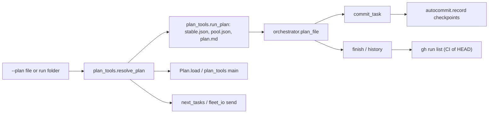
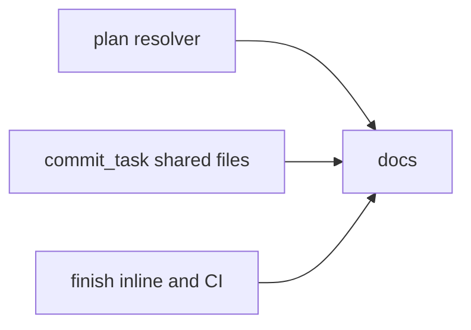

# Superlite: commit_task shared-file checkpoints and `--plan <run folder>` everywhere (B161, #667, #668)

**Goal:** fix #667 (commit_task: a file several tasks share gets a wrong `left uncommitted` note, a misleading `no change since its last checkpoint`, or lands in the wrong task's checkpoint) and #668 (`--plan .superlite` fails in `fleet send`, `packet`, `finish`; tools without `--plan` ignore the run's own plan; `finish` of an inline run counts nothing; a green CI run of HEAD does not count as the full run).
**Architecture:** one resolver in `plan_tools` (`run_plan(sd)`, `resolve_plan(path)`; `Plan.load` and the `plan_tools` CLI resolve a folder through it; `orchestrator.plan_file` delegates to it); `next_tasks` and `fleet_io` use it at their entry. `commit_task.commit_one` defers the `owned by` note to the end of the call, never holds a file the task claimed, fails instead of reporting `no change` when only held files changed, and holds a modified shared test while another busy fleet worker runs. `finish` resolves a run folder, counts an inline run's branch commits and spec rulings, and takes a green CI run of HEAD as the full run.
**Tech stack:** Python 3.10+ stdlib, pytest (through `sl run_tests`); Markdown docs.
**Spec:** this file, section Design; issues #667, #668 (and the owner's comment on #668: CI run in `finish`).
**Detail:** contracts
**Target-min:** 11
**Wave0:** none
**Worktree:** none
**Coverage:** off
**Max chars:** 40000

Global constraints:
- Every script line keeps the repo's `# O(...)` complexity comment; stdlib only; LF endings.
- Tests use `tmp_path` repos and state folders (`SUPERLITE_STATE_DIR` or a `.superlite` in the temp repo), never the real `~/.superlite`; a test that needs `gh` puts a fake `gh` script first on `PATH`; no test reaches the network.
- Exact output texts are the ones in Design; existing texts not named there stay byte-identical.
- Standing rules for every lead and its workers (the owner's decisions, passed on by main): this repository is public: no host names, user names, home paths, other project or repository names, ticket keys or account names in code, tests, docs, commit messages, PR texts or issue comments (write "a Swift project", "a second Mac", "the machine"). Never change the machine's gate config or ~/.superlite/machine.json; tests and proofs use private temp homes and state dirs. No real app builds as proof; this repository's own test suite is the check. Priority of this round: scheduling and admission of test runs, parallel agents and the fleet, wall-clock and token efficiency; measure before and after where the issue names a waste and put the figures into your report. Friction with superlite itself goes to `sl feedback add`, not into this batch. Online research is allowed when something is unclear (official docs first); name the source.
- Builds: the verdict is `sl run_tests` (the project's test command; a project with `.maxapp` runs `maxapp test`, which a build pool may place on another Mac, and a full run whose tree a green maxapp test stamp covers returns that result without a run); task trees build in <tree>/.build/DerivedData and any build of your own goes under .build/ of the worktree, never -derivedDataPath outside the worktree (your session scratchpad included; backlog cleanup removes scratchpad build folders when the worktree goes); a product, simulator or device build stays on this machine and runs only when an issue's acceptance asks for a running-app check.
- Simulators: append the UDID of each simulator you create (`xcrun simctl create` or `clone`) as one line to `<worktree>/.superlite/simulators.txt`; never list one you did not create; ship cleanup shuts down and deletes each listed one.

Ruling: `**Coverage:** off` (because both issues change existing flows of existing tools, no new subsystem; cost if wrong: none).
Ruling: detail `contracts` (because every changed behaviour is a short rule with an exact output text; cost if wrong: one fixer round).
Ruling: #667 wanted 2 keeps #399's hold for a running co-owner: a held file never joins this checkpoint, but when held files are the only change the call fails `nothing to commit; held for running T2: F` instead of `no change since its last checkpoint` (because wanted 3 asks for the same hold for busy workers; cost if wrong: a held file waits for one more commit_task call).
Ruling: #667 case 3 cause: a file the ledger rules to the task (`--claim`, or `--also` in an earlier call) was held for its running plan owner; it is now never held, like `--also` (cost if wrong: a running owner's half edit joins the claimer's checkpoint).
Ruling: #667 wanted 3 attributes a modified shared test by evidence: it joins task Tn when no other busy editing worker runs, when Tn's newest fleet report lists it in `files`, or when the caller is a fleet worker whose current send is not newer than the file's mtime; otherwise it is held and the line names the busy workers (cost if wrong: a held shared test needs one more commit_task call).
Ruling: `finish` treats a run folder with no plan document as an inline run (wanted 4), not as an error; every other tool exits 2 with one line (wanted 3).
Ruling: `finish` asks `gh` for CI only when the ledger has no full run that covers every commit, the tree has no tracked change and HEAD is on a remote-tracking ref; a missing, failing or slow (15 s) `gh` prints nothing (cost if wrong: one local full run, as today).

## Design

### 1. One plan resolver (#668 wanted 1-3)
`plan_tools.run_plan(sd)`: the `plan` string of `sd/stable.json`, then of `sd/pool.json`, when it names an existing file (as given, relative to the cwd, else relative to `sd.parent`), else `sd/plan.md` when it is a file, else None. `plan_tools.resolve_plan(path)`: an existing file is itself; an existing folder resolves through `state.plan_dir(path)` and `run_plan`; a folder that names none raises `PlanError("--plan <path> is a run folder with no plan file (stable.json, pool.json and plan.md name none); pass the plan file")`; anything else raises `PlanError("plan not found: <path>")`. `Plan.load` of a folder loads `resolve_plan(folder)`. `plan_tools.main` replaces a `--plan X` or `--plan=X` value that names a folder by the resolved file before any subcommand (the `pt_review` ones too: `packet`, `adapter`, `contract`); a `PlanError` prints `error: <message>` and exits 2. `orchestrator.plan_file(sd, given)` keeps its contract and calls `run_plan`. `next_tasks.main` without `--plan` uses `next_tasks.default_plan()` (the session run's `run_plan`, else `.superlite/plan.md`); with `--plan` a folder resolves; an unresolved folder dies with one line, exit 2. `fleet_io` `send W Tn` resolves `--plan` the same way (no `--plan`: `default_plan()`); a `PlanError` prints `error: <message>`, exit 2, no traceback.

### 2. commit_task and shared files (#667, #668 wanted 2)
1. `owned by` note (case 1): `left uncommitted (owned by T2, changed after its checkpoint; run commit_task T2): F` is collected per call and printed after the last task of the call, only for a file that then still differs from the newest checkpoint; a file a later task of the same call checkpointed prints nothing.
2. Claimed files (case 3): a file that a ledger ruling `Ruling: Tn also commits F` (from `--claim` or an earlier `--also`) gives the task being committed is never held for a running sibling, like this call's `--also` files.
3. Held only (case 2): when files are held (running sibling, #399) or busy-held (shared tests) and every other file of the task equals the newest checkpoint, the task fails, exit 1, no checkpoint, no ledger line: `Tn FAILED: nothing to commit; held for running T2: F` or `Tn FAILED: nothing to commit; held for busy W7: F` (the texts the empty case already prints); `Tn: no change since its last checkpoint <sha>` then never prints.
4. Shared tests (case 4): busy editing workers = `fleet.json` workers in state `busy`, not the caller (`SUPERLITE_FLEET_WORKER`), role `implementer` (also when unset), `fixer`, `package-reviewer` or `writer`, whose `task` label does not name the task being committed. A modified shared test with such workers is held unless Tn's newest fleet report (`fleet/reports/*.json` whose `label` names Tn, newest by mtime) lists it in `files`, or the caller is a fleet worker whose `sent` (ms) is not later than the file's mtime. A worker whose brief names the file keeps today's line `left uncommitted (edited by busy W7 (label); commit_task Tn again once it is done): F`; else the line names every busy editing worker: one: `left uncommitted (changed while busy W3 (T6) runs; commit_task T5 again once it is done): F`, several: `left uncommitted (changed while busy W3 (T6), W7 (fix-x) run; commit_task T5 again once they are done): F`.
5. No `--plan` (#668 wanted 2): commit_task uses `orchestrator.plan_file(sd)` of the session's run (stable.json, pool.json, then `sd/plan.md`) before `.superlite/plan.md`.

### 3. finish (#668 wanted 1, 4, owner's comment)
1. `--plan` naming a folder resolves through `orchestrator.plan_file(state.plan_dir(folder))`; history, report and `moved_lines` get the file. `history.run_rows` and `history.record_run` resolve a folder the same way (a folder without a plan raises `plan_tools.PlanError`), so `history: plan not found: .superlite` never prints for a run with a plan.
2. Inline run = no plan document (`--plan` a folder without one, or no `--plan` and the session run's `plan_file` is None). Its ledger without `commit` lines prints the branch commits since the run's base: `commits: N (branch commits since <base10>, inline run)` and one `- <sha10> <subject>` line each, oldest first; base = `checkpoints.json` `base`, else the merge-base of HEAD with the default branch (`refs/remotes/origin/HEAD`'s target, else `origin/main`, `main`, `master`). Rulings add the `Ruling:` lines of `<run folder>/spec.md` not already in the ledger. History prints `history: no plan document (inline run); nothing recorded`.
3. CI as the full run: when the ledger has no full non-recorded run, or commits came after it, and the tree has no tracked change and HEAD is on a remote-tracking ref, `gh run list --commit <HEAD> --json databaseId,workflowName,name,status,conclusion,url --limit 20` (timeout 15 s) runs; when every run is completed with conclusion `success`, `skipped` or `neutral` and one is `success`, the tests line is `tests (full, CI): <workflowName or name> run <databaseId> green on HEAD <sha10> (<url>)` (several runs: `... run <id> and K more green on HEAD ...`), followed, when the ledger has a result, by `- local <mode> run (not the run's result): <passed> passed, <failed> failed, <skipped> skipped in <s>s`. Otherwise the tests lines stay as today.

## Main diagram

## File structure

- `skills/subagent-driven-development/scripts/plan_tools.py`: `run_plan`, `resolve_plan`, folder-aware `Plan.load` and `main`.
- `skills/subagent-driven-development/scripts/orchestrator.py`: `plan_file` delegates to `run_plan`.
- `skills/subagent-driven-development/scripts/next_tasks.py`: `default_plan`, `--plan` resolution.
- `skills/subagent-driven-development/scripts/fleet_io.py`: `send` plan resolution, `PlanError` exit 2.
- `skills/subagent-driven-development/scripts/commit_task.py`: deferred notes, claim holds, held-only failure, busy shared tests, default plan.
- `skills/subagent-driven-development/scripts/finish.py`, `history.py`: folder plan, inline run, CI full run.
- `docs/tools.md`: appended paragraphs (append-only file).
- Tests: `tests/scripts/test_plan_folder_668.py`, `tests/scripts/test_commit_task_b94.py`, `tests/scripts/test_commit_task_batch.py`, `tests/scripts/test_commit_shared_hold_399.py`, `tests/scripts/test_finish_plan_folder_668.py`.

## Task graph

```mermaid
%% schedule
gantt
  title Predicted schedule (mm:ss)
  dateFormat X
  axisFormat %M:%S
  section lane 1
  T2 commit_task shared files claims and d :t2, 0, 248s
  T4 tools doc paragraphs :t4, 248, 173s
  section lane 2
  T3 finish for run folders inline runs an :t3, 0, 247s
  section lane 3
  T1 plan resolver for files and run folde :t1, 0, 239s
```

critical path: T2 → T4 (7.0 min) · peak width 3 · predicted build 7.0 min · predicted total ≈ 15.5 min (target ✗ 11.0)

## Predicted schedule

## Plan resolution

**Probe entry:** none (CLI tools driven through subprocess and `main(argv)` tests in temp repos; no one-text-argument function)

### T1 plan resolver for files and run folders · Complexity 4 · Est. context 52k
**Owns:** skills/subagent-driven-development/scripts/plan_tools.py, skills/subagent-driven-development/scripts/orchestrator.py, skills/subagent-driven-development/scripts/next_tasks.py, skills/subagent-driven-development/scripts/fleet_io.py, tests/scripts/test_plan_folder_668.py
**Components:** 2
**LOC owned:** 150
**Tests:** fast
**Model:** sonnet
**Covers:** 1
**Produces:** plan_tools.run_plan(sd: Path) -> Path | None · plan_tools.resolve_plan(path: str) -> Path · next_tasks.default_plan() -> str
e.g. run_plan(Path("r/.superlite")) with stable.json {"plan": "docs/plans/p.md"} (file exists) -> Path("docs/plans/p.md")
e.g. run_plan(Path("r/.superlite")) with neither json nor plan.md -> None
e.g. resolve_plan("r/.superlite") with no plan -> PlanError("--plan r/.superlite is a run folder with no plan file (stable.json, pool.json and plan.md name none); pass the plan file")
**Review Focus:** `test_run_plan_order`: stable.json beats pool.json beats `plan.md`; a json `plan` naming a missing file is skipped; a relative `plan` resolves against `sd.parent` when the cwd lacks it. `test_resolve_plan_file_folder_missing`: file -> itself; folder -> stable.json's plan; `nope.md` -> `PlanError("plan not found: nope.md")`. `test_plan_load_folder`: `Plan.load(str(sd)).path` is the plan file. `test_review_commands_get_file`: with `pt_review.main` monkeypatched to record argv, `plan_tools.main(["packet", "--plan", str(sd)])` passes `["packet", "--plan", <plan file>]`; `--plan=<sd>` too. `test_cli_folder_without_plan_exits_2`: `plan_tools.main(["taskgraph", "--plan", str(empty_sd)])` -> 2, stderr exactly one line starting `error: --plan `. `test_orchestrator_plan_file_unchanged`: `orchestrator.plan_file(sd, str(file))` -> the file; `plan_file(sd)` -> stable.json's plan. `test_next_tasks_default_plan`: with `SUPERLITE_STATE_DIR=<sd>` and stable.json naming `docs/plans/p.md`, `next_tasks.main([])` prints the plan's ready task; with an empty run, `default_plan()` -> `.superlite/plan.md`. `test_fleet_send_folder_plan`: fleet.json with idle `W1`, `fleet_io._prompt` monkeypatched to record, `fleet_io.main(["send", "W1", "T1", "--plan", str(sd)])` -> 0 and the message names T1; with an empty run folder -> 2, one `error: --plan ...` stderr line, no `Traceback`.
**Steps:** 1 failing tests, 2 run: FAIL, 3 implement, 4 run: PASS
**Notes:** keep `orchestrator.plan_file`'s signature and results (the #456 and #635 tests stay green). `plan_tools` imports `state` lazily inside `resolve_plan` (no import cycle). `fleet_io` reaches `send` through `sl fleet send` (`fleet.py` delegates `send`, `keys`, `wait` to `fleet_io.main`); `fleet.py` is not this task's file.

## commit_task

**Probe entry:** none (CLI over git; covered by temp-repo tests)

### T2 commit_task shared files, claims and default plan · Complexity 6 · Est. context 72k
**Owns:** skills/subagent-driven-development/scripts/commit_task.py, tests/scripts/test_commit_task_b94.py, tests/scripts/test_commit_task_batch.py, tests/scripts/test_commit_shared_hold_399.py
**Components:** 2
**LOC owned:** 210
**Tests:** fast
**Model:** sonnet
**Covers:** 2
**Review Focus:** state and file cases, one named test each. `test_owned_note_skipped_when_later_call_task_commits` (test_commit_task_batch.py): plan T2, T3, T4; T2 and T4 own `src/f.py`, T3 owns `src/c.py`; T2 checkpointed, then `src/f.py` and `src/c.py` change; `commit_task T3 T4` -> 0, stderr has no `owned by` line, T4's checkpoint holds the new `src/f.py`. `test_owned_note_kept_when_nobody_commits_it`: same plan, `commit_task T3` alone -> stderr has `left uncommitted (owned by T2, changed after its checkpoint; run commit_task T2): src/f.py` once. `test_claimed_file_not_held_for_running_owner` (test_commit_shared_hold_399.py): T2 owns `src/shared.py` and is busy in pool.json; `commit_task T1 --claim src/shared.py --ruling R`, then `commit_task T1` with only `src/shared.py` changed -> 0, a new checkpoint holding it, no `shared with running` line; the same after an earlier `commit_task T1 --also src/shared.py --ruling R`. `test_held_after_own_checkpoint_fails` (replaces `test_held_after_own_checkpoint_says_no_change`): -> 1, stdout `T1 FAILED: nothing to commit; held for running T2: src/shared.py`, no `no change since` text, checkpoint count unchanged. `test_unnamed_busy_worker_holds_shared_test` (test_commit_task_b94.py; replaces the second half of `test_idle_worker_or_unnamed_file_does_not_hold`): busy fixer W7 whose brief names another file -> stderr `left uncommitted (changed while busy W7 (fix-F-T5-1) runs; commit_task T4 again once it is done): tests/registry/test_x.py`, checkpoint files `["src/a.py"]`. `test_two_busy_workers_named`: W3 implementer on T6 and W7 -> `... (changed while busy W3 (T6), W7 (fix-F-T5-1) run; commit_task T4 again once they are done): ...`. `test_own_report_lists_shared_test`: `fleet/reports/T4.json` {"label": "T4", "role": "implementer", "files": ["tests/registry/test_x.py"]} -> the shared test joins T4 (`shared-test` on stderr). `test_caller_worker_edit_after_send_joins`: `SUPERLITE_FLEET_WORKER=W9`, W9 busy with `sent` before the file's mtime, W3 busy too -> joins. `test_reader_roles_do_not_hold`: a busy `final-reviewer` or `research` worker -> joins. `test_commit_without_plan_uses_stable_plan` (test_commit_task_b94.py): `SUPERLITE_STATE_DIR=<sd>`, stable.json `{"plan": "docs/plans/p.md"}`, no `.superlite/plan.md`, `commit_task.main(["T1"])` -> 0 and a checkpoint of T1.
**Steps:** 1 failing tests, 2 run: FAIL, 3 implement, 4 run: PASS
**Notes:** design 2.1: collect `(file, owners)` into `a.owned_notes` in `commit_one` instead of `note_once`; `main` prints them after the loop for `changed_vs_parent(files)` (autocommit on: vs HEAD). Design 2.2: build the hold candidates without files `ruled[e] == tid` matches (`hit(f, e)`). Design 2.3: when `held` or `busy_held` is not empty, check `changed_vs_parent(mine)` before `autocommit.record`/`git commit`; empty -> fail with the held reason. Design 2.4: extend `busy_briefs` or add a helper; keep `brief_names`. Design 2.5: replace the `nt.DEFAULT_PLAN` default with `orchestrator.plan_file(sd)` when no `--plan` is given (use the existing function). Update the module docstring for each rule.

## finish

**Probe entry:** none (CLI over git and a ledger; covered by temp-repo tests)

### T3 finish for run folders, inline runs and CI · Complexity 5 · Est. context 64k
**Owns:** skills/subagent-driven-development/scripts/finish.py, skills/subagent-driven-development/scripts/history.py, tests/scripts/test_finish_plan_folder_668.py
**Components:** 2
**LOC owned:** 200
**Tests:** fast
**Model:** sonnet
**Covers:** 3
**Produces:** finish.inline_commits(sd: Path) -> tuple[str, list[tuple[str, str]]] | None · finish.spec_rulings(sd: Path) -> list[str] · finish.ci_full_run(top: Path, sha: str) -> dict | None
e.g. inline_commits(sd) on a branch 2 commits past main -> ("<base sha>", [("<sha1>", "fix a"), ("<sha2>", "fix b")])
e.g. spec_rulings(sd) with spec.md lines `Ruling: x` and `- Ruling: y` -> ["x", "y"]
e.g. ci_full_run(top, sha) with one green run -> {"name": "ci", "id": 7, "url": "https://example.invalid/r/7", "more": 0}
**Review Focus:** `test_folder_plan_reaches_history`: `history.record_run` monkeypatched to record its plan arg, `.superlite/metrics.jsonl` present, stable.json names `docs/plans/p.md`; `finish.main(["--plan", str(sd)])` -> 0 and the recorded plan is that file; no `plan not found`. `test_inline_run_counts_branch_commits`: main has 1 commit, the branch 2 (`fix a`, `fix b`), no plan, `sd/spec.md` with 2 `Ruling:` lines, empty ledger; stdout has `commits: 2 (branch commits since <base10>, inline run)`, `- <sha10> fix a` before `fix b`, `rulings: 2`, `history: no plan document (inline run); nothing recorded`. `test_ledger_commits_win`: a ledger `- commit T1 abcdef1234 x` line -> `commits: 1` and no `inline run`. `test_ci_green_is_full_run`: bare remote, HEAD pushed, clean tree, fake `gh` printing two completed success runs -> `tests (full, CI): ci run 7 and 1 more green on HEAD <sha10> (https://example.invalid/r/7)`; with a ledger `tests fast passed=3 failed=0 skipped=0 seconds=1.0` line the next line is `- local fast run (not the run's result): 3 passed, 0 failed, 0 skipped in 1.0s`. `test_ci_not_green_or_not_asked`: a `failure` conclusion -> no `CI` line; a dirty tracked file, an unpushed HEAD, or a ledger full run with no later commit -> the fake `gh` is never run (it writes a marker file); `gh` exiting 1 -> no CI line, exit 0. `test_history_cli_folder_without_plan_exits_2`: `history.main(["write", "--plan", str(empty_sd)])` -> 2, one `error:` line.
**Steps:** 1 failing tests, 2 run: FAIL, 3 implement, 4 run: PASS
**Notes:** resolve the folder with the existing `orchestrator.plan_file(state.plan_dir(p))` (T1 keeps its contract). `ci_full_run` returns None on any error or timeout; never raise. The `gh` call happens only under the conditions of Design 3.3, so existing finish tests start no `gh`.

## Docs

**Probe entry:** none (docs only)

### T4 tools doc paragraphs · Complexity 1 · Est. context 22k
**Owns:** docs/tools.md, tests/scripts/test_docs_b161_tools.py
**Components:** 1
**LOC owned:** 30
**Tests:** fast
**Kind:** mechanical
**Model:** haiku
**Covers:** 1, 2, 3
**Review Focus:** `test_tools_doc_b161` in tests/scripts/test_docs_b161_tools.py: `text = (ROOT / "docs/tools.md").read_text()`; each of `"plan_tools.resolve_plan` resolves a folder through `run_plan`"`, `"is never held for its running owner"`, `"left uncommitted (changed while busy W3 (T6) runs; commit_task T5 again once it is done): F"`, `"history: no plan document (inline run); nothing recorded"` and `"tests (full, CI): <workflow> run <id> green on HEAD <sha> (<url>)"` is `in text` -> True; `text.splitlines()[-3].startswith("`--plan` takes a plan file or a run folder")` -> True (ROOT = the repository root, `Path(__file__).resolve().parents[2]`).
**Steps:** 1 write the test, 2 run: FAIL, 3 append the three paragraphs verbatim at the end of docs/tools.md, 4 run `sl run_tests --fast tests/scripts/test_docs_b161_tools.py --task T4`: PASS
**Notes:** append exactly, each paragraph one line, after the current last line:
`--plan` takes a plan file or a run folder in every tool (#668): `plan_tools.resolve_plan` resolves a folder through `run_plan` (the `plan` of `stable.json`, then of `pool.json`, then `plan.md`), `Plan.load` and `plan_tools` (its `packet`, `adapter` and `contract` too), `next_tasks`, `fleet send`, `commit_task` and `finish` use it; a folder that names no plan ends with one `error: --plan <folder> is a run folder with no plan file ...` line, exit 2. Without `--plan`, `next_tasks`, `fleet send` and `commit_task` take the session run's plan before `.superlite/plan.md`.
`commit_task` and shared files (#667): the `left uncommitted (owned by T2, changed after its checkpoint; run commit_task T2)` note prints after the whole call, only for a file no task of the call checkpointed; a file the ledger rules to the task (`--claim`, an earlier `--also`) is never held for its running owner; when held files are the only change the task fails `nothing to commit; held for running T2: F` (or `held for busy W7: F`) instead of `no change since its last checkpoint`; a modified shared test stays out while another busy implementer, fixer, package reviewer or writer runs, unless the task's newest fleet report lists it or the calling worker changed it after its send: `left uncommitted (changed while busy W3 (T6) runs; commit_task T5 again once it is done): F`.
`finish --plan <run folder>` resolves the folder's plan for history and the report; an inline run (no plan document) prints `commits: N (branch commits since <base>, inline run)` from git, adds the `Ruling:` lines of the run folder's `spec.md` and `history: no plan document (inline run); nothing recorded`; with no full run covering every commit, a clean tree and HEAD pushed, a green `gh run list --commit HEAD` counts as the full run: `tests (full, CI): <workflow> run <id> green on HEAD <sha> (<url>)` (#668).

## Review Focus

- Plan resolution (CLI, file): protocol (`--plan` and `--plan=` forms, folder vs file vs missing), file (relative `plan` in stable.json, missing files). Cases in T1.
- commit_task (CLI over git, state): state (running and busy workers, multi-task calls, ledger rulings), file (shared tests, claimed files). Cases in T2.
- finish (CLI, file, state): protocol (gh output shapes, failures, timeouts), state (ledger with and without full runs), file (spec.md, checkpoints.json base). Cases in T3.

## Self-review

Coverage: #667 wanted 1-4 -> T2 (2.1-2.4), #668 wanted 1-3 -> T1, wanted 2 for commit_task -> T2 (2.5), wanted 4 and the CI comment -> T3, wanted 5 tests spread over T1-T3, docs -> T4. No placeholders; T1, T2, T3 share no file; T4 waits for the three it describes.
