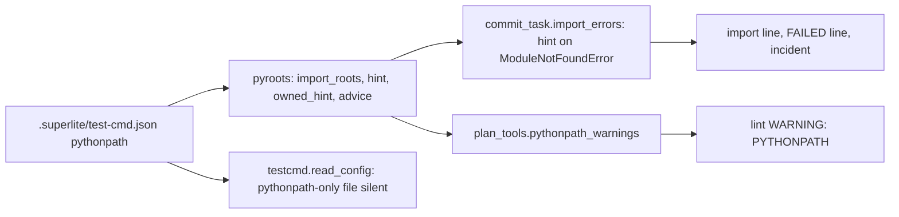
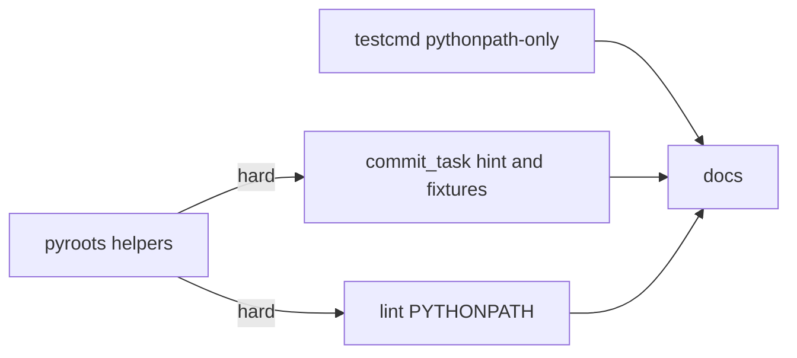

# Superlite: commit_task's import check names the pythonpath fix (B180, #712)

**Goal:** fix #712: a task owning a Python package outside the repo root and `src/` (`tools/pkg/a.py` importing `pkg.b`) fails commit_task's import check with a bare `ModuleNotFoundError`; the check, the FAILED line and plan lint now name the `"pythonpath"` fix, a pythonpath-only test-cmd.json is accepted silently, and fixture scripts are not imported.
**Architecture:** `pyroots` gains three stdlib helpers (`advice`, `hint`, `owned_hint`); `commit_task.import_errors` appends `pyroots.advice` to a ModuleNotFoundError that `pyroots.hint` can place, `is_module` drops `fixtures/` files and `commit_one` names them; `plan_tools.pythonpath_warnings` warns once per task from `pyroots.owned_hint`; `testcmd.read_config` returns None without a note for a file holding only `pythonpath`/`related`.
**Tech stack:** Python 3.10+ stdlib, pytest (through `sl run_tests`).
**Spec:** this file, section Design; issue #712.
**Detail:** tests
**Target-min:** 11
**Wave0:** none
**Worktree:** none
**Coverage:** off (bounded: one issue on an existing flow, Wanted items 1-5 are the scope)
**Max chars:** 31000

Global constraints:
- Every script line keeps the repo's `# O(...)` complexity comment; stdlib only; LF endings.
- Tests use `tmp_path` projects and a private `SUPERLITE_HOME`; never the real `~/.superlite`.
- Standing rules for every lead and its workers (the owner's decisions, passed on by main): this repository is public: no host names, user names, home paths, other project or repository names, ticket keys or account names in code, tests, docs, commit messages, PR texts or issue comments (write "a Swift project", "a second Mac", "the machine"). Never change the machine's gate config or ~/.superlite/machine.json; tests and proofs use private temp homes and state dirs. No real app builds as proof; this repository's own test suite is the check. Priority of this round: scheduling and admission of test runs, parallel agents and the fleet, wall-clock and token efficiency. Measure before and after where the issue names a waste (seconds, runs, tokens) and put the figures into your notes. Friction with superlite itself goes to `sl feedback add`, not into this batch. Online research is allowed when something is unclear (official docs first, then how others solved it); name the source in your notes.
- Builds: the verdict is `sl run_tests` (the project's test command; a project with `.maxapp` runs `maxapp test`, which a build pool may place on another Mac, and a full run whose tree a green maxapp test stamp covers returns that result without a run); task trees build in <tree>/.build/DerivedData and any build of your own goes under .build/ of the worktree, never -derivedDataPath outside the worktree (your session scratchpad included; backlog cleanup removes scratchpad build folders when the worktree goes); a product, simulator or device build stays on this machine and runs only when an issue's acceptance asks for a running-app check.
- Simulators: append the UDID of each simulator you or a worker creates (`xcrun simctl create` or `clone`; a checker's `Simulators:` line marks its created ones) as one line to `<worktree>/.superlite/simulators.txt`; never list one you did not create; ship cleanup shuts down and deletes each listed one.

## Design

### 1. pythonpath-only test-cmd.json (Wanted 1)
`testcmd.read_config` returns None with no stderr line for a JSON object without a `"test"` key whose keys are all in `SIDE_KEYS = ("pythonpath", "related")` (at least one key): those two are read from the file directly (`pyroots.configured`, `testcmd._raw_config`), so the command lookup goes on to the main checkout's file, the user entry and detection. Any other object without `"test"` keeps the `ignored` line. Adjacent fixes in testcmd.py: `main` calls `resolve(a.root, ...)` with `a.root` None when no `--root` is given, so `sl testcmd` with no argument crashes (`TypeError`, measured); it passes `root`. `seed_note` no longer says a worktree's own copy "is the one that runs" when that copy holds no command (`read_config` None).

### 2. Import-check hint (Wanted 2)
`pyroots.hint(root, name, roots, near)` returns the directory D (repo-relative POSIX) that holds module `name` when `name` does not resolve from the root, `src/` or a root: the ancestors of `near`'s folder first (nearest first), then a bounded walk of the repo (as `derive` walks). `commit_task.import_errors` appends `; ` + `pyroots.advice(root, [D])` to the error of a `ModuleNotFoundError: No module named 'X...'` that `hint` places, so the `import ...` line, the FAILED line and the incident all carry it.

### 3. Plan lint warning (Wanted 3)
`plan_tools.pythonpath_warnings(plan, root)` checks every non-draft task's owned `.py` files that `commit_task.is_module` accepts; `pyroots.owned_hint` gives the directory commit_task would need on the path. An existing file is judged by its own absolute imports (ast, stdlib names skipped, `hint` without the walk); a file not yet written by its folder: a package (`__init__.py` on disk or in any task's Owns) whose base is not the root, `src/` or a root, or a plain folder whose parent is not. One `WARNING: PYTHONPATH:` line per task.

### 4. Fixture scripts (Wanted 4)
`commit_task.is_fixture(path)` is True for a path with a `fixtures` folder part; `is_module` is False for it; `commit_one` prints `import check skipped (fixture): F` on stderr for each owned `.py` fixture file. The syntax check still covers them.

### 5. Docs (Wanted 5)
`docs/tools.md` rows `commit_task`, `pyroots`, `testcmd` and `docs/language.md` (the `.superlite/test-cmd.json` keys) describe 1 to 4.

Ruling: `owned_hint` judges an existing file by its imports and a new file by its folder, because a structural rule alone warns on working files such as a flat `scripts/run.py`; a flat new file directly below the root or `src/` gets no warning (its import style is unknown; commit_task's hint covers it at run time).
Ruling: `hint` prefers ancestors of the failing file, then the shallowest, then alphabetically first directory of the walk; a candidate `D/X` must be `X.py`, `X/__init__.py` or a folder with a `.py` file directly inside, so a docs or asset folder named like the module is no match.
Ruling: with a `"pythonpath"` key already set, `advice` says `add "D" to "pythonpath" in .superlite/test-cmd.json`, else `add "pythonpath": ["D"] to .superlite/test-cmd.json`.
Ruling: accept predicted 19.1 min - T3 and T4 tests run T1's pyroots code (hard edges) and the docs describe all three - a 5-minute longer build
Ruling: the `fixtures` rule matches the folder name exactly (`tests/fixtures/x.py`, `fixtures/x.py`), not `fixture` or a file stem, because the issue names `fixtures`.

## Main diagram



## File structure

- `skills/subagent-driven-development/scripts/pyroots.py`: `advice`, `hint`, `owned_hint`; docstring names them.
- `skills/subagent-driven-development/scripts/testcmd.py`: `SIDE_KEYS`, `read_config`, `seed_note`, `main` root fix.
- `skills/subagent-driven-development/scripts/commit_task.py`: `is_fixture`, `is_module`, the skip note, the hint in `import_errors`.
- `skills/subagent-driven-development/scripts/plan_tools.py`: `pythonpath_warnings` and its call in `lint_plan`.
- `docs/tools.md`, `docs/language.md`: the rows and the key.
- New tests: `tests/scripts/test_pyroots_hint_712.py`, `test_testcmd_pythonpath_only_712.py`, `test_commit_task_pythonpath_712.py`, `test_lint_pythonpath_712.py`.

## Task graph




critical path: T1 → T4 → T5 (10.6 min) · peak width 2 · predicted build 10.6 min · predicted total ≈ 19.1 min (target ✗ 11.0)

## Package: import roots

App type: CLI and library. Categories: error (messages the worker acts on), compat (existing roots, configured keys).
**Probe entry:** none (filesystem fixtures; named tests cover them)

### T1 pyroots hint helpers · Complexity 3 · Est. context 36k
**Owns:** skills/subagent-driven-development/scripts/pyroots.py, tests/scripts/test_pyroots_hint_712.py
**Components:** 1
**LOC owned:** 170
**Tests:** fast
**Model:** sonnet
**Covers:** 2, 3
**Produces:** pyroots.advice(root, dirs: list[str]) -> str
e.g. no test-cmd.json: advice(root, ["tools"]) -> 'add "pythonpath": ["tools"] to .superlite/test-cmd.json'
e.g. test-cmd.json {"pythonpath": ["lib"]}: advice(root, ["tools", "a", "tools"]) -> 'add "a", "tools" to "pythonpath" in .superlite/test-cmd.json'
**Produces:** pyroots.hint(root, name: str, roots: list[str], near: str, walk: bool = True) -> str | None
e.g. tools/pkg/__init__.py, tools/pkg/b.py: hint(root, "pkg", [], "tools/pkg/a.py") -> "tools"
e.g. same tree: hint(root, "pkg", ["tools"], "tools/pkg/a.py") -> None
**Produces:** pyroots.owned_hint(root, rel: str, roots: list[str], packages: set[str] = frozenset()) -> str | None
e.g. empty repo: owned_hint(root, "tools/pkg/a.py", []) -> "tools"
e.g. empty repo: owned_hint(root, "tools/a.py", []) -> None
**Review Focus:** `test_hint_*` and `test_owned_hint_*` below; `import_roots`, `derive` and `configured` unchanged (test_pyroots.py, test_pyroots_packages.py stay green).
**Notes:** `_holds(d, name)`: `d/name.py` is a file, or `d/name/__init__.py` is, or `d/name` is a folder with a `*.py` file directly inside. `hint`: None when `root/name.py` is a file or `root/name` a folder (a namespace package resolves), same for `root/src` and each root; then ancestors of `PurePosixPath(near).parent`, nearest first, stopping before `.`, skipping `src` and the roots, first `_holds` wins; then (only when `walk`) `os.walk(root)` pruned like `derive` (hidden, `SKIP`, depth below `MAX_DEPTH`), candidates other than `.`, `src` and the roots, the `_holds` hit with the smallest (depth, path). `owned_hint`: None unless `rel` ends `.py` and lies under no root; a file on disk: its level-0 `import X.y` / `from X.y import z` top names, sorted, minus `sys.stdlib_module_names`, first `hint(root, X, roots, rel, walk=False)` hit, else None (a SyntaxError or read error falls through to the folder rule); a missing file: `base` is `src` when the path starts `src/` and `root/src` is a folder, else `.`; the path's parts below `base` (stem included) must all be identifiers, else None; `is_pkg(d)`: `root/d/__init__.py` exists or `d/__init__.py` is in `packages`; walk `b` up from the folder while `b != base` and `is_pkg(b)`; when `b` moved: None if `b == base` else `b`; else None if the folder or its parent is `base`, else the parent.
**Test code (verbatim):**
```python
"""#712: pyroots names the directory a pythonpath entry needs."""
import json
import sys
from pathlib import Path

sys.path.insert(0, str(Path(__file__).resolve().parents[2] / "skills" / "subagent-driven-development" / "scripts"))
import pyroots  # noqa: E402


def mk(root, rel, text=""):
    p = root / rel
    p.parent.mkdir(parents=True, exist_ok=True)
    p.write_text(text, encoding="utf-8")


def tools_pkg(root):
    mk(root, "tools/pkg/__init__.py")
    mk(root, "tools/pkg/b.py", "Y = 1\n")


def test_advice_without_key(tmp_path):
    assert pyroots.advice(tmp_path, ["tools"]) == 'add "pythonpath": ["tools"] to .superlite/test-cmd.json'


def test_advice_with_key(tmp_path):
    mk(tmp_path, ".superlite/test-cmd.json", json.dumps({"pythonpath": ["lib"]}))
    assert pyroots.advice(tmp_path, ["tools", "a", "tools"]) == 'add "a", "tools" to "pythonpath" in .superlite/test-cmd.json'


def test_hint_package_parent(tmp_path):
    tools_pkg(tmp_path)
    assert pyroots.hint(tmp_path, "pkg", [], "tools/pkg/a.py") == "tools"


def test_hint_namespace_package(tmp_path):
    mk(tmp_path, "tools/pkg/b.py")
    assert pyroots.hint(tmp_path, "pkg", [], "tools/pkg/a.py") == "tools"


def test_hint_flat_sibling(tmp_path):
    mk(tmp_path, "scripts/helper.py")
    assert pyroots.hint(tmp_path, "helper", [], "scripts/run.py") == "scripts"


def test_hint_none_when_root_src_or_a_root_resolves(tmp_path):
    tools_pkg(tmp_path)
    assert pyroots.hint(tmp_path, "pkg", ["tools"], "tools/pkg/a.py") is None
    mk(tmp_path, "src/pkg/b.py")
    assert pyroots.hint(tmp_path, "pkg", [], "tools/pkg/a.py") is None


def test_hint_walks_the_repo_after_the_ancestors(tmp_path):
    mk(tmp_path, "libs/shared/__init__.py")
    mk(tmp_path, "z/deep/er/shared.py")
    assert pyroots.hint(tmp_path, "shared", [], "app/main.py") == "libs"
    assert pyroots.hint(tmp_path, "shared", [], "app/main.py", walk=False) is None


def test_hint_ignores_folders_without_python_and_skipped_dirs(tmp_path):
    mk(tmp_path, "docs/pkg/readme.md")
    mk(tmp_path, ".venv/lib/pkg/__init__.py")
    mk(tmp_path, "node_modules/x/pkg.py")
    assert pyroots.hint(tmp_path, "pkg", [], "tools/a.py") is None


def test_owned_hint_new_files(tmp_path):
    assert pyroots.owned_hint(tmp_path, "tools/pkg/a.py", [], {"tools/pkg/__init__.py"}) == "tools"
    assert pyroots.owned_hint(tmp_path, "tools/pkg/a.py", []) == "tools"
    assert pyroots.owned_hint(tmp_path, "a/b/c/x.py", []) == "a/b"
    assert pyroots.owned_hint(tmp_path, "tools/a.py", []) is None
    assert pyroots.owned_hint(tmp_path, "a.py", []) is None


def test_owned_hint_none_for_src_roots_packages_and_odd_names(tmp_path):
    (tmp_path / "src").mkdir()
    assert pyroots.owned_hint(tmp_path, "src/pkg/a.py", []) is None
    assert pyroots.owned_hint(tmp_path, "tools/pkg/a.py", ["tools"]) is None
    assert pyroots.owned_hint(tmp_path, "pkg/sub/a.py", [], {"pkg/__init__.py", "pkg/sub/__init__.py"}) is None
    assert pyroots.owned_hint(tmp_path, "my-tools/pkg/a.py", []) is None
    assert pyroots.owned_hint(tmp_path, "tools/pkg/notes.md", []) is None


def test_owned_hint_existing_file_reads_its_imports(tmp_path):
    tools_pkg(tmp_path)
    mk(tmp_path, "tools/pkg/a.py", "import os\nfrom pkg import b\n")
    assert pyroots.owned_hint(tmp_path, "tools/pkg/a.py", []) == "tools"
    mk(tmp_path, "tools/pkg/a.py", "import json\nfrom tools.pkg import b\nfrom . import b as c\n")
    assert pyroots.owned_hint(tmp_path, "tools/pkg/a.py", []) is None


def test_owned_hint_unparsable_file_uses_its_folder(tmp_path):
    mk(tmp_path, "tools/pkg/a.py", "def broken(:\n")
    assert pyroots.owned_hint(tmp_path, "tools/pkg/a.py", []) == "tools"
```
**Steps:** 1 failing test, 2 run: FAIL, 3 implement, 4 run: PASS

### T2 testcmd accepts a pythonpath-only file · Complexity 2 · Est. context 30k
**Owns:** skills/subagent-driven-development/scripts/testcmd.py, tests/scripts/test_testcmd_pythonpath_only_712.py
**Components:** 1
**LOC owned:** 70
**Tests:** fast
**Kind:** mechanical
**Model:** haiku
**Covers:** 1
**Produces:** testcmd.read_config(root: Path) -> dict | None
e.g. file {"pythonpath": ["tools"]} -> None, stderr empty
e.g. file {"tests": "pytest"} -> None, stderr 'test-cmd.json ignored: needs a JSON object with a "test" command'
**Review Focus:** the tests below; existing test_testcmd*.py suites stay green.
**Notes:** add `SIDE_KEYS = ("pythonpath", "related")  # keys read from the file itself, not the command config (#712) | O(1)` beside `CONFIG`; in `read_config`, before the `ignored` print: `if isinstance(d, dict) and d and "test" not in d and set(d) <= set(SIDE_KEYS): return None`. `seed_note`: the `own` branch returns its line only when `read_config(Path(root)) is not None`. `main`: `resolve(root, a.fast)` instead of `resolve(a.root, a.fast)`.
**Test code (verbatim):**
```python
"""#712: a test-cmd.json holding only pythonpath is accepted without a note; sl testcmd runs without --root."""
import json
import os
import subprocess
import sys
from pathlib import Path

ROOT = Path(__file__).resolve().parents[2]
SCRIPTS = ROOT / "skills" / "subagent-driven-development" / "scripts"
sys.path.insert(0, str(SCRIPTS))
import testcmd  # noqa: E402

IGNORED = 'test-cmd.json ignored: needs a JSON object with a "test" command'


def cfg(root, data):
    (root / ".superlite").mkdir(exist_ok=True)
    (root / ".superlite" / "test-cmd.json").write_text(json.dumps(data), encoding="utf-8")


def test_pythonpath_only_is_silent(tmp_path, capsys):
    cfg(tmp_path, {"pythonpath": ["tools"]})
    assert testcmd.read_config(tmp_path) is None
    assert capsys.readouterr().err == ""


def test_related_and_pythonpath_are_silent(tmp_path, capsys):
    cfg(tmp_path, {"pythonpath": ["tools"], "related": "tests/test_{src}.py"})
    assert testcmd.read_config(tmp_path) is None
    assert capsys.readouterr().err == ""


def test_other_keys_without_test_still_note(tmp_path, capsys):
    for data in ({"tests": "pytest"}, {"pythonpath": ["tools"], "test_file": "pytest {files}"}, {}):
        cfg(tmp_path, data)
        assert testcmd.read_config(tmp_path) is None
        assert capsys.readouterr().err.strip() == IGNORED


def test_cli_without_root_resolves_detection(tmp_path):
    cfg(tmp_path, {"pythonpath": ["tools"]})
    (tmp_path / "conftest.py").write_text("", encoding="utf-8")
    env = dict(os.environ, PYTHONIOENCODING="utf-8")
    r = subprocess.run([sys.executable, str(SCRIPTS / "testcmd.py")], capture_output=True, text=True,
                       cwd=tmp_path, env=env, timeout=60)
    assert r.returncode == 0, r.stderr
    assert "ignored" not in r.stderr
    out = json.loads(r.stdout.splitlines()[0])
    assert out["language"] == "python" and out["origin"] == "detection"


def test_seed_note_quiet_for_an_own_copy_without_command(tmp_path, monkeypatch):
    main = tmp_path / "main"
    wt = tmp_path / "wt"
    cfg(main, {"language": "python", "test": "pytest"})
    cfg(wt, {"pythonpath": ["tools"]})
    monkeypatch.setattr(testcmd, "_main_checkout_root", lambda root: main)
    assert testcmd.seed_note(wt) == ""
    cfg(wt, {"language": "python", "test": "pytest -x"})
    assert "is the one that runs" in testcmd.seed_note(wt)
```
**Steps:** 1 failing test, 2 run: FAIL, 3 implement, 4 run: PASS

### T3 commit_task names the fix and skips fixtures · Complexity 3 · Est. context 44k
**Owns:** skills/subagent-driven-development/scripts/commit_task.py, tests/scripts/test_commit_task_pythonpath_712.py
**Components:** 1
**LOC owned:** 90
**Tests:** fast
**Model:** sonnet
**Covers:** 2, 4
**Consumes:** pyroots.hint(root, name: str, roots: list[str], near: str, walk: bool = True) -> str | None (T1) · pyroots.advice(root, dirs: list[str]) -> str (T1)
**Produces:** commit_task.is_fixture(path: str) -> bool
e.g. is_fixture("tests/fixtures/opens_a_file.py") -> True
e.g. is_fixture("tools/fixtures_util.py") -> False
**Review Focus:** the tests below; test_commit_import_gate_471.py, test_commit_import_packages.py and test_commit_pix_v2.py stay green (skip and optional-dependency notes unchanged).
**Notes:** `is_fixture`: `"fixtures" in PurePosixPath(path.replace("\\", "/")).parts[:-1]`; `is_module` adds `and not is_fixture(path)`. In `commit_one`, inside `if not problems:` before `import_errors`, one `import check skipped (fixture): F` stderr line per owned `.py` file `is_fixture` accepts. In `import_errors`, for a failure that is no optional-dependency warning, when the `ModuleNotFoundError: No module named '([^'.]+)` match holds, `d = pyroots.hint(root, m.group(1), list(roots or []), f["file"])` and, when `d`, the error becomes `f["error"] + "; " + pyroots.advice(root, [d])`. Update the module docstring's import-check sentence.
**Test code (verbatim):**
```python
"""#712: the import check names the pythonpath fix and skips fixture scripts."""
import sys
from pathlib import Path

HERE = Path(__file__).resolve().parent
sys.path.insert(0, str(HERE))
from test_commit_pix_v2 import commit, repo_with, task  # noqa: E402
from test_run_scripts import SCRIPTS, write  # noqa: E402

sys.path.insert(0, str(SCRIPTS))
import commit_task  # noqa: E402

FIX = 'add "pythonpath": ["tools"] to .superlite/test-cmd.json'
ERR = "ModuleNotFoundError: No module named 'pkg'"


def pkg(root):
    write(root, "tools/pkg/__init__.py", "")
    write(root, "tools/pkg/b.py", "Y = 1\n")
    write(root, "tools/pkg/a.py", "from pkg import b\nX = b.Y\n")


def test_import_error_names_the_fix(tmp_path):
    pkg(tmp_path)
    assert commit_task.import_errors(["tools/pkg/a.py"], [], root=tmp_path) == [("tools/pkg/a.py", 1, f"{ERR}; {FIX}")]


def test_configured_root_imports(tmp_path):
    pkg(tmp_path)
    assert commit_task.import_errors(["tools/pkg/a.py"], ["tools"], root=tmp_path) == []


def test_module_nowhere_in_the_repo_has_no_fix(tmp_path):
    write(tmp_path, "tools/x.py", "import module_that_does_not_exist_xyz\n")
    assert commit_task.import_errors(["tools/x.py"], [], root=tmp_path) == [
        ("tools/x.py", 1, "ModuleNotFoundError: No module named 'module_that_does_not_exist_xyz'")]


def test_fixture_files_are_no_modules():
    assert commit_task.is_fixture("tests/fixtures/opens_a_file.py")
    assert not commit_task.is_module("tests/fixtures/opens_a_file.py")
    assert not commit_task.is_module("fixtures/x.py")
    assert not commit_task.is_fixture("tools/fixtures_util.py")
    assert commit_task.is_module("tools/fixtures_util.py")
    assert commit_task.is_module("tools/pkg/a.py")


def test_import_and_failed_lines_name_the_fix(tmp_path):
    repo = repo_with(tmp_path, task(1, ["tools/pkg/__init__.py", "tools/pkg/a.py", "tools/pkg/b.py"]))
    pkg(repo)
    r = commit(repo, "T1")
    assert r.returncode != 0
    assert f"import tools/pkg/a.py:1 {ERR}; {FIX}" in r.stdout
    assert FIX in r.stdout.split("T1 FAILED: ", 1)[1]


def test_fixture_script_does_not_block(tmp_path):
    repo = repo_with(tmp_path, task(1, ["tests/fixtures/opens_a_file.py", "tools/ok.py"]))
    write(repo, "tests/fixtures/opens_a_file.py", "open('data/missing.txt').read()\n")
    write(repo, "tools/ok.py", "X = 1\n")
    r = commit(repo, "T1")
    assert r.returncode == 0, r.stdout + r.stderr
    assert r.stderr.count("import check skipped (fixture): tests/fixtures/opens_a_file.py") == 1
```
**Steps:** 1 failing test, 2 run: FAIL, 3 implement, 4 run: PASS

## Package: plan lint

App type: CLI. Categories: error (the warning text), compat (no warning for root, src/ and configured layouts).
**Probe entry:** none (plan fixtures; named tests cover them)

### T4 lint warns on unimportable package files · Complexity 3 · Est. context 42k
**Owns:** skills/subagent-driven-development/scripts/plan_tools.py, tests/scripts/test_lint_pythonpath_712.py
**Components:** 1
**LOC owned:** 110
**Tests:** fast
**Model:** sonnet
**Covers:** 3
**Consumes:** pyroots.owned_hint(root, rel: str, roots: list[str], packages: set[str] = frozenset()) -> str | None (T1) · pyroots.advice(root, dirs: list[str]) -> str (T1)
**Produces:** plan_tools.pythonpath_warnings(plan: Plan, root: Path | None) -> list[str]
e.g. T1 owns tools/pkg/__init__.py, tools/pkg/a.py, tools/pkg/b.py, tests/test_a.py, no test-cmd.json -> ['WARNING: PYTHONPATH: T1 owns tools/pkg/__init__.py and 2 more, not importable by their own package name from the repo root, src/ or a pythonpath root; commit_task\'s import check fails on them unless you add "pythonpath": ["tools"] to .superlite/test-cmd.json']
e.g. same plan, test-cmd.json {"pythonpath": ["tools"]} -> []
**Review Focus:** the tests below; existing lint suites (test_lint_reach_owns_606.py, test_plan_lint_import_check.py) stay green.
**Notes:** `root` None returns []. Lazy `import pyroots` and `import commit_task as ct` inside the function (for `ct.is_module`). `roots = pyroots.import_roots(root, str(plan.path) if plan.path else None)`, computed only when some task owns a `.py` entry. `packages` = every `__init__.py` entry in any task's Owns. Per non-draft task, in Owns order: skip glob entries (`*?[`), non-`.py` entries and `not ct.is_module(ent)`; collect `(ent, d)` for each `d = pyroots.owned_hint(root, ent, roots, packages)` that is not None. Line: `WARNING: PYTHONPATH: {tid} owns {first}{" and N more" when N > 0}, not importable by their own package name from the repo root, src/ or a pythonpath root; commit_task's import check fails on them unless you {pyroots.advice(root, dirs)}`. Call it in `lint_plan` next to `owns_link_warnings(plan, root_)` (same try block).
**Test code (verbatim):**
```python
"""#712: plan lint warns once per task that owns package files commit_task cannot import by their package name."""
import json
import os
import subprocess
import sys

from test_plan_tools import SCRIPTS

sys.path.insert(0, str(SCRIPTS))
import plan_tools as ptm  # noqa: E402

PLAN = """# Plan
**Goal:** x.

### T1 tool · Complexity 2 · Est. context 30k
**Owns:** tools/pkg/__init__.py, tools/pkg/a.py, tools/pkg/b.py, tests/test_a.py

### T2 app · Complexity 2 · Est. context 30k
**Owns:** app/main.py, tests/test_main.py, docs/x.md
"""
WARN = ("WARNING: PYTHONPATH: T1 owns tools/pkg/__init__.py and 2 more, not importable by their own package name from the repo root, "
        "src/ or a pythonpath root; commit_task's import check fails on them unless you ")


def proj(tmp_path, text=PLAN, cfg=None):
    (tmp_path / ".superlite").mkdir()
    (tmp_path / ".git").mkdir()
    if cfg is not None:
        (tmp_path / ".superlite" / "test-cmd.json").write_text(json.dumps(cfg), encoding="utf-8")
    (tmp_path / "plan.md").write_text(text, encoding="utf-8")
    return ptm.Plan.load(str(tmp_path / "plan.md"))


def test_warns_once_per_task(tmp_path):
    assert ptm.pythonpath_warnings(proj(tmp_path), tmp_path) == [
        WARN + 'add "pythonpath": ["tools"] to .superlite/test-cmd.json']


def test_configured_root_is_quiet(tmp_path):
    assert ptm.pythonpath_warnings(proj(tmp_path, cfg={"test": "pytest", "pythonpath": ["tools"]}), tmp_path) == []


def test_other_configured_root_names_the_entry_to_add(tmp_path):
    assert ptm.pythonpath_warnings(proj(tmp_path, cfg={"test": "pytest", "pythonpath": ["lib"]}), tmp_path) == [
        WARN + 'add "tools" to "pythonpath" in .superlite/test-cmd.json']


def test_existing_file_with_root_imports_is_quiet(tmp_path):
    text = PLAN.replace("tools/pkg/__init__.py, tools/pkg/a.py, tools/pkg/b.py, tests/test_a.py", "tools/pkg/a.py")
    plan = proj(tmp_path, text)
    (tmp_path / "tools" / "pkg").mkdir(parents=True)
    (tmp_path / "tools" / "pkg" / "a.py").write_text("from tools.pkg import b\n", encoding="utf-8")
    (tmp_path / "tools" / "pkg" / "b.py").write_text("Y = 1\n", encoding="utf-8")
    assert ptm.pythonpath_warnings(plan, tmp_path) == []


def test_draft_task_and_no_root_are_skipped(tmp_path):
    text = PLAN.replace("**Owns:** tools/pkg", "**Status:** draft\n**Owns:** tools/pkg")
    assert ptm.pythonpath_warnings(proj(tmp_path, text), tmp_path) == []
    assert ptm.pythonpath_warnings(ptm.Plan.load(str(tmp_path / "plan.md")), None) == []


def test_lint_prints_the_warning(tmp_path):
    proj(tmp_path)
    env = dict(os.environ, PYTHONIOENCODING="utf-8", SUPERLITE_HOME=str(tmp_path / "home"))
    out = subprocess.run([sys.executable, str(SCRIPTS / "plan_tools.py"), "lint", "--plan", str(tmp_path / "plan.md")],
                         capture_output=True, text=True, cwd=tmp_path, env=env, timeout=120).stdout
    assert out.count("WARNING: PYTHONPATH: T1 owns tools/pkg/__init__.py and 2 more") == 1
```
**Steps:** 1 failing test, 2 run: FAIL, 3 implement, 4 run: PASS

## Package: docs

App type: docs. Categories: compat (rows stay in place).
**Probe entry:** none (prose)

### T5 docs for the pythonpath hint · Complexity 2 · Est. context 32k
**Owns:** docs/tools.md, docs/language.md
**Components:** 1
**LOC owned:** 12
**Tests:** fast
**Model:** sonnet
**Covers:** 5
**Review Focus:** every docs test (`tests/scripts/test_docs*.py`) stays green; text inserted inside the existing rows, no row reordered (another batch also edits docs/tools.md).
**Notes:** `docs/tools.md`: the `commit_task` row gets the hint (`; add "pythonpath": ["D"] to .superlite/test-cmd.json` on a ModuleNotFoundError `pyroots.hint` places) and `import check skipped (fixture): F` (files under a `fixtures` folder are not imported); the `pyroots` row names `advice`, `hint`, `owned_hint` and the lint `WARNING: PYTHONPATH:` line; the `testcmd` row says a file holding only `pythonpath` and `related` is no command config and prints no note. `docs/language.md`: one sentence after the first paragraph: `.superlite/test-cmd.json` may hold only `"pythonpath": ["tools"]` (Python import roots for commit_task's import check and probes), plan lint and commit_task name the key when a package lies outside the root and `src/`. Verify: `<abs sl> run_tests --fast tests/scripts --task T5 --background`, then its `wait:` line.
**Steps:** 1 edit, 2 run the docs tests: PASS

## Review Focus

- error: every hint line names the key and the directory (`"pythonpath": ["tools"]`); an error `hint` cannot place keeps its text byte for byte.
- compat: no warning or hint for a module that resolves from the root, `src/` or a configured or derived root; `import_roots` order unchanged.

## Self-review

Coverage: Wanted 1 T2, 2 T1+T3, 3 T1+T4, 4 T3, 5 T5. No placeholders. Consumes match T1's Produces. Edges: T3 and T4 run T1's code in their tests (hard); docs wait for the code.
