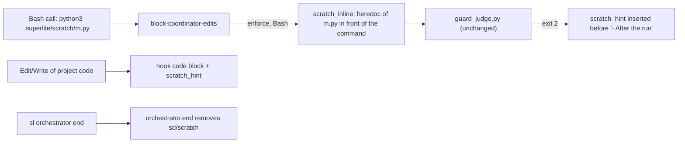
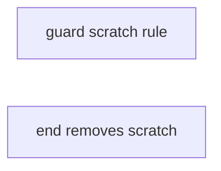

# Superlite: a sanctioned scratch folder for the coordinator (B173, #690)

**Goal:** fix #690: a coordinator that needs a throwaway script (count lines, compare two outputs, time a command) has no named place for it, so it pipes long inline code through the shell or hands a trivial job to a worker; and a script it writes in one call and runs in a later call is never judged (measured: `python3 .superlite/scratch/bad.py`, whose file writes `src/a.py`, passes the guard today). One folder, `<state folder>/scratch/`, becomes the sanctioned place: writes pass, a run of a script there is judged like a heredoc script, the block message names the folder, `sl orchestrator end` removes it.
**Architecture:** `hooks/block-coordinator-edits` gains `scratch_inline` (before `run_judge`, Bash only, while the guard enforces: puts each scratch script the command names in front of the command as a heredoc, in the JSON copy the judge reads) and `scratch_hint` (one message line, in the hook's own code block and inserted into the judge's code block). `orchestrator.end` removes the folder.
**Tech stack:** bash 3.2+ builtins (the hook), Python 3.10+ stdlib (orchestrator.py), pytest through `sl run_tests`; Markdown docs.
**Spec:** this file, section Design; issue #690.
**Detail:** contracts
**Target-min:** 11
**Wave0:** none
**Coverage:** off
**Max chars:** 30000

Global constraints:
- The hook stays bash 3.2 compatible (stock macOS): no `${var,,}`, `mapfile`, `declare -A`, `globstar`, `read -N`; no external command (`cat`, `wc`, `stat`, `tr`, `sed`) in the new hook code: builtins only. Every option the new code changes (`nullglob`) is restored.
- guard_judge.py, guard_lex.py, guard_files.py, guard_tools.py, hooks/guard stay unchanged (another batch owns them).
- Existing message lines and texts stay byte-identical; new lines are added, never rewritten.
- Python lines in orchestrator.py keep the file's `# O(...)` complexity comments; stdlib only; LF endings.
- Tests use `tmp_path` projects and state folders and a private `SUPERLITE_HOME` under `tmp_path`, never the real `~/.superlite`; no test reaches the network.
- Standing rules for every lead and its workers (the owner's decisions, passed on by main): this repository is public: no host names, user names, home paths, other project or repository names, ticket keys or account names in code, tests, docs, commit messages, PR texts or issue comments (write "a Swift project", "a second Mac", "the machine"). Never change the machine's gate config or ~/.superlite/machine.json; tests and proofs use private temp homes and state dirs. No real app builds as proof; this repository's own test suite is the check. Friction with superlite itself goes to `sl feedback add`, not into this batch.
- Builds: the verdict is `sl run_tests` (the project's test command; a project with `.maxapp` runs `maxapp test`, which a build pool may place on another Mac, and a full run whose tree a green maxapp test stamp covers returns that result without a run); task trees build in <tree>/.build/DerivedData and any build of your own goes under .build/ of the worktree, never -derivedDataPath outside the worktree (your session scratchpad included; backlog cleanup removes scratchpad build folders when the worktree goes); a product, simulator or device build stays on this machine and runs only when an issue's acceptance asks for a running-app check.
- Simulators: append the UDID of each simulator you or a worker creates (`xcrun simctl create` or `clone`; a checker's `Simulators:` line marks its created ones) as one line to /Users/max/github/superlite/.claude/worktrees/superlite-b173-coordinator-scratch-dir/.superlite/simulators.txt; never list one you did not create; ship cleanup shuts down and deletes each listed one.

Ruling: the folder is `<state folder>/scratch/` (`$sd/scratch`, normally `.superlite/scratch/`), no new write rule (because rule 3 already allows `.superlite/**` and `.superlite/` is git-ignored through the exclude line commit_task and the hooks write; cost if wrong: a state folder outside the project is not git-ignored, but it is outside the work tree anyway).
Ruling: a run of a scratch script is judged by handing the judge its text as a heredoc in front of the command, done in the hook (because the judge already judges a heredoc-written script run in the same command, path-matched from any cwd, and guard_judge.py belongs to another batch; cost if wrong: a script with `__file__`-built or argv-built targets is now blocked as unresolved, with the judge's existing hint, where it ran unjudged before).
Ruling: only names that look like scripts are inlined (the extensions in Design 2, or an executable file), regular non-symlink files in the folder and one level below, at most 64 files examined and 65536 characters each (because a data file such as `out.json` needs no judging and a large or special file must not slow every call; cost if wrong: a script with another extension, a symlinked one or a larger one runs unjudged, as today).
Ruling: `sl orchestrator end` removes the folder (because `finish.py` only prints `next: sl orchestrator end` and `end` is the step that closes a run; cost if wrong: none). orchestrator.py and its new test lie outside the brief's file list, and no open batch lists them.
Ruling: detail `contracts` (because every behaviour is a short rule with an exact outcome; cost if wrong: one fixer round).

## Design

### 1. The folder (#690 wanted 1)
`<state folder>/scratch/`. Writes there already pass (rule 3: `.superlite/**`); new tests pin it. It is git-ignored with `.superlite/`. `orchestrator.end(sd)` removes it (section 4).

### 2. Judging a scratch script run (`scratch_inline`, hook)
Runs in the Bash branch right before `run_judge "$mode"`, only when `tool` is `Bash` and `enforce` is 1 (active run or unapproved human plan); idle mode and PowerShell never inline. A global `jin` starts as `$input`; `run_judge` pipes `"$jin"` to the judge instead of `"$input"` (nothing else changes in `run_judge`).
- Candidates: with `nullglob` on (saved and restored), `"$sd"/scratch/* "$sd"/scratch/*/*`, at most 64 examined, in glob order. A candidate is inlined when all hold: `[ -f F ]` and not `[ -L F ]`; its basename `B` occurs in `$cmd` (`[[ $cmd == *"$B"* ]]`); `B` ends in `.py`, `.sh`, `.bash`, `.zsh`, `.js`, `.mjs`, `.cjs`, `.ts`, `.pl`, `.rb` or `.php`, or `[ -x F ]`; `IFS= read -r -d '' -n 65537 body < F` returns 1 (whole file read, no NUL byte, at most 65536 characters; any other return skips the file).
- Each inlined file adds to `pre`: `cat > 'F' <<'D'` newline, `body` (plus a newline when it does not end in one), `D` newline. `F` is the absolute path `$sd/scratch/...` as globbed, single-quoted (a `'` written `'\''`). `D` is `SL_SCRATCH_<n>` (n = 1, 2, ... per inlined file), with `_$RANDOM` appended while a line of the body equals it.
- JSON escape `pre`: `\` to `\\` first, then `"` to `\"`, newline to `\n`, tab to `\t`, CR to `\r`. A file whose escaped text still holds a control character (`[[:cntrl:]]`) is skipped (escape per file, then append).
- Splice: `re='"command"[[:space:]]*:[[:space:]]*"'`; when `[[ $input =~ $re ]]` and `pre` is not empty, with `m=${BASH_REMATCH[0]}`: `tail=${input#*"$m"}`, `jin=${input:0:$(( ${#input} - ${#tail} ))}$pre$tail` (the command string now starts with the heredocs). No match or nothing inlined: `jin` stays `$input`.
- Effect (judge unchanged): `python3 .superlite/scratch/m.py`, `bash .superlite/scratch/t.sh`, `./t.sh`, an absolute path or `cd src && python3 ../.superlite/scratch/m.py` run the inlined body through the judge's heredoc-script path: reads pass, a write of project code blocks with the judge's message.

### 3. The message line (`scratch_hint`, hook; #690 wanted 2)
`scratch_hint` prints, with `S` = `$sd/scratch` project-relative when `$sd` lies under `$proj` (`.superlite/scratch`), else absolute:
`- A throwaway script (count lines, compare outputs, time a command): write it under S/ and run it from there. The folder is git-ignored and `sl orchestrator end` removes it; a run of a script there is judged like a heredoc script, so it may read the project but not write project code.`
- The hook's own code block (Edit, Write, NotebookEdit: the `else` branch of the message `if`) prints it right after the `- A throwaway edit to check a render` line, before `- After the run`.
- `run_judge`, on exit 2: when `$out` holds a line starting `- After the run, ` (only the judge's code message has it), the hint line goes in right before that line (first occurrence); the rest of `$out`, its last line included, is unchanged. Protected, cache, human and fleet blocks never carry it.

### 4. `orchestrator.end` removes the folder (`orchestrator.py`)
Before the `if not present:` return, after the `inline-flow.json` unlink: `p = sd / "scratch"`. A symlink (or a plain file) at `p` is unlinked (the link target is never touched); a directory is removed with `shutil.rmtree(p, ignore_errors=True)`. When `p` existed before and does not exist afterwards, the returned line gets `; scratch folder removed` appended, in both returns. No `scratch` at `p`: both lines stay byte-identical to today.
e.g. end(sd) with stable.json and scratch/m.py -> "orchestrator: run ended; 1 files moved to <sd>/runs/<time>; scratch folder removed"
e.g. end(sd) with only scratch/m.py -> "orchestrator: nothing to end in <sd>; scratch folder removed"
e.g. end(sd) with stable.json and no scratch -> "orchestrator: run ended; 1 files moved to <sd>/runs/<time>"

### 5. Docs (#690 wanted 3)
`docs/hooks.md`: one new bullet right after the `block-coordinator-edits`, variables (#665) bullet:
`` - `block-coordinator-edits`, scratch folder (#690): `<state folder>/scratch/` (normally `.superlite/scratch/`) is the coordinator's place for a throwaway script (count lines, compare outputs, time a command). Writes there pass like any `.superlite/**` path; the folder is git-ignored with `.superlite/` and `sl orchestrator end` removes it. While the guard enforces (an active run or an unapproved human plan), a Bash command that names a script there by its file name (a `.py`, `.sh`, `.bash`, `.zsh`, `.js`, `.mjs`, `.cjs`, `.ts`, `.pl`, `.rb` or `.php` file, or an executable one; regular files, no symlinks, in the folder and one level below, at most 64 files and 65536 characters each) reaches the judge with that script's text as a heredoc in front of the command, so a script written in an earlier call is judged like one the command writes itself: one that only reads the project passes, one that writes project code is blocked. The code block's message names the folder. ``
The hook's header comment, rule 3: one added sentence: `<state folder>/scratch/ is the coordinator's throwaway-script folder: a Bash run of a script there is judged with its text inlined as a heredoc (scratch_inline), and the code block names it (scratch_hint).`

## Main diagram

## File structure

- `hooks/block-coordinator-edits`: `scratch_inline`, `scratch_hint`, `jin` in `run_judge`, header sentence.
- `tests/scripts/test_block_coordinator_edits.py`: the new hook tests.
- `docs/hooks.md`: one new bullet.
- `skills/subagent-driven-development/scripts/orchestrator.py`: `end` removes the folder.
- `tests/scripts/test_orchestrator_end_scratch_690.py` (new): its tests.

## Task graph

```mermaid
%% schedule
gantt
  title Predicted schedule (mm:ss)
  dateFormat X
  axisFormat %M:%S
  section lane 1
  T1 guard judges scratch scripts and name :t1, 0, 334s
  section lane 2
  T2 orchestrator end removes the scratch :t2, 0, 267s
```

critical path: T1 (5.6 min) · peak width 2 · predicted build 5.6 min · predicted total ≈ 16.1 min (target ✗ 11.0)

## Predicted schedule

## Guard

**Probe entry:** none (a bash hook; covered by subprocess tests that feed it hook JSON)

### T1 guard judges scratch scripts and names the folder · Complexity 5 · Est. context 45k
**Owns:** hooks/block-coordinator-edits, tests/scripts/test_block_coordinator_edits.py, docs/hooks.md
**Components:** 2
**LOC owned:** 190
**Tests:** fast
**Model:** sonnet
**Covers:** 1, 2, 3, 5
**Review Focus:** encoding, file, state and protocol cases, each a named test in tests/scripts/test_block_coordinator_edits.py using its `proj` fixture (`.superlite/pool.json`, so the run is active) plus a `src/a.py` file, with `SUPERLITE_HOME` set to a `tmp_path` folder in the env:
- `test_scratch_write_passes`: Write `<proj>/.superlite/scratch/m.py` -> 0; Bash `cat > .superlite/scratch/m.py <<'EOF'\nprint(1)\nEOF` -> 0.
- `test_scratch_read_only_script_runs`: scratch/m.py = `print(sum(1 for _ in open('src/a.py')))`: `python3 .superlite/scratch/m.py` -> 0, `python3 .superlite/scratch/m.py > .superlite/scratch/out.txt` -> 0; scratch/t.sh = `wc -l src/a.py`: `bash .superlite/scratch/t.sh` -> 0.
- `test_scratch_code_writer_blocked` (parametrized): scratch/bad.py = `open('src/a.py','w').write('y')`: `python3 .superlite/scratch/bad.py`, `python3 <proj>/.superlite/scratch/bad.py`, `cd src && python3 ../.superlite/scratch/bad.py` -> 2 and stderr's last line `Blocked target: src/a.py`; scratch/t.sh = `echo y > src/a.py`: `bash .superlite/scratch/t.sh` -> 2.
- `test_scratch_writer_to_scratch_passes`: scratch/w.py = `open('.superlite/scratch/o.txt','w').write('1')`: `python3 .superlite/scratch/w.py` -> 0.
- `test_scratch_escaping_reaches_judge`: scratch/q.py holds `print("a\tb", '\\', "\"x\"")` (a real tab) then `open('src/a.py','w').write('y')` -> 2; the same file without the write line -> 0; neither run writes a `guard-error` row to `.superlite/incidents.jsonl`.
- `test_scratch_delimiter_line_in_body`: scratch/d.py = a line `SL_SCRATCH_1`, then `open('src/a.py','w').write('y')` -> 2.
- `test_scratch_data_file_not_inlined`: scratch/notes.txt = `open('src/a.py','w').write('y')` (not executable): `cat .superlite/scratch/notes.txt` -> 0.
- `test_scratch_symlink_and_oversize_skipped`: scratch/link.py a symlink to scratch/bad.py, `python3 .superlite/scratch/link.py` -> 0; scratch/big.py = 70000 characters of comment lines then the src write, `python3 .superlite/scratch/big.py` -> 0 (not inlined, as today).
- `test_scratch_idle_not_judged`: no pool.json (idle), `python3 .superlite/scratch/bad.py` -> 0.
- `test_scratch_hint_in_write_block`: Write `<proj>/src/x.py` -> 2; stderr holds the hint line with `.superlite/scratch/` once, right before the `- After the run` line.
- `test_scratch_hint_in_bash_block`: `cat > src/x.py <<'EOF'\nprint(1)\nEOF` -> 2; the hint once, right before `- After the run`; last line `Blocked target: src/x.py`.
- `test_scratch_hint_not_in_protected_block`: Write `<proj>/.superlite/orchestrator.json` -> 2, no `throwaway script` in stderr.
- `test_scratch_hint_names_outside_state_dir`: `SUPERLITE_STATE_DIR` = `tmp_path/state` (holding pool.json), Write `<proj>/src/x.py` -> 2 and the hint names `<tmp_path>/state/scratch/` (absolute).
- `test_scratch_inline_bash32`: when `/bin/bash` exists and `/bin/bash -c 'echo ${BASH_VERSINFO[0]}'` prints 3 (else skip): the hook run with `/bin/bash` blocks `python3 .superlite/scratch/bad.py` (2) and passes `python3 .superlite/scratch/m.py` (0).
**Steps:** 1 failing tests, 2 run: FAIL, 3 implement, 4 run: PASS
**Notes:** the judge's `Blocked command:` line for an unresolved verdict shows the inlined heredocs; that is accepted. Write the docs bullet and the header sentence exactly as Design 5 gives them. Measure with the hook on a 3-line `src/a.py` and a plain `ls` command: the hook's wall time with no scratch folder must not change; give both times (no folder, folder with 3 scripts) in your report.

## Run end

**Probe entry:** none (one function over a temp folder)

### T2 orchestrator end removes the scratch folder · Complexity 1 · Est. context 22k
**Owns:** skills/subagent-driven-development/scripts/orchestrator.py, tests/scripts/test_orchestrator_end_scratch_690.py
**Components:** 1
**LOC owned:** 60
**Tests:** fast
**Kind:** mechanical
**Model:** haiku
**Covers:** 4
**Produces:** orchestrator.end(sd: Path) -> str
e.g. end(sd) with stable.json and scratch/m.py -> "orchestrator: run ended; 1 files moved to <sd>/runs/<time>; scratch folder removed"
e.g. end(sd) with only scratch/m.py -> "orchestrator: nothing to end in <sd>; scratch folder removed"
e.g. end(sd) with stable.json and no scratch -> "orchestrator: run ended; 1 files moved to <sd>/runs/<time>"
**Review Focus:** file cases in tests/scripts/test_orchestrator_end_scratch_690.py, `sd = tmp_path / ".superlite"`, `SUPERLITE_HOME` monkeypatched to `tmp_path / "home"`:
- `test_end_removes_scratch_with_run`: sd/stable.json and sd/scratch/m.py and sd/scratch/sub/x.txt -> line starts `orchestrator: run ended; 1 files moved to ` and ends `; scratch folder removed`; `not (sd / "scratch").exists()`.
- `test_end_removes_scratch_without_run`: only sd/scratch/m.py -> `f"orchestrator: nothing to end in {sd}; scratch folder removed"`.
- `test_end_without_scratch_unchanged`: sd/stable.json only -> the line does not contain `scratch`; empty sd -> `f"orchestrator: nothing to end in {sd}"` exactly.
- `test_end_scratch_symlink_keeps_target`: sd/scratch a symlink to `tmp_path / "outside"` holding keep.txt -> the link is gone, `tmp_path / "outside" / "keep.txt"` still exists, the line ends `; scratch folder removed`.
- `test_end_scratch_plain_file`: sd/scratch a regular file -> removed, line ends `; scratch folder removed`.
**Steps:** 1 failing tests, 2 run: FAIL, 3 implement, 4 run: PASS
**Notes:** `import shutil` at the top if missing. Check `p.is_symlink() or p.is_file()` first (unlink), then `p.is_dir()` (rmtree); `existed = p.is_symlink() or p.exists()` before. Do not touch `RUN_FILES`, the archive or `state.unbind`.

## Review Focus

Guard (a hook reading JSON): protocol (hook JSON in, judge JSON out), encoding (JSON escaping of quotes, backslashes, tabs; heredoc delimiter collisions), file (symlinks, oversize, data files, special files), state (idle vs active vs human; outside state folder). Specific risks: an invalid spliced JSON makes the judge fail and the hook fail open (a `guard-error` row) — the escaping test checks for it; a slow read of a large file on every call — bounded by `-n 65537` and the 64-file cap. Run end: file (symlink target never deleted).

## Self-review

Coverage: wanted 1 -> T1 (writes, judging) and T2 (removal); wanted 2 -> T1; wanted 3 -> T1 (tests, docs) and T2 (tests). No placeholders. T1 and T2 share no file and have no edge. Every task has Components, LOC owned, Tests and Model.
