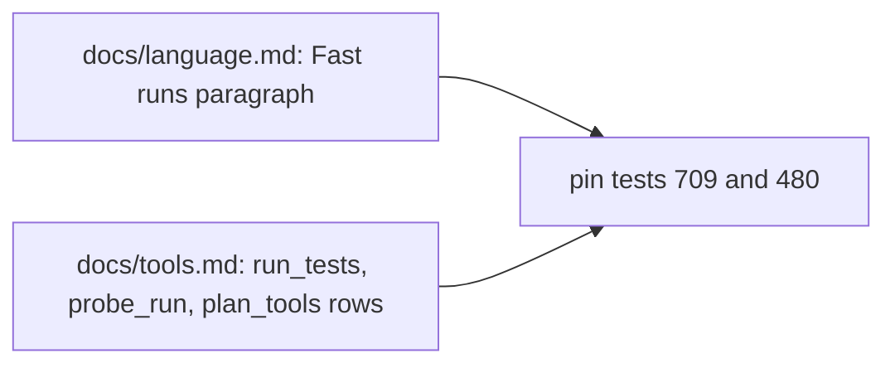

# Superlite: docs name the dropped-paths fast-run gate and the probe_run sandbox in their rows (B187, #722)

**Goal:** fix #722. `docs/language.md` ("Fast runs and `{files}`") and the `docs/tools.md` `run_tests` row say a dropped-paths `--fast` run only runs whole, and that only a full run takes the full-suite lock; the `probe_run` and `plan_tools` rows do not name the `run=` sandbox, the stale-adapter exit 2 or lint's `PROBE: run=` issue and warning. B181 put both facts on two end lines of `docs/tools.md` (#711, #714); this batch moves them into their rows and drops those lines.
**Architecture:** docs only, four exact text insertions or replacements and two deleted lines; two pin tests follow the texts.
**Tech stack:** Markdown; pytest pin tests (through `sl run_tests`).
**Spec:** this file, section Design; issue #722.
**Detail:** tests
**Target-min:** 11
**Wave0:** none
**Worktree:** none
**Coverage:** off

Global constraints:
- Every edit is an exact string from the Design section; no other wording in `docs/tools.md` or `docs/language.md` changes. New text holds no ` | ` (a table row keeps exactly one ` | `, the cell border).
- Standing rules for every lead and its workers (the owner's decisions, passed on by main): this repository is public: no host names, user names, home paths, other project or repository names, ticket keys or account names in code, tests, docs, commit messages, PR texts or issue comments (write "a Swift project", "a second Mac", "the machine"). Never change the machine's gate config or ~/.superlite/machine.json; tests and proofs use private temp homes and state dirs. No real app builds as proof; this repository's own test suite is the check. Priority of this round: scheduling and admission of test runs, parallel agents and the fleet, wall-clock and token efficiency. Measure before and after where the issue names a waste (seconds, runs, tokens) and put the figures into your notes. Friction with superlite itself goes to `sl feedback add`, not into this batch. Online research is allowed when something is unclear (official docs first, then how others solved it); name the source in your notes.
- Builds: the verdict is `sl run_tests` (the project's test command; a project with `.maxapp` runs `maxapp test`, which a build pool may place on another Mac, and a full run whose tree a green maxapp test stamp covers returns that result without a run); task trees build in <tree>/.build/DerivedData and any build of your own goes under .build/ of the worktree, never -derivedDataPath outside the worktree (your session scratchpad included; backlog cleanup removes scratchpad build folders when the worktree goes); a product, simulator or device build stays on this machine and runs only when an issue's acceptance asks for a running-app check.
- Simulators: append the UDID of each simulator you or a worker creates (`xcrun simctl create` or `clone`; a checker's `Simulators:` line marks its created ones) as one line to <worktree>/.superlite/simulators.txt; never list one you did not create; ship cleanup shuts down and deletes each listed one.

## Design

Behaviour (checked in code): `run_tests.py` sets `whole` for a `--fast` run whose paths were dropped (non-Python command without `{files}`) when no `-m`, no pass-through arguments and no honoured marker changed the command, and then runs it through `full_run_gate(a, "full", ...)` with `enabled=spec.get("lock", True)`: `machine.json` admission, else the toolchain's full-suite lock; `"lock": false` skips both. Lint (`plan_tools.py` `RUN_DRY`, `RUN_OUTSIDE`, `RUN_WORDS`) fails a `run=` entry with a dry-run flag or an outside tool (`gh`, `git`, `ssh`, `curl`, ...) and warns on a word such as `deploy`, `publish`, `push`.

Edits (each anchor occurs exactly once today):
1. `docs/language.md`, "Fast runs and `{files}`": replace ``ignores the `--fast` paths and runs whole, still labelled fast; `run_tests` prints`` with `FAST_LANG` (test below).
2. `docs/tools.md` `run_tests` row: replace ``a full run (no `--fast`, no `-m`, no `**Tests:** cmd=`) first takes the machine-wide full-suite lock `~/.superlite/locks/full-suite-<toolchain>.lock` `` with `FAST_ROW`.
3. `docs/tools.md` `probe_run` row: right after ``a `run=` probe's timeout is 3 x the measured start-up + 1 s (at most 60 s); `` insert `PROBE_ROW` and one space.
4. `docs/tools.md` `plan_tools` row: right after `says a build for the host platform skips that code. ` insert `LINT_PROBE` and one space.
5. `docs/tools.md`: delete the two end lines starting ``A `run=` probe entry runs`` and ``A `run_tests --fast` run whose paths are all dropped``; ``Backlog rules are split by reader`` becomes the last line.

Ruling: the #711 and #714 texts move from B181's two end lines into the `probe_run`, `plan_tools` and `run_tests` rows and the end lines go (because a reader of a row finds the fact there, and one copy costs fewer tokens than two) (lead's ruling).
Ruling: `tests/scripts/test_docs_709_hooks.py` and `tests/scripts/test_docs_480_full_suite_lock.py` change with the texts they pin; no open batch lists them (lead's ruling).
Ruling: one mechanical haiku task; the predicted total may miss the 11 min target (a single prose task), accepted because there is nothing to split (lead's ruling).

## Main diagram



## File structure

- `docs/language.md`: edit 1 (T1).
- `docs/tools.md`: edits 2 to 5 (T1).
- `tests/scripts/test_docs_709_hooks.py`: pins the rows instead of the end lines (T1).
- `tests/scripts/test_docs_480_full_suite_lock.py`: pins the new run_tests clause (T1).

## Task graph

```mermaid
%% schedule
gantt
  title Predicted schedule (mm:ss)
  dateFormat X
  axisFormat %M:%S
  section lane 1
  T1 Docs rows name the fast-run gate and :t1, 0, 442s
```




critical path: T1 (7.4 min) · peak width 1 · predicted build 7.4 min · predicted total ≈ 21.9 min (target ✗ 11.0)

## Package: docs

App type: docs. Categories: none (exact strings).
**Probe entry:** none (prose; pin tests cover it)

### T1 Docs rows name the fast-run gate and probe sandbox · Complexity 1 · Est. context 30k
**Owns:** docs/language.md, docs/tools.md, tests/scripts/test_docs_709_hooks.py, tests/scripts/test_docs_480_full_suite_lock.py
**Components:** 1
**LOC owned:** 40
**Tests:** fast
**Model:** haiku
**Kind:** mechanical
**Covers:** Design
**Produces:** docs text only
**Review Focus:** the tests below; `tests/scripts/test_docs_b67_tools.py`, `test_docs_b95_tools.py`, `test_docs_b16.py`, `test_docs_b32_tools.py`, `test_run_tests_paths_dropped_708.py` and every other `tests/scripts/test_docs*.py` stay green unchanged.
**Test code (verbatim):**
```python
# tests/scripts/test_docs_709_hooks.py: replace PROBE_LINE, FAST_LINE and test_end_lines with this block (keep HOOKS, FINISH, COMMIT and the other tests)
LANGUAGE = ROOT / "docs" / "language.md"
PROBE_ROW = (
    "a `run=` entry runs in a scratch `HOME` and working folder, without `GH_TOKEN`, `GITHUB_TOKEN`, `SSH_AUTH_SOCK` or other credential variables, and `probe_run` exits 2 on a generated adapter whose `run=` predates that sandbox (`probe_run: adapter's run= predates the sandbox; rebuild with plan_tools adapter`) (#711);"
)
LINT_PROBE = (
    "Lint fails a `run=` probe entry with `PROBE: run=<cmd> has a dry-run flag` or `PROBE: run=<cmd> runs <tool>` (a tool that reaches outside the machine, such as `gh`, `git`, `ssh` or `curl`) and warns `WARNING: PROBE: run=<cmd> names \"<word>\"` for a word such as `deploy`, `publish` or `push`, since probes run every `run=` entry for real with fuzzed arguments (#711)."
)
FAST_ROW = (
    "a full run (no `--fast`, no `-m`, no `**Tests:** cmd=`), and a `--fast` run whose paths are all dropped (it runs the whole command, still labelled fast: summary mode, ledger, no unit stamp) unless `-m`, pass-through arguments or an honoured marker narrow it (#714), passes the full-run gate (the `machine.json` admission below, else the lock; `\"lock\": false` skips both): it first takes the machine-wide full-suite lock `~/.superlite/locks/full-suite-<toolchain>.lock`"
)
FAST_LANG = (
    "ignores the `--fast` paths and runs whole, still labelled fast, and unless `-m`, pass-through arguments or an honoured marker narrow it, passes the full-run gate like a full run (`~/.superlite/machine.json` admission, else the toolchain's full-suite lock; `\"lock\": false` skips it); `run_tests` prints"
)


def _row(name):
    rows = [l for l in TOOLS.read_text().splitlines() if l.startswith(f"| `{name}` |")]
    assert len(rows) == 1, name
    return rows[0]


def test_rows_name_the_sandbox_and_the_gate():
    assert PROBE_ROW in _row("probe_run")
    assert LINT_PROBE in _row("plan_tools")
    assert FAST_ROW in _row("run_tests")
    for name in ("probe_run", "plan_tools", "run_tests"):
        r = _row(name)
        assert r.count(" | ") == 1 and r.rstrip().endswith("|"), name


def test_language_names_the_gate():
    text = LANGUAGE.read_text()
    assert FAST_LANG in text
    assert "still labelled fast; `run_tests` prints" not in text


def test_end_lines_moved_into_the_rows():
    lines = TOOLS.read_text().splitlines()
    assert not any(l.startswith(("A `run=` probe entry runs", "A `run_tests --fast` run whose paths")) for l in lines)
    assert lines[-1].startswith("Backlog rules are split by reader")
    assert TOOLS.read_text().count("predates that sandbox") == 1
```
```python
# tests/scripts/test_docs_480_full_suite_lock.py: in test_row_names_the_lock, the first `part` becomes
        "passes the full-run gate (the `machine.json` admission below, else the lock; `\"lock\": false` skips both): it first takes the machine-wide full-suite lock `~/.superlite/locks/full-suite-<toolchain>.lock`",
```
**Steps:** 1 edit the two test files, 2 run them: FAIL, 3 make edits 1 to 5 of the Design section, 4 run them and every `tests/scripts/test_docs*.py` plus `tests/scripts/test_run_tests_paths_dropped_708.py`: PASS
**Notes:** Edit with exact string replacement (the rows are single long lines); the docstring of test_docs_709_hooks.py gains `; the #711 and #714 texts sit in their rows (B187)` before its closing period.

## Review Focus

- T1: each new text sits in its row once, rows keep one ` | `, the two end lines are gone, `docs/language.md` keeps the strings `test_run_tests_paths_dropped_708.py` pins.

## Self-review

- Coverage: #722 part 1 (language.md, run_tests row), part 2 (probe_run row, plan_tools row); B181's end lines removed.
- One task, no edges; no placeholder; texts quoted once in tests and referenced by name in Design.
