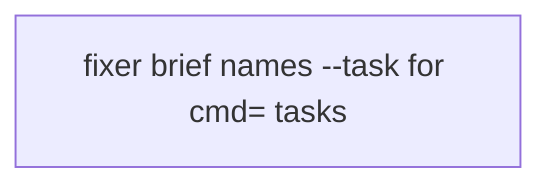

# Superlite: fixer briefs name `--task Tn --plan <plan file>` for a task with a **Tests:** cmd= (B198, #744)

**Goal:** fix #744: the `Verify:` paragraph of every fixer brief `findings route` writes says `run_tests --fast <the test files you touched> --background`. Without `--task Tn`, `run_tests` ignores the owning task's `**Tests:** fast cmd=<command>` and runs the project's own test command, which is the whole suite when that command takes no `{files}`. One fixer for a comment-only fix ran a 444-test suite (over 120 s) and ended NEEDS_CONTEXT when its Bash wait hit the 120 s default.
**Architecture:** `findings.shared_lines` gets the owning task's id, the resolved plan file and that task's `cmd=` command; a task brief whose task has a `cmd=` names `run_tests --fast <the test files you touched> --task Tn --plan <plan file> --background` and the command it runs. A task without `cmd=` keeps today's line byte for byte. The coordinator brief (no owning task) keeps today's line and adds one line saying why it has no `--task`. Every brief adds the Bash timeout for the wait.
**Tech stack:** Python 3.10+ stdlib, pytest (through `sl run_tests`).
**Spec:** this file, section Design; issue #744.
**Detail:** tests
**Target-min:** 11
**Wave0:** none
**Worktree:** none
**Coverage:** off

Global constraints:
- Every script line keeps the repo's `# O(...)` complexity comment; stdlib only; LF endings.
- Tests use `tmp_path` folders; never the machine's own `~/.superlite` or git common dir.
- `run_tests --fast` takes one or more paths (`nargs="+"`): a command `run_tests --fast --task T1` does not parse, so the brief keeps the `<the test files you touched>` placeholder; with `--task Tn` and a `cmd=`, run_tests runs that command and does not pass the paths (stderr says so).
- `run_tests.task_cmd_spec` reads `--plan` only when it is a file (`Path(plan).is_file()`); a run folder silently drops the `cmd=`. The brief's `--plan` value is therefore the plan file (`plan_tools.resolve_plan`), never the folder `findings route --plan` may have been given.
- Standing rules for every lead and its workers (the owner's decisions, passed on by main): this repository is public: no host names, user names, home paths, other project or repository names, ticket keys or account names in code, tests, docs, commit messages, PR texts or issue comments (write "a Swift project", "a second Mac", "the machine"). Never change the machine's gate config or ~/.superlite/machine.json; tests and proofs use private temp homes and state dirs. No real app builds as proof; this repository's own test suite is the check. Priority of this round: scheduling and admission of test runs, parallel agents and the fleet, wall-clock and token efficiency; measure before and after where the issue names a waste and put the figures into your report. Friction with superlite itself goes to `sl feedback add`, not into this batch. Online research is allowed when something is unclear (official docs first, then how others solved it); name the source.
- Builds: the verdict is `sl run_tests` (the project's test command; a project with `.maxapp` runs `maxapp test`, which a build pool may place on another Mac, and a full run whose tree a green maxapp test stamp covers returns that result without a run); task trees build in <tree>/.build/DerivedData and any build of your own goes under .build/ of the worktree, never -derivedDataPath outside the worktree (your session scratchpad included; backlog cleanup removes scratchpad build folders when the worktree goes); a product, simulator or device build stays on this machine and runs only when an issue's acceptance asks for a running-app check.
- Simulators: append the UDID of each simulator you or a worker creates (`xcrun simctl create` or `clone`; a checker's `Simulators:` line marks its created ones) as one line to `<worktree>/.superlite/simulators.txt`; never list one you did not create; ship cleanup shuts down and deletes each listed one.

## Design

Three brief kinds, one `Verify:` rule each:
- **Task brief, task has `cmd=`** (`testcmd.task_command` of the task's Tests field is not None): ``Verify: `<sl> run_tests --fast <the test files you touched> --task Tn --plan <plan file> --background` runs Tn's **Tests:** cmd= (`<command>`; the paths are not passed to it), then run the printed `wait:` line in the foreground (never as a background command) and end your turn only after it reports.``
- **Task brief, no `cmd=`**: today's line unchanged: ``Verify: `<sl> run_tests --fast <the test files you touched> --background`, then run the printed `wait:` line in the foreground (never as a background command) and end your turn only after it reports.`` (pinned by `tests/scripts/test_fixer_foreground_b26.py`).
- **Coordinator brief** (`task=coordinator`, the cross-task brief): today's line unchanged, followed by the line ``No `--task` here: the tasks owning these files are in progress, so the project's test command runs these files (a task's **Tests:** cmd= does not apply).``

Every brief: the existing cue line becomes ``The `--background` run prints a `next:` cue and, as its last line, the `wait:` line; give that wait's Bash call a timeout of 600000 ms (the default 120000 ms ends a longer wait early).``

Ruling: `--task` only for a task with `cmd=` (because the `cmd=` route is the bug; on an isolated stack a fleet worker's run without `--task` uses its own `worker-<Wn>` tree that leaves out files another busy fixer's brief names (#479), which a `--task` tree does not, so a task without `cmd=` keeps that protection - cost if wrong: a later issue adds `--task` to the plain line).
Ruling: the coordinator brief gets no `--task` (because its findings' owning tasks are running: `--task` would share that task's tree with its implementer - cost if wrong: a cross-task fix runs the project command, as today).
Ruling: adjacent fix: the 600000 ms Bash timeout line (because the issue's run ended NEEDS_CONTEXT at the 120000 ms Bash default while `run_tests --wait` waits up to 540 s; same paragraph, same file, no new design).
Ruling: the brief's `--plan` is `plan_tools.resolve_plan(plan)` (because run_tests reads `cmd=` only from a plan file).

## Task graph

```mermaid
%% schedule
gantt
  title Predicted schedule (mm:ss)
  dateFormat X
  axisFormat %M:%S
  section lane 1
  T1 Fixer brief names --task for cmd= tas :t1, 0, 278s
```





critical path: T1 (4.6 min) · peak width 1 · predicted build 4.6 min · predicted total ≈ 15.1 min (target ✗ 11.0)

## Package: findings

App type: CLI library. Categories: protocol (brief text other agents run verbatim).
**Probe entry:** none (text-shaped output; named tests cover it)

### T1 Fixer brief names --task for cmd= tasks · Complexity 2 · Est. context 45k
**Owns:** skills/subagent-driven-development/scripts/findings.py, tests/scripts/test_findings_task_verify_744.py
**Components:** 1
**LOC owned:** 120
**Tests:** fast
**Model:** sonnet
**Covers:** Design
**Produces:** findings.shared_lines(sl_path: str, task_id: str | None = None, plan_file: Path | None = None, cmd: str | None = None, coordinator: bool = False) -> list[str] · findings.task_cmd(task) -> str | None · findings.brief_text(..., plan_file: Path | None = None) (new keyword, last)
e.g. task_cmd(a pt.Task whose Tests field is `fast cmd=bash tests/run.sh`) -> "bash tests/run.sh"; task_cmd(SimpleNamespace(id="T1", owns=["a.py"])) -> None
e.g. shared_lines("/sl/sl") -> today's lines plus the 600000 ms clause on the cue line
**Review Focus:** the tests below; `tests/scripts/test_findings_route.py`, `test_findings_route_484.py`, `test_findings_brief_603.py`, `test_fixer_foreground_b26.py` and `test_fix_brief_cue_438_461.py` stay green unchanged.
**Test code (verbatim):**
```python
# tests/scripts/test_findings_task_verify_744.py
"""Fixer briefs name --task Tn --plan <plan file> for a task with a **Tests:** cmd=, so run_tests runs that command (#744)."""
import json
import re
import sys
from types import SimpleNamespace
import pytest
from test_plan_tools import SCRIPTS, make_plan
sys.path.insert(0, str(SCRIPTS))
import findings  # noqa: E402
import run_tests  # noqa: E402

PLAIN = "Verify: `/sl/sl run_tests --fast <the test files you touched> --background`, then run the printed `wait:` line in the foreground (never as a background command) and end your turn only after it reports."


def f(file, line, tier=1):
    return {"file": file, "line": line, "problem": "p", "fix": "x", "tier": tier}


@pytest.fixture
def run(tmp_path):
    root = tmp_path / "repo"; sd = root / ".superlite"; (sd / "fleet" / "reports").mkdir(parents=True)
    plan = make_plan(sd, [{"id": "T1", "owns": "src/a.py, tests/test_a.py", "tests": "fast cmd=bash tests/run.sh"},
                          {"id": "T2", "owns": "src/b.py", "tests": "fast"}], name="plan.md")
    def report(items):
        p = sd / "fleet" / "reports" / "FR1.json"
        p.write_text(json.dumps({"id": "W4", "label": "FR1", "status": "CHANGES_REQUESTED", "findings": items, "valid": True}))
        return str(p)
    return root, sd, plan, report


def brief(sd, fid):
    return (sd / "briefs" / f"fix-{fid}.md").read_text()


def test_cmd_task_brief_names_task_and_plan_file(run):
    root, sd, plan, report = run
    findings.route(sd, plan, [report([f("src/a.py", 3)])], "/sl/sl")
    t = brief(sd, "F-T1-1")
    assert f"Verify: `/sl/sl run_tests --fast <the test files you touched> --task T1 --plan {plan.resolve()} --background` runs T1's **Tests:** cmd= (`bash tests/run.sh`; the paths are not passed to it), then run the printed `wait:` line in the foreground (never as a background command) and end your turn only after it reports." in t.split("\n")
    assert PLAIN not in t.split("\n")


def test_run_folder_plan_becomes_the_plan_file(run):
    root, sd, plan, report = run
    findings.route(sd, sd, [report([f("src/a.py", 3)])], "/sl/sl")
    t = brief(sd, "F-T1-1")
    assert f"--task T1 --plan {plan.resolve()} --background" in t
    assert f"--plan {sd.resolve()} --background" not in t


def test_brief_command_takes_the_cmd_route(run, monkeypatch):
    root, sd, plan, report = run
    findings.route(sd, sd, [report([f("src/a.py", 3)])], "/sl/sl")
    m = re.search(r"--task (\S+) --plan (\S+) --background", brief(sd, "F-T1-1"))
    monkeypatch.chdir(root)
    spec = run_tests.task_cmd_spec(SimpleNamespace(task=m.group(1), plan=m.group(2)))
    assert spec is not None and spec["command"] == "bash tests/run.sh"


def test_task_without_cmd_keeps_the_plain_line(run):
    root, sd, plan, report = run
    findings.route(sd, plan, [report([f("src/b.py", 3)])], "/sl/sl")
    t = brief(sd, "F-T2-1")
    assert PLAIN in t.split("\n") and "--task" not in t.split("Verify:")[1].split("\n")[0]


def test_coordinator_brief_has_no_task_flag(run):
    root, sd, plan, report = run
    (sd / "pool.json").write_text(json.dumps({"agents": [{"id": "W1", "busy": True, "current": "T1"}]}))
    findings.route(sd, plan, [report([f("src/a.py", 3)])], "/sl/sl")
    t = brief(sd, "F-C-1")
    assert PLAIN in t.split("\n")
    assert "No `--task` here: the tasks owning these files are in progress, so the project's test command runs these files (a task's **Tests:** cmd= does not apply)." in t.split("\n")
    assert "--task T1" not in t


def test_every_brief_names_the_wait_timeout():
    text = "\n".join(findings.shared_lines("/sl/sl"))
    assert "The `--background` run prints a `next:` cue and, as its last line, the `wait:` line; give that wait's Bash call a timeout of 600000 ms (the default 120000 ms ends a longer wait early)." in text.split("\n")


def test_task_cmd_reads_the_tests_field(run):
    root, sd, plan, report = run
    import plan_tools as pt
    tasks = {t.id: t for t in pt.Plan.load(str(plan)).tasks}
    assert findings.task_cmd(tasks["T1"]) == "bash tests/run.sh"
    assert findings.task_cmd(tasks["T2"]) is None
    assert findings.task_cmd(SimpleNamespace(id="T1", owns=["a.py"])) is None
```
**Steps:** 1 write the test file, 2 run it: FAIL (`Red run:` line), 3 implement, 4 run it: PASS, then the five findings test files named in Review Focus.
**Notes:** `task_cmd(task)` is `testcmd.task_command(task.field_text("tests"))` when the task has `field_text`, else None (brief_text is also called with a bare `SimpleNamespace(id, owns)`). `route` computes `pt.resolve_plan(plan)` once and passes it as `plan_file`; `brief_text` falls back to `plan` when `plan_file` is None. `coordinator_text` calls `shared_lines(sl_path, coordinator=True)`. Keep `shared_lines("/abs/sl")` with no other argument returning today's paragraphs (plus the timeout clause), since other tests call it that way.

## Self-review

One task, one source file and its new test file; the five existing findings test files pin the unchanged lines. No placeholders; every Produces name is used by the tests.
