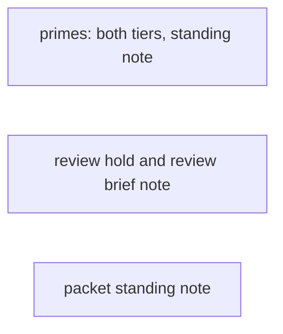

# Superlite: both tier primes in one build, standing note in script briefs, held review hints (B193, #735 #738 #741)

**Goal:** fix #735: `build_prime --plan P` also writes `prime-haiku.md` when the plan has a haiku task, so one `fleet spawn --for-dispatch` round sends both tiers. Fix #738: every worker brief a script writes (the primes, the review briefs of `fleet spawn --for-review|--package`, the final-review packet) carries the standing note of `.superlite/briefs/lead.md` without a flag, as fixer briefs already do. Fix #741: a committed task that shares a file with a task not committed yet gets no plain review hint but a `held until Tn commits` line; once all of them commit, one review hint names them together; `for_review` refuses the held case.
**Architecture:** all three reuse what exists: `build_prime.build_mini(plan, "haiku")` for the second prime, `findings.standing_note(sd)` for the note lines, `fleet_io.ledger_commits` and the plan's Owns and Also-touches paths for the share check.
**Tech stack:** Python 3.10+ stdlib, pytest (through `sl run_tests`).
**Spec:** this file, section Design; issues #735, #738, #741.
**Detail:** contracts
**Target-min:** 11
**Wave0:** none
**Worktree:** none
**Coverage:** off

Global constraints:
- Every script line keeps the repo's `# O(...)` complexity comment; stdlib only; LF endings.
- Tests use `tmp_path` folders and git repositories; never the machine's own `~/.superlite`, its gate config or `~/.superlite/machine.json`.
- With no `.superlite/briefs/lead.md` (or one without the standing-note line) every brief and prime stays byte-identical to today: existing tests stay green unchanged.
- Standing rules for every lead and its workers (the owner's decisions, passed on by main): this repository is public: no host names, user names, home paths, other project or repository names, ticket keys or account names in code, tests, docs, commit messages, PR texts or issue comments (write "a Swift project", "a second Mac", "the machine"). Never change the machine's gate config or ~/.superlite/machine.json; tests and proofs use private temp homes and state dirs. No real app builds as proof; this repository's own test suite is the check. Priority of this round: scheduling and admission of test runs, parallel agents and the fleet, wall-clock and token efficiency; measure before and after where the issue names a waste (seconds, runs, tokens) and put the figures into your report. Friction with superlite itself goes to `sl feedback add`, not into this batch. Online research is allowed when something is unclear (official docs first, then how others solved it); name the source.
- Builds: the verdict is `sl run_tests` (the project's test command; a project with `.maxapp` runs `maxapp test`, which a build pool may place on another Mac, and a full run whose tree a green maxapp test stamp covers returns that result without a run); task trees build in <tree>/.build/DerivedData and any build of your own goes under .build/ of the worktree, never -derivedDataPath outside the worktree (your session scratchpad included; backlog cleanup removes scratchpad build folders when the worktree goes); a product, simulator or device build stays on this machine and runs only when an issue's acceptance asks for a running-app check.
- Simulators: append the UDID of each simulator you or a worker creates (`xcrun simctl create` or `clone`; a checker's `Simulators:` line marks its created ones) as one line to `<worktree>/.superlite/simulators.txt`; never list one you did not create; ship cleanup shuts down and deletes each listed one.

## Design

#735 (main's ruling: build_prime writes both). A `build_prime` run whose kind is not `mini` (default tier sonnet, any `--prime full|slim`, an experiment claim) also builds `build_mini(plan, "haiku")` when `routing.read_tiers(plan)` gives any task the tier `haiku`, and writes it to `<folder of --out>/prime-haiku.md` (default `.superlite/prime-haiku.md`, the file `fleet._spawn` reads). Its bytes equal those of `build_prime --tier haiku --plan P`. Both primes are built and checked against `--max-bytes` before either is written. stdout keeps its first line `<sha256> <size>`; the haiku prime adds a second line `<sha256> <size> prime-haiku.md`. A plan without a haiku task writes no haiku prime and leaves an existing one alone. `--tier haiku` behaves as today.

#738. `findings.standing_note(sd)` returns the note line and its indented lines from `<sd>/briefs/lead.md`. Each writer appends them when non-empty:
- every prime kind (full, slim, mini): a `## Standing note` section after the preamble and `## Read first`, before the rest, `sd` = the folder of the output file. One copy per worker (the prime), not per task message: the cheaper place for the token budget.
- `fleet.for_review` (task ids and `--package`): the note lines after the Global constraints section, before `## Coordinator notes`.
- `pt_review packet`: a `## Standing note` section after the packet's first heading block, never cut by the token cap.

#741. Two committed or uncommitted tasks share a file when a path is in both tasks' Owns or Also-touches (`task.also_touches`). A task's share group is the transitive closure over shared files, across all plan tasks. `fleet_io.review_hints(sd, plan)` keeps its `[(label, reasons)]` shape:
- a hint-worthy (today's reasons, `no red run` included), uncovered, committed task whose group holds a task with no commit line in `progress.md` gets no hint; `fleet_io.held_hints(sd, plan)` lists it instead.
- a group with every task committed gives one hint whose label is the group's uncovered committed tasks in plan order joined by one space (`T1 T2`), reasons `Tn: r1; r2` per member that has reasons, then `shared <files, comma-separated>`. A task that shares no file keeps today's label and reasons byte-identical.
- printed by `fleet.for_dispatch` and `commit_task --dispatch` as `review: <label> (<reasons>); run <sl> fleet spawn --for-review <label> --plan P` and `review: T1 held until T2 commits (shared a.py)` (`until T2, T3 commit` for several). commit_task prints the lines whose tasks meet this call's committed ones.
- `fleet.for_review` refuses, before writing a brief or spawning: `BLOCKED: T1 shares a.py with T2, not committed yet; run --for-review T1 T2 after T2 commits`, exit 3, for every requested task (task ids or `--package`) whose group holds an uncommitted task.

Ruling: refuse, not warn, in `for_review`: the harm in #741 is a reviewer-fixer editing the file another worker edits; the fix after the last commit costs one wait (lead's ruling).
Ruling: Also-touches paths count as shared files: such a task edits the file the same way (lead's ruling).
Ruling: the note goes into the prime once instead of every task message, and into the final-review packet too, since #738 asks for every worker brief a script writes; `pt_review.py` is outside the batch list and no open batch lists it (lead's ruling).

## Task graph

```mermaid
%% schedule
gantt
  title Predicted schedule (mm:ss)
  dateFormat X
  axisFormat %M:%S
  section lane 1
  T2 held review hints group hints for_rev :t2, 0, 280s
  section lane 2
  T1 build_prime writes both tier primes a :t1, 0, 193s
  section lane 3
  T3 final-review packet carries the stand :t3, 0, 179s
```

critical path: T2 (4.7 min) · peak width 3 · predicted build 4.7 min · predicted total ≈ 13.2 min (target ✗ 11.0)

## Package: primes

App type: CLI library. Categories: protocol (prime bytes).
**Probe entry:** none (file-shaped outputs; named tests cover them)

### T1 build_prime writes both tier primes and the standing note · Complexity 3 · Est. context 34k
**Owns:** skills/subagent-driven-development/scripts/build_prime.py, skills/subagent-driven-development/SKILL.md, tests/scripts/test_build_prime_both_tiers_735.py, tests/scripts/test_prime_standing_note_738.py
**Components:** 1
**LOC owned:** 160
**Tests:** fast
**Model:** sonnet
**Covers:** Design
**Produces:** build_prime.note_section(sd: Path) -> str ("" when findings.standing_note(sd) is empty, else "## Standing note\n\n" + the lines joined by "\n") · build_prime.main(argv) -> int (also writes prime-haiku.md as in the Design)
e.g. main(["--plan", plan_with_a_mechanical_haiku_task, "--out", str(tmp/".superlite/prime.md")]) -> 0, writes prime.md and prime-haiku.md; prime-haiku.md bytes == those of main([... "--tier", "haiku", "--out", other/prime.md]) written to other/prime-haiku.md
**Review Focus:** `test_plain_build_writes_the_haiku_prime_too`: a plan with one `Kind: mechanical`/`Model: haiku` task -> both files, stdout has 2 lines, the second ends ` prime-haiku.md`; `test_haiku_prime_bytes_match_tier_haiku`: bytes equal; `test_no_haiku_task_writes_no_haiku_prime`: stdout 1 line, no file; `test_existing_haiku_prime_left_alone_without_haiku_task`; `test_haiku_prime_over_cap_writes_neither`: `--max-bytes` between the two sizes -> exit 1, neither file; `test_tier_haiku_unchanged`: `--tier haiku` writes only prime-haiku.md, 1 stdout line. `test_slim_full_mini_carry_the_note`: lead.md with the NOTE_HEAD line and two four-space lines -> each kind has `## Standing note` and both lines once; `test_no_lead_md_prime_unchanged`: bytes equal to the build before the change (compare with a build where briefs/lead.md is absent vs one whose lead.md lacks the note line). SKILL.md Prime bullet and step 2's haiku clause name the auto-built haiku prime and the note; doc pins in tests/scripts that grep SKILL.md stay green.
**Steps:** 1 failing tests, 2 run: FAIL, 3 implement, 4 run: PASS. Measure: on the test plan, `build_prime` calls needed before a dispatch can send both tiers, before (2) and after (1); report them.

## Package: review

App type: CLI library. Categories: state (ledger, fleet.json review records), protocol (printed hint lines).
**Probe entry:** none (named tests cover them)

### T2 held review hints, group hints, for_review refusal and standing note · Complexity 5 · Est. context 52k
**Owns:** skills/subagent-driven-development/scripts/fleet_io.py, skills/subagent-driven-development/scripts/fleet.py, skills/subagent-driven-development/scripts/commit_task.py, tests/scripts/test_review_hold_741.py, tests/scripts/test_review_brief_note_738.py
**Components:** 3
**LOC owned:** 190
**Tests:** fast
**Model:** sonnet
**Covers:** Design
**Produces:** fleet_io.share_group(pl, tid) -> list[str] (task ids in plan order, tid included) · fleet_io.review_hints(sd, plan) -> list[tuple[str, list[str]]] (label space-joined) · fleet_io.held_hints(sd, plan) -> list[tuple[str, list[str], list[str]]] (task, waiting ids, shared files) · fleet.for_review(...) unchanged signature, refuses the held case with exit 3
e.g. plan T1 (Owns a.py, seam T1<->T2), T2 (Owns a.py, b.py), T1 committed only -> review_hints [] and held_hints [("T1", ["T2"], ["a.py"])]; both committed -> review_hints [("T1 T2", ["T1: seam T1↔T2", "T2: seam T1↔T2", "shared a.py"])]
**Review Focus:** `test_hint_held_while_sharer_uncommitted`; `test_group_hint_after_last_commit`; `test_unshared_task_hint_unchanged` (today's label and reasons); `test_also_touches_counts_as_shared`; `test_transitive_group` (T1-T2 share a.py, T2-T3 share b.py, T3 uncommitted holds T1); `test_covered_member_left_out_of_label`; `test_for_dispatch_prints_held_line` and `test_commit_task_dispatch_prints_held_and_group_lines` (exact line text from the Design); `test_for_review_refuses_held_task` (exit 3, the BLOCKED text, no brief file, no spawn) and the same for `--package`; `test_review_brief_carries_standing_note`: lead.md with the note -> review-T1.md has the note lines once, after the constraints and before `## Coordinator notes` when `--note` is given; `test_review_brief_without_note_unchanged`. Existing tests test_fleet_for_review_422.py, test_fleet_io_review_422.py, test_review_brief_606.py, test_commit_task_b94.py stay green unchanged.
**Steps:** 1 failing tests, 2 run: FAIL, 3 implement, 4 run: PASS. Measure on the e.g. plan: premature `review:` lines at T1's commit before (1) and after (0), and hints after T2 commits (1 group hint); report them.

## Package: packet

App type: CLI library. Categories: protocol (packet text).
**Probe entry:** none (named tests cover them)

### T3 final-review packet carries the standing note · Complexity 2 · Est. context 30k
**Owns:** skills/subagent-driven-development/scripts/pt_review.py, tests/scripts/test_packet_standing_note_738.py
**Components:** 1
**LOC owned:** 60
**Tests:** fast
**Model:** sonnet
**Covers:** Design
**Produces:** pt_review packet writes `## Standing note` (from findings.standing_note(<root>/.superlite)) after the packet's first heading block
e.g. a packet run (as tests/scripts/test_packet_inline.py builds one) with .superlite/briefs/lead.md holding the note -> review-packet.md holds `## Standing note` and the note lines once
**Review Focus:** `test_packet_carries_standing_note`; `test_packet_note_survives_token_cap` (a small `--max-tokens` still keeps the note); `test_packet_without_note_unchanged` (no lead.md: bytes equal to a run without the change, i.e. no `## Standing note`). Existing packet tests stay green.
**Steps:** 1 failing tests, 2 run: FAIL, 3 implement, 4 run: PASS.

## Review Focus

- primes: protocol: byte equality of prime-haiku.md across both paths; no change without a haiku task or a note.
- review: state: covered tasks, ledger without commit lines; protocol: exact hint lines.
- packet: protocol: note placement and the cap.

## Self-review

Coverage: #735 T1; #738 T1 (primes), T2 (review briefs), T3 (packet); #741 T2. No shared files across tasks; no edges. Fixer briefs already carry the note (#603).
