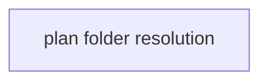

# Superlite: `--plan .superlite` from a subfolder never moves the fleet to a new folder (B178, #707)

**Goal:** fix #707: every `sl fleet` subcommand but `on` (and `name`) exits 2 when the state folder `--plan` names does not exist; a bare `--plan .superlite` from a subfolder of a checkout resolves to the nearest `.superlite` above that holds run state; the session's fleet moves only into a folder that holds run state or that `fleet on` names; docs/fleet.md states the rules.
**Architecture:** `state.py` gains `RUN_STATE`, `holds_run_state(sd)` and a bounded ancestor walk inside `plan_dir` for the bare value `.superlite`. `fleet.main` refuses a missing state folder before `_follow` and before any delegation. `fleet_state.follow` takes `named=False` and returns None for a target without run state unless named; `fleet._follow` passes `named=True` only for `on`.
**Tech stack:** Python 3.10+ stdlib, pytest (through `sl run_tests`); Markdown docs.
**Spec:** this file, section Design; issue #707.
**Detail:** tests
**Wave0:** none
**Worktree:** none
**Coverage:** off

Global constraints:
- Every script line keeps the repo's `# O(...)` complexity comment; stdlib only; LF endings.
- Tests use `tmp_path` projects and a private `SUPERLITE_HOME` (the suite's conftest sets it); never the real `~/.superlite`. Tests that change directory use `monkeypatch.chdir` and also `monkeypatch.setenv("PWD", str(cwd))` (`state._abs` joins the logical `$PWD`).
- Exact text: `error: --plan P: no run state at <abs>` where P is the `--plan` value as given and `<abs>` is `Path(state.resolve(plan)).resolve()`; one stderr line, no hint suffix, exit 2, printed before `_follow` and before `send`/`keys`/`wait`/`run`/`restore` delegate.
- Standing rules for every lead and its workers (the owner's decisions, passed on by main): this repository is public: no host names, user names, home paths, other project or repository names, ticket keys or account names in code, tests, docs, commit messages, PR texts or issue comments (write "a Swift project", "a second Mac", "the machine"). Never change the machine's gate config or ~/.superlite/machine.json; tests and proofs use private temp homes and state dirs. No real app builds as proof; this repository's own test suite is the check. Priority of this round: scheduling and admission of test runs, parallel agents and the fleet, wall-clock and token efficiency; measure before and after where the issue names a waste and put the figures into your report. Friction with superlite itself goes to `sl feedback add`, not into this batch. Online research is allowed when something is unclear (official docs first); name the source.
- Builds: the verdict is `sl run_tests` (the project's test command; a project with `.maxapp` runs `maxapp test`, which a build pool may place on another Mac, and a full run whose tree a green maxapp test stamp covers returns that result without a run); task trees build in <tree>/.build/DerivedData and any build of your own goes under .build/ of the worktree, never -derivedDataPath outside the worktree (your session scratchpad included; backlog cleanup removes scratchpad build folders when the worktree goes); a product, simulator or device build stays on this machine and runs only when an issue's acceptance asks for a running-app check.
- Simulators: append the UDID of each simulator you or a worker creates (`xcrun simctl create` or `clone`; a checker's `Simulators:` line marks its created ones) as one line to `<worktree>/.superlite/simulators.txt`; never list one you did not create; ship cleanup shuts down and deletes each listed one.

Ruling: `name` is exempt from the missing-folder refusal with `on`, because it reads only the checkout's `.git`, writes nothing and moves no fleet (it is already exempt from `_follow`), and SDD SKILL.md runs it for every Agent description, also before a run folder exists.
Ruling: run state is a folder holding any of `state.ACTIVE_MARKERS` (stable.json, prime.md, pool.json, orchestrator.json, inline-flow.json), `fleet.json` or the `session` owner file; `state.bind` writes `session` before its follow, so a bind always moves the fleet as before.
Ruling: the walk applies only to the bare relative value `.superlite` (normpath), starts at the cwd, stops at the cwd's git top (`state.git_root`, a file walk; a linked worktree's top, never the main checkout), and is skipped outside a checkout so `~/.superlite` is never picked; with no ancestor holding run state the value stays `<cwd>/.superlite`, so tools that create the folder behave as before.
Ruling: the walk lives in `state.plan_dir`, so every tool that takes `--plan .superlite` resolves alike (B161's one resolver), not only `fleet`.

## Design

### 1. Missing state folder (#707 Wanted 1)
`fleet.main`: after `_plan_problem`, when `plan is not None` and `argv[0]` is a subcommand other than `on` and `name`, `sd = Path(state.resolve(plan))`; when `not sd.is_dir()` print the exact line and return 2. `_plan_problem` keeps its `/dev/null` and `cannot create` checks (the latter now only reachable for `on`).

### 2. `.superlite` from a subfolder (#707 Wanted 2)
`state.plan_dir`: when `p.name == ".superlite"` and `os.path.normpath(os.fspath(plan_or_dir)) == ".superlite"` and `not holds_run_state(p)`, return the first `d / ".superlite"` holding run state for `d` in `(cwd, *cwd.parents)` up to and including `git_root(cwd)`; none (or no git top) -> `p`. Any other value is unchanged.

### 3. Fleet move only into a run (#707 Wanted 3)
`fleet_state.follow(sd, sid=None, fallback=None, named=False)`: right after `target` is computed, `if not named and not state.holds_run_state(target): return None` (nothing created, no lock file written). `fleet._follow(plan, named=False)` passes it; `fleet.main` calls `_follow(plan, named=argv[0] == "on")`.

### 4. Docs (#707 Wanted 4)
`docs/fleet.md` `## Commands`, the paragraph that starts "Run as": the `cannot create` clause names `fleet on`; then the sentences of T1 Notes.

## File structure

- `skills/subagent-driven-development/scripts/state.py`: `RUN_STATE`, `holds_run_state`, the walk in `plan_dir`; `Library:` docstring line names `holds_run_state`.
- `skills/subagent-driven-development/scripts/fleet.py`: the refusal in `main`, `_follow(plan, named)`.
- `skills/subagent-driven-development/scripts/fleet_state.py`: `follow(..., named=False)`.
- `docs/fleet.md`: the rules.
- `tests/scripts/test_fleet_plan_folder_707.py` (new); `tests/scripts/test_fleet_cli_b54.py`, `tests/scripts/test_fleet_follow_580.py`, `tests/scripts/test_fleet_follow_cli_580.py` (targets gain a run marker or the new expectation).

## Task graph

## Package: plan folder

App type: CLI. Categories: state (folder resolution), protocol (exit codes and stderr text).
**Probe entry:** none (path-shaped inputs; named tests cover them)

### T1 fleet --plan folder resolution and follow gate · Complexity 2 · Est. context 45k
**Owns:** skills/subagent-driven-development/scripts/state.py, skills/subagent-driven-development/scripts/fleet.py, skills/subagent-driven-development/scripts/fleet_state.py, docs/fleet.md, tests/scripts/test_fleet_plan_folder_707.py, tests/scripts/test_fleet_cli_b54.py, tests/scripts/test_fleet_follow_580.py, tests/scripts/test_fleet_follow_cli_580.py
**Components:** 3
**LOC owned:** 190
**Tests:** fast
**Kind:** design
**Model:** sonnet
**Covers:** 1, 2, 3, 4
**Produces:** state.holds_run_state(sd) -> bool
e.g. holds_run_state(folder with orchestrator.json) -> True; holds_run_state(folder with only briefs/ and run-config.json) -> False; holds_run_state(missing path) -> False
**Produces:** fleet_state.follow(sd, sid=None, fallback=None, named=False) -> dict | None
**Review Focus:** the refusal runs before `_follow` and before every delegation; `name` and `on` pass; the walk never leaves the git top; `state.bind`'s follow still moves.
**Tests:** new file `tests/scripts/test_fleet_plan_folder_707.py` (imports as `test_fleet_cli_b54.py` does: `from test_plan_tools import SCRIPTS`; a repo is `tmp_path / "repo"` with a `.git` folder; a run is `.superlite/orchestrator.json` = `{}` unless named):
- `test_status_from_empty_subfolder_reads_the_top_run`: repo run with `fleet.json` `{"on": true, "workers": {"W1": {"state": "ready", "task": null}}, ...default keys}`; cwd `repo/.superlite/fleet/reports` (created, empty) -> `fleet.main(["status", "--plan", ".superlite"]) == 0`, stdout has a line starting `W1`, `not (cwd / ".superlite").exists()`.
- `test_status_from_subfolder_without_any_run_exits_2`: repo without `.superlite`; cwd `repo/a/b` -> returns 2, stderr == `f"error: --plan .superlite: no run state at {(cwd / '.superlite').resolve()}\n"`, `not (cwd / ".superlite").exists()`.
- `test_missing_folder_refused_by_every_subcommand_but_on_and_name` (parametrized argv, `M = tmp_path / "x" / ".superlite"`): `["off"]`, `["status"]`, `["spawn", "--role", "research"]`, `["stop", "--all"]`, `["report", "W1"]`, `["send", "W1", "--text", "hi"]`, `["keys", "W1", "y"]`, `["wait"]`, `["run", "--layer", "tui"]`, `["restore"]`, each plus `["--plan", str(M)]` -> 2, stderr == `f"error: --plan {M}: no run state at {M.resolve()}\n"`, `not (tmp_path / "x").exists()`.
- `test_name_with_missing_folder_still_prints`: `fleet.main(["name", "T1", "--plan", str(M)]) == 0`, stdout one line starting `sl:`, `not M.exists()`.
- `test_on_creates_the_missing_folder_and_takes_the_fleet`: session `s1` (`SUPERLITE_SESSION_ID`) with an owned, remembered fleet on in `S = tmp_path/"S"/".superlite"` holding W1; `fleet.main(["on", "--plan", str(N)])` with `N = tmp_path/"N"/".superlite"` missing -> 0, `fs.is_on(N)`, `"W1" in fs.load(N)["workers"]`, stderr has `fleet: this session's fleet moved from`.
- `test_fleet_never_moves_into_a_missing_folder`: same session fleet in S; `fleet.main(["status", "--plan", str(N)]) == 2` -> `fs.is_on(S)`, `"moved_to" not in fs.load(S)`, `not N.exists()`, `"moved" not in stderr`.
- `test_follow_into_a_folder_without_run_state_is_none`: S as above, W an empty existing folder -> `fs.follow(W, "s1") is None`, `not fs.path(W).exists()`, S unchanged; then `fs.follow(W, "s1", named=True)` returns the move dict.
- `test_follow_into_a_run_moves` (parametrized marker `stable.json`, `orchestrator.json`, `session`, `fleet.json` with `{"on": false}`): W holds the marker -> `fs.follow(W, "s1")` returns `{"from": str(S.resolve()), "to": str(W.resolve()), "workers": 1}`.
- `test_plan_dir_bare_value_walks_to_nearest_run`: repo run at `repo/.superlite`; `repo/a/.superlite` holds only `session`; cwd `repo/a/b/c` -> `state.plan_dir(".superlite").resolve() == (repo/"a"/".superlite").resolve()`; remove `repo/a/.superlite/session` -> resolves to `repo/.superlite`; also `state.plan_dir("./.superlite")` gives the same.
- `test_plan_dir_own_run_wins_and_other_values_unchanged`: cwd `repo/a` with its own `.superlite/stable.json` -> `plan_dir(".superlite")` is `repo/a/.superlite`; cwd `repo/b` (no `.superlite`) -> `plan_dir(str(repo/"b"/".superlite"))` (absolute) and `plan_dir("x/.superlite")` stay `repo/b/.superlite` and `repo/b/x/.superlite`.
- `test_plan_dir_walk_stops_at_the_checkout_top`: `outer/.superlite/stable.json`, `outer/inner/.git` folder, cwd `outer/inner/sub` -> `plan_dir(".superlite").resolve() == (outer/"inner"/"sub"/".superlite").resolve()`.
- `test_holds_run_state`: the three `e.g.` lines above.
Existing tests: `test_fleet_cli_b54.py::test_new_plan_file_in_a_writable_folder_passes_the_check` becomes `test_new_plan_file_without_run_state`: `status` with that plan -> 2 and the exact line (`<abs>` = `(tmp_path/"docs"/".superlite").resolve()`), then `on` with the same plan -> 0 and the folder exists. In `test_fleet_follow_580.py` (`test_follow_moves_fleet`, `test_follow_fallback`, `test_follow_never_overwrites_a_target_report`, `test_follow_twice_is_a_no_op`) and `test_fleet_follow_cli_580.py::test_wait_delegation_follows_first` the target W gains `stable.json` (`{}`) before the follow; their assertions stay.
**Steps:** 1 failing tests, 2 run: FAIL, 3 implement, 4 run: PASS
**Notes:** `RUN_STATE = ACTIVE_MARKERS + ("fleet.json", OWNER)` next to ACTIVE_MARKERS. In `plan_dir` the walk uses the logical cwd `_abs(".")` and `git_root` of it; compare folders by equality in the loop (`if d == top: break` after checking d). docs/fleet.md sentences, appended to the "Run as" paragraph: "Every subcommand but `on` and `name` exits 2 when the state folder `--plan` names does not exist: `error: --plan P: no run state at <absolute path>`; nothing is created and no fleet moves. `--plan .superlite` (that bare value) given from a subfolder of a checkout names the nearest `.superlite` at or above the current folder, up to the checkout's top, that holds run state (a plan, pool, prime, orchestrator, inline-flow, fleet or session file); with none it is the current folder's. The session's fleet follows only into a folder that holds run state or that `fleet on` names (`fleet: this session's fleet moved from A to B`)." Add `holds_run_state` to state.py's docstring `Library:` list.
