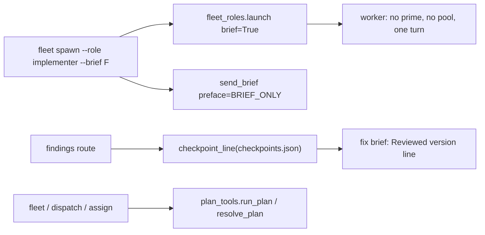
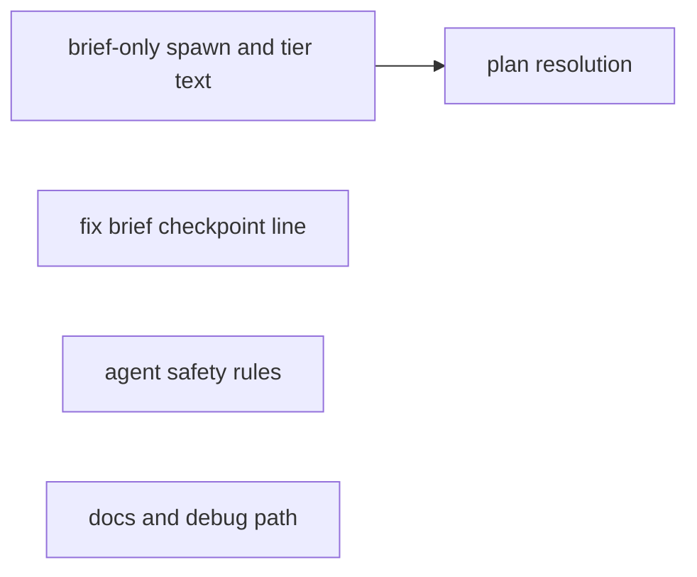

# Superlite: brief-only fleet roles and fixer safety rules (B162, #669, #670)

**Goal:** fix #669 (a fleet role for a brief-only build task outside a plan run, a package reviewer that commits its own fixes outside a run, the roles that take no `--tier` named, a debug path under fleet, one place for `--plan` resolution) and #670 (fixer rules against bulk rewrites, vacuous wording proofs, self-matching `pgrep -f` waits and shared-tree reverts; every fixer brief names the reviewed checkpoint).
**Architecture:** `fleet_roles.launch` gains a `brief` flag; `fleet._spawn` starts an implementer with `--brief` and no prime as a one-turn, pool-less worker whose message carries `fleet_roles.BRIEF_ONLY`; `fleet.py`, `dispatch.py` and `assign.py` resolve the plan through `plan_tools.run_plan`/`resolve_plan`; `findings.checkpoint_line` adds a `Reviewed version:` line to both fix briefs; agent texts and docs carry the rules.
**Tech stack:** Python 3.10+ stdlib, pytest (through `sl run_tests`); Markdown agent files and docs.
**Spec:** this file, section Design; issues #669 and #670.
**Detail:** contracts
**Target-min:** 11
**Wave0:** none
**Worktree:** none
**Max chars:** 30000

Global constraints:
- Every script line keeps the repo's `# O(...)` complexity comment; stdlib only; LF endings.
- Tests use `tmp_path` homes and state dirs and the in-process Herdr fake of `tests/scripts/test_fleet.py` (`world`); never the real `~/.superlite`.
- Keep every phrase an existing test asserts: before changing a line, grep `tests/` for it; append or extend, never drop a pinned phrase.
- Standing rules for every lead and its workers (the owner's decisions, passed on by main): this repository is public: no host names, user names, home paths, other project or repository names, ticket keys or account names in code, tests, docs, commit messages, PR texts or issue comments (write "a Swift project", "a second Mac", "the machine"). Never change the machine's gate config or ~/.superlite/machine.json; tests and proofs use private temp homes and state dirs. No real app builds as proof; this repository's own test suite is the check. Priority of this round: scheduling and admission of test runs, parallel agents and the fleet, wall-clock and token efficiency; measure before and after where the issue names a waste and put the figures into your report. Friction with superlite itself goes to `sl feedback add`, not into this batch. Online research is allowed when something is unclear (official docs first); name the source in your report.
- Builds: the verdict is `sl run_tests` (the project's test command; a project with `.maxapp` runs `maxapp test`, which a build pool may place on another Mac, and a full run whose tree a green maxapp test stamp covers returns that result without a run); task trees build in <tree>/.build/DerivedData and any build of your own goes under .build/ of the worktree, never -derivedDataPath outside the worktree (your session scratchpad included; backlog cleanup removes scratchpad build folders when the worktree goes); a product, simulator or device build stays on this machine and runs only when an issue's acceptance asks for a running-app check.
- Simulators: append the UDID of each simulator you or a worker creates (`xcrun simctl create` or `clone`; a checker's `Simulators:` line marks its created ones) as one line to `<worktree>/.superlite/simulators.txt`; never list one you did not create; ship cleanup shuts down and deletes each listed one.

## Coverage

| Category | State | Basis |
|---|---|---|
| Scope and success criteria | settled | #669 Wanted 1-5 plus the owner's comment (plan resolution); #670 Wanted 1-6 |
| Domain and data model | ruled | `launch()` dict keeps its keys; a fleet.json worker record gains `brief_only: true` only for a brief-only implementer |
| Persistence and migration | ruled | no new files; checkpoints.json is read, never written |
| Interfaces and contracts | ruled | `launch(role, tier, cfg, output=None, brief=False)`; `send_brief(..., preface="")`; `checkpoint_line(st, task_id=None) -> str`; `fleet.plan_file` removed |
| UI states | n/a | CLI text only |
| Concurrency and state ownership | ruled | a brief-only implementer gets no pool.json entry, so `dispatch` never reuses it for a plan task |
| Error handling and recovery | ruled | no prime and no `--brief`: BLOCKED exit 3 as today, with the `--brief` tail; a run folder without a plan: exit 2 with `plan_tools.PlanError`'s text |
| Security and privacy | n/a | no new input surface; briefs are local files |
| Performance and limits | ruled | no runtime cost: one json read per fix brief; the issues' wastes (a 40 min self-matching wait, a NEEDS_CONTEXT round, uncommitted reviewer fixes) are worker behaviour removed by rule, not measurable in this batch |
| Observability | ruled | the brief-only BLOCKED tail; the fix brief's `Reviewed version:` line; report lines `- grep: 0 matches` and `shared tree: only the fix` |
| Testing strategy | ruled | unit tests per task; agent-text and doc tests read the files |
| Compatibility | ruled | an implementer with prime.md present keeps prime-then-brief; for-dispatch's BLOCKED line stays byte-identical; plan defaults now prefer stable.json over pool.json |
| Rollout | ruled | ships with the next version; rollback reverts the PR |
| Research unknowns | settled | code paths read by five research workers (notes) |

Ruling: brief-only build outside a plan run is `fleet spawn --role implementer --brief FILE` without prime.md (main's ruling).
Ruling: a package-reviewer outside a run commits its own changed files with a plain `git commit` (main's ruling).
Ruling: brief-only mode starts only when prime.md (prime-haiku.md for haiku) is missing (because an implementer spawned with `--brief` inside a plan run keeps today's prime-then-brief path byte-identical; cost if wrong: a stale prime.md makes a brief-only worker read a plan prime first).
Ruling: a brief-only implementer is one-turn and gets no pool entry (because it holds no prime, so a later dispatch must never reuse it for a plan task).
Ruling: the four safe-edit rules go into package-reviewer.md too, verbatim (because it fixes in the same shared tree; cost: four lines).
Ruling: `fleet spawn --for-dispatch` builds no fixer brief (research R3): `findings.py` `brief_text` and `coordinator_text` are the only fixer brief builders, so #670 Wanted 5 is met there.
Ruling: plan detail `contracts` (text rules and small wiring; named tests with exact values suffice).
Ruling: skills/subagent-driven-development/SKILL.md shows no `--tier` spawn example, so it needs no change; agents/implementer.md (another batch's file) gets a follow-up for the brief-only start; the brief-only message carries the rule meanwhile.

## Design

### 1. Brief-only implementer (#669 Wanted 1)
`fleet_roles.launch(..., brief=True)` for `implementer` returns `prime: False, pool: False, one_turn: True`, every other key as without it; other roles ignore `brief`. `fleet._spawn(..., brief=False)`: when `launch["prime"]` and the prime file is missing, `brief=True` relaunches with `brief=True` and marks the record `brief_only: True`; `brief=False` prints `BLOCKED: no <sd>/<prime>; run build_prime [--tier haiku ]--plan PLAN first, or pass --brief FILE for a brief-only task outside a plan run` and exits 3. `main` passes `brief=bool(a.brief)` and, for a brief-only worker, `fio.send_brief(..., preface=fleet_roles.BRIEF_ONLY)`. `for_dispatch`'s `BLOCKED: Tn not sent (no <p>; run build_prime --plan PLAN first)` is unchanged.

### 2. `--tier` refusal (#669 Wanted 3)
Reviewers and the checker raise `ValueError("<role> takes no --tier (its agent file sets the model); --tier works for implementer, fixer, research and writer")`.

### 3. Plan resolution in one place (#669 owner comment)
`fleet.plan_file` goes; its callers use `orchestrator.plan_file(sd, plan)` (the `--plan` file, else `plan_tools.run_plan(sd)`: stable.json, pool.json, plan.md). `for_dispatch` and `for_review` default to `str(pt.run_plan(sd) or nt.DEFAULT_PLAN)`; `main`'s run-folder expansion uses `pt.resolve_plan` and prints its PlanError (exit 2). `dispatch.py` and `assign.py`: `--plan` goes through `pt.resolve_plan` (PlanError: exit 2), no `--plan` takes `pt.run_plan(<run folder>)` (dispatch: `sd`; assign: `Path(a.pool).parent`), else `nt.DEFAULT_PLAN`.

### 4. Fixer briefs name the reviewed checkpoint (#670 Wanted 5)
`findings.checkpoint_line(st, task_id)` reads a checkpoints.json dict; `brief_text` adds it after the `Task:` line (task's newest checkpoint, else the chain head), `coordinator_text` after its `Task: none` line (chain head). Checkpoints chain, so the head holds every checkpointed file.

### 5. Agent texts (#669 Wanted 2, #670 Wanted 1-4, 6)
Four verbatim bullets (section T4) in the three fixer files and package-reviewer.md; package-reviewer gains the outside-a-run commit rule; fixing.md names both.

### 6. Docs and debug path (#669 Wanted 3, 4)
skill fleet.md, docs/fleet.md, docs/skills-and-agents.md name the brief-only implementer, the roles without `--tier`, the reviewer's outside-a-run commit and the `Reviewed version:` line; commands/debug.md names the fleet-on path.

## File structure

- `skills/subagent-driven-development/scripts/fleet_roles.py`: `launch(brief=)`, `BRIEF_ONLY`, tier refusal text.
- `skills/subagent-driven-development/scripts/fleet.py`: brief-only spawn; plan resolution via plan_tools.
- `skills/subagent-driven-development/scripts/fleet_io.py`: `send_brief(preface=)`.
- `skills/subagent-driven-development/scripts/dispatch.py`, `assign.py`: plan default via plan_tools.
- `skills/subagent-driven-development/scripts/findings.py`: `checkpoint_line`, used by both fix briefs.
- `agents/fixer-*.md`, `agents/package-reviewer.md`, `skills/subagent-driven-development/fixing.md`: rules.
- `skills/subagent-driven-development/fleet.md`, `docs/fleet.md`, `docs/skills-and-agents.md`, `commands/debug.md`: docs.



## Task graph

```mermaid
%% schedule
gantt
  title Predicted schedule (mm:ss)
  dateFormat X
  axisFormat %M:%S
  section lane 1
  T1 brief-only spawn and tier text :t1, 0, 276s
  T2 plan resolution :t2, 276, 270s
  section lane 2
  T5 docs and debug path :t5, 0, 226s
  section lane 3
  T4 agent safety rules :t4, 0, 225s
  section lane 4
  T3 fix brief checkpoint line :t3, 0, 181s
```





critical path: T1 → T2 (9.1 min) · peak width 4 · predicted build 9.1 min · predicted total ≈ 17.6 min (target ✗ 11.0)

## Package: fleet roles

**Probe entry:** none (CLI wiring over Herdr; the Review Focus cases are named tests)

### T1 brief-only spawn and tier text · Complexity 4 · Est. context 52k
**Owns:** skills/subagent-driven-development/scripts/fleet_roles.py, skills/subagent-driven-development/scripts/fleet.py, skills/subagent-driven-development/scripts/fleet_io.py, tests/scripts/test_fleet_roles.py, tests/scripts/test_fleet_dispatch_round.py
**Components:** 3
**LOC owned:** 110
**Tests:** fast
**Model:** sonnet
**Covers:** 1, 2
**Produces:** fleet_roles.launch(role: str, tier: str | None, cfg: dict, output: str | None = None, brief: bool = False) -> dict
e.g. launch("implementer", None, CFG, brief=True) -> {"role": "implementer", "agent": "superlite:implementer", "model": "sonnet", "effort": "medium", "argv": ["--agent", "superlite:implementer", "--model", "sonnet", "--effort", "medium", "--disallowedTools", "AskUserQuestion"], "prime": False, "pool": False, "one_turn": True}
e.g. launch("fixer", "1", CFG, brief=True) == launch("fixer", "1", CFG)
e.g. launch("package-reviewer", "opus", CFG) raises ValueError("package-reviewer takes no --tier (its agent file sets the model); --tier works for implementer, fixer, research and writer")
**Produces:** fleet_roles.BRIEF_ONLY: str
e.g. BRIEF_ONLY == "No prime and no plan run: this brief is your whole task (no READY reply, no `sl task`, no `commit_task`). Commit only the files you changed and their tests with plain `git add <files>` and `git commit` in the brief's folder; for this task that replaces your agent file's prime, task-message and commit rules."
**Produces:** fleet_io.send_brief(sd: Path, wid: str, brief: str, label: str = "", full: bool = False, preface: str = "") -> str
e.g. send_brief(sd, "W1", "/r/.superlite/briefs/b.md", preface=BRIEF_ONLY) prompts W1 with BRIEF_ONLY + " " + fleet_report.brief_message("implementer", "/r/.superlite/briefs/b.md") and returns "b"
**Review Focus:** `test_launch_brief_only_implementer`: the first e.g. above, exact dict; `test_launch_brief_ignored_for_other_roles`: fixer tier 1, research, package-reviewer give the same dict with and without `brief=True`; `test_tier_refusal_names_tier_roles` (parametrized package-reviewer, final-reviewer, checker): `pytest.raises(ValueError, match=r"^<role> takes no --tier \(its agent file sets the model\); --tier works for implementer, fixer, research and writer$")`; `test_spawn_brief_only_implementer_without_prime` (world fake, prime.md removed): `fleet.main(["spawn", "--role", "implementer", "--brief", F, "--plan", str(sd)])` returns 0, no prompt names `prime.md`, exactly one prompt starts with `BRIEF_ONLY` and contains `Read <abs F>`, pool.json lists no agent for the new worker, its fleet.json record has `one_turn: True` and `brief_only: True`; `test_spawn_implementer_with_prime_and_brief_keeps_prime`: prime.md present, same call: the prime prompt comes first, the brief prompt has no `BRIEF_ONLY`, the pool has the worker; `test_spawn_implementer_no_prime_no_brief_blocked`: returns or raises exit 3, stdout is exactly `BLOCKED: no <sd>/prime.md; run build_prime --plan PLAN first, or pass --brief FILE for a brief-only task outside a plan run`, and no Herdr start call happened
**Steps:** 1 failing tests, 2 run: FAIL, 3 implement, 4 run: PASS
**Notes:** `_spawn` (fleet.py ~392) computes the prime file name after `launch`; keep that order and relaunch with `brief=True` only in the missing-prime case. Spawn tests go in tests/scripts/test_fleet_roles.py and import `world`/`fleet` from test_fleet.py as tests/scripts/test_fleet_roles_spawn.py does. tests/scripts/test_fleet_dispatch_round.py lines 26 and 35: update only an assertion whose line comes from the plain spawn path (line 43's for-dispatch line stays). Keep `match="checker takes no --tier"` in test_fleet_roles_checker_600.py passing.

### T2 plan resolution · Complexity 3 · Est. context 44k
**Owns:** skills/subagent-driven-development/scripts/fleet.py, skills/subagent-driven-development/scripts/dispatch.py, skills/subagent-driven-development/scripts/assign.py, tests/scripts/test_plan_resolve_669.py
**Components:** 3
**LOC owned:** 70
**Tests:** fast
**Model:** sonnet
**Covers:** 3
**Review Focus:** `test_for_dispatch_default_prefers_stable_json`: sd with stable.json `{"plan": A}` and pool.json `{"plan": B}` (both files exist): `fleet.for_dispatch(sd, None, root)` passes A to `orchestrator.require` (monkeypatch it to record and return 3); `test_for_review_default_prefers_stable_json`: same for `fleet.for_review(sd, None, root, ["T1"])`; `test_dispatch_default_prefers_stable_json`: `dispatch.main(["--pool", str(sd/"pool.json")])` with `state.resolve` returning sd: require gets A; `test_assign_default_prefers_stable_json`: `assign.main(["--task", "T1", "--pool", str(sd/"pool.json")])` parses A (monkeypatch `nt.taskgraph`/`nt.parse_plan` to record); `test_dispatch_plan_md_fallback`: no stable.json, no pool.json, sd/plan.md exists: require gets sd/plan.md; `test_dispatch_run_folder_without_plan_exits_2`: `dispatch.main(["--plan", str(empty_sd)])` returns 2 and stderr holds "is a run folder with no plan file"; `test_fleet_has_no_own_plan_file`: `not hasattr(fleet, "plan_file")`; `test_brief_constraints_use_run_plan`: only sd/plan.md (with a Global constraints list) exists: `fleet spawn --role research --brief F --plan sd` appends its constraints as today's stable.json case does
**Steps:** 1 failing tests, 2 run: FAIL, 3 implement, 4 run: PASS
**Notes:** fleet.py callers at ~669, ~920, ~1110 switch to `orchestrator.plan_file(sd, plan)`; `for_dispatch` ~556 and `for_review` ~633 to `str(pt.run_plan(sd) or <their DEFAULT_PLAN>)`; `main` ~1082 to `pt.resolve_plan` with `except pt.PlanError as e: print(f"error: {e}", file=sys.stderr); return 2`. dispatch.py ~398, assign.py ~107. Run the existing tests that touch these (test_fleet_for_dispatch.py, test_fleet_dispatch_round.py, test_fleet_brief_constraints_635.py, test_dispatch_pool_state_595.py, test_plan_folder_668.py) with your files; a test that pinned pool.json-over-stable.json is updated to the new order (name it in your report).

## Package: fixer briefs

**Probe entry:** none (checkpoint_line takes a dict, not one text argument; the Review Focus cases are named tests)

### T3 fix brief checkpoint line · Complexity 3 · Est. context 40k
**Owns:** skills/subagent-driven-development/scripts/findings.py, tests/scripts/test_fixer_brief_checkpoint_670.py
**Components:** 1
**LOC owned:** 60
**Tests:** fast
**Model:** sonnet
**Covers:** 4
**Produces:** findings.checkpoint_line(st: dict | None, task_id: str | None = None) -> str
e.g. checkpoint_line({"run": "p-20261113", "entries": [{"task": "T1", "sha": "a1"}, {"task": "T2", "sha": "b2"}, {"task": "T1", "sha": "c3"}]}, "T2") -> "Reviewed version: T2's checkpoint b2 (ref refs/superlite/p-20261113/T2): `git show b2:<path>` prints a file as reviewed; restore from it or from your own saved patch, never with `git checkout --` in the shared tree."
e.g. checkpoint_line(<same st>, None) -> "Reviewed version: newest checkpoint c3 (T1, ref refs/superlite/p-20261113/T1): `git show c3:<path>` prints a file as reviewed; restore from it or from your own saved patch, never with `git checkout --` in the shared tree."
e.g. checkpoint_line(<same st>, "T9") -> the same text as checkpoint_line(<same st>, None)
e.g. checkpoint_line(None, "T1") -> "Reviewed version: no checkpoint yet; save `git diff -- <file>` as a patch under .superlite/ before an experiment and revert with `git apply -R` of that patch, never with `git checkout --` in the shared tree."
**Review Focus:** `test_checkpoint_line_task_entry`, `test_checkpoint_line_chain_head`, `test_checkpoint_line_unknown_task_uses_head`, `test_checkpoint_line_none` and `test_checkpoint_line_empty_entries` (`{"run": "r", "entries": []}` gives the no-checkpoint text): the e.g. values exactly; `test_brief_text_names_task_checkpoint`: monkeypatch `findings.commit_task.autocommit.load_state` to return the st above; `brief_text(...)` for task T2 has `checkpoint_line(st, "T2")` as the line right after its `Task: T2 · Owns: ...` line; `test_coordinator_text_names_newest_checkpoint`: `coordinator_text(...)` has `checkpoint_line(st, None)` right after its `Task: none · running: ...` line; `test_route_brief_file_names_checkpoint`: a `route()` call as in the existing route tests writes a brief file holding a `Reviewed version:` line
**Steps:** 1 failing tests, 2 run: FAIL, 3 implement, 4 run: PASS
**Notes:** the ref is `f"{commit_task.autocommit.REF_ROOT}/{st['run']}/{tid}"`; a task's entry is the last one whose `task` equals it; no `run` key or a non-list `entries` reads as no checkpoint. Keep tests/scripts/test_fixer_red_brief_b65.py green.

## Package: agent texts and docs

**Probe entry:** none (Markdown only)

### T4 agent safety rules · Complexity 2 · Est. context 36k
**Owns:** agents/fixer-opus.md, agents/fixer-sonnet-high.md, agents/fixer-sonnet.md, agents/package-reviewer.md, skills/subagent-driven-development/fixing.md, tests/scripts/test_fleet_roles_docs.py
**Components:** 2
**LOC owned:** 60
**Tests:** fast
**Model:** sonnet
**Covers:** 5
**Review Focus:** `test_safe_edit_block_in_fixers_and_reviewer`: each of the four agent files holds the four bullets below verbatim, each as one line (`SAFE_EDITS` list in the test, copied from this plan); `test_safe_edit_rules_name_the_hazards`: each file holds "exact-match `Edit`", "re-read the changed lines", "zero matches", "`pgrep -f`", "`git apply -R`", "throwaway worktree", "never `git checkout --`", "shared tree: only the fix"; `test_package_reviewer_commits_outside_a_run`: package-reviewer.md holds the outside-a-run bullet below verbatim, its front-matter description holds "outside a run", and its `Never run \`git add\`` line still holds "The coordinator commits"; `test_fixing_md_names_safe_edits`: fixing.md holds the fixing.md line below verbatim
**Steps:** 1 failing tests, 2 run: FAIL, 3 implement, 4 run: PASS
**Notes:** Insert the four bullets, in this order, right after the `- Format only the files you changed: ...` bullet of each fixer file's `Rules:` list and of package-reviewer.md's `Rules:` list:
```
- Edits: change source files with exact-match `Edit` calls only and re-read the changed lines after each edit; never a bulk regex, `sed -i` or script rewrite of a source file (a broad pattern can match an earlier, similar string and delete code). A `Reviewed version:` line in the brief names the checkpoint holding the reviewed files: `git show <sha>:<path>` prints a file as reviewed.
- Wording or rename fix: prove it with a `grep` that shows zero matches of the old text and say so on its report line (`- grep: 0 matches`). A `run_tests --fast` run over docs-only files that matched no test is no pass; never report it as one.
- Waiting: wait for a background command through its completion notice or by its PID (`wait <pid>` in the shell that started it), never with `pgrep -f` on a string the waiting command line itself contains: the pattern matches the waiting shell, so the wait never ends.
- Experiments: run a diagnosis experiment in a throwaway worktree (`git worktree add --detach <dir under .build/> <sha>`, then `git worktree remove` it), or save the experiment's own diff as a patch under `.superlite/` and revert it with `git apply -R` of that patch; never `git checkout --`, `git restore` or `git stash` in the shared tree, where other workers have uncommitted edits. Before your report, `git diff` of the files you touched holds only your fix; the report says `shared tree: only the fix`.
```
package-reviewer.md: insert this bullet right after its `- Never run \`git add\`, ...` bullet, and append ` Outside a run it commits its own fixes.` to its front-matter `description:` value:
```
- Outside a run (the brief names no task id `Tn` and no plan, or says outside a run): commit only the files you changed (your fixes and their regression tests) with plain `git add <files>` and `git commit` in the brief's folder once their focused tests pass; leave every other file as it is, and a fix that needs a file outside the brief's folder or scope stays open (`out of scope: ...`). Inside a run every rule above stays; this rule is the one exception to the `git add` and `commit` ban.
```
fixing.md: append this line as its own paragraph right before the `After the run` paragraph:
```
Safe edits (agents/fixer-*.md, agents/package-reviewer.md): exact-match `Edit` only, a `grep` with zero matches proves a wording fix, waits by completion notice or PID (never a self-matching `pgrep -f`), experiments in a throwaway worktree or reverted with `git apply -R` of an own patch, never `git checkout --` in the shared tree; each fix brief's `Reviewed version:` line names the checkpoint of the reviewed files.
```
These are doc-only changes; the text tests are the red runs.

### T5 docs and debug path · Complexity 2 · Est. context 46k
**Owns:** skills/subagent-driven-development/fleet.md, docs/fleet.md, docs/skills-and-agents.md, commands/debug.md, tests/scripts/test_fleet_docs_669.py
**Components:** 2
**LOC owned:** 70
**Tests:** fast
**Model:** sonnet
**Covers:** 6
**Review Focus:** `test_docs_name_tier_roles`: skill fleet.md, docs/fleet.md and docs/skills-and-agents.md each hold "package-reviewer, final-reviewer and checker take no `--tier`"; `test_docs_name_brief_only_implementer`: the same three each hold "fleet spawn --role implementer --brief" and "brief-only"; `test_fleet_docs_quote_blocked_tail`: skill fleet.md and docs/fleet.md hold "or pass --brief FILE for a brief-only task outside a plan run"; `test_docs_reviewer_commits_outside_a_run`: the three hold "outside a run it commits its own fixes with a plain `git commit`"; `test_fleet_docs_name_reviewed_version`: skill fleet.md and docs/fleet.md hold "Reviewed version:"; `test_docs_fleet_md_names_plan_resolution`: docs/fleet.md holds "plan_tools.run_plan" and "stable.json, then pool.json, then plan.md"; `test_debug_md_names_fleet_path`: commands/debug.md holds "fleet spawn --role fixer --tier 3 --brief", "Outside a run: commit with plain git commit", "fleet spawn --role implementer --brief", and still "Fix inline", "only inside a plan run", with "worktree ensure" before "Fix inline"
**Steps:** 1 failing tests, 2 run: FAIL, 3 implement, 4 run: PASS
**Notes:** Facts to document (from Design 1-4): `fleet spawn --role implementer --brief <abs file>` with no prime.md starts a brief-only worker: the brief is the whole task (folder, files, tests, proof), it commits with plain `git commit`, gets no pool entry and stops after its report; without `--brief` the spawn prints `BLOCKED: no <sd>/prime.md; run build_prime --plan PLAN first, or pass --brief FILE for a brief-only task outside a plan run`. `--tier` works for implementer, fixer, research and writer; package-reviewer, final-reviewer and checker take no `--tier` (exit 2, `<role> takes no --tier (its agent file sets the model); ...`). The package reviewer: outside a run it commits its own fixes with a plain `git commit` of the files it changed; an out-of-scope fix stays an open finding. Each fix brief from `findings route` has a `Reviewed version:` line naming the checkpoint (sha and `refs/superlite/<run>/<task>` ref) of the reviewed files. Without `--plan`, `fleet spawn --for-dispatch`, `--for-review`, `dispatch` and `assign` take the run's plan from stable.json, then pool.json, then plan.md (`plan_tools.run_plan`); a `--plan` run folder with no plan exits 2. In skill fleet.md put the tier sentence in the `## Other roles` paragraph and the brief-only implementer as a sentence at the end of `## Implementers`; in docs/skills-and-agents.md extend the implementer and package-reviewer bullets and add one line for the tier roles. commands/debug.md: change "Fix inline:" to "Fix inline (fleet off):", prefix "Fix-only agents" with "With fleet off, " (lowercase f), and append: "With fleet on (the coordinator guard then keeps you from writing code), the diagnosis and the fix go to one fixer worker: write a brief under `.superlite/briefs/` with the symptom and how to reproduce it, the `Root:` folder, the files it may change, the test command and the line `Outside a run: commit with plain git commit`, then run `<sl> fleet spawn --role fixer --tier 3 --brief <abs brief> --wait --timeout 540000 --plan .superlite` (fixer-opus reproduces and finds the cause); a cause the brief already names takes `--tier 1` (one module) or `--tier 2` (across modules). A build task outside a plan run goes to `<sl> fleet spawn --role implementer --brief <abs brief>` instead." Doc-only: the text tests are the red runs.

## Review Focus

- fleet roles (CLI): protocol (spawn flags and BLOCKED text), state (pool.json and fleet.json records of a brief-only worker; plan default order). Specific: an implementer `--brief` with prime.md present must keep the prime; for-dispatch's BLOCKED line unchanged; a run folder `--plan` without a plan exits 2 before any pane.
- fixer briefs (generator): encoding (sha and ref text), state (task entry vs chain head, missing or malformed checkpoints.json).
- agent texts and docs: the verbatim blocks identical across the four agent files; no pinned phrase dropped.

## Running-app checks

None: CLI and Markdown only.

## Self-review

Every #669 and #670 Wanted item maps to a task (669: 1 T1, 2 T4, 3 T1+T5, 4 T5, 5 tests in T1/T4/T5, comment T2; 670: 1-4 and 6 T4, 5 T3). No placeholders. T1 and T2 share fleet.py, so T2 waits for T1; no other two tasks share a file.
