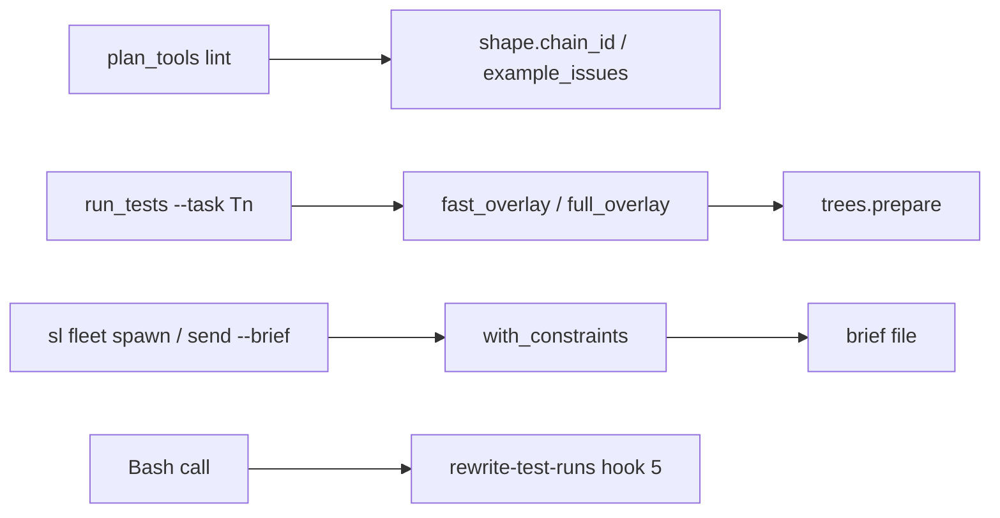
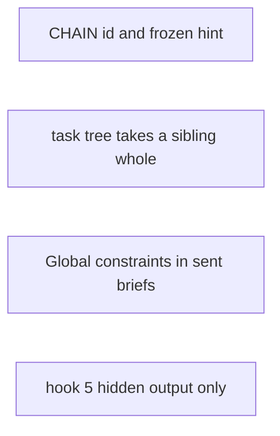

# Superlite: fleet run friction (B157, #635)

**Goal:** fix the parts of #635 still open at 1.5.171 that live in files no other open batch holds: a CHAIN id that survives plan edits, a frozen-producer EXAMPLE hint that names the hard edge, `run_tests --task` trees that take a sibling task whole or not at all, the plan's Global constraints in every brief `sl fleet` sends, and a Bash hook 5 that blocks only a test runner's own hidden output.
**Architecture:** four independent changes in four modules: `shape.py` (plan lint helpers), `run_tests.py` (isolated task trees), `fleet.py` (worker spawn and send), `hooks/rewrite-test-runs` (coordinator Bash hook). No new interfaces between them.
**Tech stack:** Python 3.10+ stdlib, pytest (through `sl run_tests`); bash builtins for the hook.
**Spec:** this file, section Design; issue #635.
**Detail:** contracts
**Target-min:** 11
**Wave0:** none
**Coverage:** off

Global constraints:
- Existing tests stay green. An existing test file changes only when the task Owns it. If another existing test turns red, report it in DONE_WITH_CONCERNS with the test id and the reason instead of editing it.
- Run `sl` as an executable (`<abs>/sl ...`). Verify with `<abs>/sl run_tests --fast <own test files> --task Tn --background`, then run the printed `wait:` line in the foreground and end the turn only after it reports.
- No version edits (the ship step bumps the version). Never run `scripts/evals.sh`, `claude plugin eval` or `scripts/test_layers.py run`.
- Keep the file's style: every code line carries its `# O(...)` comment, as the surrounding lines do.
- This repository is public: no host names, user names, home paths, other project or repository names, ticket keys or account names in code, tests, docs or commit messages. Write "a Swift project", "a second Mac", "the machine".
- Never change the machine's gate config or ~/.superlite/machine.json; tests use private temp homes and state dirs (tests/scripts/conftest.py already sets them).
- No real app builds as proof; this repository's own test suite is the check. Task trees build in <tree>/.build/DerivedData and any build of your own goes under .build/ of the worktree, never -derivedDataPath outside the worktree.
- Simulators: append the UDID of each simulator you create to <run root>/.superlite/simulators.txt; never list one you did not create.
- Friction with superlite itself goes to `sl feedback add`, not into this task.

Ruling: main's ruling (orchestrator, not Max): the CHAIN id derives from the chain's member task ids.
Ruling: the id hashes the sorted member ids, not their order or minutes (because a plan edit that changes minutes or reorders the same members keeps the ruling; cost if wrong: a ruling outlives a chain whose members stayed but whose cost grew, and lint still prints the new cost in its NOTE).
Ruling: a sibling pulled into a task tree comes with every changed file it owns, new and modified, transitively (because "together or neither" per task keeps the tree consistent; cost if wrong: a pulled sibling's half-edit can break the run, which the stderr line names).
Ruling: `sl fleet` appends `## Global constraints` to the brief file in place, once (because the worker reads that file and the coordinator sees what was sent; cost if wrong: a regenerated brief is appended again at its next send, never twice in one file).
Ruling: hooks/rewrite-test-runs is edited here: no open batch lists it (named in notes.md).
Ruling: already fixed before this batch, no change: the spawn limit by session count (#643, memory admission, 1.5.156), the shared testcmd write target (#663, 1.5.171), remote full runs and the maxapp test stamp (#638, #639); backlog_brief.py needs no change.
Ruling: one plan, four parallel tasks, no edges; detail `contracts` (each test named with exact inputs and outputs); no probe adapter (no `call=` entry fits); layers: unit (tests/scripts) and headless (hooks/**).
LAYERS: unit, headless

## Design

### 1. CHAIN id from member task ids (shape.py)
`chain_id(cp, ctimes=None)` returns `"chain-" + sha1("|".join(sorted(set(cp))))[:4]`; `ctimes` stays as an unused parameter so plan_tools' call `shape.chain_id(cp, ctimes)` keeps working. The same members give the same id whatever their minutes or order.

### 2. EXAMPLE hint for a frozen producer (shape.py)
`example_issues` keeps its message; the frozen hint becomes `(producer P is dispatched and frozen: add the hard edge "P -->|hard| C" to the taskgraph so C builds against the built P, or drop this Consumes entry)`, P and C the task ids. A consumer on a hard edge is already exempt, so the hint is a fix lint accepts.

### 3. Task trees take a sibling whole (run_tests.py)
`run_tests --task Tn` on an isolated stack overlays working-tree changes into Tn's tree. A changed file Tn owns together with an unfinished sibling S carries S's edits, so S comes in whole: every changed file S owns (new and modified) is overlaid, not kept at base, and a file shared with a pulled sibling pulls its other owners too, until nothing changes. A sibling that shares no changed file stays held as now. This holds for the `--fast` tree (`fast_overlay`) and the `--full --task` tree (task owns plus the pulled siblings' changed files). Each pulled sibling gets one stderr line: `run_tests: T2's tree takes T1 whole: it shares src/s.py`.

### 4. Global constraints in every sent brief (fleet.py)
The plan's Global constraints (`wave0.constraint_lines`, as `sl task` uses) are appended as a `## Global constraints` section to the brief that `fleet spawn --for-review` writes, the `--brief` file of a plain `fleet spawn`, and the `--brief` file of `fleet send` (before fleet.py hands `send` to fleet_io). A brief that already has a `## Global constraints` heading, a plan with none, or no readable plan leaves the brief unchanged. The plan is the `--plan` file, else the run's `stable.json` `plan`, else `pool.json` `plan`, else `<sd>/plan.md`.

### 5. Hook 5 counts only a runner's own hidden output (hooks/rewrite-test-runs)
For each command segment the hook today denies a `/dev/null` redirect anywhere in a segment that starts with a known runner or the project's own test command, quoted text included, so `remote-run exec 'bun install >/dev/null 2>&1 && bunx prettier --check .'` is blocked. New rule: split the segment into its unquoted text (`bare`; an unterminated quote runs to the segment's end) and its quoted texts. Deny when `bare` holds the redirect and the segment starts with a known runner or the project runner (the launcher's own stdout is hidden), or when a quoted text, split on `;`, `&&`, `||` and `|`, has a piece that starts with a known runner and holds the redirect (`remote-run exec 'bun test >/dev/null'`). Bash builtins only, as the rest of the hook.

## File structure

- `skills/subagent-driven-development/scripts/shape.py`: chain_id, frozen hint (T1)
- `tests/scripts/test_chain_id_stable_635.py`: new (T1); `tests/scripts/test_lint_pix_v2.py`: the pinned hint text (T1)
- `skills/subagent-driven-development/scripts/run_tests.py`: shared_siblings, fast_overlay, full_overlay, the --full tree call (T2)
- `tests/scripts/test_run_tests_tree_whole_sibling_635.py`: new (T2)
- `skills/subagent-driven-development/scripts/fleet.py`: plan_file, with_constraints, add_constraints and their three call sites (T3)
- `tests/scripts/test_fleet_brief_constraints_635.py`: new (T3)
- `hooks/rewrite-test-runs`: hidden-output check and header comment (T4)
- `tests/scripts/test_rewrite_hidden_quoted_635.py`: new (T4)

## Task graph

```mermaid
%% schedule
gantt
  title Predicted schedule (mm:ss)
  dateFormat X
  axisFormat %M:%S
  section lane 1
  T2 task tree takes a co-owning sibling w :t2, 0, 196s
  section lane 2
  T3 Global constraints in every sent brie :t3, 0, 195s
  section lane 3
  T4 hook 5 blocks only a runner's own hid :t4, 0, 187s
  section lane 4
  T1 CHAIN id from member ids and the froz :t1, 0, 184s
```

critical path: T2 (3.3 min) · peak width 4 · predicted build 3.3 min · predicted total ≈ 11.8 min (target ✗ 11.0)

## Package: plan lint

App type: library. Categories: state. **Probe entry:** none (lint helpers; the cases are named tests).

### T1 CHAIN id from member ids and the frozen hint · Complexity 2 · Est. context 30k
**Owns:** skills/subagent-driven-development/scripts/shape.py, tests/scripts/test_chain_id_stable_635.py, tests/scripts/test_lint_pix_v2.py
**Kind:** design
**Components:** 1
**LOC owned:** 70
**Tests:** fast
**Model:** sonnet
**Covers:** 1, 2
**Consumes:** none
**Produces:** shape.chain_id(cp: list, ctimes: list | None = None) -> str
**Review Focus:** `test_chain_id_ignores_minutes`: `chain_id(["T1","T2","T3"], [1.0, 2.0, 3.0]) == chain_id(["T1","T2","T3"], [4.0, 5.5, 9.0])`; `test_chain_id_ignores_order`: `chain_id(["T3","T1","T2"]) == chain_id(["T1","T2","T3"])`; `test_chain_id_value`: `chain_id(["T2","T1","T3"]) == "chain-" + hashlib.sha1(b"T1|T2|T3").hexdigest()[:4]`; `test_chain_id_differs_for_other_members`: `chain_id(["T1","T2","T4"]) != chain_id(["T1","T2","T3"])`; `test_lint_chain_id_survives_a_minutes_edit`: with `_chain_plan` from tests/scripts/test_0_3_1_scripts.py, lint (`--stated --max-task-min 10`) prints `CHAIN [cid]`; add `Ruling: sequential [cid] - one shared parser`, then change T2's stated time so the chain's minutes change, lint again: no `CHAIN [` line and the `NOTE: accepted Ruling: sequential [cid]` line is printed.
**Notes:** in test_lint_pix_v2.py change only the expected text of `test_example_hint_for_frozen_producer` to `EXAMPLE: T2 consumes lang.parse but its Produces line has no e.g. (producer T1 is dispatched and frozen: add the hard edge "T1 -->|hard| T2" to the taskgraph so T2 builds against the built T1, or drop this Consumes entry)`. Read `make_plan` in tests/scripts/test_plan_tools.py for how a task's stated time is set. Update chain_id's docstring.
**Steps:** 1 write the new tests and the changed expectation, 2 run: FAIL, 3 implement, 4 run: PASS

## Package: run_tests

App type: CLI. Categories: state, file. **Probe entry:** none (git trees; the cases are named tests).

### T2 task tree takes a co-owning sibling whole · Complexity 4 · Est. context 45k
**Owns:** skills/subagent-driven-development/scripts/run_tests.py, tests/scripts/test_run_tests_tree_whole_sibling_635.py
**Kind:** design
**Components:** 1
**LOC owned:** 150
**Tests:** fast
**Model:** sonnet
**Covers:** 3
**Consumes:** none
**Produces:** run_tests.shared_siblings(paths: list, task: str, info: dict, done: set) -> dict · run_tests.full_overlay(root: str, task: str, info: dict, ledger: str) -> list
**Review Focus:** the tests reuse `repo`, `call` and `swift` from tests/scripts/test_run_tests_fast_tree_siblings.py, with plan owns given as comma lists, base files committed as `base`, changes written as `new`. `test_shared_file_pulls_the_sibling_whole`: T1 owns `src/s.py, src/n.py`, T2 owns `src/s.py, src/b.py`; s.py modified, n.py new and untracked: `fast_overlay(".", "T2", ...) == (["src/n.py", "src/s.py"], {})`; `test_unshared_sibling_stays_held`: as above plus T3 owning `src/a.py`, a.py modified: held is `{"src/a.py": ["T3"]}` and n.py is overlaid; `test_pull_is_transitive`: T1 owns `src/s.py, src/n.py`, T3 owns `src/n.py, src/c.py`, T2 owns `src/s.py`; s.py, n.py, c.py changed: overlay is `["src/c.py", "src/n.py", "src/s.py"]`, held `{}`; `test_unchanged_shared_file_pulls_nothing`: T1 owns `src/s.py, src/n.py`, T2 owns `src/s.py, src/b.py`, only n.py new: held `{"src/n.py": ["T1"]}`; `test_committed_sibling_is_not_pulled`: the ledger holds `- commit T1 5e9dd8b464 x`: shared_siblings returns `{}` for T2; `test_shared_siblings_names_the_shared_path`: `shared_siblings(["src/n.py", "src/s.py"], "T2", info, set()) == {"T1": "src/s.py"}`; `test_fast_run_names_the_pulled_sibling`: with `swift(tmp_path)`, `run_tests --fast src/b.py --task T2 --plan plan` exits 0, stderr holds `run_tests: T2's tree takes T1 whole: it shares src/s.py`, and `.superlite/trees/T2/src/n.py` reads `new`; `test_full_task_tree_takes_the_pulled_files`: the same with `--full --task T2`: `.superlite/trees/T2/src/n.py` reads `new`, `.superlite/trees/T2/src/b.py` is the working-tree copy.
**Notes:** `shared_siblings` returns {sibling id: the first shared changed path, sorted} for unfinished siblings (not `task`, not in `done`) pulled by the closure in Design 3; `fast_overlay` overlays a path whose remaining owners are all pulled; `full_overlay` returns `info[task]["owns"]` plus the pulled siblings' changed files (from `trees.own_changes(root, trees.base_commit(root), ["**/*"])`, copy and delete) and replaces `info[a.task]["owns"]` in run()'s `trees.prepare` call for a `--full --task` run. Print the stderr line once per pulled sibling, from fast_overlay and full_overlay. `worker_overlay` stays as is. Keep the one ledger read per overlay (`test_ledger_is_read_once_per_fast_overlay`).
**Steps:** 1 write the tests, 2 run: FAIL, 3 implement, 4 run: PASS

## Package: fleet

App type: CLI. Categories: file, state. **Probe entry:** none (Herdr panes; the cases are named tests).

### T3 Global constraints in every sent brief · Complexity 3 · Est. context 45k
**Owns:** skills/subagent-driven-development/scripts/fleet.py, tests/scripts/test_fleet_brief_constraints_635.py
**Kind:** design
**Components:** 1
**LOC owned:** 140
**Tests:** fast
**Model:** sonnet
**Covers:** 4
**Consumes:** none
**Produces:** fleet.plan_file(sd: Path, plan: str | None) -> Path | None · fleet.with_constraints(text: str, plan: Path | None) -> str · fleet.add_constraints(brief: str, plan: Path | None) -> bool
**Review Focus:** a plan whose header holds `Global constraints:` then `- Every check runs on the build machine.` (PLAN below). `test_with_constraints_appends_the_section`: `with_constraints("# Brief\n", PLAN) == "# Brief\n\n## Global constraints\n\nGlobal constraints:\n- Every check runs on the build machine.\n"`; `test_with_constraints_keeps_a_brief_that_has_them`: a text holding a `## Global constraints` line comes back unchanged; `test_with_constraints_no_plan_or_none_stated`: `with_constraints("x\n", None) == "x\n"`, and a plan without constraint lines gives the text back unchanged; `test_plan_file_order`: an existing plan file argument wins; else `<sd>/stable.json` `{"plan": <abs path>}`; else `<sd>/pool.json` `{"plan": "docs/p.md"}` resolved against sd's parent; a missing or unreadable file falls through; nothing gives None; `test_send_brief_gains_constraints_once`: `fleet.main(["send", "W1", "--brief", str(brief), "--plan", str(PLAN)])` with `fleet_io.main` faked (records its argv, returns 0) leaves the section in the brief, and a second call does not add it again; the faked main got the argv unchanged; `test_spawn_brief_gains_constraints`: a plain `spawn --role fixer --brief F --plan PLAN` (fakes as in tests/scripts/test_fleet_spawn_brief_578.py) sends a brief holding the section; `test_for_review_brief_has_constraints`: `spawn --for-review T1` (fakes as in tests/scripts/test_fleet_for_review_422.py) writes a brief holding the section, after the review text and before `## Coordinator notes` when `--note` is given.
**Notes:** `with_constraints` appends `text.rstrip("\n") + "\n\n## Global constraints\n\n" + "\n".join(lines) + "\n"`, lines from `wave0.constraint_lines(plan_tools.Plan.load(str(plan)))`; an existing heading is any line matching `^#{1,4}\s+Global constraints` (case-insensitive). `add_constraints` rewrites the file only when the text changed and returns whether it did; any OSError or plan error leaves the brief as it was and returns False (a send never fails on it). `send`: read `--brief X` or `--brief=X` from argv before the `fleet_io` hand-off; the sd is the one `_sd` resolves for the `--plan` value. A relative path in stable.json or pool.json is tried against the current directory, then sd's parent.
**Steps:** 1 write the tests, 2 run: FAIL, 3 implement, 4 run: PASS

## Package: hooks

App type: CLI (Bash hook). Categories: protocol, encoding. **Probe entry:** none (a hook script; the cases are named tests).

### T4 hook 5 blocks only a runner's own hidden output · Complexity 3 · Est. context 40k
**Owns:** hooks/rewrite-test-runs, tests/scripts/test_rewrite_hidden_quoted_635.py
**Kind:** design
**Components:** 1
**LOC owned:** 90
**Tests:** fast
**Model:** sonnet
**Covers:** 5
**Consumes:** none
**Produces:** none
**Review Focus:** reuse `proj`, `run` and `denied` from tests/scripts/test_rewrite_test_runs.py; the project's `.superlite/test-cmd.json` is `{"test": "remote-run exec --timeout 30 'bun install --frozen-lockfile >/dev/null 2>&1 && bun test'", "test_file": "remote-run exec --timeout 30 'bun test {file}'"}`. `test_quoted_install_redirect_passes` (parametrized; each exits 0 with empty stderr): `remote-run exec --timeout 30 'bun install --frozen-lockfile >/dev/null 2>&1 && bunx prettier --check .'`, `remote-run exec 'bun install --frozen-lockfile >/dev/null'`, `remote-run exec "bun install >/dev/null 2>&1; bun run typecheck"`; `test_hidden_runner_output_is_denied` (parametrized; each `denied`): `remote-run exec 'bun test >/dev/null'`, `remote-run exec --timeout 30 'bun test' >/dev/null`, `remote-run exec 'bun install >/dev/null 2>&1 && npx vitest run >/dev/null'`, `pytest -q >/dev/null`.
**Notes:** change only the hidden-output check in the segment loop (Design 5) and the header comment's sentence on it. A segment cut by the hook's separator split mid-quote (odd quote count) still reaches this check: treat its unterminated quote as quoted text up to the segment's end. No external process (the file's last header line); `test_denial_check_stays_fast` and every existing test in tests/scripts/test_rewrite_*.py stay green.
**Steps:** 1 write the tests, 2 run: FAIL (the three allowed commands are denied today), 3 implement, 4 run: PASS

## Self-review

Coverage: Design 1 and 2 map to T1, 3 to T2, 4 to T3, 5 to T4. No placeholders. No Consumes; Produces are used only inside their own task. Four tasks, no edges, disjoint Owns. Fields filled. Under 15k characters.
