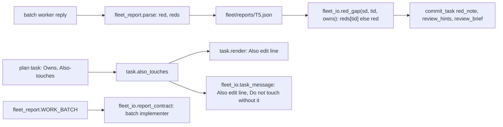
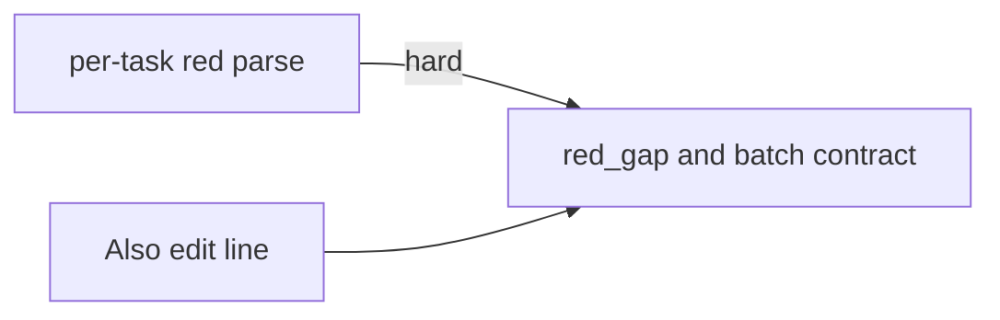

# Superlite: batch reports carry one red run per task; task texts list Also-touches files as editable (B192, #736, #745)

**Goal:** fix #736 and #745. #736: a batch worker (label `T5,T6`) reports its red runs per task (a `Red run:` header with `- T5: ...` items, indented `T5: ...` lines, `Red run T5: ...` lines, or a json `red` object keyed by task id); `fleet_report.parse` reads only one `red` string, so `fleet_io.red_gap` flags `no red run` for every member. #745: `fleet_io.task_message` puts a task's `**Also-touches:**` files under `Do not touch` and never names them as editable; `sl task` does not mark them either.
**Architecture:** `fleet_report.parse` keeps its `red` string and gains a `reds` dict (`{task id: red text}`) in every report; `red_gap(sd, tid, owns)` takes `reds[tid]` when present, else `red`. `fleet_report.WORK_BATCH` is `WORK` with `red` as an object keyed by task id; `fleet_io.report_contract` gives it to a batch implementer, and the task message's `Batch:` line names the per-task form. New `task.also_touches(task)` reads a task's Also-touches files the way `commit_task.add_also_owns` does; `task.render` and `fleet_io.task_message` add one `Also edit:` line (`task.also_line`) and drop those files from `Do not touch`.
**Tech stack:** Python 3.10+ stdlib, pytest (through `sl run_tests`).
**Spec:** this file, section Design; issues #736 and #745.
**Detail:** contracts
**Target-min:** 11
**Wave0:** none
**Worktree:** none
**Coverage:** off
**Max chars:** 21000

Global constraints:
- Every script line keeps the repo's `# O(...)` complexity comment; stdlib only; LF endings. Module docstrings name the new behaviour in one sentence each.
- Tests write plans, reports and fleet files under `tmp_path`; never the machine's `~/.superlite` or a real fleet.
- A single-task message and a plan without `**Also-touches:**` keep their text byte-identical; a single `Red run: X` reply keeps `red == "X"` and `reds == {}`.
- Standing rules for every lead and its workers (the owner's decisions, passed on by main): this repository is public: no host names, user names, home paths, other project or repository names, ticket keys or account names in code, tests, docs, commit messages, PR texts or issue comments (write "a Swift project", "a second Mac", "the machine"). Never change the machine's gate config or ~/.superlite/machine.json; tests and proofs use private temp homes and state dirs. No real app builds as proof; this repository's own test suite is the check. Priority of this round: scheduling and admission of test runs, parallel agents and the fleet, wall-clock and token efficiency; measure before and after where the issue names a waste (seconds, runs, tokens) and put the figures into the notes. Friction with superlite itself goes to `sl feedback add`, not into this batch. Online research is allowed when something is unclear (official docs first, then how others solved it); name the source in the notes.
- Builds: the verdict is `sl run_tests` (the project's test command; a project with `.maxapp` runs `maxapp test`, which a build pool may place on another Mac, and a full run whose tree a green maxapp test stamp covers returns that result without a run); task trees build in <tree>/.build/DerivedData and any build of your own goes under .build/ of the worktree, never -derivedDataPath outside the worktree (your session scratchpad included; backlog cleanup removes scratchpad build folders when the worktree goes); a product, simulator or device build stays on this machine and runs only when an issue's acceptance asks for a running-app check.
- Simulators: append the UDID of each simulator you or a worker creates (`xcrun simctl create` or `clone`; a checker's `Simulators:` line marks its created ones) as one line to the worktree's `.superlite/simulators.txt`; never list one you did not create; ship cleanup shuts down and deletes each listed one.

## Design

### #736 per-task red runs (fleet_report.py, fleet_io.py)

- Task id pattern `TID = [A-Z]{1,3}\d+[A-Za-z]?` (the plan's task ids).
- `RED_TASK`: a `Red run Tn: <text>` or `Red run (Tn): <text>` line; optional leading `-`/`*` bullet, bold or backticks around the label as `RED_LINE` allows; CRLF ok. `RED_LINE` itself is unchanged, so such a line never becomes the plain `red`.
- `RED_HEAD`: any `Red run:` or `Red runs:` line, with or without a value (bullet, bold, backticks ok). The lines after it, blank lines skipped only before the first item, are per-task items while each matches `RED_ITEM`: optional bullet (`-`, `*`, `+`, `1.`, `1)`) or indent, then `Tn:` (bold or backticks ok), then a non-empty value; the first other line ends the list.
- `_red_tasks(text) -> dict[str, str]`: the `RED_TASK` lines and header items in text order; a later entry for the same id wins; a fully bold value drops its closing `**` as `_red_line` does; values stripped.
- json block: a `red` string works as now; a `red` object whose values are all strings gives `{key.strip(): value.strip()}` for the non-empty pairs, and the plain `red` then comes from `_red_line(text)`; any other `red` (a list, a number, an object with a non-string value) breaks the block as today. The expression `"red": red or _red_line(text)` stays literally in `_from_json` (pinned by `tests/scripts/test_docs_b72_backlog.py`).
- Every report dict gains `"reds"` right after `"red"`: on the json path `{**_red_tasks(text), **json_reds}`, on the other paths `_red_tasks(text)`.
- `_labelled`: a line that matches `RED_HEAD` or `RED_TASK` while a label is open closes it and is skipped (today only a sibling `RED_LINE` does), so a `- Red run:` header and its `- T5: ...` items never enter `files`, `tests` or `concerns`.
- `WORK_BATCH = WORK.replace(RED_ONE, RED_MANY, 1)` with `RED_ONE = '"red": "<the summary line of the run that saw your new tests fail, or none - no test>"'` and `RED_MANY = '"red": {"<task id>": "<the summary line of the run that saw that task\'s new tests fail, or none - no test>"}'`.
- `fleet_io.red_gap(sd, tid, owns)`: the newest implementer report for `tid` as today; its red text is `reds[tid]` when `reds` is a dict holding a string for `tid`, else `red`; the rest of the rules (empty, `none` with test files, no failed count) unchanged. A report without `reds` (written before this change) works as before.
- `fleet_io.report_contract(wrec)`: an implementer (role missing or `implementer`) whose `task` holds a comma gets `fleet_report.WORK_BATCH`; everything else unchanged. `_ask` prompts `ASK + " " + report_contract(w)` (same roles as today; the pin in `test_docs_b72_backlog.py` moves to that expression).
- `task_message`'s `Batch:` line gains, at its end: ` Report each task's red run on its own line, `Red run Tn: 
`, and give the json block's `red` as an object keyed by task id.`

### #745 Also-touches in task texts (task.py, fleet_io.py)

- `task.also_touches(task) -> list[str]`: `nt.parse_owns(nt._field(task.text, "Also-touches"))` (the parse `commit_task.add_also_owns` uses: fenced lines skipped, backticks and parentheticals dropped, braces expanded), repeats and entries the task owns dropped, order kept.
- `task.also_line(files) -> str`: `"Also edit: " + ", ".join(files) + " (Also-touches: files another task owns that this task edits too; commit_task commits them with this task)"`.
- `task.render`: when `also_touches(task)` is non-empty, `""` and `also_line(...)` follow the verbatim task block (before an external brief and Consumed interfaces).
- `fleet_io.task_message`: `also` = the members' `also_touches` not in `owns`, repeats dropped (`[]` for an external task); `others` drops `also` too; when `also` is non-empty, `also_line(also)` follows the `Owns` line. The haiku tier embeds `render`, so its message holds the line twice (once in the task text, once beside `Do not touch`).

Ruling: `red` stays a string and per-task reds go into a new `reds` dict in every report (because `red_gap` and the review brief read `red` as one string and B65/B91 ruled one shape for every report; cost: three tests that compare whole report dicts gain `"reds": {}`) (lead's ruling).
Ruling: a task the per-task form does not name falls back to the report's plain `red` line (because a worker may write one line for a whole batch; cost: a batch whose plain line names another member's failure hides one member's gap) (lead's ruling).
Ruling: `commit_task.py` stays unchanged: `red_note` already reads `red_gap`, so it sees the per-task red once `red_gap` does (lead's ruling).
Ruling: `fleet_restore`'s continue prompt for a busy implementer keeps `WORK` (because a restart mid-batch is rare and the per-task lines the `Batch:` line asks for still parse; `fleet_restore.py` stays outside this batch) (lead's ruling).
Ruling: the haiku tier's message names `Also edit:` twice, once in the embedded task text and once beside `Do not touch` (because the line belongs beside the list it overrides and in `sl task`; cost about 30 tokens per haiku task with Also-touches) (lead's ruling).
Ruling: edge T1 --> T3 is hard (because T3's end-to-end test parses replies with T1's real `parse`; its examples cannot stand in for it) (lead's ruling).
Ruling: accept the predicted total over the 11 min target: the path T2 --> T3 is forced by T2's Also-touches edit of fleet_io.py, which T3 owns, and T1 runs beside T2 (lead's ruling).
Ruling: measured before: the four batch forms of #736 (header list, indented, `Red run Tn:` lines, json object) on 1.5.200 give `red == ""` and 8 of 8 false `no red run` gaps (`red_gap` for T5 and T6 each); T3's end-to-end test asserts 0 of 8 after (lead's ruling).

## Main diagram

## File structure

- `skills/subagent-driven-development/scripts/fleet_report.py`: `reds`, `RED_TASK`, `RED_HEAD`, `RED_ITEM`, `_red_tasks`, `WORK_BATCH` (T1).
- `skills/subagent-driven-development/scripts/task.py`: `also_touches`, `also_line`, `render` (T2).
- `skills/subagent-driven-development/scripts/fleet_io.py`: `task_message` Also edit (T2, Also-touches), `red_gap`, `report_contract`, `_ask`, the `Batch:` line (T3).
- Tests: `tests/scripts/test_fleet_report_reds_736.py` (T1, new), `test_fleet_report.py`, `test_fleet_report_labelled_500.py`, `test_fleet_report_red_b65.py` (T1, `"reds": {}` in whole-dict expectations); `test_task_also_edit_745.py` (T2, new); `test_fleet_io_reds_736.py` (T3, new), `test_fleet_io_batch_verify_556.py` (T3, its `BATCH` text), `test_docs_b72_backlog.py` (T3, the `_ask` pin).

## Task graph

```mermaid
%% schedule
gantt
  title Predicted schedule (mm:ss)
  dateFormat X
  axisFormat %M:%S
  section lane 1
  T2 Also edit line in task texts :t2, 0, 585s
  T3 red_gap and the batch report contract :t3, 585, 545s
  section lane 2
  T1 Per-task red runs in fleet_report.par :t1, 0, 550s
```

critical path: T2 → T3 (18.8 min) · peak width 2 · predicted build 18.8 min · predicted total ≈ 35.3 min (target ✗ 11.0)

## Package: fleet reports and task texts

App type: CLI library. Categories: protocol (the report contract between a worker's reply and the coordinator's checks).
**Probe entry:** none (string contracts; named tests cover them)

### T1 Per-task red runs in fleet_report.parse · Complexity 4 · Est. context 34k
**Owns:** skills/subagent-driven-development/scripts/fleet_report.py, tests/scripts/test_fleet_report_reds_736.py, tests/scripts/test_fleet_report.py, tests/scripts/test_fleet_report_labelled_500.py, tests/scripts/test_fleet_report_red_b65.py
**Components:** 1
**LOC owned:** 130
**Tests:** fast
**Model:** sonnet
**Covers:** Design
**Produces:** fleet_report.parse(text: str, label: str = "", allow_json: bool = True) -> dict · fleet_report.WORK_BATCH: str
e.g. parse("Red run:\n- T5: tests (fast): 0 passed, 1 failed\n- T6: tests (fast): 0 passed, 2 failed\n\nStatus: DONE\n", "T5,T6")["reds"] -> {"T5": "tests (fast): 0 passed, 1 failed", "T6": "tests (fast): 0 passed, 2 failed"}
e.g. parse("Red run: tests (fast): 0 passed, 1 failed\nStatus: DONE\n") -> red "tests (fast): 0 passed, 1 failed", reds {}
e.g. WORK_BATCH.replace(RED_MANY, RED_ONE) -> WORK
**Review Focus:** protocol: the forms below parse, a plain single report is unchanged, header items never leak into `files`; `tests/scripts/test_fleet_report*.py` and `tests/scripts/test_docs_b72_backlog.py` stay green.
**Test code (contracts):** in `tests/scripts/test_fleet_report_reds_736.py` (import as `test_fleet_report_red_b65.py` does; `R1 = "tests (fast): 0 passed, 1 failed"`, `R2 = "tests (fast): 0 passed, 2 failed"`, `BOTH = {"T5": R1, "T6": R2}`):
- `test_header_list_items`: `"Red run:\n- T5: R1\n- T6: R2\n\nStatus: DONE\n"` -> `reds == BOTH`, `red == ""`, `status == "DONE"`; same with `* ` and `1. ` bullets and with a blank line between the header and the first item.
- `test_indented_items`: `"Red run:\n  T5: R1\n  T6: R2\n"` -> `reds == BOTH`; `"**Red runs:**\n- **T5:** R1\n- `T6`: R2\n"` -> `reds == BOTH`.
- `test_red_run_tn_lines`: `"- Red run T5: R1\n- **Red run T6:** R2\nStatus: DONE\n"` -> `reds == BOTH`, `red == ""`; `"Red run (T5): R1\n"` -> `{"T5": R1}`.
- `test_json_red_object`: a block like B65's `GOOD` with `"red": {"T5": R1, "T6": " " + R2 + " "}` -> `valid`, `reds == BOTH`, `red == ""`; with the text line `Red run: R1` before the block `red == R1`.
- `test_json_red_object_with_a_non_string_breaks_the_block`: `"red": {"T5": 1}` -> `valid is False`; `"red": ["x"]` -> `valid is False` (as today).
- `test_header_items_stay_out_of_files`: `"Files changed:\n- src/a.py\nRed run:\n- T5: R1\nStatus: DONE\n"` and `"- Files changed:\n  - src/a.py\n- Red run:\n  - T5: R1\nStatus: DONE\n"` -> `files == ["src/a.py"]`, `reds == {"T5": R1}`, `concerns == []`.
- `test_list_ends_at_the_first_other_line`: `"Red run:\n- T5: R1\nT6 needed no test.\n- T7: R2\n"` -> `reds == {"T5": R1}`.
- `test_later_entry_wins`: `"Red run T5: R2\nRed run T5: R1\n"` -> `{"T5": R1}`.
- `test_single_report_unchanged`: `"Red run: R1\nStatus: DONE\n"` -> `red == R1`, `reds == {}`; `parse("")["reds"] == {}`; a `Verdict: APPROVED` reply carries `reds`.
- `test_work_batch`: `WORK_BATCH != WORK`, `RED_MANY in WORK_BATCH`, `WORK_BATCH.replace(RED_MANY, RED_ONE) == WORK` (both strings as in Design).
**Steps:** 1 write the tests and add `"reds": {}` to the whole-dict expectations of the three existing files, 2 run: FAIL, 3 implement, 4 run: PASS.

### T2 Also edit line in task texts · Complexity 3 · Est. context 30k
**Owns:** skills/subagent-driven-development/scripts/task.py, tests/scripts/test_task_also_edit_745.py
**Also-touches:** skills/subagent-driven-development/scripts/fleet_io.py
**Components:** 2
**LOC owned:** 90
**Tests:** fast
**Model:** sonnet
**Covers:** Design
**Produces:** task.also_touches(task: plan_tools.Task) -> list[str] · task.also_line(files: list[str]) -> str
e.g. also_touches(<task with `**Also-touches:** \`src/b.py\``>) -> ["src/b.py"]
e.g. also_line(["src/b.py"]) -> "Also edit: src/b.py (Also-touches: files another task owns that this task edits too; commit_task commits them with this task)"
**Review Focus:** protocol: the message never lists an Also-touches file under `Do not touch`; a plan without Also-touches gives byte-identical texts; `tests/scripts/test_fleet_owns_research_b54.py`, `test_fleet_io_batch_verify_556.py`, `test_fleet_io.py` and the `sl task` tests stay green.
**Test code (contracts):** in `tests/scripts/test_task_also_edit_745.py`; the plan is written as text (as `test_commit_also_touches_596.py` does): a taskgraph `T1 --> T2`, `T1` owns `src/a.py, tests/test_a.py` with `**Also-touches:** \`src/b.py\``, `T2` owns `src/b.py, tests/test_b.py`, `T3` owns `src/c.py`; `LINE = task.also_line(["src/b.py"])`:
- `test_message_lists_also_touches`: `fleet_io.task_message(plan, ["T1"], "/sl/sl", "/sl").splitlines()` holds `"Owns: src/a.py, tests/test_a.py"`, then `LINE` as the next line, then `"Do not touch: tests/test_b.py, src/c.py"`.
- `test_haiku_message_and_sl_task`: the `tier="haiku"` message holds `LINE` twice; `task.render(plan_tools.Plan.load(plan), "T1")` holds `LINE` right after the task block; `task.main(["T1", "--plan", plan])` prints it (capsys).
- `test_plain_task_unchanged`: the `T2` message and `render(..., "T2")` hold no line starting `Also edit:`; `T2`'s `Do not touch` is `src/a.py, tests/test_a.py, src/c.py`.
- `test_batch_unions_also_touches`: `T3` also lists `**Also-touches:** src/b.py, src/a.py`; the `["T1", "T3"]` message holds `"Owns: src/a.py, tests/test_a.py, src/c.py"`, `LINE` once, and `"Do not touch: tests/test_b.py"`.
- `test_also_touches_parse`: `src/{b,d}.py` gives `["src/b.py", "src/d.py"]`; an entry the task owns and a repeat are dropped; an `**Also-touches:**` line inside a fenced block gives `[]`.
**Steps:** 1 failing tests, 2 run: FAIL, 3 implement `task.py` and the `task_message` lines, 4 run: PASS. Commit with `commit_task T2` (it commits fleet_io.py with T2).

### T3 red_gap and the batch report contract · Complexity 3 · Est. context 34k
**Owns:** skills/subagent-driven-development/scripts/fleet_io.py, tests/scripts/test_fleet_io_reds_736.py, tests/scripts/test_fleet_io_batch_verify_556.py, tests/scripts/test_docs_b72_backlog.py
**Components:** 1
**LOC owned:** 100
**Tests:** fast
**Model:** sonnet
**Covers:** Design
**Consumes:** fleet_report.parse(text: str, label: str = "", allow_json: bool = True) -> dict (T1) · fleet_report.WORK_BATCH: str (T1)
**Produces:** fleet_io.red_gap(sd, tid: str, owns: list) -> str | None · fleet_io.report_contract(wrec: dict) -> str
e.g. red_gap(sd, "T6", ["src/b.py", "tests/test_b.py"]) with reds {"T5": "tests (fast): 0 passed, 1 failed", "T6": "none - no test"} -> "its report says `none - no test`, but it owns test files (tests/test_b.py)"
e.g. report_contract({"role": "implementer", "task": "T5,T6"}) -> fleet_report.WORK_BATCH
**Review Focus:** protocol: each batch member's gap comes from its own entry; old reports without `reds` behave as before; `tests/scripts/test_commit_red_run_606.py`, `test_review_brief_606.py`, `test_fleet_io_ask_470.py`, `test_lead_phase_texts_732.py` stay green.
**Test code (contracts):** in `tests/scripts/test_fleet_io_reds_736.py`; a report is `fleet_report.parse(text, "T5,T6")` written as `<sd>/fleet/reports/T5.json` with `label "T5,T6"` and `role "implementer"` (as `_finish` does); `OWNS = ["src/a.py", "tests/test_a.py"]`:
- `test_every_batch_form_proves_each_member` (the #736 measurement): the four texts of the Design ruling (header list, indented, `Red run Tn:` lines, json object; T5 `0 passed, 1 failed`, T6 `0 passed, 2 failed`) -> `red_gap(sd, t, OWNS) is None` for T5 and T6 in each: 0 of 8 gaps.
- `test_member_none_with_test_files`: reds T5 `R1`, T6 `none - no test`; T6 owning `tests/test_b.py` -> the first `e.g.` above; T5 -> None.
- `test_missing_member_falls_back_to_red`: reds `{"T5": R1}` with `red ""` -> T6 `"its report names no red run"`; with `red "tests (fast): 0 passed, 3 failed"` -> T6 None.
- `test_report_without_reds`: a json report `{"status": "DONE", "label": "T5,T6", "role": "implementer", "red": R1}` -> None for both.
- `test_batch_contract`: `report_contract` gives `WORK_BATCH` for `{"role": "implementer", "task": "T5,T6"}` and `{"task": "T5,T6"}`, `WORK` for `{"task": "T5"}` and `{"role": "fixer", "task": "T5,T6"}`, `REVIEW` for a final reviewer; `_ask` to a busy batch implementer prompts `fleet_io.ASK + " " + fleet_report.WORK_BATCH` (the scripted Herdr fake of `test_fleet_io_ask_470.py`).
- `test_batch_line_names_the_per_task_form`: a two-task `task_message` holds the `Batch:` line ending with the Design sentence; update `BATCH` in `test_fleet_io_batch_verify_556.py` to match and move the `_ask` pin in `test_docs_b72_backlog.py` to `ASK + " " + report_contract(w)`.
**Steps:** 1 failing tests, 2 run: FAIL, 3 implement, 4 run: PASS.

## Review Focus

Package fleet reports and task texts, protocol: a worker's reply is the only record of its red run; a parse that drops it makes `commit_task` and `review_hints` ask a reviewer to prove a test that was proven. Cases: the named tests of T1-T3.

## Self-review

Coverage: #736 parse (T1), consumers and prompt (T3); #745 message and `sl task` (T2). No placeholders. T3 consumes T1's Produces as written. T2 edits fleet_io.py before T3 owns it (Also-touches, edge T2 --> T3).
