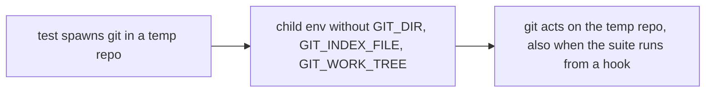
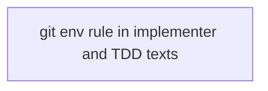

# Superlite: tests that spawn git in a temporary repository drop git's exported variables (B200)

**Goal:** fix #753: `agents/implementer.md` and `skills/test-driven-development/SKILL.md` each gain one rule line: a test that spawns git in a temporary repository removes `GIT_DIR`, `GIT_INDEX_FILE` and `GIT_WORK_TREE` from the child's environment, because git exports them to its hooks and such a test run from a hook acts on the real repository (the cause found in #709).
**Architecture:** prompt text only. The two files each gain one identical rule line; a new test reads both files and checks the line and its place.
**Tech stack:** Markdown prompts; Python 3.10+ stdlib, pytest (through `sl run_tests`).
**Spec:** this file, section Design; issue #753.
**Detail:** tests
**Target-min:** 11
**Wave0:** none
**Coverage:** off
**Read first:** .superlite/briefs/standing.md

Global constraints:
- Existing tests stay green. An existing test file changes only when the task Owns it. If another existing test turns red, report it in DONE_WITH_CONCERNS with the test id and the reason instead of editing it.
- Run `sl` as an executable (`<abs>/sl ...`). Verify with `<abs>/sl run_tests --fast <own test files> --task Tn --background`, then run the printed `wait:` line in the foreground and end the turn only after it reports.
- No version edits (the ship step bumps the version). Never run `scripts/evals.sh`, `claude plugin eval` or `scripts/test_layers.py run`.
- Change no other line of the two files: only the one inserted line per file.
- This repository is public: no host names, user names, home paths, other project or repository names, ticket keys or account names in code, tests or docs.

Ruling: one identical line in both files (because one string keeps the test and later edits simple; cost if wrong: none, both lists are rule bullets).
Ruling: agents/implementer-haiku.md and agents/fixer-*.md stay unchanged (because #753 names exactly the two files; cost if wrong: a haiku implementer or a fixer that writes a git-spawning test lacks the rule until a follow-up adds it).
Ruling: one mechanical task; already in the lead worktree, no `sl worktree ensure`; no probe adapter (prompt text); layers: unit (tests/scripts), headless and evals (agents/**, skills/*/SKILL.md).
Ruling: accept predicted 18.4 min (MISSED TARGET) - one task, nothing to split - cost: none.
Ruling: no before/after figure (because #753 names a rule gap, not a measured waste of seconds, runs or tokens).
LAYERS: unit, headless, evals



## Design

### 1. The rule line
Both files gain this exact line (`GITENV` below):

`- A test that spawns git in a temporary repository removes `GIT_DIR`, `GIT_INDEX_FILE` and `GIT_WORK_TREE` from the child's environment: git exports them to its hooks, so a test run from a hook (a pre-commit suite run) that keeps them acts on the real repository.`

### 2. Where it goes
- `agents/implementer.md`: the line right after the rule line that starts `- For each producer your task consumes, test against a fake.`
- `skills/test-driven-development/SKILL.md`: in `## Good tests`, the line right after `- Cover the contract's edge cases: empty input, errors, boundaries.`

## File structure

- `agents/implementer.md`, `skills/test-driven-development/SKILL.md`: one inserted rule line each (T1)
- `tests/scripts/test_docs_753_git_env.py`: the test below (T1)

## Task graph

```mermaid
%% schedule
gantt
  title Predicted schedule (mm:ss)
  dateFormat X
  axisFormat %M:%S
  section lane 1
  T1 git env rule in implementer and TDD t :t1, 0, 352s
```





critical path: T1 (5.9 min) · peak width 1 · predicted build 5.9 min · predicted total ≈ 18.4 min (target ✗ 11.0)

## Package: worker and TDD texts

App type: prompt text. Categories: none beyond the named test. **Probe entry:** none (prompt text; the case is a named test).

### T1 git env rule in implementer and TDD texts · Complexity 1 · Est. context 25k
**Owns:** agents/implementer.md, skills/test-driven-development/SKILL.md, tests/scripts/test_docs_753_git_env.py
**Kind:** mechanical
**Components:** 1
**LOC owned:** 30
**Tests:** fast
**Model:** haiku
**Est. time:** 1.5 min (1 component, about 30 LOC, fast tests)
**Covers:** 1, 2
**Consumes:** none
**Produces:** none
**Review Focus:** `test_both_texts_hold_the_git_env_rule`: each of the two files holds the `GITENV` line exactly once, directly after its anchor line (in the TDD skill inside `## Good tests`).
**Notes:** write the test first and run it red (both files lack the line), then insert the line into each file at its place (Design 2), changing nothing else.
**Test code (verbatim):** new file tests/scripts/test_docs_753_git_env.py:
```python
"""#753: implementer and TDD texts tell a test that spawns git in a temporary repository to drop git's exported variables."""
from pathlib import Path

ROOT = Path(__file__).resolve().parents[2]
GITENV = ("- A test that spawns git in a temporary repository removes `GIT_DIR`, `GIT_INDEX_FILE` and `GIT_WORK_TREE` from "
          "the child's environment: git exports them to its hooks, so a test run from a hook (a pre-commit suite run) that "
          "keeps them acts on the real repository.")
ANCHORS = {
    "agents/implementer.md": "- For each producer your task consumes, test against a fake.",
    "skills/test-driven-development/SKILL.md": "- Cover the contract's edge cases: empty input, errors, boundaries.",
}


def test_both_texts_hold_the_git_env_rule():
    for rel, anchor in ANCHORS.items():
        lines = (ROOT / rel).read_text(encoding="utf-8").split("\n")
        assert lines.count(GITENV) == 1, rel
        at = lines.index(GITENV)
        assert lines[at - 1].startswith(anchor), rel


def test_tdd_rule_sits_in_good_tests():
    text = (ROOT / "skills/test-driven-development/SKILL.md").read_text(encoding="utf-8")
    good = text.split("## Good tests\n")[1].split("\n## ")[0]
    assert GITENV in good.split("\n")


def test_rule_names_the_three_variables_and_the_cause():
    for s in ("`GIT_DIR`", "`GIT_INDEX_FILE`", "`GIT_WORK_TREE`", "temporary repository", "exports them to its hooks",
              "acts on the real repository"):
        assert s in GITENV, s
```
**Steps:** 1 write the test file, 2 run it: FAIL (`tests (fast): 1 passed, 2 failed`), 3 insert the line in the two files, 4 run: PASS

## Self-review

Coverage: Design 1 and 2 map to T1. No placeholders. No Consumes or Produces. One task, no edges. Fields filled. Plan well under 15k characters.
