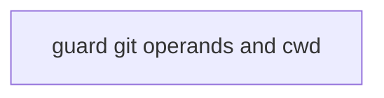

# Superlite: guard reads unknown git checkout operands, unknown git subcommands and subprocess cwd= (B188, #726, #728)

**Goal:** close two guard holes in `guard_tools.py`. #726: `git checkout "$x"` and a git subcommand that is not a literal (`git "$s" x`) are judged as no write in the judge's Bash walk, in shell strings and in subprocess lists; an unknown checkout operand may be a path and an unknown subcommand may be checkout, restore or clean. #728: `_a_sh` ignores a Python subprocess call's `cwd=`, so relative targets are judged from the shell's folder instead of the folder the call runs in.
**Architecture:** all changes live in `skills/subagent-driven-development/scripts/guard_tools.py`: a `_dyn(word)` test for words the guard cannot read; `_git` returns `?` with a `why` reason for an unknown subcommand and for an unknown checkout operand; `_a_sh` reads `cwd=` (`_call_dir`), joins each relative target onto it (`_in_dir`) and sets `_CALL_DIR` while it reads the call, so `_exists` (checkout's path-or-branch test) looks in that folder. The judge (`guard_judge.py`) is unchanged: it already prints `Unresolved word: ? (from git: <why>)` and `... (from python3: <unresolved()>)`.
**Tech stack:** Python 3.10+ stdlib, pytest (through `sl run_tests`).
**Spec:** this file, section Design; issues #726 and #728.
**Detail:** full
**Target-min:** 11
**Wave0:** none
**Worktree:** none
**Coverage:** off
**Max chars:** 21000

Global constraints:
- Every script line keeps the repo's `# O(...)` complexity comment; stdlib only; LF endings.
- Change only `guard_tools.py`, `tests/scripts/test_guard_tools_dyn_705.py` and `tests/scripts/test_guard_subprocess_705.py`. A pin in another test file that flips: edit it only when no open batch lists it (B177 owns `tests/scripts/test_guard_fleet_agents.py` and `tests/scripts/test_lead_guard_heredoc_276.py`, B189 owns `tests/scripts/test_guard_files.py`); otherwise report it, and the lead writes a `Follow-up:` line. The planning prototype ran every guard test file: only `test_checkout_same_verdict_as_shell_word` (in this batch's file) and `test_guard_parity.py` (it reruns that file) flipped.
- Tests use `tmp_path` projects and private `SUPERLITE_HOME`s, never the machine's `~/.superlite`.
- Standing rules for every lead and its workers (the owner's decisions, passed on by main): this repository is public: no host names, user names, home paths, other project or repository names, ticket keys or account names in code, tests, docs, commit messages, PR texts or issue comments (write "a Swift project", "a second Mac", "the machine"). Never change the machine's gate config or ~/.superlite/machine.json; tests and proofs use private temp homes and state dirs. No real app builds as proof; this repository's own test suite is the check. Priority of this round: scheduling and admission of test runs, parallel agents and the fleet, wall-clock and token efficiency; measure before and after where the issue names a waste (seconds, runs, tokens) and put the figures into the notes. Friction with superlite itself goes to `sl feedback add`, not into this batch. Online research is allowed when something is unclear (official docs first, then how others solved it); name the source in the notes.

## Design

**Unknown word.** `_dyn(w)`: `w == "?"` (a non-literal argument in a shell string or subprocess list) or `w` holds `$` or a backtick (the judge's Bash walk passes an unknown variable or substitution as written; a known one arrives expanded, so `x=src/a.py; git checkout "$x"` already blocks as `src/a.py`).

**#726, git.**
- Subcommand: right after `if not sub: return []`, a `_dyn(sub)` returns `["?"]` and appends `subcommand <sub> is not a literal` to `why`.
- Checkout without `--`: after the existing tests (the operand exists, `--ours`/`--theirs`/`--conflict`), an operand that starts with `~` is a path too (adjacent fix: no branch name starts with `~`, and `_exists` cannot look there); else a `_dyn` first operand adds `?` and the reason `checkout operand <op> may be a path; git switch takes only a branch`, unless `-b`, `-B`, `--orphan` or `--detach` is given (then the operand is a start point). With `--` nothing changes. Later operands stay paths as before.
- Restore: no change; every operand is already a path. Tests pin it.

**#728, subprocess cwd=.** Python calls only (`lang == "py"`). `_call_dir(args, lang)` -> `(named, folder)`: `named` is whether a `cwd` keyword is given; `folder` is its literal value, or `None` when the value is not a literal string, is empty, holds the composed-unknown marker `_UNK`, or starts with `~` (subprocess does not expand it). `_in_dir(folder, t)` maps one target: `?`, absolute, `~`, `$` or backtick targets stay; with `folder` None a relative target becomes `?`; else `_join(folder, t)`, keeping a trailing `/`. `_a_sh` maps its targets after the existing argument cause, recording `subprocess cwd= is not a string literal` when a relative target became `?`. While it reads the call it sets `_CALL_DIR[0]` (composed with an outer call's folder, None when either is unknown) and restores it in `finally`; `_exists` joins a relative path onto `_CALL_DIR[0]` and returns False when it is None.

Ruling: an unknown word counts as a possible path, never as a possible option (`git restore --staged "$o"`, `git switch "$o" b`, `git reset "$o"` stay as they are); that unknown-option class is a follow-up (planning lead's ruling).
Ruling: a literal checkout operand under an unknown `-C` or cwd= keeps the branch reading, as the existing pin `git -C $X checkout a.py` -> [] does (planning lead's ruling).
Ruling: the unknown checkout operand returns `?` with a git reason, not the word itself, so the block names `git switch` as the path-free form (planning lead's ruling).
Ruling: JS `{cwd:}`, Ruby `chdir:`, PHP `proc_open` cwd and `cd DIR &&` inside a script's shell string stay out of B188 (follow-up in notes.md) (planning lead's ruling).
Ruling: one task: all three changes edit guard_tools.py, so a split runs in sequence and only adds an implementer start; the MISSED TARGET warning (one-task critical path, contention x3) is accepted (planning lead's ruling).
Ruling: measurement: rerun `python3 .superlite/measure_b188.py "$PWD" <scratch dir> 10` after the build and put the after figures next to the before figures in notes.md (`.superlite/measure_b188.before.txt`; the planning prototype's are in `.superlite/measure_b188.prototype.txt`) (planning lead's ruling).

## Task graph

```mermaid
%% schedule
gantt
  title Predicted schedule (mm:ss)
  dateFormat X
  axisFormat %M:%S
  section lane 1
  T1 Guard unknown git operands and subpro :t1, 0, 607s
```





critical path: T1 (10.1 min) · peak width 1 · predicted build 10.1 min · predicted total ≈ 26.6 min (target ✗ 11.0)

## Package: guard

App type: library (command reader). Categories: protocol (git arguments, subprocess keywords), state (`_CALL_DIR` restored after each call).
**Probe entry:** none (the reader takes word lists and code text; named tests cover it)

### T1 Guard unknown git operands and subprocess cwd · Complexity 3 · Est. context 40k
**Owns:** skills/subagent-driven-development/scripts/guard_tools.py, tests/scripts/test_guard_tools_dyn_705.py, tests/scripts/test_guard_subprocess_705.py
**Components:** 2
**LOC owned:** 230
**Tests:** fast
**Model:** sonnet
**Covers:** Design
**Produces:** guard_tools._dyn(w: str) -> bool · guard_tools._call_dir(args: list[Arg], lang: str) -> tuple[bool, str | None] · guard_tools._in_dir(d: str | None, t: str) -> str
e.g. _dyn("$x") -> True; _dyn("?") -> True; _dyn("main") -> False
e.g. _in_dir("src", "a.py") -> "src/a.py"; _in_dir("src", "./") -> "src/"; _in_dir(None, "a.py") -> "?"; _in_dir(None, "/abs/a") -> "/abs/a"
**Review Focus:** `test_checkout_operand_looked_up_in_cwd_728` (the `_CALL_DIR` reset after a call); `test_argument_cause_comes_before_cwd_728`; the flipped `test_checkout_same_verdict_as_shell_word` (both now exit 2).
**Steps:** 1 append the tests below and flip the one assertion, 2 run `sl run_tests --fast tests/scripts/test_guard_tools_dyn_705.py tests/scripts/test_guard_subprocess_705.py`: FAIL (the prototype run saw 39 failed, 79 passed), 3 apply the implementation below, 4 run: PASS, 5 `sl run_tests --full` and fix any other pin per Global constraints.

**Implementation (verbatim)**, four edits in `guard_tools.py`:

1. Above `def _exists`, add:
```python
def _dyn(w: str) -> bool:  # O(len(w)) | a word whose value the guard cannot read: "?" (a non-literal argument), a $ or a backtick (#726)
    return w == "?" or "$" in w or "`" in w  # O(len(w))


_CALL_DIR: list[str | None] = [""]  # the folder the subprocess call being read runs in, from the shell's folder ("": the shell's own, None: unknown) (#728)
```
and in `_exists`, between `full = _join(base, p)` and the `return`:
```python
    if not _is_abs(full):  # a subprocess call's cwd= folder (#728)  # O(1)
        if _CALL_DIR[0] is None:  # O(1)
            return False  # O(1)
        full = _join(_CALL_DIR[0], full)  # O(len(full))
```
2. In `_git`, right after `if not sub: return []`:
```python
    if _dyn(sub):  # a subcommand that is not a literal may be checkout, restore, apply or clean (#726)  # O(len(sub))
        if why is not None:  # O(1)
            why.append(f"subcommand {sub} is not a literal")  # O(len(sub))
        return ["?"]  # O(1)
```
3. In `_git`'s checkout branch, replace the `if ops and (_exists(...) or any(...)): paths.append(ops[0])` block with:
```python
            start = any(_git_flag(args, s, lg, sub) for s, lg in (("b", ""), ("B", ""), ("", "orphan"), ("", "detach")))  # the operand is a commit  # O(len(args))
            if ops and (ops[0].startswith("~") or _exists(cwd, base, ops[0]) or any(  # --ours/--theirs/--conflict take only paths
                    _git_flag([x], "", "ours", sub) or _git_flag([x], "", "theirs", sub)
                    or _git_flag([x], "", "conflict", sub) for x in args)):  # O(len(args))
                paths.append(ops[0])  # O(1)
            elif ops and _dyn(ops[0]) and not start:  # an operand that is not a literal may be a path (#726)  # O(len(ops[0]))
                if why is not None:  # O(1)
                    why.append(f"checkout operand {ops[0]} may be a path; git switch takes only a branch")  # O(len(ops[0]))
                paths.append("?")  # O(1)
```
4. In `_a_sh`, replace everything from `_depth[0] += 1` to its `return out` with the block below, and add `_call_dir` and `_in_dir` after `_a_sh`:
```python
    named, d = _call_dir(args, lang)  # O(len(args))
    prev = _CALL_DIR[0]  # O(1)
    if named:  # O(1)
        _CALL_DIR[0] = None if prev is None or d is None else _join(prev, d)  # O(len(d))
    _depth[0] += 1  # O(1)
    try:  # O(1)
        out = _shell(words[0]) if len(words) == 1 else _argv(words)  # O(len(raw))
    finally:  # O(1)
        _depth[0] -= 1  # O(1)
        _CALL_DIR[0] = prev  # O(1)
    if "?" in out and k >= 0:  # O(len(out))
        _why(cause)  # O(1)
    if named:  # O(len(out))
        moved = [_in_dir(d, t) for t in out]  # O(len(out))
        if any(m == "?" and t != "?" for m, t in zip(moved, out)):  # O(len(out))
            _why("subprocess cwd= is not a string literal")  # O(1)
        out = _uniq(moved)  # O(len(out))
    return out  # O(1)


def _call_dir(args: list[Arg], lang: str) -> tuple[bool, str | None]:  # O(len(args)) | does a Python call name cwd=, and its folder (None: not a literal) (#728)
    if lang != "py":  # O(1)
        return False, ""  # O(1)
    for k, v in args:  # O(len(args))
        if k == "cwd":  # O(1)
            if not isinstance(v, str) or not v or _UNK in v or v.startswith("~"):  # O(len(v))
                return True, None  # O(1)
            return True, v  # O(1)
    return False, ""  # O(1)


def _in_dir(d: str | None, t: str) -> str:  # O(len(d) + len(t)) | target t of a call that runs in folder d (None: unknown) (#728)
    if t == "?" or _is_abs(t) or t.startswith("~") or "$" in t or "`" in t:  # O(len(t))
        return t  # O(1)
    if d is None:  # O(1)
        return "?"  # O(1)
    r = _join(d, t)  # O(len(d) + len(t))
    return _dirp(r) if t.endswith("/") else r  # an extraction folder keeps its slash  # O(len(r))
```

**Test code (verbatim):**
In `tests/scripts/test_guard_subprocess_705.py`, `test_checkout_same_verdict_as_shell_word` now asserts `sub.returncode == sh.returncode == 2`. Append to that file:
```python
@pytest.mark.parametrize("cmd,line", [
    ('git checkout "$x"', "Unresolved word: ? (from git: checkout operand $x may be a path; git switch takes only a branch)"),
    ('git "$s" src/a.py', "Unresolved word: ? (from git: subcommand $s is not a literal)"),
    ('git restore "$x"', "Unresolved word: $x"),
])
def test_unknown_git_operand_blocks_726(proj, cmd, line):
    r = bash(proj, cmd)
    assert r.returncode == 2
    assert word(r) == [line]


@pytest.mark.parametrize("cmd", ["git checkout main", 'git checkout -b "$x"', 'git checkout -b feat "$x"', 'git switch "$x"'])
def test_branch_forms_pass_726(proj, cmd):
    assert bash(proj, cmd).returncode == 0


def test_subprocess_cwd_resolves_relative_target_728(proj):
    r = bash(proj, heredoc('subprocess.run(["rm", "a.py"], cwd="src")'))
    assert r.returncode == 2
    assert r.stderr.splitlines()[-1] == "Blocked target: src/a.py"


def test_subprocess_cwd_into_state_folder_passes_728(proj):
    assert bash(proj, heredoc('subprocess.run(["rm", "x.json"], cwd=".superlite/scratch")')).returncode == 0


def test_subprocess_unknown_cwd_names_cause_728(proj):
    r = bash(proj, heredoc('subprocess.run(["rm", "a.py"], cwd=p)'))
    assert r.returncode == 2
    assert word(r) == ["Unresolved word: ? (from python3: subprocess cwd= is not a string literal)"]
```
Append to `tests/scripts/test_guard_tools_dyn_705.py`:
```python
# B188: git checkout with an unknown operand, a git subcommand that is not a literal (#726), subprocess cwd= (#728)

CO = "checkout operand {} may be a path; git switch takes only a branch"


@pytest.mark.parametrize("words,op", [
    (["git", "checkout", "$x"], "$x"),
    (["git", "checkout", "?"], "?"),
    (["git", "checkout", "src/$x"], "src/$x"),
    (["git", "checkout", "$(cat b)"], "$(cat b)"),
    (["git", "checkout", "`cat b`"], "`cat b`"),
    (["git", "checkout", "-q", "$x"], "$x"),
    (["git", "-C", "sub", "checkout", "$x"], "$x"),
])
def test_checkout_unknown_operand_may_be_a_path_726(words, op):
    assert guard_tools.targets(words) == ["?"]
    assert guard_tools.why(words) == CO.format(op)


def test_checkout_unknown_first_of_two_operands_726():
    assert guard_tools.targets(["git", "checkout", "$x", "$y"]) == ["$y", "?"]


@pytest.mark.parametrize("words", [
    ["git", "checkout", "-b", "$x"],
    ["git", "checkout", "-b", "new", "$x"],
    ["git", "checkout", "-B", "$x", "$y"],
    ["git", "checkout", "--detach", "$x"],
    ["git", "checkout", "--orphan", "$x"],
    ["git", "checkout", "main"],
    ["git", "switch", "$x"],
    ["git", "-C", "$X", "checkout", "a.py"],
    ["git", "-C", "$d", "status"],
])
def test_branch_and_start_point_operands_stay_no_write_726(words, tmp_path, monkeypatch):
    monkeypatch.chdir(tmp_path)
    assert guard_tools.targets(words) == []


@pytest.mark.parametrize("words,want", [
    (["git", "checkout", "$x", "--", "src/a.py"], ["src/a.py"]),
    (["git", "checkout", "--", "$x"], ["$x"]),
    (["git", "checkout", "--ours", "$x"], ["$x"]),
    (["git", "checkout", "~/x"], ["~/x"]),
    (["git", "restore", "$x"], ["$x"]),
    (["git", "restore", "?"], ["?"]),
])
def test_path_operands_keep_their_word_726(words, want):
    assert guard_tools.targets(words) == want


@pytest.mark.parametrize("words,sub", [
    (["git", "$s", "x"], "$s"),
    (["git", "?", "x"], "?"),
    (["git", "-C", "d", "$s"], "$s"),
    (["git", "${S}"], "${S}"),
])
def test_unknown_subcommand_is_unknown_726(words, sub):
    assert guard_tools.targets(words) == ["?"]
    assert guard_tools.why(words) == f"subcommand {sub} is not a literal"


@pytest.mark.parametrize("code,why", [
    ('subprocess.run(["git", "checkout", p])', "subprocess argument 3 is not a string literal"),
    ('subprocess.run(["git", p, "src/a.py"])', "subprocess argument 2 is not a string literal"),
    ("os.system('git checkout \"$x\"')", ""),
    ("os.system('git \"$s\" x')", ""),
])
def test_unknown_checkout_operand_or_subcommand_in_scripts_726(code, why):
    assert py(code) == ["?"]
    assert guard_tools.unresolved() == why


@pytest.mark.parametrize("code", [
    'subprocess.run(["git", "checkout", "-b", p])',
    'subprocess.run(["git", "switch", p])',
    "os.system('git switch \"$b\"')",
])
def test_branch_forms_in_scripts_still_pass_726(code):
    assert py(code) == []


@pytest.mark.parametrize("code,want", [
    ('subprocess.run(["rm", "a.py"], cwd="src")', ["src/a.py"]),
    ('subprocess.run(["rm", "a.py"], check=True, cwd="src")', ["src/a.py"]),
    ('subprocess.Popen(["rm", "a.py"], cwd="src")', ["src/a.py"]),
    ('subprocess.run("rm a.py", shell=True, cwd="src")', ["src/a.py"]),
    ('subprocess.run(["rm", "a.py"], cwd="/abs/d")', ["/abs/d/a.py"]),
    ('subprocess.run(["rm", "/abs/a.py"], cwd="src")', ["/abs/a.py"]),
    ('D = "src"\nsubprocess.run(["rm", "a.py"], cwd=D)', ["src/a.py"]),
    ('subprocess.run(["rm", "a.py"], cwd=os.path.join("src", "lib"))', ["src/lib/a.py"]),
    ('subprocess.run(["git", "clean", "-fd"], cwd="src")', ["src/?"]),
    ('subprocess.run(["git", "reset", "--hard"], cwd="src")', ["src"]),
    ('subprocess.run(["tar", "xf", "a.tar"], cwd="src")', ["src/"]),
    ('subprocess.run(["git", "-C", "lib", "checkout", "--", "a.py"], cwd="src")', ["src/lib/a.py"]),
    ('os.system("rm a.py")', ["a.py"]),
])
def test_literal_cwd_resolves_relative_targets_728(code, want):
    assert py(code) == want
    assert guard_tools.unresolved() == ""


@pytest.mark.parametrize("code", [
    'subprocess.run(["rm", "a.py"], cwd=p)',
    'subprocess.run(["rm", "a.py"], cwd=f"src/{p}")',
    'subprocess.run(["rm", "a.py"], cwd="~/x")',
    'subprocess.run(["rm", "a.py"], cwd="")',
])
def test_unknown_cwd_makes_relative_target_unknown_728(code):
    assert py(code) == ["?"]
    assert guard_tools.unresolved() == "subprocess cwd= is not a string literal"


@pytest.mark.parametrize("code,want", [
    ('subprocess.run(["rm", "/abs/a.py"], cwd=p)', ["/abs/a.py"]),
    ('subprocess.run(["git", "status"], cwd=p)', []),
])
def test_unknown_cwd_keeps_absolute_and_empty_targets_728(code, want):
    assert py(code) == want
    assert guard_tools.unresolved() == ""


def test_argument_cause_comes_before_cwd_728():
    assert py('subprocess.run(["rm", p], cwd=p)') == ["?"]
    assert guard_tools.unresolved() == "subprocess argument 2 is not a string literal"


def test_checkout_operand_looked_up_in_cwd_728(tmp_path, monkeypatch):
    (tmp_path / "src").mkdir()
    (tmp_path / "src" / "a.py").write_text("x = 1\n")
    monkeypatch.chdir(tmp_path)
    assert py('subprocess.run(["git", "checkout", "a.py"], cwd="src")') == ["src/a.py"]
    assert py('subprocess.run(["git", "checkout", "a.py"])') == []
    assert py('subprocess.run(["git", "checkout", "a.py"], cwd=p)') == []
    assert guard_tools.targets(["git", "checkout", "src/a.py"]) == ["src/a.py"]
```
**Notes:** the planning prototype of exactly this code passed all 118 tests of the two files and every other guard test file; `os.system("cd src && rm a.py")` still reads `a.py` (out of scope, follow-up).

## Review Focus

Package guard: protocol and state. Cases: a `-b`/`-B`/`--orphan`/`--detach` start point stays no write; `--` keeps the words before it as the tree-ish; `_CALL_DIR` is back to `""` after every call (the `finally`), also when `_argv` raises; a nested call's cwd composes with the outer one; an absolute or `~` target is never joined onto cwd.

## Self-review

Coverage: #726 (checkout operand, subcommand, restore pinned) and #728 (literal and unknown cwd, the existence test) map to T1. No placeholders. One task, no edges; the three files are T1's alone.
