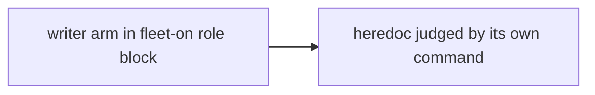

# Superlite: fleet backlog guard judges a heredoc by its own command; writer arm in the fleet-on role block (B177, #706, #710)

**Goal:** #706: in a fleet session, a heredoc body or quoted text that a `cat`, `tee`, `printf` or `echo` writes into a file no longer counts as runnable just because another command of the same Bash call is a runner (`make test`, `bun test`); the block line says which heredoc or quote matched and why. #710: with fleet on, an in-process `Agent superlite:writer` is refused like the other roles and names `sl fleet spawn --role writer --brief <abs brief file> --plan PLAN`.
**Architecture:** both changes live in `hooks/block-coordinator-edits`. #710 adds a `writer` arm and its own message to the rule-4 role case. #706 extends `bl_scan` with per-text consumer data (which simple command a text belongs to, whether it sits inside `$( )` or backticks, the command's stdout file redirects) and `bl_judge` with a data test per text; the call-wide runner flag `run` stays as it is.
**Tech stack:** bash builtins (stock bash 3.2 compatible), pytest through `sl run_tests`.
**Spec:** this file, sections Design; issues #706 and #710.
**Detail:** tests
**Target-min:** 11
**Wave0:** none
**Worktree:** none
**Coverage:** off

Global constraints:
- The hook stays bash builtins only on the fleet path (no subshell, no external command, no `$( )`) and runs on stock bash 3.2: no associative arrays (`declare -A`), no `${x,,}`, no `mapfile`; indexed arrays and `[[ ]]` only. LF endings. Tests never quote `/bin/bash` (the hook tests use `test_block_coordinator_edits.BASH`).
- Exact block texts are given in the task blocks; copy them byte for byte.
- Standing rules for every lead and its workers (the owner's decisions, passed on by main): this repository is public: no host names, user names, home paths, other project or repository names, ticket keys or account names in code, tests, docs, commit messages, PR texts or issue comments (write "a Swift project", "a second Mac", "the machine"). Never change the machine's gate config or ~/.superlite/machine.json; tests and proofs use private temp homes and state dirs. No real app builds as proof; this repository's own test suite is the check. Priority of this round: scheduling and admission of test runs, parallel agents and the fleet, wall-clock and token efficiency; measure before and after where the issue names a waste and put the figures into your report. Friction with superlite itself goes to `sl feedback add`, not into this batch. Online research is allowed when something is unclear (official docs first, then how others solved it); name the source.
- Builds: the verdict is `sl run_tests` (the project's test command; a project with `.maxapp` runs `maxapp test`, which a build pool may place on another Mac, and a full run whose tree a green maxapp test stamp covers returns that result without a run); task trees build in <tree>/.build/DerivedData and any build of your own goes under .build/ of the worktree, never -derivedDataPath outside the worktree (your session scratchpad included; backlog cleanup removes scratchpad build folders when the worktree goes); a product, simulator or device build stays on this machine and runs only when an issue's acceptance asks for a running-app check.
- Simulators: append the UDID of each simulator you or a worker creates (`xcrun simctl create` or `clone`; a checker's `Simulators:` line marks its created ones) as one line to `<worktree>/.superlite/simulators.txt`; never list one you did not create; ship cleanup shuts down and deletes each listed one.

## Design

**#710.** The rule-4 case (`case "$fname" in` near line 379) gains `writer) frole="writer" ;;`. `fname` is already lowercased with `superlite:` dropped, so `Superlite:Writer` and `writer` match. The incident row is the shared `printf` above the message, unchanged. The writer gets its own message, because the generic `fleet send Wn --brief` path would fail: `fleet spawn --role writer` without `--brief` exits 2.

**#706.** A text is a BLT entry (a quoted word's text or a heredoc body; BLS entries stay runnable always). Today every BLT entry is runnable when `run=1`. New: a BLT entry is runnable when `run=1` and it is not **written data**. Written data, all of:
1. the text is not inside `$( )` or backticks (its output could feed the outer command);
2. its consumer's command word is `cat`, `tee`, `printf` or `echo` (basename; leading reserved words such as `then`, `do`, `{`, `!`, `time` and `NAME=value` assignments are skipped). The consumer is the simple command the quoted word belongs to, or the one whose `<<` opened the heredoc;
3. the consumer redirects its stdout to a file: a `>` or `>>` with no fd prefix or fd `1`, whose target is not `&N` and not a process substitution `>(...)`;
4. it writes at least one file, and every written file (each stdout redirect target, plus for `tee` each operand word not starting with `-`) is plain: no `$`, backtick, `*`, `?` or `[` in it, not under `/dev/` or `/proc/` (except `/dev/null`);
5. no other command of the call runs a written file: none whose command word basename equals the file's basename (`./f.sh`), no runner command (one holding a runner word) with a word containing that basename (`bash f.sh`, `bash < f`, `python3 /tmp/x.py`), and no `make` in the call when the basename is `Makefile`, `makefile`, `GNUmakefile` or ends in `.mk`.

So `cat > docs/x.md <<'EOF' ... EOF` then `make test` passes; `bash <<'EOF'`, `cat <<'EOF' | bash`, `cat > f.sh <<'EOF' ... EOF; bash f.sh`, `git commit -m '...' && make test` and an unquoted heredoc with `$(` or a backtick stay blocked.

Ruling: written data is a narrow exemption from the call-wide flag (writer commands only), not a full per-consumer runnable test, because a non-writer consumer can pass text on to a runner in ways the scan does not trace (`read -r x <<EOF ... ; eval "$x"`); cost if wrong: a non-writer text next to a runner word still blocks, and the block line says to split the call (lead's ruling).
Ruling: a file a runner reads by convention other than a makefile (`package.json` for `bun run`, `conftest.py` for pytest) is not traced; the backlog script's own fleet-worker refusal is the backstop (lead's ruling).

**Block line (#706 item 2).** The existing `Blocked: sl backlog X runs only in the main session ...` line gets one more sentence, `BLWHY`, set by `bl_judge` (empty for a two-word command hit and for a line over 4096 characters). `{what}` is `the heredoc <<DELIM` (the delimiter without quotes) or `the quoted text "<first 60 chars of the text, newlines as spaces>"`. `{W}` is the runner word as its basename (`make`, `bash`, `python3`), `$X` for `$X -c`, `env -S` for env with `-S`, `source`/`.`/`exec` as written.
- BLS hit: ` Matched: an assigned value or an unquoted heredoc holding $( or a backtick; the shell runs it.`
- runner word in the consumer's own command: ` Matched: {what}, which {W} in the same command runs.`
- a written file another command runs (rule 5): ` Matched: {what}; it writes {file}, which this call then runs ({W}).` with `{W}` the runner word or command word of that command, `make` for a makefile.
- otherwise (W = the first runner word of the call): ` Matched: {what}; the runner word {W} elsewhere in this call makes it runnable. Write the file in one Bash call and run {W} in another: that passes.`

## Task graph

```mermaid
%% schedule
gantt
  title Predicted schedule (mm:ss)
  dateFormat X
  axisFormat %M:%S
  section lane 1
  T1 Writer arm in the fleet-on role block :t1, 0, 263s
  T2 Heredoc judged by its own command :t2, 263, 325s
```





critical path: T1 → T2 (9.8 min) · peak width 1 · predicted build 9.8 min · predicted total ≈ 20.3 min (target ✗ 11.0)

Ruling: sequential T1 -> T2 - both edit hooks/block-coordinator-edits and docs/hooks.md; T1 is small (lead's ruling).

## Package: guard

App type: hook (stdin JSON, exit code, stderr). Categories: protocol (block texts, incident row), deep (shell scanning).
**Probe entry:** none (the hook tests feed JSON on stdin; named tests cover it)

### T1 Writer arm in the fleet-on role block · Complexity 1 · Est. context 24k
**Owns:** tests/scripts/test_guard_fleet_agents.py
**Also-touches:** hooks/block-coordinator-edits, docs/hooks.md
**Components:** 1
**LOC owned:** 40
**Tests:** fast
**Kind:** mechanical
**Model:** haiku
**Covers:** Design
**Produces:** hook rule-4 writer refusal (exit 2, message below, rule-block incident row)
**Review Focus:** `test_fleet_on_blocks_writer_with_its_brief_path`: four spellings exit 2 with the writer line and a `rule-block` row; `test_fleet_on_blocks_each_superlite_role[superlite:checker]` and `[Superlite:Checker]`
**Steps:** 1 add the tests, 2 run: FAIL, 3 edit the hook and docs, 4 run: PASS
**Test code (verbatim):** in tests/scripts/test_guard_fleet_agents.py append two items to the existing `test_fleet_on_blocks_each_superlite_role` parametrize list: `("superlite:checker", "sl fleet spawn --role checker")` and `("Superlite:Checker", "sl fleet spawn --role checker")`; then append:
```python
@pytest.mark.parametrize("agent", ["superlite:writer", "Superlite:Writer", "writer", "WRITER"])
def test_fleet_on_blocks_writer_with_its_brief_path(sd, agent):  # #710
    fleet(sd)
    r = guard(sd, agent)
    assert r.returncode == 2, r.stderr
    assert "sl fleet spawn --role writer --brief <abs brief file> --plan PLAN" in r.stderr
    assert "Output: line names the one file" in r.stderr and "fleet send" not in r.stderr
    assert "do not retry it" in r.stderr and "sl fleet off" in r.stderr
    inc = json.loads((sd / "incidents.jsonl").read_text().splitlines()[-1])
    assert (inc["kind"], inc["agent"], inc["tool"], inc["rule"]) == ("rule-block", "coordinator", "Agent", "fleet")
    assert agent in inc["target"]
```
**Notes:** hooks/block-coordinator-edits: (a) header comment rule 4 (lines 16-21): `researcher, checker) is denied` becomes `researcher, checker, writer) is denied`, and right after `report under <state folder>/fleet/reports/).` insert ` A writer's names spawn --role writer --brief; the brief's Output: line names its one file.`; (b) in the role case add the line `        writer) frole="writer" ;;` after the `checker)` arm; (c) in `if [ "$frole" = research ]; then ... else ... fi` add an `elif [ "$frole" = writer ]; then` branch printing to stderr exactly:
`printf '%s\n' "Blocked: fleet is on, so $REPLY runs as a fleet worker, not an in-process Agent call. $again Use: sl fleet spawn --role writer --brief <abs brief file> --plan PLAN (fleet.md); the brief's Output: line names the one file the writer may write. PLAN is the plan file, or $FSD for a build without a plan. sl fleet off goes back to in-process agents.$fread" >&2`
docs/hooks.md: insert after the line starting ``- `block-coordinator-edits`, subprocess arguments (#705)`` the bullet:
``- `block-coordinator-edits`, fleet on (rule 4, #710): while `.superlite/fleet.json` says on, an in-process Agent call of a superlite role (`implementer`, `implementer-haiku`, `fixer-sonnet`, `fixer-sonnet-high`, `fixer-opus`, `package-reviewer`, `final-reviewer`, `researcher`, `checker`, `writer`; any letter case, with or without `superlite:`) is refused with its `sl fleet spawn --role` line and a `rule-block` row in `incidents.jsonl`; the writer's line names `sl fleet spawn --role writer --brief <abs brief file> --plan PLAN`, whose `Output:` line names the one file the writer may write.``

### T2 Heredoc judged by its own command · Complexity 6 · Est. context 52k
**Owns:** hooks/block-coordinator-edits, docs/hooks.md, tests/scripts/test_lead_guard_heredoc_276.py
**Components:** 2
**LOC owned:** 150
**Tests:** fast
**Model:** sonnet
**Covers:** Design
**Consumes:** hook rule-4 writer refusal (exit 2, message below, rule-block incident row) (T1)
**Produces:** bl_scan CMD (BLW, BLT, BLS, BLLONG plus per-text and per-command arrays) · bl_judge CMD (BLHIT, BLWHY)
**Review Focus:** deep: every BLOCK case of the test file stays blocked (pipes, `$( )`, groups, `>(...)`, `/dev/stdout`, a written file run later, a makefile); protocol: the four `Matched:` texts
**Steps:** 1 add the tests, 2 run: FAIL, 3 implement, 4 run: PASS, 5 measure (Notes)
**Test code (verbatim):** in tests/scripts/test_lead_guard_heredoc_276.py append to `ALLOW`:
```python
    # #706: a writer's heredoc or quote is data even when another command of the call is a runner
    "cat > docs/x.md <<'EOF'\nRun `sl backlog plan` from main.\nEOF\nmake test",
    "cat > docs/x.md <<'EOF'\nsl backlog start B1\nEOF\nbun test",
    "cat <<'EOF' > docs/x.md\nsl backlog plan --reset\nEOF\nmake test && git add docs/x.md",
    "tee docs/x.md > /dev/null <<'EOF'\nsl backlog start\nEOF\npython3 -m pytest -q",
    "printf '%s\\n' 'sl backlog answer B1' > f; make test",
    "echo 'sl backlog decide' >> notes.md; node build.js",
    "if true; then cat > a.md <<'EOF'\nsl backlog plan\nEOF\nfi; make",
```
append to `BLOCK`:
```python
    # #706: text that feeds a runner, or a written file the call runs, stays blocked
    "bash <<'EOF'\nsl backlog plan\nEOF\nmake test", "cat <<EOF > docs/x.md\n`sl backlog plan`\nEOF\nmake test",
    "cat <<'EOF' | bash\nsl backlog start\nEOF", "{ cat <<'EOF'; } | bash\nsl backlog start\nEOF",
    "cat > >(bash) <<'EOF'\nsl backlog start\nEOF", "cat >/dev/stdout <<'EOF' | bash\nsl backlog start\nEOF",
    "cat <<'EOF' >&2 | bash\nsl backlog start\nEOF", "cat 2> err <<'EOF' | bash\nsl backlog start\nEOF",
    "cat > f.sh <<'EOF'\nsl backlog start\nEOF\nchmod +x f.sh && ./f.sh", "cat > f <<'EOF'\nsl backlog start\nEOF\nbash < f",
    "cat > /tmp/x.py <<'EOF'\nos.system('sl backlog start')\nEOF\npython3 /tmp/x.py",
    "tee f.sh <<'EOF' >/dev/null\nsl backlog start\nEOF\nsh f.sh", "cat > Makefile <<'EOF'\nall:\n\tsl backlog start\nEOF\nmake",
    "cat > $F <<'EOF'\nsl backlog start\nEOF\nbash $F", "x=$(cat <<'EOF'\nsl backlog start\nEOF\n); bash -c \"$x\"",
    "read -r x <<'EOF'\nsl backlog start\nEOF\neval \"$x\"", "git commit -m 'sl backlog plan' && make test",
```
and append at the end of the file:
```python
@pytest.mark.parametrize("cmd,parts,absent", [
    ("cat <<'EOF' | tee docs/x.md\nsl backlog plan\nEOF\nmake test",
     ["Matched: the heredoc <<EOF; the runner word make elsewhere in this call makes it runnable.",
      "Write the file in one Bash call and run make in another: that passes."], []),
    ("git commit -m 'sl backlog plan' && make test",
     ['Matched: the quoted text "sl backlog plan"; the runner word make elsewhere'], []),
    ("bash <<'EOF'\nsl backlog plan\nEOF", ["Matched: the heredoc <<EOF, which bash in the same command runs."], ["in another"]),
    ("cat > f.sh <<'EOF'\nsl backlog start\nEOF\nbash f.sh",
     ["Matched: the heredoc <<EOF; it writes f.sh, which this call then runs (bash)."], ["in another"]),
    ("cat <<EOF > d.md\n$(sl backlog start)\nEOF",
     ["Matched: an assigned value or an unquoted heredoc holding $( or a backtick; the shell runs it."], []),
    ("ls; sl backlog start B1", [], ["Matched:"]),
])
def test_block_line_names_the_match(sd, cmd, parts, absent):  # #706 item 2
    r = call(sd, cmd)
    assert r.returncode == 2 and "runs only in the main session" in r.stderr, r.stderr
    for p in parts:
        assert p in r.stderr, (p, r.stderr)
    for a in absent:
        assert a not in r.stderr, (a, r.stderr)
```
**Notes:** bl_scan: keep a command counter `sc` (the number of `$'\001'` in BLW so far; `bl_sep` increments it). For each BLT entry j record `BLTC[j]` (sc of its command; for a heredoc the sc at its `<<`, kept in the pending arrays next to `pd`), `BLTN[j]` (1 when `stk` holds `S` or `B` at that point) and `BLTK[j]` (`<<DELIM` or the quoted text). At a `>`: when the word just before it is glued digits (`2>`), that is its fd; with no fd or fd 1, look past further `>` and blanks: `(` or `&` next means no file, else set `BLO[sc]=1` and mark that the next emitted word of this command is a target (append it to `BLF[sc]`, newline-separated; `bl_sep` clears the mark). bl_judge: per command c keep the command word basename `CW[c]`, the words `CA[c]` (newline-joined), `CR[c]=1` when it holds a runner word (same rules as today) and its first runner word; `run` and the two-word check stay as they are; a BLT entry that is written data (Design 1-5) is skipped; set `BLWHY` for the hit as in Design. Print `BLWHY` right after `report NEEDS_DECISION instead.` on the same line. docs/hooks.md: after T1's fleet-on bullet add a bullet ``- `block-coordinator-edits`, fleet backlog guard (#706): ...`` stating Design rules 1-5 in one paragraph, the two examples that pass and the five that stay blocked, the `Matched:` sentence, and that a file a runner reads by convention other than a makefile is not traced. Measure: for the 7 new ALLOW commands count blocks under `git show d3af805a:hooks/block-coordinator-edits` (the start commit, before) and the new hook (after), and the child CPU time of `test_large_heredoc_is_quick`'s command for both; report the four figures.

## Review Focus

- deep (T2): the BLOCK list above plus the existing #276 BLOCK list stay exit 2 for lead and implementer roles; the 3000-line heredoc stays under the 10 s CPU bound.
- protocol (T1, T2): exact block texts; the writer refusal writes the `rule-block` row.

## Self-review

Coverage: #710 items 1-4 in T1, #706 items 1-3 in T2. No placeholders. T2's Consumes names T1's Produces line. One edge, file overlap only.
