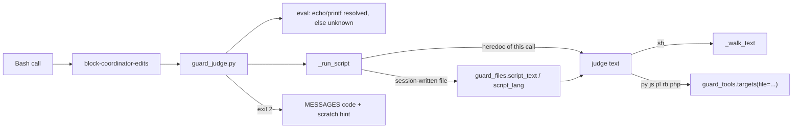
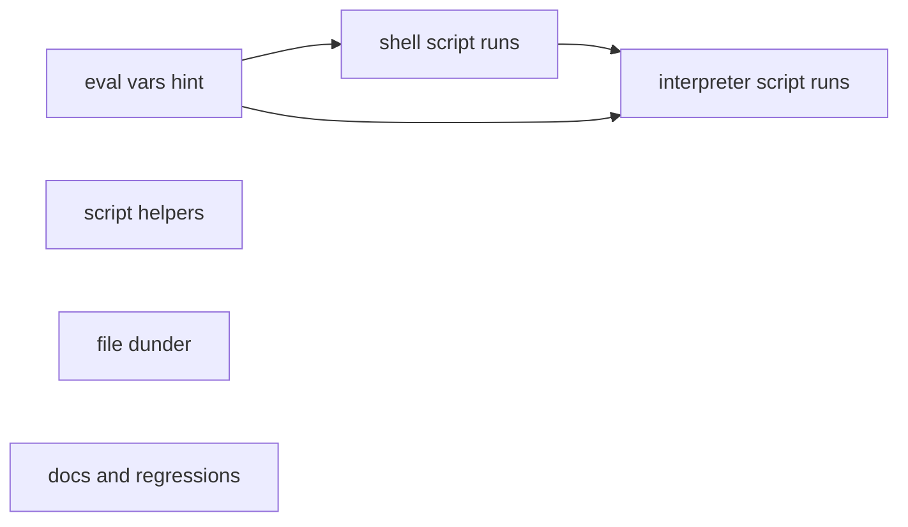

# Superlite: the guard judges session-written scripts, eval of a substitution, and split variables (B174, #693)

**Goal:** fix #693 and its owner comment: (1) a script file this session wrote is judged by its text when a later call runs it (today `sh x.sh` passes whatever `x.sh` holds); (2) `eval` of a command substitution or a variable is judged on the resolved text, and refused when the guard cannot resolve it (today `eval "$(echo rm -rf src)"` passes); (3) unquoted `$CLAUDE_PROJECT_DIR`, `$PWD`, `$TMPDIR` whose value holds a default-IFS character stay unknown like `$HOME`; (4) the judge prints the scratch hint line itself; (5) `__file__` in a judged Python script is the script's path; (6) `cd .superlite/scratch && python3 m.py` and `uv run m.py` match a heredoc-written script.
**Architecture:** `guard_files.py` gains three pure helpers (read a script file, its `#!` language, the session start from the transcript). `guard_tools.py` resolves `__file__`, `.parent`, `dirname`, `abspath`, `realpath` in Python writer targets. `guard_judge.py` gets one script-run path (`_run_script`) used by shells, `source`/`.`, a path run as a command, the interpreters and `uv run`, which takes the text from a heredoc of this call or, for a session-written file, from disk; the eval branch resolves `echo`/`printf` substitutions and refuses the rest; `_expand` drops its HOME-only condition; `MESSAGES["code"]` carries the scratch hint. The hook stops inserting the hint.
**Tech stack:** Python 3.10+ stdlib (guard_*.py), bash 3.2+ (the hook), pytest through `sl run_tests`; Markdown docs.
**Spec:** this file, section Design; issue #693.
**Detail:** contracts
**Target-min:** 11
**Wave0:** none
**Coverage:** off
**Max chars:** 32000

Global constraints:
- Every new or changed Python line in guard_*.py keeps the files' trailing `# O(...)` complexity comment; stdlib only; LF endings; no new module.
- Existing message lines and texts stay byte-identical except where a task says otherwise; every block still ends with its `Blocked target:` / `Blocked command:` line.
- The guard fails open only on its own errors, never on a script it cannot read (that blocks while the guard enforces, through `_unknown`).
- Tests use `tmp_path` projects and state folders, a private `SUPERLITE_HOME` under `tmp_path` where a test needs a home, never the real `~/.superlite`; no test reaches the network. Hook tests use the `proj`, `run` and `bash` helpers of tests/scripts/test_block_coordinator_edits.py (`run(proj, "Bash", {"command": c}, transcript_path=str(t), cwd=str(d))` passes extra hook fields).
- A session start is set in a test by a transcript file `t.jsonl` whose first line is `{"type": "user", "timestamp": "<UTC ISO, Z>"}`; file times by `os.utime`.
- Standing rules for every lead and its workers (the owner's decisions, passed on by main): this repository is public: no host names, user names, home paths, other project or repository names, ticket keys or account names in code, tests, docs, commit messages, PR texts or issue comments (write "a Swift project", "a second Mac", "the machine"). Never change the machine's gate config or ~/.superlite/machine.json; tests and proofs use private temp homes and state dirs. No real app builds as proof; this repository's own test suite is the check. Priority of this round: scheduling and admission of test runs, parallel agents and the fleet, wall-clock and token efficiency; measure before and after where the issue names a waste and put the figures into your report. Friction with superlite itself goes to `sl feedback add`, not into this batch. Online research is allowed when something is unclear (official docs first); name the source in your report.
- Builds: the verdict is `sl run_tests` (the project's test command; a project with `.maxapp` runs `maxapp test`, which a build pool may place on another Mac, and a full run whose tree a green maxapp test stamp covers returns that result without a run); task trees build in <tree>/.build/DerivedData and any build of your own goes under .build/ of the worktree, never -derivedDataPath outside the worktree (your session scratchpad included; backlog cleanup removes scratchpad build folders when the worktree goes); a product, simulator or device build stays on this machine and runs only when an issue's acceptance asks for a running-app check.
- Simulators: append the UDID of each simulator you or a worker creates (`xcrun simctl create` or `clone`; a checker's `Simulators:` line marks its created ones) as one line to <worktree>/.superlite/simulators.txt; never list one you did not create; ship cleanup shuts down and deletes each listed one.

Ruling: main's ruling (orchestrator, not the owner): a script file this session wrote and then runs is judged by its content, and refused when the guard cannot read it.
Ruling: "this session wrote" = the file lies in `<state folder>/scratch/`, or (it is not tracked by git in its own repository, it does not lie in the superlite plugin tree outside the project, and its mtime is at or after the session start). Session start = the earlier of the transcript's birth time (where the OS reports one) and the first `timestamp` in its first 64 KiB; no transcript or no time: every untracked file counts (because the hook keeps no write history and git's index plus mtime is the cheapest close reading; cost if wrong: a dependency script installed during the session is judged and may block; a `touch -t` script evades).
Ruling: unreadable means over 65536 characters, not UTF-8, an OS read error, or a `#!` interpreter the guard cannot judge; each blocks with its reason in the target word. A binary (a NUL byte, or an ELF, Mach-O or PE header) is no script and runs; a missing file and an operand with an unresolved variable stay as today (pass) (because built binaries and `bash "$SL" ...` are everyday commands; cost if wrong: a compiled writer and `sh "$X"` stay holes).
Ruling: eval resolves `$(echo ...)`, `$(printf ...)` (and backtick forms) with literal words and the variables the command assigned; anything else still holding `$` or a backtick is an unknown target, except the stdin forms (`$(cat)`, `/dev/stdin`: they take the heredocs as today) and `$(ssh-agent ...)` (pinned to pass by test_guard_judge.py::test_wrappers_and_recursion) (cost if wrong: `eval "$(brew shellenv)"` and similar block while the guard enforces).
Ruling: the hook's `scratch_inline` stays; the judge's heredoc path takes its text first. B173's pin `test_scratch_symlink_and_oversize_skipped` flips: a symlinked scratch script is judged through its target, an oversize one is refused.
Ruling: the 1.5.174 false-block cases already live in tests/scripts/test_guard_false_blocks_554.py and stay green; tests/scripts/test_guard_false_blocks.py gets this batch's no-false-block cases.
Ruling: files outside the brief's list, named by no open batch: hooks/block-coordinator-edits (the issue's `hooks/guard`), guard_tools.py, tests/scripts/test_block_coordinator_edits.py, the new test files.
Ruling: sequential T1 -> T4 -> T5 - all three change guard_judge.py - one task's wait.

## Design

### 1. Script helpers (`guard_files.py`, T2)
`script_text(path, limit=65536)` opens `path` (following symlinks) and reads at most `4 * limit + 1` bytes: OSError -> `(None, "unreadable: <strerror>")`; data starting with `\x7fELF`, `\xfe\xed\xfa\xce`, `\xfe\xed\xfa\xcf`, `\xce\xfa\xed\xfe`, `\xcf\xfa\xed\xfe`, `\xca\xfe\xba\xbe` or `MZ`, or holding a NUL -> `(None, "binary")`; more than `4 * limit` bytes, or decoded text over `limit` characters -> `(None, "over 65536 characters")` (the number is `limit`); strict UTF-8 failure -> `(None, "not UTF-8 text")`; else `(text, None)`.
`script_lang(text)` reads the first line: no `#!` -> `("sh", "sh")`. Else the interpreter is the `#!` path's basename; for `env` the first word after `env` and its options (`-S` splits the rest; `-i`, `-u NAME`, `NAME=V` skipped). sh, bash, zsh, ksh, dash -> `"sh"`; `python*`, `pypy*`, `uv` -> `"py"`; node, nodejs, bun -> `"js"`; perl -> `"pl"`; ruby -> `"rb"`; php -> `"php"`; anything else -> `(None, name)`.
`session_start(transcript)`: None or a missing file -> None; else the minimum of `st_birthtime` (when the stat has it) and the first top-level `"timestamp"` (ISO 8601, `Z` or offset) of a JSON line in the first 65536 bytes; neither -> None.

### 2. `__file__` and path calls in Python targets (`guard_tools.py`, T3)
`targets(..., file=None)` and `_code(..., file=None)` gain a keyword `file`; for Python code `__file__` then has the value `file` (no `file`: unknown, as today). The composer resolves, on a known string value `v`: `Path(v)` / `pathlib.Path(v)`, `.parent` (chained), `.resolve()`, `.absolute()`, `.with_name(lit)`, `.joinpath(lit, ...)`, the `/` operator with a literal, `os.path.dirname(v)`, `os.path.abspath(v)`, `os.path.realpath(v)`, `os.path.normpath(v)` and `os.path.join(v, lit, ...)`, each to its plain string (`posixpath` rules, no file system access; a relative value stays relative). Anything else stays unknown.

### 3. Eval, variables, the hint (`guard_judge.py` + hook, T1)
- `_source_or_eval`, eval branch: before the join, each part's `$(echo W...)`, `` `echo W...` ``, `$(printf F W...)` whose inner words are all literal (no `$`, backtick, glob, redirect or control operator) is replaced by its output: echo joins its words with one space (a leading `-n` dropped; any other leading option: not resolvable); printf supports `%s`, `%%`, `\n`, `\t`, `\\` and reuses the format while words remain; trailing newlines are cut as a substitution does. The joined text is walked as today. When that walk returns None and a part still holds `$` or a backtick: a part matching `STDIN_READ` keeps today's heredoc walk; a part that is exactly `$(ssh-agent ...)` or `` `ssh-agent ...` `` keeps today's pass; any other returns `_unknown(ctx, "eval " + part + ": text the guard cannot resolve")` (part cut by `_flat`).
- `_expand`: the condition `(name == "HOME" or ifs != DEFAULT_IFS)` goes; an unquoted known name whose value holds a character of the IFS in force stays as written, for HOME, CLAUDE_PROJECT_DIR, PWD and TMPDIR alike. Quoted expansions keep resolving.
- `MESSAGES["code"]` gains, right before the `- After the run, ` line, the hook's scratch hint text with `S` = the `--sd` folder's `scratch` path relative to `--project` when it lies inside it (`.superlite/scratch`), else absolute: `- A throwaway script (count lines, compare outputs, time a command): write it under S/ and run it from there. The folder is git-ignored and `sl orchestrator end` removes it; a run of a script there is judged like a heredoc script, so it may read the project but not write project code.` The hook's `run_judge` no longer inserts it (lines 741-744 go); its Edit/Write block keeps its own line.

### 4. Script runs (`guard_judge.py`, T4 and T5)
`_run_script(operand, lang, argv, c, st, ctx, depth)` replaces `_wrote_script` and `_script`. The operand is expanded with `_expand`; still holding `$` or a backtick -> None. For each directory in `c.inn` (an absolute operand once): `full` as today. `full` in `st.shared["scripts"]` -> judge that text; in `st.shared["wrote"]` -> `_unknown(ctx, operand)`; else `_disk_script(full, ctx)`: not a regular file after following links -> skip; not session-written (Ruling 2; `git -C <dir> ls-files --error-unmatch -- <name>` through `_git_run`, cached per real path; a git error counts as untracked) -> skip; `guard_files.script_text`: `"binary"` -> skip, another reason -> `_unknown(ctx, f"{operand}: a script this session wrote, {reason}")`; `lang` None -> `guard_files.script_lang(text)`, an unknown one -> `_unknown(ctx, f"{operand}: a script this session wrote for {name}, a language the guard cannot judge")`. Judging: `"sh"` -> `_walk_text(text, st.fork_for(c) with nested, ctx, depth + 1)`; other languages -> `guard_tools.targets(_argv_sub([interp, flag, text] + argv), text=ctx.text, file=full)` with flag `-c` (py), `-e` (js, pl, rb), `-r` (php), each target judged like a heredoc script's. The first non-None verdict wins; each real path is read at most once per call. `ctx.session_start` is computed once, lazily, from the hook JSON's `transcript_path`. The plugin tree is the folder three levels above guard_judge.py (real path).
- T4 wires: a shell's script operand (`_shell`), a shell with no script operand, no `-c` and stdin redirected from a file (`sh < x.sh`), `source`/`.` (dirs still unknown afterwards; `ACTIVATE` still passes), and a command word holding `/` that is not a shell (lang from `#!`).
- T5 wires: the interpreters (`INTERP`) with a script operand (python skips `-W`/`-X` values and stops at `-m`/`-c`; node, bun skip `-r`/`--require` values and stop at `-e`/`-p`/`--eval`; perl `-e`/`-E`, ruby `-e`, php `-r` are code, php `-f FILE` is a script), `uv run [options] X.py` and `uv run --script X` (as `python3 X`), `python3 < x.py` / `python3 - < x.py`, and the heredoc match from every `cd` directory (`cat > .superlite/scratch/m.py <<'EOF' ... EOF` then `cd .superlite/scratch && python3 m.py`; then `uv run .superlite/scratch/m.py`).

### 5. Docs (`docs/hooks.md`, T6)
One new bullet right after the `block-coordinator-edits`, scratch folder (#690) bullet:
`` - `block-coordinator-edits`, session scripts and eval (#693): while the guard enforces, a run of a script file is judged by the file's text when this session wrote it: an interpreter's script operand (`sh`, `bash`, `zsh`, `ksh`, `dash`, `python`, `pypy`, `node`, `bun`, `perl`, `ruby`, `php`), `uv run X.py`, a path run as a command (`./x.sh`, `/tmp/x.py`; the language from its `#!` line, a file without one is a shell script), `source`/`.` and a shell or Python reading the file on stdin (`sh < x.sh`). A file is this session's when it lies in `<state folder>/scratch/`, or when git does not track it in its own repository, it lies outside the superlite plugin (unless inside the project), and it changed at or after the session start (the earlier of the transcript's birth time and its first `timestamp`; without either every such file counts). A file the guard cannot read blocks and names why (over 65536 characters, not UTF-8, a read error, a `#!` interpreter it cannot judge); a binary (a NUL byte, an ELF, Mach-O or PE header) is no script and runs; a missing file or an operand with an unresolved variable runs as before. A script written earlier in the same call is matched from every directory the command may be in (`cd .superlite/scratch && python3 m.py`, `uv run m.py`), and in a judged Python script `__file__` is the script's path (`Path(__file__).parent`, `os.path.dirname`, `abspath`, `realpath`). `eval` judges the text it runs: `$(echo ...)` and `$(printf ...)` with literal words and the variables the command assigned resolve; any other substitution or variable is an unknown target, except `$(cat)` and the other stdin forms, which take the heredocs, and `$(ssh-agent ...)`. Unquoted `$CLAUDE_PROJECT_DIR`, `$PWD` and `$TMPDIR` whose value holds a space, tab or newline stay unknown, like `$HOME`. The judge's code block prints the scratch-folder line itself. ``

## Main diagram

## File structure

- `skills/subagent-driven-development/scripts/guard_files.py`: `script_text`, `script_lang`, `session_start` (T2).
- `skills/subagent-driven-development/scripts/guard_tools.py`: `file=` and the path calls (T3).
- `skills/subagent-driven-development/scripts/guard_judge.py`: eval, `_expand`, hint (T1); `_run_script`, `_disk_script` and the shell wiring (T4); interpreter, `uv run` and heredoc-match wiring (T5).
- `hooks/block-coordinator-edits`: drop the hint insertion (T1).
- Tests: `tests/scripts/test_guard_eval_vars_693.py` (T1), `test_guard_script_helpers_693.py` (T2), `test_guard_file_dunder_693.py` (T3), `test_guard_script_run_693.py` (T4, T5 adds its own cases to `test_guard_interp_run_693.py`), `test_block_coordinator_edits.py` (T5 flips one pin), `test_guard_false_blocks.py` (T6).
- `docs/hooks.md` (T6).

## Task graph

```mermaid
%% schedule
gantt
  title Predicted schedule (mm:ss)
  dateFormat X
  axisFormat %M:%S
  section lane 1
  T1 eval split variables and the judge's :t1, 0, 369s
  T4 shell source and path runs of session :t4, 369, 333s
  T5 interpreter uv run and heredoc-match :t5, 702, 372s
  section lane 2
  T2 script helpers in guard_files :t2, 0, 366s
  section lane 3
  T6 docs and no-false-block regressions :t6, 0, 311s
  section lane 4
  T3 __file__ and path calls in Python wri :t3, 0, 278s
```

critical path: T1 → T4 → T5 (17.9 min) · peak width 4 · predicted build 17.9 min · predicted total ≈ 28.4 min (target ✗ 11.0)

## Predicted schedule

## Guard

**Probe entry:** none (a bash hook and its judge; covered by subprocess tests that feed it hook JSON and by unit tests of the helpers)

### T1 eval, split variables and the judge's hint line · Complexity 5 · Est. context 50k
**Owns:** tests/scripts/test_guard_eval_vars_693.py, hooks/block-coordinator-edits
**Also-touches:** skills/subagent-driven-development/scripts/guard_judge.py
**Components:** 3
**LOC owned:** 150
**Tests:** fast
**Model:** sonnet
**Covers:** 3
**Review Focus:** state, encoding and protocol cases, named tests in tests/scripts/test_guard_eval_vars_693.py through the hook (`proj` fixture: active run):
- `test_eval_echo_substitution_blocks` (parametrized): `eval "$(echo rm -rf src)"`, `eval $(echo rm -rf src)`, `` eval "`echo rm -rf src`" ``, `eval "$(printf 'rm -rf src')"`, `eval "$(printf '%s ' rm -rf src)"`, `x='rm -rf src'; eval "$x"` -> 2, last line `Blocked target: src`.
- `test_eval_unresolved_refused` (parametrized): `eval "$(some-tool --print)"`, `eval "$Y"` (Y unassigned), `x=$(date); eval "$x"`, `eval "$(echo -e 'rm src')"` -> 2, stderr holds `text the guard cannot resolve`.
- `test_eval_still_passes` (parametrized): `eval 'ls'`, `eval ls -la`, `eval "$(echo ls docs)"`, `x='ls docs'; eval "$x"`, `eval "$(ssh-agent -s)"`, `eval "$(cat)" <<'EOF'\nls\nEOF` -> 0; `eval "$(cat)" <<'EOF'\nrm -rf src\nEOF` -> 2.
- `test_eval_idle_not_judged`: no pool.json (idle state): `eval "$(some-tool --print)"` -> 0.
- `test_unquoted_vars_with_space_unknown` (parametrized over TMPDIR, CLAUDE_PROJECT_DIR, PWD): the variable's value holds a space (TMPDIR = `tmp_path/"t d"`, a project at `tmp_path/"p q"` for CLAUDE_PROJECT_DIR, a `cwd` of `proj/"docs/plans/a b"` for PWD); an unquoted write `echo x > $VAR/docs/plans/n.md` (TMPDIR: `> $TMPDIR/n.txt`) -> 2 with `?` in the last line; the same word double-quoted -> 0. Without whitespace in the value, the unquoted form -> 0.
- `test_code_message_carries_scratch_hint`: `cat > src/x.py <<'EOF'\nprint(1)\nEOF` -> 2; stderr holds exactly one `- A throwaway script` line, right before the `- After the run, ` line, naming `.superlite/scratch/`; running guard_judge.py directly (`python3 -I guard_judge.py --mode active --project P --sd P/.superlite` with the hook JSON on stdin) prints that line too; a protected block (`echo x > .superlite/orchestrator.json`) has no `throwaway script`.
**Steps:** 1 failing tests, 2 run: FAIL, 3 implement, 4 run: PASS
**Notes:** Design 3. Existing tests that pin `MESSAGES["code"]` or the hint (`test_block_coordinator_edits.py::test_scratch_hint_*`, `_hint_before_after_run`) must pass unchanged; `test_guard_judge.py:345` (`cd docs; eval "$X"; printf x > a.py` blocks) keeps blocking. Measure the hook's wall time for `ls` and for `eval "$(echo ls)"` before and after (median of 10) and report both.

### T2 script helpers in guard_files · Complexity 3 · Est. context 30k
**Owns:** skills/subagent-driven-development/scripts/guard_files.py, tests/scripts/test_guard_script_helpers_693.py
**Components:** 3
**LOC owned:** 130
**Tests:** fast
**Model:** sonnet
**Covers:** 1
**Produces:** guard_files.script_text(path: str, limit: int = 65536) -> tuple[str | None, str | None]
e.g. script_text("/t/r.sh") with "wc -l src/a.py\n" -> ("wc -l src/a.py\n", None)
e.g. script_text("/t/app") with b"\x7fELF\x02\x01" -> (None, "binary")
e.g. script_text("/t/big.sh") with 70000 characters -> (None, "over 65536 characters")
**Produces:** guard_files.script_lang(text: str) -> tuple[str | None, str]
e.g. script_lang("echo hi\n") -> ("sh", "sh")
e.g. script_lang("#!/usr/bin/env -S uv run --script\nprint(1)\n") -> ("py", "uv")
e.g. script_lang("#!/usr/bin/env swift\nprint(1)\n") -> (None, "swift")
**Produces:** guard_files.session_start(transcript: str | None) -> float | None
e.g. session_start(None) -> None
e.g. session_start("/t/t.jsonl") whose first timestamped line holds "2026-11-13T02:41:07.427Z" and whose birth time is later -> 1794537667.427
e.g. session_start("/t/missing.jsonl") -> None
**Review Focus:** file and encoding cases in tests/scripts/test_guard_script_helpers_693.py:
- `test_script_text_reads_and_limits`: a 65536-character file -> text; 65537 characters -> `(None, "over 65536 characters")`; a 3-byte UTF-8 character repeated 30000 times (90000 bytes, 30000 characters) -> text; `limit=10` with 11 characters -> `(None, "over 10 characters")`.
- `test_script_text_binary_and_errors`: each magic header listed in Design 1 -> `"binary"`; `b"echo a\x00b"` -> `"binary"`; `b"\xff\xfe x"` -> `"not UTF-8 text"`; a missing path -> reason starts `unreadable: `; a directory -> reason starts `unreadable: `; a symlink to a text file -> that text.
- `test_script_lang_cases`: `#!/bin/bash -eu`, `#!/bin/sh`, `#!/usr/bin/env zsh` -> "sh"; `#!/usr/bin/env python3`, `#!/usr/local/bin/python3.12`, `#!/usr/bin/env -S uv run --script` -> "py"; `#!/usr/bin/env node`, `#!/usr/bin/env bun` -> "js"; `#!/usr/bin/perl -w` -> "pl"; `#!/usr/bin/env ruby` -> "rb"; `#!/usr/bin/env php` -> "php"; `#!/usr/bin/env -i FOO=1 python3` -> "py"; `#!/usr/bin/env swift` -> `(None, "swift")`; `#!` alone -> `(None, "")`; an empty text -> "sh".
- `test_session_start_cases`: the examples above; a first line without `timestamp` then a second with one -> that time; a timestamp with `+02:00` offset -> its UTC epoch; a file whose JSON lines are all without `timestamp` -> its birth time where `os.stat` has `st_birthtime`, else None; a non-JSON first line is skipped.
**Steps:** 1 failing tests, 2 run: FAIL, 3 implement, 4 run: PASS
**Notes:** pure functions, no git and no subprocess; extend the module docstring by one line naming the three helpers.

### T3 __file__ and path calls in Python writer targets · Complexity 4 · Est. context 45k
**Owns:** skills/subagent-driven-development/scripts/guard_tools.py, tests/scripts/test_guard_file_dunder_693.py
**Components:** 1
**LOC owned:** 110
**Tests:** fast
**Model:** sonnet
**Covers:** 2
**Produces:** guard_tools.targets(words: list[str], cwd: str | None = None, env=None, top: str | None = None, text: str | None = None, file: str | None = None) -> list[str]
e.g. targets(["python3", "-c", "from pathlib import Path\nopen(Path(__file__).parent / 'o.json', 'w')"], file="/p/.superlite/scratch/m.py") -> ["/p/.superlite/scratch/o.json"]
e.g. targets(["python3", "-c", "import os\nopen(os.path.join(os.path.dirname(os.path.abspath(__file__)), 'o.json'), 'w')"], file="/p/s/m.py") -> ["/p/s/o.json"]
e.g. targets(["python3", "-c", "from pathlib import Path\nopen(Path(__file__).parent / 'o.json', 'w')"]) -> ["?"]
**Review Focus:** deep and encoding cases in tests/scripts/test_guard_file_dunder_693.py (direct `guard_tools.targets` calls):
- `test_file_dunder_forms` (parametrized, file="/p/s/m.py"): `Path(__file__).parent / 'o.json'` -> "/p/s/o.json"; `Path(__file__).parent.parent / 'src' / 'a.py'` -> "/p/src/a.py"; `Path(__file__).resolve().parent.joinpath('o.json')` -> "/p/s/o.json"; `Path(__file__).with_name('o.json')` -> "/p/s/o.json"; `os.path.join(os.path.dirname(__file__), 'o.json')` -> "/p/s/o.json"; `os.path.realpath(__file__)` as the write target -> "/p/s/m.py"; `pathlib.Path(__file__).parent / 'o.json'` -> "/p/s/o.json"; each used as `open(<expr>, 'w')` and as `<expr>.write_text('x')` (Path forms).
- `test_path_calls_on_literals`: `Path('/a/b/c.py').parent / 'o.txt'` -> "/a/b/o.txt"; `os.path.dirname('/a/b/c.py')` + `os.path.join(.., 'o.txt')` -> "/a/b/o.txt"; `os.path.normpath('/a/b/../c')` -> "/a/c"; a relative `Path('s/m.py').parent / 'o'` -> "s/o".
- `test_file_unknown_without_file`: each form above with no `file=` -> ["?"]; `__file__` in node code (`require('fs').writeFileSync(__filename, 'x')`) -> ["?"] (unchanged).
- `test_file_dunder_reassigned`: `__file__ = input()` before the write -> ["?"].
**Steps:** 1 failing tests, 2 run: FAIL, 3 implement, 4 run: PASS
**Notes:** Design 2; `_code` gets the same keyword. No file system access: `resolve`, `absolute`, `abspath` and `realpath` of an absolute value are its normpath; of a relative value they stay unknown (`?`) since the guard cannot know the process directory here.

### T4 shell, source and path runs of session scripts · Complexity 6 · Est. context 60k
**Owns:** tests/scripts/test_guard_script_run_693.py
**Also-touches:** skills/subagent-driven-development/scripts/guard_judge.py
**Components:** 2
**LOC owned:** 190
**Tests:** fast
**Model:** sonnet
**Covers:** 4
**Consumes:** guard_files.script_text(path: str, limit: int = 65536) -> tuple[str | None, str | None] (T2) · guard_files.script_lang(text: str) -> tuple[str | None, str] (T2) · guard_files.session_start(transcript: str | None) -> float | None (T2)
**Review Focus:** file, state and protocol cases, named tests in tests/scripts/test_guard_script_run_693.py through the hook (`proj` fixture plus `src/a.py`; scripts in an `out` folder from `tmp_path_factory` unless named under the project; no transcript unless named):
- `test_session_shell_script_writer_blocked` (parametrized): `out/w.sh` = `echo y > src/a.py`: `sh OUT/w.sh`, `bash OUT/w.sh`, `zsh OUT/w.sh`, `OUT/w.sh` (chmod 755, no `#!`), `source OUT/w.sh`, `. OUT/w.sh`, `bash < OUT/w.sh`, and `bash scripts/w.sh` for an untracked `proj/scripts/w.sh` -> 2, last line `Blocked target: src/a.py`.
- `test_session_shell_script_reader_passes`: `out/r.sh` = `wc -l src/a.py` -> `sh OUT/r.sh` and `OUT/r.sh` (755) -> 0.
- `test_session_script_eval_inside`: `out/e.sh` = `eval "$(echo rm -rf src)"` -> `sh OUT/e.sh` -> 2.
- `test_session_script_unreadable_refused` (parametrized): 70000 characters of `# c` lines then `ls` -> 2, stderr holds `over 65536 characters`; bytes `\xff\xfe ls` -> 2, `not UTF-8 text`; mode 000 (skip when `os.geteuid() == 0`) -> 2, `unreadable`; `OUT/s` = `#!/usr/bin/env swift\nprint(1)` (755) run as `OUT/s` -> 2, `swift`.
- `test_binary_and_missing_run`: `OUT/app` = `b"\x7fELF" + b"\0" * 64` (755): `OUT/app --version` -> 0; `bash nothere.sh`, `OUT/none.sh` -> 0; `bash "$SL" x` -> 0.
- `test_old_and_tracked_scripts_pass`: a transcript whose first timestamp is one hour ago, `OUT/w.sh` with mtime two hours ago -> `sh OUT/w.sh` -> 0; the same script with mtime now -> 2; `git init` in proj, `tools/w.sh` (writes src/a.py) added to the index -> `bash tools/w.sh` -> 0.
- `test_plugin_tree_exempt`: unit test importing guard_judge with its plugin-root constant monkeypatched to `tmp_path/"plugin"`: an untracked new script there is not session-written; the same under a project inside that plugin root is.
- `test_activate_still_passes`: `proj/.venv/bin/activate` = `rm -rf src` -> `source .venv/bin/activate` -> 0.
**Steps:** 1 failing tests, 2 run: FAIL, 3 implement, 4 run: PASS
**Notes:** Design 4: write `_run_script` and `_disk_script` (Ruling 2), keep `_script` for T5 to replace (python callers unchanged in this task), wire the T4 call sites. Measure the hook's wall time (median of 10) for `ls`, `sh OUT/r.sh` (session-written) and `sh OUT/w.sh` with an old mtime, and report them.

### T5 interpreter, uv run and heredoc-match runs · Complexity 6 · Est. context 60k
**Owns:** skills/subagent-driven-development/scripts/guard_judge.py, tests/scripts/test_guard_interp_run_693.py, tests/scripts/test_block_coordinator_edits.py
**Components:** 3
**LOC owned:** 170
**Tests:** fast
**Model:** sonnet
**Covers:** 4
**Consumes:** guard_tools.targets(words: list[str], cwd: str | None = None, env=None, top: str | None = None, text: str | None = None, file: str | None = None) -> list[str] (T3) · guard_files.script_text(path: str, limit: int = 65536) -> tuple[str | None, str | None] (T2)
**Review Focus:** protocol, file and deep cases, named tests in tests/scripts/test_guard_interp_run_693.py through the hook (as in T4):
- `test_session_interp_script_writer_blocked` (parametrized): `out/w.py` = `open('src/a.py','w').write('y')`: `python3 OUT/w.py`, `python3 -u OUT/w.py`, `python3 -W ignore OUT/w.py`, `uv run OUT/w.py`, `uv run --script OUT/w.py`, `uv run python OUT/w.py`, `python3 < OUT/w.py`, `python3 - < OUT/w.py`, `OUT/w.py` with `#!/usr/bin/env python3` (755) -> 2, last line `Blocked target: src/a.py`; `out/w.js` = `require('fs').writeFileSync('src/a.js','y')`: `node OUT/w.js` -> 2; `out/w.rb` = `File.write('src/a.rb','y')`: `ruby OUT/w.rb` -> 2.
- `test_session_interp_argv_target`: `out/a.py` = `import sys\nopen(sys.argv[1],'w').write('y')`: `python3 OUT/a.py src/a.py` -> 2; `python3 OUT/a.py docs/plans/x.md` -> 0.
- `test_interp_code_and_module_untouched`: `python3 -m pytest -q`, `python3 -c 'print(1)'`, `node -e '1'`, `uv run pytest -q` -> 0.
- `test_heredoc_script_matched_after_cd`: `cat > .superlite/scratch/m.py <<'EOF'\nopen('src/a.py','w').write('y')\nEOF\ncd .superlite/scratch && python3 m.py` -> 2; the same with `uv run .superlite/scratch/m.py` as the run -> 2; with `print(1)` as the body -> 0 for both.
- `test_file_dunder_in_session_script`: scratch `m.py` = `from pathlib import Path\nopen(Path(__file__).parent / 'o.json','w').write('{}')` -> `python3 .superlite/scratch/m.py` -> 0; `open(Path(__file__).parent.parent.parent / 'src' / 'a.py','w')` -> 2 with `Blocked target: src/a.py`.
- In tests/scripts/test_block_coordinator_edits.py, `test_scratch_symlink_and_oversize_skipped` becomes `test_scratch_symlink_and_oversize_judged`: `link.py` -> 2, `big.py` -> 2 with `over 65536 characters` in stderr.
**Steps:** 1 failing tests, 2 run: FAIL, 3 implement, 4 run: PASS
**Notes:** Design 4 (T5 wiring); `_script` and `_wrote_script` are gone after this task (every caller uses `_run_script`). Reproduce the cd and `uv run` misses test-first and name their cause in your report.

### T6 docs and no-false-block regressions · Complexity 2 · Est. context 30k
**Owns:** docs/hooks.md, tests/scripts/test_guard_false_blocks.py
**Components:** 2
**LOC owned:** 90
**Tests:** fast
**Kind:** mechanical
**Model:** haiku
**Covers:** 5
**Review Focus:** state cases, named tests appended to tests/scripts/test_guard_false_blocks.py (its `proj`, `bash`, `run` imports; `src/a.py` created per test):
- `test_693_missing_and_module_runs_pass` (parametrized): `bash script.sh`, `python3 nothere.py`, `./nothere.sh`, `python3 -m pytest -q`, `uv run pytest -q` -> 0.
- `test_693_tracked_script_passes`: `git init -q` in proj, `tools/w.sh` = `echo y > src/a.py` added with `git add`, chmod 755: `bash tools/w.sh` and `./tools/w.sh` -> 0.
- `test_693_old_untracked_script_passes`: `t.jsonl` first line `{"type": "user", "timestamp": "<now - 1 h>"}`; `old.sh` in a `tmp_path_factory` folder = `echo y > src/a.py`, mtime now - 2 h; `run(proj, "Bash", {"command": f"bash {old}"}, transcript_path=str(t))` -> 0.
- `test_693_eval_forms_pass` (parametrized): `eval "$(ssh-agent -s)"`, `eval 'ls'`, `eval ls -la`, `x='ls docs'; eval "$x"`, `eval "$(cat)" <<'EOF'\nls\nEOF` -> 0.
- `test_693_quoted_tmpdir_with_space_passes`: env TMPDIR = an existing `tmp_path/"a b"` (pass `env` through a local copy of `run` with `TMPDIR` set): `echo x > "$TMPDIR/o.txt"` -> 0.
- `test_693_binary_and_activate_pass`: a new `app` file `b"\x7fELF" + b"\0" * 64` (755) outside the project -> `<app> --version` -> 0; `source .venv/bin/activate` with that file present -> 0.
**Steps:** 1 write the tests, 2 run: PASS (they pin passes that hold today), 3 add the docs bullet, 4 run: PASS
**Notes:** Design 5: write the bullet exactly as given, right after the line starting `` - `block-coordinator-edits`, scratch folder (#690) ``; change no other line.

## Review Focus

Guard (a hook judging shell text): protocol (hook JSON in, block message out), file (symlinks, binaries, sizes, permissions, missing files, tracked vs untracked, mtimes), encoding (UTF-8, NUL, heredoc delimiters), state (idle, active, human; transcript present or not), deep (nested eval and scripts up to the judge's depth). Specific risks: a false block of an everyday run (`sl` by path, `.venv/bin/pytest`, a built binary, `eval "$(ssh-agent -s)"`, `bash "$SL" ...`), a git call per script run slowing every Bash call (cached per real path, under the judge's deadline), a script read outside the judge's time budget.

## Self-review

Coverage: wanted 1 -> T2, T4, T5; wanted 2 -> T1; wanted 3 -> T1; wanted 4 -> every task's tests and T6; comment items: hint -> T1, `__file__` -> T3 and T5, cd and `uv run` -> T5. No placeholders. Tasks sharing guard_judge.py are ordered T1 -> T4 -> T5. Every task has Components, LOC owned, Tests and Model.
