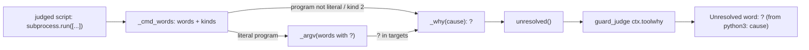
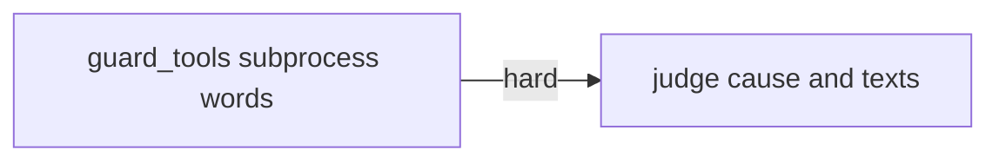

# Superlite: a subprocess call with a non-literal argument no longer makes a whole script unknown (B176, #705)

**Goal:** fix #705: the coordinator guard blocks a judged Python script (inline, heredoc, scratch folder) as `Unresolved word: ? (from python3)` when it calls `subprocess.run` (also `call`, `Popen`, `check_output`, `os.system`) with an argument list holding any non-literal element, e.g. `["git", "show", f"HEAD:{p}"]`. Wanted: such a list is judged by its program and literal words, as the shell path judges `git show "$x"`; a non-literal program stays unknown; the block names the cause; the scratch-folder message line and docs/hooks.md say so.
**Architecture:** `guard_tools._cmd_words` returns each element's kind (literal, one unknown word, any number of words); `_a_sh` judges a literal-program list with `_argv` over the words (unknown ones written `?`, exactly as `_shell` writes a dynamic shell word) and records the cause, read through the new `guard_tools.unresolved()`. `_argv`/`_targets` gain four narrow unknown rules for words that may be code. `guard_judge` keeps the cause in `ctx.toolwhy` and prints it in the `? (from python3: ...)` word, as it does for git's `gitwhy`.
**Tech stack:** Python 3.10+ stdlib (guard modules), bash 3.2+ (the hook), pytest through `sl run_tests`; Markdown docs.
**Spec:** this file, section Design; issue #705.
**Detail:** full
**Target-min:** 11
**Wave0:** none
**Coverage:** off
**Max chars:** 36000

Global constraints:
- Every new or changed Python line in guard_tools.py and guard_judge.py keeps the file's trailing `# O(...)` complexity comment (guard_judge.py writes `# <note> | O(...)`); stdlib only; LF endings.
- The hook stays bash 3.2 compatible; only the one `printf` text of `scratch_hint` changes.
- Existing message lines stay byte-identical except the scratch line, which only gains the sentence given in Design 4 at its end (its start, which tests pin, is unchanged).
- Tests use `tmp_path` projects with `.superlite/pool.json` (an active run), drop every `SUPERLITE_*` variable from the hook's env and set `SUPERLITE_HOME` under `tmp_path`; never the real `~/.superlite`; no network. Judged test scripts take their unknown value from `input()`, never `sys.argv`: the judge reads a heredoc's command-line arguments (`python3 - x` makes `sys.argv[1]` the literal `x`).
- Do not touch tests/scripts/test_guard_fleet_agents.py or tests/scripts/test_lead_guard_heredoc_276.py (batch B177 owns them). docs/hooks.md and hooks/block-coordinator-edits are shared with B177: change only the lines this plan names.
- Standing rules for every lead and its workers (the owner's decisions, passed on by main): this repository is public: no host names, user names, home paths, other project or repository names, ticket keys or account names in code, tests, docs, commit messages, PR texts or issue comments (write "a Swift project", "a second Mac", "the machine"). Never change the machine's gate config or ~/.superlite/machine.json; tests and proofs use private temp homes and state dirs. No real app builds as proof; this repository's own test suite is the check. Priority of this round: scheduling and admission of test runs, parallel agents and the fleet, wall-clock and token efficiency; measure before and after where the issue names a waste and put the figures into the notes. Friction with superlite itself goes to `sl feedback add`, not into this batch. Online research is allowed when something is unclear (official docs first); name the source in the notes.
- Simulators: none are needed; one you create anyway goes as one line into /Users/max/github/superlite/.claude/worktrees/superlite-b176-guard-subprocess-dynamic-args/.superlite/simulators.txt.

Ruling: a list whose first element is a string literal is judged by `_argv` over its words, each non-literal element written as the word `?` (because that is the word `_shell` writes for a dynamic shell word, so "judged as the shell path judges" holds by construction; cost if wrong: a dynamic word the shell path also misjudges, see the follow-ups in .superlite/notes.md).
Ruling: a Python element counts as a literal when `_compose_raw` reads it as exactly one value with no unknown piece (a name bound only to one literal, `+`, `os.path.join`, `str()` of literals), the reading open() targets already get (because a module constant `HOOK = "hooks/x"` is the common throwaway-script program; cost if wrong: none, unknown pieces stay unknown).
Ruling: an unpacked element (`*args`) or a list followed by `+` stands for any number of words and keeps the call unknown, as today (because any words may hold `-c CODE` or `checkout -- <path>`).
Ruling: `_argv` and `_targets`, which the subprocess path and shell strings inside scripts use (never the judge's own Bash walk), call a command unknown when: a wrapper has no known program and its first non-option, non-assignment word is `?`; a shell, PowerShell or interpreter has `?` before its last word; an interpreter's inline code is `?`; `find` has any `?` word (because such a word may be `-c`, the code or a find action; the last word of `bash X` or `python3 X` is its script operand, judged as a literal operand is).
Ruling: the cause reaches the block as `guard_tools.unresolved()` and `ctx.toolwhy`, printed `Unresolved word: ? (from python3: <cause>)`; argument numbers count the program as argument 1 (the issue's own example names `f"{rev}:{path}"` of `["git", "show", ...]` argument 3).
Ruling: other languages' comma-form calls (`system("git", "show", rev)`) keep today's unknown for a later non-literal argument; only a non-literal first element names the program cause (scope: the issue's list form).
Ruling: the 14.5 min prediction misses the 11 min target and is accepted (because T2's hook tests run T1's code, so the two tasks are sequential, and splitting either would only add a seam; cost if wrong: a few minutes of wall clock).
Ruling: detail `full` (because the core is a parser change in a security guard; the planning lead ran this exact code and these tests on a scratch copy: 53 new tests green, 45 of them red on the base, 2880 guard-related tests passed and 0 failed).

## Design

### 1. Element kinds (`guard_tools._cmd_words`, `_elem`)
`_cmd_words(raw, lang)` returns `(words, kinds)` or None (unreadable). Kinds: 0 a literal, 1 one word that is not a literal (written `?`), 2 any number of words (written `?`). The list form finds its `]` with `_scan_close` (quotes and nesting respected, so `d["k]"]` is one element) and splits it with `_split_top`; a trailing comma is dropped; an empty element is unreadable. After `]`: `+` adds one kind-2 word and ends; any char but `,` `)` `;` newline or the end makes it unreadable (a slice, a method call). The comma form is unchanged, except that a first element that is not a literal returns `(["?"], [1])`.
e.g. `(["git", "show", f"HEAD:{p}"])` -> `(["git", "show", "?"], [0, 0, 1])`
e.g. `([p, "x"])` -> `(["?", "x"], [1, 0])`; `(cmd, shell=True)` -> `(["?"], [1])`
e.g. `(["bash", *a])` -> `(["bash", "?"], [0, 2])`; `(["git"] + rest)` -> `(["git", "?"], [0, 2])`

### 2. Judging and the cause (`_a_sh`, `_why`, `unresolved`, `targets`)
Kind of the first word not 0: `_why("subprocess program is not a string literal")`. Else `k` = index of the first non-literal word, cause `subprocess argument {k+1} is not a string literal`; a kind-2 word: `_why(cause)`; otherwise `out = _shell(words[0]) if len(words) == 1 else _argv(words)`, and when `"?" in out` and some word is not a literal, `_why(cause)` is recorded too (out is returned unchanged). The bare `run(`/`call(` lambda's `["?"]` becomes the program cause. `targets()` clears `_WHY` first; `unresolved()` returns its first entry or "".

### 3. Words that may be code (`_argv`, `_targets`)
The four unknown rules of the fourth Ruling, each returning `["?"]`.

### 4. Message line, hook copy, docs (#705 wanted 3)
The scratch line of `MESSAGES["code"]` (guard_judge.py) and `scratch_hint` (the hook) both end, after `...but not write project code.`, with: ` A subprocess call whose program is not a string literal (`[prog, ...]`, `sys.executable`) is judged unknown; a later argument that is not a literal is judged like an unknown shell variable.` docs/hooks.md gets one new bullet right after the `block-coordinator-edits`, session scripts and eval (#693) bullet (text in T2).

## Main diagram



## File structure

- `skills/subagent-driven-development/scripts/guard_tools.py`: element kinds, `_a_sh`, the cause API, the four unknown rules.
- `tests/scripts/test_guard_tools_dyn_705.py` (new): guard_tools-level tests.
- `skills/subagent-driven-development/scripts/guard_judge.py`: `ctx.toolwhy`, `_tool_targets`, the word text, the message line.
- `hooks/block-coordinator-edits`: the `scratch_hint` text.
- `docs/hooks.md`: one new bullet.
- `tests/scripts/test_guard_subprocess_705.py` (new): hook-level tests.

## Task graph

```mermaid
%% schedule
gantt
  title Predicted schedule (mm:ss)
  dateFormat X
  axisFormat %M:%S
  section lane 1
  T1 guard_tools judges subprocess lists b :t1, 0, 245s
  T2 judge names the subprocess cause mess :t2, 245, 234s
```





critical path: T1 → T2 (8.0 min) · peak width 1 · predicted build 8.0 min · predicted total ≈ 14.5 min (target ✗ 11.0)

## Predicted schedule

## Guard tools

**Probe entry:** none (a library; covered by direct `guard_tools.targets` calls)

### T1 guard_tools judges subprocess lists by program and literal words · Complexity 4 · Est. context 34k
**Owns:** skills/subagent-driven-development/scripts/guard_tools.py, tests/scripts/test_guard_tools_dyn_705.py
**Components:** 2
**LOC owned:** 210
**Tests:** fast
**Model:** sonnet
**Covers:** 1, 2, 3
**Produces:** guard_tools.unresolved() -> str
e.g. after `targets(["python3", "-c", "import subprocess\np = input()\nsubprocess.run([p, 'x'])"])` -> `unresolved()` == "subprocess program is not a string literal"
e.g. after `targets(["python3", "-c", "import subprocess\np = input()\nsubprocess.run(['cp', 'a', p])"])` -> "subprocess argument 3 is not a string literal"
e.g. after `targets(["python3", "-c", "open(input() + '.md', 'w')"])` -> ""
**Review Focus:** parser and state cases, all in tests/scripts/test_guard_tools_dyn_705.py: `test_dynamic_argument_judged_by_program` (12 read-only calls -> `[]`, no cause), `test_unknown_names_the_cause` (16 calls -> `["?"]` and the exact cause), `test_same_targets_as_shell_word` (subprocess list == os.system shell string), `test_shell_word_that_may_run_text_is_unknown`, `test_shell_word_as_operand_still_passes`, `test_reason_is_per_call` (no stale cause), `test_literal_lists_unchanged`.
**Test code (verbatim):**
```python
import sys
from pathlib import Path

import pytest

sys.path.insert(0, str(Path(__file__).resolve().parents[2] / "skills" / "subagent-driven-development" / "scripts"))
import guard_tools  # noqa: E402

HEAD = "import os, subprocess, sys\np = input()\n"


def py(code):
    return guard_tools.targets(["python3", "-c", HEAD + code])


@pytest.mark.parametrize("code", [
    'subprocess.run(["git", "show", f"HEAD:{p}"])',
    'subprocess.run(["git", "show", "HEAD:" + p])',
    'subprocess.check_output(["wc", "-c", str(p)])',
    'subprocess.run(["git", "show", p], capture_output=True, text=True)',
    'subprocess.Popen(["git", "log", "--format=%H", f"{p}..HEAD"])',
    'subprocess.run(["git", "show", d["k]"]])',
    'subprocess.run(["bash", p], input="{}")',
    'subprocess.run(["python3", p])',
    'subprocess.run(["python3", "-c", "print(1)", p])',
    'subprocess.run(["timeout", p, "git", "status"])',
    'subprocess.run(\n    ["git", "diff", "--stat", p],\n    check=True,\n)',
    'HOOK = "hooks/x"\nsubprocess.run([HOOK, "--flag"])',
])
def test_dynamic_argument_judged_by_program(code):
    assert py(code) == []
    assert guard_tools.unresolved() == ""


@pytest.mark.parametrize("code,why", [
    ('subprocess.run([p, "x"])', "subprocess program is not a string literal"),
    ('subprocess.run([sys.executable, "-c", "print(1)"])', "subprocess program is not a string literal"),
    ('subprocess.run(p, shell=True)', "subprocess program is not a string literal"),
    ('subprocess.run(f"git show {p}", shell=True)', "subprocess program is not a string literal"),
    ('os.system("git show " + p)', "subprocess program is not a string literal"),
    ('from subprocess import run\nrun(p)', "subprocess program is not a string literal"),
    ('subprocess.run(["cp", "a", p])', "subprocess argument 3 is not a string literal"),
    ('subprocess.run(["rm", f"src/{p}"])', "subprocess argument 2 is not a string literal"),
    ('subprocess.run(["python3", "-c", p])', "subprocess argument 3 is not a string literal"),
    ('subprocess.run(["bash", "-c", p])', "subprocess argument 3 is not a string literal"),
    ('subprocess.run(["bash", p, "x"])', "subprocess argument 2 is not a string literal"),
    ('subprocess.run(["node", p, "-e", "1"])', "subprocess argument 2 is not a string literal"),
    ('subprocess.run(["bash", *sys.argv[1:]])', "subprocess argument 2 is not a string literal"),
    ('subprocess.run(["git", "show"] + sys.argv[1:])', "subprocess argument 3 is not a string literal"),
    ('subprocess.run(["env", p, "x"])', "subprocess argument 2 is not a string literal"),
    ('subprocess.run(["find", p, "-name", "x"])', "subprocess argument 2 is not a string literal"),
])
def test_unknown_names_the_cause(code, why):
    assert py(code) == ["?"]
    assert guard_tools.unresolved() == why


@pytest.mark.parametrize("argv,shell", [
    ('["git", "checkout", f"{p}"]', 'git checkout "$x"'),
    ('["git", "show", f"{p}:a"]', 'git show "$x"'),
    ('["rm", p]', 'rm "$x"'),
    ('["cp", "a", p]', 'cp a "$x"'),
])
def test_same_targets_as_shell_word(argv, shell):
    assert py(f"subprocess.run({argv})") == py(f"os.system({shell!r})")


@pytest.mark.parametrize("shell", ['env "$P" x', 'bash "$o" "$c"', 'python3 -c "$X"', 'find . "$o"', 'perl "$o" "$c"'])
def test_shell_word_that_may_run_text_is_unknown(shell):
    assert py(f"os.system({shell!r})") == ["?"]


@pytest.mark.parametrize("shell", ['nohup ./run.sh "$a"', 'timeout 5 git show "$r"', 'bash -c "echo hi"'])
def test_shell_word_as_operand_still_passes(shell):
    assert py(f"os.system({shell!r})") == []


def test_reason_is_per_call():
    assert py('subprocess.run([p, "x"])') == ["?"]
    assert guard_tools.targets(["python3", "-c", "import sys\nopen(sys.stdin.readline() + '.md', 'w')"]) == ["?"]
    assert guard_tools.unresolved() == ""


def test_literal_lists_unchanged():
    assert py('subprocess.run(["rm", "src/a"])') == ["src/a"]
    assert py('subprocess.run(["bash", "-c", "rm src/a"], check=True)') == ["src/a"]
    assert py('subprocess.run(["git", "show", "HEAD:src/a.py"])') == []
```
**Implementation (verbatim):** replace the whole `def _cmd_words` function (up to `def _known`) with this block:
```python
_WHY: list[str] = []  # O(1) | the reasons the last targets() call recorded for a subprocess call it names "?" (#705)


def _why(reason: str) -> list[str]:  # O(|_WHY|) | record why a subprocess call is unknown; its "?" target
    if reason not in _WHY:  # O(|_WHY|)
        _WHY.append(reason)  # O(1)
    return ["?"]  # O(1)


def unresolved() -> str:  # O(1) | the first reason the last targets() call recorded for a "?", "" when none
    return _WHY[0] if _WHY else ""  # O(1)


def _elem(part: str, lang: str) -> str | None:  # O(len(part)) | one argv element's literal value, None when it is not a literal
    m = _LIT.match(part)  # O(len(part))
    if m and not part[m.end():].strip():  # O(len(part))
        return _unq(m, lang)  # O(len(part))
    if lang == "py":  # a name bound only to one literal, or a composition of literals (#705)  # O(1)
        r = _compose_raw(part.strip(), _NAMES[0])  # O(len(part))
        if r is not None and len(r) == 1 and _UNK not in r[0]:  # O(len(r[0]))
            return r[0]  # O(1)
    return None  # O(1)


def _cmd_words(raw: str, lang: str) -> tuple[list[str], list[int]] | None:  # O(len(raw)) | the command words and their kinds: 0 a literal, 1 one word that is not a literal ("?"), 2 any number of words; None when unreadable
    s = raw.lstrip(" \t\r\n")  # O(len(raw))
    if s.startswith("("):  # O(1)
        s = s[1:]  # O(len(raw))
    words: list[str] = []  # O(1)
    kinds: list[int] = []  # O(1)
    while True:  # O(len(raw))
        s = s.lstrip(" \t\r\n")  # O(len(s))
        if not s or s[0] in ");":  # O(1)
            break  # O(1)
        if s[0] == "[":  # the argv list  # O(1)
            j = _scan_close(s, 0)  # O(len(s))
            if j >= len(s):  # O(1)
                return None  # O(1)
            parts = _split_top(s[1:j])  # O(len(s))
            if parts and not parts[-1].strip():  # a trailing comma  # O(1)
                parts.pop()  # O(1)
            for part in parts:  # O(len(s))
                p = part.strip()  # O(len(part))
                if not p:  # O(1)
                    return None  # O(1)
                v = None if p.startswith("*") else _elem(p, lang)  # O(len(p))
                words.append("?" if v is None else v)  # O(1)
                kinds.append(2 if p.startswith("*") else int(v is None))  # an unpacked list: any number of words  # O(1)
            s = s[j + 1:].lstrip(" \t")  # O(len(s))
            if s.startswith("+"):  # the list + more words: any number of words  # O(1)
                words.append("?")  # O(1)
                kinds.append(2)  # O(1)
                break  # O(1)
            if s and s[0] not in ",);\n":  # the list is part of another expression (a slice, a method call)  # O(1)
                return None  # O(1)
        else:  # O(1)
            m = _LIT.match(s)  # O(len(s))
            nxt = s[m.end():].lstrip(" \t") if m else ""  # O(len(s))
            v = _unq(m, lang) if m and (not nxt or nxt[0] in ",);\n") else None  # O(len(s))
            if v is not None:  # O(1)
                words.append(v)  # O(1)
                kinds.append(0)  # O(1)
                s = s[m.end():]  # O(len(s))
            elif words and re.match(r"\{|\w+\s*(?:=(?!=)|:(?!:))|function\b|async\b|\(|\w+\s*=>|\)", s):  # options  # O(1)
                break  # O(1)
            elif not words:  # the program, or the shell string, is not a literal (#705)  # O(1)
                return ["?"], [1]  # O(1)
            else:  # O(1)
                return None  # O(1)
        s = s.lstrip(" \t")  # O(len(s))
        if s.startswith(","):  # O(1)
            s = s[1:]  # O(len(s))
        else:  # O(1)
            break  # O(1)
    return (words, kinds) if words else None  # O(1)


def _runs_code(c: str) -> bool:  # O(1) | an interpreter whose inline code _eval_code reads
    return _PY.match(c) is not None or c in _NODE or c in ("ruby", "php", "perl")  # O(1)
```
Replace the body of `_a_sh` (signature unchanged) with:
```python
    found = _cmd_words(raw, lang)  # O(len(raw))
    if found is None or _depth[0] >= 4:  # O(1)
        return ["?"]  # O(1)
    words, kinds = found  # O(1)
    if kinds[0]:  # the program, or the shell string, is not a literal (#705)  # O(1)
        return _why("subprocess program is not a string literal")  # O(1)
    k = next((i for i, x in enumerate(kinds) if x), -1)  # the first argument that is not a literal  # O(w)
    cause = f"subprocess argument {k + 1} is not a string literal"  # the program is argument 1  # O(1)
    if 2 in kinds:  # an unpacked list or a `+` tail: any words, -c CODE too  # O(w)
        return _why(cause)  # O(1)
    _depth[0] += 1  # O(1)
    try:  # O(1)
        out = _shell(words[0]) if len(words) == 1 else _argv(words)  # O(len(raw))
    finally:  # O(1)
        _depth[0] -= 1  # O(1)
    if "?" in out and k >= 0:  # O(len(out))
        _why(cause)  # O(1)
    return out  # O(1)
```
In `_argv`, replace the three lines from `if k == len(words):` through the xargs/find line's `return ["?"]` with:
```python
        if k == len(words):  # O(1)
            first = next((x for x in words[1:] if not x.startswith("-") and not re.match(r"[A-Za-z_]\w*=", x)), None)  # O(w)
            return ["?"] if first == "?" else []  # a wrapper whose program is not a literal (#705)  # O(1)
    w = words[k:]  # O(w)
    c = _cmd(w[0])  # O(1)
    if c == "xargs" or (c == "find" and any(a in _FIND_W or a == "?" for a in w)):  # find: a word that is not a literal may be an action (#705)  # O(w)
        return ["?"]  # O(1)
    if "?" in w[1:-1] and (c in _SHELLS or c in _PSHELLS or _runs_code(c)):  # such a word before the last may be -c and its code (#705)  # O(w)
        return ["?"]  # O(1)
```
In `_targets`, right after `found = _eval_code(cmd, args)`, insert:
```python
    if found and "?" in found[1].split("\n"):  # inline code that is not a literal (#705)  # O(len(code))
        return ["?"]  # O(1)
```
In `targets()`, before its `return _targets(...)`, insert `    _WHY.clear()  # the reasons of this call only (#705)  # O(1)`. In `_CALLS["py"]`, the bare `run|call|...` lambda's `else ["?"]` becomes `else _why("subprocess program is not a string literal")`.
**Steps:** 1 write the test file, 2 run: FAIL (the planning lead saw 36 of 42 fail on the base), 3 implement, 4 run: PASS, 5 run `sl run_tests --fast tests/scripts/test_guard_tools.py tests/scripts/test_guard_files.py tests/scripts/test_guard_false_blocks.py tests/scripts/test_guard_concat_362.py tests/scripts/test_guard_scratch_script.py` green.
**Notes:** `_scan_close`, `_split_top`, `_compose_raw`, `_UNK`, `_NAMES`, `_LIT`, `_unq`, `_PY`, `_NODE`, `_SHELLS`, `_PSHELLS`, `_FIND_W` already exist in guard_tools.py; add nothing else. `_cmd_words` has no other caller.

## Judge and texts

**Probe entry:** none (a bash hook; covered by subprocess tests that feed it hook JSON)

### T2 judge names the subprocess cause; message, hook and docs · Complexity 3 · Est. context 40k
**Owns:** skills/subagent-driven-development/scripts/guard_judge.py, hooks/block-coordinator-edits, docs/hooks.md, tests/scripts/test_guard_subprocess_705.py
**Components:** 2
**LOC owned:** 140
**Tests:** fast
**Model:** sonnet
**Covers:** 2, 4
**Consumes:** guard_tools.unresolved() -> str (T1)
**Review Focus:** protocol and state cases in tests/scripts/test_guard_subprocess_705.py: the read-only heredoc and scratch runs pass (exit 0); the block's `Unresolved word:` line names the cause exactly; `git checkout` with an unknown word gets the same verdict as the os.system shell form; a plain unknown open() keeps `? (from python3)` with no stale cause; git's own reason unchanged; the hint line ends with the new sentence in both the hook's and the judge's code block.
**Test code (verbatim):**
```python
import json
import os
import shutil
import subprocess
from pathlib import Path

import pytest

ROOT = Path(__file__).resolve().parents[2]
HOOK = ROOT / "hooks" / "block-coordinator-edits"
BASH = shutil.which("bash")
HEAD = "import os, subprocess, sys\np = input()\n"
NOTE = ("A subprocess call whose program is not a string literal (`[prog, ...]`, `sys.executable`) is judged unknown; "
        "a later argument that is not a literal is judged like an unknown shell variable.")


@pytest.fixture
def proj(tmp_path):
    p = tmp_path / "P"
    (p / ".superlite" / "scratch").mkdir(parents=True)
    (p / ".superlite" / "pool.json").write_text("{}")
    (p / "src").mkdir()
    (p / "src" / "a.py").write_text("x = 1\n")
    return p


def hook(proj, payload):
    env = {k: v for k, v in os.environ.items() if not k.startswith("SUPERLITE_")}
    env.update(CLAUDE_PROJECT_DIR=str(proj), SUPERLITE_HOME=str(proj.parent / "home"))
    return subprocess.run([BASH, str(HOOK)], input=json.dumps(payload), capture_output=True, text=True, env=env, cwd=proj)


def bash(proj, cmd):
    return hook(proj, {"tool_name": "Bash", "tool_input": {"command": cmd}})


def heredoc(code):
    return f"python3 - <<'EOF'\n{HEAD}{code}\nEOF"


def word(r):
    return [ln for ln in r.stderr.splitlines() if ln.startswith("Unresolved word: ")]


@pytest.mark.parametrize("code", [
    'subprocess.run(["git", "show", f"HEAD:{p}"])',
    'subprocess.run(["git", "show", "HEAD:" + p], capture_output=True)',
    'subprocess.check_output(["wc", "-c", str(p)])',
])
def test_heredoc_read_with_dynamic_argument_passes(proj, code):
    assert bash(proj, heredoc(code)).returncode == 0


def test_scratch_script_with_dynamic_argument_passes(proj):
    (proj / ".superlite" / "scratch" / "m.py").write_text(HEAD + 'subprocess.run(["git", "show", f"HEAD:{p}"])\n')
    assert bash(proj, "python3 .superlite/scratch/m.py").returncode == 0


def test_program_name_blocked_names_cause(proj):
    r = bash(proj, heredoc('subprocess.run([p, "x"])'))
    assert r.returncode == 2
    assert word(r) == ["Unresolved word: ? (from python3: subprocess program is not a string literal)"]


def test_dynamic_destination_names_argument(proj):
    r = bash(proj, heredoc('subprocess.run(["cp", "a", p])'))
    assert r.returncode == 2
    assert word(r) == ["Unresolved word: ? (from python3: subprocess argument 3 is not a string literal)"]


def test_scratch_script_block_names_cause(proj):
    (proj / ".superlite" / "scratch" / "w.py").write_text(HEAD + 'subprocess.run(["rm", f"src/{p}"])\n')
    r = bash(proj, "python3 .superlite/scratch/w.py")
    assert r.returncode == 2
    assert word(r) == ["Unresolved word: ? (from python3: subprocess argument 2 is not a string literal)"]


def test_checkout_same_verdict_as_shell_word(proj):
    sub = bash(proj, heredoc('subprocess.run(["git", "checkout", f"{p}"])'))
    sh = bash(proj, heredoc("os.system('git checkout \"$x\"')"))
    assert sub.returncode == sh.returncode == 0


def test_unknown_open_keeps_plain_word(proj):
    r = bash(proj, "python3 - <<'EOF'\nimport sys\nopen(sys.stdin.readline() + '.md', 'w')\nEOF")
    assert r.returncode == 2
    assert word(r) == ["Unresolved word: ? (from python3)"]


def test_git_reason_unchanged(proj):
    r = bash(proj, 'git -c core.hooksPath="$(cat x)" commit -m x')
    assert all("subprocess" not in ln for ln in word(r))


def test_scratch_hint_names_non_literal_program(proj):
    w = hook(proj, {"tool_name": "Write", "tool_input": {"file_path": str(proj / "src" / "x.py")}})
    b = bash(proj, "cat > src/x.py <<'EOF'\nprint(1)\nEOF")
    for r in (w, b):
        assert r.returncode == 2
        lines = [ln for ln in r.stderr.splitlines() if ln.startswith("- A throwaway script")]
        assert len(lines) == 1 and lines[0].endswith(NOTE)
```
**Implementation:** guard_judge.py, each an exact edit:
- `__init__` of the context class, after the `self.gitwhy = ""` line: `self.toolwhy = ""  # why a script's subprocess call is unknown (guard_tools.unresolved, #705), for the command being judged | O(1)`.
- `_run_words`, after `ctx.gitwhy = ""  # O(1)`: `ctx.toolwhy = ""  # O(1)`.
- `_check`: the `word = ...` line becomes two lines: `why = ctx.gitwhy if ctx.cmd == "git" else ctx.toolwhy  # git's reason, else a script's subprocess call's (#705) | O(1)` and `word = t if t != "?" else "? (from " + (ctx.cmd or "the command") + (": " + why if why else "") + ")"  # the target as read, before the $VAR/ cut | O(p)`.
- New helper right above `_prog_pairs`: `def _tool_targets(ctx, w, **kw):  # O(len) | guard_tools.targets, keeping why a script's subprocess call is unknown for the block's word (#705)`; body: `ts = guard_tools.targets(w, **kw)`; `if "?" in ts and not ctx.toolwhy: ctx.toolwhy = guard_tools.unresolved()` (two lines); `return ts`; each line with its `# O(...)` comment.
- `_prog_pairs(w, flag, progs, text=None)` becomes `_prog_pairs(w, flag, progs, ctx)`, its targets call `_tool_targets(ctx, w2, text=ctx.text)`; its one caller passes `ctx` instead of `ctx.text`.
- `_code_run` and the last `else:` branch of `_targets` (the `_argv_sub(w) if m and flag == "-c" else w` call) call `_tool_targets(ctx, ...)` with the same arguments instead of `guard_tools.targets(...)`. The git branch keeps `guard_tools.targets` and `gitwhy`.
- `MESSAGES["code"]`, the scratch line: after `"heredoc script, so it may read the project but not write project code.` append, inside the same string, the sentence of Design 4 (split the literal over lines as the file does).
hooks/block-coordinator-edits, `scratch_hint`: the printf text gets the same sentence after `not write project code.`, backticks escaped as `\``, inside the existing double quotes.
docs/hooks.md, new bullet right after the session scripts and eval (#693) bullet:
`` - `block-coordinator-edits`, subprocess arguments (#705): in a script the guard judges (inline code, a heredoc, a scratch or session script), a `subprocess`, `os.system` or `os.popen` call whose argument list starts with a string literal is judged by that program and its literal words; a word that is not a string literal reads like an unknown shell variable, so `subprocess.run(["git", "show", f"HEAD:{p}"])` passes as `git show "$x"` does and `subprocess.run(["cp", "a", p])` stays unknown. A Python name bound only to one literal, and a `+`, `os.path.join` or `str()` of literals, count as that literal. Unknown: a program that is not a string literal (`[prog, ...]`, `sys.executable`, `run(cmd)`, an f-string or `+` shell string), an unpacked list or a `+` tail (`["bash", *args]`, `["git"] + rest`), and, in these calls and in shell strings inside scripts, a non-literal word before the last word of a shell or interpreter, an interpreter's inline code that is not a literal, any non-literal word of `find`, and a wrapper (`env`, `timeout`, `sudo`) whose program word is not a literal. The block names the cause: `Unresolved word: ? (from python3: subprocess program is not a string literal)` or `... subprocess argument N is not a string literal` (the program is argument 1). Other languages' comma-form calls (`system("git", "show", rev)`) stay unknown for a later non-literal argument. ``
**Steps:** 1 write the test file, 2 run: FAIL, 3 implement, 4 run: PASS, 5 run `sl run_tests --fast tests/scripts/test_block_coordinator_edits.py tests/scripts/test_guard_eval_vars_693.py tests/scripts/test_guard_concat_362.py tests/scripts/test_guard_scratch_script.py tests/scripts/test_guard_script_run_693.py tests/scripts/test_coordinator_doc_images.py tests/scripts/test_judge_housekeeping.py` green.
**Notes:** after the commit, the build lead copies `.superlite/measure_705.py` into `.superlite/scratch/`, runs `python3 .superlite/scratch/measure_705.py <worktree>` (the guard now judges it and must pass it) and writes the after-figures into .superlite/notes.md next to the before line (prototype expectation: 4 of 8 blocked, each with a cause; scratch run exit 0; hook median about 0.05 s).

## Review Focus

Guard (a library and a hook reading JSON): parser (list element splitting with quotes and nesting, trailing commas, `+` tails, slices), state (the per-call cause, no stale cause across calls or commands), protocol (the `Unresolved word:` line format, the message line in both code blocks). Specific risk: a new pass for a command that can write (a wrapper, a shell or interpreter running unknown code, find); T1's `test_unknown_names_the_cause` and `test_shell_word_that_may_run_text_is_unknown` pin them.

## Self-review

Coverage: wanted 1 -> T1 (and T2's hook tests); wanted 2 -> T1 (cause) and T2 (word text); wanted 3 -> T2. No placeholders. T1 and T2 share no file; T2's hook tests run T1's code (hard edge). Every task has Components, LOC owned, Tests and Model.
