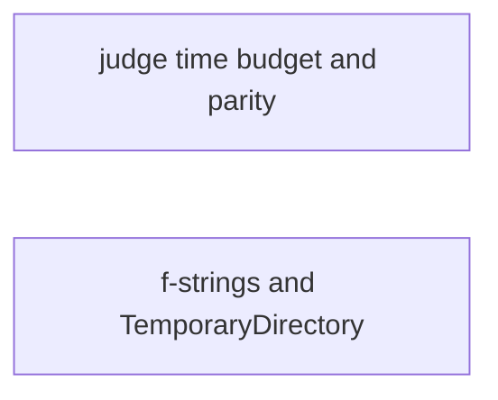

# Superlite: guard tests free of wall-clock time; f-string text and TemporaryDirectory in scratch scripts (B197, #739, #746)

**Goal:** #739: the guard tests stop depending on wall-clock time under load: the judge's 1.5 s budget is raised for the test suite through an environment variable (the step budget still holds), the parity test no longer nests a parallel run inside a parallel run (it reruns only the guard files its own session does not collect), and the lexer's nesting check counts calls instead of timing a subprocess. #746: the coordinator guard reads an f-string's literal parts as data (its `{...}` fields stay code), and `tempfile.TemporaryDirectory()` is a fresh folder below the temp root like `tempfile.mkdtemp()`.
**Architecture:** `guard_judge.py` gets `_seconds()` (the wall-clock budget, from `SUPERLITE_GUARD_SECONDS` when valid); `tests/scripts/conftest.py` sets that variable to 30 at import so hook subprocesses and nested pytest runs inherit it. `test_guard_parity.py` splits its nested run into `nested_files()` and `nested_args()`. `guard_tools.py` `_mask` blanks f-string literal parts through a new `_fmask`; `_Comp.atom`/`_temp` read `tempfile.TemporaryDirectory(...)` (`.name` on the call), and `_assigned` binds `with tempfile.TemporaryDirectory(...) as NAME` and `NAME.name` after `NAME = tempfile.TemporaryDirectory(...)`.
**Tech stack:** Python 3.10+ stdlib, pytest (through `sl run_tests`).
**Spec:** this file, section Design; issues #739 and #746.
**Detail:** tests
**Target-min:** 11
**Wave0:** none
**Worktree:** none
**Coverage:** off
**Max chars:** 26000

Global constraints:
- Every script line keeps the repo's `# O(...)` complexity comment; stdlib only; LF endings.
- Tests use `tmp_path` projects and private `SUPERLITE_HOME`s, never the machine's `~/.superlite`. Run tests only through `sl run_tests`.
- A pin in another test file that flips: edit it only when no open batch lists it (B189 owns `tests/scripts/test_guard_files.py`); otherwise report it.
- Standing rules for every lead and its workers (the owner's decisions, passed on by main): this repository is public: no host names, user names, home paths, other project or repository names, ticket keys or account names in code, tests, docs, commit messages, PR texts or issue comments (write "a Swift project", "a second Mac", "the machine"). Never change the machine's gate config or ~/.superlite/machine.json; tests and proofs use private temp homes and state dirs. No real app builds as proof; this repository's own test suite is the check. Priority of this round: scheduling and admission of test runs, parallel agents and the fleet, wall-clock and token efficiency; measure before and after where the issue names a waste (seconds, runs, tokens) and put the figures into your report. Friction with superlite itself goes to `sl feedback add`, not into this batch. Online research is allowed when something is unclear (official docs first, then how others solved it); name the source in your report.
- Builds: the verdict is `sl run_tests` (the project's test command; a project with `.maxapp` runs `maxapp test`, which a build pool may place on another Mac, and a full run whose tree a green maxapp test stamp covers returns that result without a run); task trees build in <tree>/.build/DerivedData and any build of your own goes under .build/ of the worktree, never -derivedDataPath outside the worktree (your session scratchpad included; backlog cleanup removes scratchpad build folders when the worktree goes); a product, simulator or device build stays on this machine and runs only when an issue's acceptance asks for a running-app check.
- Simulators: append the UDID of each simulator you or a worker creates (`xcrun simctl create` or `clone`; a checker's `Simulators:` line marks its created ones) as one line to /Users/max/github/superlite/.claude/worktrees/superlite-b197-guard-time-and-scratch-fixes/.superlite/simulators.txt; never list one you did not create; ship cleanup shuts down and deletes each listed one.

## Design

**#739, the judge's time budget.** `guard_judge._seconds() -> float`: `SUPERLITE_GUARD_SECONDS` parsed with `float()`; a value with `0 < v <= 30` wins, anything else (unset, empty, not a number, `nan`, `inf`, `<= 0`, `> 30`) gives `MAX_SECONDS` (read at call time, so a monkeypatched `MAX_SECONDS` counts). `_Ctx.__init__` sets `self.deadline = time.monotonic() + _seconds()`. `MAX_STEPS` is unchanged and still ends a walk. The comment at `MAX_SECONDS` names the variable and #739. `tests/scripts/conftest.py` sets `os.environ["SUPERLITE_GUARD_SECONDS"] = "30"` at import, next to `SUPERLITE_HOME`, so in-process judge calls, hook subprocesses and the parity test's nested pytest all get 30 s. `test_guard_priors_312.py::test_nested_literal_for_loops_are_not_walked_again` drops its `MAX_SECONDS` monkeypatch (the variable covers it) and keeps its CPU-time check.

**#739, parity.** `nested_files(collected: set[Path]) -> list[Path]`: the `parity_files()` whose resolved path is not in `collected`, in `parity_files()` order. `nested_args() -> list[str]`: the pytest argv as today, with `-n auto` only when xdist imports and `PYTEST_XDIST_WORKER` is unset. `test_parity_existing_suites(request)` collects `{Path(str(item.path)).resolve() for item in request.session.items}` (an xdist worker collects the whole session too), skips with reason `every parity file runs in this session (#739)` when `nested_files` is empty, else runs `nested_args()` on those files only. In the full run (`pytest tests -n 4`) every parity file is collected, so the nested rerun of the whole guard suite is gone; run alone, the file still reruns every parity file.

**#739, lexer nesting.** `test_nested_failing_arithmetic_lexes_in_linear_time` counts guard_lex function calls with `sys.setprofile` (`_lex_calls`) at nesting depth 10 and 20 and asserts `0 < small and big <= 16 * small`. Lead's measurement (Python 3.15): depth 10 -> 20 multiplies the calls by 7.08, 7.08, 1.90, 7.07, 1.94 for the five cases; an exponential retry multiplies them by about 1000. `test_nested_failing_arithmetic_keeps_the_hook_verdict` keeps its hook calls with `timeout=60` (a hang guard far above any load, was 10).

**#746, f-strings.** `_mask` keeps blanking comments and plain strings. An f-string or t-string is blanked by `_fmask(code, a, b, chars)`: `code[a:b]` is the whole literal (prefix letters, opening quote, body, closing quote); every body character outside a replacement field becomes a space (newlines stay), `{{` and `}}` are literal text, a `{` opens a field that ends at its matching `}` (nested `(`, `[`, `{` counted; a quoted string inside a field is skipped whole, triple quotes and backslash escapes read), and the field text, prefix and quotes stay. The positions are collected first and applied only when the field scan ends cleanly at the closing quote; otherwise the literal stays unmasked (as today). Spans: Python 3.12+ from the outermost `FSTRING_START` (or `TSTRING_START`, read with `getattr(tokenize, ..., None)`) to its matching `*_END` (inner f-strings stay inside the outer field); before 3.12 a `STRING` token whose prefix holds `f`/`F`. Everything that reads `code` rather than `scan` (`_Comp.string`, `_assigned` values, `_parse_args`, `_params`) is unchanged, so f-string path values resolve as before. `_RUNS_TEXT` still runs on the masked text: code that can run text keeps every string visible.

**#746, TemporaryDirectory.** `_temp(name, raw)` serves `tempfile.TemporaryDirectory` with mkdtemp's rules (no `dir`, at most two positional plain-string arguments, `prefix`/`suffix` plain strings without `/`, `\` or `..`) and also accepts `ignore_cleanup_errors=` and `delete=` with any constant value. `_Comp.atom`: a `tempfile.TemporaryDirectory(...)` call followed by `.name` (not a call) consumes the `.name` and gives `_temp`'s value; without `.name` it is `[_UNK]` (the object, whose `str()` is no path). `_assigned` (Python only):
- a `with` event (`(?<![\w.])(?:async\s+)?with\s+`, found in `scan`): the header runs to the first `:` at bracket depth 0; a header starting with `(` makes every `as NAME` in it unknown; else it is split with `_split_top` and each item `EXPR as NAME` binds NAME to `_temp`'s value when EXPR is exactly one `tempfile.TemporaryDirectory(...)` call and that value holds no `_UNK`, else NAME is unknown;
- `NAME = tempfile.TemporaryDirectory(...)` (the whole right side is that call) also binds the key `NAME.name` to `_temp`'s value; NAME itself stays unknown;
- `NAME.name` is dropped when NAME has any other binding event (assignment, for, tuple, with, helper parameter), when `scan` holds `NAME.name` followed by an assignment operator, or when `scan` holds `setattr`.
`_Comp.atom` already reads a dotted name such as `t.name` from the names. The temp root gate (`temp_root`: no `TMPDIR`, `TEMP`, `TMP` or `tempdir` in the command text) applies unchanged; `from tempfile import TemporaryDirectory` stays unread like `from tempfile import mkdtemp`.

**Docs.** `docs/hooks.md` (no open batch lists it): "a writer call inside a string literal (not an f-string) or a comment is data" becomes "... inside a string literal (also an f-string's literal text; its `{...}` fields are code) or a comment ..."; the `tempfile.mkdtemp()` sentence adds `tempfile.TemporaryDirectory()` (the same arguments plus `ignore_cleanup_errors`/`delete`; as `with ... as NAME`, as `.name` on the call, and as `NAME.name` after `NAME = tempfile.TemporaryDirectory()` unless NAME is bound again, `NAME.name` is assigned or the code calls `setattr`). The test-only variable stays in the code comment, not in the docs.

Ruling: the variable is capped at 30 s and cannot switch the time budget off: the hook's default timeout is 60 s and `_git_run` spends `min(1, left)` per call, so an unbounded budget could turn a slow walk into a fail-open hook timeout (lead's ruling).
Ruling: the parity test skips when its session collects every parity file instead of always running serially: the full run already runs those files, so the nested rerun only doubled the guard suite's time (lead's ruling).
Ruling: the lexer check bounds the growth (x16 per doubling), not linearity: the lexer is polynomial today (about x7 per doubling for nested `$(( (`), which the test's old 1 s limit hid; the test name stays so the issue's reference holds (lead's ruling).
Ruling: `tests/scripts/test_lead_guard_heredoc_276.py::test_large_heredoc_is_quick` already measures child CPU time (B130's follow-up is done); no change (lead's ruling).
Ruling: two tasks, one per issue: T1's files and T2's files do not overlap, so both run at once (lead's ruling).

## Task graph

```mermaid
%% schedule
gantt
  title Predicted schedule (mm:ss)
  dateFormat X
  axisFormat %M:%S
  section lane 1
  T1 Judge time budget and parity without :t1, 0, 449s
  section lane 2
  T2 F-string text and TemporaryDirectory :t2, 0, 422s
```





critical path: T1 (7.5 min) · peak width 2 · predicted build 7.5 min · predicted total ≈ 20.0 min (target ✗ 11.0)

## Package: guard

App type: library (command reader) and its test suite. Categories: numeric (the budget parse), protocol (f-string grammar), state (names bound and dropped).

**Probe entry:** none (the reader takes code text; named tests cover it)

### T1 Judge time budget and parity without nesting · Complexity 3 · Est. context 35k
**Owns:** skills/subagent-driven-development/scripts/guard_judge.py, tests/scripts/conftest.py, tests/scripts/test_guard_time_739.py, tests/scripts/test_guard_parity.py, tests/scripts/test_guard_priors_312.py, tests/scripts/test_guard_false_blocks.py
**Components:** 3
**LOC owned:** 110
**Tests:** fast
**Model:** sonnet
**Covers:** Design
**Produces:** guard_judge._seconds() -> float · test_guard_parity.nested_files(collected: set[Path]) -> list[Path] · test_guard_parity.nested_args() -> list[str]
**Review Focus:** `test_seconds_reads_the_variable` (`nan`, `inf`, `31`, `0`); `test_a_spent_time_budget_makes_the_command_unknown` (the hook path reads the variable too); `test_parity_existing_suites` skips in a session that collects every parity file and never adds `-n auto` inside an xdist worker.
**Steps:** 0 before any change: `sl run_tests --fast tests/scripts/test_guard_parity.py --task T1` and note its duration and the nested run's test count (the before figure of the rerun the full run pays), 1 write the tests below, 2 run `sl run_tests --fast tests/scripts/test_guard_time_739.py tests/scripts/test_guard_parity.py tests/scripts/test_guard_false_blocks.py --task T1`: FAIL, 3 implement per Design (#739 parts), 4 run: PASS, 5 run every `tests/scripts/test_guard_*.py` file plus `test_block_coordinator_edits.py` once and compare the run time with step 0's figure (the 30 s budget must not make a test slow: name any test over 5 s).
**Test code (verbatim):** new file `tests/scripts/test_guard_time_739.py`:
```python
"""#739: the judge's wall-clock budget comes from SUPERLITE_GUARD_SECONDS when valid; the step budget still holds."""
import sys
from pathlib import Path

import pytest

sys.path.insert(0, str(Path(__file__).resolve().parents[2] / "skills" / "subagent-driven-development" / "scripts"))

import guard_judge  # noqa: E402
from guard_judge import Verdict, judge  # noqa: E402
from test_block_coordinator_edits import bash, proj  # noqa: E402,F401

UNK = Verdict("?", "?", "code")


@pytest.fixture
def P(tmp_path):
    p = (tmp_path / "p").resolve()
    for d in ("src", "docs/plans", ".superlite"):
        (p / d).mkdir(parents=True)
    return str(p)


def test_the_suite_raises_the_time_budget():
    # conftest.py sets it at import: hook subprocesses and nested pytest runs inherit it
    assert guard_judge._seconds() == 30.0


@pytest.mark.parametrize("raw,want", [
    ("30", 30.0), ("0.5", 0.5), ("12", 12.0),
    ("", 1.5), ("abc", 1.5), ("0", 1.5), ("-1", 1.5), ("31", 1.5), ("nan", 1.5), ("inf", 1.5),
])
def test_seconds_reads_the_variable(monkeypatch, raw, want):
    monkeypatch.setenv("SUPERLITE_GUARD_SECONDS", raw)
    assert guard_judge._seconds() == want


def test_seconds_without_the_variable_is_max_seconds(monkeypatch):
    monkeypatch.delenv("SUPERLITE_GUARD_SECONDS", raising=False)
    monkeypatch.setattr(guard_judge, "MAX_SECONDS", 2.5)
    assert guard_judge._seconds() == 2.5


def test_a_spent_time_budget_makes_the_command_unknown(P, monkeypatch, proj):  # noqa: F811
    monkeypatch.setenv("SUPERLITE_GUARD_SECONDS", "1e-9")
    assert judge("echo hi > docs/plans/a.md", P, P, "active") == UNK
    assert bash(proj, "echo hi > docs/plans/a.md").returncode == 2  # the hook's judge reads it too
    monkeypatch.setenv("SUPERLITE_GUARD_SECONDS", "30")
    assert judge("echo hi > docs/plans/a.md", P, P, "active") is None
    assert bash(proj, "echo hi > docs/plans/a.md").returncode == 0


def test_the_step_budget_holds_with_a_raised_time_budget(P, monkeypatch):
    monkeypatch.setenv("SUPERLITE_GUARD_SECONDS", "30")
    monkeypatch.setattr(guard_judge, "MAX_STEPS", 0)
    assert judge("echo hi > docs/plans/a.md", P, P, "active") == UNK
```
Append to `tests/scripts/test_guard_parity.py` (the helpers `_has_xdist`, `nested_files`, `nested_args` and the new `test_parity_existing_suites(request)` per Design replace the old test body):
```python
def test_parity_files_collected_here_are_not_rerun():
    files = parity_files()
    resolved = {p.resolve() for p in files}
    assert nested_files(resolved) == []
    assert nested_files(resolved - {files[0].resolve()}) == [files[0]]
    assert nested_files(set()) == files


def test_nested_run_is_serial_inside_an_xdist_worker(monkeypatch):
    monkeypatch.setenv("PYTEST_XDIST_WORKER", "gw0")
    assert "-n" not in nested_args()
    monkeypatch.delenv("PYTEST_XDIST_WORKER")
    assert ("-n" in nested_args()) == _has_xdist()
```
In `tests/scripts/test_guard_false_blocks.py` replace `test_nested_failing_arithmetic_lexes_in_linear_time` and its parametrize list (drop `_Path` only if nothing else uses it), and set `timeout=60` in `test_nested_failing_arithmetic_keeps_the_hook_verdict`:
```python
def _lex_calls(cmd):
    # #739: calls into guard_lex while it splits cmd, a step count no machine load changes
    calls = 0
    lex = guard_lex.__file__

    def count(frame, event, arg):
        nonlocal calls
        if event == "call" and frame.f_code.co_filename == lex:
            calls += 1

    sys.setprofile(count)
    try:
        guard_lex.split(cmd)
    finally:
        sys.setprofile(None)
    return calls


# F-T1-1: a failing `$((` or command-position `((` is tried as arithmetic once per start index, so nesting does not
# grow exponentially. #739: counted in lexer calls, not wall clock: doubling the depth from 10 to 20 multiplied them
# by 1.9 to 7.1 when measured; an exponential retry multiplies them by about a thousand.
@pytest.mark.parametrize("head,opener,mid,closer", [
    ("echo ", "$(( (", "", ")"),
    ("echo ", "$(( (", "rm src/a.py", ")"),
    ("", "((", "echo a", ")"),
    ("(( ", "$(( (", "", ")"),
    ("", "(( ", "rm src/a.py", ") "),
])
def test_nested_failing_arithmetic_lexes_in_linear_time(head, opener, mid, closer):
    small, big = (_lex_calls(head + opener * n + mid + closer * n) for n in (10, 20))
    assert 0 < small and big <= 16 * small, (small, big)
```
**Notes:** report the step 0 and step 5 figures (seconds, nested test count). `item.path` needs pytest 7+ (the suite runs pytest 8+). If the hook passes `echo hi > docs/plans/a.md` without calling the judge, use a command it judges and say so in the report.

### T2 F-string text and TemporaryDirectory in scratch scripts · Complexity 5 · Est. context 50k
**Owns:** skills/subagent-driven-development/scripts/guard_tools.py, tests/scripts/test_guard_scratch_746.py, docs/hooks.md
**Components:** 2
**LOC owned:** 200
**Tests:** fast
**Model:** sonnet
**Covers:** Design
**Produces:** guard_tools._fmask(code: str, a: int, b: int, chars: list[str]) -> bool
**Review Focus:** `test_mask_blanks_fstring_literal_parts` (exact offsets); `test_fstring_field_code_is_still_judged`; `test_temporary_directories_the_guard_cannot_place_stay_unknown` (`t.name =`, `setattr`, rebinding, `str(t)`, `dir=`); the `with` header split on top-level commas only.
**Steps:** 0 before any change: time the hook on the two issue scripts (`python3 .superlite/scratch/x.py v` and `python3 .superlite/scratch/t.py` in a temp project with `.superlite/pool.json`, median of 10, exit code and ms) with a throwaway script under `.superlite/`, 1 write the tests below, 2 run `sl run_tests --fast tests/scripts/test_guard_scratch_746.py --task T2`: FAIL, 3 implement per Design (#746 parts, then Docs), 4 run: PASS, 5 run every `tests/scripts/test_guard_*.py` file and fix any flipped pin per Global constraints, 6 repeat step 0's timing.
**Test code (verbatim):** new file `tests/scripts/test_guard_scratch_746.py`:
```python
"""#746: a scratch script's f-string text is data; tempfile.TemporaryDirectory() is a fresh folder below the temp root."""
import sys
import tempfile
from pathlib import Path

import pytest

sys.path.insert(0, str(Path(__file__).resolve().parents[2] / "skills" / "subagent-driven-development" / "scripts"))

import guard_tools  # noqa: E402
from guard_tools import targets  # noqa: E402
from test_block_coordinator_edits import proj, sproj  # noqa: E402,F401


@pytest.fixture
def troot(monkeypatch, tmp_path):
    r = tmp_path / "troot"
    r.mkdir()
    monkeypatch.setattr(tempfile, "tempdir", str(r))
    return str(r)


def _py(code):
    return targets(["python3", "-c", code], text=code)


@pytest.mark.parametrize("code,want", [
    ('x = f"run() {y}"\n', 'x = f"' + " " * 6 + '{y}"\n'),
    ("x = f'{{a}} {b!r:>{w}}'\n", "x = f'" + " " * 6 + "{b!r:>{w}}'\n"),
    ('x = rf"run( {y}"\n', 'x = rf"' + " " * 5 + '{y}"\n'),
    ('x = f"""a\n{b}"""\n', 'x = f""" \n{b}"""\n'),
    ('x = "run()"  # open(\n', "x = " + " " * 16 + "\n"),
])
def test_mask_blanks_fstring_literal_parts(code, want):
    assert guard_tools._mask(code) == want


@pytest.mark.parametrize("code", [
    'import sys\nprint(f"run() {sys.argv[1]}")\n',
    "import sys\nprint(f\"open('src/a.py', 'w') {sys.argv[1]}\")\n",
    'import sys\nprint(f"{{run()}} {sys.argv[1]:>{10}} run()")\n',
    'print(f"""run(\n{1}""")\n',
    "print(F'run() {1}')\n",
])
def test_fstring_literal_text_is_no_call(code):
    assert _py(code) == []


def test_fstring_field_code_is_still_judged():
    assert _py("print(f\"{open('src/a.py', 'w').write('y')}\")\n") == ["src/a.py"]
    assert _py("import subprocess\nprint(f\"run() {1}\")\nsubprocess.run(['rm', 'src/a.py'])\n") == ["src/a.py"]


@pytest.mark.parametrize("code", [
    "import tempfile, pathlib\nwith tempfile.TemporaryDirectory() as d:\n    (pathlib.Path(d) / 'x.txt').write_text('x')\n",
    "import tempfile, os\nwith tempfile.TemporaryDirectory(prefix='sl-', suffix='.d') as d:\n"
    "    open(os.path.join(d, 'x.txt'), 'w').write('x')\n",
    "import tempfile, os\nwith tempfile.TemporaryDirectory(ignore_cleanup_errors=True) as d, open('README') as f:\n"
    "    open(os.path.join(d, 'x.txt'), 'w')\n",
    "import tempfile, os\nd = tempfile.TemporaryDirectory().name\nopen(os.path.join(d, 'x.txt'), 'w')\n",
    "import tempfile, os\nt = tempfile.TemporaryDirectory()\nopen(os.path.join(t.name, 'x.txt'), 'w')\nt.cleanup()\n",
])
def test_temporary_directory_is_a_fresh_folder_below_the_temp_root(troot, code):
    assert _py(code) == [troot + "/?/x.txt"]


@pytest.mark.parametrize("code", [
    "import tempfile, os\nwith tempfile.TemporaryDirectory(dir='src') as d:\n    open(os.path.join(d, 'a'), 'w')\n",
    "import tempfile, os\nwith tempfile.TemporaryDirectory('', '', 'src') as d:\n    open(os.path.join(d, 'a'), 'w')\n",
    "import tempfile, os\nwith tempfile.TemporaryDirectory(prefix='../x') as d:\n    open(os.path.join(d, 'a'), 'w')\n",
    "import tempfile, os\ntempfile.tempdir = 'src'\nwith tempfile.TemporaryDirectory() as d:\n    open(os.path.join(d, 'a'), 'w')\n",
    "import os\nwith open('x') as d:\n    open(os.path.join(d, 'a'), 'w')\n",
    "import tempfile, os\nt = tempfile.TemporaryDirectory()\nt.name = 'src'\nopen(os.path.join(t.name, 'a'), 'w')\n",
    "import tempfile, os\nt = tempfile.TemporaryDirectory()\nsetattr(t, 'name', 'src')\nopen(os.path.join(t.name, 'a'), 'w')\n",
    "import tempfile, os\nt = tempfile.TemporaryDirectory()\nt = 'src'\nopen(os.path.join(t.name, 'a'), 'w')\n",
    "import tempfile\nt = tempfile.TemporaryDirectory()\nopen(f'{t}.txt', 'w')\n",
    "from tempfile import TemporaryDirectory\nimport os\nwith TemporaryDirectory() as d:\n    open(os.path.join(d, 'a'), 'w')\n",
])
def test_temporary_directories_the_guard_cannot_place_stay_unknown(troot, code):
    assert _py(code) == ["?"]


def test_issue_fstring_script_runs(sproj, tmp_path_factory):
    sproj.put("x.py", 'import sys\nprint(f"run() {sys.argv[1]}")\n')
    r = sproj.sh("python3 .superlite/scratch/x.py v", env_extra={"TMPDIR": str(tmp_path_factory.mktemp("troot"))})
    assert r.returncode == 0, r.stderr


def test_issue_temporary_directory_script_runs(sproj, tmp_path_factory):
    sproj.put("t.py", 'import pathlib, tempfile\nwith tempfile.TemporaryDirectory() as d:\n'
                      '    p = pathlib.Path(d) / "x.txt"\n    p.write_text("x")\n')
    r = sproj.sh("python3 .superlite/scratch/t.py", env_extra={"TMPDIR": str(tmp_path_factory.mktemp("troot"))})
    assert r.returncode == 0, r.stderr


def test_scratch_fstring_field_writing_project_code_blocks(sproj):
    sproj.put("w.py", "print(f\"{open('src/a.py', 'w').write('y')}\")\n")
    r = sproj.sh("python3 .superlite/scratch/w.py")
    assert r.returncode == 2 and r.stderr.rstrip("\n").splitlines()[-1] == "Blocked target: src/a.py", r.stderr
```
**Notes:** `_fmask` returns whether it blanked (False: the literal stays as is). Report step 0 and step 6 figures (exit codes, median ms).

## Review Focus

- guard (T1): the variable cannot switch the budget off or past 30 s; `_seconds()` is read per judge call; the parity skip reason names #739; the nested argv never carries `-n auto` inside a worker.
- guard (T2): no hole: a `{...}` field, a nested f-string and code that can run text (`_RUNS_TEXT`) stay visible; `NAME.name` is dropped on any rebinding, attribute assignment or `setattr`; `str(t)` and `f"{t}"` stay unknown; `dir=` and a named temp variable stay unknown.

## Self-review

Every Design part maps to T1 (#739: budget, parity, lexer) or T2 (#746: f-strings, TemporaryDirectory, docs). No placeholders. T1 and T2 share no file, so no edge. Measurements: T1 step 0/5, T2 step 0/6.
