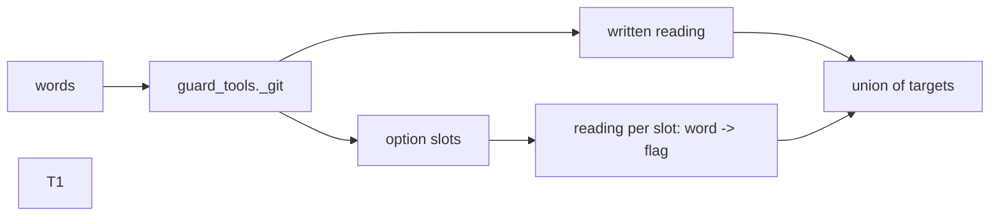

# Guard: an unknown git word in an option position (#749)

**Goal:** guard_tools reads an unknown git word that stands where an option may stand as that subcommand's writing option, as B189 did for sed, cp and tar (#727).
**Architecture:** one change in `guard_tools._git`: after the written reading, each unknown option word is read once as the subcommand's writing flag; the targets are the union.
**Tech stack:** Python 3, pytest (`sl run_tests`).
**Spec path:** this plan (Rulings below); issue #749.
**Detail:** tests
**Wave0:** none
**Coverage:** off

Global constraints:
- This repository is public: no host names, user names, home paths, other project or repository names, ticket keys or account names in code, tests, docs, commit messages, PR texts or issue comments.
- Never change the machine's gate config or ~/.superlite/machine.json; tests use private temp homes and state dirs.
- No real app builds as proof; this repository's own test suite is the check.
- Priority of this round: scheduling and admission of test runs, parallel agents and the fleet, wall-clock and token efficiency. Friction with superlite itself goes to `sl feedback add`, not into this batch. Online research is allowed when something is unclear (official docs first); name the source.
- Builds: the verdict is `sl run_tests`; task trees build in <tree>/.build/DerivedData and any build of your own goes under .build/ of the worktree, never -derivedDataPath outside the worktree; a product, simulator or device build stays on this machine and runs only when an issue's acceptance asks for a running-app check.
- Simulators: append the UDID of each simulator you create (`xcrun simctl create` or `clone`) as one line to /Users/max/github/superlite/.claude/worktrees/superlite-b199-guard-unknown-git-word-in-an-option/.superlite/simulators.txt; never list one you did not create.
- Keep the `# O(...)` complexity comment on every new code line of guard_tools.py, as the file does.

Ruling: an unknown option word is `guard_files._unknown(word, True)`: `?`, a word starting with `$` or a backtick, or `-` with an expansion in the option name. `src/$x` is no option word (lead's ruling).
Ruling: option position: after the subcommand, before `--`, not the value of a value option (`_GIT_SKIP`, plus `-c`, `-C`, `--create`, `--force-create` for switch) (lead's ruling).
Ruling: may-be flag per subcommand: reset `--hard`, switch `-f`, checkout `-f`, restore `-W`, read-tree `-u`, checkout-index `-a`; one flag per word, no pairs and no 8-word cap (single readings stay linear) (lead's ruling).
Ruling: a reading git would refuse is not read: switch needs a branch operand left over unless `-c`, `-C`, `--create`, `--force-create`, `--orphan`, `--detach` or `-d` is given (so `git switch "$b"` passes, which B188's block text recommends); reset with a literal `--soft` or `--mixed` (one mode, as tar's ruling) or with words after `--`; checkout with words after `--` (lead's ruling).
Ruling: no readings when the written targets already hold an unknown word (`?` or a `$`/backtick word): the block keeps its #726 cause line (lead's ruling).
Ruling: `--output` of diff, log, show and the other `_GIT_OUT` commands is not read from an unknown word: it would make `git log "$range"` and `git diff "$a" "$b"` unknown targets (lead's ruling).
Ruling: B188's pinned no-write cases `checkout -b new "$x"`, `checkout -B "$x" "$y"` and `checkout --detach "$x"` now block (the start point may be `-f`), as #749 asks (lead's ruling).

```mermaid
%% schedule
gantt
  title Predicted schedule (mm:ss)
  dateFormat X
  axisFormat %M:%S
  section lane 1
  T1 unknown git option words :t1, 0, 456s
```





critical path: T1 (7.6 min) · peak width 1 · predicted build 7.6 min · predicted total ≈ 22.1 min

## Files

- skills/subagent-driven-development/scripts/guard_tools.py: `_git` readings for unknown option words.
- tests/scripts/test_guard_git_option_749.py: new tests.
- tests/scripts/test_guard_tools_dyn_705.py: drop the three B188 no-write cases that now block.
- docs/hooks.md: the coordinator writes it after T1 (docs are coordinator files).

## Section: guard git

### T1 unknown git option words · Complexity 4 (O-1) · Est. context 40k
**Owns:** skills/subagent-driven-development/scripts/guard_tools.py, tests/scripts/test_guard_git_option_749.py, tests/scripts/test_guard_tools_dyn_705.py
**Components:** 1
**LOC owned:** 110
**Tests:** fast
**Model:** sonnet
**Est. time:** 3 min
**Consumes:** none
**Produces:** guard_tools.targets(words: list[str], cwd: str | None = None, env=None, top: str | None = None, text: str | None = None, file: str | None = None) -> list[str]
**Review Focus:** `test_unknown_option_word_writes`: `git reset "$o"` gives ["."]; `test_reading_git_refuses_passes`: `git switch "$b"` and `git reset --soft "$c"` give []
**Test code (verbatim):**
```python
import sys
from pathlib import Path

import pytest

from test_block_coordinator_edits import bash, proj  # noqa: F401

sys.path.insert(0, str(Path(__file__).resolve().parents[2] / "skills" / "subagent-driven-development" / "scripts"))
import guard_tools  # noqa: E402


@pytest.fixture
def code_proj(proj):  # noqa: F811
    (proj / "src").mkdir()
    (proj / "src" / "a.py").write_text("x\n")
    return proj


@pytest.mark.parametrize("words,want", [
    (["git", "restore", "--staged", "$o", "f"], ["f"]),  # $o may be -W
    (["git", "restore", "--staged", "?", "f"], ["f"]),
    (["git", "switch", "$o", "b"], ["."]),  # -f
    (["git", "switch", "-c", "n", "$o"], ["."]),
    (["git", "reset", "$o"], ["."]),  # --hard
    (["git", "reset", "-q", "$(cat m)"], ["."]),
    (["git", "-C", "sub", "reset", "$o"], ["sub"]),
    (["git", "checkout", "-b", "n", "$o"], ["."]),  # -f
    (["git", "checkout", "-B", "$x", "$y"], ["."]),
    (["git", "checkout", "--detach", "$x"], ["."]),
    (["git", "read-tree", "$o", "HEAD"], ["."]),  # -u
    (["git", "checkout-index", "$o"], ["."]),  # -a
    (["git", "reset", "--$o"], ["."]),  # an expansion in the option name
])
def test_unknown_option_word_writes(words, want, tmp_path, monkeypatch):  # #749
    monkeypatch.chdir(tmp_path)
    assert guard_tools.targets(words) == want


@pytest.mark.parametrize("words", [
    ["git", "switch", "$b"],
    ["git", "switch", "-c", "$b"],
    ["git", "switch", "-C", "$b"],
    ["git", "checkout", "-b", "$x"],
    ["git", "checkout", "--orphan", "$x"],
    ["git", "restore", "--staged", "$f"],
    ["git", "restore", "-s", "$s", "--staged", "f"],
    ["git", "reset", "--soft", "$c"],
    ["git", "reset", "--mixed", "$c"],
    ["git", "reset", "$c", "--", "f"],
    ["git", "reset", "src/$x"],
    ["git", "log", "$range"],
    ["git", "diff", "$a", "$b"],
    ["git", "status", "$x"],
])
def test_reading_git_refuses_passes(words, tmp_path, monkeypatch):  # #749
    monkeypatch.chdir(tmp_path)
    assert guard_tools.targets(words) == []


@pytest.mark.parametrize("words,want", [
    (["git", "checkout", "$x", "--", "src/a.py"], ["src/a.py"]),
    (["git", "checkout", "$x", "$y"], ["$y", "?"]),
    (["git", "restore", "$x"], ["$x"]),
])
def test_written_unknown_keeps_its_targets(words, want, tmp_path, monkeypatch):  # #749
    monkeypatch.chdir(tmp_path)
    assert guard_tools.targets(words) == want


@pytest.mark.parametrize("cmd", [
    'git restore --staged "$o" src/a.py',
    'git switch "$o" main',
    'git reset "$o"',
    'git checkout -b n "$o"',
    "python3 - <<'EOF'\nimport subprocess, sys\nsubprocess.run([\"git\", \"reset\", sys.argv[1]])\nEOF",
])
def test_hook_blocks_unknown_git_option(code_proj, cmd):  # #749
    assert bash(code_proj, cmd).returncode == 2, cmd


@pytest.mark.parametrize("cmd", [
    'git switch "$b"',
    'git reset --soft "$c"',
    'git restore --staged "$f"',
    'git log "$range"',
])
def test_hook_passes_git_readings_that_cannot_write(code_proj, cmd):  # #749
    assert bash(code_proj, cmd).returncode == 0, cmd
```
**Steps:** 1 write the test file, 2 run: FAIL, 3 implement in `_git` (split its tail after `args = words[i:]` into a helper the readings call again), 4 delete the cases `["git", "checkout", "-b", "new", "$x"]`, `["git", "checkout", "-B", "$x", "$y"]` and `["git", "checkout", "--detach", "$x"]` from `test_branch_and_start_point_operands_stay_no_write_726` in tests/scripts/test_guard_tools_dyn_705.py, 5 run both files and tests/scripts/test_guard_*.py: PASS
**Notes:** the Rulings above are the contract. `whole()` stays `[root]` as today. A test whose expected list the Rulings contradict is a plan error: report it, do not bend the Rulings.

## Review Focus

- Package guard git: app type library (no runnable entry); categories: input parsing, false blocks. Cases: the T1 tests; `git switch "$b"` must keep passing.

## Self-review

Coverage: #749 part 1 is T1, part 2 (docs) is the coordinator's docs/hooks.md edit after T1. No placeholders. One task, no edges.
