# Superlite: an unknown option word of sed, perl or cp may be the option that writes (B189, #727)

**Goal:** #727: an unknown word where an option may stand (`sed "$F" s/a/b/ src/a.py`, `["sed", p, ...]` in a script) counts as a possible writing option (sed/perl `-i`, cp/mv/ln/install `-t`, cp `-s`, install `-d`, rsync `--remove-source-files`) in every guard path: the judge's Bash walk, shell strings in scripts and subprocess lists.
**Architecture:** `guard_files.targets` and `guard_files.link_sources` judge the command as written plus "readings": each unknown option word replaced by each bare option the command may take, alone and in pairs, and return the union. Unknown words are `"?"` (guard_tools already maps every non-literal word to it) or, with the new `dyn` flags the judge passes, a word whose first character or option name comes from an expansion. tar lives in guard_tools.py (another batch's file): follow-up.
**Tech stack:** Python 3.10+ stdlib, pytest through `sl run_tests`.
**Spec:** this file, section Design; issue #727.
**Detail:** full
**Target-min:** 11
**Wave0:** none
**Worktree:** none
**Coverage:** off

Global constraints:
- Every code line in guard_files.py and guard_judge.py ends with a `# O(...)` complexity comment, as its neighbours do. Python 3.10 syntax at most.
- Standing rules for every lead and its workers (the owner's decisions, passed on by main): this repository is public: no host names, user names, home paths, other project or repository names, ticket keys or account names in code, tests, docs, commit messages, PR texts or issue comments (write "a Swift project", "a second Mac", "the machine"). Never change the machine's gate config or ~/.superlite/machine.json; tests and proofs use private temp homes and state dirs. No real app builds as proof; this repository's own test suite is the check. Priority of this round: scheduling and admission of test runs, parallel agents and the fleet, wall-clock and token efficiency; measure before and after where the issue names a waste and put the figures into your report. Friction with superlite itself goes to `sl feedback add`, not into this batch. Online research is allowed when something is unclear (official docs first, then how others solved it); name the source.
- Builds: the verdict is `sl run_tests` (the project's test command; a project with `.maxapp` runs `maxapp test`, which a build pool may place on another Mac, and a full run whose tree a green maxapp test stamp covers returns that result without a run); task trees build in <tree>/.build/DerivedData and any build of your own goes under .build/ of the worktree, never -derivedDataPath outside the worktree (your session scratchpad included; backlog cleanup removes scratchpad build folders when the worktree goes); a product, simulator or device build stays on this machine and runs only when an issue's acceptance asks for a running-app check.
- Simulators: append the UDID of each simulator you or a worker creates (`xcrun simctl create` or `clone`; a checker's `Simulators:` line marks its created ones) as one line to `<worktree>/.superlite/simulators.txt`; never list one you did not create; ship cleanup shuts down and deletes each listed one.

## Design

Measured before (hook on a temp project with an active run, `src/a.py` present): `sed "$F" s/a/b/ src/a.py`, `perl "$F" -pe s/a/b/ src/a.py`, `sed -n "$A" "$B" src/a.py`, `cp "$F" src /tmp/n.py` (F may be `-t`), `cp "$F" src/a.py /tmp/l.py` (F may be `-s`), `install "$M" src/x /tmp/y`, `rsync -a "$F" src/ /tmp/b/` and the same sed in a heredoc script's subprocess list or `os.system` string all pass.

**Unknown option word.** `_parse` gains `slots`: the index of each word read where an option may stand (an operand before `--`, for perl only its first operand, and every option word). Such a word is unknown when it is `"?"`, or `dyn[i]` is true and it starts with `$` or a backtick, or starts with `-` and its name part (before `=`) holds `$` or a backtick. A literal `'$p'` (no dyn flag), `s/$A/$B/` and `src/$X.py` (literal first character) and `--expression=$S` are not unknown.

**Readings.** `_MAY_BE`: sed and perl `-i`, `-e1`; cp `-t`, `-s`; mv, ln `-t`; install `-t`, `-d`; rsync `--remove-source-files`; other commands none. Readings are: the words as written; each unknown slot k replaced by each option o; and in each such list each unknown slot j (recomputed, so perl's later words count once k is an option) replaced by each option o2. `-e1` only matters in a pair: one word is `-i`, the other gives the script, so every operand is a file. Over 8 unknown slots `targets` returns `["?"]`. `targets`/`link_sources` return the old result unchanged when there is one reading, else the first-seen union over all readings.

Ruling: an unknown word is read as a bare option only; an option whose value sits in the unknown word itself (`--target-directory=src`, `-ew src/a.py`, dd `of=...`) and an unknown sed script holding `w` are not read, since reading them makes every `cp "$f" dir/` and `sed -n "$R" f` an unknown target; follow-up for main (lead's ruling).
Ruling: the judge passes its `dyn` flags (guard_judge.py, two lines; no open batch lists it); guard_tools needs no change, its words are already `"?"` (lead's ruling).
Ruling: tar's `_tar` is in guard_tools.py (B188's file): follow-up, not built here (lead's ruling).

**Addendum, T2 (tar).** B188 shipped during the ship sync and no open batch lists guard_tools.py any more, so tar is built here after all (brief .superlite/briefs/T2-tar.md, brief-only worker, commit 5fafc3cd). In `_tar`, an unknown word where a tar option may stand (`guard_files._unknown(a, True)`; not a value, not after `--`) makes the result `["?"]`, because it may be `-x` and `-P` (members land anywhere). The exception is a literal mode other than extract: a short `c`, `t`, `r`, `u`, `A` or `d`, or a whole long `--create`, `--list`, `--append`, `--update`, `--catenate`, `--concatenate`, `--diff`, `--compare` or `--delete`. An abbreviation counts as no mode. The package review fixed one bug (9c557566): the value letters of bsdtar `-s,old,new,` were read as mode letters. A one-word `cp -st` reading was considered and dropped: every target it adds is already covered by the as-written reading and the `-s` reading.
Ruling: tar is built here once B188 shipped, since the issue names it and no open batch owns the file (lead's ruling).

## Task graph

```mermaid
%% schedule
gantt
  title Predicted schedule (mm:ss)
  dateFormat X
  axisFormat %M:%S
  section lane 1
  T1 Unknown option word readings :t1, 0, 688s
```




critical path: T1 (11.5 min) · peak width 1 · predicted build 11.5 min · predicted total ≈ 30.0 min (target ✗ 11.0)

## Package: guard

App type: library (guard_files) behind a hook (stdin JSON, exit code). Categories: deep (option parsing), protocol (targets contract).
**Probe entry:** none (unit tests call targets; the hook tests feed JSON on stdin)

### T1 Unknown option word readings · Complexity 5 · Est. context 45k
**Owns:** skills/subagent-driven-development/scripts/guard_files.py, skills/subagent-driven-development/scripts/guard_judge.py, tests/scripts/test_guard_files.py, tests/scripts/test_guard_unknown_option_727.py
**Components:** 2
**LOC owned:** 170
**Tests:** fast
**Model:** sonnet
**Covers:** Design
**Produces:** guard_files.targets(words: list[str], dyn: list[bool] | None = None) -> list[str] · guard_files.link_sources(words: list[str], dyn: list[bool] | None = None) -> list[str]
**Review Focus:** deep: `test_unknown_option_word_may_be_a_writing_option_727` and `test_unknown_option_word_of_copy_commands_727` exact lists; `test_unknown_option_word_blocks` (10 cases exit 2); `test_unknown_word_that_cannot_write_passes` (10 cases exit 0); every existing test_guard_files.py assertion unchanged
**Steps:** 1 add the tests, 2 run: FAIL, 3 implement (Notes), 4 run: PASS, then `run_tests --fast` over tests/scripts/test_guard_*.py and test_block_coordinator_edits.py
**Test code (verbatim):** append to tests/scripts/test_guard_files.py:
```python
def test_unknown_option_word_may_be_a_writing_option_727():
    assert targets(["sed", "?", "s/a/b/", "src/a.py"]) == ["src/a.py"]  # ? may be -i
    assert targets(["sed", "$F", "s/a/b/", "src/a.py"], [False, True, False, False]) == ["src/a.py"]
    assert targets(["sed", "$F", "s/a/b/", "src/a.py"]) == []  # no dyn flags: a literal word
    assert targets(["sed", "-n", "?", "?", "src/a.py"]) == ["src/a.py"]  # one is -i, the other -e SCRIPT
    assert targets(["sed", "-n", "?", "src/a.py"]) == []  # read as -i, src/a.py is the script
    assert targets(["sed", "-n", "?", "?"]) == []
    assert targets(["sed", "?", "s/a/b/", "?"]) == ["?", "s/a/b/"]
    assert targets(["sed", "--", "?", "s/a/b/", "src/a.py"]) == []  # after --: an operand
    assert targets(["sed", "-e", "?", "src/a.py"]) == []  # the value of -e, not an option
    assert targets(["sed", "-$X", "s/a/b/", "f"], [False, True, False, False]) == ["f"]
    assert targets(["sed", "--expression=$S", "f"], [False, True, False]) == []
    assert targets(["sed", "-n", "1p", "src/$X.py"], [False, False, False, True]) == []  # literal first character
    assert targets(["perl", "?", "-pe", "s/a/b/", "src/a.py"]) == ["src/a.py"]
    assert targets(["perl", "-pe", "s/a/b/", "src/a.py", "?"]) == []  # after perl's first operand: an argument
    assert targets(["sed"] + ["?"] * 9 + ["f"]) == ["?"]  # over 8 unknown option words


def test_unknown_option_word_of_copy_commands_727():
    assert targets(["cp", "?", "src", "n.py"]) == ["n.py", "src/"]  # ? may be -t
    assert targets(["cp", "?", ".superlite/scratch/"]) == [".superlite/scratch/"]
    assert targets(["install", "?", "a", "b"]) == ["b", "a/", "a"]  # -t a, or -d
    assert targets(["mv", "?", "d", "f"]) == ["?", "d", "f", "d/"]
    assert targets(["ln", "?", "src", "x"]) == ["x", "src/"]
    assert targets(["rsync", "-a", "?", "src/", "/tmp/b/"]) == ["/tmp/b/", "src/"]  # may remove its sources
    assert targets(["rm", "?", "a"]) == ["?", "a"]
    assert targets(["tee", "a", "a"]) == ["a", "a"]  # no unknown word: unchanged
    assert guard_files.link_sources(["cp", "?", "src/a.py", "l.py"]) == ["src/a.py"]  # ? may be -s
    assert guard_files.link_sources(["cp", "?", "?", "d", "src/a.py"]) == ["?", "d", "src/a.py"]  # -s with -t
    assert guard_files.link_sources(["ln", "?", "src", "x"]) == ["?", "src", "x"]
    assert guard_files.link_sources(["cp", "-s", "src/a.py", "l.py"], [False] * 4) == ["src/a.py"]
```
new file tests/scripts/test_guard_unknown_option_727.py:
```python
import pytest

from test_block_coordinator_edits import bash, proj  # noqa: F401


@pytest.fixture
def code_proj(proj):  # noqa: F811
    (proj / "src").mkdir()
    (proj / "src" / "a.py").write_text("x\n")
    return proj


@pytest.mark.parametrize("cmd", [
    'sed "$F" s/a/b/ src/a.py',
    'perl "$F" -pe s/a/b/ src/a.py',
    'sed -n "$A" "$B" src/a.py',
    'cp "$F" src /tmp/n.py',
    'cp "$F" src/a.py /tmp/l.py',
    'install "$M" src/x /tmp/y',
    'rsync -a "$F" src/ /tmp/b/',
    'F=$(cat opts.txt); sed "$F" s/a/b/ src/a.py',
    "python3 - <<'EOF'\nimport subprocess, sys\np = sys.argv[1]\nsubprocess.run([\"sed\", p, \"s/a/b/\", \"src/a.py\"])\nEOF",
    "python3 -c 'import os; os.system(\"sed \\\"$F\\\" s/a/b/ src/a.py\")'",
])
def test_unknown_option_word_blocks(code_proj, cmd):  # #727
    assert bash(code_proj, cmd).returncode == 2, cmd


@pytest.mark.parametrize("cmd", [
    'sed -n "${A},${B}p" src/a.py',
    'sed -n "$R" "$f"',
    "sed -n '$p' src/a.py src/b.py",
    'sed "s/$A/$B/" src/a.py',
    'sed -e "$S" src/a.py',
    'perl -ne "$X" src/a.py',
    'cp "$f" /tmp/x/',
    'cp -r "$d" .superlite/scratch/',
    'for f in $(git ls-files src); do sed -n 1,5p "$f"; done',
    'git diff --name-only | xargs sed -n 1p',
])
def test_unknown_word_that_cannot_write_passes(code_proj, cmd):  # #727
    assert bash(code_proj, cmd).returncode == 0, cmd
```
**Notes:** guard_files.py, exact code (put `_MAY_BE` ... `_union` above `_has`):
```python
# per command: the bare options an unknown word in option position may be (#727)
_MAY_BE = {"sed": ("-i", "-e1"), "perl": ("-i", "-e1"), "cp": ("-t", "-s"), "mv": ("-t",), "ln": ("-t",),  # O(1)
           "install": ("-t", "-d"), "rsync": ("--remove-source-files",)}  # O(1)
_MAX_UNKNOWN = 8  # O(1) | more unknown option words than this: the target is unknown


def _unknown(w, d):  # O(m) | a word the guard cannot read that may be an option: "?", or (dynamic) an expansion first or in an option's name
    if w == "?":  # O(1)
        return True  # O(1)
    if not d or not w:  # O(1)
        return False  # O(1)
    head = w.partition("=")[0]  # O(m)
    return w[0] in "$`" or (w[0] == "-" and ("$" in head or "`" in head))  # O(m)


def _slots(words, dyn, name):  # O(n*m) | indices of the unknown words _parse reads where an option may stand
    pos = []  # O(1)
    _parse(words, name, permute=(name != "perl"), slots=pos)  # O(n*m)
    return [k for k in pos if _unknown(words[k], k < len(dyn) and dyn[k])]  # O(n*m)


def _readings(words, dyn, name):  # O(u^2 * n*m) | word lists: as written, then each unknown option word as each _MAY_BE option, alone and with a second; None over _MAX_UNKNOWN
    may = _MAY_BE.get(name, ())  # O(1)
    dyn = list(dyn) if dyn is not None else []  # O(n)
    first = _slots(words, dyn, name) if may else []  # O(n*m)
    if len(first) > _MAX_UNKNOWN:  # O(1)
        return None  # O(1)
    out = [words]  # O(1)
    for k in first:  # O(u)
        for o in may:  # O(1)
            w1 = words[:k] + [o] + words[k + 1:]  # O(n)
            out.append(w1)  # O(1)
            for j in _slots(w1, dyn[:k] + [False] + dyn[k + 1:], name):  # O(u * n*m)
                for o2 in may:  # O(1)
                    out.append(w1[:j] + [o2] + w1[j + 1:])  # O(n)
    return out  # O(1)


def _union(lists):  # O(r * t^2) | the items of every list, first-seen order, no repeats
    out = []  # O(1)
    for ts in lists:  # O(r)
        for t in ts:  # O(t)
            if t not in out:  # O(t)
                out.append(t)  # O(1)
    return out  # O(1)
```
`_parse(words, name, permute=True, slots=None)`: in the operand branch, before `ops.append(w)`, add `if slots is not None and not end: slots.append(i - 1)`; after the `if w == "--":` block, add `if slots is not None: slots.append(i - 1)` (an option word). `targets(words, dyn=None)`: after the COMMANDS check, `rs = _readings(words, dyn, name)`; `None` returns `["?"]`; one reading returns `_one(words, name)`; else `_union(_one(w, name) for w in rs)`; `_one(words, name)` holds today's dispatch from `if name in ("cp", ...)` on. `link_sources(words, dyn=None)`: after its name check, `rs = _readings(words, dyn, name) or [words]`, one reading returns `_link_one(words, name)`, else the union; `_link_one` holds today's body from `opts, ops = _parse(words, name)` on. Module docstring: add a rule bullet after the sed/perl one: unknown option words ("?", or with dyn an expansion first or in an option's name) are read as each bare writing option (sed/perl -i and -e SCRIPT, cp/mv/ln/install -t, cp -s, install -d, rsync --remove-source-files), alone and in pairs, and the targets are the union; over 8 such words "?"; an option whose value sits in the unknown word is not read (#727).
guard_judge.py `_targets`: after the `w = [base] + ...` line add `wd = [False] + list(dyn[1:]) + ([True] if xargs else [])  # the words holding an expansion the guard could not read (#727) | O(w)` and pass it: `guard_files.targets(w, wd)`, `guard_files.link_sources(w, wd)`.

## Review Focus

Package guard (library behind a hook): deep (readings stay sound for perl's first-operand rule, `--`, values consumed by `-e`/`-t`), protocol (one reading returns today's exact list, duplicates kept). No running-app checks.

## Self-review

Coverage: the Design maps to T1. Placeholders: none. Types: `targets`/`link_sources` keep their first parameter, `dyn` is optional, callers in guard_tools need no change. Graph: one task. Limits: the plan is under 15k characters; tar and the value-in-word class are follow-ups.
