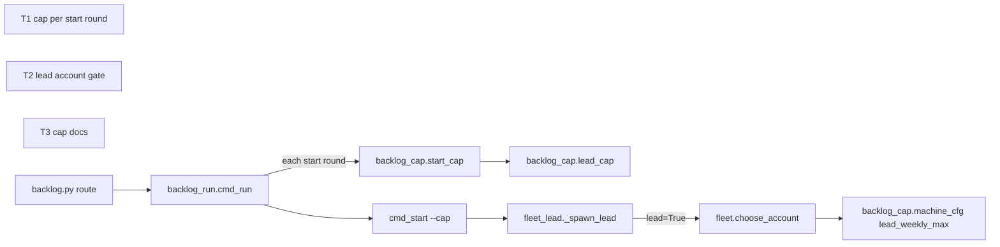

# Lead cap per start round, lead account gate, cap docs (#761)

**Goal:** `sl backlog run` reads the lead cap again before each start round; a lead and the workers a lead starts skip accounts at or above `lead_weekly_max` while another is usable; backlog-main.md and docs/tools.md name the cap line, its machine.json keys and the new status texts.
**Architecture:** `backlog_cap.start_cap` gathers the readings for a start (backlog.json, overlap holds, lead tier); `backlog.py` status and the `start` route use it through `_cap_line`; `backlog_run.cmd_run` calls it per start round; `fleet.choose_account` gets a `lead` flag (also on when `SUPERLITE_FLEET_ROLE=lead`) that prefers accounts under `lead_weekly_max`.
**Tech stack:** Python 3 stdlib, pytest (`tests/scripts`).
**Spec path:** docs/plans/2026-11-13-lead-cap-per-round.md
**Detail:** contracts
**Wave0:** none
**Target-min:** 11

## Global constraints

- Every new or changed code line ends with a `# O(...)` complexity comment, as the lines around it do.
- Script tests set `SUPERLITE_LEAD_CAP_LIVE=0` (tests/scripts/conftest.py does) and use a private `SUPERLITE_HOME` under `tmp_path`; never read or write the machine's `~/.superlite/machine.json`.
- Tests clear SUPERLITE_FLEET_ROLE, SUPERLITE_FLEET_PARENT_DIR, SUPERLITE_FLEET_WORKER and SUPERLITE_STATE_DIR with `monkeypatch.delenv(..., raising=False)` unless the test sets them.
- Standing rules for every lead and its workers (the owner's decisions, passed on by main):
  - This repository is public: no host names, user names, home paths, other project or repository names, ticket keys or account names in code, tests, docs, commit messages, PR texts or issue comments. Write "a Swift project", "a second Mac", "the machine".
  - Never change the machine's gate config or ~/.superlite/machine.json; tests and proofs use private temp homes and state dirs.
  - No real app builds as proof; this repository's own test suite is the check.
  - Priority of this round: scheduling and admission of test runs, parallel agents and the fleet, wall-clock and token efficiency. Measure before and after where the issue names a waste (seconds, runs, tokens) and put the figures into your notes.
  - Friction with superlite itself goes to `sl feedback add`, not into this batch.
  - Online research is allowed when something is unclear (official docs first, then how others solved it); name the source in your notes.
- Builds: the verdict is `sl run_tests`; task trees build in <tree>/.build/DerivedData and any build of your own goes under .build/ of the worktree, never -derivedDataPath outside the worktree; a product, simulator or device build stays on this machine and runs only when an issue's acceptance asks for a running-app check.
- Simulators: append the UDID of each simulator you create to /Users/max/github/superlite/.claude/worktrees/superlite-b202-lead-cap-recompute-per-start-round/.superlite/simulators.txt; never list one you did not create.

## Design

Understood from #761 (owner's follow-ups of B194 and B196): (1) the cap is computed once when `backlog run` starts and passed as `--cap N`, so a run of hours keeps a stale cap; `backlog_run`'s argparse and docstring still say `--cap 2`. (2) `fleet.choose_account` ignores `lead_weekly_max`; only the cap's account gate reads it, so a lead can land on an account over the limit while another is free; the workers of a lead should skip such an account too. (3) backlog-main.md step 4 and the docs/tools.md backlog row name neither the `cap:` line nor its keys nor `start, or after B` and `B has no open question`. (4) backlog-main.md step 2 should name plan's `depends:` repair lines and the `B waits for D: <reason>` status line (the commands/backlog.md half belongs to running batch B201: a follow-up).

Ruling: `backlog_cap.start_cap(root, model, config)` holds the reading `backlog._cap_line` does today (backlog.json, `len(bs.holds(data))`, tier = `model`, else `run_config.resolve(config, root)["lead"]["model"]`, any failure None); `_cap_line` keeps its gate (fleet worker, `--cap`, `--help`) and calls it (because one reader serves status, start and run; cost if wrong: none, same readings).
Ruling: `backlog run` no longer gets `--cap N` from the route; `cmd_run` with `a.cap` None calls `start_cap` before each start round that has a planned batch and passes the cap to `cmd_start`; a round with no planned batch reuses the last cap (FIXED_CAP before the first) without the reading; the `cap:` line prints on the first reading and again only when the cap number changes (because the room part changes every round and would repeat the line; cost if wrong: a reason change with the same number goes unprinted).
Ruling: argparse `--cap` of `start` and `run` defaults to None; `cmd_start` with None calls `start_cap` after its main-session and ship-approval checks and prints the line (a direct `backlog_run.py start`); the docstring says `[--cap N]` (because the default is the reading now, not 2).
Ruling: the key keeps its name `lead_weekly_max`: it gates every account a backlog run starts, a lead (`choose_account(..., lead=True)` from fleet_lead) and every worker a lead starts (`SUPERLITE_FLEET_ROLE=lead` in the caller's environment, which also covers `fleet run --layer`); a session outside a backlog keeps the plain pick (because machine.json files since 1.5.205 use the name, and the scope is still the backlog's leads; cost if wrong: a rename later with an alias).
Ruling: the gate is a preference, not a block: first the accounts under the limit, then a path or `current` entry the usage report does not know (as today), then the accounts at or above it, with one stderr line `account A: weekly_all X% >= lead_weekly_max Y%; no account under it` (because a running lead must not stall mid-batch; the cap's account gate already holds new leads; cost if wrong: an over-limit account still gets work when all are over).
Ruling: each docs fact goes into the backlog-main.md step that runs its command: status texts in step 1, depends lines in step 2, `B has no open question` in step 3, cap and keys in step 4, the per-round reading in step 5; the step-4 sentence's `[--cap 2]` becomes `[--cap N]` in backlog-main.md, its rules_684 fixture line and test_docs_b26.py's pin (because the cap is no longer 2; cost if wrong: none).
Ruling: T3 (docs) runs beside T1 and T2 without an edge: its text is fixed here and its test reads only docs (because no docs test runs their code).
Ruling: detail `contracts` (because the tests need the repo's existing fake-usage, fake-herdr and backlog fixtures the implementer reads; cost if wrong: one review round).

## Coverage

| Category | State | Basis |
|---|---|---|
| Scope and success criteria | settled | #761 items 1-4; commands/backlog.md half of item 4 is a follow-up (B201 owns it) |
| Domain and data model | n/a | no new state; backlog.json and fleet.json unchanged |
| Persistence and migration | n/a | nothing stored |
| Interfaces and contracts | ruled | `choose_account(..., lead=False)` and `_retry_account(..., lead=False)` keep every call valid; `start_cap` new |
| UI states | n/a | CLI text only |
| Concurrency and state ownership | settled | readings are read-only; `cmd_start` keeps its own locking |
| Error handling and recovery | ruled | `start_cap` tier failure gives None; all accounts over the limit falls back with a stderr line |
| Security and privacy | n/a | no untrusted input beyond machine.json, already validated by `machine_cfg` |
| Performance and limits | ruled | one reading per start round with a planned batch (B194 measured lead_cap at 0.07 s) |
| Observability | ruled | `cap:` line on change; stderr line on an over-limit fallback |
| Testing strategy | ruled | unit tests with monkeypatched readings, fake usage and private homes |
| Compatibility | ruled | an explicit `--cap N` behaves as today; the key name stays |
| Rollout | n/a | ships with the plugin version bump |
| Research unknowns | n/a | none |

## Main diagram

```mermaid
%% schedule
gantt
  title Predicted schedule (mm:ss)
  dateFormat X
  axisFormat %M:%S
  section lane 1
  T1 cap read per start round :t1, 0, 277s
  section lane 2
  T2 lead account gate :t2, 0, 233s
  section lane 3
  T3 cap docs :t3, 0, 179s
```

critical path: T1 (4.6 min) · peak width 3 · predicted build 4.6 min · predicted total ≈ 11.1 min (target ✗ 11.0)

## File structure

- skills/subagent-driven-development/scripts/backlog_cap.py: `start_cap`, the readings for a start.
- skills/subagent-driven-development/scripts/backlog.py: `_cap_line` delegates; the `run` route passes argv through.
- skills/subagent-driven-development/scripts/backlog_run.py: per-round cap in `cmd_run`, `--cap` default None, docstring.
- skills/subagent-driven-development/scripts/fleet.py: `choose_account` and `_retry_account` `lead` flag, the weekly gate.
- skills/subagent-driven-development/scripts/fleet_lead.py: `_spawn_lead` passes `lead=True`.
- skills/subagent-driven-development/backlog-main.md, docs/tools.md, docs/config.md: the docs.

## Cap and run loop

### T1 cap read per start round · Complexity 4 (O-1) · Est. context 45k
**Owns:** skills/subagent-driven-development/scripts/backlog_cap.py, skills/subagent-driven-development/scripts/backlog.py, skills/subagent-driven-development/scripts/backlog_run.py, tests/scripts/test_backlog_cap_round_761.py
**Components:** 3
**LOC owned:** 170
**Tests:** fast
**Kind:** design
**Model:** sonnet
**Est. time:** 4 min
**Produces:** backlog_cap.start_cap(root: Path, model: str | None = None, config: str | None = None) -> tuple[int, str]
  e.g. start_cap(root) with SUPERLITE_LEAD_CAP_LIVE=0, a private SUPERLITE_HOME without machine.json and no batch -> (2, "cap: 2 (fixed cap 2: machine.json names no room command; accounts unknown (no usage data))")
  e.g. start_cap(root, model="sonnet") calls lead_cap(data, root, held=len(bs.holds(data)), tier="sonnet")
**Review Focus:** state: `test_run_rereads_cap_each_round`; protocol: `test_run_route_passes_no_cap`
**Test code (contracts):** new file tests/scripts/test_backlog_cap_round_761.py; reuse the fake time, `_round` and `cmd_start` patching of tests/scripts/test_backlog_run_loop_673.py.
- `test_start_cap_fixed`: the first e.g. above, exact tuple.
- `test_start_cap_tier`: lead_cap monkeypatched to record kwargs; `start_cap(root, model="sonnet")` records tier "sonnet"; with model None and `run_config.resolve` raising, tier None.
- `test_run_rereads_cap_each_round`: a planned batch; `backlog_cap.start_cap` monkeypatched to return (1, "cap: 1 (a)") then (2, "cap: 2 (b)"); `cmd_start` records `a.cap`; two start rounds of `cmd_run` (a `_round` line between them makes the second round due) -> recorded caps [1, 2], stdout has "cap: 1 (a)" and "cap: 2 (b)" once each. Before the change the same run passed [1, 1].
- `test_run_same_cap_prints_once`: start_cap returns (2, "cap: 2 (a)") then (2, "cap: 2 (b)") -> caps [2, 2], stdout has one line starting "cap: 2".
- `test_run_explicit_cap_skips_reading`: `run --cap 3` -> start_cap never called, caps [3, 3].
- `test_run_no_planned_skips_reading`: no planned batch -> start_cap never called, `cmd_start` gets cap 2 (FIXED_CAP).
- `test_run_route_passes_no_cap`: `backlog.main(["run"])` with `backlog_run.main` monkeypatched -> it receives ["run"], and stdout has no "cap:" line; `backlog.main(["start"])` still passes "--cap" (unchanged).
- `test_cap_default_none`: `backlog_run.main` argparse: `start` and `run` without `--cap` give `a.cap is None` (patch the cmd functions to capture `a`); `backlog_run.__doc__` contains "[--cap N]" and not "--cap 2".
- `test_cmd_start_reads_cap_when_none`: `cmd_start` with `a.cap` None and the ship approval recorded: `_pick` receives the start_cap cap and stdout has its line.
**Steps:** 1 failing tests, 2 run: FAIL, 3 implement, 4 run: PASS (also run tests/scripts/test_backlog_run*.py, test_backlog_cli*.py, test_backlog_cap_748.py, test_backlog_start_test_cmd_334.py, test_backlog_run_config_681.py and fix only this task's code if one goes red)
**Notes:** `cmd_run` prints the `cap:` line outside the stdout redirect around `cmd_start`, with `flush=True`. `_cap_line` keeps returning (None, "") for a fleet worker, `--cap`, `-h`/`--help`. The `run` route in `backlog.main` becomes `backlog_run.main(argv)`.

## Account pick

### T2 lead account gate · Complexity 4 (O-1) · Est. context 42k
**Owns:** skills/subagent-driven-development/scripts/fleet.py, skills/subagent-driven-development/scripts/fleet_lead.py, tests/scripts/test_fleet_account_weekly_761.py
**Components:** 2
**LOC owned:** 150
**Tests:** fast
**Kind:** design
**Model:** sonnet
**Est. time:** 3.5 min
**Produces:** fleet.choose_account(sd, model, env, avoid=None, lead=False) -> tuple[str, str, str]
  e.g. lead_weekly_max 90, a1 weekly_all 95 with 0 workers, a2 weekly_all 40 with 1 worker: choose_account(sd, None, env, lead=True)[0] -> "a2"; lead=False -> "a1"
**Produces:** fleet._retry_account(sd, model, env, avoid, lead=False) -> tuple[str, str, str]
**Review Focus:** state: `test_lead_pick_skips_over_weekly_max`; numeric: `test_at_limit_counts_as_over`
**Test code (contracts):** new file tests/scripts/test_fleet_account_weekly_761.py; private SUPERLITE_HOME with machine.json `{"lead_weekly_max": 90}`; fake usage and listing as the existing choose_account tests (tests/scripts/test_fleet_roles_spawn.py and its neighbours) build them; herdr agents empty.
- `test_lead_pick_skips_over_weekly_max`: the e.g. above, both results.
- `test_lead_role_env_gates_worker_pick`: `SUPERLITE_FLEET_ROLE=lead` in os.environ, `lead=False` -> "a2".
- `test_at_limit_counts_as_over`: a1 weekly_all exactly 90 -> lead=True gives "a2".
- `test_all_over_falls_back`: a1 95, a2 92 -> lead=True gives "a1" (the plain pick) and stderr has "a1: weekly_all 95% >= lead_weekly_max 90%; no account under it".
- `test_unknown_entry_before_over_limit`: fleet.json accounts ["a1", "<tmp>/cfg"] (a config dir path unknown to usage), a1 95 -> lead=True gives "cfg".
- `test_no_weekly_max_plain_pick`: no machine.json -> lead=True gives "a1".
- `test_retry_account_passes_lead`: `choose_account` monkeypatched to record kwargs; `_retry_account(sd, None, env, "a1", lead=True)` -> both calls it makes carry lead=True.
- `test_spawn_lead_asks_lead_pick`: `fleet.choose_account` monkeypatched to record kwargs and raise SystemExit(3); `fleet_lead._spawn_lead(...)` -> the recorded call has lead=True.
**Steps:** 1 failing tests, 2 run: FAIL, 3 implement, 4 run: PASS (also run tests/scripts/test_fleet_lead*.py, test_fleet_capacity*.py, test_fleet_roles_spawn.py, test_fleet_layer.py)
**Notes:** the limit is `backlog_cap.machine_cfg(history.home())["lead_weekly_max"]` (lazy import); an account counts as over when its usage entry (through `alias`) exists and `ac._pct(a, "weekly_all") >= limit`. Order: `ac.pick_account` over the allowed names not over, then the existing path/`current` fallback, then `ac.pick_account` over all allowed with the stderr line. `_retry_account` passes `lead` to both of its calls; fleet_lead `_spawn_lead` passes `lead=True` to `choose_account` and `_retry_account`.

## Docs

### T3 cap docs · Complexity 2 (O-1) · Est. context 40k
**Owns:** skills/subagent-driven-development/backlog-main.md, docs/tools.md, docs/config.md, tests/scripts/fixtures/rules_684/backlog.txt, tests/scripts/test_docs_b26.py, tests/scripts/test_docs_lead_cap_761.py
**Components:** 1
**LOC owned:** 60
**Tests:** fast
**Kind:** design
**Model:** sonnet
**Est. time:** 3 min
**Review Focus:** protocol: `test_main_step4_names_cap`
**Test code (contracts):** new file tests/scripts/test_docs_lead_cap_761.py; a step is the backlog-main.md line starting with `<n>. `.
- `test_main_step4_names_cap`: step 4 holds "[--cap N]", "`cap:`", "`room`", "`lead_units`", "`leads_per_repo`", "`leads_per_machine`", "`lead_weekly_max`", "fixed cap 2"; backlog-main.md holds no "[--cap 2]".
- `test_main_step5_rereads_cap`: step 5 holds "before each start round".
- `test_main_status_texts`: step 1 holds "`start, or after Bx`"; step 3 holds "`B has no open question`".
- `test_main_step2_depends_lines`: step 2 holds "`depends: B no longer waits for D: no shared file and no reason`" and "`B waits for D: <reason>`".
- `test_tools_rows`: the docs/tools.md row starting "| `backlog` |" holds "`cap:`", the five keys, "start, or after B" and "B has no open question"; the row starting "| `backlog_run` |" holds "[--cap N]" and no "--cap 2".
- `test_config_weekly_max_scope`: the `lead_weekly_max` line of docs/config.md's `## Lead cap` section holds "worker".
**Steps:** 1 failing tests, 2 run: FAIL, 3 edit docs, 4 run: PASS (also run tests/scripts/test_backlog_rules_split_684.py, test_docs_b26.py, test_docs_lead_cap_748.py, test_docs_684_tools.py and every tests/scripts/test_*docs*.py that reads these files)
**Notes:** Text to add, each as sentences in the named step (keep every other sentence byte-identical):
- step 1: "A planned batch an earlier planned one holds shows `start, or after Bx` (a running holder keeps `clash Bx`); while a batch is planned, status ends with the `cap:` line a start would take."
- step 2: "Plan keeps a dependency only where the batches share a file or the triage gave a reason: a dropped one prints `depends: B no longer waits for D: no shared file and no reason`, an order only dropped ones held prints `depends: B waits for D: <reason> (the order the dropped dependencies held)`; status keeps the `waits Bx` cell plus a `B waits for D: <reason>` line, and start refuses with that line."
- step 3: "`decide --print --batch B` with no worktree or question.json prints `B has no open question` (exit 0)."
- step 4: `[--cap 2]` becomes `[--cap N]` (also in the fixture line 110 and test_docs_b26.py `B_START`), plus "Without `--cap`, start prints one `cap:` line and starts at most that many leads in all: the minimum of the machine.json `room` command (its room // `lead_units`, default 2), `leads_per_repo` (6), `leads_per_machine` (12 live `sl-*-lead` agents) and the account gate (no account under `lead_weekly_max`: no new lead); no room command: the fixed cap 2 ([docs/config.md](../../docs/config.md), Lead cap). A lead, and every worker a lead starts, goes to an account under `lead_weekly_max` while one is usable."
- step 5: "Without `--cap`, run reads the cap again before each start round that has a planned batch and prints the `cap:` line when the cap changes."
- docs/tools.md `backlog` row: one clause "status ends with the `cap:` line while a batch is planned (machine.json `room`, `lead_units`, `leads_per_repo`, `leads_per_machine`, `lead_weekly_max`; docs/config.md), shows `start, or after B` for a batch an earlier planned one holds, and `decide --print --batch B` prints `B has no open question`"; `backlog_run` row: `[--cap 2]` becomes `[--cap N]` plus "without `--cap` start reads the cap: line's limit and run reads it again before each start round".
- docs/config.md `lead_weekly_max` line: append "; a lead and every worker a lead starts skip an account at or above it while another is usable".

## Review Focus

- backlog_run / backlog_cap (CLI, no runnable UI): state (cap per round, printed on change), protocol (route argv). Probe entry: none (CLI library functions, covered by unit tests).
- fleet account pick: state, numeric (at the limit counts as over). Probe entry: none.

## Self-review

Coverage: items 1-3 and step 2 of item 4 map to T1, T2, T3; commands/backlog.md is a follow-up. No placeholders. Consumes: none across tasks (T2 uses the existing `machine_cfg`). Graph: no edges; Owns are disjoint.
