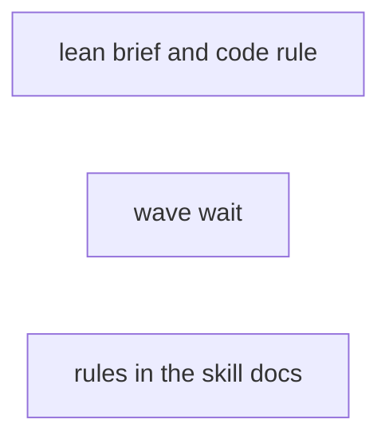

# Superlite: lean lead path, code questions through researchers, one wait per wave (B171, #683)

**Goal:** fix #683: a `lean` lead brief variant picked by the run config's `lead.text` (the `default` variant stays the default), a researcher rule for code questions in both variants, a wave wait (`fleet wait --wave`, all busy workers or the first failure) that a background `run_tests` run can join (`--tests PATH`), shell polling loops named a defect, tests for the brief choice and the wait, before and after figures.
**Architecture:** `run_config.VARIANTS` gains `lean`. `backlog_brief.lead_variant(batch, ctx)` picks `lean` only for a lean config text, one issue and no batch decision; `lead_brief` swaps only the head of its Build sentence for the lean head and adds the code-question line and the wave-wait line in both variants. `fleet_io.wait` gains `wave` and `tests`: it returns after every pending worker and test run finished or right after the first failure, and polls each named test summary with `run_tests.read_summary` and `run_tests.pid_gone`. `fleet_restore` re-arms with `--wave`. The rules in SDD `fleet.md`, `SKILL.md` and `backlog.md` name the wave wait, `--tests`, the researcher rule and polling loops as a defect.
**Tech stack:** Python 3.10+ stdlib, pytest (through `sl run_tests`); Markdown docs.
**Spec:** this file, section Design; issue #683.
**Detail:** contracts
**Target-min:** 11
**Wave0:** none
**Worktree:** none
**Max chars:** 26000

Global constraints:
- This repository is public: no host names, user names, home paths, other project or repository names, ticket keys or account names in code, tests, docs or commit messages.
- Never change the machine's gate config or ~/.superlite/machine.json; tests use private temp homes and state dirs (tests/scripts/conftest.py sets SUPERLITE_HOME per test).
- Every function line keeps the repo's `# O(...)` complexity comment style.
- The `default` lead brief stays byte-identical except the two lines Design 2 and 3 name; `test_backlog_brief_render_567.BUILD` stays unchanged.
- SDD `SKILL.md` stays at most 13300 characters (`test_orchestrator.SDD_CAP`) and keeps every phrase `test_orchestrator.py` pins.
- Standing rules for every lead and its workers (the owner's decisions, passed on by main): this repository is public: no host names, user names, home paths, other project or repository names, ticket keys or account names in code, tests, docs, commit messages, PR texts or issue comments; write "a Swift project", "a second Mac", "the machine". Never change the machine's gate config or ~/.superlite/machine.json; tests and proofs use private temp homes and state dirs. No real app builds as proof; this repository's own test suite is the check. Priority of this round: scheduling and admission of test runs, parallel agents and the fleet, wall-clock and token efficiency; measure before and after where the issue names a waste (seconds, runs, tokens) and put the figures into your notes. Friction with superlite itself goes to `sl feedback add`, not into this batch. Online research is allowed when something is unclear (official docs first, then how others solved it); name the source in your notes.
- Builds: the verdict is `sl run_tests` (the project's test command; a project with `.maxapp` runs `maxapp test`, which a build pool may place on another Mac, and a full run whose tree a green maxapp test stamp covers returns that result without a run); task trees build in <tree>/.build/DerivedData and any build of your own goes under .build/ of the worktree, never -derivedDataPath outside the worktree (your session scratchpad included; backlog cleanup removes scratchpad build folders when the worktree goes); a product, simulator or device build stays on this machine and runs only when an issue's acceptance asks for a running-app check.
- Simulators: append the UDID of each simulator you create (`xcrun simctl create` or `clone`) as one line to `.superlite/simulators.txt` of this worktree (the run root); never list one you did not create; ship cleanup shuts down and deletes each listed one.

## Coverage

| Category | State | Basis |
|---|---|---|
| Scope and success criteria | settled | #683 Wanted 1-5; the owner's comment: `lead_brief` picks by `lead.text`, `lean` is the second variant |
| Domain and data model | ruled | lean applies to one issue and no `decisions` in the batch record; the lead checks "names its files" itself (Ruling 1) |
| Persistence and migration | n/a | no stored format changes; run-configs.json files gain one accepted value |
| Interfaces and contracts | ruled | `fleet wait` keeps its default and `--any`; `--wave` and `--tests` are new; BUSY and TIMEOUT keep their head word (Ruling 3) |
| UI states | n/a | CLI text only |
| Concurrency and state ownership | settled | exactly-once collection stays in `claim`/`_take`; a test run is read-only (its summary file) |
| Error handling and recovery | ruled | a half-written summary reads as not done; a gone pid without summary is `DIED`; `--any` with `--wave` exits 2 |
| Security and privacy | n/a | no untrusted input beyond existing issue text; public-repo rule in Global constraints |
| Performance and limits | ruled | timeout default stays 540000 ms (under the 600000 ms Bash cap); poll 2 s as today |
| Observability | settled | `batch_waits.py` (#680) counts wake-ups from transcripts; the figures go in notes.md |
| Testing strategy | settled | named tests per task over the Herdr fake and fixture summaries; docs tests pin the new phrases |
| Compatibility | ruled | the default brief and a bare `fleet wait` behave as before; old `--any` callers keep working |
| Rollout | ruled | `default` stays the variant until an experiment picks `lean` (#683 Wanted 1) |
| Research unknowns | n/a | none |

Ruling 1: lean needs the config text `lean`, exactly one issue and an empty `decisions` list; whether the issue body names its files is the lead's check, written into the lean head (because the brief writer has no issue body; cost if wrong: a lean lead without named files takes the full path, as the brief says).
Ruling 2: when `ctx` holds no `text`, `lead_brief` resolves the layered default config (`run_config.resolve(None, root)`, root = the worktree's `.claude/worktrees` grandparent, any error: `default`); `backlog_run.py` (B165/B166's file) passing `ctx["text"] = rc["lead"]["text"]` for `--config NAME` is a follow-up (because no open batch may lose its file; cost if wrong: `--config lean` alone keeps the default brief until that line lands).
Ruling 3: `--wave` is a new flag, not a new default, and `fleet.md` makes it the rule for every coordinator; `--any` stays for a task on the critical path (because spawn --wait, restore and old briefs call a bare wait; cost if wrong: one extra flag in each wait line).
Ruling 4: a wave failure is a result whose status is not DONE, DONE_WITH_CONCERNS, APPROVED or GREEN, or that has findings above 0 or `partial` (because each of those needs the coordinator before the rest finish; cost if wrong: one extra wake-up per such result).

## Design

### 1. Lean variant (#683 Wanted 1)
`run_config.VARIANTS = ("default", "lean")`. `lead_variant(batch, ctx)` returns `"lean"` when the text (`ctx["text"]`, else Ruling 2) is `lean`, `len(batch["issues"]) == 1` and `not batch.get("decisions")`; else `"default"`. The lean brief replaces only the head `Build: superlite:brainstorming (AI orchestrator, no questions), superlite:writing-plans, ` with `LEAN_BUILD` (T1 Notes); the tail from `superlite:subagent-driven-development with fleet on` on, the Builds sentence and every other line stay.

### 2. Code questions (#683 Wanted 2)
Both variants add `CODE_RULE` right after the `First:` line. No line tells a lead to have another worker check a worker's work.

### 3. One wait per wave (#683 Wanted 3)
`fleet wait --wave [--tests PATH ...]`: one call per dispatch round. Both variants' wait line names it; fleet.md, SKILL.md and backlog.md name it, `--tests`, and shell polling loops (`sleep`, `until grep`) as a defect. `fleet restore` re-arms `--wave`.

### 4. Figures (#683 Wanted 4)
The lead measures with `batch_waits.py` over lead transcripts (before: turns before the first dispatch and wake-ups per lead) and the wave test's call count (after); figures go in notes.md.

### 5. Tests (#683 Wanted 5)
T1 tests the brief choice, T2 the wait, T3 the rule phrases.

## File structure

- `skills/subagent-driven-development/scripts/run_config.py`: VARIANTS gains `lean`.
- `skills/subagent-driven-development/scripts/backlog_brief.py`: `lead_variant`, `LEAN_BUILD`, `CODE_RULE`, the wave-wait line.
- `skills/subagent-driven-development/scripts/fleet_io.py`: `wait(..., wave, tests)`, `wave_failure`, `test_result`, CLI `--wave`, `--tests`.
- `skills/subagent-driven-development/scripts/fleet_restore.py`: re-arm line `--wave`.
- `skills/subagent-driven-development/fleet.md`, `SKILL.md`, `backlog.md`: the rules.
- Tests: `tests/scripts/test_backlog_brief_lean_683.py`, `tests/scripts/test_fleet_wait_wave_683.py`, `tests/scripts/test_docs_683.py` (new), pins updated in `test_backlog_brief_jira_208.py`, `test_backlog_brief_563.py`, `test_fleet_restore_577.py`.

## Task graph

```mermaid
%% schedule
gantt
  title Predicted schedule (mm:ss)
  dateFormat X
  axisFormat %M:%S
  section lane 1
  T2 wave wait and test join :t2, 0, 246s
  section lane 2
  T1 lean brief variant :t1, 0, 242s
  section lane 3
  T3 wave wait and researcher rules in the :t3, 0, 183s
```

critical path: T2 (4.1 min) · peak width 3 · predicted build 4.1 min · predicted total ≈ 12.6 min (target ✗ 11.0)

## Package: brief

**Probe entry:** none (pure text builders; named tests cover them)

### T1 lean brief variant · Complexity 4 · Est. context 44k
**Owns:** skills/subagent-driven-development/scripts/backlog_brief.py, skills/subagent-driven-development/scripts/run_config.py, tests/scripts/test_backlog_brief_lean_683.py, tests/scripts/test_backlog_brief_jira_208.py, tests/scripts/test_backlog_brief_563.py
**Components:** 2
**LOC owned:** 170
**Tests:** fast
**Kind:** design
**Model:** sonnet
**Covers:** 1, 2, 3
**Produces:** backlog_brief.lead_variant(batch: dict, ctx: dict) -> str
  e.g. lead_variant({"id": "B1", "issues": [7], "files": ["a.py"], "decisions": []}, {"text": "lean"}) -> "lean"
  e.g. lead_variant({"id": "B1", "issues": [7, 8], "files": ["a.py"], "decisions": []}, {"text": "lean"}) -> "default"
  e.g. lead_variant({"id": "B1", "issues": [7], "files": ["a.py"], "decisions": []}, {"text": "default"}) -> "default"
**Produces:** backlog_brief.lead_brief(batch, ctx) -> str
**Review Focus:** `test_variants_accept_lean`: `run_config.load_text('{"configs": {"x": {"lead": {"text": "lean"}}}}')` passes and `"text": "short"` raises ConfigError naming `short is not one of default, lean`; `test_lean_one_issue`: lead_brief with ctx text "lean", one issue, no decisions holds `LEAN_BUILD` and not `Build: superlite:brainstorming`; `test_lean_two_issues_full`: two issues keep the default Build head; `test_lean_decisions_full`: `decisions` [{"questions": [...]}] keeps it; `test_default_byte_identical_tail`: default and lean briefs of one batch differ only in the Build head (split both at `superlite:subagent-driven-development with fleet on`, the tails are equal); `test_both_variants_code_rule`: both hold `CODE_RULE` right after the `First:` line and neither holds `verify` next to `worker`; `test_wave_wait_line`: both hold `fleet wait --wave --timeout 540000 --plan .superlite`, `--tests 
` and `` (`sleep`, `until grep`) is a defect``; `test_layered_default_picks_lean`: no ctx text, `$SUPERLITE_HOME/run-configs.json` = `{"default": "l", "configs": {"l": {"lead": {"text": "lean"}}}}`, worktree `<tmp>/.claude/worktrees/b1-x`: lean; `test_bad_machine_file_is_default`: that file `[1]`: default, no exception; `test_lean_plan_fields_lint`: a plan written with exactly the fields `LEAN_BUILD` lists (one task owning `pkg/a.py`, `tests/test_a.py`, `**Tests:** fast`, `**Kind:** mechanical`, `**Model:** haiku`) passes `plan_tools.py lint --plan P --spec P --stable` in a tmp git repo with `DISPATCH NOW: T1`.
**Steps:** 1 failing tests, 2 run: FAIL, 3 implement, 4 run: PASS
**Notes:** `LEAN_BUILD` (adjust only the field list when `test_lean_plan_fields_lint` shows lint needs another field): "Build (lean path: one issue and no batch decision): when your issue's body names the files to change and asks no design question, skip superlite:brainstorming and superlite:writing-plans and write a short plan yourself in docs/plans/<date>-<topic>.md (docs/superpowers/plans/ when that folder exists): header `**Goal:**`, `**Tech stack:**`, `**Spec:**` the issue, `**Wave0:** none`, `**Worktree:** none`, `**Coverage:** off`; a mermaid flowchart with a `%% taskgraph` line; per task a `### Tn <title>` block with `**Owns:**`, `**Components:**`, `**LOC owned:**`, `**Tests:**`, `**Kind:**`, `**Model:**` and named tests with exact inputs and outputs; lint it with `{sl} plan_tools lint --plan <plan> --spec <plan> --stable`; an issue that names no files or asks a design question takes the full path: superlite:brainstorming (AI orchestrator, no questions), superlite:writing-plans. Then " followed by the unchanged tail `superlite:subagent-driven-development with fleet on, the final review (...)`. `CODE_RULE`: "Code questions go to a researcher worker, one pointed brief per question (the question, the files or symbols to start from, the answer you need): `{sl} fleet spawn --role research --brief <abs file> --label R<n> --wait --timeout 540000 --plan .superlite` (several at once: spawn each with --brief, then one wave wait); read a file yourself only when you are about to rule on it." Wait line, both variants: "Never end your turn while your workers run: wait once per wave with `{sl} fleet wait --wave --timeout 540000 --plan .superlite` in the foreground (it returns when every busy worker reported, or at the first failure; add `--tests 
` for a `run_tests --background` run, so one wait covers both; on TIMEOUT run it again), never as a background command: under memory pressure Claude Code stops an idle session's background commands, and a restarted wait still reports every worker that finished meanwhile. A shell loop that polls (`sleep`, `until grep`) is a defect: wait with `fleet wait` or `run_tests --wait`." Ruling 2's root: `Path(ctx["worktree"]).parents[2]` when its parent is named `worktrees` and the grandparent `.claude`, else no project layer; import run_config lazily inside lead_variant; catch `run_config.ConfigError` and `OSError`. Update the golden lines in test_backlog_brief_jira_208.py and the pin in test_backlog_brief_563.py to the new wait line; keep `Never end your turn while your workers run` (test_backlog_brief.py pins it).

## Package: wait

**Probe entry:** none (polls over the Herdr fake and summary files; named tests cover them)

### T2 wave wait and test join · Complexity 5 · Est. context 52k
**Owns:** skills/subagent-driven-development/scripts/fleet_io.py, skills/subagent-driven-development/scripts/fleet_restore.py, tests/scripts/test_fleet_wait_wave_683.py, tests/scripts/test_fleet_restore_577.py
**Components:** 2
**LOC owned:** 200
**Tests:** fast
**Kind:** design
**Model:** sonnet
**Covers:** 3, 4, 5
**Produces:** fleet_io.wave_failure(r: dict) -> bool
  e.g. wave_failure({"status": "DONE", "findings": 0}) -> False
  e.g. wave_failure({"status": "BLOCKED", "findings": 0}) -> True
  e.g. wave_failure({"status": "APPROVED", "findings": 0, "partial": True}) -> True
**Produces:** fleet_io.test_result(path: Path) -> dict | None
**Produces:** fleet_io.wait(sd, ids, timeout_ms, poll_s=2.0, clock=None, any_=False, wave=False, tests=None) -> list
**Review Focus:** `test_wave_waits_for_all`: W1..W4 busy, stop records with `Status: DONE` at fake times 10, 20, 30, 40 s: one wait(wave=True) call returns 4 results and prints no BUSY line, while wait(any_=True) needs 4 calls (3 print `BUSY`); `test_wave_ends_at_first_failure`: W1 BLOCKED at 10 s, W2 DONE at 40 s: wave returns [W1] and prints `BUSY W2`; W2 stays busy and a second wave call returns it; `test_findings_end_the_wave`: a reviewer DONE with findings=2 ends it; `test_tests_green_joins`: no busy worker, `--tests S` where S appears at 6 s holding `{"passed": 3, "failed": 0, "mode": "full"}`: prints `tests S GREEN tests (full): 3 passed, 0 failed`; `test_tests_red_ends_wave`: S red with W1 still busy: prints the RED line then `BUSY W1`; `test_half_written_summary_waits`: S holding `{"pass` is not done; `test_died_run`: no S, `S.pid` naming a pid that does not exist: `tests S DIED`; `test_timeout_lists_tests`: TIMEOUT line ends with `tests:S` after the worker ids; `test_any_and_wave_exclusive`: `fleet_io.main(["wait", "--any", "--wave"])` exits 2 with stderr `error: --any and --wave exclude each other` before any state call; `test_partial_flag_in_result`: an APPROVED report with unread lines gives a result with `"partial": True`; `test_restore_rearms_wave`: fleet_restore's re-arm line reads `fleet wait --wave --timeout 540000`.
**Steps:** 1 failing tests, 2 run: FAIL, 3 implement, 4 run: PASS
**Notes:** `WAVE_OK = ("DONE", "DONE_WITH_CONCERNS", "APPROVED", "GREEN")`; wave_failure: status not in WAVE_OK, or `findings` above 0, or `partial`. `_finish` adds `"partial": part` to its result dict. test_result: `import run_tests` lazily; `data = run_tests.read_summary(path)`; data None: `run_tests.pid_gone(path)` not None and the file still missing gives DIED, else None (running); green = `not data.get("failed") and bool(data.get("passed") or data.get("skipped"))` as run_tests.wait_background; prints `tests <path> GREEN|RED <run_tests.summary_line(data)>` or `tests <path> DIED (pid N, no summary); log <path with suffix .log>`; returns `{"id": "tests", "task": str(path), "status": "GREEN"|"RED"|"DIED", "report": str(path), "source": "tests", "findings": 0}` (RED and DIED are wave failures). wait: tests paths resolved against cwd; the loop runs while workers or tests are pending; after each poll, wave and a failure among this call's results: print `BUSY ` + the rest + `_reported(results)` and return (nothing left: return without BUSY); any_ counts a test result as a finisher; pending tests appear as `tests:<path>` after the worker ids in BUSY and TIMEOUT. CLI: `--wave` store_true, `--tests` action append; the exclusive check sits beside the timeout parse, before `state.resolve`. Update the module docstring (`wait [--timeout MS] [--any | --wave] [--tests PATH ...] [WID ...]` and one sentence). fleet_restore line 275: `--wave`; update the two pins in test_fleet_restore_577.py. Reuse the Herdr fake and stop-record helpers of tests/scripts/test_fleet_io.py (import them, do not copy).

## Package: rules

**Probe entry:** none (Markdown rules; a docs test pins them)

### T3 wave wait and researcher rules in the skill docs · Complexity 3 · Est. context 40k
**Owns:** skills/subagent-driven-development/fleet.md, skills/subagent-driven-development/SKILL.md, skills/subagent-driven-development/backlog.md, tests/scripts/test_docs_683.py
**Components:** 1
**LOC owned:** 70
**Tests:** fast
**Kind:** design
**Model:** sonnet
**Covers:** 2, 3
**Review Focus:** `test_fleet_md_wave`: fleet.md `## Waiting and acting` holds `fleet wait --wave --timeout 540000 --plan $PLAN`, `--tests 
`, `first failure`, and still holds `fleet wait --any`, `background` and `BUSY Wn` (test_fleet_b1_docs pins them); its Low memory paragraph's foreground wait says `--wave`; `test_polling_defect`: fleet.md, SKILL.md and backlog.md each name `sleep` and `until grep` loops a defect; `test_researcher_rule`: fleet.md's Research line and backlog.md `## Lead` say code questions go to a researcher worker with a pointed brief and the lead reads a file itself only to rule on it; neither holds `verify` beside `worker`; `test_backlog_lead_variant`: backlog.md `## Lead` names `lead.text`, `lean` and `default`, and Main step 4 names `--config NAME`; `test_sdd_cap`: SKILL.md at most 13300 characters.
**Steps:** 1 failing tests, 2 run: FAIL, 3 implement, 4 run: PASS
**Notes:** fleet.md: rewrite the first paragraph of `## Waiting and acting`: wait once per wave with `"$SL" fleet wait --wave --timeout 540000 --plan $PLAN` (returns when every busy worker reported, or right after the first failure: a status other than DONE, DONE_WITH_CONCERNS, APPROVED or GREEN, `findings=` above 0, or ` partial`; `BUSY Wn Wm (reported: ...)` names the rest); `--tests 
` (repeatable, the `summary:` line of `run_tests --background`) joins a background run: `tests <path> GREEN|RED <counts>` or `DIED`, a pending one shows as `tests:<path>` in BUSY and TIMEOUT; run it as a background command (the harness wakes you when it ends) or, as a lead, in the foreground; `fleet wait --any` ends at the first finisher, only for a task on the critical path whose dependents should dispatch the moment it commits; keep the `--timeout` units, exactly-once and one-turn-stop sentences; add: a shell loop that polls (`sleep`, `until grep`) is a defect. Low memory: the foreground wait becomes `--wave`. Research line: a lead's code questions, one pointed brief each; a lead reads a file itself only to rule on it. SKILL.md: one Red flags row `| A `sleep` or `until grep` loop polling for a result | `fleet wait --wave [--tests S]` or `run_tests --wait` |`; trim other SKILL.md wording to stay at most 13300 characters and keep every phrase test_orchestrator.py pins (run tests/scripts/test_orchestrator.py too). backlog.md `## Lead`: the `fleet wait` bullet becomes the wave wait plus the polling defect; a new bullet for code questions through a researcher worker; a new bullet: the run config's `lead.text` picks the lead brief, `default` (the full path) or `lean` (a batch of one issue and no decision whose issue names its files skips brainstorming and writing-plans and writes a short plan inline); Main step 4 names `--config NAME` (run config: lead model, effort, brief variant; `--model` overrides its lead model). Run test_backlog_docs.py and test_fleet_b1_docs.py too.

## Review Focus

- Package brief (library, pure text): encoding (a lean head that breaks the Build sentence), state (variant chosen from the wrong source).
- Package wait (CLI, concurrency): protocol (`--any`/`--wave` exclusive, `--tests` repeatable), state (a result collected twice, a busy worker left uncollected after a wave failure), file (half-written summary, dead pid).
- Package rules: wording only; pinned phrases kept.

## Self-review

Every Wanted item maps to a task (1: T1; 2: T1, T3; 3: T1, T2, T3; 4: lead measurement plus T2's call-count test; 5: T1, T2). No edges: T3 names T2's flags only. No two tasks share a file.
