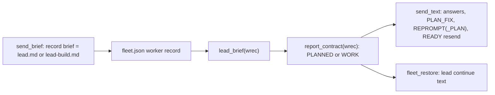
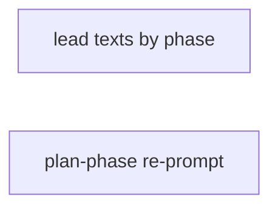

# Superlite: every text to a lead names its phase's statuses; the READY resend sends the lead's own brief (B190, #732)

**Goal:** fix #732. `fleet_io.send_text` appends `fleet_report.WORK` to every lead text, so a planning lead's answers, main's `PLAN_FIX` and the status re-prompt lack `DONE planned: <plan path>`; its READY resend always sends `briefs/lead.md`, so a build lead whose stop said only READY gets the planning brief instead of `briefs/lead-build.md`; `fleet_restore`'s lead continue text names no status at all; `backlog_run.REPROMPT` lists the single-lead statuses to a planning lead too.
**Architecture:** the lead's phase is read from the brief it was sent: `fleet_io.send_brief` already stores the brief's absolute path as the worker record's `brief` (`briefs/lead.md` for a single or planning lead, `briefs/lead-build.md` for a build lead). New `fleet_io.lead_brief(wrec)` returns that path (fallback `<lead_sd>/briefs/lead.md`); new `fleet_io.report_contract(wrec)` gives the contract a worker's texts end with (`fleet_report.PLANNED` for a lead whose brief holds B184's plan-phase End line, via `fleet_report._planning`). `send_text` and `fleet_restore`'s lead continue use them; `backlog_run` gets a plan-phase re-prompt text.
**Tech stack:** Python 3.10+ stdlib, pytest (through `sl run_tests`).
**Spec:** this file, section Design; issue #732.
**Detail:** tests
**Target-min:** 11
**Wave0:** none
**Worktree:** none
**Coverage:** off
**Max chars:** 21000

Global constraints:
- Every script line keeps the repo's `# O(...)` complexity comment; stdlib only; LF endings.
- Tests write briefs and fleet files under `tmp_path` (the existing `world`, `w` and `bk` fixtures); never the machine's `~/.superlite` or a real fleet.
- `skills/subagent-driven-development/scripts/fleet_report.py` and `backlog_brief.py` stay unchanged.
- Standing rules for every lead and its workers (the owner's decisions, passed on by main): this repository is public: no host names, user names, home paths, other project or repository names, ticket keys or account names in code, tests, docs, commit messages, PR texts or issue comments (write "a Swift project", "a second Mac", "the machine"). Never change the machine's gate config or ~/.superlite/machine.json; tests and proofs use private temp homes and state dirs. No real app builds as proof; this repository's own test suite is the check. Priority of this round: scheduling and admission of test runs, parallel agents and the fleet, wall-clock and token efficiency; measure before and after where the issue names a waste (seconds, runs, tokens) and put the figures into the notes. Friction with superlite itself goes to `sl feedback add`, not into this batch. Online research is allowed when something is unclear (official docs first, then how others solved it); name the source in the notes.

## Design

- `lead_brief(wrec) -> Path | None`: `Path(wrec["brief"])` when that key is set and names a file; else `Path(wrec["lead_sd"]) / "briefs" / "lead.md"` when `lead_sd` is non-empty and that is a file; else None. Paths are returned as recorded (not resolved); an empty `lead_sd` never yields a cwd-relative `briefs/lead.md`.
- `report_contract(wrec) -> str`: role `layer` gives `""`; `final-reviewer` gives `fleet_report.REVIEW`; `lead` whose `lead_brief` is not None and `fleet_report._planning(str(brief))` is True gives `fleet_report.PLANNED`; everything else (other roles, single and build leads, a lead with no readable brief) gives `fleet_report.WORK`. A missing role counts as `implementer`.
- `send_text`: the message is `text + "\n\n" + report_contract(wrec)` (just `text` when the contract is empty). For role `lead` with a `lead_brief`, a newest own stop since `sent` whose `last` is only `READY` sends `fleet_report.brief_message("lead", str(brief.resolve()))` instead: the lead's own brief, so a build lead gets `lead-build.md` with `WORK` and a planning lead `lead.md` with `PLANNED`. Everything else in `send_text` is unchanged.
- `fleet_restore`: a busy lead's continue text is `"\n".join([LEAD_CONTINUE] + rearm_of_lead + [LEAD_TAIL]) + "\n\n" + fio.report_contract(w)`; non-lead texts unchanged.
- `backlog_run`: `PLAN_FIX` text unchanged (it now arrives with `PLANNED` through `send_text`); new `REPROMPT_PLAN` is `REPROMPT` with `Status: DONE, ` replaced by `Status: DONE planned: <plan path>, DONE, ` (first one); `_round` sends `REPROMPT_PLAN` when the batch's `phase` is `plan`, else `REPROMPT`.

Ruling: the phase comes from the brief the lead was sent (record `brief`, fallback `<lead_sd>/briefs/lead.md`) and B184's End-line marker, not from main's batch record or a new fleet.json field (because fleet_io and fleet_restore never read main's backlog state, send_brief already records the path, and B184 ruled the brief the one record of the phase; cost: one brief read per lead text) (lead's ruling).
Ruling: fleet_io calls the private `fleet_report._planning` and fleet_report.py stays unchanged (because the marker test exists there once; fleet_restore already calls `fio._busy` across modules) (lead's ruling).
Ruling: the lead's restore continue text gains its phase's contract after `LEAD_TAIL` (because #732 expects every message to a lead to name its phase's statuses and that text named none; cost about 525 or 551 characters once per Herdr restart per busy lead); the pinned assertion in `tests/scripts/test_fleet_restore_577.py::test_lead_fleet_first_and_lead_prompt` changes with it (lead's ruling).
Ruling: adjacent fix: `backlog_run.REPROMPT` itself lists only single-lead statuses, so a planning lead gets `REPROMPT_PLAN` (because #732 expects the phase's statuses in each message; inside the batch's files, no new design decision) (lead's ruling).
Ruling: the predicted total misses the 11 min target (critical path T1 alone, one sonnet task with fast tests); accepted, because splitting the two-line fleet_restore change out would cost a second implementer prime for no shorter path (lead's ruling).
Ruling: `**Max chars:** 21000`, because the plan is two verbatim test files and the rulings the build lead needs; nothing in it is a spec excerpt to move out (lead's ruling).

## Main diagram



## File structure

- `skills/subagent-driven-development/scripts/fleet_io.py`: `lead_brief`, `report_contract`, `send_text` (T1).
- `skills/subagent-driven-development/scripts/fleet_restore.py`: the lead continue text (T1).
- `skills/subagent-driven-development/scripts/backlog_run.py`: `REPROMPT_PLAN` and its use in `_round` (T2).
- `tests/scripts/test_lead_phase_texts_732.py` (T1, new), `tests/scripts/test_fleet_restore_577.py` (T1, one pinned assertion), `tests/scripts/test_backlog_reprompt_plan_732.py` (T2, new).

## Task graph

```mermaid
%% schedule
gantt
  title Predicted schedule (mm:ss)
  dateFormat X
  axisFormat %M:%S
  section lane 1
  T1 Lead texts and READY resend follow th :t1, 0, 320s
  section lane 2
  T2 Planning lead re-prompt names DONE pl :t2, 0, 262s
```





critical path: T1 (5.3 min) · peak width 2 · predicted build 5.3 min · predicted total ≈ 15.8 min (target ✗ 11.0)

## Package: fleet lead texts

App type: CLI library. Categories: protocol (the Status line a lead's stop must carry).
**Probe entry:** none (string contract; named tests cover it)

### T1 Lead texts and READY resend follow the phase · Complexity 3 · Est. context 30k
**Owns:** skills/subagent-driven-development/scripts/fleet_io.py, skills/subagent-driven-development/scripts/fleet_restore.py, tests/scripts/test_lead_phase_texts_732.py, tests/scripts/test_fleet_restore_577.py
**Components:** 2
**LOC owned:** 120
**Tests:** fast
**Model:** sonnet
**Covers:** Design
**Produces:** fleet_io.lead_brief(wrec: dict) -> Path | None · fleet_io.report_contract(wrec: dict) -> str
e.g. lead_brief({"role": "lead", "lead_sd": "/w/.superlite", "brief": "/w/.superlite/briefs/lead-build.md"}) -> Path("/w/.superlite/briefs/lead-build.md") (when that file exists)
e.g. report_contract({"role": "lead", "brief": <a brief holding a line starting "End: Status: DONE planned:">}) -> fleet_report.PLANNED
e.g. report_contract({"role": "final-reviewer"}) -> fleet_report.REVIEW; report_contract({"role": "layer"}) -> ""
**Review Focus:** the tests below; `tests/scripts/test_fleet_io.py`, `tests/scripts/test_fleet_io_b87.py`, `tests/scripts/test_fleet_io_ask_470.py`, `tests/scripts/test_fleet_report_planned_716.py` and `tests/scripts/test_fleet_restore_577.py` stay green (577 with only the one assertion changed).
**Test code (verbatim):**
```python
# tests/scripts/test_lead_phase_texts_732.py
"""Texts to a lead name its phase's statuses; the READY resend sends the lead's own brief (#732)."""
import json
import os
import sys

import pytest

from test_fleet_io import io, world  # noqa: F401
from test_fleet_io_b87 import lead, script
from test_fleet_restore_577 import fr, w, worker  # noqa: F401
from test_plan_tools import SCRIPTS
sys.path.insert(0, str(SCRIPTS))
import backlog_brief as bb  # noqa: E402
import backlog_run as br  # noqa: E402
import fleet_report  # noqa: E402

pytestmark = pytest.mark.skipif(os.environ.get("SUPERLITE_REAL") == "1", reason="scripted herdr replies")
PLAN_BRIEF = "# Lead brief: B1 (x)\n" + bb.PLAN_END + "\n"
BUILD_BRIEF = "# Lead brief: B1 (x)\nEnd: Status: DONE once merge printed shipped; otherwise Status: BLOCKED with the reason.\n"


def as_lead(world, last, name="lead.md", text=PLAN_BRIEF, record=True):
    """W1 is a lead whose briefs/lead.md is a planning brief; NAME holds TEXT; RECORD stores NAME as the record's brief."""
    lsd = lead(world, last)
    (lsd / "briefs" / "lead.md").write_text(PLAN_BRIEF, encoding="utf-8")
    p = (lsd / "briefs" / name).resolve()
    p.write_text(text, encoding="utf-8")
    if record:
        fj = json.loads((world.sd / "fleet.json").read_text())
        fj["workers"]["W1"]["brief"] = str(p)
        (world.sd / "fleet.json").write_text(json.dumps(fj))
    return p


def rec(world, wid="W1"):
    return json.loads((world.sd / "fleet.json").read_text())["workers"][wid]


def test_report_contract_by_role(tmp_path):
    plan = tmp_path / "lead.md"
    plan.write_text(PLAN_BRIEF, encoding="utf-8")
    assert io.report_contract({"role": "layer"}) == ""
    assert io.report_contract({"role": "final-reviewer", "brief": str(plan)}) == fleet_report.REVIEW
    assert io.report_contract({}) == fleet_report.WORK
    for role in ("implementer", "research", "fixer"):
        assert io.report_contract({"role": role, "brief": str(plan)}) == fleet_report.WORK


def test_lead_brief_and_contract_follow_the_phase(tmp_path):
    briefs = tmp_path / ".superlite" / "briefs"
    briefs.mkdir(parents=True)
    plan, build = briefs / "lead.md", briefs / "lead-build.md"
    plan.write_text(PLAN_BRIEF, encoding="utf-8")
    build.write_text(BUILD_BRIEF, encoding="utf-8")
    lsd = str(tmp_path / ".superlite")
    assert io.lead_brief({"role": "lead", "lead_sd": lsd, "brief": str(build)}) == build
    assert io.report_contract({"role": "lead", "lead_sd": lsd, "brief": str(build)}) == fleet_report.WORK
    assert io.report_contract({"role": "lead", "lead_sd": lsd, "brief": str(plan)}) == fleet_report.PLANNED
    assert io.lead_brief({"role": "lead", "lead_sd": lsd}) == plan
    assert io.lead_brief({"role": "lead", "lead_sd": lsd, "brief": str(briefs / "gone.md")}) == plan
    assert io.report_contract({"role": "lead", "lead_sd": lsd}) == fleet_report.PLANNED
    assert io.lead_brief({"role": "lead"}) is None
    assert io.lead_brief({"role": "lead", "lead_sd": "", "brief": str(tmp_path / "gone.md")}) is None
    assert io.report_contract({"role": "lead"}) == fleet_report.WORK


def test_send_text_to_planning_lead_names_done_planned(world):
    as_lead(world, "Status: DONE")
    records = script(world, "ok")
    text = br.PLAN_FIX.format(plan="docs/plans/p.md", errs="lint failed")
    io.send_text(world.sd, "W1", text)
    assert records == [text + "\n\n" + fleet_report.PLANNED]


def test_send_text_to_build_lead_keeps_work(world):
    as_lead(world, "Status: DONE", "lead-build.md", BUILD_BRIEF)
    records = script(world, "ok")
    io.send_text(world.sd, "W1", "go on")
    assert records == ["go on\n\n" + fleet_report.WORK]


def test_ready_resend_sends_the_build_brief(world, capsys):
    p = as_lead(world, "READY", "lead-build.md", BUILD_BRIEF)
    records = script(world, "ok")
    io.send_text(world.sd, "W1", "go on")
    assert records == [f"Read {p} and do what it says. {fleet_report.WORK}"]
    assert "W1 brief resent (its last stop said only READY)" in capsys.readouterr().out
    assert rec(world)["brief"] == str(p) and rec(world)["state"] == "busy"


def test_ready_resend_to_planning_lead_names_done_planned(world):
    p = as_lead(world, "READY")
    records = script(world, "ok")
    io.send_text(world.sd, "W1", "go on")
    assert records == [f"Read {p} and do what it says. {fleet_report.PLANNED}"]


def test_ready_resend_without_a_recorded_brief_uses_lead_md(world):
    p = as_lead(world, "READY", record=False)
    records = script(world, "ok")
    io.send_text(world.sd, "W1", "go on")
    assert records == [f"Read {p} and do what it says. {fleet_report.PLANNED}"]


@pytest.mark.parametrize("name,text,want", [("lead.md", PLAN_BRIEF, "PLANNED"), ("lead-build.md", BUILD_BRIEF, "WORK")])
def test_restore_continue_names_the_lead_phase_contract(w, name, text, want):
    lsd = w.sd.parent / "wt" / ".superlite"
    (lsd / "briefs").mkdir(parents=True)
    (lsd / "briefs" / "lead.md").write_text(PLAN_BRIEF, encoding="utf-8")
    p = lsd / "briefs" / name
    p.write_text(text, encoding="utf-8")
    w.save({"W1": worker(name="sl-a-lead", role="lead", agent="lead", lead_sd=str(lsd), session="ls1", pane_id="w6:p1", brief=str(p))})
    lines, blocked = w.run()
    assert not blocked and any(x.startswith("W1 restored") and x.endswith("busy, continued") for x in lines)
    prompt = next(c for c in w.fake.calls if c[0] == "prompt" and c[1] == "sl-a-lead")[2]
    assert prompt.startswith(fr.LEAD_CONTINUE) and prompt.endswith(fr.LEAD_TAIL + "\n\n" + getattr(fleet_report, want))
    assert w.data()["workers"]["W1"]["brief"] == str(p)
```
**Steps:** 1 write the test file, 2 run: FAIL, 3 implement, 4 change the one pinned assertion, 5 run: PASS
**Notes:** Put `lead_brief` and `report_contract` right above `send_text`. `send_text` keeps its locking, busy update, pane label and prints exactly; only the contract line and the READY branch change (`brief = lead_brief(wrec) if role == "lead" else None`; `latest_stop` runs only when `brief` is not None; the resend uses `brief.resolve()`). Name the local variable so it does not shadow `report_contract`. `fleet_restore.py` line `text = "\n".join([LEAD_CONTINUE] + rearm_of_lead + [LEAD_TAIL])` gains `+ "\n\n" + fio.report_contract(w)`. In `tests/scripts/test_fleet_restore_577.py::test_lead_fleet_first_and_lead_prompt` change only `assert lead_prompt.endswith("Then continue your brief where you stopped.")` to `assert lead_prompt.endswith("Then continue your brief where you stopped.\n\n" + fleet_report.WORK)` (its lead's `brief` is `b.md` and its `lead_sd` has no `briefs/lead.md`, so WORK). Docstrings: in fleet_io's module docstring replace the line `` `send --text` to a lead whose newest own stop said only READY resends the brief file instead of the text. `` with `` `send --text` to a lead whose newest own stop said only READY resends its own brief (the record's `brief`, else `<lead_sd>/briefs/lead.md`) instead of the text; every text ends with the worker's report contract (`report_contract`: a lead whose brief holds the plan-phase End line gets `fleet_report.PLANNED`) (#732). ``; in fleet_restore's module docstring, after `A busy worker whose turn the restart cut gets a continue prompt` add ` (a lead's ends with its phase's report contract, fleet_io.report_contract)`. Comments: `lead_brief` O(1), `report_contract` O(size of the brief).

## Package: backlog wait texts

App type: CLI library. Categories: none (one constant text and a one-line switch).
**Probe entry:** none (string constant; named tests cover it)

### T2 Planning lead re-prompt names DONE planned · Complexity 1 · Est. context 28k
**Owns:** skills/subagent-driven-development/scripts/backlog_run.py, tests/scripts/test_backlog_reprompt_plan_732.py
**Components:** 1
**LOC owned:** 30
**Tests:** fast
**Model:** haiku
**Kind:** mechanical
**Covers:** Design
**Produces:** backlog_run.REPROMPT_PLAN: str
e.g. REPROMPT_PLAN == REPROMPT.replace("Status: DONE, ", "Status: DONE planned: <plan path>, DONE, ", 1)
**Review Focus:** the tests below; `tests/scripts/test_backlog_run.py`, `tests/scripts/test_backlog_run_lifecycle.py` and `tests/scripts/test_docs_b26.py` stay green unchanged.
**Test code (verbatim):**
```python
# tests/scripts/test_backlog_reprompt_plan_732.py
"""backlog wait's status re-prompt to a planning lead names `DONE planned: <plan path>` (#732)."""
import pytest

from test_backlog_run import br, bk, run, running  # noqa: F401


def texts(bk):
    return [c[1][3] for c in bk.calls if c[0] == "text"]


def test_reprompt_plan_names_done_planned():
    assert br.REPROMPT_PLAN == br.REPROMPT.replace("Status: DONE, ", "Status: DONE planned: <plan path>, DONE, ", 1)
    assert "end your turn only with Status: DONE planned: <plan path>, DONE, DONE_WITH_CONCERNS, NEEDS_CONTEXT or BLOCKED" in br.REPROMPT_PLAN
    assert br.REPROMPT.count("Status: DONE, ") == 1 and "planned" not in br.REPROMPT


@pytest.mark.parametrize("phase,want", [("plan", "REPROMPT_PLAN"), ("build", "REPROMPT"), ("single", "REPROMPT"), (None, "REPROMPT")])
def test_wait_reprompts_with_the_phase_text(bk, capsys, phase, want):
    running(bk, **({"phase": phase} if phase else {}))
    bk.stops["W1"] = {"t": 2000, "last": "PONG"}
    assert run(capsys, "wait", "--timeout", "0") == (0, "TIMEOUT\n")
    assert texts(bk) == [getattr(br, want)]


def test_planning_lead_second_miss_still_parks(bk, capsys):
    running(bk, phase="plan", reprompted=True)
    bk.stops["W1"] = {"t": 2000, "last": "PONG"}
    assert run(capsys, "wait", "--timeout", "0") == (0, "B1 parked: no status in stop text: PONG\n")
    assert texts(bk) == []
```
**Steps:** 1 write the test file, 2 run: FAIL, 3 implement, 4 run: PASS
**Notes:** Add right after the `REPROMPT = (...)` constant: `REPROMPT_PLAN = REPROMPT.replace("Status: DONE, ", "Status: DONE planned: <plan path>, DONE, ", 1)  # O(1) a planning lead's re-prompt (#732)`. In `_round`, the one line `if fleet_io.main(["send", b["lead"], "--text", REPROMPT, "--plan", str(sd)]):` sends `REPROMPT_PLAN if b.get("phase") == "plan" else REPROMPT` instead of `REPROMPT`. Module docstring: `Status line is re-prompted once (`reprompted`), then parked.` becomes `Status line is re-prompted once (`reprompted`; a planning lead's re-prompt names `DONE planned: <plan path>`), then parked.` Change nothing else; `PLAN_FIX` stays as it is.

## Review Focus

- T1 protocol: a planning lead's texts end with `PLANNED`, a single or build lead's with `WORK`; the READY resend names the lead's recorded brief; an empty `lead_sd` never reads a cwd-relative `briefs/lead.md`; non-lead texts are byte-identical to before.
- T2: only the re-prompt line and the docstring change; a second miss still parks.

## Self-review

- Coverage: send_text answers (T1), READY resend (T1), fleet_restore lead text (T1), PLAN_FIX (T1 through send_text, tested with the real text), status re-prompt (T2).
- No edge: T2's tests stub `fleet_io`, so they never run T1's code; the two tasks share no file.
